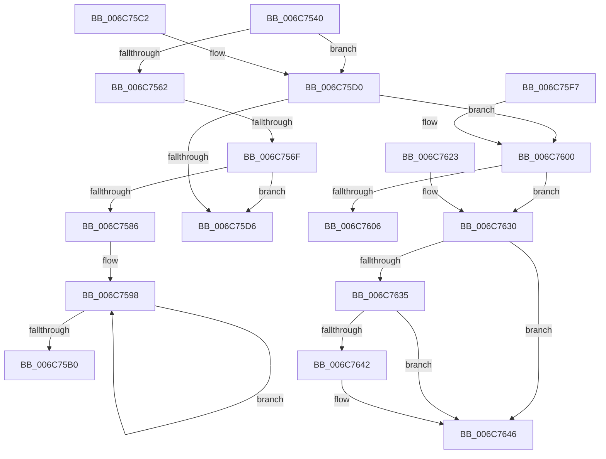

# _memset_spec_ermsb

- RVA: `0x006C7540`–`0x006C7647` (길이 `263` bytes)
- VA: `0x00000001406C7540`
- 실행 섹션: `.text`
- PDB 이름 있음: `예`; PDB Function 태그: `아니요`
- unwind 정보 RVA: `0x000BFAC8`
- 디코드: `66`개 명령, `263/263` bytes 표시
- 미해석 바이트: `0` (있으면 어셈블리에 `.byte`로 보존)

> 이 문서는 커널 이미지의 기계어와 PDB 기호를 분석해 생성했습니다. 4번과 5번은 함수 원형과 자료형을 바이너리 사용 방식에서 추정한 C 해석이며 원본 소스 복구 결과는 아닙니다.

## 1. Dependencies

- 직접 호출 지점: **0**; 고유 호출 대상: **0**
- 직접 호출자로 확인된 함수: **0**
- RIP 상대 이미지 참조: **0**

### Outgoing calls
- 직접 디코드된 call 명령이 없습니다.

### Direct callers
- 이 함수 시작 RVA로 연결되는 직접 call은 확인되지 않았습니다. 간접 호출은 완전히 역산할 수 없습니다.

### Static image references
- 디코드된 RIP-relative 메모리 참조가 없습니다.

## 2. Other-region calls and transfers

- 다른 실행 섹션으로 향하는 call: **0**
- call이 아닌 외부 분기/꼬리 이동: **1**
  - `0x006C7569` → [_memset_spec_ermsb_repmovsb](_memset_spec_ermsb_repmovsb_function_006C7680.md) (`tail-transfer`)

## 3. Assembly (complete function range)

```asm
006C7540  48 8B C1                        mov rax, rcx
006C7543  0F B6 D2                        movzx edx, dl
006C7546  49 B9 01 01 01 01 01 01 01 01   movabs r9, 0x101010101010101
006C7550  49 0F AF D1                     imul rdx, r9
006C7554  66 48 0F 6E C2                  movq xmm0, rdx
006C7559  0F 16 C0                        movlhps xmm0, xmm0
006C755C  49 83 F8 40                     cmp r8, 0x40
006C7560  72 6E                           jb 0x1406c75d0
006C7562  49 81 F8 20 03 00 00            cmp r8, 0x320
006C7569  0F 83 11 01 00 00               jae 0x1406c7680
006C756F  0F 11 01                        movups xmmword ptr [rcx], xmm0
006C7572  4C 03 C1                        add r8, rcx
006C7575  48 83 C1 10                     add rcx, 0x10
006C7579  48 83 E1 F0                     and rcx, 0xfffffffffffffff0
006C757D  4C 2B C1                        sub r8, rcx
006C7580  49 83 F8 40                     cmp r8, 0x40
006C7584  72 50                           jb 0x1406c75d6
006C7586  4A 8D 54 01 F0                  lea rdx, [rcx + r8 - 0x10]
006C758B  4E 8D 4C 01 D0                  lea r9, [rcx + r8 - 0x30]
006C7590  49 83 E1 F0                     and r9, 0xfffffffffffffff0
006C7594  49 C1 E8 06                     shr r8, 6
006C7598  0F 29 01                        movaps xmmword ptr [rcx], xmm0
006C759B  0F 29 41 10                     movaps xmmword ptr [rcx + 0x10], xmm0
006C759F  48 83 C1 40                     add rcx, 0x40
006C75A3  49 FF C8                        dec r8
006C75A6  0F 29 41 E0                     movaps xmmword ptr [rcx - 0x20], xmm0
006C75AA  0F 29 41 F0                     movaps xmmword ptr [rcx - 0x10], xmm0
006C75AE  75 E8                           jne 0x1406c7598
006C75B0  41 0F 29 01                     movaps xmmword ptr [r9], xmm0
006C75B4  41 0F 29 41 10                  movaps xmmword ptr [r9 + 0x10], xmm0
006C75B9  41 0F 29 41 20                  movaps xmmword ptr [r9 + 0x20], xmm0
006C75BE  0F 11 02                        movups xmmword ptr [rdx], xmm0
006C75C1  C3                              ret
006C75C2  66 66 66 66 66 66 0F 1F 84 00 00 00 00 00  nop word ptr [rax + rax]
006C75D0  49 83 F8 10                     cmp r8, 0x10
006C75D4  72 2A                           jb 0x1406c7600
006C75D6  4D 8D 4C 08 F0                  lea r9, [r8 + rcx - 0x10]
006C75DB  49 83 E0 20                     and r8, 0x20
006C75DF  0F 11 01                        movups xmmword ptr [rcx], xmm0
006C75E2  49 D1 E8                        shr r8, 1
006C75E5  41 0F 11 01                     movups xmmword ptr [r9], xmm0
006C75E9  42 0F 11 04 01                  movups xmmword ptr [rcx + r8], xmm0
006C75EE  49 F7 D8                        neg r8
006C75F1  43 0F 11 04 01                  movups xmmword ptr [r9 + r8], xmm0
006C75F6  C3                              ret
006C75F7  66 0F 1F 84 00 00 00 00 00      nop word ptr [rax + rax]
006C7600  49 83 F8 04                     cmp r8, 4
006C7604  72 2A                           jb 0x1406c7630
006C7606  4D 8D 4C 08 FC                  lea r9, [r8 + rcx - 4]
006C760B  49 83 E0 08                     and r8, 8
006C760F  89 11                           mov dword ptr [rcx], edx
006C7611  49 D1 E8                        shr r8, 1
006C7614  41 89 11                        mov dword ptr [r9], edx
006C7617  42 89 14 01                     mov dword ptr [rcx + r8], edx
006C761B  49 F7 D8                        neg r8
006C761E  43 89 14 01                     mov dword ptr [r9 + r8], edx
006C7622  C3                              ret
006C7623  66 66 66 66 66 0F 1F 84 00 00 00 00 00  nop word ptr [rax + rax]
006C7630  4D 85 C0                        test r8, r8
006C7633  74 11                           je 0x1406c7646
006C7635  88 11                           mov byte ptr [rcx], dl
006C7637  4E 8D 4C 01 FE                  lea r9, [rcx + r8 - 2]
006C763C  49 83 F8 01                     cmp r8, 1
006C7640  74 04                           je 0x1406c7646
006C7642  66 41 89 11                     mov word ptr [r9], dx
006C7646  C3                              ret
```

## 4. C-style interpretation (structured pseudocode)

```c
__int64 __fastcall _memset_spec_ermsb(__int64 a1, unsigned __int8 a2, __int64 a3)
{
    a2 = (a2) * (a4);
    if (a3 < 64) goto loc_006C75D0;
    *(unsigned __int64 *)(a1) = v_xmm0;
    a3 = (a3) + (a1);
    a1 = (a1) + (16);
    a1 = (a1) & (-16);
    a3 = (a3) - (a1);
    if (a3 < 64) goto loc_006C75D6;
    a4 = (a1 + a3 * 1 - 48) & (-16);
    a3 = (a3) >> (6);
loc_006C7598:
    *(unsigned __int64 *)(a1) = v_xmm0;
    *(unsigned __int64 *)(a1 + 16) = v_xmm0;
    a1 = (a1) + (64);
    a3 = (a3) - 1;
    *(unsigned __int64 *)(a1 - 32) = v_xmm0;
    *(unsigned __int64 *)(a1 - 16) = v_xmm0;
    if (condition_is_not_equal) goto loc_006C7598;
    *(unsigned __int64 *)(a4) = v_xmm0;
    *(unsigned __int64 *)(a4 + 16) = v_xmm0;
    *(unsigned __int64 *)(a4 + 32) = v_xmm0;
    *(unsigned __int64 *)(a1 + a3 * 1 - 16) = v_xmm0;
    return a1;
loc_006C75D0:
    if (a3 < 16) goto loc_006C7600;
loc_006C75D6:
    a3 = (a3) & (32);
    *(unsigned __int64 *)(a1) = v_xmm0;
    a3 = (a3) >> (1);
    *(unsigned __int64 *)(a3 + a1 * 1 - 16) = v_xmm0;
    *(unsigned __int64 *)(a1 + a3 * 1) = v_xmm0;
    a3 = -(a3);
    *(unsigned __int64 *)(a3 + a1 * 1 - 16 + a3 * 1) = v_xmm0;
    return a1;
loc_006C7600:
    if (a3 < 4) goto loc_006C7630;
    a3 = (a3) & (8);
    *(unsigned int *)(a1) = (unsigned int)(a1 + a3 * 1 - 16);
    a3 = (a3) >> (1);
    *(unsigned int *)(a3 + a1 * 1 - 4) = (unsigned int)(a1 + a3 * 1 - 16);
    *(unsigned int *)(a1 + a3 * 1) = (unsigned int)(a1 + a3 * 1 - 16);
    a3 = -(a3);
    *(unsigned int *)(a3 + a1 * 1 - 4 + a3 * 1) = (unsigned int)(a1 + a3 * 1 - 16);
    return a1;
loc_006C7630:
    if (a3 == 0) goto loc_006C7646;
    *(unsigned __int8 *)(a1) = (unsigned __int8)(a1 + a3 * 1 - 16);
    if (a3 != 1) {
        *(unsigned __int16 *)(a1 + a3 * 1 - 2) = (unsigned __int16)(a1 + a3 * 1 - 16);
    }
    return a1;
}
```

## 5. (Beta) C Style

```c
void *_memset_spec_ermsb(void *Arg1, uint8_t Arg2, int64_t Arg3)
{
    uint8_t *arg1 = (uint8_t *)Arg1;

    Arg2 = (Arg2) * (a4);
    if (Arg3 < 64) goto loc_006C75D0;
    *(uint64_t *)(arg1) = v_xmm0;
    Arg3 = (Arg3) + (Arg1);
    Arg1 = (Arg1) + (16);
    Arg1 = (Arg1) & (-16);
    Arg3 = (Arg3) - (Arg1);
    if (Arg3 < 64) goto loc_006C75D6;
    a4 = (Arg1 + Arg3 * 1 - 48) & (-16);
    Arg3 = (Arg3) >> (6);
loc_006C7598:
    *(uint64_t *)(arg1) = v_xmm0;
    *(uint64_t *)(arg1 + 0x10) = v_xmm0;
    Arg1 = (Arg1) + (64);
    Arg3 = (Arg3) - 1;
    *(uint64_t *)(arg1 - 0x20) = v_xmm0;
    *(uint64_t *)(arg1 - 0x10) = v_xmm0;
    if (condition_is_not_equal) goto loc_006C7598;
    *(uint64_t *)(a4) = v_xmm0;
    *(uint64_t *)(a4 + 0x10) = v_xmm0;
    *(uint64_t *)(a4 + 0x20) = v_xmm0;
    *(uint64_t *)(arg1 + Arg3 * 1 - 0x10) = v_xmm0;
    return Arg1;
loc_006C75D0:
    if (Arg3 < 16) goto loc_006C7600;
loc_006C75D6:
    Arg3 = (Arg3) & (32);
    *(uint64_t *)(arg1) = v_xmm0;
    Arg3 = (Arg3) >> (1);
    *(uint64_t *)(Arg3 + arg1 * 1 - 0x10) = v_xmm0;
    *(uint64_t *)(arg1 + Arg3 * 1) = v_xmm0;
    Arg3 = -(Arg3);
    *(uint64_t *)(Arg3 + arg1 * 1 - 0x10 + Arg3 * 1) = v_xmm0;
    return Arg1;
loc_006C7600:
    if (Arg3 < 4) goto loc_006C7630;
    Arg3 = (Arg3) & (8);
    *(uint32_t *)(arg1) = (uint32_t)(Arg1 + Arg3 * 1 - 16);
    Arg3 = (Arg3) >> (1);
    *(uint32_t *)(Arg3 + arg1 * 1 - 0x4) = (uint32_t)(Arg1 + Arg3 * 1 - 16);
    *(uint32_t *)(arg1 + Arg3 * 1) = (uint32_t)(Arg1 + Arg3 * 1 - 16);
    Arg3 = -(Arg3);
    *(uint32_t *)(Arg3 + arg1 * 1 - 0x4 + Arg3 * 1) = (uint32_t)(Arg1 + Arg3 * 1 - 16);
    return Arg1;
loc_006C7630:
    if (Arg3 == 0) goto loc_006C7646;
    *(uint8_t *)(arg1) = (uint8_t)(Arg1 + Arg3 * 1 - 16);
    if (Arg3 != 1) {
        *(uint16_t *)(arg1 + Arg3 * 1 - 0x2) = (uint16_t)(Arg1 + Arg3 * 1 - 16);
    }
    return Arg1;
}
```

### 관측된 메모리 오프셋

구조체 형식이 확인되지 않은 접근은 인자 기준의 오프셋으로만 기록했습니다.

| 기준 인자 | 오프셋 표현 | 폭 (bit) | 접근 |
|---|---:|---:|---|
| `Arg1` | `- 0x30 + r8*1` | `64` | `R` |
| `Arg1` | `- 0x20` | `128` | `W` |
| `Arg1` | `- 0x10` | `128` | `W` |
| `Arg1` | `- 0x10 + r8*1` | `64` | `R` |
| `Arg1` | `- 0x2 + r8*1` | `64` | `R` |
| `Arg1` | `+ 0x0` | `8` | `W` |
| `Arg1` | `+ 0x0` | `16` | `W` |
| `Arg1` | `+ 0x0` | `32` | `W` |
| `Arg1` | `+ 0x0` | `128` | `R` |
| `Arg1` | `+ 0x0` | `128` | `W` |
| `Arg1` | `+ 0x0 + r8*1` | `32` | `W` |
| `Arg1` | `+ 0x0 + r8*1` | `128` | `R` |
| `Arg1` | `+ 0x10` | `128` | `W` |
| `Arg1` | `+ 0x20` | `128` | `W` |

## 6. Execution-region graph

[열기: 2D/3D 그래프와 함수 탐색 컨트롤 패널](../../../control-panel.html?section=text&rva=0x006C7540&view=graph)

- 2D 그래프는 위에서 아래로 흐르고, 3D 그래프는 빈 공간을 드래그해 회전합니다. Shift+드래그는 이동, 휠은 확대·축소, 함수 노드 선택은 대상 보고서 이동입니다.

### Static fallback


