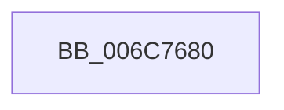

# _memset_spec_ermsb_repmovsb

- RVA: `0x006C7680`–`0x006C76B3` (길이 `51` bytes)
- VA: `0x00000001406C7680`
- 실행 섹션: `.text`
- PDB 이름 있음: `예`; PDB Function 태그: `아니요`
- unwind 정보 RVA: `0x000C2840`
- 디코드: `17`개 명령, `51/51` bytes 표시
- 미해석 바이트: `0` (있으면 어셈블리에 `.byte`로 보존)

> 이 문서는 커널 이미지의 기계어와 PDB 기호를 분석해 생성했습니다. 4번과 5번은 함수 원형과 자료형을 바이너리 사용 방식에서 추정한 C 해석이며 원본 소스 복구 결과는 아닙니다.

## 1. Dependencies

- 직접 호출 지점: **0**; 고유 호출 대상: **0**
- 직접 호출자로 확인된 함수: **0**
- RIP 상대 이미지 참조: **0**

### Outgoing calls
- 직접 디코드된 call 명령이 없습니다.

### Direct callers
- 이 함수 시작 RVA로 연결되는 직접 call은 확인되지 않았습니다. 간접 호출은 완전히 역산할 수 없습니다.

### Static image references
- 디코드된 RIP-relative 메모리 참조가 없습니다.

## 2. Other-region calls and transfers

- 다른 실행 섹션으로 향하는 call: **0**
- 별도 외부 분기/꼬리 이동을 확인하지 못했습니다.

## 3. Assembly (complete function range)

```asm
006C7680  57                              push rdi
006C7681  48 8B F9                        mov rdi, rcx
006C7684  4C 03 C1                        add r8, rcx
006C7687  0F 11 01                        movups xmmword ptr [rcx], xmm0
006C768A  48 83 C7 40                     add rdi, 0x40
006C768E  0F 11 41 10                     movups xmmword ptr [rcx + 0x10], xmm0
006C7692  48 83 E7 C0                     and rdi, 0xffffffffffffffc0
006C7696  0F 11 41 20                     movups xmmword ptr [rcx + 0x20], xmm0
006C769A  4C 2B C7                        sub r8, rdi
006C769D  0F 11 41 30                     movups xmmword ptr [rcx + 0x30], xmm0
006C76A1  49 8B C8                        mov rcx, r8
006C76A4  4C 8B C8                        mov r9, rax
006C76A7  66 48 0F 7E C0                  movq rax, xmm0
006C76AC  F3 AA                           rep stosb byte ptr [rdi], al
006C76AE  49 8B C1                        mov rax, r9
006C76B1  5F                              pop rdi
006C76B2  C3                              ret
```

## 4. C-style interpretation (structured pseudocode)

```c
__int64 __fastcall _memset_spec_ermsb_repmovsb(__int64 a1, __int64 a2, __int64 a3)
{
    __int64 v_rdi;

    a3 = (a3) + (a1);
    *(unsigned __int64 *)(a1) = v_xmm0;
    v_rdi = (a1) + (64);
    *(unsigned __int64 *)(a1 + 16) = v_xmm0;
    v_rdi = (v_rdi) & (-64);
    *(unsigned __int64 *)(a1 + 32) = v_xmm0;
    a3 = (a3) - (v_rdi);
    *(unsigned __int64 *)(a1 + 48) = v_xmm0;
    return result;
}
```

## 5. (Beta) C Style

```c
int64_t _memset_spec_ermsb_repmovsb(void *Arg1, int64_t Arg2, int64_t Arg3)
{
    uint8_t *arg1 = (uint8_t *)Arg1;

    int64_t local_rdi;

    Arg3 = (Arg3) + (Arg1);
    *(uint64_t *)(arg1) = v_xmm0;
    local_rdi = (Arg1) + (64);
    *(uint64_t *)(arg1 + 0x10) = v_xmm0;
    local_rdi = (local_rdi) & (-64);
    *(uint64_t *)(arg1 + 0x20) = v_xmm0;
    Arg3 = (Arg3) - (local_rdi);
    *(uint64_t *)(arg1 + 0x30) = v_xmm0;
    return result;
}
```

### 관측된 메모리 오프셋

구조체 형식이 확인되지 않은 접근은 인자 기준의 오프셋으로만 기록했습니다.

| 기준 인자 | 오프셋 표현 | 폭 (bit) | 접근 |
|---|---:|---:|---|
| `Arg1` | `+ 0x0` | `8` | `W` |
| `Arg1` | `+ 0x0` | `128` | `R` |
| `Arg1` | `+ 0x10` | `128` | `R` |
| `Arg1` | `+ 0x20` | `128` | `R` |
| `Arg1` | `+ 0x30` | `128` | `R` |

## 6. Execution-region graph

[열기: 2D/3D 그래프와 함수 탐색 컨트롤 패널](../../../control-panel.html?section=text&rva=0x006C7680&view=graph)

- 2D 그래프는 위에서 아래로 흐르고, 3D 그래프는 빈 공간을 드래그해 회전합니다. Shift+드래그는 이동, 휠은 확대·축소, 함수 노드 선택은 대상 보고서 이동입니다.

### Static fallback


