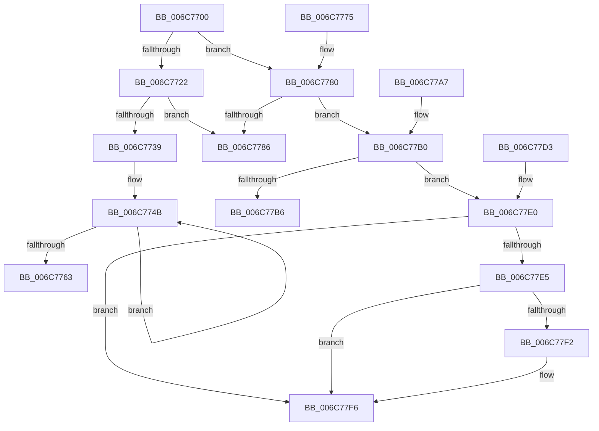

# _memset_spec_plain

- RVA: `0x006C7700`–`0x006C77F7` (길이 `247` bytes)
- VA: `0x00000001406C7700`
- 실행 섹션: `.text`
- PDB 이름 있음: `예`; PDB Function 태그: `아니요`
- unwind 정보 RVA: `0x000BFAC8`
- 디코드: `64`개 명령, `247/247` bytes 표시
- 미해석 바이트: `0` (있으면 어셈블리에 `.byte`로 보존)

> 이 문서는 커널 이미지의 기계어와 PDB 기호를 분석해 생성했습니다. 4번과 5번은 함수 원형과 자료형을 바이너리 사용 방식에서 추정한 C 해석이며 원본 소스 복구 결과는 아닙니다.

## 1. Dependencies

- 직접 호출 지점: **0**; 고유 호출 대상: **0**
- 직접 호출자로 확인된 함수: **0**
- RIP 상대 이미지 참조: **0**

### Outgoing calls
- 직접 디코드된 call 명령이 없습니다.

### Direct callers
- 이 함수 시작 RVA로 연결되는 직접 call은 확인되지 않았습니다. 간접 호출은 완전히 역산할 수 없습니다.

### Static image references
- 디코드된 RIP-relative 메모리 참조가 없습니다.

## 2. Other-region calls and transfers

- 다른 실행 섹션으로 향하는 call: **0**
- 별도 외부 분기/꼬리 이동을 확인하지 못했습니다.

## 3. Assembly (complete function range)

```asm
006C7700  48 8B C1                        mov rax, rcx
006C7703  0F B6 D2                        movzx edx, dl
006C7706  49 B9 01 01 01 01 01 01 01 01   movabs r9, 0x101010101010101
006C7710  49 0F AF D1                     imul rdx, r9
006C7714  66 48 0F 6E C2                  movq xmm0, rdx
006C7719  0F 16 C0                        movlhps xmm0, xmm0
006C771C  49 83 F8 40                     cmp r8, 0x40
006C7720  72 5E                           jb 0x1406c7780
006C7722  0F 11 01                        movups xmmword ptr [rcx], xmm0
006C7725  4C 03 C1                        add r8, rcx
006C7728  48 83 C1 10                     add rcx, 0x10
006C772C  48 83 E1 F0                     and rcx, 0xfffffffffffffff0
006C7730  4C 2B C1                        sub r8, rcx
006C7733  49 83 F8 40                     cmp r8, 0x40
006C7737  72 4D                           jb 0x1406c7786
006C7739  4A 8D 54 01 F0                  lea rdx, [rcx + r8 - 0x10]
006C773E  4E 8D 4C 01 D0                  lea r9, [rcx + r8 - 0x30]
006C7743  49 83 E1 F0                     and r9, 0xfffffffffffffff0
006C7747  49 C1 E8 06                     shr r8, 6
006C774B  0F 29 01                        movaps xmmword ptr [rcx], xmm0
006C774E  0F 29 41 10                     movaps xmmword ptr [rcx + 0x10], xmm0
006C7752  48 83 C1 40                     add rcx, 0x40
006C7756  49 FF C8                        dec r8
006C7759  0F 29 41 E0                     movaps xmmword ptr [rcx - 0x20], xmm0
006C775D  0F 29 41 F0                     movaps xmmword ptr [rcx - 0x10], xmm0
006C7761  75 E8                           jne 0x1406c774b
006C7763  41 0F 29 01                     movaps xmmword ptr [r9], xmm0
006C7767  41 0F 29 41 10                  movaps xmmword ptr [r9 + 0x10], xmm0
006C776C  41 0F 29 41 20                  movaps xmmword ptr [r9 + 0x20], xmm0
006C7771  0F 11 02                        movups xmmword ptr [rdx], xmm0
006C7774  C3                              ret
006C7775  66 66 66 0F 1F 84 00 00 00 00 00  nop word ptr [rax + rax]
006C7780  49 83 F8 10                     cmp r8, 0x10
006C7784  72 2A                           jb 0x1406c77b0
006C7786  4D 8D 4C 08 F0                  lea r9, [r8 + rcx - 0x10]
006C778B  49 83 E0 20                     and r8, 0x20
006C778F  0F 11 01                        movups xmmword ptr [rcx], xmm0
006C7792  49 D1 E8                        shr r8, 1
006C7795  41 0F 11 01                     movups xmmword ptr [r9], xmm0
006C7799  42 0F 11 04 01                  movups xmmword ptr [rcx + r8], xmm0
006C779E  49 F7 D8                        neg r8
006C77A1  43 0F 11 04 01                  movups xmmword ptr [r9 + r8], xmm0
006C77A6  C3                              ret
006C77A7  66 0F 1F 84 00 00 00 00 00      nop word ptr [rax + rax]
006C77B0  49 83 F8 04                     cmp r8, 4
006C77B4  72 2A                           jb 0x1406c77e0
006C77B6  4D 8D 4C 08 FC                  lea r9, [r8 + rcx - 4]
006C77BB  49 83 E0 08                     and r8, 8
006C77BF  89 11                           mov dword ptr [rcx], edx
006C77C1  49 D1 E8                        shr r8, 1
006C77C4  41 89 11                        mov dword ptr [r9], edx
006C77C7  42 89 14 01                     mov dword ptr [rcx + r8], edx
006C77CB  49 F7 D8                        neg r8
006C77CE  43 89 14 01                     mov dword ptr [r9 + r8], edx
006C77D2  C3                              ret
006C77D3  66 66 66 66 66 0F 1F 84 00 00 00 00 00  nop word ptr [rax + rax]
006C77E0  4D 85 C0                        test r8, r8
006C77E3  74 11                           je 0x1406c77f6
006C77E5  88 11                           mov byte ptr [rcx], dl
006C77E7  4E 8D 4C 01 FE                  lea r9, [rcx + r8 - 2]
006C77EC  49 83 F8 01                     cmp r8, 1
006C77F0  74 04                           je 0x1406c77f6
006C77F2  66 41 89 11                     mov word ptr [r9], dx
006C77F6  C3                              ret
```

## 4. C-style interpretation (structured pseudocode)

```c
__int64 __fastcall _memset_spec_plain(__int64 a1, unsigned __int8 a2, __int64 a3)
{
    a2 = (a2) * (a4);
    if (a3 < 64) goto loc_006C7780;
    *(unsigned __int64 *)(a1) = v_xmm0;
    a3 = (a3) + (a1);
    a1 = (a1) + (16);
    a1 = (a1) & (-16);
    a3 = (a3) - (a1);
    if (a3 < 64) goto loc_006C7786;
    a4 = (a1 + a3 * 1 - 48) & (-16);
    a3 = (a3) >> (6);
loc_006C774B:
    *(unsigned __int64 *)(a1) = v_xmm0;
    *(unsigned __int64 *)(a1 + 16) = v_xmm0;
    a1 = (a1) + (64);
    a3 = (a3) - 1;
    *(unsigned __int64 *)(a1 - 32) = v_xmm0;
    *(unsigned __int64 *)(a1 - 16) = v_xmm0;
    if (condition_is_not_equal) goto loc_006C774B;
    *(unsigned __int64 *)(a4) = v_xmm0;
    *(unsigned __int64 *)(a4 + 16) = v_xmm0;
    *(unsigned __int64 *)(a4 + 32) = v_xmm0;
    *(unsigned __int64 *)(a1 + a3 * 1 - 16) = v_xmm0;
    return a1;
loc_006C7780:
    if (a3 < 16) goto loc_006C77B0;
loc_006C7786:
    a3 = (a3) & (32);
    *(unsigned __int64 *)(a1) = v_xmm0;
    a3 = (a3) >> (1);
    *(unsigned __int64 *)(a3 + a1 * 1 - 16) = v_xmm0;
    *(unsigned __int64 *)(a1 + a3 * 1) = v_xmm0;
    a3 = -(a3);
    *(unsigned __int64 *)(a3 + a1 * 1 - 16 + a3 * 1) = v_xmm0;
    return a1;
loc_006C77B0:
    if (a3 < 4) goto loc_006C77E0;
    a3 = (a3) & (8);
    *(unsigned int *)(a1) = (unsigned int)(a1 + a3 * 1 - 16);
    a3 = (a3) >> (1);
    *(unsigned int *)(a3 + a1 * 1 - 4) = (unsigned int)(a1 + a3 * 1 - 16);
    *(unsigned int *)(a1 + a3 * 1) = (unsigned int)(a1 + a3 * 1 - 16);
    a3 = -(a3);
    *(unsigned int *)(a3 + a1 * 1 - 4 + a3 * 1) = (unsigned int)(a1 + a3 * 1 - 16);
    return a1;
loc_006C77E0:
    if (a3 == 0) goto loc_006C77F6;
    *(unsigned __int8 *)(a1) = (unsigned __int8)(a1 + a3 * 1 - 16);
    if (a3 != 1) {
        *(unsigned __int16 *)(a1 + a3 * 1 - 2) = (unsigned __int16)(a1 + a3 * 1 - 16);
    }
    return a1;
}
```

## 5. (Beta) C Style

```c
void *_memset_spec_plain(void *Arg1, uint8_t Arg2, int64_t Arg3)
{
    uint8_t *arg1 = (uint8_t *)Arg1;

    Arg2 = (Arg2) * (a4);
    if (Arg3 < 64) goto loc_006C7780;
    *(uint64_t *)(arg1) = v_xmm0;
    Arg3 = (Arg3) + (Arg1);
    Arg1 = (Arg1) + (16);
    Arg1 = (Arg1) & (-16);
    Arg3 = (Arg3) - (Arg1);
    if (Arg3 < 64) goto loc_006C7786;
    a4 = (Arg1 + Arg3 * 1 - 48) & (-16);
    Arg3 = (Arg3) >> (6);
loc_006C774B:
    *(uint64_t *)(arg1) = v_xmm0;
    *(uint64_t *)(arg1 + 0x10) = v_xmm0;
    Arg1 = (Arg1) + (64);
    Arg3 = (Arg3) - 1;
    *(uint64_t *)(arg1 - 0x20) = v_xmm0;
    *(uint64_t *)(arg1 - 0x10) = v_xmm0;
    if (condition_is_not_equal) goto loc_006C774B;
    *(uint64_t *)(a4) = v_xmm0;
    *(uint64_t *)(a4 + 0x10) = v_xmm0;
    *(uint64_t *)(a4 + 0x20) = v_xmm0;
    *(uint64_t *)(arg1 + Arg3 * 1 - 0x10) = v_xmm0;
    return Arg1;
loc_006C7780:
    if (Arg3 < 16) goto loc_006C77B0;
loc_006C7786:
    Arg3 = (Arg3) & (32);
    *(uint64_t *)(arg1) = v_xmm0;
    Arg3 = (Arg3) >> (1);
    *(uint64_t *)(Arg3 + arg1 * 1 - 0x10) = v_xmm0;
    *(uint64_t *)(arg1 + Arg3 * 1) = v_xmm0;
    Arg3 = -(Arg3);
    *(uint64_t *)(Arg3 + arg1 * 1 - 0x10 + Arg3 * 1) = v_xmm0;
    return Arg1;
loc_006C77B0:
    if (Arg3 < 4) goto loc_006C77E0;
    Arg3 = (Arg3) & (8);
    *(uint32_t *)(arg1) = (uint32_t)(Arg1 + Arg3 * 1 - 16);
    Arg3 = (Arg3) >> (1);
    *(uint32_t *)(Arg3 + arg1 * 1 - 0x4) = (uint32_t)(Arg1 + Arg3 * 1 - 16);
    *(uint32_t *)(arg1 + Arg3 * 1) = (uint32_t)(Arg1 + Arg3 * 1 - 16);
    Arg3 = -(Arg3);
    *(uint32_t *)(Arg3 + arg1 * 1 - 0x4 + Arg3 * 1) = (uint32_t)(Arg1 + Arg3 * 1 - 16);
    return Arg1;
loc_006C77E0:
    if (Arg3 == 0) goto loc_006C77F6;
    *(uint8_t *)(arg1) = (uint8_t)(Arg1 + Arg3 * 1 - 16);
    if (Arg3 != 1) {
        *(uint16_t *)(arg1 + Arg3 * 1 - 0x2) = (uint16_t)(Arg1 + Arg3 * 1 - 16);
    }
    return Arg1;
}
```

### 관측된 메모리 오프셋

구조체 형식이 확인되지 않은 접근은 인자 기준의 오프셋으로만 기록했습니다.

| 기준 인자 | 오프셋 표현 | 폭 (bit) | 접근 |
|---|---:|---:|---|
| `Arg1` | `- 0x30 + r8*1` | `64` | `R` |
| `Arg1` | `- 0x20` | `128` | `W` |
| `Arg1` | `- 0x10` | `128` | `W` |
| `Arg1` | `- 0x10 + r8*1` | `64` | `R` |
| `Arg1` | `- 0x2 + r8*1` | `64` | `R` |
| `Arg1` | `+ 0x0` | `8` | `W` |
| `Arg1` | `+ 0x0` | `16` | `W` |
| `Arg1` | `+ 0x0` | `32` | `W` |
| `Arg1` | `+ 0x0` | `128` | `R` |
| `Arg1` | `+ 0x0` | `128` | `W` |
| `Arg1` | `+ 0x0 + r8*1` | `32` | `W` |
| `Arg1` | `+ 0x0 + r8*1` | `128` | `R` |
| `Arg1` | `+ 0x10` | `128` | `W` |
| `Arg1` | `+ 0x20` | `128` | `W` |

## 6. Execution-region graph

[열기: 2D/3D 그래프와 함수 탐색 컨트롤 패널](../../../control-panel.html?section=text&rva=0x006C7700&view=graph)

- 2D 그래프는 위에서 아래로 흐르고, 3D 그래프는 빈 공간을 드래그해 회전합니다. Shift+드래그는 이동, 휠은 확대·축소, 함수 노드 선택은 대상 보고서 이동입니다.

### Static fallback


