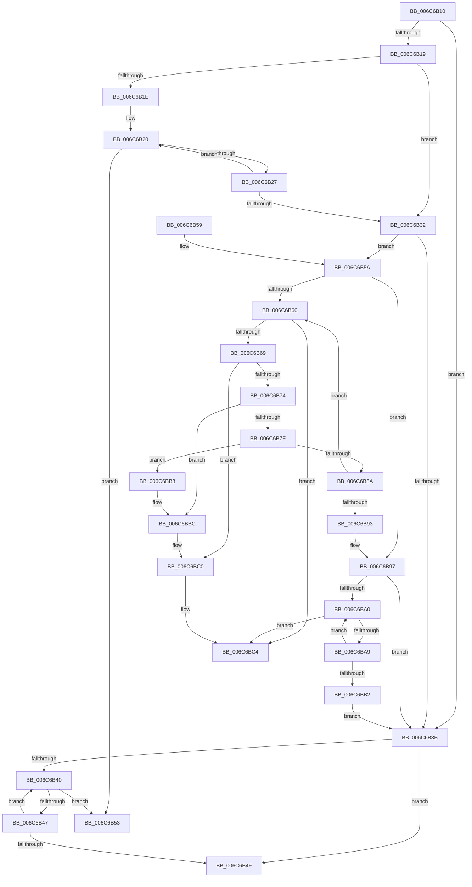

# memcmp

- RVA: `0x006C6B10`–`0x006C6BD7` (길이 `199` bytes)
- VA: `0x00000001406C6B10`
- 실행 섹션: `.text`
- PDB 이름 있음: `예`; PDB Function 태그: `아니요`
- unwind 정보 RVA: `0x000BFAC8`
- 디코드: `69`개 명령, `199/199` bytes 표시
- 미해석 바이트: `0` (있으면 어셈블리에 `.byte`로 보존)

> 이 문서는 커널 이미지의 기계어와 PDB 기호를 분석해 생성했습니다. 4번과 5번은 함수 원형과 자료형을 바이너리 사용 방식에서 추정한 C 해석이며 원본 소스 복구 결과는 아닙니다.

## 1. Dependencies

- 직접 호출 지점: **0**; 고유 호출 대상: **0**
- 직접 호출자로 확인된 함수: **125**
- RIP 상대 이미지 참조: **0**

### Outgoing calls
- 직접 디코드된 call 명령이 없습니다.

### Direct callers
- [sub_0025F532](../25/Unknown_function_0025F532.md) at `0x0025F635`
- [sub_0025F6D3](../25/Unknown_function_0025F6D3.md) at `0x0025F6FD`
- [KeUpdateSoftParkRankList](../2D/KeUpdateSoftParkRankList_function_002D5998.md) at `0x002D5AF5`
- [CompareEventEntry](../2F/CompareEventEntry_function_002F17B4.md) at `0x002F17E3`
- [CompareEventEntry](../2F/CompareEventEntry_function_002F17B4.md) at `0x002F1814`
- [RtlpIsNameInExpressionPrivate](../2F/RtlpIsNameInExpressionPrivate_function_002FDBAC.md) at `0x002FDFC1`
- [SepMatchPackage](../2F/SepMatchPackage_function_002FFDC0.md) at `0x002FFE6B`
- [AuthzBasepFindSecurityAttributeValue](../30/AuthzBasepFindSecurityAttributeValue_function_00302B2C.md) at `0x00302CCD`
- [AuthzBasepFindSecurityAttributeValue](../30/AuthzBasepFindSecurityAttributeValue_function_00302B2C.md) at `0x00302CDD`
- [AuthzBasepFindSecurityAttributeValue](../30/AuthzBasepFindSecurityAttributeValue_function_00302B2C.md) at `0x00302D04`
- [AuthzBasepFindSecurityAttributeValue](../30/AuthzBasepFindSecurityAttributeValue_function_00302B2C.md) at `0x00302D89`
- [SMKM_STORE&lt;SM_TRAITS&gt;::SmStCompareRegionDataCallback](../34/SMKM_STORE_SM_TRAITS_SmStCompareRegionDataCallback_function_0034D390.md) at `0x0034D53A`
- [SeComputeCreatorDeniedRights](../3A/SeComputeCreatorDeniedRights_function_003A6080.md) at `0x003A61A2`
- [SeComputeCreatorDeniedRights](../3A/SeComputeCreatorDeniedRights_function_003A6080.md) at `0x003A62FF`
- [SeComputeCreatorDeniedRights](../3A/SeComputeCreatorDeniedRights_function_003A6080.md) at `0x003A650D`
- [SeComputeCreatorDeniedRights](../3A/SeComputeCreatorDeniedRights_function_003A6080.md) at `0x003A65C2`
- [SeComputeCreatorDeniedRights](../3A/SeComputeCreatorDeniedRights_function_003A6080.md) at `0x003A65E5`
- [SepPotentialGlobalTableAttribute](../3A/SepPotentialGlobalTableAttribute_function_003A8828.md) at `0x003A8875`
- [AuthzBasepEqualUnicodeStringCaseSensitive](../3A/AuthzBasepEqualUnicodeStringCaseSensitive_function_003A8A44.md) at `0x003A8A63`
- [sub_003C860A](../3C/Unknown_function_003C860A.md) at `0x003C86B9`
- [sub_003C860A](../3C/Unknown_function_003C860A.md) at `0x003C8796`
- [sub_003C860A](../3C/Unknown_function_003C860A.md) at `0x003C87A8`
- [sub_003C87C8](../3C/Unknown_function_003C87C8.md) at `0x003C87EE`
- [sub_003D047D](../3D/Unknown_function_003D047D.md) at `0x003D0529`
- [sub_003D05E0](../3D/Unknown_function_003D05E0.md) at `0x003D0606`
- [sub_003D0617](../3D/Unknown_function_003D0617.md) at `0x003D061A`
- [sub_003D063D](../3D/Unknown_function_003D063D.md) at `0x003D0663`
- [sub_003D0CA5](../3D/Unknown_function_003D0CA5.md) at `0x003D0D35`
- [sub_003D0DC6](../3D/Unknown_function_003D0DC6.md) at `0x003D0DCC`
- [sub_003E5D8A](../3E/Unknown_function_003E5D8A.md) at `0x003E5E3F`
- [sub_003E5D8A](../3E/Unknown_function_003E5D8A.md) at `0x003E5F7C`
- [sub_003E5FE3](../3E/Unknown_function_003E5FE3.md) at `0x003E5FE6`
- [sub_003E5FE3](../3E/Unknown_function_003E5FE3.md) at `0x003E6009`
- [RtlSidHashLookup](../3E/RtlSidHashLookup_function_003EBE00.md) at `0x003EBEAD`
- [RtlSidHashLookup](../3E/RtlSidHashLookup_function_003EBE00.md) at `0x003EBF21`
- [HalpAcpiIsCachedTableCompromised](../3F/HalpAcpiIsCachedTableCompromised_function_003F6E78.md) at `0x003F6EF1`
- [HalpAcpiGetRsdt](../3F/HalpAcpiGetRsdt_function_003F806C.md) at `0x003F8146`
- [RtlpOwnerAcesPresent](../3F/RtlpOwnerAcesPresent_function_003FB2F0.md) at `0x003FB392`
- [sub_003FBDD9](../3F/Unknown_function_003FBDD9.md) at `0x003FBE08`
- [sub_003FDA2D](../3F/Unknown_function_003FDA2D.md) at `0x003FDAA0`
- [RtlFindAceBySid](../40/RtlFindAceBySid_function_004004E0.md) at `0x00400581`
- [RtlEqualSid](../40/RtlEqualSid_function_00400AD0.md) at `0x00400AEB`
- [RtlAreNamesEqual](../40/RtlAreNamesEqual_function_0040BCB0.md) at `0x0040BD4F`
- [IopIsKnownGoodLegacyFsFilter](../41/IopIsKnownGoodLegacyFsFilter_function_004108A0.md) at `0x004108D6`
- [AuthzBasepCompareOctetStringOperands](../4B/AuthzBasepCompareOctetStringOperands_function_004BD4A8.md) at `0x004BD503`
- [MiIdealClusterPage](../4D/MiIdealClusterPage_function_004DB964.md) at `0x004DBFF7`
- [MiIdealClusterPage](../4D/MiIdealClusterPage_function_004DB964.md) at `0x004DC055`
- [SepValidateCAPID](../4F/SepValidateCAPID_function_004FA528.md) at `0x004FA55E`
- [SymCryptEcDhSecretAgreementSelftest](../52/SymCryptEcDhSecretAgreementSelftest_function_0052B2C4.md) at `0x0052B406`
- [SymCryptEcDsaSelftest](../52/SymCryptEcDsaSelftest_function_0052B45C.md) at `0x0052B596`
- [SymCryptRsaSelftest](../52/SymCryptRsaSelftest_function_0052B638.md) at `0x0052B797`
- [SymCryptFdefDecideModulusType](../53/SymCryptFdefDecideModulusType_function_00533F78.md) at `0x00534013`
- [HalMatchAcpiOemTableId](../53/HalMatchAcpiOemTableId_function_0053EB80.md) at `0x0053EC1B`
- [_asan_wrap_memcmp](../5A/_asan_wrap_memcmp_function_005AE570.md) at `0x005AE702`
- [KiDisplayBlueScreen](../5B/KiDisplayBlueScreen_function_005B494C.md) at `0x005B4A52`
- [RtlpComparePropertyEntry](../5E/RtlpComparePropertyEntry_function_005E8560.md) at `0x005E856A`
- [MiFindSpecialPurposeMemoryType](../69/MiFindSpecialPurposeMemoryType_function_0069503C.md) at `0x0069506A`
- [MinCryptK_GetBootAppSvnFromRevocationList](../6A/MinCryptK_GetBootAppSvnFromRevocationList_function_006A6154.md) at `0x006A61BB`
- [MinCryptCheckCertsAndKeys](../6A/MinCryptCheckCertsAndKeys_function_006A61F8.md) at `0x006A628A`
- [MinCryptIsCertPresent](../6A/MinCryptIsCertPresent_function_006A631C.md) at `0x006A6357`
- [sub_006FBF78](../6F/Unknown_function_006FBF78.md) at `0x006FBFCB`
- [sub_006FBF78](../6F/Unknown_function_006FBF78.md) at `0x006FC00F`
- [RtlSuffixUnicodeString](../../page/78/RtlSuffixUnicodeString_function_0078A780.md) at `0x0078A80D`
- [RtlReplaceSidInSd](../../page/78/RtlReplaceSidInSd_function_0078E6E0.md) at `0x0078E787`
- [RtlReplaceSidInSd](../../page/78/RtlReplaceSidInSd_function_0078E6E0.md) at `0x0078E802`
- [RtlReplaceSidInSd](../../page/78/RtlReplaceSidInSd_function_0078E6E0.md) at `0x0078E8C7`
- [RtlReplaceSidInSd](../../page/78/RtlReplaceSidInSd_function_0078E6E0.md) at `0x0078E99D`
- [RtlpCheckDynamicTimeZoneInformation](../../page/78/RtlpCheckDynamicTimeZoneInformation_function_0078FB3C.md) at `0x0078FCD4`
- [RtlpUpdateDynamicTimeZones](../../page/79/RtlpUpdateDynamicTimeZones_function_0079019C.md) at `0x007903AA`
- [SepSecureBootManifestCompareElements](../../page/7A/SepSecureBootManifestCompareElements_function_007A24F0.md) at `0x007A2503`
- [SepSecureBootValidateBcdDataAgainstBcdRule](../../page/7A/SepSecureBootValidateBcdDataAgainstBcdRule_function_007A26BC.md) at `0x007A27F0`
- [SLQueryLicenseValueInternal](../../page/7C/SLQueryLicenseValueInternal_function_007C93EC.md) at `0x007C95AF`
- [SLQueryLicenseValueInternal](../../page/7C/SLQueryLicenseValueInternal_function_007C93EC.md) at `0x007C9B2E`
- [SLUpdateLicenseDataInternal](../../page/7C/SLUpdateLicenseDataInternal_function_007C9C04.md) at `0x007CA4B2`
- [ExpKdPullRemoteFileForUser](../../page/7D/ExpKdPullRemoteFileForUser_function_007D15AC.md) at `0x007D17B1`
- [ExpKdPullRemoteFileForUser](../../page/7D/ExpKdPullRemoteFileForUser_function_007D15AC.md) at `0x007D192D`
- [ExpKdPullRemoteFileForUser](../../page/7D/ExpKdPullRemoteFileForUser_function_007D15AC.md) at `0x007D19EF`
- [SdbpCheckMatchingRegistryValue](../../page/81/SdbpCheckMatchingRegistryValue_function_0081462C.md) at `0x008148D3`
- [I_MinCryptCheckEKU](../../page/83/I_MinCryptCheckEKU_function_008364C4.md) at `0x008364FE`
- [MinCryptVerifyCertificateWithPolicy2](../../page/83/MinCryptVerifyCertificateWithPolicy2_function_008368A8.md) at `0x00836F6B`
- [MincrypK_ParseCertificateChainWithPolicy2](../../page/83/MincrypK_ParseCertificateChainWithPolicy2_function_00837534.md) at `0x00837635`
- [I_MinCryptHashSearchCompare](../../page/83/I_MinCryptHashSearchCompare_function_008376F0.md) at `0x00837703`
- [I_MinCryptIsTimestampSignerTrusted](../../page/83/I_MinCryptIsTimestampSignerTrusted_function_00837714.md) at `0x00837795`
- [I_MinAsn1ParseSingleAttribute](../../page/83/I_MinAsn1ParseSingleAttribute_function_00838A10.md) at `0x00838AF4`
- [MinAsn1ParseSingleExtensionValue](../../page/83/MinAsn1ParseSingleExtensionValue_function_00839058.md) at `0x00839148`
- [I_MinCryptCheckEKURequirements](../../page/83/I_MinCryptCheckEKURequirements_function_00839218.md) at `0x008392C0`
- [ObpLookupDirectoryEntry](../../page/85/ObpLookupDirectoryEntry_function_0085D5B0.md) at `0x0085D83F`
- [AlpcpEnterStateChangeEventMessageLog](../../page/89/AlpcpEnterStateChangeEventMessageLog_function_00897CF8.md) at `0x00897DC5`
- [ObpLookupObjectName](../../page/89/ObpLookupObjectName_function_0089BE90.md) at `0x0089D278`
- [ObpLookupObjectName](../../page/89/ObpLookupObjectName_function_0089BE90.md) at `0x0089DAD5`
- [IopParseDevice](../../page/89/IopParseDevice_function_0089E510.md) at `0x0089F9A9`
- [sub_008BA32C](../../page/8B/Unknown_function_008BA32C.md) at `0x008BA5E7`
- [ObSetSecurityDescriptorInfo](../../page/8B/ObSetSecurityDescriptorInfo_function_008BAE20.md) at `0x008BB08E`
- [sub_008BC997](../../page/8B/Unknown_function_008BC997.md) at `0x008BCA9B`
- [EtwpGetLoggerInfoFromContext](../../page/8B/EtwpGetLoggerInfoFromContext_function_008BEF90.md) at `0x008BF28F`
- [ObLogSecurityDescriptor](../../page/8C/ObLogSecurityDescriptor_function_008C0020.md) at `0x008C024B`
- [sub_008E314B](../../page/8E/Unknown_function_008E314B.md) at `0x008E3289`
- [sub_008E34DB](../../page/8E/Unknown_function_008E34DB.md) at `0x008E34FF`
- [PiPnpRtlCmActionCallback](../../page/8E/PiPnpRtlCmActionCallback_function_008EF110.md) at `0x008EF4EE`
- [RtlPrefixUnicodeString](../../page/8F/RtlPrefixUnicodeString_function_008F4F70.md) at `0x008F508B`
- [PiDmObjectProcessPropertyChange](../../page/8F/PiDmObjectProcessPropertyChange_function_008F8A48.md) at `0x008F8DA6`
- [PiDmObjectUpdateCachedObjectProperty](../../page/8F/PiDmObjectUpdateCachedObjectProperty_function_008F9C94.md) at `0x008F9E4E`
- [PfSnAltProfileTreeCompareByProcess](../../page/90/PfSnAltProfileTreeCompareByProcess_function_00903DD8.md) at `0x00903DF0`
- [PfSnEndProcessTrace](../../page/90/PfSnEndProcessTrace_function_00903E04.md) at `0x00903F84`
- [RtlPrefixString](../../page/90/RtlPrefixString_function_0090F520.md) at `0x0090F5AA`
- [PopApplyPolicy](../../page/91/PopApplyPolicy_function_009107B0.md) at `0x009108D2`
- [RtlEqualUnicodeString](../../page/93/RtlEqualUnicodeString_function_00932A20.md) at `0x00932B6C`
- [PfSnAsyncPrefetchWorker](../../page/93/PfSnAsyncPrefetchWorker_function_009394B0.md) at `0x0093979E`
- [CmpFindMatchingDescriptorCell](../../page/94/CmpFindMatchingDescriptorCell_function_009494A0.md) at `0x00949542`
- [RtlFindUnicodeSubstring](../../page/94/RtlFindUnicodeSubstring_function_00949FA0.md) at `0x0094A10E`
- [PfSnPrefetchCacheEntryGet](../../page/95/PfSnPrefetchCacheEntryGet_function_0095F890.md) at `0x0095F98D`
- [PfSnPrefetchCacheEntryUpdate](../../page/96/PfSnPrefetchCacheEntryUpdate_function_00961234.md) at `0x009612EA`
- [sub_00968AF6](../../page/96/Unknown_function_00968AF6.md) at `0x00969B1F`
- [sub_00968AF6](../../page/96/Unknown_function_00968AF6.md) at `0x00969B39`
- [sub_00968AF6](../../page/96/Unknown_function_00968AF6.md) at `0x00969B58`
- [sub_00968AF6](../../page/96/Unknown_function_00968AF6.md) at `0x00969B82`
- [sub_00968AF6](../../page/96/Unknown_function_00968AF6.md) at `0x00969BAC`
- [sub_00968AF6](../../page/96/Unknown_function_00968AF6.md) at `0x00969BD4`
- [sub_00968AF6](../../page/96/Unknown_function_00968AF6.md) at `0x00969D87`
- [sub_00968AF6](../../page/96/Unknown_function_00968AF6.md) at `0x00969DA9`
- [sub_00968AF6](../../page/96/Unknown_function_00968AF6.md) at `0x00969DCB`
- [sub_00968AF6](../../page/96/Unknown_function_00968AF6.md) at `0x00969DEB`
- [sub_00968AF6](../../page/96/Unknown_function_00968AF6.md) at `0x0096A084`
- [sub_00968AF6](../../page/96/Unknown_function_00968AF6.md) at `0x0096A0A6`
- [sub_00968AF6](../../page/96/Unknown_function_00968AF6.md) at `0x0096A0C8`
- [sub_00968AF6](../../page/96/Unknown_function_00968AF6.md) at `0x0096A0E8`
- [sub_00968AF6](../../page/96/Unknown_function_00968AF6.md) at `0x0096A102`
- [sub_00968AF6](../../page/96/Unknown_function_00968AF6.md) at `0x0096A12C`
- [sub_00968AF6](../../page/96/Unknown_function_00968AF6.md) at `0x0096A156`
- [sub_00968AF6](../../page/96/Unknown_function_00968AF6.md) at `0x0096A17E`
- [sub_00968AF6](../../page/96/Unknown_function_00968AF6.md) at `0x0096A4E5`
- [sub_00968AF6](../../page/96/Unknown_function_00968AF6.md) at `0x0096A504`
- [sub_00968AF6](../../page/96/Unknown_function_00968AF6.md) at `0x0096A526`
- [sub_00968AF6](../../page/96/Unknown_function_00968AF6.md) at `0x0096A546`
- [sub_00968AF6](../../page/96/Unknown_function_00968AF6.md) at `0x0096A560`
- [sub_00968AF6](../../page/96/Unknown_function_00968AF6.md) at `0x0096A582`
- [sub_00968AF6](../../page/96/Unknown_function_00968AF6.md) at `0x0096A5A4`
- [sub_00968AF6](../../page/96/Unknown_function_00968AF6.md) at `0x0096A5C4`
- [sub_00968AF6](../../page/96/Unknown_function_00968AF6.md) at `0x0096A5E3`
- [sub_00968AF6](../../page/96/Unknown_function_00968AF6.md) at `0x0096A605`
- [sub_00968AF6](../../page/96/Unknown_function_00968AF6.md) at `0x0096A627`
- [sub_00968AF6](../../page/96/Unknown_function_00968AF6.md) at `0x0096A647`
- [sub_00968AF6](../../page/96/Unknown_function_00968AF6.md) at `0x0096A661`
- [sub_00968AF6](../../page/96/Unknown_function_00968AF6.md) at `0x0096A683`
- [sub_00968AF6](../../page/96/Unknown_function_00968AF6.md) at `0x0096A6A5`
- [sub_00968AF6](../../page/96/Unknown_function_00968AF6.md) at `0x0096A6C5`
- [sub_00968AF6](../../page/96/Unknown_function_00968AF6.md) at `0x0096AAE5`
- [sub_00968AF6](../../page/96/Unknown_function_00968AF6.md) at `0x0096AB0F`
- [sub_00968AF6](../../page/96/Unknown_function_00968AF6.md) at `0x0096AB37`
- [sub_00968AF6](../../page/96/Unknown_function_00968AF6.md) at `0x0096ACB1`
- [sub_00968AF6](../../page/96/Unknown_function_00968AF6.md) at `0x0096ACDB`
- [sub_00968AF6](../../page/96/Unknown_function_00968AF6.md) at `0x0096AD03`
- [SshpCacheDatabaseCompare](../../page/97/SshpCacheDatabaseCompare_function_009725D0.md) at `0x009726C5`
- [SshpCacheDatabaseCompare](../../page/97/SshpCacheDatabaseCompare_function_009725D0.md) at `0x009726DF`
- [SshpCacheDatabaseCompare](../../page/97/SshpCacheDatabaseCompare_function_009725D0.md) at `0x00972781`
- [SeExamineSacl](../../page/97/SeExamineSacl_function_00973A30.md) at `0x00973BA3`
- [SeExamineSacl](../../page/97/SeExamineSacl_function_00973A30.md) at `0x00973C22`
- [sub_0097D1E2](../../page/97/Unknown_function_0097D1E2.md) at `0x0097D384`
- [MiComputeBadImageHeaderType](../../page/98/MiComputeBadImageHeaderType_function_00987668.md) at `0x009877DF`
- [MiComputeBadImageHeaderType](../../page/98/MiComputeBadImageHeaderType_function_00987668.md) at `0x00987838`
- [PopEtAggregateFind](../../page/98/PopEtAggregateFind_function_0098E1F4.md) at `0x0098E36A`
- [RtlpInternEntryMatch](../../page/98/RtlpInternEntryMatch_function_0098EA24.md) at `0x0098EA9C`
- [sub_009A732C](../../page/9A/Unknown_function_009A732C.md) at `0x009A75B1`
- [PropertyEval](../../page/9C/PropertyEval_function_009CB300.md) at `0x009CD932`
- [PropertyEval](../../page/9C/PropertyEval_function_009CB300.md) at `0x009CD97D`
- [_CmGetDeviceMappedPropertyFromComposite](../../page/9D/_CmGetDeviceMappedPropertyFromComposite_function_009D1684.md) at `0x009D1AAB`
- [SepSidInSidAndAttributes](../../page/9D/SepSidInSidAndAttributes_function_009D4A94.md) at `0x009D4AF4`
- [EtwpCompareGuid](../../page/9E/EtwpCompareGuid_function_009E4860.md) at `0x009E486A`
- [EtwpUpdateDisallowedGuids](../../page/9E/EtwpUpdateDisallowedGuids_function_009EA8FC.md) at `0x009EAA6C`
- [TraitsCompare](../../page/9F/TraitsCompare_function_009F397C.md) at `0x009F39A1`
- [ExpWnfFindScopeInstance](../../page/9F/ExpWnfFindScopeInstance_function_009FFDE8.md) at `0x009FFE21`
- [PnpProcessTargetDeviceEvent](../../page/A0/PnpProcessTargetDeviceEvent_function_00A046BC.md) at `0x00A0475F`
- [FsRtlNotifyFilterReportChange](../../page/A1/FsRtlNotifyFilterReportChange_function_00A1E880.md) at `0x00A1ED5A`
- [SepExamineSaclEx](../../page/A2/SepExamineSaclEx_function_00A2F39C.md) at `0x00A2F572`
- [SepExamineSaclEx](../../page/A2/SepExamineSaclEx_function_00A2F39C.md) at `0x00A2F753`
- [SepExamineSaclEx](../../page/A2/SepExamineSaclEx_function_00A2F39C.md) at `0x00A2F841`
- [PiDcCompareUpdateProperties](../../page/A5/PiDcCompareUpdateProperties_function_00A5EC80.md) at `0x00A5EC93`
- [EtwpGenerateFileName](../../page/A9/EtwpGenerateFileName_function_00A962C8.md) at `0x00A963B1`
- [EtwpStartLogger](../../page/A9/EtwpStartLogger_function_00A99D80.md) at `0x00A9A642`
- [PiDevCfgResolveVariableExpression](../../page/AA/PiDevCfgResolveVariableExpression_function_00AA8C00.md) at `0x00AA975F`
- [PiDevCfgResolveVariableExpression](../../page/AA/PiDevCfgResolveVariableExpression_function_00AA8C00.md) at `0x00AA9788`
- [PiSwDoesCreateChangesRequireReEnum](../../page/AA/PiSwDoesCreateChangesRequireReEnum_function_00AAE658.md) at `0x00AAE735`
- [ExpWnfInvalidateDataStores](../../page/AB/ExpWnfInvalidateDataStores_function_00AB6E08.md) at `0x00AB6E96`
- [BiExportEfiBootManager](../../page/AC/BiExportEfiBootManager_function_00ACB13C.md) at `0x00ACB2A3`
- [BiAreBootEntriesEqual](../../page/AC/BiAreBootEntriesEqual_function_00ACF1D0.md) at `0x00ACF1DF`
- [NtSetSystemInformation](../../page/AF/NtSetSystemInformation_function_00AF4A60.md) at `0x00AF4F2F`
- [NtSetSystemInformation](../../page/AF/NtSetSystemInformation_function_00AF4A60.md) at `0x00AF4FC7`
- [sub_00B1C8E2](../../page/B1/Unknown_function_00B1C8E2.md) at `0x00B1C91A`
- [sub_00B2940C](../../page/B2/Unknown_function_00B2940C.md) at `0x00B29501`
- [sub_00B397DE](../../page/B3/Unknown_function_00B397DE.md) at `0x00B398AF`
- [sub_00B397DE](../../page/B3/Unknown_function_00B397DE.md) at `0x00B3995D`
- [IovpExamineIrpStackForwarding](../../pagevrfy/B9/IovpExamineIrpStackForwarding_function_00B9D640.md) at `0x00B9D6CA`
- [ViCtxEqualExtendedState](../../pagevrfy/BB/ViCtxEqualExtendedState_function_00BB206C.md) at `0x00BB20E0`
- [ViCtxEqualExtendedState](../../pagevrfy/BB/ViCtxEqualExtendedState_function_00BB206C.md) at `0x00BB2117`
- [ViCtxEqualExtendedState](../../pagevrfy/BB/ViCtxEqualExtendedState_function_00BB206C.md) at `0x00BB2151`
- [HalpAcpiDetectMachineSpecificActions](../../init/C2/HalpAcpiDetectMachineSpecificActions_function_00C257FC.md) at `0x00C25855`
- [HalpAcpiDetectMachineSpecificActions](../../init/C2/HalpAcpiDetectMachineSpecificActions_function_00C257FC.md) at `0x00C25870`
- [PipCheckSystemFirmwareUpdated](../../init/C3/PipCheckSystemFirmwareUpdated_function_00C3048C.md) at `0x00C3055A`
- [CmpGetBiosDate](../../init/C5/CmpGetBiosDate_function_00C59C80.md) at `0x00C59E0F`

### Static image references
- 디코드된 RIP-relative 메모리 참조가 없습니다.

## 2. Other-region calls and transfers

- 다른 실행 섹션으로 향하는 call: **0**
- 별도 외부 분기/꼬리 이동을 확인하지 못했습니다.

## 3. Assembly (complete function range)

```asm
006C6B10  48 2B D1                        sub rdx, rcx
006C6B13  49 83 F8 08                     cmp r8, 8
006C6B17  72 22                           jb 0x1406c6b3b
006C6B19  F6 C1 07                        test cl, 7
006C6B1C  74 14                           je 0x1406c6b32
006C6B1E  66 90                           nop
006C6B20  8A 01                           mov al, byte ptr [rcx]
006C6B22  3A 04 11                        cmp al, byte ptr [rcx + rdx]
006C6B25  75 2C                           jne 0x1406c6b53
006C6B27  48 FF C1                        inc rcx
006C6B2A  49 FF C8                        dec r8
006C6B2D  F6 C1 07                        test cl, 7
006C6B30  75 EE                           jne 0x1406c6b20
006C6B32  4D 8B C8                        mov r9, r8
006C6B35  49 C1 E9 03                     shr r9, 3
006C6B39  75 1F                           jne 0x1406c6b5a
006C6B3B  4D 85 C0                        test r8, r8
006C6B3E  74 0F                           je 0x1406c6b4f
006C6B40  8A 01                           mov al, byte ptr [rcx]
006C6B42  3A 04 11                        cmp al, byte ptr [rcx + rdx]
006C6B45  75 0C                           jne 0x1406c6b53
006C6B47  48 FF C1                        inc rcx
006C6B4A  49 FF C8                        dec r8
006C6B4D  75 F1                           jne 0x1406c6b40
006C6B4F  48 33 C0                        xor rax, rax
006C6B52  C3                              ret
006C6B53  1B C0                           sbb eax, eax
006C6B55  83 D8 FF                        sbb eax, -1
006C6B58  C3                              ret
006C6B59  90                              nop
006C6B5A  49 C1 E9 02                     shr r9, 2
006C6B5E  74 37                           je 0x1406c6b97
006C6B60  48 8B 01                        mov rax, qword ptr [rcx]
006C6B63  48 3B 04 11                     cmp rax, qword ptr [rcx + rdx]
006C6B67  75 5B                           jne 0x1406c6bc4
006C6B69  48 8B 41 08                     mov rax, qword ptr [rcx + 8]
006C6B6D  48 3B 44 11 08                  cmp rax, qword ptr [rcx + rdx + 8]
006C6B72  75 4C                           jne 0x1406c6bc0
006C6B74  48 8B 41 10                     mov rax, qword ptr [rcx + 0x10]
006C6B78  48 3B 44 11 10                  cmp rax, qword ptr [rcx + rdx + 0x10]
006C6B7D  75 3D                           jne 0x1406c6bbc
006C6B7F  48 8B 41 18                     mov rax, qword ptr [rcx + 0x18]
006C6B83  48 3B 44 11 18                  cmp rax, qword ptr [rcx + rdx + 0x18]
006C6B88  75 2E                           jne 0x1406c6bb8
006C6B8A  48 83 C1 20                     add rcx, 0x20
006C6B8E  49 FF C9                        dec r9
006C6B91  75 CD                           jne 0x1406c6b60
006C6B93  49 83 E0 1F                     and r8, 0x1f
006C6B97  4D 8B C8                        mov r9, r8
006C6B9A  49 C1 E9 03                     shr r9, 3
006C6B9E  74 9B                           je 0x1406c6b3b
006C6BA0  48 8B 01                        mov rax, qword ptr [rcx]
006C6BA3  48 3B 04 11                     cmp rax, qword ptr [rcx + rdx]
006C6BA7  75 1B                           jne 0x1406c6bc4
006C6BA9  48 83 C1 08                     add rcx, 8
006C6BAD  49 FF C9                        dec r9
006C6BB0  75 EE                           jne 0x1406c6ba0
006C6BB2  49 83 E0 07                     and r8, 7
006C6BB6  EB 83                           jmp 0x1406c6b3b
006C6BB8  48 83 C1 08                     add rcx, 8
006C6BBC  48 83 C1 08                     add rcx, 8
006C6BC0  48 83 C1 08                     add rcx, 8
006C6BC4  48 8B 0C 0A                     mov rcx, qword ptr [rdx + rcx]
006C6BC8  48 0F C8                        bswap rax
006C6BCB  48 0F C9                        bswap rcx
006C6BCE  48 3B C1                        cmp rax, rcx
006C6BD1  1B C0                           sbb eax, eax
006C6BD3  83 D8 FF                        sbb eax, -1
006C6BD6  C3                              ret
```

## 4. C-style interpretation (structured pseudocode)

```c
__int64 __fastcall memcmp(__int64 a1, __int64 a2, __int64 a3)
{
    __int64 result;

    a2 = (a2) - (a1);
    if (a3 < 8) goto loc_006C6B3B;
    if ((((unsigned __int8)(a1)) & (7)) == 0) goto loc_006C6B32;
loc_006C6B20:
    if (((unsigned __int8)(*(unsigned __int8 *)(a1))) != (*(unsigned __int8 *)(a1 + a2 * 1))) goto loc_006C6B53;
    a1 = (a1) + 1;
    a3 = (a3) - 1;
    if ((((unsigned __int8)(a1)) & (7)) != 0) goto loc_006C6B20;
loc_006C6B32:
    a4 = (a3) >> (3);
    if (condition_is_not_equal) goto loc_006C6B5A;
loc_006C6B3B:
    if (a3 == 0) goto loc_006C6B4F;
loc_006C6B40:
    if (((unsigned __int8)(*(unsigned __int8 *)(a1))) != (*(unsigned __int8 *)(a1 + a2 * 1))) goto loc_006C6B53;
    a1 = (a1) + 1;
    a3 = (a3) - 1;
    if (((unsigned __int8)(*(unsigned __int8 *)(a1))) != (*(unsigned __int8 *)(a1 + a2 * 1))) goto loc_006C6B40;
loc_006C6B4F:
    result = 0;
    return result;
loc_006C6B53:
    return result;
loc_006C6B5A:
    a4 = (a4) >> (2);
    if (condition_is_equal) goto loc_006C6B97;
loc_006C6B60:
    if ((*(unsigned __int64 *)(a1)) != (*(unsigned __int64 *)(a1 + a2 * 1))) goto loc_006C6BC4;
    if ((*(unsigned __int64 *)(a1 + 8)) != (*(unsigned __int64 *)(a1 + a2 * 1 + 8))) goto loc_006C6BC0;
    if ((*(unsigned __int64 *)(a1 + 16)) != (*(unsigned __int64 *)(a1 + a2 * 1 + 16))) goto loc_006C6BBC;
    if ((*(unsigned __int64 *)(a1 + 24)) != (*(unsigned __int64 *)(a1 + a2 * 1 + 24))) goto loc_006C6BB8;
    a1 = (a1) + (32);
    a4 = (a4) - 1;
    if (condition_is_not_equal) goto loc_006C6B60;
    a3 = (a3) & (31);
loc_006C6B97:
    a4 = (a3) >> (3);
    if (condition_is_equal) goto loc_006C6B3B;
loc_006C6BA0:
    if ((*(unsigned __int64 *)(a1)) != (*(unsigned __int64 *)(a1 + a2 * 1))) goto loc_006C6BC4;
    a1 = (a1) + (8);
    a4 = (a4) - 1;
    if (condition_is_not_equal) goto loc_006C6BA0;
    a3 = (a3) & (7);
    goto loc_006C6B3B;
loc_006C6BB8:
    a1 = (a1) + (8);
loc_006C6BBC:
    a1 = (a1) + (8);
loc_006C6BC0:
    a1 = (a1) + (8);
loc_006C6BC4:
    return *(unsigned __int64 *)(a1);
}
```

## 5. (Beta) C Style

```c
int64_t memcmp(int64_t Arg1, void *Arg2, int64_t Arg3)
{
    uint8_t *arg2 = (uint8_t *)Arg2;

    int64_t result;

    Arg2 = (Arg2) - (Arg1);
    if (Arg3 < 8) goto loc_006C6B3B;
    if ((((uint8_t)(Arg1)) & (7)) == 0) goto loc_006C6B32;
loc_006C6B20:
    if (((uint8_t)(*(uint8_t *)(Arg1))) != (*(uint8_t *)(Arg1 + arg2 * 1))) goto loc_006C6B53;
    Arg1 = (Arg1) + 1;
    Arg3 = (Arg3) - 1;
    if ((((uint8_t)(Arg1)) & (7)) != 0) goto loc_006C6B20;
loc_006C6B32:
    a4 = (Arg3) >> (3);
    if (condition_is_not_equal) goto loc_006C6B5A;
loc_006C6B3B:
    if (Arg3 == 0) goto loc_006C6B4F;
loc_006C6B40:
    if (((uint8_t)(*(uint8_t *)(Arg1))) != (*(uint8_t *)(Arg1 + arg2 * 1))) goto loc_006C6B53;
    Arg1 = (Arg1) + 1;
    Arg3 = (Arg3) - 1;
    if (((uint8_t)(*(uint8_t *)(Arg1))) != (*(uint8_t *)(Arg1 + arg2 * 1))) goto loc_006C6B40;
loc_006C6B4F:
    result = 0;
    return result;
loc_006C6B53:
    return result;
loc_006C6B5A:
    a4 = (a4) >> (2);
    if (condition_is_equal) goto loc_006C6B97;
loc_006C6B60:
    if ((*(uint64_t *)(Arg1)) != (*(uint64_t *)(Arg1 + arg2 * 1))) goto loc_006C6BC4;
    if ((*(uint64_t *)(Arg1 + 0x8)) != (*(uint64_t *)(Arg1 + arg2 * 1 + 0x8))) goto loc_006C6BC0;
    if ((*(uint64_t *)(Arg1 + 0x10)) != (*(uint64_t *)(Arg1 + arg2 * 1 + 0x10))) goto loc_006C6BBC;
    if ((*(uint64_t *)(Arg1 + 0x18)) != (*(uint64_t *)(Arg1 + arg2 * 1 + 0x18))) goto loc_006C6BB8;
    Arg1 = (Arg1) + (32);
    a4 = (a4) - 1;
    if (condition_is_not_equal) goto loc_006C6B60;
    Arg3 = (Arg3) & (31);
loc_006C6B97:
    a4 = (Arg3) >> (3);
    if (condition_is_equal) goto loc_006C6B3B;
loc_006C6BA0:
    if ((*(uint64_t *)(Arg1)) != (*(uint64_t *)(Arg1 + arg2 * 1))) goto loc_006C6BC4;
    Arg1 = (Arg1) + (8);
    a4 = (a4) - 1;
    if (condition_is_not_equal) goto loc_006C6BA0;
    Arg3 = (Arg3) & (7);
    goto loc_006C6B3B;
loc_006C6BB8:
    Arg1 = (Arg1) + (8);
loc_006C6BBC:
    Arg1 = (Arg1) + (8);
loc_006C6BC0:
    Arg1 = (Arg1) + (8);
loc_006C6BC4:
    return *(uint64_t *)(Arg1);
}
```

### 관측된 메모리 오프셋

구조체 형식이 확인되지 않은 접근은 인자 기준의 오프셋으로만 기록했습니다.

| 기준 인자 | 오프셋 표현 | 폭 (bit) | 접근 |
|---|---:|---:|---|
| `Arg2` | `+ 0x0 + rcx*1` | `64` | `R` |

## 6. Execution-region graph

[열기: 2D/3D 그래프와 함수 탐색 컨트롤 패널](../../../control-panel.html?section=text&rva=0x006C6B10&view=graph)

- 2D 그래프는 위에서 아래로 흐르고, 3D 그래프는 빈 공간을 드래그해 회전합니다. Shift+드래그는 이동, 휠은 확대·축소, 함수 노드 선택은 대상 보고서 이동입니다.

### Static fallback


