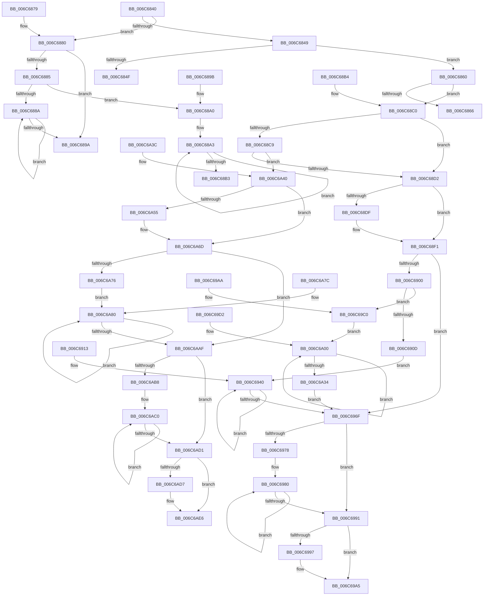

# memcpy

- RVA: `0x006C6840`–`0x006C6AEA` (길이 `682` bytes)
- VA: `0x00000001406C6840`
- 실행 섹션: `.text`
- PDB 이름 있음: `예`; PDB Function 태그: `아니요`
- unwind 정보 RVA: `0x000BFAC8`
- 디코드: `166`개 명령, `682/682` bytes 표시
- 미해석 바이트: `0` (있으면 어셈블리에 `.byte`로 보존)

> 이 문서는 커널 이미지의 기계어와 PDB 기호를 분석해 생성했습니다. 4번과 5번은 함수 원형과 자료형을 바이너리 사용 방식에서 추정한 C 해석이며 원본 소스 복구 결과는 아닙니다.

## 1. Dependencies

- 직접 호출 지점: **0**; 고유 호출 대상: **0**
- 직접 호출자로 확인된 함수: **1479**
- RIP 상대 이미지 참조: **0**

### Outgoing calls
- 직접 디코드된 call 명령이 없습니다.

### Direct callers
- [PpmIdleSnapConcurrency](../20/PpmIdleSnapConcurrency_function_00204694.md) at `0x00204704`
- [ST_STORE&lt;SM_TRAITS&gt;::StDmpSinglePageAdd](../20/ST_STORE_SM_TRAITS_StDmpSinglePageAdd_function_0020502C.md) at `0x00205127`
- [ST_STORE&lt;SM_TRAITS&gt;::StDmpSinglePageAdd](../20/ST_STORE_SM_TRAITS_StDmpSinglePageAdd_function_0020502C.md) at `0x00205242`
- [IopBuildDeviceIoControlRequest](../20/IopBuildDeviceIoControlRequest_function_00205B00.md) at `0x00205BBD`
- [IopBuildDeviceIoControlRequest](../20/IopBuildDeviceIoControlRequest_function_00205B00.md) at `0x00205CF4`
- [SepRmDispatchDataToLsa](../22/SepRmDispatchDataToLsa_function_0022395C.md) at `0x00223AB9`
- [SepRmDispatchDataToLsa](../22/SepRmDispatchDataToLsa_function_0022395C.md) at `0x00223B2F`
- [SepRmDispatchDataToLsa](../22/SepRmDispatchDataToLsa_function_0022395C.md) at `0x00223B54`
- [SeReportSecurityEventWithSubCategory](../22/SeReportSecurityEventWithSubCategory_function_002248B0.md) at `0x00224A4F`
- [SepAdtMarshallAuditRecord](../22/SepAdtMarshallAuditRecord_function_00224DD8.md) at `0x00224E9E`
- [SepAdtMarshallAuditRecord](../22/SepAdtMarshallAuditRecord_function_00224DD8.md) at `0x00224F23`
- [SepAdtMarshallAuditRecord](../22/SepAdtMarshallAuditRecord_function_00224DD8.md) at `0x00224FCF`
- [EtwpEventWriteFull](../22/EtwpEventWriteFull_function_00225C10.md) at `0x00226C2F`
- [EtwpEventWriteFull](../22/EtwpEventWriteFull_function_00225C10.md) at `0x00226D13`
- [EtwpEventWriteFull](../22/EtwpEventWriteFull_function_00225C10.md) at `0x00226F0D`
- [EtwpEventWriteFull](../22/EtwpEventWriteFull_function_00225C10.md) at `0x00227061`
- [EtwpEventWriteFull](../22/EtwpEventWriteFull_function_00225C10.md) at `0x002273C3`
- [EtwpEventWriteFull](../22/EtwpEventWriteFull_function_00225C10.md) at `0x002274F8`
- [MiCopySinglePage](../22/MiCopySinglePage_function_00228FA4.md) at `0x00229078`
- [MiCloneVads](../22/MiCloneVads_function_0022DC1C.md) at `0x0022E299`
- [PoStoreDiagnosticContext](../23/PoStoreDiagnosticContext_function_0023009C.md) at `0x00230141`
- [PoStoreRequester](../23/PoStoreRequester_function_002304D4.md) at `0x0023059E`
- [PopUmpoSendPowerMessage](../23/PopUmpoSendPowerMessage_function_00230730.md) at `0x002307D4`
- [sub_00235A0C](../23/Unknown_function_00235A0C.md) at `0x00235AD3`
- [sub_00235A0C](../23/Unknown_function_00235A0C.md) at `0x00235B03`
- [sub_0023F815](../23/Unknown_function_0023F815.md) at `0x0023F83A`
- [sub_00252A85](../25/Unknown_function_00252A85.md) at `0x00252B65`
- [sub_00252A85](../25/Unknown_function_00252A85.md) at `0x00252C5F`
- [KiHeteroSelectProcessorToPreempt](../25/KiHeteroSelectProcessorToPreempt_function_002560D0.md) at `0x00256204`
- [EtwpLogKernelEvent](../25/EtwpLogKernelEvent_function_0025CC00.md) at `0x0025D181`
- [sub_002665E6](../26/Unknown_function_002665E6.md) at `0x0026662E`
- [sub_002667A7](../26/Unknown_function_002667A7.md) at `0x002667C3`
- [B_TREE&lt;_SM_PAGE_KEY,SMKM_STORE_MGR&lt;SM_TRAITS&gt;::SMKM_FRONTEND_ENTRY,4096,B_TREE_DUMMY_NODE_POOL,B_TREE_KEY_COMPARATOR&lt;_SM_PAGE_KEY&gt; &gt;::BTreeDeleteEx](../26/B_TREE__SM_PAGE_KEY_SMKM_STORE_MGR_SM_TRAITS_SMKM_FRONTEND_ENTRY_4096_B_TREE_DUMMY_NODE_POOL_B_TREE__function_00266C00.md) at `0x00266C64`
- [sub_00266DCF](../26/Unknown_function_00266DCF.md) at `0x00266DE8`
- [B_TREE&lt;_SM_PAGE_KEY,SMKM_STORE_MGR&lt;SM_TRAITS&gt;::SMKM_FRONTEND_ENTRY,4096,B_TREE_DUMMY_NODE_POOL,B_TREE_KEY_COMPARATOR&lt;_SM_PAGE_KEY&gt; &gt;::BTreeRedistribute](../26/B_TREE__SM_PAGE_KEY_SMKM_STORE_MGR_SM_TRAITS_SMKM_FRONTEND_ENTRY_4096_B_TREE_DUMMY_NODE_POOL_B_TREE__function_00267188.md) at `0x002672C4`
- [B_TREE&lt;_SM_PAGE_KEY,SMKM_STORE_MGR&lt;SM_TRAITS&gt;::SMKM_FRONTEND_ENTRY,4096,B_TREE_DUMMY_NODE_POOL,B_TREE_KEY_COMPARATOR&lt;_SM_PAGE_KEY&gt; &gt;::BTreeRedistribute](../26/B_TREE__SM_PAGE_KEY_SMKM_STORE_MGR_SM_TRAITS_SMKM_FRONTEND_ENTRY_4096_B_TREE_DUMMY_NODE_POOL_B_TREE__function_00267188.md) at `0x002672F8`
- [B_TREE&lt;_SM_PAGE_KEY,SMKM_STORE_MGR&lt;SM_TRAITS&gt;::SMKM_FRONTEND_ENTRY,4096,B_TREE_DUMMY_NODE_POOL,B_TREE_KEY_COMPARATOR&lt;_SM_PAGE_KEY&gt; &gt;::BTreeRedistribute](../26/B_TREE__SM_PAGE_KEY_SMKM_STORE_MGR_SM_TRAITS_SMKM_FRONTEND_ENTRY_4096_B_TREE_DUMMY_NODE_POOL_B_TREE__function_00267188.md) at `0x0026731F`
- [B_TREE&lt;_SM_PAGE_KEY,SMKM_STORE_MGR&lt;SM_TRAITS&gt;::SMKM_FRONTEND_ENTRY,4096,B_TREE_DUMMY_NODE_POOL,B_TREE_KEY_COMPARATOR&lt;_SM_PAGE_KEY&gt; &gt;::BTreeMergeNodes](../26/B_TREE__SM_PAGE_KEY_SMKM_STORE_MGR_SM_TRAITS_SMKM_FRONTEND_ENTRY_4096_B_TREE_DUMMY_NODE_POOL_B_TREE__function_002674CC.md) at `0x00267553`
- [B_TREE&lt;_SM_PAGE_KEY,SMKM_STORE_MGR&lt;SM_TRAITS&gt;::SMKM_FRONTEND_ENTRY,4096,B_TREE_DUMMY_NODE_POOL,B_TREE_KEY_COMPARATOR&lt;_SM_PAGE_KEY&gt; &gt;::BTreeSplitChild](../26/B_TREE__SM_PAGE_KEY_SMKM_STORE_MGR_SM_TRAITS_SMKM_FRONTEND_ENTRY_4096_B_TREE_DUMMY_NODE_POOL_B_TREE__function_002675D4.md) at `0x0026768A`
- [B_TREE&lt;_SM_PAGE_KEY,SMKM_STORE_MGR&lt;SM_TRAITS&gt;::SMKM_FRONTEND_ENTRY,4096,B_TREE_DUMMY_NODE_POOL,B_TREE_KEY_COMPARATOR&lt;_SM_PAGE_KEY&gt; &gt;::BTreeSplitChild](../26/B_TREE__SM_PAGE_KEY_SMKM_STORE_MGR_SM_TRAITS_SMKM_FRONTEND_ENTRY_4096_B_TREE_DUMMY_NODE_POOL_B_TREE__function_002675D4.md) at `0x00267721`
- [SmPrepareForFatalHeapCorruption](../26/SmPrepareForFatalHeapCorruption_function_00267AC0.md) at `0x00267B5B`
- [SMKM_STORE_MGR&lt;SM_TRAITS&gt;::SmCompressCtxProcessEntry](../26/SMKM_STORE_MGR_SM_TRAITS_SmCompressCtxProcessEntry_function_002681DC.md) at `0x00268316`
- [sub_0026A4AD](../26/Unknown_function_0026A4AD.md) at `0x0026A634`
- [sub_0026A9FF](../26/Unknown_function_0026A9FF.md) at `0x0026ADC0`
- [SmStoreCopyHashCompressedBuffer](../26/SmStoreCopyHashCompressedBuffer_function_0026B918.md) at `0x0026B961`
- [CcExtendVacbArray](../26/CcExtendVacbArray_function_0026DCD0.md) at `0x0026DE02`
- [MiGetPage](../28/MiGetPage_function_002884C0.md) at `0x00288936`
- [NtSetInformationFile](../29/NtSetInformationFile_function_0029C5E0.md) at `0x0029CC26`
- [IopBuildAsynchronousFsdRequest](../29/IopBuildAsynchronousFsdRequest_function_0029DD40.md) at `0x0029DEF7`
- [NtGetWriteWatch](../2A/NtGetWriteWatch_function_002A7CE0.md) at `0x002A85A4`
- [MiCopyDataPageToImagePage](../2A/MiCopyDataPageToImagePage_function_002AE818.md) at `0x002AEDD4`
- [MiGetWorkingSetInfoList](../2A/MiGetWorkingSetInfoList_function_002AF770.md) at `0x002AF849`
- [MiGetWorkingSetInfoList](../2A/MiGetWorkingSetInfoList_function_002AF770.md) at `0x002AFFA5`
- [MiMakePageAvoidRead](../2B/MiMakePageAvoidRead_function_002B7DE0.md) at `0x002B80A5`
- [MiStartDpcGang](../2C/MiStartDpcGang_function_002C8C34.md) at `0x002C8D4A`
- [MiFindBestZeroingProcessor](../2C/MiFindBestZeroingProcessor_function_002CC73C.md) at `0x002CC944`
- [sub_002D6AB0](../2D/Unknown_function_002D6AB0.md) at `0x002D6B72`
- [sub_002D6AB0](../2D/Unknown_function_002D6AB0.md) at `0x002D6B9F`
- [sub_002D7BB3](../2D/Unknown_function_002D7BB3.md) at `0x002D7CD6`
- [PpmPerfSnapDeliveredPerformance](../2D/PpmPerfSnapDeliveredPerformance_function_002D7F30.md) at `0x002D81ED`
- [RtlSparseArrayElementAllocate](../2F/RtlSparseArrayElementAllocate_function_002F09C8.md) at `0x002F0A2D`
- [sub_002F1861](../2F/Unknown_function_002F1861.md) at `0x002F1A3C`
- [sub_002F1861](../2F/Unknown_function_002F1861.md) at `0x002F1A89`
- [EtwpTraceMessageVa](../2F/EtwpTraceMessageVa_function_002FB2B0.md) at `0x002FB900`
- [EtwpLogSystemEventUnsafe](../2F/EtwpLogSystemEventUnsafe_function_002FBF10.md) at `0x002FC20D`
- [EtwTraceEvent](../2F/EtwTraceEvent_function_002FD290.md) at `0x002FD4AB`
- [EtwTraceEvent](../2F/EtwTraceEvent_function_002FD290.md) at `0x002FD5CD`
- [EtwTraceEvent](../2F/EtwTraceEvent_function_002FD290.md) at `0x002FD621`
- [EtwTraceEvent](../2F/EtwTraceEvent_function_002FD290.md) at `0x002FD695`
- [AuthzBasepUnicodeStringFromOperandValue](../2F/AuthzBasepUnicodeStringFromOperandValue_function_002FE4E8.md) at `0x002FE5A2`
- [AuthzBasepEvaluateAceCondition](../2F/AuthzBasepEvaluateAceCondition_function_002FEBD0.md) at `0x002FEF3D`
- [AuthzBasepAddSecurityAttributeValues](../30/AuthzBasepAddSecurityAttributeValues_function_003020EC.md) at `0x003022B6`
- [AuthzBasepDuplicateSecurityAttributes](../30/AuthzBasepDuplicateSecurityAttributes_function_003023C0.md) at `0x0030247B`
- [AuthzBasepDuplicateSecurityAttributes](../30/AuthzBasepDuplicateSecurityAttributes_function_003023C0.md) at `0x00302809`
- [AuthzBasepDuplicateSecurityAttributes](../30/AuthzBasepDuplicateSecurityAttributes_function_003023C0.md) at `0x00302938`
- [AuthzBasepDuplicateSecurityAttributes](../30/AuthzBasepDuplicateSecurityAttributes_function_003023C0.md) at `0x00302A1A`
- [KeCpuSetReportParkedProcessors](../30/KeCpuSetReportParkedProcessors_function_003052B0.md) at `0x0030541E`
- [HvlGetSparseGpaPagesAccessState](../30/HvlGetSparseGpaPagesAccessState_function_00306A78.md) at `0x00306B8D`
- [HvlGetSparseGpaPagesAccessState](../30/HvlGetSparseGpaPagesAccessState_function_00306A78.md) at `0x00306BD6`
- [ST_STORE&lt;SM_TRAITS&gt;::StDmSinglePageCopy](../31/ST_STORE_SM_TRAITS_StDmSinglePageCopy_function_00317F44.md) at `0x00317FCB`
- [ST_STORE&lt;SM_TRAITS&gt;::StDmSinglePageCopy](../31/ST_STORE_SM_TRAITS_StDmSinglePageCopy_function_00317F44.md) at `0x00317FEE`
- [ST_STORE&lt;SM_TRAITS&gt;::StDmSinglePageCopy](../31/ST_STORE_SM_TRAITS_StDmSinglePageCopy_function_00317F44.md) at `0x00318151`
- [sub_0032010F](../32/Unknown_function_0032010F.md) at `0x003201BB`
- [MmCopyToCachedPage](../34/MmCopyToCachedPage_function_00347B44.md) at `0x00347D71`
- [PfLogEvent](../34/PfLogEvent_function_00349BA8.md) at `0x00349C6D`
- [NtSetInformationWorkerFactory](../35/NtSetInformationWorkerFactory_function_00350A30.md) at `0x00350BCA`
- [vDbgPrintExWithPrefixInternalHelper](../35/vDbgPrintExWithPrefixInternalHelper_function_003593C0.md) at `0x003594B0`
- [MiPfPutPagesInTransition](../36/MiPfPutPagesInTransition_function_003640EC.md) at `0x003648B2`
- [MiReplacePageOfProtoPool](../36/MiReplacePageOfProtoPool_function_00364BB8.md) at `0x00364EC8`
- [MiReplacePageOfProtoPool](../36/MiReplacePageOfProtoPool_function_00364BB8.md) at `0x003651CC`
- [MiPfIssueCoalescedSupport](../36/MiPfIssueCoalescedSupport_function_0036AE14.md) at `0x0036AFEC`
- [FsRtlRemoveBaseMcbEntry](../38/FsRtlRemoveBaseMcbEntry_function_00387070.md) at `0x003871A1`
- [sub_003875A6](../38/Unknown_function_003875A6.md) at `0x003876F7`
- [sub_00387740](../38/Unknown_function_00387740.md) at `0x0038796E`
- [FsRtlAddEntry](../38/FsRtlAddEntry_function_00387BE0.md) at `0x00387C36`
- [FsRtlAddEntry](../38/FsRtlAddEntry_function_00387BE0.md) at `0x00387CAA`
- [FsRtlRemoveLargeEntry](../38/FsRtlRemoveLargeEntry_function_00387EA0.md) at `0x00387ED7`
- [RtlInsertElementGenericTable](../38/RtlInsertElementGenericTable_function_0038EDE0.md) at `0x0038EF30`
- [RtlInsertElementGenericTableFull](../38/RtlInsertElementGenericTableFull_function_0038EF60.md) at `0x0038F05B`
- [KiComputeThreadAffinity](../39/KiComputeThreadAffinity_function_00399DE0.md) at `0x0039A0F4`
- [KiComputeThreadAffinity](../39/KiComputeThreadAffinity_function_00399DE0.md) at `0x0039A11C`
- [KiComputeCpuSetAffinity](../39/KiComputeCpuSetAffinity_function_0039A1C0.md) at `0x0039A55F`
- [KiComputeCpuSetAffinity](../39/KiComputeCpuSetAffinity_function_0039A1C0.md) at `0x0039A734`
- [KiComputeCpuSetAffinity](../39/KiComputeCpuSetAffinity_function_0039A1C0.md) at `0x0039A7C0`
- [SmDecompressBuffer](../3A/SmDecompressBuffer_function_003A4978.md) at `0x003A4B12`
- [RtlDecompressBufferLz4](../3A/RtlDecompressBufferLz4_function_003A4D20.md) at `0x003A5174`
- [AuthzBasepCopyoutSecurityAttributes](../3A/AuthzBasepCopyoutSecurityAttributes_function_003A8100.md) at `0x003A8224`
- [AuthzBasepCopyoutSecurityAttributes](../3A/AuthzBasepCopyoutSecurityAttributes_function_003A8100.md) at `0x003A8327`
- [sub_003A8680](../3A/Unknown_function_003A8680.md) at `0x003A86E4`
- [sub_003A8680](../3A/Unknown_function_003A8680.md) at `0x003A8777`
- [sub_003A8680](../3A/Unknown_function_003A8680.md) at `0x003A87F0`
- [sub_003A93DA](../3A/Unknown_function_003A93DA.md) at `0x003A941A`
- [B_TREE&lt;unsigned long,ST_STORE&lt;SM_TRAITS&gt;::_ST_HASH_ENTRY,4096,NP_CONTEXT,ST_STORE&lt;SM_TRAITS&gt;::ST_HASH_ENTRY_COMPARATOR&gt;::BTreeMergeNodes](../3A/B_TREE_unsigned_long_ST_STORE_SM_TRAITS__ST_HASH_ENTRY_4096_NP_CONTEXT_ST_STORE_SM_TRAITS_ST_HASH_EN_function_003AA404.md) at `0x003AA4B5`
- [B_TREE&lt;unsigned long,ST_STORE&lt;SM_TRAITS&gt;::_ST_REGION_ENTRY,4096,NP_CONTEXT,ST_STORE&lt;SM_TRAITS&gt;::ST_REGION_ENTRY_COMPARATOR&gt;::BTreeSplitChild](../3A/B_TREE_unsigned_long_ST_STORE_SM_TRAITS__ST_REGION_ENTRY_4096_NP_CONTEXT_ST_STORE_SM_TRAITS_ST_REGIO_function_003AAAA4.md) at `0x003AAB72`
- [B_TREE&lt;unsigned long,ST_STORE&lt;SM_TRAITS&gt;::_ST_REGION_ENTRY,4096,NP_CONTEXT,ST_STORE&lt;SM_TRAITS&gt;::ST_REGION_ENTRY_COMPARATOR&gt;::BTreeSplitChild](../3A/B_TREE_unsigned_long_ST_STORE_SM_TRAITS__ST_REGION_ENTRY_4096_NP_CONTEXT_ST_STORE_SM_TRAITS_ST_REGIO_function_003AAAA4.md) at `0x003AAC8B`
- [B_TREE&lt;unsigned long,ST_STORE&lt;SM_TRAITS&gt;::_ST_REGION_ENTRY,4096,NP_CONTEXT,ST_STORE&lt;SM_TRAITS&gt;::ST_REGION_ENTRY_COMPARATOR&gt;::BTreeSplitChild](../3A/B_TREE_unsigned_long_ST_STORE_SM_TRAITS__ST_REGION_ENTRY_4096_NP_CONTEXT_ST_STORE_SM_TRAITS_ST_REGIO_function_003AAAA4.md) at `0x003AACF5`
- [B_TREE&lt;_SM_PAGE_KEY,ST_STORE&lt;SM_TRAITS&gt;::_ST_PAGE_ENTRY,4096,NP_CONTEXT,B_TREE_KEY_COMPARATOR&lt;_SM_PAGE_KEY&gt; &gt;::BTreeMergeNodes](../3A/B_TREE__SM_PAGE_KEY_ST_STORE_SM_TRAITS__ST_PAGE_ENTRY_4096_NP_CONTEXT_B_TREE_KEY_COMPARATOR__SM_PAGE_function_003AADC4.md) at `0x003AAE75`
- [B_TREE&lt;_SM_PAGE_KEY,ST_STORE&lt;SM_TRAITS&gt;::_ST_PAGE_ENTRY,4096,NP_CONTEXT,B_TREE_KEY_COMPARATOR&lt;_SM_PAGE_KEY&gt; &gt;::BTreeSplitChild](../3A/B_TREE__SM_PAGE_KEY_ST_STORE_SM_TRAITS__ST_PAGE_ENTRY_4096_NP_CONTEXT_B_TREE_KEY_COMPARATOR__SM_PAGE_function_003AAF50.md) at `0x003AB024`
- [B_TREE&lt;_SM_PAGE_KEY,ST_STORE&lt;SM_TRAITS&gt;::_ST_PAGE_ENTRY,4096,NP_CONTEXT,B_TREE_KEY_COMPARATOR&lt;_SM_PAGE_KEY&gt; &gt;::BTreeSplitChild](../3A/B_TREE__SM_PAGE_KEY_ST_STORE_SM_TRAITS__ST_PAGE_ENTRY_4096_NP_CONTEXT_B_TREE_KEY_COMPARATOR__SM_PAGE_function_003AAF50.md) at `0x003AB137`
- [B_TREE&lt;_SM_PAGE_KEY,ST_STORE&lt;SM_TRAITS&gt;::_ST_PAGE_ENTRY,4096,NP_CONTEXT,B_TREE_KEY_COMPARATOR&lt;_SM_PAGE_KEY&gt; &gt;::BTreeSplitChild](../3A/B_TREE__SM_PAGE_KEY_ST_STORE_SM_TRAITS__ST_PAGE_ENTRY_4096_NP_CONTEXT_B_TREE_KEY_COMPARATOR__SM_PAGE_function_003AAF50.md) at `0x003AB1A1`
- [B_TREE&lt;_SM_PAGE_KEY,ST_STORE&lt;SM_TRAITS&gt;::_ST_PAGE_ENTRY,4096,NP_CONTEXT,B_TREE_KEY_COMPARATOR&lt;_SM_PAGE_KEY&gt; &gt;::BTreeDeleteEx](../3A/B_TREE__SM_PAGE_KEY_ST_STORE_SM_TRAITS__ST_PAGE_ENTRY_4096_NP_CONTEXT_B_TREE_KEY_COMPARATOR__SM_PAGE_function_003AB210.md) at `0x003AB26D`
- [sub_003AB41E](../3A/Unknown_function_003AB41E.md) at `0x003AB43A`
- [B_TREE&lt;_SM_PAGE_KEY,ST_STORE&lt;SM_TRAITS&gt;::_ST_PAGE_ENTRY,4096,NP_CONTEXT,B_TREE_KEY_COMPARATOR&lt;_SM_PAGE_KEY&gt; &gt;::BTreeRedistribute](../3A/B_TREE__SM_PAGE_KEY_ST_STORE_SM_TRAITS__ST_PAGE_ENTRY_4096_NP_CONTEXT_B_TREE_KEY_COMPARATOR__SM_PAGE_function_003AB4B8.md) at `0x003AB612`
- [B_TREE&lt;_SM_PAGE_KEY,ST_STORE&lt;SM_TRAITS&gt;::_ST_PAGE_ENTRY,4096,NP_CONTEXT,B_TREE_KEY_COMPARATOR&lt;_SM_PAGE_KEY&gt; &gt;::BTreeRedistribute](../3A/B_TREE__SM_PAGE_KEY_ST_STORE_SM_TRAITS__ST_PAGE_ENTRY_4096_NP_CONTEXT_B_TREE_KEY_COMPARATOR__SM_PAGE_function_003AB4B8.md) at `0x003AB640`
- [B_TREE&lt;_SM_PAGE_KEY,ST_STORE&lt;SM_TRAITS&gt;::_ST_PAGE_ENTRY,4096,NP_CONTEXT,B_TREE_KEY_COMPARATOR&lt;_SM_PAGE_KEY&gt; &gt;::BTreeRedistribute](../3A/B_TREE__SM_PAGE_KEY_ST_STORE_SM_TRAITS__ST_PAGE_ENTRY_4096_NP_CONTEXT_B_TREE_KEY_COMPARATOR__SM_PAGE_function_003AB4B8.md) at `0x003AB666`
- [sub_003AB867](../3A/Unknown_function_003AB867.md) at `0x003AB8AF`
- [sub_003ABA1D](../3A/Unknown_function_003ABA1D.md) at `0x003ABAA8`
- [sub_003ABBB5](../3A/Unknown_function_003ABBB5.md) at `0x003ABC5A`
- [sub_003ABC8C](../3A/Unknown_function_003ABC8C.md) at `0x003ABD12`
- [SmArrayGrow](../3A/SmArrayGrow_function_003AC6C8.md) at `0x003AC777`
- [B_TREE&lt;unsigned long,ST_STORE&lt;SM_TRAITS&gt;::_ST_REGION_ENTRY,4096,NP_CONTEXT,ST_STORE&lt;SM_TRAITS&gt;::ST_REGION_ENTRY_COMPARATOR&gt;::BTreeSearchKey](../3A/B_TREE_unsigned_long_ST_STORE_SM_TRAITS__ST_REGION_ENTRY_4096_NP_CONTEXT_ST_STORE_SM_TRAITS_ST_REGIO_function_003ACD20.md) at `0x003AD0A3`
- [B_TREE&lt;unsigned long,ST_STORE&lt;SM_TRAITS&gt;::_ST_REGION_ENTRY,4096,NP_CONTEXT,ST_STORE&lt;SM_TRAITS&gt;::ST_REGION_ENTRY_COMPARATOR&gt;::BTreeDeleteEx](../3A/B_TREE_unsigned_long_ST_STORE_SM_TRAITS__ST_REGION_ENTRY_4096_NP_CONTEXT_ST_STORE_SM_TRAITS_ST_REGIO_function_003ADAF0.md) at `0x003ADB55`
- [sub_003ADD08](../3A/Unknown_function_003ADD08.md) at `0x003ADD24`
- [B_TREE&lt;unsigned long,ST_STORE&lt;SM_TRAITS&gt;::_ST_HASH_ENTRY,4096,NP_CONTEXT,ST_STORE&lt;SM_TRAITS&gt;::ST_HASH_ENTRY_COMPARATOR&gt;::BTreeSearchKey](../3A/B_TREE_unsigned_long_ST_STORE_SM_TRAITS__ST_HASH_ENTRY_4096_NP_CONTEXT_ST_STORE_SM_TRAITS_ST_HASH_EN_function_003ADDB0.md) at `0x003AE164`
- [B_TREE&lt;unsigned long,ST_STORE&lt;SM_TRAITS&gt;::_ST_HASH_ENTRY,4096,NP_CONTEXT,ST_STORE&lt;SM_TRAITS&gt;::ST_HASH_ENTRY_COMPARATOR&gt;::BTreeDeleteEx](../3A/B_TREE_unsigned_long_ST_STORE_SM_TRAITS__ST_HASH_ENTRY_4096_NP_CONTEXT_ST_STORE_SM_TRAITS_ST_HASH_EN_function_003AE410.md) at `0x003AE475`
- [sub_003AE62C](../3A/Unknown_function_003AE62C.md) at `0x003AE648`
- [sub_003AE727](../3A/Unknown_function_003AE727.md) at `0x003AE773`
- [sub_003AE7FC](../3A/Unknown_function_003AE7FC.md) at `0x003AE981`
- [B_TREE&lt;unsigned long,ST_STORE&lt;SM_TRAITS&gt;::_ST_REGION_ENTRY,4096,NP_CONTEXT,ST_STORE&lt;SM_TRAITS&gt;::ST_REGION_ENTRY_COMPARATOR&gt;::BTreeRedistribute](../3A/B_TREE_unsigned_long_ST_STORE_SM_TRAITS__ST_REGION_ENTRY_4096_NP_CONTEXT_ST_STORE_SM_TRAITS_ST_REGIO_function_003AEA1C.md) at `0x003AEB79`
- [B_TREE&lt;unsigned long,ST_STORE&lt;SM_TRAITS&gt;::_ST_REGION_ENTRY,4096,NP_CONTEXT,ST_STORE&lt;SM_TRAITS&gt;::ST_REGION_ENTRY_COMPARATOR&gt;::BTreeRedistribute](../3A/B_TREE_unsigned_long_ST_STORE_SM_TRAITS__ST_REGION_ENTRY_4096_NP_CONTEXT_ST_STORE_SM_TRAITS_ST_REGIO_function_003AEA1C.md) at `0x003AEBA7`
- [B_TREE&lt;unsigned long,ST_STORE&lt;SM_TRAITS&gt;::_ST_REGION_ENTRY,4096,NP_CONTEXT,ST_STORE&lt;SM_TRAITS&gt;::ST_REGION_ENTRY_COMPARATOR&gt;::BTreeRedistribute](../3A/B_TREE_unsigned_long_ST_STORE_SM_TRAITS__ST_REGION_ENTRY_4096_NP_CONTEXT_ST_STORE_SM_TRAITS_ST_REGIO_function_003AEA1C.md) at `0x003AEBCD`
- [B_TREE&lt;unsigned long,ST_STORE&lt;SM_TRAITS&gt;::_ST_HASH_ENTRY,4096,NP_CONTEXT,ST_STORE&lt;SM_TRAITS&gt;::ST_HASH_ENTRY_COMPARATOR&gt;::BTreeRedistribute](../3A/B_TREE_unsigned_long_ST_STORE_SM_TRAITS__ST_HASH_ENTRY_4096_NP_CONTEXT_ST_STORE_SM_TRAITS_ST_HASH_EN_function_003AECFC.md) at `0x003AEE59`
- [B_TREE&lt;unsigned long,ST_STORE&lt;SM_TRAITS&gt;::_ST_HASH_ENTRY,4096,NP_CONTEXT,ST_STORE&lt;SM_TRAITS&gt;::ST_HASH_ENTRY_COMPARATOR&gt;::BTreeRedistribute](../3A/B_TREE_unsigned_long_ST_STORE_SM_TRAITS__ST_HASH_ENTRY_4096_NP_CONTEXT_ST_STORE_SM_TRAITS_ST_HASH_EN_function_003AECFC.md) at `0x003AEE87`
- [B_TREE&lt;unsigned long,ST_STORE&lt;SM_TRAITS&gt;::_ST_HASH_ENTRY,4096,NP_CONTEXT,ST_STORE&lt;SM_TRAITS&gt;::ST_HASH_ENTRY_COMPARATOR&gt;::BTreeRedistribute](../3A/B_TREE_unsigned_long_ST_STORE_SM_TRAITS__ST_HASH_ENTRY_4096_NP_CONTEXT_ST_STORE_SM_TRAITS_ST_HASH_EN_function_003AECFC.md) at `0x003AEEAD`
- [B_TREE&lt;unsigned long,ST_STORE&lt;SM_TRAITS&gt;::_ST_REGION_ENTRY,4096,NP_CONTEXT,ST_STORE&lt;SM_TRAITS&gt;::ST_REGION_ENTRY_COMPARATOR&gt;::BTreeMergeNodes](../3A/B_TREE_unsigned_long_ST_STORE_SM_TRAITS__ST_REGION_ENTRY_4096_NP_CONTEXT_ST_STORE_SM_TRAITS_ST_REGIO_function_003AF47C.md) at `0x003AF52D`
- [B_TREE&lt;unsigned long,ST_STORE&lt;SM_TRAITS&gt;::_ST_HASH_ENTRY,4096,NP_CONTEXT,ST_STORE&lt;SM_TRAITS&gt;::ST_HASH_ENTRY_COMPARATOR&gt;::BTreeSplitChild](../3A/B_TREE_unsigned_long_ST_STORE_SM_TRAITS__ST_HASH_ENTRY_4096_NP_CONTEXT_ST_STORE_SM_TRAITS_ST_HASH_EN_function_003AF610.md) at `0x003AF6DE`
- [B_TREE&lt;unsigned long,ST_STORE&lt;SM_TRAITS&gt;::_ST_HASH_ENTRY,4096,NP_CONTEXT,ST_STORE&lt;SM_TRAITS&gt;::ST_HASH_ENTRY_COMPARATOR&gt;::BTreeSplitChild](../3A/B_TREE_unsigned_long_ST_STORE_SM_TRAITS__ST_HASH_ENTRY_4096_NP_CONTEXT_ST_STORE_SM_TRAITS_ST_HASH_EN_function_003AF610.md) at `0x003AF839`
- [B_TREE&lt;unsigned long,ST_STORE&lt;SM_TRAITS&gt;::_ST_HASH_ENTRY,4096,NP_CONTEXT,ST_STORE&lt;SM_TRAITS&gt;::ST_HASH_ENTRY_COMPARATOR&gt;::BTreeSplitChild](../3A/B_TREE_unsigned_long_ST_STORE_SM_TRAITS__ST_HASH_ENTRY_4096_NP_CONTEXT_ST_STORE_SM_TRAITS_ST_HASH_EN_function_003AF610.md) at `0x003AF888`
- [EtwpTiAllocVadQueryEventWriteWorkItemContext](../3B/EtwpTiAllocVadQueryEventWriteWorkItemContext_function_003B958C.md) at `0x003B9685`
- [EtwpTiAllocVadQueryEventWriteWorkItemContext](../3B/EtwpTiAllocVadQueryEventWriteWorkItemContext_function_003B958C.md) at `0x003B96D3`
- [PfpLogApplicationEvent](../3B/PfpLogApplicationEvent_function_003BA3A0.md) at `0x003BA4EC`
- [PpmHeteroUpdateHgsConfiguration](../3B/PpmHeteroUpdateHgsConfiguration_function_003BF344.md) at `0x003BF4EC`
- [PpmHeteroUpdateHgsConfiguration](../3B/PpmHeteroUpdateHgsConfiguration_function_003BF344.md) at `0x003BFAA6`
- [KiHeteroScanQueueForPreemptionSwapTarget](../3C/KiHeteroScanQueueForPreemptionSwapTarget_function_003C133C.md) at `0x003C13AF`
- [KiHeteroScanQueueForPreemptionSwapTarget](../3C/KiHeteroScanQueueForPreemptionSwapTarget_function_003C133C.md) at `0x003C13C6`
- [CcCopyToCacheHelper](../3C/CcCopyToCacheHelper_function_003CC290.md) at `0x003CC2CD`
- [CcCopyToCacheHelper](../3C/CcCopyToCacheHelper_function_003CC290.md) at `0x003CC324`
- [CcCopyBytesToUserBuffer](../3C/CcCopyBytesToUserBuffer_function_003CC3D0.md) at `0x003CC458`
- [HviCopyMemory](../3C/HviCopyMemory_function_003CC53C.md) at `0x003CC585`
- [MiCopyToUserVa](../3D/MiCopyToUserVa_function_003D1E68.md) at `0x003D1FAA`
- [ExpExpandResourceOwnerTable](../3D/ExpExpandResourceOwnerTable_function_003D489C.md) at `0x003D4926`
- [RtlCopyXStateArea](../3D/RtlCopyXStateArea_function_003D5850.md) at `0x003D5A86`
- [RtlCopyXStateArea](../3D/RtlCopyXStateArea_function_003D5850.md) at `0x003D5AF5`
- [KiRaiseException](../3D/KiRaiseException_function_003D5CA0.md) at `0x003D5D53`
- [sub_003DF220](../3D/Unknown_function_003DF220.md) at `0x003DF226`
- [RtlCopyBitMap](../3E/RtlCopyBitMap_function_003E2210.md) at `0x003E22AC`
- [RtlpCopyBitMapTailToHead](../3E/RtlpCopyBitMapTailToHead_function_003E2420.md) at `0x003E2563`
- [MiReAllocateWorkingSetSwapSupport](../3E/MiReAllocateWorkingSetSwapSupport_function_003E2A58.md) at `0x003E2A94`
- [FioFwReadBytesAtOffset](../3E/FioFwReadBytesAtOffset_function_003E5948.md) at `0x003E5960`
- [PspIumFreePartitionPages](../3E/PspIumFreePartitionPages_function_003E79D8.md) at `0x003E7A6F`
- [EtwpAddLastDroppedEvent](../3E/EtwpAddLastDroppedEvent_function_003EB8A4.md) at `0x003EB930`
- [IopProcessBufferedIoCompletion](../3E/IopProcessBufferedIoCompletion_function_003ED220.md) at `0x003ED288`
- [RtlInsertElementGenericTableAvl](../3E/RtlInsertElementGenericTableAvl_function_003EE510.md) at `0x003EE5DA`
- [RtlInsertElementGenericTableFullAvl](../3E/RtlInsertElementGenericTableFullAvl_function_003EED00.md) at `0x003EEDDC`
- [EtwpTraceLostEvent](../3F/EtwpTraceLostEvent_function_003F0D58.md) at `0x003F0EBF`
- [EtwpApplyEventNameFilter](../3F/EtwpApplyEventNameFilter_function_003F10B8.md) at `0x003F11F2`
- [EtwpApplyPayloadFilterInternal](../3F/EtwpApplyPayloadFilterInternal_function_003F43D0.md) at `0x003F45B7`
- [RtlpCopyXStateChunk](../3F/RtlpCopyXStateChunk_function_003F51D4.md) at `0x003F544B`
- [FsRtlTruncateBaseMcb](../3F/FsRtlTruncateBaseMcb_function_003FB460.md) at `0x003FB522`
- [EtwpTraceStackKey](../3F/EtwpTraceStackKey_function_003FC290.md) at `0x003FC59A`
- [AuthzBasepCopyoutInternalSecurityAttributeValues](../3F/AuthzBasepCopyoutInternalSecurityAttributeValues_function_003FEC10.md) at `0x003FEDC0`
- [sub_003FEF4E](../3F/Unknown_function_003FEF4E.md) at `0x003FEF6E`
- [IopAllocateAndPopulateWriteIrp](../40/IopAllocateAndPopulateWriteIrp_function_004011F4.md) at `0x0040137E`
- [MiExpandFlushMdl](../40/MiExpandFlushMdl_function_00404A30.md) at `0x00404A91`
- [MiBuildReservationCluster](../40/MiBuildReservationCluster_function_004071A0.md) at `0x0040755D`
- [MiBuildReservationCluster](../40/MiBuildReservationCluster_function_004071A0.md) at `0x004075FF`
- [MiOrderTrimList](../40/MiOrderTrimList_function_00409F24.md) at `0x0040A0FE`
- [MiComputeAgeDistribution](../40/MiComputeAgeDistribution_function_0040A360.md) at `0x0040A43D`
- [sub_0040C2C0](../40/Unknown_function_0040C2C0.md) at `0x0040C434`
- [sub_0040C2C0](../40/Unknown_function_0040C2C0.md) at `0x0040C47E`
- [sub_0040C65D](../40/Unknown_function_0040C65D.md) at `0x0040C7A6`
- [sub_0040C65D](../40/Unknown_function_0040C65D.md) at `0x0040C7ED`
- [AdtpBuildAccessReasonAuditString](../40/AdtpBuildAccessReasonAuditString_function_0040EE04.md) at `0x0040F25E`
- [sub_0040F9DA](../40/Unknown_function_0040F9DA.md) at `0x0040F9F0`
- [sub_0040FA86](../40/Unknown_function_0040FA86.md) at `0x0040FA99`
- [sub_0041401D](../41/Unknown_function_0041401D.md) at `0x00414055`
- [PpmParkSnapNodeStatistics](../41/PpmParkSnapNodeStatistics_function_0041419C.md) at `0x0041424B`
- [EtwpCCSwapTrace](../41/EtwpCCSwapTrace_function_00417BBC.md) at `0x00417D99`
- [sub_0041DF44](../41/Unknown_function_0041DF44.md) at `0x0041DF78`
- [RtlpCopyBitMapTailToHeadEx](../41/RtlpCopyBitMapTailToHeadEx_function_0041DFE4.md) at `0x0041E063`
- [CcPostVolumeTelemetry](../42/CcPostVolumeTelemetry_function_00420FF8.md) at `0x00421171`
- [VslQueryPrivilegedAccessedState](../42/VslQueryPrivilegedAccessedState_function_004292CC.md) at `0x0042935B`
- [HvlMapSparseGpaPages](../42/HvlMapSparseGpaPages_function_0042A160.md) at `0x0042A223`
- [HvlGetGpaPagesAccessState](../42/HvlGetGpaPagesAccessState_function_0042A3D4.md) at `0x0042A569`
- [KiSelectProcessorToPreempt](../42/KiSelectProcessorToPreempt_function_0042F9E0.md) at `0x0042FA5B`
- [PopWriteBsdPoInfo](../43/PopWriteBsdPoInfo_function_00430768.md) at `0x004307FA`
- [PopWriteBsdPoInfo](../43/PopWriteBsdPoInfo_function_00430768.md) at `0x0043083C`
- [RtlpInsertInvertedFunctionTableEntry](../43/RtlpInsertInvertedFunctionTableEntry_function_004321B0.md) at `0x0043228C`
- [HvpCopyDataToOffsetArray](../43/HvpCopyDataToOffsetArray_function_00433BA8.md) at `0x00433C23`
- [KeCapturePersistentThreadState](../43/KeCapturePersistentThreadState_function_00435D90.md) at `0x004360AA`
- [KeCapturePersistentThreadState](../43/KeCapturePersistentThreadState_function_00435D90.md) at `0x004360D4`
- [KeCapturePersistentThreadState](../43/KeCapturePersistentThreadState_function_00435D90.md) at `0x004360FA`
- [RtlAddAtomToAtomTableEx](../43/RtlAddAtomToAtomTableEx_function_00438550.md) at `0x00438699`
- [VslAccessPciDevice](../43/VslAccessPciDevice_function_004393E0.md) at `0x00439482`
- [VslAccessPciDevice](../43/VslAccessPciDevice_function_004393E0.md) at `0x004394B0`
- [KeCopyExceptionRecord](../43/KeCopyExceptionRecord_function_00439750.md) at `0x004397AC`
- [EtwpCovSampCaptureBufferQueue](../43/EtwpCovSampCaptureBufferQueue_function_0043C234.md) at `0x0043C2FE`
- [sub_0043E326](../43/Unknown_function_0043E326.md) at `0x0043E355`
- [IoGetGenericIrpExtension](../43/IoGetGenericIrpExtension_function_0043E970.md) at `0x0043E9B8`
- [MiComputeIdealDpcGang](../43/MiComputeIdealDpcGang_function_0043EAAC.md) at `0x0043EBA5`
- [MiComputeIdealDpcGang](../43/MiComputeIdealDpcGang_function_0043EAAC.md) at `0x0043EC3A`
- [ExpGetPoolTagInfoTarget](../44/ExpGetPoolTagInfoTarget_function_004407D0.md) at `0x00440910`
- [ExpGetPoolTagInfoTarget](../44/ExpGetPoolTagInfoTarget_function_004407D0.md) at `0x00440963`
- [SeAccessCheckByType](../44/SeAccessCheckByType_function_00440BC8.md) at `0x004415B1`
- [ExGetBigPoolInfo](../44/ExGetBigPoolInfo_function_00446970.md) at `0x00446A09`
- [HalpEnumerateEnvironmentVariablesWithFilter](../44/HalpEnumerateEnvironmentVariablesWithFilter_function_004492D0.md) at `0x00449500`
- [HalpEnumerateEnvironmentVariablesWithFilter](../44/HalpEnumerateEnvironmentVariablesWithFilter_function_004492D0.md) at `0x0044969F`
- [RtlpCopyRetpolineRelocationBlockEntryArray](../44/RtlpCopyRetpolineRelocationBlockEntryArray_function_0044AB44.md) at `0x0044ABA9`
- [RtlCreateRetpolineRelocationInformation](../44/RtlCreateRetpolineRelocationInformation_function_0044AC14.md) at `0x0044AD52`
- [MiGatherSlabDemoteCandidates](../44/MiGatherSlabDemoteCandidates_function_0044D3C0.md) at `0x0044D50D`
- [PpmResetPerfTimes](../44/PpmResetPerfTimes_function_0044F8EC.md) at `0x0044F989`
- [RtlInsertDynamicUserFunctionTable](../45/RtlInsertDynamicUserFunctionTable_function_004513C4.md) at `0x004515B8`
- [RtlInsertDynamicUserFunctionTable](../45/RtlInsertDynamicUserFunctionTable_function_004513C4.md) at `0x0045165D`
- [MiFindBestLargePageStealCandidates](../45/MiFindBestLargePageStealCandidates_function_00453EEC.md) at `0x0045440A`
- [LdrUnloadAlternateResourceModuleEx](../45/LdrUnloadAlternateResourceModuleEx_function_00454AE4.md) at `0x00454BB1`
- [LdrUnloadAlternateResourceModuleEx](../45/LdrUnloadAlternateResourceModuleEx_function_00454AE4.md) at `0x00454C28`
- [LdrpSetAlternateResourceModuleHandle](../45/LdrpSetAlternateResourceModuleHandle_function_00455EBC.md) at `0x0045617C`
- [CmpDoQueryKeyName](../45/CmpDoQueryKeyName_function_00456664.md) at `0x004568DA`
- [ST_STORE&lt;SM_TRAITS&gt;::StCompactionPickPriority](../45/ST_STORE_SM_TRAITS_StCompactionPickPriority_function_004591A0.md) at `0x0045927C`
- [PfTFiNotifyVolumeCreateCallback](../45/PfTFiNotifyVolumeCreateCallback_function_0045ED30.md) at `0x0045EE56`
- [PfTFiNotifyFileStreamCreateCallback](../45/PfTFiNotifyFileStreamCreateCallback_function_0045EEB0.md) at `0x0045EFC8`
- [EtwpCovSampCaptureBufferOptimizeIP](../46/EtwpCovSampCaptureBufferOptimizeIP_function_00460210.md) at `0x0046024A`
- [HalpGetPCIData](../46/HalpGetPCIData_function_00461858.md) at `0x004618F5`
- [HvlMapGpaPages](../46/HvlMapGpaPages_function_00462934.md) at `0x00462ADA`
- [RtlRemoveDynamicUserFunctionTable](../46/RtlRemoveDynamicUserFunctionTable_function_00466514.md) at `0x00466687`
- [RtlIpv6AddressToStringExA](../46/RtlIpv6AddressToStringExA_function_00466800.md) at `0x004668C2`
- [RtlIpv4AddressToStringExW](../46/RtlIpv4AddressToStringExW_function_00467760.md) at `0x004677F7`
- [BgpGxConvertRectangleEx](../46/BgpGxConvertRectangleEx_function_004696D4.md) at `0x004697E1`
- [CmQueryLayeredKey](../46/CmQueryLayeredKey_function_0046A930.md) at `0x0046AA7C`
- [IoSetGenericIrpExtension](../47/IoSetGenericIrpExtension_function_004715E0.md) at `0x0047162A`
- [CreateNewEventEntry](../47/CreateNewEventEntry_function_00473C00.md) at `0x00473D1B`
- [CreateNewEventEntry](../47/CreateNewEventEntry_function_00473C00.md) at `0x00473DD4`
- [IoReportTargetDeviceChangeAsynchronous](../47/IoReportTargetDeviceChangeAsynchronous_function_00475DA0.md) at `0x00475F1F`
- [RtlIpv6StringToAddressW](../47/RtlIpv6StringToAddressW_function_0047C110.md) at `0x0047C250`
- [RtlIpv4AddressToStringExA](../47/RtlIpv4AddressToStringExA_function_0047C800.md) at `0x0047C8C7`
- [RtlIpv6AddressToStringExW](../48/RtlIpv6AddressToStringExW_function_00480CF0.md) at `0x00480DC1`
- [HvpGenerateLogEntryHeader](../48/HvpGenerateLogEntryHeader_function_00481A60.md) at `0x00481BF1`
- [ST_STORE&lt;SM_TRAITS&gt;::StCompactionFindEmptiest](../48/ST_STORE_SM_TRAITS_StCompactionFindEmptiest_function_00483988.md) at `0x00483A7F`
- [WheapCompressErrorRecord](../48/WheapCompressErrorRecord_function_004849C8.md) at `0x00484A89`
- [WheapCompressErrorRecord](../48/WheapCompressErrorRecord_function_004849C8.md) at `0x00484AFC`
- [GxpWriteFrameBufferPixels](../48/GxpWriteFrameBufferPixels_function_0048C9F4.md) at `0x0048CC73`
- [GxpWriteFrameBufferPixels](../48/GxpWriteFrameBufferPixels_function_0048C9F4.md) at `0x0048CCB5`
- [KiForceIdleUpdateSchedulerParkState](../48/KiForceIdleUpdateSchedulerParkState_function_0048D874.md) at `0x0048D9D0`
- [KiForceIdleUpdateSchedulerParkState](../48/KiForceIdleUpdateSchedulerParkState_function_0048D874.md) at `0x0048DA4F`
- [PspWow64ThunkProcessParameters](../49/PspWow64ThunkProcessParameters_function_00490424.md) at `0x00490636`
- [PspWow64ThunkProcessParameters](../49/PspWow64ThunkProcessParameters_function_00490424.md) at `0x0049068C`
- [PspWow64ThunkProcessParameters](../49/PspWow64ThunkProcessParameters_function_00490424.md) at `0x004906D1`
- [PspWow64ThunkProcessParameters](../49/PspWow64ThunkProcessParameters_function_00490424.md) at `0x00490716`
- [PspWow64ThunkProcessParameters](../49/PspWow64ThunkProcessParameters_function_00490424.md) at `0x0049076A`
- [PspWow64ThunkProcessParameters](../49/PspWow64ThunkProcessParameters_function_00490424.md) at `0x004907C1`
- [PspWow64ThunkProcessParameters](../49/PspWow64ThunkProcessParameters_function_00490424.md) at `0x00490821`
- [PspWow64ThunkProcessParameters](../49/PspWow64ThunkProcessParameters_function_00490424.md) at `0x00490881`
- [PspWow64ThunkProcessParameters](../49/PspWow64ThunkProcessParameters_function_00490424.md) at `0x004908E1`
- [PspWow64ThunkProcessParameters](../49/PspWow64ThunkProcessParameters_function_00490424.md) at `0x00490955`
- [PspWow64ThunkProcessParameters](../49/PspWow64ThunkProcessParameters_function_00490424.md) at `0x00490A2E`
- [PspWow64ThunkProcessParameters](../49/PspWow64ThunkProcessParameters_function_00490424.md) at `0x00490A69`
- [PspWow64ThunkProcessParameters](../49/PspWow64ThunkProcessParameters_function_00490424.md) at `0x00490ABC`
- [PspWow64ThunkProcessParameters](../49/PspWow64ThunkProcessParameters_function_00490424.md) at `0x00490B64`
- [WmipWriteWnodeToObject](../49/WmipWriteWnodeToObject_function_00491C0C.md) at `0x00491CD1`
- [PnpSetDeviceInstancePropertyChangeEventFromDeviceInstance](../49/PnpSetDeviceInstancePropertyChangeEventFromDeviceInstance_function_00493500.md) at `0x00493592`
- [PopGetPowerSettingValue](../49/PopGetPowerSettingValue_function_0049C6CC.md) at `0x0049C738`
- [RtlpFcAddFeatureUsageDataToBuffer](../49/RtlpFcAddFeatureUsageDataToBuffer_function_0049C8CC.md) at `0x0049C928`
- [RtlCopyString](../49/RtlCopyString_function_0049D700.md) at `0x0049D729`
- [gsl::copy&lt;unsigned char const ,-1,unsigned char,-1&gt;](../49/gsl_copy_unsigned_char_const_-1_unsigned_char_-1__function_0049D878.md) at `0x0049D8D1`
- [HvlpFastFlushPasidAddressList](../4A/HvlpFastFlushPasidAddressList_function_004A1C6C.md) at `0x004A1D4E`
- [PsDispatchIumService](../4A/PsDispatchIumService_function_004A2F0C.md) at `0x004A324E`
- [ST_STORE&lt;SM_TRAITS&gt;::StCompactRegions](../4A/ST_STORE_SM_TRAITS_StCompactRegions_function_004A48E0.md) at `0x004A4C20`
- [ST_STORE&lt;SM_TRAITS&gt;::StCompactRegions](../4A/ST_STORE_SM_TRAITS_StCompactRegions_function_004A48E0.md) at `0x004A4C27`
- [RtlExtractBitMapEx](../4A/RtlExtractBitMapEx_function_004A5170.md) at `0x004A51D9`
- [IopGetFileVolumeNameInformation](../4A/IopGetFileVolumeNameInformation_function_004A5EB4.md) at `0x004A5F23`
- [RtlIpv6StringToAddressA](../4A/RtlIpv6StringToAddressA_function_004A6BD0.md) at `0x004A7049`
- [HalpIumGetNextVariableName](../4A/HalpIumGetNextVariableName_function_004A7DB0.md) at `0x004A7E2C`
- [HalpIumGetNextVariableName](../4A/HalpIumGetNextVariableName_function_004A7DB0.md) at `0x004A7E7A`
- [HalpIumGetVariable](../4A/HalpIumGetVariable_function_004AAA30.md) at `0x004AAB09`
- [HalpIumGetVariable](../4A/HalpIumGetVariable_function_004AAA30.md) at `0x004AAB6C`
- [PnpSetDeviceInstanceStartedEventFromDeviceInstance](../4A/PnpSetDeviceInstanceStartedEventFromDeviceInstance_function_004AED80.md) at `0x004AEE12`
- [RtlWriteNonVolatileMemory](../4A/RtlWriteNonVolatileMemory_function_004AF0D0.md) at `0x004AF12E`
- [RtlWriteNonVolatileMemory](../4A/RtlWriteNonVolatileMemory_function_004AF0D0.md) at `0x004AF177`
- [HvlpSlowFlushListTbEx](../4A/HvlpSlowFlushListTbEx_function_004AFCF8.md) at `0x004AFF49`
- [PnpSetDeviceInstanceRemovalEvent](../4B/PnpSetDeviceInstanceRemovalEvent_function_004B16D8.md) at `0x004B177F`
- [RtlMoveMemory](../4B/RtlMoveMemory_function_004B3270.md) at `0x004B3274`
- [IopWriteDriverList](../4B/IopWriteDriverList_function_004B6AD0.md) at `0x004B6B54`
- [IoRaiseInformationalHardError](../4B/IoRaiseInformationalHardError_function_004B82B0.md) at `0x004B8444`
- [HalSocRequestApi](../4B/HalSocRequestApi_function_004B848C.md) at `0x004B8503`
- [AuthzBasepConvertRelativeToAbsoluteTokenAttribute](../4B/AuthzBasepConvertRelativeToAbsoluteTokenAttribute_function_004B97BC.md) at `0x004B9AD0`
- [AuthzBasepConvertRelativeToAbsoluteTokenAttribute](../4B/AuthzBasepConvertRelativeToAbsoluteTokenAttribute_function_004B97BC.md) at `0x004B9BB4`
- [AuthzBasepConvertRelativeToAbsoluteTokenAttribute](../4B/AuthzBasepConvertRelativeToAbsoluteTokenAttribute_function_004B97BC.md) at `0x004B9C78`
- [RtlNormalizeSecurityDescriptor](../4B/RtlNormalizeSecurityDescriptor_function_004BABA0.md) at `0x004BAD87`
- [RtlNormalizeSecurityDescriptor](../4B/RtlNormalizeSecurityDescriptor_function_004BABA0.md) at `0x004BADD2`
- [KiOp_SGDTSIDT](../4B/KiOp_SGDTSIDT_function_004BF6A0.md) at `0x004BF7F4`
- [SepExpandSingletonArrays](../4B/SepExpandSingletonArrays_function_004BFCE0.md) at `0x004BFD74`
- [BiMapEfiDeviceForSpaces](../4C/BiMapEfiDeviceForSpaces_function_004C06F4.md) at `0x004C0813`
- [BiMapEfiDeviceForSpaces](../4C/BiMapEfiDeviceForSpaces_function_004C06F4.md) at `0x004C0822`
- [PopFxIssueComponentPerfStateChanges](../4C/PopFxIssueComponentPerfStateChanges_function_004C1940.md) at `0x004C19EA`
- [sub_004C4874](../4C/Unknown_function_004C4874.md) at `0x004C4C1E`
- [RtlpMuiRegLoadLicInformation](../4C/RtlpMuiRegLoadLicInformation_function_004CB26C.md) at `0x004CB38E`
- [RtlpMuiRegLoadLicInformation](../4C/RtlpMuiRegLoadLicInformation_function_004CB26C.md) at `0x004CB4B6`
- [RtlpMuiRegLoadLicInformation](../4C/RtlpMuiRegLoadLicInformation_function_004CB26C.md) at `0x004CB5EB`
- [PnpDuplicateUnicodeString](../4C/PnpDuplicateUnicodeString_function_004CC044.md) at `0x004CC084`
- [PopRecordPoIrpBlackboxInformation](../4C/PopRecordPoIrpBlackboxInformation_function_004CE14C.md) at `0x004CE352`
- [BgpFwQueryBootGraphicsInformation](../4C/BgpFwQueryBootGraphicsInformation_function_004CF524.md) at `0x004CF669`
- [BgpFwQueryBootGraphicsInformation](../4C/BgpFwQueryBootGraphicsInformation_function_004CF524.md) at `0x004CF6CC`
- [EtwpGetCrimsonStackKey](../4D/EtwpGetCrimsonStackKey_function_004D68CC.md) at `0x004D6B35`
- [sub_004DD3C8](../4D/Unknown_function_004DD3C8.md) at `0x004DD7CC`
- [SeRmReferenceFindCapName](../4D/SeRmReferenceFindCapName_function_004DDBA4.md) at `0x004DDCC0`
- [IvtAllocateContextTable](../4D/IvtAllocateContextTable_function_004DE0D4.md) at `0x004DE1A4`
- [HalpDmaSyncMapBuffersWithEmergencyResources](../4D/HalpDmaSyncMapBuffersWithEmergencyResources_function_004DE714.md) at `0x004DE93A`
- [AuthzBasepMemberOf](../4E/AuthzBasepMemberOf_function_004E3584.md) at `0x004E361E`
- [AuthzBasepDeviceMemberOf](../4E/AuthzBasepDeviceMemberOf_function_004E3694.md) at `0x004E3737`
- [FsRtlCancelNotify](../4E/FsRtlCancelNotify_function_004E7F90.md) at `0x004E820B`
- [SepCreateTokenEx](../4E/SepCreateTokenEx_function_004E9CD0.md) at `0x004EA75D`
- [IopLoadDriverImage](../4F/IopLoadDriverImage_function_004FA0FC.md) at `0x004FA1F5`
- [PpmParkCompleteMakeup](../4F/PpmParkCompleteMakeup_function_004FBB44.md) at `0x004FBBA1`
- [PpmParkCompleteMakeup](../4F/PpmParkCompleteMakeup_function_004FBB44.md) at `0x004FBBF2`
- [wcscpy](../50/wcscpy_function_00501A20.md) at `0x00501A46`
- [wcsncat](../50/wcsncat_function_00501C30.md) at `0x00501C6F`
- [wcsncpy](../50/wcsncpy_function_00501CE0.md) at `0x00501D1D`
- [RaiseException](../50/RaiseException_function_00504510.md) at `0x005045A2`
- [memcpy_s](../50/memcpy_s_function_00505D40.md) at `0x00505D76`
- [memmove_s](../50/memmove_s_function_00505DE0.md) at `0x00505E0E`
- [ReadString](../50/ReadString_function_005089B0.md) at `0x00508B46`
- [KiSwInterruptDispatch](../50/KiSwInterruptDispatch_function_0050A5C0.md) at `0x0050A68F`
- [sub_0050C0E0](../50/Unknown_function_0050C0E0.md) at `0x0050C319`
- [SymCryptSha256Append](../51/SymCryptSha256Append_function_0051CB20.md) at `0x0051CB6B`
- [SymCryptSha256Append](../51/SymCryptSha256Append_function_0051CB20.md) at `0x0051CBCC`
- [SymCryptMarvin32Append](../51/SymCryptMarvin32Append_function_0051F4AC.md) at `0x0051F4F5`
- [SymCryptMarvin32Append](../51/SymCryptMarvin32Append_function_0051F4AC.md) at `0x0051F548`
- [SymCryptParallelHashSetNextWork](../52/SymCryptParallelHashSetNextWork_function_00522038.md) at `0x00522108`
- [SymCryptParallelHashSetNextWork](../52/SymCryptParallelHashSetNextWork_function_00522038.md) at `0x00522160`
- [SymCryptRsaPkcs1ApplySignaturePadding](../52/SymCryptRsaPkcs1ApplySignaturePadding_function_00525160.md) at `0x00525255`
- [SymCryptRsaPkcs1ApplySignaturePadding](../52/SymCryptRsaPkcs1ApplySignaturePadding_function_00525160.md) at `0x00525283`
- [SymCryptSha512Append](../52/SymCryptSha512Append_function_00527548.md) at `0x00527595`
- [SymCryptSha512Append](../52/SymCryptSha512Append_function_00527548.md) at `0x005275FF`
- [SymCryptEcpointCopy](../52/SymCryptEcpointCopy_function_0052C564.md) at `0x0052C58E`
- [SymCryptHashAppendInternal](../52/SymCryptHashAppendInternal_function_0052D1FC.md) at `0x0052D257`
- [SymCryptHashAppendInternal](../52/SymCryptHashAppendInternal_function_0052D1FC.md) at `0x0052D2C4`
- [SymCryptFdefRawDivMod](../52/SymCryptFdefRawDivMod_function_0052DC30.md) at `0x0052DCA6`
- [SymCryptFdefRawDivMod](../52/SymCryptFdefRawDivMod_function_0052DC30.md) at `0x0052DD00`
- [SymCryptFdefRawDivMod](../52/SymCryptFdefRawDivMod_function_0052DC30.md) at `0x0052DE4F`
- [SymCryptFdefModDivPow2](../53/SymCryptFdefModDivPow2_function_005342A8.md) at `0x005342DB`
- [SymCryptFdefModElementCopy](../53/SymCryptFdefModElementCopy_function_0053449C.md) at `0x005344AF`
- [SymCryptFdefModElementToIntGeneric](../53/SymCryptFdefModElementToIntGeneric_function_00534844.md) at `0x00534868`
- [SymCryptFdefModInvMontgomery](../53/SymCryptFdefModInvMontgomery_function_00534C40.md) at `0x00534C74`
- [SymCryptFdefModPreGetMontgomery](../53/SymCryptFdefModPreGetMontgomery_function_00535020.md) at `0x0053504B`
- [SymCryptFdefIntCopy](../53/SymCryptFdefIntCopy_function_00535A88.md) at `0x00535AA4`
- [SymCryptFdefIntCopyMixedSize](../53/SymCryptFdefIntCopyMixedSize_function_00535AB8.md) at `0x00535AF8`
- [SymCryptFdef369ModInvMontgomery](../53/SymCryptFdef369ModInvMontgomery_function_00537470.md) at `0x005374A9`
- [SymCryptFdef369ModPreGetMontgomery](../53/SymCryptFdef369ModPreGetMontgomery_function_00537590.md) at `0x005375CA`
- [SymCryptEcDhSecretAgreement](../53/SymCryptEcDhSecretAgreement_function_00537798.md) at `0x00537947`
- [HalInitializeBios](../53/HalInitializeBios_function_0053D9A0.md) at `0x0053DA4C`
- [HalInitializeBios](../53/HalInitializeBios_function_0053D9A0.md) at `0x0053DC33`
- [HalMatchAcpiOemTableId](../53/HalMatchAcpiOemTableId_function_0053EB80.md) at `0x0053EC0A`
- [HalpAddMcaToProcessorSpecificSection](../54/HalpAddMcaToProcessorSpecificSection_function_005403D8.md) at `0x005408AE`
- [HalpCreateMcaMemoryErrorRecord](../54/HalpCreateMcaMemoryErrorRecord_function_00540C78.md) at `0x00540FF1`
- [HalpCreateMcaProcessorErrorRecord](../54/HalpCreateMcaProcessorErrorRecord_function_00541038.md) at `0x00541297`
- [HalpTranslateToLegacyMcaException](../54/HalpTranslateToLegacyMcaException_function_00542360.md) at `0x005423D9`
- [HalpInterruptSetProcessorStartContext](../54/HalpInterruptSetProcessorStartContext_function_00543A90.md) at `0x00543ABE`
- [HalpCreateNMIErrorRecord](../54/HalpCreateNMIErrorRecord_function_005459A8.md) at `0x00545AE4`
- [HalpRegisterDmaController](../55/HalpRegisterDmaController_function_00554638.md) at `0x0055477F`
- [HalpExtractGenericErrorData](../55/HalpExtractGenericErrorData_function_00555B34.md) at `0x00555B59`
- [HalpErrorDeferredHandler](../55/HalpErrorDeferredHandler_function_005565D0.md) at `0x00556619`
- [HalpPmemErrorDeferredRecovery](../55/HalpPmemErrorDeferredRecovery_function_00556B24.md) at `0x00556B93`
- [HalpInterruptBlockSmtSiblings](../55/HalpInterruptBlockSmtSiblings_function_00557670.md) at `0x00557721`
- [HalpNumaAddRangeProximity](../55/HalpNumaAddRangeProximity_function_00558EC0.md) at `0x0055910E`
- [HalpQueryNumaRangeTableInformation](../55/HalpQueryNumaRangeTableInformation_function_0055A0A0.md) at `0x0055A109`
- [HalpQueryNumaRangeTableInformation](../55/HalpQueryNumaRangeTableInformation_function_0055A0A0.md) at `0x0055A130`
- [HalpInterruptBuildStartupStub](../55/HalpInterruptBuildStartupStub_function_0055A470.md) at `0x0055A4AA`
- [HalpInterruptBuildStartupStub](../55/HalpInterruptBuildStartupStub_function_0055A470.md) at `0x0055A54C`
- [HalpTimerRegister](../56/HalpTimerRegister_function_005616BC.md) at `0x0056192A`
- [HalpIumSetVariable](../56/HalpIumSetVariable_function_00562FC0.md) at `0x0056307B`
- [HalpIumSetVariable](../56/HalpIumSetVariable_function_00562FC0.md) at `0x005630A3`
- [HalpInterruptRegisterController](../56/HalpInterruptRegisterController_function_005640F0.md) at `0x005644FF`
- [HalpReadWriteWheaPhysicalMemory](../56/HalpReadWriteWheaPhysicalMemory_function_005648B0.md) at `0x005649D3`
- [IvtAllocateScalableModePasidTables](../56/IvtAllocateScalableModePasidTables_function_0056E8DC.md) at `0x0056EBBD`
- [IvtLegacyGrowPasidTable](../57/IvtLegacyGrowPasidTable_function_00571CA0.md) at `0x00571DA8`
- [HalpIommuProcessDeviceEntries](../57/HalpIommuProcessDeviceEntries_function_00572C58.md) at `0x00572E88`
- [HalpIvtLegacyProcessDrhdEntry](../57/HalpIvtLegacyProcessDrhdEntry_function_00578C58.md) at `0x0057939C`
- [HalpIvtProcessDrhdEntry](../57/HalpIvtProcessDrhdEntry_function_005794B4.md) at `0x00579C87`
- [DmrConvertDeviceScope](../57/DmrConvertDeviceScope_function_0057A834.md) at `0x0057A8A9`
- [DmrpRmrrTreeAddNewScope](../57/DmrpRmrrTreeAddNewScope_function_0057AD9C.md) at `0x0057ADF0`
- [DbgkpTriageDumpSnapData](../58/DbgkpTriageDumpSnapData_function_005806E0.md) at `0x00580756`
- [DbgkpTriageDumpSnapData](../58/DbgkpTriageDumpSnapData_function_005806E0.md) at `0x005807E0`
- [FsRtlRegisterFileSystemFilterCallbacks](../58/FsRtlRegisterFileSystemFilterCallbacks_function_00581110.md) at `0x0058115A`
- [HvlPhase2Initialize](../58/HvlPhase2Initialize_function_00583EA0.md) at `0x00584203`
- [HvlQueryMinrootInfo](../58/HvlQueryMinrootInfo_function_00584880.md) at `0x005849C5`
- [HvlpDepositPages](../58/HvlpDepositPages_function_00585474.md) at `0x005855F1`
- [HvlRegisterDeviceId](../58/HvlRegisterDeviceId_function_005891C0.md) at `0x005892D3`
- [HvlpDmaFastFlushDeviceDomainVaList](../58/HvlpDmaFastFlushDeviceDomainVaList_function_00589BE0.md) at `0x00589C53`
- [HvlpDmaSlowFlushDeviceDomainVaList](../58/HvlpDmaSlowFlushDeviceDomainVaList_function_00589CC0.md) at `0x00589D62`
- [HvlpSlowAcknowledgePageRequest](../58/HvlpSlowAcknowledgePageRequest_function_00589E20.md) at `0x00589E84`
- [HvlpSlowFlushPasidAddressList](../58/HvlpSlowFlushPasidAddressList_function_00589EE4.md) at `0x00589F6F`
- [HvlMapDmaRanges](../58/HvlMapDmaRanges_function_0058A110.md) at `0x0058A17F`
- [HvlUnmapDmaRanges](../58/HvlUnmapDmaRanges_function_0058A210.md) at `0x0058A298`
- [HvlCollectLivedump](../58/HvlCollectLivedump_function_0058B460.md) at `0x0058B5F4`
- [HvlpGetEncryptedDataFromHypervisor](../58/HvlpGetEncryptedDataFromHypervisor_function_0058B984.md) at `0x0058BB24`
- [HvlpSnapshotCrashArea](../58/HvlpSnapshotCrashArea_function_0058C0B0.md) at `0x0058C0DC`
- [HvlpEndSecurePageListIteration](../58/HvlpEndSecurePageListIteration_function_0058D610.md) at `0x0058D69C`
- [VslExchangeEntropy](../58/VslExchangeEntropy_function_0058E0D0.md) at `0x0058E110`
- [VslExchangeEntropy](../58/VslExchangeEntropy_function_0058E0D0.md) at `0x0058E13D`
- [VslReportBugCheckProgress](../58/VslReportBugCheckProgress_function_0058F230.md) at `0x0058F31A`
- [BgkSetVirtualFrameBuffer](../59/BgkSetVirtualFrameBuffer_function_00590F50.md) at `0x00591094`
- [IoFillDumpHeader](../59/IoFillDumpHeader_function_00591ECC.md) at `0x0059202F`
- [IoFillTriageDumpBuffer](../59/IoFillTriageDumpBuffer_function_005921CC.md) at `0x00592660`
- [IoFillTriageDumpBuffer](../59/IoFillTriageDumpBuffer_function_005921CC.md) at `0x00592692`
- [IoFillTriageDumpBuffer](../59/IoFillTriageDumpBuffer_function_005921CC.md) at `0x005926C4`
- [IoFillTriageDumpBuffer](../59/IoFillTriageDumpBuffer_function_005921CC.md) at `0x005926E4`
- [IoWriteCrashDump](../59/IoWriteCrashDump_function_005936D8.md) at `0x00593AF2`
- [IopAddCodeRegion](../59/IopAddCodeRegion_function_005941B4.md) at `0x0059438B`
- [IopFillTriageDumpDataBlocks](../59/IopFillTriageDumpDataBlocks_function_005953E8.md) at `0x00595507`
- [IopLiveDumpGenerateIptSecondaryData](../59/IopLiveDumpGenerateIptSecondaryData_function_0059C074.md) at `0x0059C125`
- [IopLiveDumpGenerateIptSecondaryData](../59/IopLiveDumpGenerateIptSecondaryData_function_0059C074.md) at `0x0059C1F7`
- [IopLiveDumpValidateParameters](../59/IopLiveDumpValidateParameters_function_0059F690.md) at `0x0059F719`
- [IopLiveDumpWriteDumpFileWithExtraPages](../59/IopLiveDumpWriteDumpFileWithExtraPages_function_0059F910.md) at `0x0059FEB2`
- [SecureDump_ConvertParsedRSAPubKeyToBCryptPubKey](../5A/SecureDump_ConvertParsedRSAPubKeyToBCryptPubKey_function_005A25E8.md) at `0x005A26A3`
- [SecureDump_ConvertParsedRSAPubKeyToBCryptPubKey](../5A/SecureDump_ConvertParsedRSAPubKeyToBCryptPubKey_function_005A25E8.md) at `0x005A26B5`
- [SecureDump_Get_SecureDumpHeader](../5A/SecureDump_Get_SecureDumpHeader_function_005A2B60.md) at `0x005A2C59`
- [SecureDump_Get_SecureDumpHeader](../5A/SecureDump_Get_SecureDumpHeader_function_005A2B60.md) at `0x005A2C95`
- [SecureDump_ReadRegistry](../5A/SecureDump_ReadRegistry_function_005A3668.md) at `0x005A3720`
- [IoRequestDeviceEjectEx](../5A/IoRequestDeviceEjectEx_function_005A59D0.md) at `0x005A5A90`
- [PnpWatchdogBugcheck](../5A/PnpWatchdogBugcheck_function_005A6494.md) at `0x005A67C6`
- [PiDevCfgQueryResolveValue](../5A/PiDevCfgQueryResolveValue_function_005A801C.md) at `0x005A813B`
- [PiDevCfgQueryResolveValue](../5A/PiDevCfgQueryResolveValue_function_005A801C.md) at `0x005A815A`
- [PnprCopyReservedMapping](../5A/PnprCopyReservedMapping_function_005A8864.md) at `0x005A8B09`
- [PnprCopyReservedMapping](../5A/PnprCopyReservedMapping_function_005A8864.md) at `0x005A8B19`
- [PnprCopyReservedMapping](../5A/PnprCopyReservedMapping_function_005A8864.md) at `0x005A8B92`
- [_asan_memcpy](../5A/_asan_memcpy_function_005AD0D0.md) at `0x005AD261`
- [KdSetDbgPrintBufferSize](../5B/KdSetDbgPrintBufferSize_function_005B0F54.md) at `0x005B108F`
- [KdSetDbgPrintBufferSize](../5B/KdSetDbgPrintBufferSize_function_005B0F54.md) at `0x005B109E`
- [KdSetDbgPrintBufferSize](../5B/KdSetDbgPrintBufferSize_function_005B0F54.md) at `0x005B10D9`
- [KeBugCheck2](../5B/KeBugCheck2_function_005B27D0.md) at `0x005B2A30`
- [KeBugCheck2](../5B/KeBugCheck2_function_005B27D0.md) at `0x005B2AC7`
- [KeQueryDpcWatchdogConfiguration](../5B/KeQueryDpcWatchdogConfiguration_function_005B5800.md) at `0x005B599B`
- [KiValidateDpcWatchdogConfiguration](../5B/KiValidateDpcWatchdogConfiguration_function_005B5E38.md) at `0x005B5E80`
- [KiAdjustGroupConfiguration](../5B/KiAdjustGroupConfiguration_function_005BBF84.md) at `0x005BC1E3`
- [PpmIdleInstallNewVetoList](../5C/PpmIdleInstallNewVetoList_function_005CFE90.md) at `0x005CFF31`
- [PopFxDuplicateUniqueId](../5D/PopFxDuplicateUniqueId_function_005D29F0.md) at `0x005D2A5F`
- [PpmFireWmiEvent](../5D/PpmFireWmiEvent_function_005D9678.md) at `0x005D96C2`
- [PpmParkRegisterParking](../5D/PpmParkRegisterParking_function_005DB508.md) at `0x005DBBA1`
- [PpmParkRegisterParking](../5D/PpmParkRegisterParking_function_005DB508.md) at `0x005DBBBC`
- [PpmParkRegisterParking](../5D/PpmParkRegisterParking_function_005DB508.md) at `0x005DBC51`
- [PpmParkRegisterParking](../5D/PpmParkRegisterParking_function_005DB508.md) at `0x005DBC76`
- [PpmParkRegisterParkingEx](../5E/PpmParkRegisterParkingEx_function_005E183C.md) at `0x005E1BB7`
- [PpmParkRegisterParkingEx](../5E/PpmParkRegisterParkingEx_function_005E183C.md) at `0x005E1BD2`
- [PpmParkRegisterParkingEx](../5E/PpmParkRegisterParkingEx_function_005E183C.md) at `0x005E1C61`
- [PpmParkRegisterParkingEx](../5E/PpmParkRegisterParkingEx_function_005E183C.md) at `0x005E1C86`
- [PspIumAllocatePhysicalPages](../5E/PspIumAllocatePhysicalPages_function_005E4574.md) at `0x005E4639`
- [PspIumAllocateSecurePool](../5E/PspIumAllocateSecurePool_function_005E4698.md) at `0x005E47E7`
- [PspIumFreePartitionState](../5E/PspIumFreePartitionState_function_005E48C4.md) at `0x005E495A`
- [LdrpGetResourceFileName](../5E/LdrpGetResourceFileName_function_005E5B28.md) at `0x005E5BB4`
- [RtlExtractBitMap](../5E/RtlExtractBitMap_function_005E6090.md) at `0x005E60FD`
- [RtlpStdLogCapturedStackTrace](../5E/RtlpStdLogCapturedStackTrace_function_005E68F4.md) at `0x005E69A5`
- [RtlpGetBootStatusPathFromRegistry](../5E/RtlpGetBootStatusPathFromRegistry_function_005E7A68.md) at `0x005E7BAD`
- [RtlCompareExchangePropertyStore](../5E/RtlCompareExchangePropertyStore_function_005E7F70.md) at `0x005E80B4`
- [RtlRemovePropertyStore](../5E/RtlRemovePropertyStore_function_005E83E0.md) at `0x005E8480`
- [RtlpIdnToUnicodeWorker](../5E/RtlpIdnToUnicodeWorker_function_005ECB3C.md) at `0x005ECDC6`
- [RtlpNameprepAsciiRealWorker](../5E/RtlpNameprepAsciiRealWorker_function_005ECDF8.md) at `0x005ECF1C`
- [RtlpNameprepAsciiRealWorker](../5E/RtlpNameprepAsciiRealWorker_function_005ECDF8.md) at `0x005ED11B`
- [RtlpTraceDatabaseInternalAdd](../5E/RtlpTraceDatabaseInternalAdd_function_005EE9A0.md) at `0x005EEB02`
- [RtlCopyKernelScpUnwindInfo](../5E/RtlCopyKernelScpUnwindInfo_function_005EF038.md) at `0x005EF0C6`
- [RtlpRemoveInvertedFunctionTableEntry](../5E/RtlpRemoveInvertedFunctionTableEntry_function_005EF354.md) at `0x005EF39E`
- [RtlpFcQueryAllInternalFeatureConfigurationsFromBufferSet](../5F/RtlpFcQueryAllInternalFeatureConfigurationsFromBufferSet_function_005F0D98.md) at `0x005F0DF0`
- [inflate](../5F/inflate_function_005F2280.md) at `0x005F2681`
- [updatewindow](../5F/updatewindow_function_005F34B8.md) at `0x005F3545`
- [updatewindow](../5F/updatewindow_function_005F34B8.md) at `0x005F3569`
- [updatewindow](../5F/updatewindow_function_005F34B8.md) at `0x005F357F`
- [deflate_stored](../5F/deflate_stored_function_005F4A80.md) at `0x005F4BCE`
- [deflate_stored](../5F/deflate_stored_function_005F4A80.md) at `0x005F4C59`
- [deflate_stored](../5F/deflate_stored_function_005F4A80.md) at `0x005F4C98`
- [deflate_stored](../5F/deflate_stored_function_005F4A80.md) at `0x005F4CD7`
- [deflate_stored](../5F/deflate_stored_function_005F4A80.md) at `0x005F4D99`
- [fill_window](../5F/fill_window_function_005F4EF0.md) at `0x005F4F3F`
- [flush_pending](../5F/flush_pending_function_005F5258.md) at `0x005F5297`
- [read_buf](../5F/read_buf_function_005F555C.md) at `0x005F559A`
- [LZ4HC_compress_generic](../5F/LZ4HC_compress_generic_function_005F564C.md) at `0x005F7D26`
- [LZ4HC_compress_generic_dictCtx](../5F/LZ4HC_compress_generic_dictCtx_function_005F7D94.md) at `0x005FA47C`
- [LZ4HC_compress_generic_dictCtx](../5F/LZ4HC_compress_generic_dictCtx_function_005F7D94.md) at `0x005FA4E1`
- [LZ4HC_compress_generic_dictCtx](../5F/LZ4HC_compress_generic_dictCtx_function_005F7D94.md) at `0x005FCB6E`
- [LZ4HC_compress_generic_dictCtx](../5F/LZ4HC_compress_generic_dictCtx_function_005F7D94.md) at `0x005FF91C`
- [tr_stored_block](../60/tr_stored_block_function_00600DC0.md) at `0x00600EB4`
- [SeGetProcessAntiTamperUIPolicy](../60/SeGetProcessAntiTamperUIPolicy_function_00606800.md) at `0x006068BA`
- [SepFlattenAcl](../60/SepFlattenAcl_function_00608E1C.md) at `0x00608F11`
- [SepGetLearningModeObjectInformation](../60/SepGetLearningModeObjectInformation_function_00608F74.md) at `0x00609240`
- [SepGetLearningModeObjectInformation](../60/SepGetLearningModeObjectInformation_function_00608F74.md) at `0x0060925B`
- [B_TREE&lt;_SM_PAGE_KEY,ST_STORE&lt;SM_TRAITS&gt;::_ST_PAGE_ENTRY,4096,NP_CONTEXT,B_TREE_KEY_COMPARATOR&lt;_SM_PAGE_KEY&gt; &gt;::BTreeWalkPostOrderInternal](../60/B_TREE__SM_PAGE_KEY_ST_STORE_SM_TRAITS__ST_PAGE_ENTRY_4096_NP_CONTEXT_B_TREE_KEY_COMPARATOR__SM_PAGE_function_0060BD34.md) at `0x0060BD76`
- [ST_STORE&lt;SM_TRAITS&gt;::StCopyIoStats](../60/ST_STORE_SM_TRAITS_StCopyIoStats_function_0060CD5C.md) at `0x0060CDB0`
- [ST_STORE&lt;SM_TRAITS&gt;::StCopyIoStats](../60/ST_STORE_SM_TRAITS_StCopyIoStats_function_0060CD5C.md) at `0x0060CDCF`
- [ST_STORE&lt;SM_TRAITS&gt;::StDmHandleDecompressionFailure](../60/ST_STORE_SM_TRAITS_StDmHandleDecompressionFailure_function_0060DA74.md) at `0x0060DBF8`
- [ST_STORE&lt;SM_TRAITS&gt;::StDmHandleDecompressionFailure](../60/ST_STORE_SM_TRAITS_StDmHandleDecompressionFailure_function_0060DA74.md) at `0x0060DCE0`
- [SmKmEtwAppendObjectName](../60/SmKmEtwAppendObjectName_function_0060F6D8.md) at `0x0060F7D2`
- [SmKmEtwAppendProductName](../60/SmKmEtwAppendProductName_function_0060F854.md) at `0x0060F967`
- [SmKmStoreTerminateWorker](../60/SmKmStoreTerminateWorker_function_0060FB30.md) at `0x0060FE00`
- [SmRecordDecompressionFailureDumpPayload](../61/SmRecordDecompressionFailureDumpPayload_function_00611120.md) at `0x0061130E`
- [VfGetVerifierInformation](../61/VfGetVerifierInformation_function_006167C4.md) at `0x0061683D`
- [VfVolatileSetDifRuleClass](../61/VfVolatileSetDifRuleClass_function_00616AA4.md) at `0x00616B79`
- [DifPopThreadContextData](../61/DifPopThreadContextData_function_00619670.md) at `0x006196F6`
- [DifPushThreadContextData](../61/DifPushThreadContextData_function_00619760.md) at `0x0061987E`
- [DifRegisterPlugin](../61/DifRegisterPlugin_function_0061ABE0.md) at `0x0061ACDB`
- [CarAddUniqueViolation](../61/CarAddUniqueViolation_function_0061B08C.md) at `0x0061B238`
- [CarLoadFromDV](../61/CarLoadFromDV_function_0061B924.md) at `0x0061B967`
- [WmiVerifierCopyEvent](../64/WmiVerifierCopyEvent_function_0064E448.md) at `0x0064E47F`
- [WmipFirmwareTableHandler](../64/WmipFirmwareTableHandler_function_0064E510.md) at `0x0064E5F4`
- [EtwpGetPmcSessions](../64/EtwpGetPmcSessions_function_0064EB08.md) at `0x0064EC43`
- [EtwpGetPmcSessions](../64/EtwpGetPmcSessions_function_0064EB08.md) at `0x0064EC6F`
- [EtwpQuerySiloRegistrySettings](../64/EtwpQuerySiloRegistrySettings_function_0064EF78.md) at `0x0064F0A7`
- [EtwTraceRaw](../65/EtwTraceRaw_function_006516CC.md) at `0x0065182E`
- [EtwpBugCheckMultiPartCallback](../65/EtwpBugCheckMultiPartCallback_function_00652390.md) at `0x0065251F`
- [ExpQueryBootLoaderMetadata](../65/ExpQueryBootLoaderMetadata_function_00654E8C.md) at `0x00654F36`
- [ExpSetBootLoaderMetadata](../65/ExpSetBootLoaderMetadata_function_00654F98.md) at `0x00655078`
- [NtDrawText](../65/NtDrawText_function_006559F0.md) at `0x00655AD6`
- [ExPoolQueryLimits](../65/ExPoolQueryLimits_function_006562A0.md) at `0x00656364`
- [ExPoolQueryLimits](../65/ExPoolQueryLimits_function_006562A0.md) at `0x0065644A`
- [ExPoolSetLimit](../65/ExPoolSetLimit_function_00656498.md) at `0x00656542`
- [ExpQueryRegistryRoutine](../65/ExpQueryRegistryRoutine_function_00657A60.md) at `0x00657A8B`
- [ExCopyWakeTimerInfo](../65/ExCopyWakeTimerInfo_function_006591F0.md) at `0x00659230`
- [ExpAllocateAsid](../65/ExpAllocateAsid_function_0065AF68.md) at `0x0065B03A`
- [WheapReportPersistedErrorRecord](../65/WheapReportPersistedErrorRecord_function_0065E010.md) at `0x0065E071`
- [WheaHwErrorReportSubmitDeviceDriver](../65/WheaHwErrorReportSubmitDeviceDriver_function_0065E7F0.md) at `0x0065E89E`
- [WheaReportFatalHwErrorDeviceDriverEx](../65/WheaReportFatalHwErrorDeviceDriverEx_function_0065E910.md) at `0x0065E991`
- [WheaReportFatalHwErrorDeviceDriverEx](../65/WheaReportFatalHwErrorDeviceDriverEx_function_0065E910.md) at `0x0065E9C0`
- [WheaReportHwErrorDeviceDriverEx](../65/WheaReportHwErrorDeviceDriverEx_function_0065EA30.md) at `0x0065EAB0`
- [WheaReportHwErrorDeviceDriverEx](../65/WheaReportHwErrorDeviceDriverEx_function_0065EA30.md) at `0x0065EADF`
- [WheaGetCurrentProcessName](../65/WheaGetCurrentProcessName_function_0065F260.md) at `0x0065F2D1`
- [WheapFormatBadPageList](../65/WheapFormatBadPageList_function_0065F7FC.md) at `0x0065F863`
- [WheapInsertPageToList](../65/WheapInsertPageToList_function_0065F898.md) at `0x0065F945`
- [WheapAddSectionFromGenericErrorData](../65/WheapAddSectionFromGenericErrorData_function_0065FAA8.md) at `0x0065FBAA`
- [WheaLogInternalEvent](../66/WheaLogInternalEvent_function_006605B0.md) at `0x0066069A`
- [WheapLogIpmiSELEvent](../66/WheapLogIpmiSELEvent_function_00660910.md) at `0x00660995`
- [WheapWmiExecutePluginCtlMethod](../66/WheapWmiExecutePluginCtlMethod_function_00661A84.md) at `0x00661B16`
- [ApiSetComposeSchema](../66/ApiSetComposeSchema_function_00662684.md) at `0x006628DC`
- [ApiSetComposeSchema](../66/ApiSetComposeSchema_function_00662684.md) at `0x006628FF`
- [ApiSetComposeSchema](../66/ApiSetComposeSchema_function_00662684.md) at `0x0066292C`
- [AsiAddDataToSchema](../66/AsiAddDataToSchema_function_00662D78.md) at `0x00662DC8`
- [ApiSetSchemaExpander_InsertHostEntry](../66/ApiSetSchemaExpander_InsertHostEntry_function_00665758.md) at `0x0066580D`
- [ApiSetSchemaExpander_MigrateSchemaData](../66/ApiSetSchemaExpander_MigrateSchemaData_function_006658F8.md) at `0x00665930`
- [ApiSetSchemaExpander_MigrateSchemaData](../66/ApiSetSchemaExpander_MigrateSchemaData_function_006658F8.md) at `0x0066595F`
- [ApiSetSchemaExpander_MigrateSchemaData](../66/ApiSetSchemaExpander_MigrateSchemaData_function_006658F8.md) at `0x0066598A`
- [ApiSetSchemaExpander_MigrateSchemaData](../66/ApiSetSchemaExpander_MigrateSchemaData_function_006658F8.md) at `0x006659B5`
- [ApiSetSchemaExpander_MigrateSchemaData](../66/ApiSetSchemaExpander_MigrateSchemaData_function_006658F8.md) at `0x006659E0`
- [ApiSetSchemaExpander_MigrateSchemaData](../66/ApiSetSchemaExpander_MigrateSchemaData_function_006658F8.md) at `0x00665A0B`
- [ApiSetSchemaExpander_MigrateSchemaData](../66/ApiSetSchemaExpander_MigrateSchemaData_function_006658F8.md) at `0x00665A36`
- [ApiSetSchemaExpander_MigrateSchemaData](../66/ApiSetSchemaExpander_MigrateSchemaData_function_006658F8.md) at `0x00665A59`
- [ApiSetpInsertHashEntry](../66/ApiSetpInsertHashEntry_function_006662DC.md) at `0x006664A7`
- [ApiSetpInsertHashEntry](../66/ApiSetpInsertHashEntry_function_006662DC.md) at `0x00666523`
- [GetMicrocodePatchData](../66/GetMicrocodePatchData_function_00666E48.md) at `0x00666FB5`
- [CmpCreateTombstone](../66/CmpCreateTombstone_function_0066AF50.md) at `0x0066B0AE`
- [MiComputeNodeMemory](../67/MiComputeNodeMemory_function_00671AA4.md) at `0x00671D1F`
- [MiGetFileOnlyRanges](../67/MiGetFileOnlyRanges_function_00672684.md) at `0x00672840`
- [MiGetBestHugeRangeFromNode](../67/MiGetBestHugeRangeFromNode_function_00675710.md) at `0x0067578D`
- [MiReturnMdlExcess](../67/MiReturnMdlExcess_function_0067774C.md) at `0x00677884`
- [MmWriteUnloadedDriverInformation](../67/MmWriteUnloadedDriverInformation_function_0067E08C.md) at `0x0067E128`
- [MmKcsanGetIgnoredRangeList](../67/MmKcsanGetIgnoredRangeList_function_0067FD68.md) at `0x0067FE29`
- [MiFillPageWithImageExtentContents](../68/MiFillPageWithImageExtentContents_function_00680E44.md) at `0x0068111F`
- [MiFillPageWithImageExtentContents](../68/MiFillPageWithImageExtentContents_function_00680E44.md) at `0x0068113A`
- [MiReapplyImportOptimizationForDriverVerifier](../68/MiReapplyImportOptimizationForDriverVerifier_function_00682268.md) at `0x0068253A`
- [MiCompactDebuggerPatchTable](../68/MiCompactDebuggerPatchTable_function_006844C0.md) at `0x006845D0`
- [MiCompactDebuggerPatchTable](../68/MiCompactDebuggerPatchTable_function_006844C0.md) at `0x006846B6`
- [MiCopyFromUntrustedMemory](../68/MiCopyFromUntrustedMemory_function_00684744.md) at `0x00684792`
- [MiCopyToUntrustedMemory](../68/MiCopyToUntrustedMemory_function_00684894.md) at `0x00684929`
- [MiCopyMemoryPagefileData](../69/MiCopyMemoryPagefileData_function_00694C04.md) at `0x00694D52`
- [MiAbsorbPossibleEngineChanges](../69/MiAbsorbPossibleEngineChanges_function_006958B4.md) at `0x00695A9D`
- [MiPreserveBootDecisions](../69/MiPreserveBootDecisions_function_00696388.md) at `0x006965EE`
- [AdtpBuildStagingReasonAuditStringInternal](../69/AdtpBuildStagingReasonAuditStringInternal_function_0069DA44.md) at `0x0069DD5C`
- [AdtpBuildStagingReasonAuditStringInternal](../69/AdtpBuildStagingReasonAuditStringInternal_function_0069DA44.md) at `0x0069DD76`
- [BiSpacesUpdatePhysicalDevicePath](../69/BiSpacesUpdatePhysicalDevicePath_function_0069E6F8.md) at `0x0069E916`
- [BcpGetProgressMessages](../6A/BcpGetProgressMessages_function_006A0B48.md) at `0x006A0BAE`
- [RaspInitializeCompositeGlyphData](../6A/RaspInitializeCompositeGlyphData_function_006A2138.md) at `0x006A2313`
- [IidCloneDeviceIdAcpi](../6A/IidCloneDeviceIdAcpi_function_006A2C88.md) at `0x006A2CBC`
- [IidCloneDeviceIdPci](../6A/IidCloneDeviceIdPci_function_006A2CD0.md) at `0x006A2CF1`
- [DrvDbGetConfigurationSubKeyCallback](../6A/DrvDbGetConfigurationSubKeyCallback_function_006A2E40.md) at `0x006A2F65`
- [DrvDbGetConfigurationSubKeyCallback](../6A/DrvDbGetConfigurationSubKeyCallback_function_006A2E40.md) at `0x006A2FDD`
- [SC_GPT::VerifyPartitionTable](../6A/SC_GPT_VerifyPartitionTable_function_006A3804.md) at `0x006A3912`
- [ScTrimString](../6A/ScTrimString_function_006A4120.md) at `0x006A41B3`
- [SC_DISK::GetStoragePropertyPost](../6A/SC_DISK_GetStoragePropertyPost_function_006A4500.md) at `0x006A45AA`
- [SC_MBR::ReadPartitionTable](../6A/SC_MBR_ReadPartitionTable_function_006A5100.md) at `0x006A533A`
- [SC_DEVICE::SaveStorageProperty](../6A/SC_DEVICE_SaveStorageProperty_function_006A5A20.md) at `0x006A5AF0`
- [MinCryptCopyAsn1IntToFixedBuffer](../6A/MinCryptCopyAsn1IntToFixedBuffer_function_006A5E28.md) at `0x006A5E86`
- [IpmiLibpAddSelRawData](../6A/IpmiLibpAddSelRawData_function_006A6D10.md) at `0x006A6D99`
- [IpmiLibKcsIpmiMessageUnpack](../6A/IpmiLibKcsIpmiMessageUnpack_function_006A75A8.md) at `0x006A7605`
- [IpmiLibpKcsIpmiMessagePack](../6A/IpmiLibpKcsIpmiMessagePack_function_006A7620.md) at `0x006A7655`
- [HvlpSecureFlushLargeRangeList](../6A/HvlpSecureFlushLargeRangeList_function_006A7C38.md) at `0x006A7CD5`
- [_SafeReallocBlob](../6A/_SafeReallocBlob_function_006A986C.md) at `0x006A98CD`
- [LkmdTelInsertTriageDataBlock](../6A/LkmdTelInsertTriageDataBlock_function_006AB190.md) at `0x006AB279`
- [LkmdTelInsertTriageDataBlock](../6A/LkmdTelInsertTriageDataBlock_function_006AB190.md) at `0x006AB2C6`
- [sub_006D6B00](../6D/Unknown_function_006D6B00.md) at `0x006D6B5F`
- [sub_006D6B00](../6D/Unknown_function_006D6B00.md) at `0x006D6BAE`
- [sub_006D8F30](../6D/Unknown_function_006D8F30.md) at `0x006D8F7E`
- [sub_006D99C0](../6D/Unknown_function_006D99C0.md) at `0x006D9A15`
- [sub_006D99C0](../6D/Unknown_function_006D99C0.md) at `0x006D9A73`
- [sub_006DEB9E](../6D/Unknown_function_006DEB9E.md) at `0x006DEC52`
- [sub_006E25FA](../6E/Unknown_function_006E25FA.md) at `0x006E2654`
- [sub_006EAD16](../6E/Unknown_function_006EAD16.md) at `0x006EAD2D`
- [sub_006ECA3A](../6E/Unknown_function_006ECA3A.md) at `0x006ECEA7`
- [sub_006ECA3A](../6E/Unknown_function_006ECA3A.md) at `0x006ECEBE`
- [sub_006EDA08](../6E/Unknown_function_006EDA08.md) at `0x006EDA94`
- [sub_006EEE7E](../6E/Unknown_function_006EEE7E.md) at `0x006EEEA9`
- [sub_006F033D](../6F/Unknown_function_006F033D.md) at `0x006F0581`
- [sub_006F033D](../6F/Unknown_function_006F033D.md) at `0x006F06DB`
- [sub_006F1854](../6F/Unknown_function_006F1854.md) at `0x006F190A`
- [sub_006F25EC](../6F/Unknown_function_006F25EC.md) at `0x006F263C`
- [sub_006FBC78](../6F/Unknown_function_006FBC78.md) at `0x006FBD28`
- [sub_006FBD3C](../6F/Unknown_function_006FBD3C.md) at `0x006FBE3B`
- [sub_006FEE40](../../page/6F/Unknown_function_006FEE40.md) at `0x006FF146`
- [sub_006FF210](../../page/6F/Unknown_function_006FF210.md) at `0x006FF516`
- [PfpRpCHashGrow](../../page/70/PfpRpCHashGrow_function_0070189C.md) at `0x00701AA6`
- [EtwQueryProcessTelemetryCoverage](../../page/70/EtwQueryProcessTelemetryCoverage_function_00701B8C.md) at `0x00701CF8`
- [EtwQueryProcessTelemetryCoverage](../../page/70/EtwQueryProcessTelemetryCoverage_function_00701B8C.md) at `0x00701D59`
- [sub_00702150](../../page/70/Unknown_function_00702150.md) at `0x00702211`
- [PnpReadDeviceConfiguration](../../page/70/PnpReadDeviceConfiguration_function_00703350.md) at `0x00703408`
- [CmpReserveRollbackPacketSpace](../../page/70/CmpReserveRollbackPacketSpace_function_00703A5C.md) at `0x00703ABF`
- [EtwpAllocateStringFilterData](../../page/70/EtwpAllocateStringFilterData_function_00704154.md) at `0x0070421C`
- [HalpQueryIdFdo](../../page/70/HalpQueryIdFdo_function_00708514.md) at `0x0070859B`
- [HalpQueryIdPdo](../../page/70/HalpQueryIdPdo_function_007085D0.md) at `0x0070867C`
- [HalpMcExportAndChargeNeededData](../../page/70/HalpMcExportAndChargeNeededData_function_0070B524.md) at `0x0070B5DE`
- [HalpDpReplaceBegin](../../page/70/HalpDpReplaceBegin_function_0070C130.md) at `0x0070C1E4`
- [HalpDpReplaceBegin](../../page/70/HalpDpReplaceBegin_function_0070C130.md) at `0x0070C1F8`
- [HalacpiIrqTranslateResourceRequirementsIsa](../../page/70/HalacpiIrqTranslateResourceRequirementsIsa_function_0070C6C0.md) at `0x0070C8F4`
- [ArbAddOrdering](../../page/70/ArbAddOrdering_function_0070E184.md) at `0x0070E1FF`
- [ArbPruneOrdering](../../page/70/ArbPruneOrdering_function_0070F26C.md) at `0x0070F3CE`
- [ArbQueryConflict](../../page/70/ArbQueryConflict_function_0070F410.md) at `0x0070F665`
- [ArbRegReadMmConfigRanges](../../page/70/ArbRegReadMmConfigRanges_function_0070F7AC.md) at `0x0070F8F1`
- [DbgkWerAddSecondaryData](../../page/71/DbgkWerAddSecondaryData_function_00711E80.md) at `0x00711F8D`
- [DbgkpTriageDumpWrite](../../page/71/DbgkpTriageDumpWrite_function_00712C00.md) at `0x00712C55`
- [EmProviderRegisterEntry](../../page/71/EmProviderRegisterEntry_function_00713300.md) at `0x00713443`
- [FsRtlpRegisterProviderWithMUP](../../page/71/FsRtlpRegisterProviderWithMUP_function_007143D4.md) at `0x0071444E`
- [HvlQuerySetBootPagesInfo](../../page/71/HvlQuerySetBootPagesInfo_function_00717D7C.md) at `0x00717EBD`
- [VslEnableOnDemandDebugWithResponse](../../page/71/VslEnableOnDemandDebugWithResponse_function_00718A48.md) at `0x00718AAB`
- [VslGetOnDemandDebugChallenge](../../page/71/VslGetOnDemandDebugChallenge_function_00718B58.md) at `0x00718C51`
- [VslTransformDumpKey](../../page/71/VslTransformDumpKey_function_00719A08.md) at `0x00719AF5`
- [VslTransformDumpKey](../../page/71/VslTransformDumpKey_function_00719A08.md) at `0x00719B67`
- [IopGetRelatedFileName](../../page/71/IopGetRelatedFileName_function_0071B4A0.md) at `0x0071B611`
- [IopGetRelatedFileName](../../page/71/IopGetRelatedFileName_function_0071B4A0.md) at `0x0071B624`
- [IopMarshalIds](../../page/71/IopMarshalIds_function_0071BC64.md) at `0x0071BCA0`
- [IopSetEaOrQuotaInformationFile](../../page/71/IopSetEaOrQuotaInformationFile_function_0071BD70.md) at `0x0071C03C`
- [IopSetRemoteLink](../../page/71/IopSetRemoteLink_function_0071C690.md) at `0x0071C76D`
- [IopValidateJunctionTarget](../../page/71/IopValidateJunctionTarget_function_0071C808.md) at `0x0071C930`
- [IopValidateJunctionTarget](../../page/71/IopValidateJunctionTarget_function_0071C808.md) at `0x0071CD5A`
- [IopIoRingDispatchRegisterBuffers](../../page/71/IopIoRingDispatchRegisterBuffers_function_0071FC18.md) at `0x0071FDFD`
- [NtQueryQuotaInformationFile](../../page/72/NtQueryQuotaInformationFile_function_00720FE0.md) at `0x007211C5`
- [NtQueryQuotaInformationFile](../../page/72/NtQueryQuotaInformationFile_function_00720FE0.md) at `0x00721226`
- [NtSetVolumeInformationFile](../../page/72/NtSetVolumeInformationFile_function_00721750.md) at `0x00721B06`
- [IopEnumerateEnvironmentVariablesTrEE](../../page/72/IopEnumerateEnvironmentVariablesTrEE_function_007220A0.md) at `0x007221ED`
- [IopEnumerateEnvironmentVariablesTrEE](../../page/72/IopEnumerateEnvironmentVariablesTrEE_function_007220A0.md) at `0x007222B5`
- [IopEnumerateEnvironmentVariablesTrEE](../../page/72/IopEnumerateEnvironmentVariablesTrEE_function_007220A0.md) at `0x007223CA`
- [IopEnumerateEnvironmentVariablesTrEE](../../page/72/IopEnumerateEnvironmentVariablesTrEE_function_007220A0.md) at `0x007223E2`
- [IopEnumerateEnvironmentVariablesTrEE](../../page/72/IopEnumerateEnvironmentVariablesTrEE_function_007220A0.md) at `0x00722458`
- [IopGetEnvironmentVariableSysEnv](../../page/72/IopGetEnvironmentVariableSysEnv_function_00722540.md) at `0x007225B3`
- [IopGetEnvironmentVariableSysEnv](../../page/72/IopGetEnvironmentVariableSysEnv_function_00722540.md) at `0x00722654`
- [IopGetEnvironmentVariableTrEE](../../page/72/IopGetEnvironmentVariableTrEE_function_007226B0.md) at `0x00722725`
- [IopGetEnvironmentVariableTrEE](../../page/72/IopGetEnvironmentVariableTrEE_function_007226B0.md) at `0x007227D6`
- [IopSetEnvironmentVariableSysEnv](../../page/72/IopSetEnvironmentVariableSysEnv_function_00722BC0.md) at `0x00722C4D`
- [IopSetEnvironmentVariableSysEnv](../../page/72/IopSetEnvironmentVariableSysEnv_function_00722BC0.md) at `0x00722C64`
- [IopSetEnvironmentVariableTrEE](../../page/72/IopSetEnvironmentVariableTrEE_function_00722CE0.md) at `0x00722D8C`
- [IopSetEnvironmentVariableTrEE](../../page/72/IopSetEnvironmentVariableTrEE_function_00722CE0.md) at `0x00722DAB`
- [IoReserveKsrPersistentMemoryEx](../../page/72/IoReserveKsrPersistentMemoryEx_function_007248C0.md) at `0x00724D18`
- [IoWriteKsrPersistentMemory](../../page/72/IoWriteKsrPersistentMemory_function_00724E00.md) at `0x00724E60`
- [PipGetPersistentMemory](../../page/72/PipGetPersistentMemory_function_00725290.md) at `0x00725810`
- [IoReportDetectedDevice](../../page/72/IoReportDetectedDevice_function_00725CD0.md) at `0x007266A6`
- [PiGetDeviceRegistryProperty](../../page/72/PiGetDeviceRegistryProperty_function_007280A8.md) at `0x00728313`
- [IoGetDmaAdapter](../../page/72/IoGetDmaAdapter_function_00729450.md) at `0x00729509`
- [IopChangeInterfaceType](../../page/72/IopChangeInterfaceType_function_0072A4C0.md) at `0x0072A57A`
- [IopTranslateAndAdjustReqDesc](../../page/72/IopTranslateAndAdjustReqDesc_function_0072B2AC.md) at `0x0072B52C`
- [PnpLogEvent](../../page/72/PnpLogEvent_function_0072C8FC.md) at `0x0072C99D`
- [PnpLogEvent](../../page/72/PnpLogEvent_function_0072C8FC.md) at `0x0072C9BE`
- [PnpLogEvent](../../page/72/PnpLogEvent_function_0072C8FC.md) at `0x0072C9E7`
- [PnpSetInterruptInformation](../../page/72/PnpSetInterruptInformation_function_0072DC8C.md) at `0x0072DCD7`
- [PiNotifyCiDriverBlocked](../../page/72/PiNotifyCiDriverBlocked_function_0072E100.md) at `0x0072E167`
- [PpBootDDBHelper](../../page/72/PpBootDDBHelper_function_0072E1CC.md) at `0x0072E27A`
- [IopCombineLegacyResources](../../page/72/IopCombineLegacyResources_function_0072E3D0.md) at `0x0072E466`
- [IopCombineCmResourceList](../../page/72/IopCombineCmResourceList_function_0072E984.md) at `0x0072E9F9`
- [IopCombineCmResourceList](../../page/72/IopCombineCmResourceList_function_0072E984.md) at `0x0072EA09`
- [IopCreateCmResourceList](../../page/72/IopCreateCmResourceList_function_0072EA38.md) at `0x0072EBA8`
- [IopCreateCmResourceList](../../page/72/IopCreateCmResourceList_function_0072EA38.md) at `0x0072EBBE`
- [PiDevCfgAppendMultiSz](../../page/73/PiDevCfgAppendMultiSz_function_00731B28.md) at `0x00731BC9`
- [PiDevCfgAppendMultiSz](../../page/73/PiDevCfgAppendMultiSz_function_00731B28.md) at `0x00731C99`
- [PiDevCfgAppendMultiSz](../../page/73/PiDevCfgAppendMultiSz_function_00731B28.md) at `0x00731CD7`
- [PiDevCfgAppendMultiSz](../../page/73/PiDevCfgAppendMultiSz_function_00731B28.md) at `0x00731D0C`
- [PiDevCfgAppendMultiSz](../../page/73/PiDevCfgAppendMultiSz_function_00731B28.md) at `0x00731D5A`
- [PiDevCfgCopyVariableData](../../page/73/PiDevCfgCopyVariableData_function_007327F8.md) at `0x0073288E`
- [PiDevCfgResolveVariableConstant](../../page/73/PiDevCfgResolveVariableConstant_function_007359E0.md) at `0x00735A6B`
- [PiDevCfgResolveVariableFormatString](../../page/73/PiDevCfgResolveVariableFormatString_function_00735AB0.md) at `0x00735EF6`
- [PiDevCfgResolveVariableGenerateGuid](../../page/73/PiDevCfgResolveVariableGenerateGuid_function_00735FD0.md) at `0x0073607C`
- [PiDevCfgResolveVariableKeyValue](../../page/73/PiDevCfgResolveVariableKeyValue_function_007361B0.md) at `0x00736320`
- [PiDevCfgSplitDriverConfigurationId](../../page/73/PiDevCfgSplitDriverConfigurationId_function_00736568.md) at `0x0073662B`
- [PiDevCfgSplitDriverConfigurationId](../../page/73/PiDevCfgSplitDriverConfigurationId_function_00736568.md) at `0x007366E5`
- [PnpSetDeviceRemovalSafe](../../page/73/PnpSetDeviceRemovalSafe_function_00738184.md) at `0x0073824F`
- [PnpSetInvalidIDEvent](../../page/73/PnpSetInvalidIDEvent_function_0073832C.md) at `0x0073839C`
- [PnpSetPowerVetoEvent](../../page/73/PnpSetPowerVetoEvent_function_007383E4.md) at `0x007384AF`
- [PnpSetPowerVetoEvent](../../page/73/PnpSetPowerVetoEvent_function_007383E4.md) at `0x007384DC`
- [PnprAddMemoryResources](../../page/73/PnprAddMemoryResources_function_007390C4.md) at `0x007391C0`
- [PnprAddProcessorResources](../../page/73/PnprAddProcessorResources_function_007392AC.md) at `0x0073934F`
- [PiSwQueuedCreateInfoCreate](../../page/73/PiSwQueuedCreateInfoCreate_function_0073B1BC.md) at `0x0073B27B`
- [IopAppendLegacyVeto](../../page/73/IopAppendLegacyVeto_function_0073D310.md) at `0x0073D375`
- [IopAppendLegacyVeto](../../page/73/IopAppendLegacyVeto_function_0073D310.md) at `0x0073D396`
- [PnpCopyResourceList](../../page/73/PnpCopyResourceList_function_0073D844.md) at `0x0073D884`
- [PnpMergeFilteredResourceRequirementsList](../../page/73/PnpMergeFilteredResourceRequirementsList_function_0073D950.md) at `0x0073D9CE`
- [PnpMergeFilteredResourceRequirementsList](../../page/73/PnpMergeFilteredResourceRequirementsList_function_0073D950.md) at `0x0073D9E2`
- [PnpMergeFilteredResourceRequirementsList](../../page/73/PnpMergeFilteredResourceRequirementsList_function_0073D950.md) at `0x0073DA36`
- [PnpRebalance](../../page/73/PnpRebalance_function_0073F508.md) at `0x0073F5E7`
- [PnpRebalance](../../page/73/PnpRebalance_function_0073F508.md) at `0x0073F84C`
- [PiDrvDbResolveSystemFilePath](../../page/74/PiDrvDbResolveSystemFilePath_function_00743514.md) at `0x007437B9`
- [IopExecuteHardwareProfileChange](../../page/74/IopExecuteHardwareProfileChange_function_00744024.md) at `0x00744162`
- [KeQuerySpeculationControlInformation](../../page/74/KeQuerySpeculationControlInformation_function_007468A8.md) at `0x00746F15`
- [KiInitializeProcessorState](../../page/74/KiInitializeProcessorState_function_00747390.md) at `0x0074741F`
- [KiInitializeProcessorState](../../page/74/KiInitializeProcessorState_function_00747390.md) at `0x00747448`
- [KiTpReadImageData](../../page/74/KiTpReadImageData_function_007489B4.md) at `0x00748A58`
- [KiTpReadImageData](../../page/74/KiTpReadImageData_function_007489B4.md) at `0x00748A77`
- [KsepDbCacheQueryDeviceData](../../page/74/KsepDbCacheQueryDeviceData_function_00748CFC.md) at `0x00748D87`
- [KsepDbCacheQueryDeviceDataList](../../page/74/KsepDbCacheQueryDeviceDataList_function_00748DB4.md) at `0x00748E1D`
- [KsepDbQueryRegistryDeviceDataList](../../page/74/KsepDbQueryRegistryDeviceDataList_function_007490B4.md) at `0x007491BB`
- [KsepSdbBootInitialize](../../page/74/KsepSdbBootInitialize_function_0074A7EC.md) at `0x0074A87E`
- [KsepCacheDeviceInsertData](../../page/74/KsepCacheDeviceInsertData_function_0074AD9C.md) at `0x0074AE43`
- [KsepRegistryEnumValue](../../page/74/KsepRegistryEnumValue_function_0074B24C.md) at `0x0074B2FA`
- [KsepRegistryQuerySZ](../../page/74/KsepRegistryQuerySZ_function_0074B58C.md) at `0x0074B7C0`
- [KsepRegistryQueryValue](../../page/74/KsepRegistryQueryValue_function_0074B7F8.md) at `0x0074BA22`
- [AlpcpPortQueryServerInfo](../../page/74/AlpcpPortQueryServerInfo_function_0074C784.md) at `0x0074CB2E`
- [AlpcpLogWaitForNewMessage](../../page/74/AlpcpLogWaitForNewMessage_function_0074D294.md) at `0x0074D348`
- [ObQueryRefTraceInformation](../../page/74/ObQueryRefTraceInformation_function_0074F4D4.md) at `0x0074F65E`
- [ObpGetObjectRefInfo](../../page/74/ObpGetObjectRefInfo_function_0074FA1C.md) at `0x0074FACE`
- [ObpStartRuntimeStackTrace](../../page/75/ObpStartRuntimeStackTrace_function_00750134.md) at `0x0075036F`
- [PfpQueryFileExtentsRequest](../../page/75/PfpQueryFileExtentsRequest_function_007508E8.md) at `0x00750AEA`
- [PfpQueryFileExtentsRequest](../../page/75/PfpQueryFileExtentsRequest_function_007508E8.md) at `0x00750E70`
- [PfpGetParameter](../../page/75/PfpGetParameter_function_00752E80.md) at `0x00752F3C`
- [PpmIdleAllocateVetoReasons](../../page/75/PpmIdleAllocateVetoReasons_function_00754D08.md) at `0x00754E2A`
- [PpmIdleInitializeConcurrency](../../page/75/PpmIdleInitializeConcurrency_function_00754F30.md) at `0x007550E2`
- [PoQueryPowerLimitAttributes](../../page/75/PoQueryPowerLimitAttributes_function_00755A70.md) at `0x00755ACB`
- [PopAssociatePowerLimitRequest](../../page/75/PopAssociatePowerLimitRequest_function_00755EC8.md) at `0x00756096`
- [PopFxRegisterComponentPerfStates](../../page/75/PopFxRegisterComponentPerfStates_function_00759764.md) at `0x00759A28`
- [PopCopyWakeSource](../../page/75/PopCopyWakeSource_function_0075C558.md) at `0x0075C61F`
- [PopCreateHiberFileSecurityDescriptor](../../page/75/PopCreateHiberFileSecurityDescriptor_function_0075D3DC.md) at `0x0075D4F7`
- [PopPowerAggregatorSnapDiagnosticContext](../../page/76/PopPowerAggregatorSnapDiagnosticContext_function_00765064.md) at `0x007650AE`
- [PopExtendConnectionState](../../page/76/PopExtendConnectionState_function_0076BBB8.md) at `0x0076BC21`
- [PopAdaptiveStandbyPowerSettingCallback](../../page/76/PopAdaptiveStandbyPowerSettingCallback_function_0076E530.md) at `0x0076E627`
- [PopDirectedDripsUmCreateTestDevice](../../page/77/PopDirectedDripsUmCreateTestDevice_function_00771514.md) at `0x0077158E`
- [SshpAlpcSendMessage](../../page/77/SshpAlpcSendMessage_function_007753E8.md) at `0x00775447`
- [PspCaptureSystemServiceInMemoryArgs](../../page/77/PspCaptureSystemServiceInMemoryArgs_function_0077E400.md) at `0x0077E43E`
- [PspInitializeProtectedProcessParameters](../../page/77/PspInitializeProtectedProcessParameters_function_0077EE98.md) at `0x0077EF41`
- [PspInitializeProtectedProcessParameters](../../page/77/PspInitializeProtectedProcessParameters_function_0077EE98.md) at `0x0077EFC8`
- [PspApiSetCopyToSystemSpace](../../page/77/PspApiSetCopyToSystemSpace_function_0077F648.md) at `0x0077F6E0`
- [PspAssignSiloSystemRootPath](../../page/77/PspAssignSiloSystemRootPath_function_0077F720.md) at `0x0077F7C5`
- [NtQueryInformationCpuPartition](../../page/78/NtQueryInformationCpuPartition_function_00783320.md) at `0x0078346D`
- [NtQueryInformationCpuPartition](../../page/78/NtQueryInformationCpuPartition_function_00783320.md) at `0x00783493`
- [NtSetInformationCpuPartition](../../page/78/NtSetInformationCpuPartition_function_00783510.md) at `0x0078361B`
- [PspSetNetRateControl](../../page/78/PspSetNetRateControl_function_00785944.md) at `0x00785995`
- [PspSetMinimalProcessName](../../page/78/PspSetMinimalProcessName_function_00787674.md) at `0x007876CC`
- [PspGetNewSessionId](../../page/78/PspGetNewSessionId_function_00789108.md) at `0x007891AC`
- [RtlCompressChunks](../../page/78/RtlCompressChunks_function_0078B3E0.md) at `0x0078B49E`
- [RtlDecompressChunks](../../page/78/RtlDecompressChunks_function_0078B550.md) at `0x0078B5F1`
- [RtlDecompressChunks](../../page/78/RtlDecompressChunks_function_0078B550.md) at `0x0078B608`
- [RtlDecompressChunks](../../page/78/RtlDecompressChunks_function_0078B550.md) at `0x0078B638`
- [RtlDecompressChunks](../../page/78/RtlDecompressChunks_function_0078B550.md) at `0x0078B687`
- [RtlDecompressChunks](../../page/78/RtlDecompressChunks_function_0078B550.md) at `0x0078B69D`
- [RtlAppendAsciizToString](../../page/78/RtlAppendAsciizToString_function_0078B910.md) at `0x0078B95B`
- [RtlSelfRelativeToAbsoluteSD2](../../page/78/RtlSelfRelativeToAbsoluteSD2_function_0078CF80.md) at `0x0078D0B0`
- [RtlAddAccessFilterAce](../../page/78/RtlAddAccessFilterAce_function_0078D210.md) at `0x0078D3B8`
- [RtlAddResourceAttributeAce](../../page/78/RtlAddResourceAttributeAce_function_0078D7F0.md) at `0x0078DADC`
- [RtlpConvertAbsoluteToRelativeSecurityAttribute](../../page/78/RtlpConvertAbsoluteToRelativeSecurityAttribute_function_0078DD5C.md) at `0x0078DF51`
- [RtlpConvertAbsoluteToRelativeSecurityAttribute](../../page/78/RtlpConvertAbsoluteToRelativeSecurityAttribute_function_0078DD5C.md) at `0x0078DFD1`
- [RtlpConvertAbsoluteToRelativeSecurityAttribute](../../page/78/RtlpConvertAbsoluteToRelativeSecurityAttribute_function_0078DD5C.md) at `0x0078E037`
- [RtlReplaceSidInSd](../../page/78/RtlReplaceSidInSd_function_0078E6E0.md) at `0x0078E79B`
- [RtlReplaceSidInSd](../../page/78/RtlReplaceSidInSd_function_0078E6E0.md) at `0x0078E816`
- [RtlReplaceSidInSd](../../page/78/RtlReplaceSidInSd_function_0078E6E0.md) at `0x0078E8DB`
- [RtlReplaceSidInSd](../../page/78/RtlReplaceSidInSd_function_0078E6E0.md) at `0x0078E9B5`
- [RtlpFcUpdateGovernedFeaturesEffectiveStates](../../page/78/RtlpFcUpdateGovernedFeaturesEffectiveStates_function_0078F658.md) at `0x0078F6E5`
- [RtlUnicodeStringToInt64](../../page/78/RtlUnicodeStringToInt64_function_0078F7E0.md) at `0x0078F85E`
- [RtlpQueryTimeZoneKeyNameRoutine](../../page/78/RtlpQueryTimeZoneKeyNameRoutine_function_0078FE40.md) at `0x0078FE94`
- [RtlCreateSystemVolumeInformationFolder](../../page/79/RtlCreateSystemVolumeInformationFolder_function_00791010.md) at `0x007910DD`
- [RtlCreateSystemVolumeInformationFolder](../../page/79/RtlCreateSystemVolumeInformationFolder_function_00791010.md) at `0x00791117`
- [RtlpSysVolCheckOwnerAndSecurity](../../page/79/RtlpSysVolCheckOwnerAndSecurity_function_00791324.md) at `0x00791533`
- [LdrpQueryValueKey](../../page/79/LdrpQueryValueKey_function_007919D0.md) at `0x00791A9A`
- [RtlReserveChunkLZNT1](../../page/79/RtlReserveChunkLZNT1_function_007957A0.md) at `0x0079586D`
- [RtlReserveChunkLZNT1](../../page/79/RtlReserveChunkLZNT1_function_007957A0.md) at `0x0079589D`
- [RtlReserveChunkLZNT1](../../page/79/RtlReserveChunkLZNT1_function_007957A0.md) at `0x007958D2`
- [Xp10BitCopy](../../page/79/Xp10BitCopy_function_00795C38.md) at `0x00795D23`
- [Xp10ScatteredCopy](../../page/79/Xp10ScatteredCopy_function_00799EB4.md) at `0x00799F06`
- [Xp10ScatteredReadBytes](../../page/79/Xp10ScatteredReadBytes_function_0079A220.md) at `0x0079A260`
- [RtlpFcQueryAllGovernedFeaturesFromBufferSet](../../page/79/RtlpFcQueryAllGovernedFeaturesFromBufferSet_function_0079AA10.md) at `0x0079AA41`
- [SeCodeIntegritySetInformationProcess](../../page/79/SeCodeIntegritySetInformationProcess_function_0079B808.md) at `0x0079B86E`
- [SepLoadNgenLocations](../../page/79/SepLoadNgenLocations_function_0079BCCC.md) at `0x0079BF7B`
- [SepAppendPrimaryGroup](../../page/79/SepAppendPrimaryGroup_function_0079D114.md) at `0x0079D157`
- [SepFreePrimaryGroup](../../page/79/SepFreePrimaryGroup_function_0079D180.md) at `0x0079D1BE`
- [SepGetMandatoryAccessControlList](../../page/79/SepGetMandatoryAccessControlList_function_0079D5EC.md) at `0x0079D8C4`
- [SepCaptureFqbnArray](../../page/79/SepCaptureFqbnArray_function_0079FD38.md) at `0x0079FDF8`
- [SepCaptureFqbnArray](../../page/79/SepCaptureFqbnArray_function_0079FD38.md) at `0x0079FE71`
- [SepCaptureFqbnArray](../../page/79/SepCaptureFqbnArray_function_0079FD38.md) at `0x0079FEDC`
- [SepCaptureOctetStringArray](../../page/79/SepCaptureOctetStringArray_function_0079FF6C.md) at `0x007A0024`
- [SepCaptureOctetStringArray](../../page/79/SepCaptureOctetStringArray_function_0079FF6C.md) at `0x007A00A1`
- [SepCaptureOctetStringArray](../../page/79/SepCaptureOctetStringArray_function_0079FF6C.md) at `0x007A00F7`
- [NtFilterBootOption](../../page/7A/NtFilterBootOption_function_007A1BE0.md) at `0x007A1DB9`
- [NtFilterBootOption](../../page/7A/NtFilterBootOption_function_007A1BE0.md) at `0x007A1E03`
- [SeQuerySecureBootPolicyValue](../../page/7A/SeQuerySecureBootPolicyValue_function_007A2020.md) at `0x007A20DE`
- [SepRmFetchGlobalSacl](../../page/7A/SepRmFetchGlobalSacl_function_007A298C.md) at `0x007A2B08`
- [SepRmGlobalSaclSetWrkr](../../page/7A/SepRmGlobalSaclSetWrkr_function_007A2B60.md) at `0x007A2CD9`
- [SepReadAndPopulateCapes](../../page/7A/SepReadAndPopulateCapes_function_007A3CB8.md) at `0x007A417D`
- [SepReadAndPopulateCapes](../../page/7A/SepReadAndPopulateCapes_function_007A3CB8.md) at `0x007A41EB`
- [SepReadAndPopulateCapes](../../page/7A/SepReadAndPopulateCapes_function_007A3CB8.md) at `0x007A425D`
- [SepReadAndPopulateCapes](../../page/7A/SepReadAndPopulateCapes_function_007A3CB8.md) at `0x007A42E0`
- [SepReadSingleCap](../../page/7A/SepReadSingleCap_function_007A43E4.md) at `0x007A45BB`
- [SepReadSingleCap](../../page/7A/SepReadSingleCap_function_007A43E4.md) at `0x007A4610`
- [SddlAddAccessFilterAce](../../page/7A/SddlAddAccessFilterAce_function_007A4D58.md) at `0x007A4F38`
- [SddlpReAlloc](../../page/7A/SddlpReAlloc_function_007A5278.md) at `0x007A52CD`
- [SmProcessCompressionAcceleratorRequest](../../page/7A/SmProcessCompressionAcceleratorRequest_function_007A5EEC.md) at `0x007A5FB7`
- [SmProcessCompressionAcceleratorRequest](../../page/7A/SmProcessCompressionAcceleratorRequest_function_007A5EEC.md) at `0x007A6014`
- [SmProcessCompressionReadStatsRequest](../../page/7A/SmProcessCompressionReadStatsRequest_function_007A6090.md) at `0x007A61C7`
- [SmProcessCompressionReadStatsRequest](../../page/7A/SmProcessCompressionReadStatsRequest_function_007A6090.md) at `0x007A6254`
- [SmProcessListRequest](../../page/7A/SmProcessListRequest_function_007A67A8.md) at `0x007A6989`
- [SmProcessListRequestExtended](../../page/7A/SmProcessListRequestExtended_function_007A6A28.md) at `0x007A6AA5`
- [SmKmFileInfoGetPath](../../page/7A/SmKmFileInfoGetPath_function_007A83AC.md) at `0x007A8449`
- [SmKmKeyGenGenerate](../../page/7A/SmKmKeyGenGenerate_function_007A85CC.md) at `0x007A86C4`
- [SmKmKeyGenLoadKey](../../page/7A/SmKmKeyGenLoadKey_function_007A8814.md) at `0x007A8943`
- [SmKmKeyGenNewKey](../../page/7A/SmKmKeyGenNewKey_function_007A8990.md) at `0x007A8A29`
- [SmKmVolumeQueryUniqueId](../../page/7A/SmKmVolumeQueryUniqueId_function_007A9FE8.md) at `0x007AA03F`
- [SmCrEncStart](../../page/7A/SmCrEncStart_function_007AA208.md) at `0x007AA2BB`
- [VmPrefetchVirtualAddresses](../../page/7A/VmPrefetchVirtualAddresses_function_007ACE98.md) at `0x007ACF65`
- [PerfDiagpUpdatePerfDiagLoggerEnableFlags](../../page/7A/PerfDiagpUpdatePerfDiagLoggerEnableFlags_function_007AF21C.md) at `0x007AF2D0`
- [WdipSemQueryValueFromRegistry](../../page/7B/WdipSemQueryValueFromRegistry_function_007B185C.md) at `0x007B1927`
- [IoWMISetSingleInstance](../../page/7B/IoWMISetSingleInstance_function_007B22C0.md) at `0x007B2368`
- [IoWMISetSingleInstance](../../page/7B/IoWMISetSingleInstance_function_007B22C0.md) at `0x007B2382`
- [IoWMISetSingleItem](../../page/7B/IoWMISetSingleItem_function_007B23F0.md) at `0x007B249C`
- [IoWMISetSingleItem](../../page/7B/IoWMISetSingleItem_function_007B23F0.md) at `0x007B24B6`
- [WmipGetSMBiosEventlog](../../page/7B/WmipGetSMBiosEventlog_function_007B2B58.md) at `0x007B2C4D`
- [WmipQuerySingleMultiple](../../page/7B/WmipQuerySingleMultiple_function_007B36F0.md) at `0x007B37EE`
- [WmipQuerySingleMultiple](../../page/7B/WmipQuerySingleMultiple_function_007B36F0.md) at `0x007B3A29`
- [WmipTranslateFileHandle](../../page/7B/WmipTranslateFileHandle_function_007B3DA4.md) at `0x007B3E82`
- [WmipInsertMofResource](../../page/7B/WmipInsertMofResource_function_007B44FC.md) at `0x007B45D9`
- [EtwpAllocatePhysicalPages](../../page/7B/EtwpAllocatePhysicalPages_function_007B57DC.md) at `0x007B58B3`
- [EtwpCoverageResetCP](../../page/7B/EtwpCoverageResetCP_function_007BA154.md) at `0x007BA31D`
- [EtwpUpdatePeriodicCaptureState](../../page/7B/EtwpUpdatePeriodicCaptureState_function_007BCC4C.md) at `0x007BCDDC`
- [SendCaptureStateNotificationsWorker](../../page/7B/SendCaptureStateNotificationsWorker_function_007BCF30.md) at `0x007BD029`
- [EtwStartAutoLogger](../../page/7B/EtwStartAutoLogger_function_007BD2F8.md) at `0x007BDE6C`
- [EtwStartAutoLogger](../../page/7B/EtwStartAutoLogger_function_007BD2F8.md) at `0x007BDEDE`
- [EtwStartAutoLogger](../../page/7B/EtwStartAutoLogger_function_007BD2F8.md) at `0x007BDF36`
- [EtwpQueryRegistryCallback](../../page/7B/EtwpQueryRegistryCallback_function_007BEA40.md) at `0x007BEB07`
- [EtwpPreserveLogger](../../page/7B/EtwpPreserveLogger_function_007BEF4C.md) at `0x007BF019`
- [EtwpWriteBufferCompressed](../../page/7B/EtwpWriteBufferCompressed_function_007BFB64.md) at `0x007BFBF7`
- [EtwpWriteBufferCompressed](../../page/7B/EtwpWriteBufferCompressed_function_007BFB64.md) at `0x007BFD04`
- [EtwpAllocatePayloadFilterData](../../page/7C/EtwpAllocatePayloadFilterData_function_007C30F4.md) at `0x007C3163`
- [EtwpAllocateSchematizedFilter](../../page/7C/EtwpAllocateSchematizedFilter_function_007C318C.md) at `0x007C31E7`
- [ExEnumerateSystemFirmwareTables](../../page/7C/ExEnumerateSystemFirmwareTables_function_007C3830.md) at `0x007C38E4`
- [ExGetSystemFirmwareTable](../../page/7C/ExGetSystemFirmwareTable_function_007C3920.md) at `0x007C39DB`
- [ExpGetSystemPlatformBinary](../../page/7C/ExpGetSystemPlatformBinary_function_007C3C18.md) at `0x007C3FBA`
- [ExpGetSystemPlatformBinary](../../page/7C/ExpGetSystemPlatformBinary_function_007C3C18.md) at `0x007C3FEB`
- [ExpQueryElamCertInfo](../../page/7C/ExpQueryElamCertInfo_function_007C4564.md) at `0x007C4780`
- [ExpQueryLegacyDriverInformation](../../page/7C/ExpQueryLegacyDriverInformation_function_007C4948.md) at `0x007C49CC`
- [ExpParseAndUpdateLeapSecondData](../../page/7C/ExpParseAndUpdateLeapSecondData_function_007C5DB0.md) at `0x007C5E6C`
- [NtDisplayString](../../page/7C/NtDisplayString_function_007C7270.md) at `0x007C7355`
- [NtDisplayString](../../page/7C/NtDisplayString_function_007C7270.md) at `0x007C73C4`
- [HeadlessTerminalAddResources](../../page/7C/HeadlessTerminalAddResources_function_007C7414.md) at `0x007C7497`
- [ExFetchLicenseData](../../page/7C/ExFetchLicenseData_function_007C7780.md) at `0x007C7877`
- [ExpCloudbookHardwareIDProvider](../../page/7C/ExpCloudbookHardwareIDProvider_function_007C7D20.md) at `0x007C7DDE`
- [ExpCloudbookHardwareLockedProvider](../../page/7C/ExpCloudbookHardwareLockedProvider_function_007C7E20.md) at `0x007C7EF0`
- [ExpOsProductCacheProviderHelper](../../page/7C/ExpOsProductCacheProviderHelper_function_007C8A58.md) at `0x007C8B68`
- [sub_007C8E88](../../page/7C/Unknown_function_007C8E88.md) at `0x007C8F21`
- [SLGetSubscriptionPfn](../../page/7C/SLGetSubscriptionPfn_function_007C9108.md) at `0x007C927C`
- [SLQueryLicenseValueInternal](../../page/7C/SLQueryLicenseValueInternal_function_007C93EC.md) at `0x007C9890`
- [SLUpdateLicenseDataInternal](../../page/7C/SLUpdateLicenseDataInternal_function_007C9C04.md) at `0x007CA1CC`
- [SLUpdateLicenseDataInternal](../../page/7C/SLUpdateLicenseDataInternal_function_007C9C04.md) at `0x007CA1E2`
- [SLUpdateLicenseDataInternal](../../page/7C/SLUpdateLicenseDataInternal_function_007C9C04.md) at `0x007CA75B`
- [ExpSetBootEntry](../../page/7C/ExpSetBootEntry_function_007CBD2C.md) at `0x007CBE98`
- [ExpSetBootEntry](../../page/7C/ExpSetBootEntry_function_007CBD2C.md) at `0x007CC0E5`
- [ExpSetBootEntry](../../page/7C/ExpSetBootEntry_function_007CBD2C.md) at `0x007CC102`
- [ExpSetBootEntry](../../page/7C/ExpSetBootEntry_function_007CBD2C.md) at `0x007CC128`
- [ExpSetBootEntry](../../page/7C/ExpSetBootEntry_function_007CBD2C.md) at `0x007CC16C`
- [ExpSetDriverEntry](../../page/7C/ExpSetDriverEntry_function_007CC424.md) at `0x007CC584`
- [ExpSetDriverEntry](../../page/7C/ExpSetDriverEntry_function_007CC424.md) at `0x007CC6EB`
- [ExpSetDriverEntry](../../page/7C/ExpSetDriverEntry_function_007CC424.md) at `0x007CC700`
- [NtEnumerateDriverEntries](../../page/7C/NtEnumerateDriverEntries_function_007CD5D0.md) at `0x007CD958`
- [NtEnumerateDriverEntries](../../page/7C/NtEnumerateDriverEntries_function_007CD5D0.md) at `0x007CD989`
- [NtSetSystemEnvironmentValueEx](../../page/7C/NtSetSystemEnvironmentValueEx_function_007CE990.md) at `0x007CEB4B`
- [ExRegisterHost](../../page/7D/ExRegisterHost_function_007D06CC.md) at `0x007D0758`
- [ExpKdPullRemoteFileForUser](../../page/7D/ExpKdPullRemoteFileForUser_function_007D15AC.md) at `0x007D16A3`
- [ExpKdPullRemoteFileForUser](../../page/7D/ExpKdPullRemoteFileForUser_function_007D15AC.md) at `0x007D18DB`
- [ExpKdPullRemoteFileForUser](../../page/7D/ExpKdPullRemoteFileForUser_function_007D15AC.md) at `0x007D1A25`
- [CMFFlushHitsFile](../../page/7D/CMFFlushHitsFile_function_007D3140.md) at `0x007D3387`
- [CMFReadCompressedSegment](../../page/7D/CMFReadCompressedSegment_function_007D3580.md) at `0x007D36E3`
- [CMFReadCompressedSegment](../../page/7D/CMFReadCompressedSegment_function_007D3580.md) at `0x007D3777`
- [ExpQuerySystemMemoryNumaPerformanceInformation](../../page/7D/ExpQuerySystemMemoryNumaPerformanceInformation_function_007D5BD4.md) at `0x007D5F14`
- [ExpWnfPopulateStateDataRemoteCallback](../../page/7D/ExpWnfPopulateStateDataRemoteCallback_function_007D66F0.md) at `0x007D676D`
- [ApiSetLoadSchemaEx](../../page/7D/ApiSetLoadSchemaEx_function_007D96F4.md) at `0x007D97C1`
- [CmRestoreKey](../../page/7D/CmRestoreKey_function_007DCF04.md) at `0x007DD232`
- [NtCompactKeys](../../page/7D/NtCompactKeys_function_007DF730.md) at `0x007DF83B`
- [NtQueryOpenSubKeysEx](../../page/7E/NtQueryOpenSubKeysEx_function_007E0190.md) at `0x007E0419`
- [NtRenameKey](../../page/7E/NtRenameKey_function_007E04B0.md) at `0x007E06A7`
- [CmSetAcpiHwProfile](../../page/7E/CmSetAcpiHwProfile_function_007E2584.md) at `0x007E2832`
- [CmpFilterAcpiDockingState](../../page/7E/CmpFilterAcpiDockingState_function_007E3B1C.md) at `0x007E3D2A`
- [CmpGetAcpiProfileInformation](../../page/7E/CmpGetAcpiProfileInformation_function_007E3D7C.md) at `0x007E406E`
- [CmpGetAcpiProfileInformation](../../page/7E/CmpGetAcpiProfileInformation_function_007E3D7C.md) at `0x007E4179`
- [CmpGetAcpiProfileInformation](../../page/7E/CmpGetAcpiProfileInformation_function_007E3D7C.md) at `0x007E4480`
- [CmpReadBuildVersion](../../page/7E/CmpReadBuildVersion_function_007E52F4.md) at `0x007E5455`
- [CmpCmdRenameHive](../../page/7E/CmpCmdRenameHive_function_007E5910.md) at `0x007E5993`
- [CmUpdateFeatureConfiguration](../../page/7E/CmUpdateFeatureConfiguration_function_007E5C10.md) at `0x007E5D08`
- [CmUpdateFeatureConfiguration](../../page/7E/CmUpdateFeatureConfiguration_function_007E5C10.md) at `0x007E5DAD`
- [CmUpdateFeatureUsageSubscription](../../page/7E/CmUpdateFeatureUsageSubscription_function_007E5E78.md) at `0x007E5F53`
- [CmpLoadLayerVersion](../../page/7E/CmpLoadLayerVersion_function_007E6A74.md) at `0x007E6B36`
- [CmpQueryLayerVersionString](../../page/7E/CmpQueryLayerVersionString_function_007E7480.md) at `0x007E7571`
- [CmpCreateRegistryProcessToken](../../page/7E/CmpCreateRegistryProcessToken_function_007E7F6C.md) at `0x007E8032`
- [CmpRecordUnloadEventForHive](../../page/7E/CmpRecordUnloadEventForHive_function_007EA6CC.md) at `0x007EA72F`
- [CmpDumpOneKeyBody](../../page/7E/CmpDumpOneKeyBody_function_007EAC5C.md) at `0x007EAD40`
- [CmpAdminSystemSecurityDescriptor](../../page/7E/CmpAdminSystemSecurityDescriptor_function_007EBED8.md) at `0x007EC0A8`
- [CmpHiveRootSecurityDescriptor](../../page/7E/CmpHiveRootSecurityDescriptor_function_007ED104.md) at `0x007ED568`
- [CmpInitializeRegistryNode](../../page/7E/CmpInitializeRegistryNode_function_007EE81C.md) at `0x007EEB17`
- [HvpViewMapMigrateCOWData](../../page/7E/HvpViewMapMigrateCOWData_function_007EEC0C.md) at `0x007EEDA8`
- [HvHiveStartEmptyClone](../../page/7E/HvHiveStartEmptyClone_function_007EF050.md) at `0x007EF0CD`
- [HvpMapHiveImage](../../page/7E/HvpMapHiveImage_function_007EF8D0.md) at `0x007EF968`
- [CmpDoReadTxRBigLogRecord](../../page/7F/CmpDoReadTxRBigLogRecord_function_007F0338.md) at `0x007F03E2`
- [CmpPreserveSystemHiveData](../../page/7F/CmpPreserveSystemHiveData_function_007F2518.md) at `0x007F28F4`
- [CmpRemoveCellFromIndex](../../page/7F/CmpRemoveCellFromIndex_function_007F31E4.md) at `0x007F3271`
- [CmpGetValueForAudit](../../page/7F/CmpGetValueForAudit_function_007F37C0.md) at `0x007F38A7`
- [HvpBuildMapForMemoryBackedHive](../../page/7F/HvpBuildMapForMemoryBackedHive_function_007F3B4C.md) at `0x007F3BA0`
- [HvpBuildMapForMemoryBackedHive](../../page/7F/HvpBuildMapForMemoryBackedHive_function_007F3B4C.md) at `0x007F3BCE`
- [CmFcpManagerCreateSectionFromBuffer](../../page/7F/CmFcpManagerCreateSectionFromBuffer_function_007F5438.md) at `0x007F54A8`
- [CmpHiveCachePopulateHiveEntryThread](../../page/7F/CmpHiveCachePopulateHiveEntryThread_function_007F5FD0.md) at `0x007F61FC`
- [CmpHiveCachePopulateHiveEntryThread](../../page/7F/CmpHiveCachePopulateHiveEntryThread_function_007F5FD0.md) at `0x007F623C`
- [MiAddEntryToImportList](../../page/7F/MiAddEntryToImportList_function_007F7D20.md) at `0x007F7D85`
- [MiFormDllRegistryPath](../../page/7F/MiFormDllRegistryPath_function_007F7E3C.md) at `0x007F7EC6`
- [MiFormDllRegistryPath](../../page/7F/MiFormDllRegistryPath_function_007F7E3C.md) at `0x007F7F34`
- [MiFormFullImageName](../../page/7F/MiFormFullImageName_function_007F7FC4.md) at `0x007F8029`
- [MiMergeMemoryBlocks](../../page/7F/MiMergeMemoryBlocks_function_007FA84C.md) at `0x007FAB8A`
- [MiMergeMemoryBlocks](../../page/7F/MiMergeMemoryBlocks_function_007FA84C.md) at `0x007FABB2`
- [MiMergeMemoryBlocks](../../page/7F/MiMergeMemoryBlocks_function_007FA84C.md) at `0x007FAC04`
- [MiAddRun](../../page/7F/MiAddRun_function_007FBD04.md) at `0x007FBDC7`
- [MmEnumerateBadPages](../../page/7F/MmEnumerateBadPages_function_007FDE28.md) at `0x007FDFC7`
- [MiFinalizeLagePageImageMapping](../../page/7F/MiFinalizeLagePageImageMapping_function_007FE454.md) at `0x007FE4B8`
- [MiCreatePagingFile](../../page/7F/MiCreatePagingFile_function_007FEFF4.md) at `0x007FF27A`
- [MiCreatePagingFile](../../page/7F/MiCreatePagingFile_function_007FEFF4.md) at `0x007FF2AD`
- [MiAllocateHotPatchRecord](../../page/80/MiAllocateHotPatchRecord_function_008017F0.md) at `0x00801863`
- [MiCaptureHotPatchInfo](../../page/80/MiCaptureHotPatchInfo_function_00802F98.md) at `0x0080305C`
- [MiPrepareToHotPatchImage](../../page/80/MiPrepareToHotPatchImage_function_00806820.md) at `0x00806B16`
- [NtCreateEnclave](../../page/80/NtCreateEnclave_function_00808CC0.md) at `0x00808F04`
- [NtInitializeEnclave](../../page/80/NtInitializeEnclave_function_008090B0.md) at `0x008091DB`
- [MiCaptureUlongPtrArray](../../page/80/MiCaptureUlongPtrArray_function_0080A664.md) at `0x0080A755`
- [NtFreeUserPhysicalPages](../../page/80/NtFreeUserPhysicalPages_function_0080AF30.md) at `0x0080B19A`
- [MiCopyForkedFixupVad](../../page/80/MiCopyForkedFixupVad_function_0080C82C.md) at `0x0080C86D`
- [MiExpandPartitionIds](../../page/80/MiExpandPartitionIds_function_0080D258.md) at `0x0080D3F5`
- [MmManagePartitionCharges](../../page/80/MmManagePartitionCharges_function_0080DDAC.md) at `0x0080DEB3`
- [MmManagePartitionCharges](../../page/80/MmManagePartitionCharges_function_0080DDAC.md) at `0x0080DF4F`
- [MmManagePartitionNodeInformation](../../page/80/MmManagePartitionNodeInformation_function_0080E490.md) at `0x0080E561`
- [MiReferenceNonPagedMemoryProcessList](../../page/80/MiReferenceNonPagedMemoryProcessList_function_0080EAF8.md) at `0x0080EBCE`
- [MiReferenceNonPagedMemoryProcessList](../../page/80/MiReferenceNonPagedMemoryProcessList_function_0080EAF8.md) at `0x0080ECC3`
- [MiReferenceNonPagedMemoryProcessList](../../page/80/MiReferenceNonPagedMemoryProcessList_function_0080EAF8.md) at `0x0080ECE7`
- [MiQuerySpecialPurposeMemoryInformation](../../page/80/MiQuerySpecialPurposeMemoryInformation_function_0080FBC8.md) at `0x0080FE83`
- [MiQuerySpecialPurposeMemoryInformation](../../page/80/MiQuerySpecialPurposeMemoryInformation_function_0080FBC8.md) at `0x0080FEA1`
- [MiInitializeZeroingDomains](../../page/81/MiInitializeZeroingDomains_function_00810884.md) at `0x0081099E`
- [MiMakeSpaceForConductorListZeroThread](../../page/81/MiMakeSpaceForConductorListZeroThread_function_008109D4.md) at `0x00810A6F`
- [MiRemoveConductorListZeroThread](../../page/81/MiRemoveConductorListZeroThread_function_00810C60.md) at `0x00810CA4`
- [MiCopyLargeVad](../../page/81/MiCopyLargeVad_function_008118A4.md) at `0x00811AC8`
- [sub_00811EE0](../../page/81/Unknown_function_00811EE0.md) at `0x00812005`
- [SdbQueryDataExTagID](../../page/81/SdbQueryDataExTagID_function_008136E0.md) at `0x00813997`
- [SdbpCheckMatchingRegistryValue](../../page/81/SdbpCheckMatchingRegistryValue_function_0081462C.md) at `0x0081480A`
- [SdbpCheckMatchingRegistryValue](../../page/81/SdbpCheckMatchingRegistryValue_function_0081462C.md) at `0x00814911`
- [SdbpCheckMatchingTextEntry](../../page/81/SdbpCheckMatchingTextEntry_function_00814A70.md) at `0x00814CAC`
- [SdbpInitializeSearchDBContext](../../page/81/SdbpInitializeSearchDBContext_function_00816210.md) at `0x008162F1`
- [SdbpInitializeSearchDBContext](../../page/81/SdbpInitializeSearchDBContext_function_00816210.md) at `0x00816304`
- [SdbpResolveMatchingFile](../../page/81/SdbpResolveMatchingFile_function_00816A20.md) at `0x00816C7A`
- [SdbpResolveMatchingFile](../../page/81/SdbpResolveMatchingFile_function_00816A20.md) at `0x00816C91`
- [SdbpResolveMatchingFile](../../page/81/SdbpResolveMatchingFile_function_00816A20.md) at `0x00816D2E`
- [SdbpGetProcessHistory](../../page/81/SdbpGetProcessHistory_function_00817250.md) at `0x00817395`
- [SdbpGetProcessHistory](../../page/81/SdbpGetProcessHistory_function_00817250.md) at `0x008173AC`
- [AslRegistryEnumKey](../../page/81/AslRegistryEnumKey_function_00819EB0.md) at `0x00819F2F`
- [AslPathClean](../../page/81/AslPathClean_function_0081AB9C.md) at `0x0081AC5D`
- [AslPathWildcardFindFirst](../../page/81/AslPathWildcardFindFirst_function_0081B534.md) at `0x0081B858`
- [AslPathWildcardFindFirst](../../page/81/AslPathWildcardFindFirst_function_0081B534.md) at `0x0081BA13`
- [AslPathWildcardFindNext](../../page/81/AslPathWildcardFindNext_function_0081BB2C.md) at `0x0081BD5F`
- [AslPathWildcardFindNext](../../page/81/AslPathWildcardFindNext_function_0081BB2C.md) at `0x0081BE5F`
- [AslPathWildcardFindNext](../../page/81/AslPathWildcardFindNext_function_0081BB2C.md) at `0x0081C0BB`
- [AslEnvVarQuery](../../page/81/AslEnvVarQuery_function_0081D410.md) at `0x0081D4AC`
- [AslpFileGetClrVersion](../../page/81/AslpFileGetClrVersion_function_0081E388.md) at `0x0081E4D7`
- [AslpFileGetVersionBlock](../../page/81/AslpFileGetVersionBlock_function_0081FA50.md) at `0x0081FE98`
- [AslpFileGetVersionBlockImageOnly](../../page/82/AslpFileGetVersionBlockImageOnly_function_00820260.md) at `0x0082046B`
- [AslpFileQuery16BitDescription](../../page/82/AslpFileQuery16BitDescription_function_00820B70.md) at `0x00820C7A`
- [AslpFileQuery16BitModuleName](../../page/82/AslpFileQuery16BitModuleName_function_00820D08.md) at `0x00820E65`
- [AdtpBuildRegistryValueString](../../page/82/AdtpBuildRegistryValueString_function_00822194.md) at `0x008223D2`
- [AdtpAppendString](../../page/82/AdtpAppendString_function_00822678.md) at `0x008227C3`
- [BiConvertBootEnvironmentDeviceToNt](../../page/82/BiConvertBootEnvironmentDeviceToNt_function_00823E44.md) at `0x008241AF`
- [BiConvertBootEnvironmentDeviceToNt](../../page/82/BiConvertBootEnvironmentDeviceToNt_function_00823E44.md) at `0x00824335`
- [BiConvertBootEnvironmentDeviceToNt](../../page/82/BiConvertBootEnvironmentDeviceToNt_function_00823E44.md) at `0x0082435B`
- [BiConvertBootEnvironmentDeviceToNt](../../page/82/BiConvertBootEnvironmentDeviceToNt_function_00823E44.md) at `0x00824529`
- [BiConvertBootEnvironmentDeviceToNt](../../page/82/BiConvertBootEnvironmentDeviceToNt_function_00823E44.md) at `0x00824597`
- [BiConvertBootEnvironmentDeviceToNt](../../page/82/BiConvertBootEnvironmentDeviceToNt_function_00823E44.md) at `0x00824896`
- [BiConvertBootEnvironmentDeviceToNt](../../page/82/BiConvertBootEnvironmentDeviceToNt_function_00823E44.md) at `0x008248B0`
- [BiConvertBootEnvironmentDeviceToUnknown](../../page/82/BiConvertBootEnvironmentDeviceToUnknown_function_008249C0.md) at `0x00824A2F`
- [BiConvertNtFilePathToBootEnvironment](../../page/82/BiConvertNtFilePathToBootEnvironment_function_00824A64.md) at `0x00824B00`
- [BiConvertNtFilePathToBootEnvironment](../../page/82/BiConvertNtFilePathToBootEnvironment_function_00824A64.md) at `0x00824B1A`
- [BiCreateFileDeviceElement](../../page/82/BiCreateFileDeviceElement_function_00824B64.md) at `0x00824BFB`
- [BiCreatePartitionDevice](../../page/82/BiCreatePartitionDevice_function_00824D10.md) at `0x008250BC`
- [BiCreateVhdRamdiskBootDevice](../../page/82/BiCreateVhdRamdiskBootDevice_function_0082518C.md) at `0x00825355`
- [BiTranslateSymbolicLinkFile](../../page/82/BiTranslateSymbolicLinkFile_function_00825C2C.md) at `0x00825D09`
- [BiTranslateSymbolicLinkFile](../../page/82/BiTranslateSymbolicLinkFile_function_00825C2C.md) at `0x00825D1A`
- [BiVerifyBootPartition](../../page/82/BiVerifyBootPartition_function_00825D94.md) at `0x00825F7F`
- [BiVerifyBootPartition](../../page/82/BiVerifyBootPartition_function_00825D94.md) at `0x00825F94`
- [BiAddBootEntryToEfiBootManagerDisplayOrder](../../page/82/BiAddBootEntryToEfiBootManagerDisplayOrder_function_008262D8.md) at `0x008263B7`
- [BiAddBootEntryToNvramDisplayOrder](../../page/82/BiAddBootEntryToNvramDisplayOrder_function_00826428.md) at `0x008264B4`
- [BiCreateBootEntry](../../page/82/BiCreateBootEntry_function_00826510.md) at `0x008266A9`
- [BiCreateBootEntry](../../page/82/BiCreateBootEntry_function_00826510.md) at `0x008266BC`
- [BiCreateBootEntry](../../page/82/BiCreateBootEntry_function_00826510.md) at `0x008267A1`
- [BiCreateBootEntry](../../page/82/BiCreateBootEntry_function_00826510.md) at `0x008267B7`
- [BiHandleFirmwareDefaultEntry](../../page/82/BiHandleFirmwareDefaultEntry_function_00826D08.md) at `0x00826DF8`
- [BiHandleFirmwareDefaultEntry](../../page/82/BiHandleFirmwareDefaultEntry_function_00826D08.md) at `0x00826E21`
- [BiUpdateObjectReferenceInEfiEntry](../../page/82/BiUpdateObjectReferenceInEfiEntry_function_0082745C.md) at `0x00827517`
- [BiUpdateObjectReferenceInEfiEntry](../../page/82/BiUpdateObjectReferenceInEfiEntry_function_0082745C.md) at `0x0082757D`
- [SiGetEspFromFirmware](../../page/82/SiGetEspFromFirmware_function_008280C0.md) at `0x00828404`
- [IidCloneDeviceId](../../page/82/IidCloneDeviceId_function_008289F8.md) at `0x00828A38`
- [RegRtlQueryKeyPathName](../../page/83/RegRtlQueryKeyPathName_function_00832AD8.md) at `0x00832BA1`
- [RegRtlQueryKeyPathName](../../page/83/RegRtlQueryKeyPathName_function_00832AD8.md) at `0x00832C79`
- [DrvDbSetDriverPackageMappedProperty](../../page/83/DrvDbSetDriverPackageMappedProperty_function_00834848.md) at `0x00834A39`
- [MinCryptParseRevocationList](../../page/83/MinCryptParseRevocationList_function_008377D0.md) at `0x0083793C`
- [I_MincryptAddChainInfo](../../page/83/I_MincryptAddChainInfo_function_00839314.md) at `0x008393EE`
- [I_MincryptAddChainInfo](../../page/83/I_MincryptAddChainInfo_function_00839314.md) at `0x0083946F`
- [I_MincryptAddChainInfo](../../page/83/I_MincryptAddChainInfo_function_00839314.md) at `0x008394BE`
- [I_MincryptAddChainInfo](../../page/83/I_MincryptAddChainInfo_function_00839314.md) at `0x00839502`
- [I_MincryptAddChainInfo](../../page/83/I_MincryptAddChainInfo_function_00839314.md) at `0x00839532`
- [I_MincryptAddChainInfo](../../page/83/I_MincryptAddChainInfo_function_00839314.md) at `0x0083955E`
- [I_MincryptAddChainInfo](../../page/83/I_MincryptAddChainInfo_function_00839314.md) at `0x00839589`
- [MinAsn1StringToOid](../../page/83/MinAsn1StringToOid_function_0083A494.md) at `0x0083A684`
- [VrpHandleIoctlLoadDifferencingHiveForHost](../../page/83/VrpHandleIoctlLoadDifferencingHiveForHost_function_0083B464.md) at `0x0083B5B9`
- [IoQueryVhdBootInformation](../../page/83/IoQueryVhdBootInformation_function_0083BB24.md) at `0x0083BB56`
- [VhdiAutoAttachOneVhd](../../page/83/VhdiAutoAttachOneVhd_function_0083BCD4.md) at `0x0083BD5C`
- [VhdiMountVhdFile](../../page/83/VhdiMountVhdFile_function_0083BED0.md) at `0x0083C05A`
- [RtlpMuiRegGetOrAddStringToPool](../../page/83/RtlpMuiRegGetOrAddStringToPool_function_0083E970.md) at `0x0083EA80`
- [RtlpMuiRegResizeStringPool](../../page/83/RtlpMuiRegResizeStringPool_function_0083EE40.md) at `0x0083EEC6`
- [RtlpMuiRegResizeStringPool](../../page/83/RtlpMuiRegResizeStringPool_function_0083EE40.md) at `0x0083EED6`
- [RtlpMuiRegSerializeRegistryInfo](../../page/84/RtlpMuiRegSerializeRegistryInfo_function_00840088.md) at `0x0084026D`
- [RtlpMuiRegSerializeRegistryInfo](../../page/84/RtlpMuiRegSerializeRegistryInfo_function_00840088.md) at `0x008402A0`
- [RtlpMuiRegSerializeRegistryInfo](../../page/84/RtlpMuiRegSerializeRegistryInfo_function_00840088.md) at `0x008402DA`
- [RtlpMuiRegSerializeRegistryInfo](../../page/84/RtlpMuiRegSerializeRegistryInfo_function_00840088.md) at `0x00840310`
- [RtlpMuiRegSerializeRegistryInfo](../../page/84/RtlpMuiRegSerializeRegistryInfo_function_00840088.md) at `0x0084034F`
- [RtlpMuiRegSerializeRegistryInfo](../../page/84/RtlpMuiRegSerializeRegistryInfo_function_00840088.md) at `0x00840391`
- [RtlpMuiRegSerializeRegistryInfo](../../page/84/RtlpMuiRegSerializeRegistryInfo_function_00840088.md) at `0x008403CE`
- [CmpDoTransWriteLogRecord](../../page/84/CmpDoTransWriteLogRecord_function_00842D30.md) at `0x00842E4A`
- [HvDuplicateCell](../../page/84/HvDuplicateCell_function_00843238.md) at `0x00843337`
- [NtSetInformationKey](../../page/84/NtSetInformationKey_function_00843720.md) at `0x00843889`
- [CmAddLogForAction](../../page/84/CmAddLogForAction_function_008445AC.md) at `0x008447D4`
- [CmAddLogForAction](../../page/84/CmAddLogForAction_function_008445AC.md) at `0x00844872`
- [CmAddLogForAction](../../page/84/CmAddLogForAction_function_008445AC.md) at `0x00844A35`
- [CmAddLogForAction](../../page/84/CmAddLogForAction_function_008445AC.md) at `0x00844AC5`
- [CmAddLogForAction](../../page/84/CmAddLogForAction_function_008445AC.md) at `0x00844B05`
- [CmAddLogForAction](../../page/84/CmAddLogForAction_function_008445AC.md) at `0x00844B30`
- [CmAddLogForAction](../../page/84/CmAddLogForAction_function_008445AC.md) at `0x00844B76`
- [NtSetValueKey](../../page/84/NtSetValueKey_function_00844EA0.md) at `0x00845194`
- [NtSetValueKey](../../page/84/NtSetValueKey_function_00844EA0.md) at `0x008451B7`
- [CmSetValueKey](../../page/84/CmSetValueKey_function_008457C0.md) at `0x0084668C`
- [CmQueryMultipleValueKey](../../page/84/CmQueryMultipleValueKey_function_00846EC0.md) at `0x008471FD`
- [CmDeleteValueKey](../../page/84/CmDeleteValueKey_function_008476E8.md) at `0x008482F8`
- [NtDeleteValueKey](../../page/84/NtDeleteValueKey_function_00848770.md) at `0x0084899E`
- [CmpRemoveSubKeyFromList](../../page/84/CmpRemoveSubKeyFromList_function_0084A030.md) at `0x0084A1BB`
- [CmpSetValueKeyExisting](../../page/84/CmpSetValueKeyExisting_function_0084B53C.md) at `0x0084B691`
- [CmpSetValueKeyExisting](../../page/84/CmpSetValueKeyExisting_function_0084B53C.md) at `0x0084B747`
- [CmpConstructNameFromKcbNameBlocks](../../page/84/CmpConstructNameFromKcbNameBlocks_function_0084D510.md) at `0x0084D637`
- [HvpAdjustBitmap](../../page/84/HvpAdjustBitmap_function_0084DBFC.md) at `0x0084DCB6`
- [CmpPopulateKeyNodeInformation](../../page/84/CmpPopulateKeyNodeInformation_function_0084DFB0.md) at `0x0084E0AD`
- [CmpPopulateKeyNodeInformation](../../page/84/CmpPopulateKeyNodeInformation_function_0084DFB0.md) at `0x0084E0C3`
- [CmpQueryKeyDataFromNode](../../page/84/CmpQueryKeyDataFromNode_function_0084EAE0.md) at `0x0084EBFA`
- [CmpQueryKeyDataFromNode](../../page/84/CmpQueryKeyDataFromNode_function_0084EAE0.md) at `0x0084EEEA`
- [CmpQueryKeyDataFromNode](../../page/84/CmpQueryKeyDataFromNode_function_0084EAE0.md) at `0x0084EEFF`
- [sub_00855CB3](../../page/85/Unknown_function_00855CB3.md) at `0x00855CC1`
- [sub_00855CD6](../../page/85/Unknown_function_00855CD6.md) at `0x00855CEE`
- [sub_00855CD6](../../page/85/Unknown_function_00855CD6.md) at `0x00855D2F`
- [CmpQueryKeyValueData](../../page/85/CmpQueryKeyValueData_function_00856650.md) at `0x00856783`
- [CmpQueryKeyValueData](../../page/85/CmpQueryKeyValueData_function_00856650.md) at `0x008568FB`
- [CmpQueryKeyValueData](../../page/85/CmpQueryKeyValueData_function_00856650.md) at `0x008569C5`
- [CmpQueryKeyValueData](../../page/85/CmpQueryKeyValueData_function_00856650.md) at `0x00856A6D`
- [CmpQueryKeyValueData](../../page/85/CmpQueryKeyValueData_function_00856650.md) at `0x00856B72`
- [sub_00856F2C](../../page/85/Unknown_function_00856F2C.md) at `0x00856FAB`
- [CmQueryKey](../../page/85/CmQueryKey_function_00858240.md) at `0x00858B0B`
- [CmpCopyCell](../../page/85/CmpCopyCell_function_0085A608.md) at `0x0085A6AC`
- [CmpAddValueKeyNew](../../page/85/CmpAddValueKeyNew_function_0085AA58.md) at `0x0085AB45`
- [CmpCopyName](../../page/85/CmpCopyName_function_0085AF98.md) at `0x0085AFE2`
- [HvReallocateCell](../../page/85/HvReallocateCell_function_0085B5D0.md) at `0x0085B6E4`
- [CmpAddToLeaf](../../page/85/CmpAddToLeaf_function_0085BC2C.md) at `0x0085BE52`
- [CmpAddToLeaf](../../page/85/CmpAddToLeaf_function_0085BC2C.md) at `0x0085BE78`
- [CmpCopySyncTree2](../../page/85/CmpCopySyncTree2_function_0085BF78.md) at `0x0085C571`
- [CmpCopySyncTree2](../../page/85/CmpCopySyncTree2_function_0085BF78.md) at `0x0085C6A1`
- [VrpAllocateDiffHiveEntry](../../page/85/VrpAllocateDiffHiveEntry_function_0085E320.md) at `0x0085E3D5`
- [VrpAllocateDiffHiveEntry](../../page/85/VrpAllocateDiffHiveEntry_function_0085E320.md) at `0x0085E3F8`
- [NtQueryKey](../../page/86/NtQueryKey_function_008676E0.md) at `0x00867D07`
- [ObpCreateHandle](../../page/86/ObpCreateHandle_function_0086B950.md) at `0x0086BC07`
- [ObpCreateHandle](../../page/86/ObpCreateHandle_function_0086B950.md) at `0x0086D93F`
- [ObpGrantAccess](../../page/86/ObpGrantAccess_function_0086F250.md) at `0x0086F425`
- [ObpGrantAccess](../../page/86/ObpGrantAccess_function_0086F250.md) at `0x0086F98F`
- [sub_0086FA65](../../page/86/Unknown_function_0086FA65.md) at `0x0086FC22`
- [sub_0086FDC3](../../page/86/Unknown_function_0086FDC3.md) at `0x0086FF0A`
- [CmpCheckOpenAccessOnKeyBody](../../page/87/CmpCheckOpenAccessOnKeyBody_function_00870000.md) at `0x0087031F`
- [CmpCheckOpenAccessOnKeyBody](../../page/87/CmpCheckOpenAccessOnKeyBody_function_00870000.md) at `0x008709B4`
- [ObCheckObjectAccess](../../page/87/ObCheckObjectAccess_function_00872260.md) at `0x00872420`
- [ObCheckObjectAccess](../../page/87/ObCheckObjectAccess_function_00872260.md) at `0x008727A5`
- [SeQuerySecurityDescriptorInfo](../../page/87/SeQuerySecurityDescriptorInfo_function_00872820.md) at `0x00872A1A`
- [SeQuerySecurityDescriptorInfo](../../page/87/SeQuerySecurityDescriptorInfo_function_00872820.md) at `0x00872A6A`
- [SeQuerySecurityDescriptorInfo](../../page/87/SeQuerySecurityDescriptorInfo_function_00872820.md) at `0x00872AD9`
- [sub_00873296](../../page/87/Unknown_function_00873296.md) at `0x0087332C`
- [CmCreateKey](../../page/87/CmCreateKey_function_00875020.md) at `0x0087522A`
- [CmLoadDifferencingKey](../../page/87/CmLoadDifferencingKey_function_00875670.md) at `0x0087595A`
- [CmpNameFromAttributes](../../page/87/CmpNameFromAttributes_function_00876AC8.md) at `0x00876BD9`
- [CmpInitHiveFromFile](../../page/87/CmpInitHiveFromFile_function_008794D4.md) at `0x008798DE`
- [CmpInitCmRM](../../page/87/CmpInitCmRM_function_0087C700.md) at `0x0087CD12`
- [MiInitializePartialVad](../../page/88/MiInitializePartialVad_function_00887954.md) at `0x008879A2`
- [sub_0088E1DC](../../page/88/Unknown_function_0088E1DC.md) at `0x0088E9BB`
- [sub_0088EC77](../../page/88/Unknown_function_0088EC77.md) at `0x0088EDBC`
- [AlpcpCaptureMessageDataSafe](../../page/88/AlpcpCaptureMessageDataSafe_function_0088F3B0.md) at `0x0088F409`
- [AlpcpCaptureMessageDataSafe](../../page/88/AlpcpCaptureMessageDataSafe_function_0088F3B0.md) at `0x0088F4E5`
- [AlpcpCaptureMessageDataSafe](../../page/88/AlpcpCaptureMessageDataSafe_function_0088F3B0.md) at `0x0088F4FB`
- [sub_00892205](../../page/89/Unknown_function_00892205.md) at `0x00892257`
- [sub_008929C9](../../page/89/Unknown_function_008929C9.md) at `0x008929EF`
- [sub_008929C9](../../page/89/Unknown_function_008929C9.md) at `0x00892AA7`
- [sub_008929C9](../../page/89/Unknown_function_008929C9.md) at `0x00892ABD`
- [AlpcpReceiveLegacyMessage](../../page/89/AlpcpReceiveLegacyMessage_function_00895DE0.md) at `0x00895FCC`
- [AlpcpReceiveLegacyMessage](../../page/89/AlpcpReceiveLegacyMessage_function_00895DE0.md) at `0x00895FE6`
- [AlpcpReceiveMessage](../../page/89/AlpcpReceiveMessage_function_00897ED0.md) at `0x008982B0`
- [AlpcpReceiveMessage](../../page/89/AlpcpReceiveMessage_function_00897ED0.md) at `0x008982DF`
- [ObpCaptureObjectName](../../page/89/ObpCaptureObjectName_function_0089BC40.md) at `0x0089BE03`
- [ObpLookupObjectName](../../page/89/ObpLookupObjectName_function_0089BE90.md) at `0x0089D874`
- [IopParseDevice](../../page/89/IopParseDevice_function_0089E510.md) at `0x0089EEDC`
- [sub_008A09C5](../../page/8A/Unknown_function_008A09C5.md) at `0x008A0A07`
- [sub_008A0A82](../../page/8A/Unknown_function_008A0A82.md) at `0x008A0B0C`
- [sub_008A0B76](../../page/8A/Unknown_function_008A0B76.md) at `0x008A0BE4`
- [sub_008A0C3F](../../page/8A/Unknown_function_008A0C3F.md) at `0x008A0CA1`
- [IopSymlinkInitializeSymlinkInfo](../../page/8A/IopSymlinkInitializeSymlinkInfo_function_008A1BF8.md) at `0x008A1C6F`
- [IopSymlinkInitializeSymlinkInfo](../../page/8A/IopSymlinkInitializeSymlinkInfo_function_008A1BF8.md) at `0x008A1C9E`
- [IopSymlinkCreateECP](../../page/8A/IopSymlinkCreateECP_function_008A1F90.md) at `0x008A204A`
- [IopSymlinkUpdateECP](../../page/8A/IopSymlinkUpdateECP_function_008A20CC.md) at `0x008A21E1`
- [PspRecordCrashedProcessIntoBlackbox](../../page/8A/PspRecordCrashedProcessIntoBlackbox_function_008A3514.md) at `0x008A3590`
- [EtwQueryProcessTelemetryInfo](../../page/8A/EtwQueryProcessTelemetryInfo_function_008A51A0.md) at `0x008A52BC`
- [EtwQueryProcessTelemetryInfo](../../page/8A/EtwQueryProcessTelemetryInfo_function_008A51A0.md) at `0x008A543A`
- [EtwQueryProcessTelemetryInfo](../../page/8A/EtwQueryProcessTelemetryInfo_function_008A51A0.md) at `0x008A5459`
- [EtwQueryProcessTelemetryInfo](../../page/8A/EtwQueryProcessTelemetryInfo_function_008A51A0.md) at `0x008A547C`
- [EtwQueryProcessTelemetryInfo](../../page/8A/EtwQueryProcessTelemetryInfo_function_008A51A0.md) at `0x008A549D`
- [EtwQueryProcessTelemetryInfo](../../page/8A/EtwQueryProcessTelemetryInfo_function_008A51A0.md) at `0x008A54BC`
- [EtwpQueryProcessCommandLine](../../page/8A/EtwpQueryProcessCommandLine_function_008A5C20.md) at `0x008A5D76`
- [IoVolumeDeviceToDosName](../../page/8A/IoVolumeDeviceToDosName_function_008A63F0.md) at `0x008A6662`
- [IopQueryNameInternal](../../page/8A/IopQueryNameInternal_function_008A6770.md) at `0x008A6AF0`
- [IopQueryNameInternal](../../page/8A/IopQueryNameInternal_function_008A6770.md) at `0x008A6BD2`
- [IopQueryNameInternal](../../page/8A/IopQueryNameInternal_function_008A6770.md) at `0x008A6C82`
- [ObQueryNameStringMode](../../page/8A/ObQueryNameStringMode_function_008A7ED0.md) at `0x008A845A`
- [ObQueryNameStringMode](../../page/8A/ObQueryNameStringMode_function_008A7ED0.md) at `0x008A867C`
- [ObQueryNameStringMode](../../page/8A/ObQueryNameStringMode_function_008A7ED0.md) at `0x008A870C`
- [ObQueryTypeInfo](../../page/8A/ObQueryTypeInfo_function_008A8CAC.md) at `0x008A8D63`
- [IopCreateFile](../../page/8A/IopCreateFile_function_008AB298.md) at `0x008AB94B`
- [IopCreateFile](../../page/8A/IopCreateFile_function_008AB298.md) at `0x008ABD9E`
- [NtQueryEaFile](../../page/8A/NtQueryEaFile_function_008AC1B0.md) at `0x008AC2D9`
- [NtQueryEaFile](../../page/8A/NtQueryEaFile_function_008AC1B0.md) at `0x008AC773`
- [IoQueryInformationByName](../../page/8A/IoQueryInformationByName_function_008AE840.md) at `0x008AEB32`
- [IoQueryInformationByName](../../page/8A/IoQueryInformationByName_function_008AE840.md) at `0x008AEB84`
- [PfSnBuildDumpFromTrace](../../page/8B/PfSnBuildDumpFromTrace_function_008B0820.md) at `0x008B0979`
- [PfSnBuildDumpFromTrace](../../page/8B/PfSnBuildDumpFromTrace_function_008B0820.md) at `0x008B09F9`
- [CmpConcatenateValueLists](../../page/8B/CmpConcatenateValueLists_function_008B0ECC.md) at `0x008B0FA8`
- [CmpCaptureKeyValueArray](../../page/8B/CmpCaptureKeyValueArray_function_008B1074.md) at `0x008B12C6`
- [NtQueryMultipleValueKey](../../page/8B/NtQueryMultipleValueKey_function_008B13B0.md) at `0x008B17AA`
- [NtEnumerateKey](../../page/8B/NtEnumerateKey_function_008B1F70.md) at `0x008B223A`
- [NtQueryValueKey](../../page/8B/NtQueryValueKey_function_008B2A00.md) at `0x008B2C1C`
- [NtQueryValueKey](../../page/8B/NtQueryValueKey_function_008B2A00.md) at `0x008B2EE0`
- [ObpParseSymbolicLinkEx](../../page/8B/ObpParseSymbolicLinkEx_function_008B35C0.md) at `0x008B3712`
- [ObpParseSymbolicLinkEx](../../page/8B/ObpParseSymbolicLinkEx_function_008B35C0.md) at `0x008B3721`
- [NtEnumerateValueKey](../../page/8B/NtEnumerateValueKey_function_008B3B50.md) at `0x008B40C6`
- [SeQueryInformationToken](../../page/8B/SeQueryInformationToken_function_008B5090.md) at `0x008B549A`
- [NtOpenThreadTokenEx](../../page/8B/NtOpenThreadTokenEx_function_008B7840.md) at `0x008B7FE9`
- [SepDuplicateToken](../../page/8B/SepDuplicateToken_function_008B87EC.md) at `0x008B8CB9`
- [SepDuplicateToken](../../page/8B/SepDuplicateToken_function_008B87EC.md) at `0x008B8DB9`
- [sub_008BA32C](../../page/8B/Unknown_function_008BA32C.md) at `0x008BA54F`
- [ObSetSecurityDescriptorInfo](../../page/8B/ObSetSecurityDescriptorInfo_function_008BAE20.md) at `0x008BB04E`
- [sub_008BB534](../../page/8B/Unknown_function_008BB534.md) at `0x008BB87D`
- [sub_008BB534](../../page/8B/Unknown_function_008BB534.md) at `0x008BB8AF`
- [sub_008BB9AC](../../page/8B/Unknown_function_008BB9AC.md) at `0x008BBA76`
- [sub_008BB9AC](../../page/8B/Unknown_function_008BB9AC.md) at `0x008BBBA9`
- [sub_008BC997](../../page/8B/Unknown_function_008BC997.md) at `0x008BCA52`
- [RtlpCreateServerAcl](../../page/8B/RtlpCreateServerAcl_function_008BCF58.md) at `0x008BD107`
- [RtlpCreateServerAcl](../../page/8B/RtlpCreateServerAcl_function_008BCF58.md) at `0x008BD15A`
- [RtlpCreateServerAcl](../../page/8B/RtlpCreateServerAcl_function_008BCF58.md) at `0x008BD180`
- [ObpSetObjectAuditInfo](../../page/8B/ObpSetObjectAuditInfo_function_008BD1F8.md) at `0x008BD322`
- [ExpWnfRegisterPermanentName](../../page/8B/ExpWnfRegisterPermanentName_function_008BE17C.md) at `0x008BE246`
- [RtlpCallQueryRegistryRoutine](../../page/8B/RtlpCallQueryRegistryRoutine_function_008BE844.md) at `0x008BE9A8`
- [RtlpQueryRegistryDirect](../../page/8B/RtlpQueryRegistryDirect_function_008BEBD4.md) at `0x008BEC18`
- [RtlpQueryRegistryDirect](../../page/8B/RtlpQueryRegistryDirect_function_008BEBD4.md) at `0x008BEC6E`
- [WmipSDRegistryQueryRoutine](../../page/8B/WmipSDRegistryQueryRoutine_function_008BECE0.md) at `0x008BED4B`
- [EtwpReceiveNotification](../../page/8B/EtwpReceiveNotification_function_008BF9F0.md) at `0x008BFBC1`
- [ObLogSecurityDescriptor](../../page/8C/ObLogSecurityDescriptor_function_008C0020.md) at `0x008C0219`
- [EtwpGetGuidSecurityDescriptor](../../page/8C/EtwpGetGuidSecurityDescriptor_function_008C05D4.md) at `0x008C0779`
- [EtwpGetGuidSecurityDescriptor](../../page/8C/EtwpGetGuidSecurityDescriptor_function_008C05D4.md) at `0x008C079E`
- [sub_008C0C36](../../page/8C/Unknown_function_008C0C36.md) at `0x008C0DB0`
- [EtwpCopySchematizedFilters](../../page/8C/EtwpCopySchematizedFilters_function_008C380C.md) at `0x008C38A3`
- [RtlGetPersistedStateLocation](../../page/8C/RtlGetPersistedStateLocation_function_008C8DE0.md) at `0x008C8ED6`
- [NtSetInformationThread](../../page/8C/NtSetInformationThread_function_008C9F60.md) at `0x008CA8F7`
- [PsImpersonateClient](../../page/8C/PsImpersonateClient_function_008CBE10.md) at `0x008CC3B1`
- [MmInitializeProcessAddressSpace](../../page/8C/MmInitializeProcessAddressSpace_function_008CF6B0.md) at `0x008CF8DD`
- [MmInitializeProcessAddressSpace](../../page/8C/MmInitializeProcessAddressSpace_function_008CF6B0.md) at `0x008CF9D6`
- [MiCopyToCfgBitMap](../../page/8D/MiCopyToCfgBitMap_function_008D1140.md) at `0x008D15A4`
- [sub_008D22F4](../../page/8D/Unknown_function_008D22F4.md) at `0x008D2365`
- [sub_008D3420](../../page/8D/Unknown_function_008D3420.md) at `0x008D34D9`
- [sub_008D4274](../../page/8D/Unknown_function_008D4274.md) at `0x008D4330`
- [WbCreateHeapExecutedBlock](../../page/8D/WbCreateHeapExecutedBlock_function_008D4BE8.md) at `0x008D4E1A`
- [WbCreateHeapExecutedBlock](../../page/8D/WbCreateHeapExecutedBlock_function_008D4BE8.md) at `0x008D4FA7`
- [WbCreateHeapExecutedBlock](../../page/8D/WbCreateHeapExecutedBlock_function_008D4BE8.md) at `0x008D51D9`
- [EtwpCovSampProcessRemoveModule](../../page/8D/EtwpCovSampProcessRemoveModule_function_008D6B78.md) at `0x008D6C07`
- [EtwpCovSampProcessAddModule](../../page/8D/EtwpCovSampProcessAddModule_function_008D8F58.md) at `0x008D9115`
- [EtwpCovSampProcessAddModule](../../page/8D/EtwpCovSampProcessAddModule_function_008D8F58.md) at `0x008D9156`
- [EtwpFindDebugId](../../page/8D/EtwpFindDebugId_function_008D9D58.md) at `0x008D9EE5`
- [PnpCopyDevProperty](../../page/8D/PnpCopyDevProperty_function_008DB1CC.md) at `0x008DB255`
- [PiSwIrpStartCreateWorker](../../page/8D/PiSwIrpStartCreateWorker_function_008DB398.md) at `0x008DB6F0`
- [ConstraintEval](../../page/8D/ConstraintEval_function_008DC1D0.md) at `0x008DC270`
- [sub_008E314B](../../page/8E/Unknown_function_008E314B.md) at `0x008E3410`
- [sub_008E359C](../../page/8E/Unknown_function_008E359C.md) at `0x008E35C9`
- [sub_008E359C](../../page/8E/Unknown_function_008E359C.md) at `0x008E3659`
- [sub_008E41B3](../../page/8E/Unknown_function_008E41B3.md) at `0x008E4230`
- [PiControlCopyUserModeCallersBuffer](../../page/8E/PiControlCopyUserModeCallersBuffer_function_008E4720.md) at `0x008E47F9`
- [PiControlCopyUserModeCallersBuffer](../../page/8E/PiControlCopyUserModeCallersBuffer_function_008E4720.md) at `0x008E4813`
- [sub_008E4C9A](../../page/8E/Unknown_function_008E4C9A.md) at `0x008E4D6D`
- [sub_008E4C9A](../../page/8E/Unknown_function_008E4C9A.md) at `0x008E4E43`
- [sub_008E4E83](../../page/8E/Unknown_function_008E4E83.md) at `0x008E4EC0`
- [PiGetRelatedDevice](../../page/8E/PiGetRelatedDevice_function_008E846C.md) at `0x008E8619`
- [KeUserModeCallback](../../page/8E/KeUserModeCallback_function_008E8A00.md) at `0x008E8BF7`
- [IopXxxControlFile](../../page/8E/IopXxxControlFile_function_008E9AD0.md) at `0x008EA363`
- [IopXxxControlFile](../../page/8E/IopXxxControlFile_function_008E9AD0.md) at `0x008EA9B1`
- [BuildQueryDirectoryIrp](../../page/8E/BuildQueryDirectoryIrp_function_008EC770.md) at `0x008EC959`
- [PiCMReturnBufferResultData](../../page/8E/PiCMReturnBufferResultData_function_008ED6D0.md) at `0x008ED7B6`
- [PnpRegQueryValueIndirect](../../page/8E/PnpRegQueryValueIndirect_function_008EE210.md) at `0x008EE349`
- [IopGetDeviceInterfaces](../../page/8F/IopGetDeviceInterfaces_function_008F0120.md) at `0x008F0740`
- [PiDmCacheDataDecode](../../page/8F/PiDmCacheDataDecode_function_008F17A0.md) at `0x008F1861`
- [PiDmCacheDataDecode](../../page/8F/PiDmCacheDataDecode_function_008F17A0.md) at `0x008F19CC`
- [PiDmCacheDataDecode](../../page/8F/PiDmCacheDataDecode_function_008F17A0.md) at `0x008F19FF`
- [sub_008F3634](../../page/8F/Unknown_function_008F3634.md) at `0x008F3658`
- [sub_008F36E5](../../page/8F/Unknown_function_008F36E5.md) at `0x008F372D`
- [sub_008F36E5](../../page/8F/Unknown_function_008F36E5.md) at `0x008F379A`
- [PnpSetDeviceInterfacePropertyData](../../page/8F/PnpSetDeviceInterfacePropertyData_function_008F5328.md) at `0x008F5436`
- [IoGetDeviceInterfaceAlias](../../page/8F/IoGetDeviceInterfaceAlias_function_008F5570.md) at `0x008F5668`
- [PnpGetDeviceInterfacePropertyData](../../page/8F/PnpGetDeviceInterfacePropertyData_function_008F6BD4.md) at `0x008F6CF6`
- [PiPnpRtlObjectEventWorker](../../page/8F/PiPnpRtlObjectEventWorker_function_008F8630.md) at `0x008F8883`
- [IoGetDeviceProperty](../../page/8F/IoGetDeviceProperty_function_008FA720.md) at `0x008FAB43`
- [IoGetDeviceProperty](../../page/8F/IoGetDeviceProperty_function_008FA720.md) at `0x008FABB8`
- [PiGetDeviceRegProperty](../../page/8F/PiGetDeviceRegProperty_function_008FAC6C.md) at `0x008FAD78`
- [PiGetDeviceRegProperty](../../page/8F/PiGetDeviceRegProperty_function_008FAC6C.md) at `0x008FADB7`
- [PiDmCacheDataEncode](../../page/8F/PiDmCacheDataEncode_function_008FB79C.md) at `0x008FB806`
- [PnpSetPlugPlayEvent](../../page/8F/PnpSetPlugPlayEvent_function_008FBE04.md) at `0x008FBEAD`
- [IopQueryDeviceResources](../../page/8F/IopQueryDeviceResources_function_008FC344.md) at `0x008FC619`
- [IopQueryDeviceResources](../../page/8F/IopQueryDeviceResources_function_008FC344.md) at `0x008FC6D1`
- [PfpVirtualQuery](../../page/90/PfpVirtualQuery_function_00901C1C.md) at `0x00901C7D`
- [PfpPfnPrioRequest](../../page/90/PfpPfnPrioRequest_function_00902488.md) at `0x0090256F`
- [PfpCopyUserPfnPrioRequest](../../page/90/PfpCopyUserPfnPrioRequest_function_00902690.md) at `0x0090287D`
- [PfGetCompletedTrace](../../page/90/PfGetCompletedTrace_function_00902950.md) at `0x00902C01`
- [NtManagePartition](../../page/90/NtManagePartition_function_00902FC0.md) at `0x009030B3`
- [NtManagePartition](../../page/90/NtManagePartition_function_00902FC0.md) at `0x009031A4`
- [NtManagePartition](../../page/90/NtManagePartition_function_00902FC0.md) at `0x0090320B`
- [NtManagePartition](../../page/90/NtManagePartition_function_00902FC0.md) at `0x00903220`
- [MmManagePartitionMemoryInformation](../../page/90/MmManagePartitionMemoryInformation_function_0090343C.md) at `0x0090356D`
- [MmManagePartitionMemoryInformation](../../page/90/MmManagePartitionMemoryInformation_function_0090343C.md) at `0x00903580`
- [sub_00907768](../../page/90/Unknown_function_00907768.md) at `0x009078B4`
- [ExpWnfReadStateData](../../page/90/ExpWnfReadStateData_function_00909C50.md) at `0x00909CF1`
- [ExpWnfWriteStateData](../../page/90/ExpWnfWriteStateData_function_0090B7B0.md) at `0x0090B9C9`
- [RtlLargeIntegerToChar](../../page/90/RtlLargeIntegerToChar_function_0090BD30.md) at `0x0090BDD5`
- [RtlGenerate8dot3Name](../../page/90/RtlGenerate8dot3Name_function_0090E950.md) at `0x0090EC3C`
- [RtlGenerate8dot3Name](../../page/90/RtlGenerate8dot3Name_function_0090E950.md) at `0x0090EC61`
- [RtlGenerate8dot3Name](../../page/90/RtlGenerate8dot3Name_function_0090E950.md) at `0x0090EC91`
- [PopLogSleepDisabled](../../page/91/PopLogSleepDisabled_function_009102D8.md) at `0x00910389`
- [PopSetPowerSettingValue](../../page/91/PopSetPowerSettingValue_function_00914E54.md) at `0x00914EC7`
- [PopSetPowerSettingValue](../../page/91/PopSetPowerSettingValue_function_00914E54.md) at `0x00915097`
- [PopMarshalSettingValues](../../page/91/PopMarshalSettingValues_function_009165A8.md) at `0x00916674`
- [BiCreateKeySecurityDescriptor](../../page/91/BiCreateKeySecurityDescriptor_function_00916D6C.md) at `0x00916ED6`
- [ExpGetProcessInformation](../../page/91/ExpGetProcessInformation_function_0091A878.md) at `0x0091B37D`
- [ExpGetProcessInformation](../../page/91/ExpGetProcessInformation_function_0091A878.md) at `0x0091B73C`
- [ExpGetProcessInformation](../../page/91/ExpGetProcessInformation_function_0091A878.md) at `0x0091B8BC`
- [ExpGetProcessInformation](../../page/91/ExpGetProcessInformation_function_0091A878.md) at `0x0091B949`
- [ExpGetProcessInformation](../../page/91/ExpGetProcessInformation_function_0091A878.md) at `0x0091BACD`
- [EtwpLogMemInfoWs](../../page/91/EtwpLogMemInfoWs_function_0091C594.md) at `0x0091C853`
- [RtlIntegerToChar](../../page/91/RtlIntegerToChar_function_0091D470.md) at `0x0091D51C`
- [sub_0091D72D](../../page/91/Unknown_function_0091D72D.md) at `0x0091D763`
- [SepAdtOpenObjectAuditAlarm](../../page/91/SepAdtOpenObjectAuditAlarm_function_0091F23C.md) at `0x0091F837`
- [SepAdtOpenObjectAuditAlarm](../../page/91/SepAdtOpenObjectAuditAlarm_function_0091F23C.md) at `0x0091F853`
- [ObQueryTypeName](../../page/92/ObQueryTypeName_function_009204B8.md) at `0x00920549`
- [AlpcpGetDataFromUserVaSafe](../../page/92/AlpcpGetDataFromUserVaSafe_function_00922908.md) at `0x0092292B`
- [AlpcpGetDataFromMessage](../../page/92/AlpcpGetDataFromMessage_function_00922958.md) at `0x009229A3`
- [AlpcpGetDataFromMessage](../../page/92/AlpcpGetDataFromMessage_function_00922958.md) at `0x009229C1`
- [AlpcpSendLegacySynchronousRequest](../../page/92/AlpcpSendLegacySynchronousRequest_function_0092376C.md) at `0x00923973`
- [AlpcpSendLegacySynchronousRequest](../../page/92/AlpcpSendLegacySynchronousRequest_function_0092376C.md) at `0x00923C87`
- [RtlLargeIntegerToUnicode](../../page/92/RtlLargeIntegerToUnicode_function_009275E4.md) at `0x00927690`
- [SeCaptureSid](../../page/92/SeCaptureSid_function_009276D4.md) at `0x0092777B`
- [RtlIntegerToUnicode](../../page/92/RtlIntegerToUnicode_function_00927DB0.md) at `0x00927E4B`
- [LocalGetAclForString](../../page/92/LocalGetAclForString_function_00927F30.md) at `0x00928A01`
- [sub_0092949C](../../page/92/Unknown_function_0092949C.md) at `0x009295C7`
- [RtlAddProcessTrustLabelAce](../../page/92/RtlAddProcessTrustLabelAce_function_00929740.md) at `0x0092984D`
- [sub_009299A4](../../page/92/Unknown_function_009299A4.md) at `0x009299DA`
- [sub_00929B11](../../page/92/Unknown_function_00929B11.md) at `0x00929B4A`
- [RtlAddMandatoryAce](../../page/92/RtlAddMandatoryAce_function_00929BA0.md) at `0x00929CF0`
- [SeCaptureSecurityDescriptor](../../page/92/SeCaptureSecurityDescriptor_function_00929F40.md) at `0x0092A309`
- [SeCaptureSecurityDescriptor](../../page/92/SeCaptureSecurityDescriptor_function_00929F40.md) at `0x0092A37F`
- [SeCaptureSecurityDescriptor](../../page/92/SeCaptureSecurityDescriptor_function_00929F40.md) at `0x0092A3F7`
- [SeCaptureSecurityDescriptor](../../page/92/SeCaptureSecurityDescriptor_function_00929F40.md) at `0x0092A529`
- [RtlpNewSecurityObject](../../page/92/RtlpNewSecurityObject_function_0092AB50.md) at `0x0092AE30`
- [RtlpNewSecurityObject](../../page/92/RtlpNewSecurityObject_function_0092AB50.md) at `0x0092AE5D`
- [RtlpNewSecurityObject](../../page/92/RtlpNewSecurityObject_function_0092AB50.md) at `0x0092AEA7`
- [RtlpNewSecurityObject](../../page/92/RtlpNewSecurityObject_function_0092AB50.md) at `0x0092AED2`
- [RtlpNewSecurityObject](../../page/92/RtlpNewSecurityObject_function_0092AB50.md) at `0x0092AF0C`
- [RtlpNewSecurityObject](../../page/92/RtlpNewSecurityObject_function_0092AB50.md) at `0x0092AF35`
- [RtlpNewSecurityObject](../../page/92/RtlpNewSecurityObject_function_0092AB50.md) at `0x0092B4D3`
- [RtlpNewSecurityObject](../../page/92/RtlpNewSecurityObject_function_0092AB50.md) at `0x0092B4F6`
- [RtlpNewSecurityObject](../../page/92/RtlpNewSecurityObject_function_0092AB50.md) at `0x0092B78C`
- [RtlpNewSecurityObject](../../page/92/RtlpNewSecurityObject_function_0092AB50.md) at `0x0092BA34`
- [RtlpNewSecurityObject](../../page/92/RtlpNewSecurityObject_function_0092AB50.md) at `0x0092BDF5`
- [RtlpNewSecurityObject](../../page/92/RtlpNewSecurityObject_function_0092AB50.md) at `0x0092BF14`
- [sub_0092CDFD](../../page/92/Unknown_function_0092CDFD.md) at `0x0092D208`
- [sub_0092CDFD](../../page/92/Unknown_function_0092CDFD.md) at `0x0092D252`
- [sub_0092CDFD](../../page/92/Unknown_function_0092CDFD.md) at `0x0092D2A3`
- [sub_0092CDFD](../../page/92/Unknown_function_0092CDFD.md) at `0x0092D2F4`
- [sub_0092CDFD](../../page/92/Unknown_function_0092CDFD.md) at `0x0092D34C`
- [sub_0092CDFD](../../page/92/Unknown_function_0092CDFD.md) at `0x0092D398`
- [sub_0092CDFD](../../page/92/Unknown_function_0092CDFD.md) at `0x0092D3E3`
- [RtlpInheritAcl2](../../page/92/RtlpInheritAcl2_function_0092D4D0.md) at `0x0092DA0D`
- [RtlpGenerateInheritedAce](../../page/92/RtlpGenerateInheritedAce_function_0092DB80.md) at `0x0092DEDB`
- [sub_0092E0A2](../../page/92/Unknown_function_0092E0A2.md) at `0x0092E15E`
- [sub_0092E268](../../page/92/Unknown_function_0092E268.md) at `0x0092E478`
- [RtlpCopyEffectiveAce](../../page/92/RtlpCopyEffectiveAce_function_0092E530.md) at `0x0092E619`
- [RtlpCopyEffectiveAce](../../page/92/RtlpCopyEffectiveAce_function_0092E530.md) at `0x0092E7A5`
- [RtlpCopyEffectiveAce](../../page/92/RtlpCopyEffectiveAce_function_0092E530.md) at `0x0092E7CE`
- [RtlpCopyEffectiveAce](../../page/92/RtlpCopyEffectiveAce_function_0092E530.md) at `0x0092E938`
- [RtlpCopyEffectiveAce](../../page/92/RtlpCopyEffectiveAce_function_0092E530.md) at `0x0092EA1F`
- [RtlpCopyEffectiveAce](../../page/92/RtlpCopyEffectiveAce_function_0092E530.md) at `0x0092EA4A`
- [DrvDbGetObjectDatabaseNodeName](../../page/92/DrvDbGetObjectDatabaseNodeName_function_0092FAC4.md) at `0x0092FB49`
- [DrvDbGetRegValueMappedProperty](../../page/92/DrvDbGetRegValueMappedProperty_function_0092FB80.md) at `0x0092FC81`
- [RtlDuplicateUnicodeString](../../page/93/RtlDuplicateUnicodeString_function_009321F0.md) at `0x009322CF`
- [VrpUpdateKeyInformation](../../page/93/VrpUpdateKeyInformation_function_00933D00.md) at `0x00933D9C`
- [VrpOutputBufferParameter](../../page/93/VrpOutputBufferParameter_function_0093461C.md) at `0x00934635`
- [VrpDestroyNamespaceNode](../../page/93/VrpDestroyNamespaceNode_function_00934A50.md) at `0x00934B70`
- [VrpCreateNamespaceNode](../../page/93/VrpCreateNamespaceNode_function_00935538.md) at `0x0093564D`
- [VrpCreateNamespaceNode](../../page/93/VrpCreateNamespaceNode_function_00935538.md) at `0x0093568C`
- [VrpAddNamespaceNodeToList](../../page/93/VrpAddNamespaceNodeToList_function_00935A94.md) at `0x00935B93`
- [VrpHandleIoctlLoadDifferencingHive](../../page/93/VrpHandleIoctlLoadDifferencingHive_function_00935C5C.md) at `0x00935EB3`
- [FsRtlFindInTunnelCacheEx](../../page/93/FsRtlFindInTunnelCacheEx_function_00937A50.md) at `0x00937B15`
- [FsRtlFindInTunnelCacheEx](../../page/93/FsRtlFindInTunnelCacheEx_function_00937A50.md) at `0x00937B58`
- [FsRtlAddToTunnelCacheEx](../../page/93/FsRtlAddToTunnelCacheEx_function_00937C00.md) at `0x00937EC6`
- [FsRtlAddToTunnelCacheEx](../../page/93/FsRtlAddToTunnelCacheEx_function_00937C00.md) at `0x00937EE1`
- [FsRtlAddToTunnelCacheEx](../../page/93/FsRtlAddToTunnelCacheEx_function_00937C00.md) at `0x00937F11`
- [PfpVolumeOpenAndVerify](../../page/93/PfpVolumeOpenAndVerify_function_009381F4.md) at `0x0093840D`
- [PfpPrefetchRequest](../../page/93/PfpPrefetchRequest_function_009385CC.md) at `0x0093866B`
- [PfpPrefetchFilesTrickle](../../page/93/PfpPrefetchFilesTrickle_function_0093C4E8.md) at `0x0093C6C2`
- [MiParseImageLoadConfig](../../page/94/MiParseImageLoadConfig_function_00940D18.md) at `0x00940EC3`
- [MiCaptureImageCfgContext](../../page/94/MiCaptureImageCfgContext_function_009414E0.md) at `0x00941694`
- [RtlCreateRvaList](../../page/94/RtlCreateRvaList_function_00942490.md) at `0x0094259B`
- [MiCaptureRetpolineRelocationTables](../../page/94/MiCaptureRetpolineRelocationTables_function_00942E14.md) at `0x00942F8C`
- [CmpCopyMergeOfLayeredKeyNode](../../page/94/CmpCopyMergeOfLayeredKeyNode_function_00945A78.md) at `0x00945B76`
- [CmpCreateChild](../../page/94/CmpCreateChild_function_0094817C.md) at `0x00948AA6`
- [CmpGetSecurityDescriptorNodeEx](../../page/94/CmpGetSecurityDescriptorNodeEx_function_00949268.md) at `0x00949408`
- [CmpSetSecurityDescriptorInfo](../../page/94/CmpSetSecurityDescriptorInfo_function_00949688.md) at `0x009497A9`
- [CmpSetSecurityDescriptorInfo](../../page/94/CmpSetSecurityDescriptorInfo_function_00949688.md) at `0x00949BE7`
- [PiSwDeviceMakeCompatibleIds](../../page/94/PiSwDeviceMakeCompatibleIds_function_0094DA8C.md) at `0x0094DC07`
- [PnpAllocateMultiSZ](../../page/94/PnpAllocateMultiSZ_function_0094E2B4.md) at `0x0094E334`
- [PiSwUpdateArrayProperties](../../page/94/PiSwUpdateArrayProperties_function_0094EBAC.md) at `0x0094EC94`
- [IoRegisterDeviceInterface](../../page/94/IoRegisterDeviceInterface_function_0094F9A0.md) at `0x0094FB3F`
- [PnpInitializeTargetDeviceRemoveEvent](../../page/94/PnpInitializeTargetDeviceRemoveEvent_function_0094FBC8.md) at `0x0094FCC9`
- [IopProcessSetInterfaceState](../../page/95/IopProcessSetInterfaceState_function_00950964.md) at `0x00950A84`
- [IopBuildGlobalSymbolicLinkString](../../page/95/IopBuildGlobalSymbolicLinkString_function_00951530.md) at `0x009515FA`
- [PnpSetDeviceClassChange](../../page/95/PnpSetDeviceClassChange_function_009517B0.md) at `0x00951831`
- [PnpSetCustomTargetEvent](../../page/95/PnpSetCustomTargetEvent_function_009519E8.md) at `0x00951AD2`
- [PnpSetCustomTargetEvent](../../page/95/PnpSetCustomTargetEvent_function_009519E8.md) at `0x00951AF4`
- [ExpUnicodeStringToNonpagedWStr](../../page/95/ExpUnicodeStringToNonpagedWStr_function_0095210C.md) at `0x0095214E`
- [NtQuerySystemEnvironmentValueEx](../../page/95/NtQuerySystemEnvironmentValueEx_function_00952180.md) at `0x00952323`
- [IoVolumeDeviceNameToGuidPath](../../page/95/IoVolumeDeviceNameToGuidPath_function_00952CC0.md) at `0x00952D7B`
- [IoVolumeDeviceNameToGuidPath](../../page/95/IoVolumeDeviceNameToGuidPath_function_00952CC0.md) at `0x00952F59`
- [PnpNotifyUserModeDeviceRemoval](../../page/95/PnpNotifyUserModeDeviceRemoval_function_00954258.md) at `0x0095435B`
- [PnpNotifyUserModeDeviceRemoval](../../page/95/PnpNotifyUserModeDeviceRemoval_function_00954258.md) at `0x009543CD`
- [PiUEventNotifyUserMode](../../page/95/PiUEventNotifyUserMode_function_00954CB4.md) at `0x00954F2F`
- [NtPowerInformation](../../page/95/NtPowerInformation_function_00955D80.md) at `0x0095610A`
- [NtPowerInformation](../../page/95/NtPowerInformation_function_00955D80.md) at `0x00956B9A`
- [NtPowerInformation](../../page/95/NtPowerInformation_function_00955D80.md) at `0x00957EE6`
- [KsepStringDuplicateUnicode](../../page/95/KsepStringDuplicateUnicode_function_00958D78.md) at `0x00958E38`
- [ExpStringCapture](../../page/95/ExpStringCapture_function_00959BF4.md) at `0x00959C7B`
- [ExpGetDeviceDataInformation](../../page/95/ExpGetDeviceDataInformation_function_0095A300.md) at `0x0095A491`
- [KsepStringConcatenate](../../page/95/KsepStringConcatenate_function_0095A8A0.md) at `0x0095A97D`
- [KsepStringConcatenate](../../page/95/KsepStringConcatenate_function_0095A8A0.md) at `0x0095A9AF`
- [KsepStringDuplicate](../../page/95/KsepStringDuplicate_function_0095B454.md) at `0x0095B4DF`
- [EtwpCoverageSamplerQuery](../../page/95/EtwpCoverageSamplerQuery_function_0095C4A0.md) at `0x0095CD95`
- [SdbpReadMappedData](../../page/95/SdbpReadMappedData_function_0095E460.md) at `0x0095E484`
- [PfSnBeginAppLaunch](../../page/95/PfSnBeginAppLaunch_function_0095EC44.md) at `0x0095ED6C`
- [PfSnCalculateScenarioNameAndHash](../../page/95/PfSnCalculateScenarioNameAndHash_function_0095FD18.md) at `0x0095FDBF`
- [PsGetAllocatedFullProcessImageName](../../page/96/PsGetAllocatedFullProcessImageName_function_00960530.md) at `0x00960587`
- [sub_00967F18](../../page/96/Unknown_function_00967F18.md) at `0x00967FE3`
- [sub_00967F18](../../page/96/Unknown_function_00967F18.md) at `0x0096802B`
- [sub_00967F18](../../page/96/Unknown_function_00967F18.md) at `0x009686B1`
- [sub_00968AF6](../../page/96/Unknown_function_00968AF6.md) at `0x00968D61`
- [sub_00968AF6](../../page/96/Unknown_function_00968AF6.md) at `0x009690F4`
- [sub_00968AF6](../../page/96/Unknown_function_00968AF6.md) at `0x00969158`
- [sub_00968AF6](../../page/96/Unknown_function_00968AF6.md) at `0x0096917F`
- [sub_00968AF6](../../page/96/Unknown_function_00968AF6.md) at `0x009693FD`
- [sub_00968AF6](../../page/96/Unknown_function_00968AF6.md) at `0x00969666`
- [sub_00968AF6](../../page/96/Unknown_function_00968AF6.md) at `0x009696B4`
- [sub_00968AF6](../../page/96/Unknown_function_00968AF6.md) at `0x0096A2E7`
- [sub_00968AF6](../../page/96/Unknown_function_00968AF6.md) at `0x0096A948`
- [sub_00968AF6](../../page/96/Unknown_function_00968AF6.md) at `0x0096ADA0`
- [SPCallServerHandleQueryPolicy](../../page/96/SPCallServerHandleQueryPolicy_function_0096AF24.md) at `0x0096B115`
- [SPCallServerHandleQueryPolicy](../../page/96/SPCallServerHandleQueryPolicy_function_0096AF24.md) at `0x0096B77E`
- [NtQueryLicenseValue](../../page/96/NtQueryLicenseValue_function_0096BCC0.md) at `0x0096BDD6`
- [NtQueryLicenseValue](../../page/96/NtQueryLicenseValue_function_0096BCC0.md) at `0x0096BF48`
- [CmpAddSecurityCellToCache](../../page/96/CmpAddSecurityCellToCache_function_0096E228.md) at `0x0096E2D9`
- [CmpAddSecurityCellToCache](../../page/96/CmpAddSecurityCellToCache_function_0096E228.md) at `0x0096E38C`
- [CmpAddSecurityCellToCache](../../page/96/CmpAddSecurityCellToCache_function_0096E228.md) at `0x0096E43C`
- [CmpAdjustSecurityCacheSize](../../page/96/CmpAdjustSecurityCacheSize_function_0096E4AC.md) at `0x0096E4F8`
- [CmpCheckLeaf](../../page/96/CmpCheckLeaf_function_0096E5BC.md) at `0x0096E76D`
- [CmpCheckValueList](../../page/97/CmpCheckValueList_function_00970F6C.md) at `0x00971431`
- [SepCaptureTokenSecurityAttributesInformation](../../page/97/SepCaptureTokenSecurityAttributesInformation_function_00971FB8.md) at `0x0097214F`
- [SepCaptureTokenSecurityAttributesInformation](../../page/97/SepCaptureTokenSecurityAttributesInformation_function_00971FB8.md) at `0x009721F1`
- [SepCaptureInt64Array](../../page/97/SepCaptureInt64Array_function_00972B84.md) at `0x00972C24`
- [SepCaptureUnicodeStringArray](../../page/97/SepCaptureUnicodeStringArray_function_00972F70.md) at `0x00973084`
- [SepCaptureUnicodeStringArray](../../page/97/SepCaptureUnicodeStringArray_function_00972F70.md) at `0x009730DF`
- [NtQuerySecurityPolicy](../../page/97/NtQuerySecurityPolicy_function_00973410.md) at `0x009736A3`
- [NtSetCachedSigningLevel2](../../page/97/NtSetCachedSigningLevel2_function_00973720.md) at `0x00973864`
- [NtPrivilegeObjectAuditAlarm](../../page/97/NtPrivilegeObjectAuditAlarm_function_00974170.md) at `0x009742EF`
- [NtPrivilegedServiceAuditAlarm](../../page/97/NtPrivilegedServiceAuditAlarm_function_00974430.md) at `0x009745B1`
- [NtOpenObjectAuditAlarm](../../page/97/NtOpenObjectAuditAlarm_function_00974700.md) at `0x00974920`
- [SepProbeAndCaptureString_U](../../page/97/SepProbeAndCaptureString_U_function_00975070.md) at `0x0097512D`
- [PiDevCfgQueryObjectProperties](../../page/97/PiDevCfgQueryObjectProperties_function_0097776C.md) at `0x0097796B`
- [PiDevCfgQueryObjectProperties](../../page/97/PiDevCfgQueryObjectProperties_function_0097776C.md) at `0x00977B61`
- [PnpDeleteDeviceInterfaces](../../page/97/PnpDeleteDeviceInterfaces_function_0097A08C.md) at `0x0097A182`
- [PiDevCfgBuildIndirectString](../../page/97/PiDevCfgBuildIndirectString_function_0097A890.md) at `0x0097A999`
- [PfTCreateTraceDump](../../page/97/PfTCreateTraceDump_function_0097B450.md) at `0x0097B757`
- [PfpFlushEventBuffers](../../page/97/PfpFlushEventBuffers_function_0097BD4C.md) at `0x0097BE15`
- [PfpCopyEvent](../../page/97/PfpCopyEvent_function_0097BE5C.md) at `0x0097BED0`
- [sub_0097C412](../../page/97/Unknown_function_0097C412.md) at `0x0097C424`
- [CmpRegisterCallbackInternal](../../page/97/CmpRegisterCallbackInternal_function_0097D54C.md) at `0x0097D60E`
- [MiAllocateChildVads](../../page/97/MiAllocateChildVads_function_0097E380.md) at `0x0097E491`
- [MiRelocateImage](../../page/98/MiRelocateImage_function_00988E14.md) at `0x009891BE`
- [PopEtEnergyTrackerQuery](../../page/98/PopEtEnergyTrackerQuery_function_0098B668.md) at `0x0098BFF8`
- [PopEtEnergyTrackerQuery](../../page/98/PopEtEnergyTrackerQuery_function_0098B668.md) at `0x0098C050`
- [PopEtEnergyTrackerQuery](../../page/98/PopEtEnergyTrackerQuery_function_0098B668.md) at `0x0098C0A3`
- [PopEtEnergyTrackerQuery](../../page/98/PopEtEnergyTrackerQuery_function_0098B668.md) at `0x0098C0F5`
- [PopEtEnergyTrackerQuery](../../page/98/PopEtEnergyTrackerQuery_function_0098B668.md) at `0x0098C159`
- [PopEtEnergyTrackerQuery](../../page/98/PopEtEnergyTrackerQuery_function_0098B668.md) at `0x0098C1BD`
- [RtlpInternEntryCreate](../../page/98/RtlpInternEntryCreate_function_0098E8CC.md) at `0x0098E9C3`
- [LdrResSearchResource](../../page/98/LdrResSearchResource_function_0098F7A0.md) at `0x0098F8F4`
- [SeQueryUserSidToken](../../page/99/SeQueryUserSidToken_function_00990950.md) at `0x009909B5`
- [PiDqGrowPropertyArray](../../page/99/PiDqGrowPropertyArray_function_00991920.md) at `0x0099199A`
- [RegRtlEnumKey](../../page/99/RegRtlEnumKey_function_00992C00.md) at `0x00992C93`
- [RegRtlEnumKey](../../page/99/RegRtlEnumKey_function_00992C00.md) at `0x00992D2D`
- [RegRtlEnumValue](../../page/99/RegRtlEnumValue_function_0099369C.md) at `0x00993789`
- [RegRtlEnumValue](../../page/99/RegRtlEnumValue_function_0099369C.md) at `0x00993833`
- [RegRtlEnumValue](../../page/99/RegRtlEnumValue_function_0099369C.md) at `0x0099384F`
- [PnpCtxRegQueryValue](../../page/99/PnpCtxRegQueryValue_function_009940FC.md) at `0x009941E7`
- [PipCallDriverAddDeviceQueryRoutine](../../page/99/PipCallDriverAddDeviceQueryRoutine_function_00996604.md) at `0x00996983`
- [IopLoadDriver](../../page/99/IopLoadDriver_function_00997B54.md) at `0x00997CB6`
- [IopLoadDriver](../../page/99/IopLoadDriver_function_00997B54.md) at `0x00998411`
- [IopLoadDriver](../../page/99/IopLoadDriver_function_00997B54.md) at `0x009984F3`
- [PiProcessDriverInstance](../../page/99/PiProcessDriverInstance_function_00998530.md) at `0x009987A3`
- [PiNormalizeDeviceText](../../page/99/PiNormalizeDeviceText_function_0099A43C.md) at `0x0099A50E`
- [EtwpCaptureRegistryData](../../page/99/EtwpCaptureRegistryData_function_0099D4FC.md) at `0x0099D567`
- [NtWaitForMultipleObjects](../../page/99/NtWaitForMultipleObjects_function_0099E400.md) at `0x0099E4EF`
- [NtQueryDirectoryObject](../../page/99/NtQueryDirectoryObject_function_0099EA20.md) at `0x0099ED7B`
- [NtQueryDirectoryObject](../../page/99/NtQueryDirectoryObject_function_0099EA20.md) at `0x0099EE2E`
- [NtQueryDirectoryObject](../../page/99/NtQueryDirectoryObject_function_0099EA20.md) at `0x0099EE5B`
- [sub_0099FE78](../../page/99/Unknown_function_0099FE78.md) at `0x0099FF64`
- [sub_0099FE78](../../page/99/Unknown_function_0099FE78.md) at `0x009A00F3`
- [IopCreateDefaultDeviceSecurityDescriptor](../../page/9A/IopCreateDefaultDeviceSecurityDescriptor_function_009A5008.md) at `0x009A5156`
- [sub_009A732C](../../page/9A/Unknown_function_009A732C.md) at `0x009A7535`
- [sub_009A7B9B](../../page/9A/Unknown_function_009A7B9B.md) at `0x009A7BAA`
- [SepCopyTokenLoggingInformation](../../page/9A/SepCopyTokenLoggingInformation_function_009A8618.md) at `0x009A8720`
- [RtlCopySidAndAttributesArray](../../page/9A/RtlCopySidAndAttributesArray_function_009A8BE0.md) at `0x009A8C58`
- [sub_009A8E57](../../page/9A/Unknown_function_009A8E57.md) at `0x009A8E5F`
- [sub_009A8E8D](../../page/9A/Unknown_function_009A8E8D.md) at `0x009A8EFF`
- [RtlCopySid](../../page/9A/RtlCopySid_function_009A9A50.md) at `0x009A9A73`
- [NtQueryInformationProcess](../../page/9A/NtQueryInformationProcess_function_009AA250.md) at `0x009AB3DB`
- [NtQueryInformationProcess](../../page/9A/NtQueryInformationProcess_function_009AA250.md) at `0x009AB75E`
- [NtQueryInformationProcess](../../page/9A/NtQueryInformationProcess_function_009AA250.md) at `0x009AD1CB`
- [NtQueryInformationProcess](../../page/9A/NtQueryInformationProcess_function_009AA250.md) at `0x009ADD5E`
- [NtQueryInformationProcess](../../page/9A/NtQueryInformationProcess_function_009AA250.md) at `0x009ADE0A`
- [NtQueryInformationProcess](../../page/9A/NtQueryInformationProcess_function_009AA250.md) at `0x009AE188`
- [CmUnloadKey](../../page/9A/CmUnloadKey_function_009AF2FC.md) at `0x009AF4AA`
- [ExWnfHiveUnloaded](../../page/9A/ExWnfHiveUnloaded_function_009AF900.md) at `0x009AF9C2`
- [CmpVERemoveHiveFromSIDMappingTable](../../page/9B/CmpVERemoveHiveFromSIDMappingTable_function_009B3244.md) at `0x009B32DE`
- [HvStoreModifiedData](../../page/9B/HvStoreModifiedData_function_009B4FB4.md) at `0x009B5076`
- [HvStoreModifiedData](../../page/9B/HvStoreModifiedData_function_009B4FB4.md) at `0x009B524F`
- [HvStoreModifiedData](../../page/9B/HvStoreModifiedData_function_009B4FB4.md) at `0x009B5317`
- [HvpFindNextDirtyBlock](../../page/9B/HvpFindNextDirtyBlock_function_009B5540.md) at `0x009B5679`
- [HvpFindNextDirtyBlock](../../page/9B/HvpFindNextDirtyBlock_function_009B5540.md) at `0x009B571C`
- [HvpFindNextDirtyBlock](../../page/9B/HvpFindNextDirtyBlock_function_009B5540.md) at `0x009B5775`
- [HvpCopyModifiedData](../../page/9B/HvpCopyModifiedData_function_009B70A8.md) at `0x009B712C`
- [HvpDropPagedBins](../../page/9B/HvpDropPagedBins_function_009B7168.md) at `0x009B726D`
- [HvpFillFileName](../../page/9B/HvpFillFileName_function_009B9A2C.md) at `0x009B9A7E`
- [MiCopyVirtualMemory](../../page/9B/MiCopyVirtualMemory_function_009BBB50.md) at `0x009BBE99`
- [MiCopyVirtualMemory](../../page/9B/MiCopyVirtualMemory_function_009BBB50.md) at `0x009BC122`
- [MiDbgReadWriteEnclaveUnaligned](../../page/9B/MiDbgReadWriteEnclaveUnaligned_function_009BC7CC.md) at `0x009BC835`
- [MiDbgReadWriteEnclaveUnaligned](../../page/9B/MiDbgReadWriteEnclaveUnaligned_function_009BC7CC.md) at `0x009BC85A`
- [EtwpCaptureString](../../page/9B/EtwpCaptureString_function_009BD754.md) at `0x009BD827`
- [RtlCreateUnicodeString](../../page/9B/RtlCreateUnicodeString_function_009BD860.md) at `0x009BD8C2`
- [EtwpRealtimeInjectEtwBuffer](../../page/9B/EtwpRealtimeInjectEtwBuffer_function_009BF910.md) at `0x009BFA17`
- [EtwpAddLogHeader](../../page/9C/EtwpAddLogHeader_function_009C0BD0.md) at `0x009C0F7A`
- [EtwpAddLogHeader](../../page/9C/EtwpAddLogHeader_function_009C0BD0.md) at `0x009C0F96`
- [EtwpAddEventToBuffer](../../page/9C/EtwpAddEventToBuffer_function_009C2524.md) at `0x009C2584`
- [EtwpAddBinaryInfoEvents](../../page/9C/EtwpAddBinaryInfoEvents_function_009C25A4.md) at `0x009C26DA`
- [EtwpAddBinaryInfoEvents](../../page/9C/EtwpAddBinaryInfoEvents_function_009C25A4.md) at `0x009C26F9`
- [PiUEventCopyEventData](../../page/9C/PiUEventCopyEventData_function_009C2E90.md) at `0x009C2F82`
- [PiUEventCopyEventData](../../page/9C/PiUEventCopyEventData_function_009C2E90.md) at `0x009C3030`
- [PiUEventCopyEventData](../../page/9C/PiUEventCopyEventData_function_009C2E90.md) at `0x009C30C7`
- [RtlQueryAtomInAtomTable](../../page/9C/RtlQueryAtomInAtomTable_function_009C4690.md) at `0x009C4862`
- [RtlQueryAtomInAtomTable](../../page/9C/RtlQueryAtomInAtomTable_function_009C4690.md) at `0x009C494D`
- [ObpInsertHandleCount](../../page/9C/ObpInsertHandleCount_function_009C4FA0.md) at `0x009C503E`
- [SeCaptureAcl](../../page/9C/SeCaptureAcl_function_009C6A58.md) at `0x009C6B07`
- [SepFilterToken](../../page/9C/SepFilterToken_function_009C6B80.md) at `0x009C752F`
- [NtPrivilegeCheck](../../page/9C/NtPrivilegeCheck_function_009C8AE0.md) at `0x009C8CB1`
- [SeCaptureLuidAndAttributesArray](../../page/9C/SeCaptureLuidAndAttributesArray_function_009C8D18.md) at `0x009C8DA5`
- [ObpCaptureBoundaryDescriptor](../../page/9C/ObpCaptureBoundaryDescriptor_function_009C9738.md) at `0x009C98CA`
- [ObpCaptureBoundaryDescriptor](../../page/9C/ObpCaptureBoundaryDescriptor_function_009C9738.md) at `0x009C9A4D`
- [SeCaptureSidAndAttributesArray](../../page/9C/SeCaptureSidAndAttributesArray_function_009C9D70.md) at `0x009C9E6F`
- [SeCaptureSidAndAttributesArray](../../page/9C/SeCaptureSidAndAttributesArray_function_009C9D70.md) at `0x009C9EA4`
- [SeCaptureSidAndAttributesArray](../../page/9C/SeCaptureSidAndAttributesArray_function_009C9D70.md) at `0x009C9F57`
- [SeCaptureSidAndAttributesArray](../../page/9C/SeCaptureSidAndAttributesArray_function_009C9D70.md) at `0x009C9FA7`
- [NtCreatePrivateNamespace](../../page/9C/NtCreatePrivateNamespace_function_009CA6D0.md) at `0x009CA7DB`
- [CmGetDeviceSiblings](../../page/9D/CmGetDeviceSiblings_function_009D0734.md) at `0x009D088F`
- [PnpMultiSzDeleteString](../../page/9D/PnpMultiSzDeleteString_function_009D0C8C.md) at `0x009D0D4C`
- [PnpMultiSzDeleteString](../../page/9D/PnpMultiSzDeleteString_function_009D0C8C.md) at `0x009D0D5A`
- [PspQueryQuotaLimits](../../page/9D/PspQueryQuotaLimits_function_009D6280.md) at `0x009D6412`
- [ExpQuerySystemPerformanceInformation](../../page/9D/ExpQuerySystemPerformanceInformation_function_009D648C.md) at `0x009D6BC2`
- [SeAppendPrivileges](../../page/9D/SeAppendPrivileges_function_009D7980.md) at `0x009D79D6`
- [SeAppendPrivileges](../../page/9D/SeAppendPrivileges_function_009D7980.md) at `0x009D7A73`
- [SepConcatenatePrivileges](../../page/9D/SepConcatenatePrivileges_function_009D7AD0.md) at `0x009D7B04`
- [PnpUnicodeStringToWstr](../../page/9D/PnpUnicodeStringToWstr_function_009D90C0.md) at `0x009D917E`
- [ObRegisterCallbacks](../../page/9D/ObRegisterCallbacks_function_009DAB00.md) at `0x009DABAC`
- [ObGetObjectInformation](../../page/9D/ObGetObjectInformation_function_009DADE0.md) at `0x009DB1D3`
- [ObGetObjectInformation](../../page/9D/ObGetObjectInformation_function_009DADE0.md) at `0x009DB35A`
- [IopSymlinkApplyToOpenedName](../../page/9D/IopSymlinkApplyToOpenedName_function_009DBCF8.md) at `0x009DBD6C`
- [IopSymlinkApplyToOpenedName](../../page/9D/IopSymlinkApplyToOpenedName_function_009DBCF8.md) at `0x009DBD84`
- [IopReplaceSymlinkPath](../../page/9D/IopReplaceSymlinkPath_function_009DBE80.md) at `0x009DBF25`
- [IopReplaceSymlinkPath](../../page/9D/IopReplaceSymlinkPath_function_009DBE80.md) at `0x009DBFDF`
- [sub_009DD363](../../page/9D/Unknown_function_009DD363.md) at `0x009DD3FE`
- [WmipProbeAndCaptureGuidObjectAttributes](../../page/9D/WmipProbeAndCaptureGuidObjectAttributes_function_009DEA00.md) at `0x009DEACA`
- [WmipGenerateRegistrationNotification](../../page/9D/WmipGenerateRegistrationNotification_function_009DF60C.md) at `0x009DF726`
- [WmipIncludeStaticNames](../../page/9D/WmipIncludeStaticNames_function_009DF754.md) at `0x009DF89F`
- [IoWMIQuerySingleInstance](../../page/9D/IoWMIQuerySingleInstance_function_009DFD70.md) at `0x009DFDF0`
- [WmipPrepareForWnodeAD](../../page/9E/WmipPrepareForWnodeAD_function_009E1A48.md) at `0x009E1BA3`
- [WmipAddProviderIdToPIList](../../page/9E/WmipAddProviderIdToPIList_function_009E1C3C.md) at `0x009E1CE0`
- [WmipCountedToSz](../../page/9E/WmipCountedToSz_function_009E2318.md) at `0x009E235A`
- [WmipTranslatePDOInstanceNames](../../page/9E/WmipTranslatePDOInstanceNames_function_009E2F0C.md) at `0x009E30EB`
- [PspCaptureUserProcessParameters](../../page/9E/PspCaptureUserProcessParameters_function_009E63C0.md) at `0x009E6943`
- [PspCaptureUserProcessParameters](../../page/9E/PspCaptureUserProcessParameters_function_009E63C0.md) at `0x009E6A56`
- [PspCopyUnicodeString](../../page/9E/PspCopyUnicodeString_function_009E6C94.md) at `0x009E6CC1`
- [SepSetTokenTrust](../../page/9E/SepSetTokenTrust_function_009E79B0.md) at `0x009E7A40`
- [SeLocateProcessImageName](../../page/9E/SeLocateProcessImageName_function_009E8B20.md) at `0x009E8B98`
- [SepCopyTokenAccessInformation](../../page/9E/SepCopyTokenAccessInformation_function_009E9C0C.md) at `0x009E9DB2`
- [SepCopyTokenAccessInformation](../../page/9E/SepCopyTokenAccessInformation_function_009E9C0C.md) at `0x009E9F04`
- [SepCopyTokenAccessInformation](../../page/9E/SepCopyTokenAccessInformation_function_009E9C0C.md) at `0x009EA059`
- [SepCopyTokenAccessInformation](../../page/9E/SepCopyTokenAccessInformation_function_009E9C0C.md) at `0x009EA132`
- [SepCopyTokenAccessInformation](../../page/9E/SepCopyTokenAccessInformation_function_009E9C0C.md) at `0x009EA17A`
- [EtwpUpdateDisallowedGuids](../../page/9E/EtwpUpdateDisallowedGuids_function_009EA8FC.md) at `0x009EA998`
- [EtwpBuildNotificationPacket](../../page/9E/EtwpBuildNotificationPacket_function_009EB13C.md) at `0x009EB1D7`
- [NtQuerySymbolicLinkObject](../../page/9E/NtQuerySymbolicLinkObject_function_009EBA20.md) at `0x009EBBF6`
- [SeCopyClientToken](../../page/9E/SeCopyClientToken_function_009EC5A8.md) at `0x009EC71F`
- [NtGetMUIRegistryInfo](../../page/9E/NtGetMUIRegistryInfo_function_009EC780.md) at `0x009EC90D`
- [PspBuildCreateProcessContext](../../page/9E/PspBuildCreateProcessContext_function_009ED6E0.md) at `0x009EDB0F`
- [PspBuildCreateProcessContext](../../page/9E/PspBuildCreateProcessContext_function_009ED6E0.md) at `0x009EDBF9`
- [PspBuildCreateProcessContext](../../page/9E/PspBuildCreateProcessContext_function_009ED6E0.md) at `0x009EDE49`
- [PspBuildCreateProcessContext](../../page/9E/PspBuildCreateProcessContext_function_009ED6E0.md) at `0x009EE18E`
- [PspBuildCreateProcessContext](../../page/9E/PspBuildCreateProcessContext_function_009ED6E0.md) at `0x009EE204`
- [PspBuildCreateProcessContext](../../page/9E/PspBuildCreateProcessContext_function_009ED6E0.md) at `0x009EE357`
- [PspBuildCreateProcessContext](../../page/9E/PspBuildCreateProcessContext_function_009ED6E0.md) at `0x009EE8EF`
- [PspBuildCreateProcessContext](../../page/9E/PspBuildCreateProcessContext_function_009ED6E0.md) at `0x009EEA18`
- [PspBuildCreateProcessContext](../../page/9E/PspBuildCreateProcessContext_function_009ED6E0.md) at `0x009EEC0D`
- [PspBuildCreateProcessContext](../../page/9E/PspBuildCreateProcessContext_function_009ED6E0.md) at `0x009EEC4A`
- [EtwpSetProviderTraitsKm](../../page/9F/EtwpSetProviderTraitsKm_function_009F3424.md) at `0x009F3481`
- [EtwpSetProviderTraitsUm](../../page/9F/EtwpSetProviderTraitsUm_function_009F3514.md) at `0x009F3624`
- [NtSetInformationVirtualMemory](../../page/9F/NtSetInformationVirtualMemory_function_009F4580.md) at `0x009F48C5`
- [NtSetInformationVirtualMemory](../../page/9F/NtSetInformationVirtualMemory_function_009F4580.md) at `0x009F48E4`
- [AlpcpReplyLegacySynchronousRequest](../../page/9F/AlpcpReplyLegacySynchronousRequest_function_009F5CF0.md) at `0x009F5FDD`
- [RtlQueryRegistryValueWithFallback](../../page/9F/RtlQueryRegistryValueWithFallback_function_009F7780.md) at `0x009F788F`
- [NtSetInformationJobObject](../../page/9F/NtSetInformationJobObject_function_009F84C0.md) at `0x009F882C`
- [NtSetInformationJobObject](../../page/9F/NtSetInformationJobObject_function_009F84C0.md) at `0x009F8B74`
- [NtSetInformationJobObject](../../page/9F/NtSetInformationJobObject_function_009F84C0.md) at `0x009F9DC5`
- [NtSetInformationJobObject](../../page/9F/NtSetInformationJobObject_function_009F84C0.md) at `0x009FA362`
- [NtSetInformationJobObject](../../page/9F/NtSetInformationJobObject_function_009F84C0.md) at `0x009FA3F9`
- [NtSetInformationJobObject](../../page/9F/NtSetInformationJobObject_function_009F84C0.md) at `0x009FA8A2`
- [NtSetInformationJobObject](../../page/9F/NtSetInformationJobObject_function_009F84C0.md) at `0x009FA976`
- [NtSetInformationJobObject](../../page/9F/NtSetInformationJobObject_function_009F84C0.md) at `0x009FAEAD`
- [NtQueryInformationJobObject](../../page/9F/NtQueryInformationJobObject_function_009FB860.md) at `0x009FC0B3`
- [EtwpAllocateEventNameFilter](../../page/9F/EtwpAllocateEventNameFilter_function_009FCBA4.md) at `0x009FCC8A`
- [EtwpAllocatePidFilter](../../page/9F/EtwpAllocatePidFilter_function_009FDACC.md) at `0x009FDB2C`
- [SepDuplicateSid](../../page/9F/SepDuplicateSid_function_009FE078.md) at `0x009FE0D8`
- [EtwpAllocDataBlock](../../page/9F/EtwpAllocDataBlock_function_009FEE38.md) at `0x009FEE90`
- [GetPrintableOperandValue](../../page/A0/GetPrintableOperandValue_function_00A01764.md) at `0x00A01865`
- [GetPrintableAttributeName](../../page/A0/GetPrintableAttributeName_function_00A019D0.md) at `0x00A01AFA`
- [GetPrintableAttributeName](../../page/A0/GetPrintableAttributeName_function_00A019D0.md) at `0x00A01B20`
- [LocalGetConditionForString](../../page/A0/LocalGetConditionForString_function_00A01C20.md) at `0x00A02233`
- [LocalGetConditionForString](../../page/A0/LocalGetConditionForString_function_00A01C20.md) at `0x00A022F1`
- [AppendCondition](../../page/A0/AppendCondition_function_00A026B4.md) at `0x00A02711`
- [GetAttributeName](../../page/A0/GetAttributeName_function_00A02768.md) at `0x00A028D6`
- [GetStringOperandValue](../../page/A0/GetStringOperandValue_function_00A02B74.md) at `0x00A02BF0`
- [LocalGetStringForRelativeAttribute](../../page/A0/LocalGetStringForRelativeAttribute_function_00A02C38.md) at `0x00A030B6`
- [LocalGetStringForRelativeAttribute](../../page/A0/LocalGetStringForRelativeAttribute_function_00A02C38.md) at `0x00A03166`
- [LocalGetStringForRelativeAttribute](../../page/A0/LocalGetStringForRelativeAttribute_function_00A02C38.md) at `0x00A03288`
- [LocalGetStringForRelativeAttribute](../../page/A0/LocalGetStringForRelativeAttribute_function_00A02C38.md) at `0x00A032F3`
- [LocalGetStringForRelativeAttribute](../../page/A0/LocalGetStringForRelativeAttribute_function_00A02C38.md) at `0x00A0336F`
- [LocalGetStringForRelativeAttribute](../../page/A0/LocalGetStringForRelativeAttribute_function_00A02C38.md) at `0x00A033D8`
- [PnpRecordBlackboxPnpEventInformation](../../page/A0/PnpRecordBlackboxPnpEventInformation_function_00A04EE0.md) at `0x00A04FB4`
- [PnpRecordBlackboxPnpEventInformation](../../page/A0/PnpRecordBlackboxPnpEventInformation_function_00A04EE0.md) at `0x00A0504E`
- [PiProcessQueryAndCancelRemoval](../../page/A0/PiProcessQueryAndCancelRemoval_function_00A05A58.md) at `0x00A05B4D`
- [IopLegacyResourceAllocation](../../page/A0/IopLegacyResourceAllocation_function_00A07224.md) at `0x00A073AA`
- [PnpResizeTargetDeviceBlock](../../page/A0/PnpResizeTargetDeviceBlock_function_00A07638.md) at `0x00A076C0`
- [PiDeviceRegistration](../../page/A0/PiDeviceRegistration_function_00A07A60.md) at `0x00A07B4A`
- [PpForEachDeviceInstanceDriver](../../page/A0/PpForEachDeviceInstanceDriver_function_00A07D2C.md) at `0x00A07E0D`
- [PnpDisableDeviceInterfaces](../../page/A0/PnpDisableDeviceInterfaces_function_00A0885C.md) at `0x00A08948`
- [sub_00A0B648](../../page/A0/Unknown_function_00A0B648.md) at `0x00A0B9B0`
- [FsRtlKernelFsControlFile](../../page/A0/FsRtlKernelFsControlFile_function_00A0CA70.md) at `0x00A0CB62`
- [FsRtlKernelFsControlFile](../../page/A0/FsRtlKernelFsControlFile_function_00A0CA70.md) at `0x00A0CC2E`
- [SmProcessCompressionInfoRequest](../../page/A0/SmProcessCompressionInfoRequest_function_00A0E980.md) at `0x00A0EA93`
- [SmProcessCompressionInfoRequest](../../page/A0/SmProcessCompressionInfoRequest_function_00A0E980.md) at `0x00A0EC48`
- [EtwpTrackDebugIdForSession](../../page/A0/EtwpTrackDebugIdForSession_function_00A0EDD4.md) at `0x00A0EED9`
- [PsQueryFullProcessImageName](../../page/A1/PsQueryFullProcessImageName_function_00A115D0.md) at `0x00A11631`
- [EtwpTrackBinaryForSession](../../page/A1/EtwpTrackBinaryForSession_function_00A11708.md) at `0x00A11881`
- [EtwpTrackBinaryForSession](../../page/A1/EtwpTrackBinaryForSession_function_00A11708.md) at `0x00A118C9`
- [EtwpTrackBinaryForSession](../../page/A1/EtwpTrackBinaryForSession_function_00A11708.md) at `0x00A11949`
- [RtlMakeSelfRelativeSD](../../page/A1/RtlMakeSelfRelativeSD_function_00A119D4.md) at `0x00A11AF2`
- [RtlMakeSelfRelativeSD](../../page/A1/RtlMakeSelfRelativeSD_function_00A119D4.md) at `0x00A11B18`
- [RtlMakeSelfRelativeSD](../../page/A1/RtlMakeSelfRelativeSD_function_00A119D4.md) at `0x00A11B3A`
- [RtlMakeSelfRelativeSD](../../page/A1/RtlMakeSelfRelativeSD_function_00A119D4.md) at `0x00A11B5C`
- [PspAllocateProcess](../../page/A1/PspAllocateProcess_function_00A13B3C.md) at `0x00A15CAE`
- [VrpPreQueryKeyName](../../page/A1/VrpPreQueryKeyName_function_00A16DB8.md) at `0x00A16E60`
- [LocalpConvertStringSidToSid](../../page/A1/LocalpConvertStringSidToSid_function_00A17490.md) at `0x00A17787`
- [sub_00A179B0](../../page/A1/Unknown_function_00A179B0.md) at `0x00A17A8D`
- [sub_00A179B0](../../page/A1/Unknown_function_00A179B0.md) at `0x00A17BAB`
- [AuthzBasepCopyoutClaimAttributeValues](../../page/A1/AuthzBasepCopyoutClaimAttributeValues_function_00A186F8.md) at `0x00A187D3`
- [PfSnArrayGrow](../../page/A1/PfSnArrayGrow_function_00A189F0.md) at `0x00A18AA8`
- [NtAlpcSetInformation](../../page/A1/NtAlpcSetInformation_function_00A19DC0.md) at `0x00A19E8A`
- [FsRtlNotifyFilterReportChangeLiteEx](../../page/A1/FsRtlNotifyFilterReportChangeLiteEx_function_00A1F2B0.md) at `0x00A1F5A6`
- [FsRtlNotifyFilterReportChangeLiteEx](../../page/A1/FsRtlNotifyFilterReportChangeLiteEx_function_00A1F2B0.md) at `0x00A1F678`
- [FsRtlNotifyCompleteIrp](../../page/A1/FsRtlNotifyCompleteIrp_function_00A1FA28.md) at `0x00A1FABF`
- [SepSetTokenPackage](../../page/A2/SepSetTokenPackage_function_00A20CB8.md) at `0x00A20D4E`
- [AlpcpQuerySidToken](../../page/A2/AlpcpQuerySidToken_function_00A20FE0.md) at `0x00A21058`
- [AlpcpQuerySidToken](../../page/A2/AlpcpQuerySidToken_function_00A20FE0.md) at `0x00A2108E`
- [AlpcpCheckConnectionSecurity](../../page/A2/AlpcpCheckConnectionSecurity_function_00A227A0.md) at `0x00A229AD`
- [MiSnapThunk](../../page/A2/MiSnapThunk_function_00A24004.md) at `0x00A242B0`
- [MiCompressImportList](../../page/A2/MiCompressImportList_function_00A24344.md) at `0x00A243E4`
- [MiLogFailedDriverLoad](../../page/A2/MiLogFailedDriverLoad_function_00A24ACC.md) at `0x00A24C67`
- [NtTranslateFilePath](../../page/A2/NtTranslateFilePath_function_00A24D50.md) at `0x00A24E47`
- [NtTranslateFilePath](../../page/A2/NtTranslateFilePath_function_00A24D50.md) at `0x00A24FBD`
- [NtTranslateFilePath](../../page/A2/NtTranslateFilePath_function_00A24D50.md) at `0x00A25028`
- [NtEnumerateBootEntries](../../page/A2/NtEnumerateBootEntries_function_00A25040.md) at `0x00A2532F`
- [NtEnumerateBootEntries](../../page/A2/NtEnumerateBootEntries_function_00A25040.md) at `0x00A25422`
- [NtEnumerateBootEntries](../../page/A2/NtEnumerateBootEntries_function_00A25040.md) at `0x00A25448`
- [NtEnumerateBootEntries](../../page/A2/NtEnumerateBootEntries_function_00A25040.md) at `0x00A2548A`
- [PopBlackBoxUpdate](../../page/A2/PopBlackBoxUpdate_function_00A26078.md) at `0x00A26298`
- [CmpSetValueDataNew](../../page/A2/CmpSetValueDataNew_function_00A26550.md) at `0x00A265D0`
- [CmpSetValueDataNew](../../page/A2/CmpSetValueDataNew_function_00A26550.md) at `0x00A2672D`
- [PnpGetDeviceLocationStrings](../../page/A2/PnpGetDeviceLocationStrings_function_00A286C0.md) at `0x00A28A29`
- [PnpGetDeviceLocationStrings](../../page/A2/PnpGetDeviceLocationStrings_function_00A286C0.md) at `0x00A28B8D`
- [PipFindDeviceOverrideEntry](../../page/A2/PipFindDeviceOverrideEntry_function_00A2A694.md) at `0x00A2A728`
- [MmGetFileNameForAddress](../../page/A2/MmGetFileNameForAddress_function_00A2B878.md) at `0x00A2B93A`
- [SleepstudyHelperSetBlockerVerboseDescription](../../page/A2/SleepstudyHelperSetBlockerVerboseDescription_function_00A2DFB4.md) at `0x00A2E0C4`
- [SleepstudyHelperSetBlockerVerboseDescription](../../page/A2/SleepstudyHelperSetBlockerVerboseDescription_function_00A2DFB4.md) at `0x00A2E0F0`
- [PfpRpCHashDeleteEntries](../../page/A3/PfpRpCHashDeleteEntries_function_00A322A8.md) at `0x00A3249D`
- [IopSymlinkRememberJunction](../../page/A3/IopSymlinkRememberJunction_function_00A33524.md) at `0x00A335DD`
- [IopCopyOverNewPathSecure](../../page/A3/IopCopyOverNewPathSecure_function_00A33660.md) at `0x00A3369E`
- [IopCopyOverNewPathSecure](../../page/A3/IopCopyOverNewPathSecure_function_00A33660.md) at `0x00A336E8`
- [ObCreateSymbolicLink](../../page/A3/ObCreateSymbolicLink_function_00A33B98.md) at `0x00A33CBF`
- [IopTrackLink](../../page/A3/IopTrackLink_function_00A36764.md) at `0x00A370CE`
- [SiGetBootDeviceName](../../page/A3/SiGetBootDeviceName_function_00A378FC.md) at `0x00A37A83`
- [SiGetRegistryValue](../../page/A3/SiGetRegistryValue_function_00A37D8C.md) at `0x00A37EA4`
- [ExpGetSystemFirmwareTableInformation](../../page/A3/ExpGetSystemFirmwareTableInformation_function_00A38A2C.md) at `0x00A38B57`
- [ExpGetSystemFirmwareTableInformation](../../page/A3/ExpGetSystemFirmwareTableInformation_function_00A38A2C.md) at `0x00A38BBF`
- [PopLoggingInformation](../../page/A3/PopLoggingInformation_function_00A395B0.md) at `0x00A3968B`
- [PiDqSerializationWrite](../../page/A3/PiDqSerializationWrite_function_00A39E00.md) at `0x00A39E28`
- [SepRegQueryValue](../../page/A3/SepRegQueryValue_function_00A3A730.md) at `0x00A3A80E`
- [CmpPopulateKeyFullInformation](../../page/A3/CmpPopulateKeyFullInformation_function_00A3C0EC.md) at `0x00A3C188`
- [BiLoadSystemStore](../../page/A3/BiLoadSystemStore_function_00A3C198.md) at `0x00A3C23B`
- [PopBcdSetDefaultResumeObjectElements](../../page/A3/PopBcdSetDefaultResumeObjectElements_function_00A3C7F8.md) at `0x00A3C973`
- [PopBcdSetDefaultResumeObjectElements](../../page/A3/PopBcdSetDefaultResumeObjectElements_function_00A3C7F8.md) at `0x00A3C993`
- [BiCreateMergedBootEntry](../../page/A3/BiCreateMergedBootEntry_function_00A3CE7C.md) at `0x00A3CFE8`
- [BiCreateMergedBootEntry](../../page/A3/BiCreateMergedBootEntry_function_00A3CE7C.md) at `0x00A3CFFB`
- [PopBcdSetupResumeObject](../../page/A3/PopBcdSetupResumeObject_function_00A3D158.md) at `0x00A3D1B7`
- [BiGetDeviceFromEfiPath](../../page/A3/BiGetDeviceFromEfiPath_function_00A3D3BC.md) at `0x00A3D44B`
- [BiBuildIdentifierList](../../page/A3/BiBuildIdentifierList_function_00A3E584.md) at `0x00A3E9C7`
- [BiGetKeyName](../../page/A3/BiGetKeyName_function_00A3EF04.md) at `0x00A3F03C`
- [BiGetRegistryValue](../../page/A3/BiGetRegistryValue_function_00A3F3CC.md) at `0x00A3F540`
- [BiConvertRegistryDataToElement](../../page/A3/BiConvertRegistryDataToElement_function_00A3F804.md) at `0x00A3F89C`
- [BiEnumerateSubKeys](../../page/A3/BiEnumerateSubKeys_function_00A3FD24.md) at `0x00A3FF61`
- [BiConvertElementToRegistryData](../../page/A4/BiConvertElementToRegistryData_function_00A400A8.md) at `0x00A4014C`
- [BiConvertElementToRegistryData](../../page/A4/BiConvertElementToRegistryData_function_00A400A8.md) at `0x00A402D6`
- [BiConvertElementToRegistryData](../../page/A4/BiConvertElementToRegistryData_function_00A400A8.md) at `0x00A403C1`
- [BiConvertElementToRegistryData](../../page/A4/BiConvertElementToRegistryData_function_00A400A8.md) at `0x00A40463`
- [BiConvertNtDeviceToBootEnvironment](../../page/A4/BiConvertNtDeviceToBootEnvironment_function_00A41760.md) at `0x00A41816`
- [BiConvertNtDeviceToBootEnvironment](../../page/A4/BiConvertNtDeviceToBootEnvironment_function_00A41760.md) at `0x00A418B2`
- [BiConvertNtDeviceToBootEnvironment](../../page/A4/BiConvertNtDeviceToBootEnvironment_function_00A41760.md) at `0x00A41953`
- [BiConvertNtDeviceToBootEnvironment](../../page/A4/BiConvertNtDeviceToBootEnvironment_function_00A41760.md) at `0x00A41D8A`
- [AdtpEtwBuildString](../../page/A4/AdtpEtwBuildString_function_00A4232C.md) at `0x00A4239D`
- [NtGetCachedSigningLevel](../../page/A4/NtGetCachedSigningLevel_function_00A42820.md) at `0x00A42A59`
- [sub_00A42ACC](../../page/A4/Unknown_function_00A42ACC.md) at `0x00A42CF4`
- [sub_00A42ACC](../../page/A4/Unknown_function_00A42ACC.md) at `0x00A42E1A`
- [PspInitializeFullProcessImageName](../../page/A4/PspInitializeFullProcessImageName_function_00A4345C.md) at `0x00A4356C`
- [MiCopyPagesIntoEnclave](../../page/A4/MiCopyPagesIntoEnclave_function_00A472AC.md) at `0x00A476D3`
- [PiCMGetDeviceInterfaceAlias](../../page/A4/PiCMGetDeviceInterfaceAlias_function_00A47904.md) at `0x00A47ACC`
- [AdtpSubstituteDriveLetter](../../page/A4/AdtpSubstituteDriveLetter_function_00A4A7D0.md) at `0x00A4A824`
- [PiQueryDeviceRelations](../../page/A4/PiQueryDeviceRelations_function_00A4BE8C.md) at `0x00A4C0E1`
- [PopBootStatGet](../../page/A4/PopBootStatGet_function_00A4C398.md) at `0x00A4C684`
- [PopBootStatSet](../../page/A4/PopBootStatSet_function_00A4C77C.md) at `0x00A4C943`
- [RtlpGetSetBootStatusData](../../page/A4/RtlpGetSetBootStatusData_function_00A4CD64.md) at `0x00A4CE57`
- [RtlpGetSetBootStatusData](../../page/A4/RtlpGetSetBootStatusData_function_00A4CD64.md) at `0x00A4CF2D`
- [PfSnGetCompletedTrace](../../page/A5/PfSnGetCompletedTrace_function_00A51C74.md) at `0x00A51D8B`
- [VslAllocateKernelShadowStack](../../page/A5/VslAllocateKernelShadowStack_function_00A54174.md) at `0x00A541E3`
- [SiGetSystemDeviceName](../../page/A5/SiGetSystemDeviceName_function_00A558B8.md) at `0x00A55960`
- [SepGetLogonSessionAccountInfo](../../page/A5/SepGetLogonSessionAccountInfo_function_00A56F18.md) at `0x00A5703B`
- [SepGetLogonSessionAccountInfo](../../page/A5/SepGetLogonSessionAccountInfo_function_00A56F18.md) at `0x00A5704D`
- [SepGetLogonSessionAccountInfo](../../page/A5/SepGetLogonSessionAccountInfo_function_00A56F18.md) at `0x00A570A6`
- [ExpQuerySystemInformation](../../page/A5/ExpQuerySystemInformation_function_00A57858.md) at `0x00A57EB1`
- [ExpQuerySystemInformation](../../page/A5/ExpQuerySystemInformation_function_00A57858.md) at `0x00A592DF`
- [ExpQuerySystemInformation](../../page/A5/ExpQuerySystemInformation_function_00A57858.md) at `0x00A5953F`
- [ExpQuerySystemInformation](../../page/A5/ExpQuerySystemInformation_function_00A57858.md) at `0x00A59707`
- [ExpQuerySystemInformation](../../page/A5/ExpQuerySystemInformation_function_00A57858.md) at `0x00A59BAD`
- [ExpQuerySystemInformation](../../page/A5/ExpQuerySystemInformation_function_00A57858.md) at `0x00A59F55`
- [ExpQuerySystemInformation](../../page/A5/ExpQuerySystemInformation_function_00A57858.md) at `0x00A5A1E3`
- [ExpQuerySystemInformation](../../page/A5/ExpQuerySystemInformation_function_00A57858.md) at `0x00A5A23D`
- [ExpQuerySystemInformation](../../page/A5/ExpQuerySystemInformation_function_00A57858.md) at `0x00A5A8AC`
- [ExpQuerySystemInformation](../../page/A5/ExpQuerySystemInformation_function_00A57858.md) at `0x00A5AEFD`
- [ExpQuerySystemInformation](../../page/A5/ExpQuerySystemInformation_function_00A57858.md) at `0x00A5B255`
- [ExpQuerySystemInformation](../../page/A5/ExpQuerySystemInformation_function_00A57858.md) at `0x00A5B5D8`
- [WmipCachePtrs](../../page/A5/WmipCachePtrs_function_00A5FFF0.md) at `0x00A6008D`
- [SepUpdateLogonSessionTrack](../../page/A6/SepUpdateLogonSessionTrack_function_00A60AA4.md) at `0x00A60B82`
- [SepUpdateLogonSessionTrack](../../page/A6/SepUpdateLogonSessionTrack_function_00A60AA4.md) at `0x00A60BBD`
- [AdtpBuildPrivilegeAuditString](../../page/A6/AdtpBuildPrivilegeAuditString_function_00A62AE8.md) at `0x00A62BF9`
- [AdtpBuildPrivilegeAuditString](../../page/A6/AdtpBuildPrivilegeAuditString_function_00A62AE8.md) at `0x00A62C1A`
- [ExRaiseHardError](../../page/A6/ExRaiseHardError_function_00A64520.md) at `0x00A64617`
- [ExRaiseHardError](../../page/A6/ExRaiseHardError_function_00A64520.md) at `0x00A6462A`
- [ExRaiseHardError](../../page/A6/ExRaiseHardError_function_00A64520.md) at `0x00A64737`
- [NtRaiseHardError](../../page/A6/NtRaiseHardError_function_00A64860.md) at `0x00A6496B`
- [NtRaiseHardError](../../page/A6/NtRaiseHardError_function_00A64860.md) at `0x00A6497D`
- [AdtpBuildSecurityDescriptorUnicodeString](../../page/A6/AdtpBuildSecurityDescriptorUnicodeString_function_00A663C0.md) at `0x00A66510`
- [SepExpandDynamic](../../page/A6/SepExpandDynamic_function_00A665F0.md) at `0x00A66668`
- [EtwpUpdateLoggerGroupMasks](../../page/A6/EtwpUpdateLoggerGroupMasks_function_00A67490.md) at `0x00A6750E`
- [sub_00A67F9C](../../page/A6/Unknown_function_00A67F9C.md) at `0x00A68002`
- [WmipCopyFromEventQueues](../../page/A6/WmipCopyFromEventQueues_function_00A6C92C.md) at `0x00A6CA19`
- [SPCallServerHandleGetAppPolicyValue](../../page/A6/SPCallServerHandleGetAppPolicyValue_function_00A6CCD0.md) at `0x00A6CE67`
- [SPCallServerHandleGetAppPolicyValue](../../page/A6/SPCallServerHandleGetAppPolicyValue_function_00A6CCD0.md) at `0x00A6D249`
- [SeSecureBootQueryInformation](../../page/A6/SeSecureBootQueryInformation_function_00A6D57C.md) at `0x00A6D5E8`
- [WmipQueueNotification](../../page/A6/WmipQueueNotification_function_00A6D684.md) at `0x00A6D75A`
- [WmipQueueNotification](../../page/A6/WmipQueueNotification_function_00A6D684.md) at `0x00A6D7A9`
- [PiControlGetDeviceStack](../../page/A6/PiControlGetDeviceStack_function_00A6FE34.md) at `0x00A7007D`
- [SeAssignWorldSecurityDescriptor](../../page/A7/SeAssignWorldSecurityDescriptor_function_00A70D20.md) at `0x00A70DDC`
- [SeAssignWorldSecurityDescriptor](../../page/A7/SeAssignWorldSecurityDescriptor_function_00A70D20.md) at `0x00A70DF6`
- [ExpQueryChannelInformation](../../page/A7/ExpQueryChannelInformation_function_00A70F20.md) at `0x00A70FAC`
- [MmGetChannelInformation](../../page/A7/MmGetChannelInformation_function_00A71000.md) at `0x00A7107F`
- [SddlFilterSacl](../../page/A7/SddlFilterSacl_function_00A710E0.md) at `0x00A711BD`
- [EtwpInitLoggerContext](../../page/A7/EtwpInitLoggerContext_function_00A7154C.md) at `0x00A715F8`
- [MmGetPageFileInformation](../../page/A7/MmGetPageFileInformation_function_00A73F64.md) at `0x00A74146`
- [SepAppendDefaultDacl](../../page/A7/SepAppendDefaultDacl_function_00A745F0.md) at `0x00A74627`
- [PnpIsDeviceInstanceEnabled](../../page/A7/PnpIsDeviceInstanceEnabled_function_00A75A3C.md) at `0x00A75B52`
- [PnpGetDeviceInstanceCsConfigFlags](../../page/A7/PnpGetDeviceInstanceCsConfigFlags_function_00A75D5C.md) at `0x00A75E1E`
- [SshpSessionManagerFlushControlEventBufferWorker](../../page/A7/SshpSessionManagerFlushControlEventBufferWorker_function_00A76CC0.md) at `0x00A76F04`
- [SepFreeDefaultDacl](../../page/A7/SepFreeDefaultDacl_function_00A772D8.md) at `0x00A77326`
- [SmProcessSystemStoreTrimRequest](../../page/A7/SmProcessSystemStoreTrimRequest_function_00A784E0.md) at `0x00A785B6`
- [CmpSetValueDataExisting](../../page/A7/CmpSetValueDataExisting_function_00A79260.md) at `0x00A79360`
- [PpmIdleGetConcurrencyStats](../../page/A7/PpmIdleGetConcurrencyStats_function_00A798E4.md) at `0x00A79A08`
- [IopInitializeDeviceInstanceKey](../../page/A7/IopInitializeDeviceInstanceKey_function_00A7A6DC.md) at `0x00A7A7A3`
- [PiControlGetDevicePowerData](../../page/A7/PiControlGetDevicePowerData_function_00A7A808.md) at `0x00A7AAB5`
- [PfSnLogIdentifier](../../page/A7/PfSnLogIdentifier_function_00A7AAC8.md) at `0x00A7AB28`
- [ExpParseEfiPath](../../page/A7/ExpParseEfiPath_function_00A7B218.md) at `0x00A7B2F0`
- [ExpWnfAllocateScopeInstance](../../page/A7/ExpWnfAllocateScopeInstance_function_00A7BF30.md) at `0x00A7BF9C`
- [sub_00A7C49C](../../page/A7/Unknown_function_00A7C49C.md) at `0x00A7C540`
- [CmpSplitLeaf](../../page/A7/CmpSplitLeaf_function_00A7C7E0.md) at `0x00A7C976`
- [CmpSplitLeaf](../../page/A7/CmpSplitLeaf_function_00A7C7E0.md) at `0x00A7CB1A`
- [PfpRpControlRequestCopy](../../page/A7/PfpRpControlRequestCopy_function_00A7CFF8.md) at `0x00A7D140`
- [PfpRpCHashAddEntries](../../page/A7/PfpRpCHashAddEntries_function_00A7D43C.md) at `0x00A7D5F9`
- [EtwpGetDisallowList](../../page/A7/EtwpGetDisallowList_function_00A7DE80.md) at `0x00A7DF8B`
- [NtNotifyChangeSession](../../page/A7/NtNotifyChangeSession_function_00A7E630.md) at `0x00A7E7A1`
- [SdbGetDatabaseID](../../page/A7/SdbGetDatabaseID_function_00A7EB20.md) at `0x00A7EB9F`
- [PopPowerRequestStatsIdConcat](../../page/A8/PopPowerRequestStatsIdConcat_function_00A80018.md) at `0x00A80096`
- [CmpRemoveFromSecurityCache](../../page/A8/CmpRemoveFromSecurityCache_function_00A80794.md) at `0x00A80837`
- [IoReplaceFileObjectName](../../page/A8/IoReplaceFileObjectName_function_00A82490.md) at `0x00A824E4`
- [ExpQueryMemoryTopologyInformation](../../page/A8/ExpQueryMemoryTopologyInformation_function_00A826E0.md) at `0x00A82739`
- [HvWriteExternal](../../page/A8/HvWriteExternal_function_00A83C20.md) at `0x00A83D31`
- [SshpSessionManagerSendControlEventSlimEtl](../../page/A8/SshpSessionManagerSendControlEventSlimEtl_function_00A87200.md) at `0x00A87318`
- [PipGenerateContainerID](../../page/A8/PipGenerateContainerID_function_00A87694.md) at `0x00A87737`
- [EtwpReceiveReplyDataBlock](../../page/A8/EtwpReceiveReplyDataBlock_function_00A87954.md) at `0x00A87A36`
- [EtwpTiSerializeTokenGroups](../../page/A8/EtwpTiSerializeTokenGroups_function_00A87B20.md) at `0x00A87BBB`
- [FsRtlNotifyUpdateBuffer](../../page/A8/FsRtlNotifyUpdateBuffer_function_00A892A4.md) at `0x00A89300`
- [FsRtlNotifyUpdateBuffer](../../page/A8/FsRtlNotifyUpdateBuffer_function_00A892A4.md) at `0x00A89336`
- [FsRtlNotifyUpdateBuffer](../../page/A8/FsRtlNotifyUpdateBuffer_function_00A892A4.md) at `0x00A89370`
- [PiUpdateDriverDBCache](../../page/A8/PiUpdateDriverDBCache_function_00A895CC.md) at `0x00A89733`
- [PnpBuildUnsafeRemovalDeviceList](../../page/A8/PnpBuildUnsafeRemovalDeviceList_function_00A89810.md) at `0x00A8993E`
- [CmQueryMultipleValueForLayeredKey](../../page/A8/CmQueryMultipleValueForLayeredKey_function_00A8DE80.md) at `0x00A8E0E4`
- [PopSetHiberFileMcb](../../page/A9/PopSetHiberFileMcb_function_00A905DC.md) at `0x00A9065E`
- [PopHeteroCapabilityDeepCopy](../../page/A9/PopHeteroCapabilityDeepCopy_function_00A90B6C.md) at `0x00A90BB7`
- [PopHeteroCapabilityDeepCopy](../../page/A9/PopHeteroCapabilityDeepCopy_function_00A90B6C.md) at `0x00A90BCA`
- [PopHeteroCapabilityDeepCopy](../../page/A9/PopHeteroCapabilityDeepCopy_function_00A90B6C.md) at `0x00A90BF0`
- [BiGetFilePathFromEfiPath](../../page/A9/BiGetFilePathFromEfiPath_function_00A90C1C.md) at `0x00A90D04`
- [PopFanReadFanNoiseInfo](../../page/A9/PopFanReadFanNoiseInfo_function_00A91138.md) at `0x00A91257`
- [HvlQueryVsmProtectionInfo](../../page/A9/HvlQueryVsmProtectionInfo_function_00A96E30.md) at `0x00A96ECF`
- [SiQuerySystemInformationString](../../page/A9/SiQuerySystemInformationString_function_00A97438.md) at `0x00A974F5`
- [RtlAppendStringToString](../../page/A9/RtlAppendStringToString_function_00A97740.md) at `0x00A97770`
- [DbgkRegisterErrorPort](../../page/A9/DbgkRegisterErrorPort_function_00A9C39C.md) at `0x00A9C49C`
- [NtTraceControl](../../page/A9/NtTraceControl_function_00A9ED40.md) at `0x00A9EEE9`
- [NtTraceControl](../../page/A9/NtTraceControl_function_00A9ED40.md) at `0x00A9F884`
- [CmpAddStringToMapping](../../page/AA/CmpAddStringToMapping_function_00AA222C.md) at `0x00AA22CD`
- [CmpAddStringToMapping](../../page/AA/CmpAddStringToMapping_function_00AA222C.md) at `0x00AA2347`
- [SepImageVerificationCallbackPreProcess](../../page/AA/SepImageVerificationCallbackPreProcess_function_00AA5970.md) at `0x00AA598B`
- [IopReadFileScatter](../../page/AA/IopReadFileScatter_function_00AA5D78.md) at `0x00AA6031`
- [PiDevCfgResolveVariableDeviceProperty](../../page/AA/PiDevCfgResolveVariableDeviceProperty_function_00AA63A0.md) at `0x00AA6681`
- [PiDevCfgResolveVariableExpression](../../page/AA/PiDevCfgResolveVariableExpression_function_00AA8C00.md) at `0x00AA910F`
- [PiDevCfgResolveVariableExpression](../../page/AA/PiDevCfgResolveVariableExpression_function_00AA8C00.md) at `0x00AA91FB`
- [PiDevCfgResolveVariableExpression](../../page/AA/PiDevCfgResolveVariableExpression_function_00AA8C00.md) at `0x00AA93E0`
- [PiDevCfgResolveVariableExpression](../../page/AA/PiDevCfgResolveVariableExpression_function_00AA8C00.md) at `0x00AA94EA`
- [PiDevCfgResolveVariableExpression](../../page/AA/PiDevCfgResolveVariableExpression_function_00AA8C00.md) at `0x00AA955B`
- [PiDevCfgResolveVariableExpression](../../page/AA/PiDevCfgResolveVariableExpression_function_00AA8C00.md) at `0x00AA9577`
- [PiDevCfgResolveVariableExpression](../../page/AA/PiDevCfgResolveVariableExpression_function_00AA8C00.md) at `0x00AA9876`
- [PiDevCfgResolveVariableExpression](../../page/AA/PiDevCfgResolveVariableExpression_function_00AA8C00.md) at `0x00AA9890`
- [PiDevCfgResolveVariableExpression](../../page/AA/PiDevCfgResolveVariableExpression_function_00AA8C00.md) at `0x00AA9AF1`
- [PiDevCfgResolveVariableExpression](../../page/AA/PiDevCfgResolveVariableExpression_function_00AA8C00.md) at `0x00AA9B0F`
- [MiConstructLoaderEntry](../../page/AA/MiConstructLoaderEntry_function_00AAA264.md) at `0x00AAA2E7`
- [MiConstructLoaderEntry](../../page/AA/MiConstructLoaderEntry_function_00AAA264.md) at `0x00AAA5EB`
- [IopWriteFileGather](../../page/AA/IopWriteFileGather_function_00AAA95C.md) at `0x00AAAC3D`
- [PnpBuildCmResourceList](../../page/AA/PnpBuildCmResourceList_function_00AAB034.md) at `0x00AAB2DA`
- [PnpBuildCmResourceList](../../page/AA/PnpBuildCmResourceList_function_00AAB034.md) at `0x00AAB2EC`
- [RtlCultureNameToLCID](../../page/AA/RtlCultureNameToLCID_function_00AACEF0.md) at `0x00AACF47`
- [PiDevCfgResolveVariableKeyHandle](../../page/AB/PiDevCfgResolveVariableKeyHandle_function_00AB2A24.md) at `0x00AB3033`
- [IoWMIExecuteMethod](../../page/AB/IoWMIExecuteMethod_function_00AB39D0.md) at `0x00AB3A89`
- [IoWMIExecuteMethod](../../page/AB/IoWMIExecuteMethod_function_00AB39D0.md) at `0x00AB3A9F`
- [IoWMIExecuteMethod](../../page/AB/IoWMIExecuteMethod_function_00AB39D0.md) at `0x00AB3B3C`
- [ObCreateObjectTypeEx](../../page/AB/ObCreateObjectTypeEx_function_00AB46D0.md) at `0x00AB4B22`
- [PiDevCfgResolveMultiSzValue](../../page/AB/PiDevCfgResolveMultiSzValue_function_00AB6894.md) at `0x00AB69B2`
- [PiDevCfgResolveMultiSzValue](../../page/AB/PiDevCfgResolveMultiSzValue_function_00AB6894.md) at `0x00AB69E0`
- [PiDevCfgResolveMultiSzValue](../../page/AB/PiDevCfgResolveMultiSzValue_function_00AB6894.md) at `0x00AB6A35`
- [PiDevCfgResolveMultiSzValue](../../page/AB/PiDevCfgResolveMultiSzValue_function_00AB6894.md) at `0x00AB6A80`
- [PiDevCfgResolveMultiSzValue](../../page/AB/PiDevCfgResolveMultiSzValue_function_00AB6894.md) at `0x00AB6B18`
- [PiDevCfgResolveMultiSzValue](../../page/AB/PiDevCfgResolveMultiSzValue_function_00AB6894.md) at `0x00AB6B8D`
- [IopUnloadDriver](../../page/AB/IopUnloadDriver_function_00ABF868.md) at `0x00ABF982`
- [IopSendMessageToTrackService](../../page/AC/IopSendMessageToTrackService_function_00AC0E5C.md) at `0x00AC1042`
- [MiLogStrongCodeDriverLoadFailure](../../page/AC/MiLogStrongCodeDriverLoadFailure_function_00AC2E6C.md) at `0x00AC2FB7`
- [MiLogStrongCodeDriverLoadFailure](../../page/AC/MiLogStrongCodeDriverLoadFailure_function_00AC2E6C.md) at `0x00AC2FD0`
- [LocalGetRelativeAttributeForString](../../page/AC/LocalGetRelativeAttributeForString_function_00AC74E4.md) at `0x00AC7BB1`
- [LocalGetRelativeAttributeForString](../../page/AC/LocalGetRelativeAttributeForString_function_00AC74E4.md) at `0x00AC7D9A`
- [LocalGetRelativeAttributeForString](../../page/AC/LocalGetRelativeAttributeForString_function_00AC74E4.md) at `0x00AC7E6F`
- [WmipGenerateMofResourceNotification](../../page/AC/WmipGenerateMofResourceNotification_function_00AC83F4.md) at `0x00AC84D4`
- [WmipGenerateMofResourceNotification](../../page/AC/WmipGenerateMofResourceNotification_function_00AC83F4.md) at `0x00AC84F3`
- [SmKmFileInfoDuplicate](../../page/AC/SmKmFileInfoDuplicate_function_00AC98FC.md) at `0x00AC9A18`
- [IoCreateDriver](../../page/AC/IoCreateDriver_function_00AC9D70.md) at `0x00AC9F74`
- [IoCreateDriver](../../page/AC/IoCreateDriver_function_00AC9D70.md) at `0x00ACA04D`
- [FsRtlLogCcFlushError](../../page/AC/FsRtlLogCcFlushError_function_00ACA170.md) at `0x00ACA34A`
- [FsRtlLogCcFlushError](../../page/AC/FsRtlLogCcFlushError_function_00ACA170.md) at `0x00ACA37E`
- [FsRtlLogCcFlushError](../../page/AC/FsRtlLogCcFlushError_function_00ACA170.md) at `0x00ACA38B`
- [PipDeviceObjectListRemove](../../page/AC/PipDeviceObjectListRemove_function_00ACA6D8.md) at `0x00ACA740`
- [MiGetPhysicalMemoryRanges](../../page/AC/MiGetPhysicalMemoryRanges_function_00ACAE08.md) at `0x00ACAF3B`
- [MiRememberUnloadedDriver](../../page/AC/MiRememberUnloadedDriver_function_00ACDC80.md) at `0x00ACDD34`
- [PopBootStatCheckIntegrity](../../page/AC/PopBootStatCheckIntegrity_function_00ACDF4C.md) at `0x00ACE027`
- [WmipDereferenceEvent](../../page/AC/WmipDereferenceEvent_function_00ACE6E4.md) at `0x00ACE898`
- [PnpFilterResourceRequirementsList](../../page/AD/PnpFilterResourceRequirementsList_function_00AD0D7C.md) at `0x00AD0E00`
- [PopLoadResumeContext](../../page/AD/PopLoadResumeContext_function_00AD1C0C.md) at `0x00AD1D0C`
- [sub_00AD1D78](../../page/AD/Unknown_function_00AD1D78.md) at `0x00AD1F23`
- [sub_00AD1D78](../../page/AD/Unknown_function_00AD1D78.md) at `0x00AD237F`
- [sub_00AD34D0](../../page/AD/Unknown_function_00AD34D0.md) at `0x00AD3932`
- [sub_00AD3B00](../../page/AD/Unknown_function_00AD3B00.md) at `0x00AD3FEA`
- [MiQueryMemoryPhysicalContiguity](../../page/AD/MiQueryMemoryPhysicalContiguity_function_00AD5B98.md) at `0x00AD602D`
- [MiQueryMemoryPhysicalContiguity](../../page/AD/MiQueryMemoryPhysicalContiguity_function_00AD5B98.md) at `0x00AD6052`
- [sub_00AD777C](../../page/AD/Unknown_function_00AD777C.md) at `0x00AD7949`
- [sub_00AD777C](../../page/AD/Unknown_function_00AD777C.md) at `0x00AD7A2F`
- [sub_00AD7D60](../../page/AD/Unknown_function_00AD7D60.md) at `0x00AD7EE1`
- [sub_00AD9930](../../page/AD/Unknown_function_00AD9930.md) at `0x00AD9AA2`
- [sub_00AD9930](../../page/AD/Unknown_function_00AD9930.md) at `0x00AD9B83`
- [CmFcpCreateAlpcSectionView](../../page/AD/CmFcpCreateAlpcSectionView_function_00ADA8DC.md) at `0x00ADA98B`
- [sub_00ADAAF4](../../page/AD/Unknown_function_00ADAAF4.md) at `0x00ADAC60`
- [PfSetSuperfetchInformation](../../page/AD/PfSetSuperfetchInformation_function_00ADE6E8.md) at `0x00ADEC59`
- [PfpDeprioritizeOldPagesInWs](../../page/AD/PfpDeprioritizeOldPagesInWs_function_00ADF310.md) at `0x00ADF376`
- [NtQueryInformationThread](../../page/AE/NtQueryInformationThread_function_00AE3760.md) at `0x00AE449F`
- [NtQueryInformationThread](../../page/AE/NtQueryInformationThread_function_00AE3760.md) at `0x00AE4948`
- [NtQueryInformationThread](../../page/AE/NtQueryInformationThread_function_00AE3760.md) at `0x00AE4C90`
- [NtSetInformationProcess](../../page/AE/NtSetInformationProcess_function_00AE5370.md) at `0x00AE6D4C`
- [NtSetInformationProcess](../../page/AE/NtSetInformationProcess_function_00AE5370.md) at `0x00AE6FFE`
- [NtSetInformationProcess](../../page/AE/NtSetInformationProcess_function_00AE5370.md) at `0x00AE8B90`
- [NtSetInformationProcess](../../page/AE/NtSetInformationProcess_function_00AE5370.md) at `0x00AE8F1B`
- [NtSetInformationProcess](../../page/AE/NtSetInformationProcess_function_00AE5370.md) at `0x00AE93B0`
- [NtSetInformationProcess](../../page/AE/NtSetInformationProcess_function_00AE5370.md) at `0x00AE9A84`
- [NtSetInformationProcess](../../page/AE/NtSetInformationProcess_function_00AE5370.md) at `0x00AE9C5B`
- [NtSetInformationProcess](../../page/AE/NtSetInformationProcess_function_00AE5370.md) at `0x00AE9E34`
- [PspCopyAndFixupParameters](../../page/AE/PspCopyAndFixupParameters_function_00AEB878.md) at `0x00AEBC97`
- [sub_00AEC8DA](../../page/AE/Unknown_function_00AEC8DA.md) at `0x00AEC9C8`
- [RtlDecompressFragmentLZNT1](../../page/AE/RtlDecompressFragmentLZNT1_function_00AECAF0.md) at `0x00AECCE0`
- [RtlDecompressFragmentLZNT1](../../page/AE/RtlDecompressFragmentLZNT1_function_00AECAF0.md) at `0x00AECDA3`
- [NtQueryInformationToken](../../page/AE/NtQueryInformationToken_function_00AECDD0.md) at `0x00AED8CE`
- [NtQueryInformationToken](../../page/AE/NtQueryInformationToken_function_00AECDD0.md) at `0x00AEFB48`
- [NtQueryInformationToken](../../page/AE/NtQueryInformationToken_function_00AECDD0.md) at `0x00AEFF16`
- [NtSetInformationToken](../../page/AF/NtSetInformationToken_function_00AF0530.md) at `0x00AF12AB`
- [EtwQueryPerformanceTraceInformation](../../page/AF/EtwQueryPerformanceTraceInformation_function_00AF28A4.md) at `0x00AF2E38`
- [EtwpWriteUserEvent](../../page/AF/EtwpWriteUserEvent_function_00AF2FEC.md) at `0x00AF3E25`
- [EtwpWriteUserEvent](../../page/AF/EtwpWriteUserEvent_function_00AF2FEC.md) at `0x00AF3EF1`
- [EtwpWriteUserEvent](../../page/AF/EtwpWriteUserEvent_function_00AF2FEC.md) at `0x00AF40DB`
- [EtwpWriteUserEvent](../../page/AF/EtwpWriteUserEvent_function_00AF2FEC.md) at `0x00AF41B7`
- [EtwpWriteUserEvent](../../page/AF/EtwpWriteUserEvent_function_00AF2FEC.md) at `0x00AF4262`
- [EtwpWriteUserEvent](../../page/AF/EtwpWriteUserEvent_function_00AF2FEC.md) at `0x00AF4430`
- [EtwpWriteUserEvent](../../page/AF/EtwpWriteUserEvent_function_00AF2FEC.md) at `0x00AF44C8`
- [NtSetSystemInformation](../../page/AF/NtSetSystemInformation_function_00AF4A60.md) at `0x00AF5B98`
- [NtSetSystemInformation](../../page/AF/NtSetSystemInformation_function_00AF4A60.md) at `0x00AF5FA2`
- [NtSetSystemInformation](../../page/AF/NtSetSystemInformation_function_00AF4A60.md) at `0x00AF60D7`
- [NtSetSystemInformation](../../page/AF/NtSetSystemInformation_function_00AF4A60.md) at `0x00AF617F`
- [NtSetSystemInformation](../../page/AF/NtSetSystemInformation_function_00AF4A60.md) at `0x00AF655A`
- [NtAddAtomEx](../../page/AF/NtAddAtomEx_function_00AF7320.md) at `0x00AF7439`
- [NtFindAtom](../../page/AF/NtFindAtom_function_00AF7560.md) at `0x00AF7671`
- [NtManageHotPatch](../../page/AF/NtManageHotPatch_function_00AF8660.md) at `0x00AF88BE`
- [NtManageHotPatch](../../page/AF/NtManageHotPatch_function_00AF8660.md) at `0x00AF88F2`
- [NtManageHotPatch](../../page/AF/NtManageHotPatch_function_00AF8660.md) at `0x00AF8CFF`
- [NtManageHotPatch](../../page/AF/NtManageHotPatch_function_00AF8660.md) at `0x00AF8D2F`
- [NtLoadEnclaveData](../../page/AF/NtLoadEnclaveData_function_00AF8DF0.md) at `0x00AF8FC3`
- [sub_00B16064](../../page/B1/Unknown_function_00B16064.md) at `0x00B16068`
- [sub_00B16078](../../page/B1/Unknown_function_00B16078.md) at `0x00B160D0`
- [sub_00B19D50](../../page/B1/Unknown_function_00B19D50.md) at `0x00B19DA7`
- [sub_00B19EB2](../../page/B1/Unknown_function_00B19EB2.md) at `0x00B19EDC`
- [sub_00B19FF6](../../page/B1/Unknown_function_00B19FF6.md) at `0x00B1A205`
- [sub_00B1A4B8](../../page/B1/Unknown_function_00B1A4B8.md) at `0x00B1A4E9`
- [sub_00B1A6A6](../../page/B1/Unknown_function_00B1A6A6.md) at `0x00B1A6B8`
- [sub_00B1B2E4](../../page/B1/Unknown_function_00B1B2E4.md) at `0x00B1B4FD`
- [sub_00B1C4F6](../../page/B1/Unknown_function_00B1C4F6.md) at `0x00B1C7EE`
- [sub_00B1C93A](../../page/B1/Unknown_function_00B1C93A.md) at `0x00B1C9D3`
- [sub_00B1C93A](../../page/B1/Unknown_function_00B1C93A.md) at `0x00B1CAF4`
- [sub_00B1D2FE](../../page/B1/Unknown_function_00B1D2FE.md) at `0x00B1D3F3`
- [sub_00B1F43A](../../page/B1/Unknown_function_00B1F43A.md) at `0x00B1F4A7`
- [sub_00B1F43A](../../page/B1/Unknown_function_00B1F43A.md) at `0x00B1F4BA`
- [sub_00B1F43A](../../page/B1/Unknown_function_00B1F43A.md) at `0x00B1F4F4`
- [sub_00B1F608](../../page/B1/Unknown_function_00B1F608.md) at `0x00B1F611`
- [sub_00B2012E](../../page/B2/Unknown_function_00B2012E.md) at `0x00B20153`
- [sub_00B2081E](../../page/B2/Unknown_function_00B2081E.md) at `0x00B2085A`
- [sub_00B21E9E](../../page/B2/Unknown_function_00B21E9E.md) at `0x00B22193`
- [sub_00B21E9E](../../page/B2/Unknown_function_00B21E9E.md) at `0x00B221AF`
- [sub_00B22C34](../../page/B2/Unknown_function_00B22C34.md) at `0x00B22CDC`
- [sub_00B22C34](../../page/B2/Unknown_function_00B22C34.md) at `0x00B22D8E`
- [sub_00B22C34](../../page/B2/Unknown_function_00B22C34.md) at `0x00B22E9C`
- [sub_00B22C34](../../page/B2/Unknown_function_00B22C34.md) at `0x00B22ECD`
- [sub_00B22F88](../../page/B2/Unknown_function_00B22F88.md) at `0x00B231AB`
- [sub_00B22F88](../../page/B2/Unknown_function_00B22F88.md) at `0x00B231DA`
- [sub_00B22F88](../../page/B2/Unknown_function_00B22F88.md) at `0x00B23318`
- [sub_00B233E6](../../page/B2/Unknown_function_00B233E6.md) at `0x00B23430`
- [sub_00B23888](../../page/B2/Unknown_function_00B23888.md) at `0x00B23A2F`
- [sub_00B23888](../../page/B2/Unknown_function_00B23888.md) at `0x00B23BD5`
- [sub_00B23888](../../page/B2/Unknown_function_00B23888.md) at `0x00B24042`
- [sub_00B245EE](../../page/B2/Unknown_function_00B245EE.md) at `0x00B246AD`
- [sub_00B246DA](../../page/B2/Unknown_function_00B246DA.md) at `0x00B24880`
- [sub_00B24914](../../page/B2/Unknown_function_00B24914.md) at `0x00B249DA`
- [sub_00B24B82](../../page/B2/Unknown_function_00B24B82.md) at `0x00B24C5D`
- [sub_00B24B82](../../page/B2/Unknown_function_00B24B82.md) at `0x00B24D5F`
- [sub_00B258D8](../../page/B2/Unknown_function_00B258D8.md) at `0x00B25929`
- [sub_00B260E4](../../page/B2/Unknown_function_00B260E4.md) at `0x00B26195`
- [sub_00B2755C](../../page/B2/Unknown_function_00B2755C.md) at `0x00B275A1`
- [sub_00B2755C](../../page/B2/Unknown_function_00B2755C.md) at `0x00B275B3`
- [sub_00B29218](../../page/B2/Unknown_function_00B29218.md) at `0x00B2932E`
- [sub_00B2B49E](../../page/B2/Unknown_function_00B2B49E.md) at `0x00B2B4C3`
- [sub_00B2CEFC](../../page/B2/Unknown_function_00B2CEFC.md) at `0x00B2CF96`
- [sub_00B2D4D0](../../page/B2/Unknown_function_00B2D4D0.md) at `0x00B2D4DB`
- [sub_00B2E0F0](../../page/B2/Unknown_function_00B2E0F0.md) at `0x00B2E2BE`
- [sub_00B2F220](../../page/B2/Unknown_function_00B2F220.md) at `0x00B2F230`
- [sub_00B2FCA2](../../page/B2/Unknown_function_00B2FCA2.md) at `0x00B2FD5C`
- [sub_00B2FEB2](../../page/B2/Unknown_function_00B2FEB2.md) at `0x00B2FF12`
- [sub_00B3032C](../../page/B3/Unknown_function_00B3032C.md) at `0x00B303BE`
- [sub_00B3032C](../../page/B3/Unknown_function_00B3032C.md) at `0x00B30404`
- [sub_00B30604](../../page/B3/Unknown_function_00B30604.md) at `0x00B30633`
- [sub_00B306B6](../../page/B3/Unknown_function_00B306B6.md) at `0x00B306EF`
- [sub_00B316B4](../../page/B3/Unknown_function_00B316B4.md) at `0x00B318C2`
- [sub_00B316B4](../../page/B3/Unknown_function_00B316B4.md) at `0x00B31C65`
- [sub_00B316B4](../../page/B3/Unknown_function_00B316B4.md) at `0x00B3230D`
- [sub_00B32AA2](../../page/B3/Unknown_function_00B32AA2.md) at `0x00B32AF5`
- [sub_00B32FE4](../../page/B3/Unknown_function_00B32FE4.md) at `0x00B33141`
- [sub_00B3347A](../../page/B3/Unknown_function_00B3347A.md) at `0x00B33487`
- [sub_00B3468E](../../page/B3/Unknown_function_00B3468E.md) at `0x00B3469D`
- [sub_00B370DA](../../page/B3/Unknown_function_00B370DA.md) at `0x00B370E3`
- [sub_00B3788E](../../page/B3/Unknown_function_00B3788E.md) at `0x00B37913`
- [sub_00B390A0](../../page/B3/Unknown_function_00B390A0.md) at `0x00B390DF`
- [sub_00B393C0](../../page/B3/Unknown_function_00B393C0.md) at `0x00B39432`
- [sub_00B39C68](../../page/B3/Unknown_function_00B39C68.md) at `0x00B39E06`
- [sub_00B39C68](../../page/B3/Unknown_function_00B39C68.md) at `0x00B39E25`
- [sub_00B3A40A](../../page/B3/Unknown_function_00B3A40A.md) at `0x00B3A46E`
- [sub_00B3A40A](../../page/B3/Unknown_function_00B3A40A.md) at `0x00B3A480`
- [sub_00B3A40A](../../page/B3/Unknown_function_00B3A40A.md) at `0x00B3A492`
- [sub_00B3A4C8](../../page/B3/Unknown_function_00B3A4C8.md) at `0x00B3A4E7`
- [sub_00B3A622](../../page/B3/Unknown_function_00B3A622.md) at `0x00B3A64C`
- [sub_00B3A622](../../page/B3/Unknown_function_00B3A622.md) at `0x00B3A79B`
- [sub_00B3A622](../../page/B3/Unknown_function_00B3A622.md) at `0x00B3A7AF`
- [sub_00B3A7EA](../../page/B3/Unknown_function_00B3A7EA.md) at `0x00B3A7F4`
- [sub_00B3B9F4](../../page/B3/Unknown_function_00B3B9F4.md) at `0x00B3BA2A`
- [sub_00B3BB7A](../../page/B3/Unknown_function_00B3BB7A.md) at `0x00B3BBBE`
- [sub_00B3C02C](../../page/B3/Unknown_function_00B3C02C.md) at `0x00B3C1C2`
- [sub_00B3C02C](../../page/B3/Unknown_function_00B3C02C.md) at `0x00B3C1E8`
- [sub_00B3C216](../../page/B3/Unknown_function_00B3C216.md) at `0x00B3C243`
- [sub_00B3C216](../../page/B3/Unknown_function_00B3C216.md) at `0x00B3C38C`
- [sub_00B3C216](../../page/B3/Unknown_function_00B3C216.md) at `0x00B3C44F`
- [sub_00B3C760](../../page/B3/Unknown_function_00B3C760.md) at `0x00B3C76E`
- [sub_00B3C988](../../page/B3/Unknown_function_00B3C988.md) at `0x00B3CCE1`
- [sub_00B3C988](../../page/B3/Unknown_function_00B3C988.md) at `0x00B3CE61`
- [sub_00B3DCDC](../../page/B3/Unknown_function_00B3DCDC.md) at `0x00B3DDD8`
- [sub_00B3DCDC](../../page/B3/Unknown_function_00B3DCDC.md) at `0x00B3DE60`
- [sub_00B3DCDC](../../page/B3/Unknown_function_00B3DCDC.md) at `0x00B3DEB5`
- [sub_00B3DCDC](../../page/B3/Unknown_function_00B3DCDC.md) at `0x00B3DEF7`
- [sub_00B3DCDC](../../page/B3/Unknown_function_00B3DCDC.md) at `0x00B3DF39`
- [sub_00B3E4E0](../../page/B3/Unknown_function_00B3E4E0.md) at `0x00B3E5E5`
- [sub_00B3F498](../../page/B3/Unknown_function_00B3F498.md) at `0x00B3F4CD`
- [sub_00B3F842](../../page/B3/Unknown_function_00B3F842.md) at `0x00B3FC85`
- [sub_00B3F842](../../page/B3/Unknown_function_00B3F842.md) at `0x00B3FD57`
- [sub_00B40726](../../page/B4/Unknown_function_00B40726.md) at `0x00B407F7`
- [sub_00B41AB2](../../page/B4/Unknown_function_00B41AB2.md) at `0x00B41AF9`
- [sub_00B41E9E](../../page/B4/Unknown_function_00B41E9E.md) at `0x00B41EEA`
- [sub_00B41F0A](../../page/B4/Unknown_function_00B41F0A.md) at `0x00B41F54`
- [sub_00B4200E](../../page/B4/Unknown_function_00B4200E.md) at `0x00B42081`
- [sub_00B4259E](../../page/B4/Unknown_function_00B4259E.md) at `0x00B42631`
- [sub_00B42738](../../page/B4/Unknown_function_00B42738.md) at `0x00B4283B`
- [sub_00B42AC8](../../page/B4/Unknown_function_00B42AC8.md) at `0x00B42B15`
- [sub_00B42AC8](../../page/B4/Unknown_function_00B42AC8.md) at `0x00B42B31`
- [sub_00B4387E](../../page/B4/Unknown_function_00B4387E.md) at `0x00B43955`
- [sub_00B444BA](../../page/B4/Unknown_function_00B444BA.md) at `0x00B44A5B`
- [sub_00B44C1A](../../page/B4/Unknown_function_00B44C1A.md) at `0x00B44FFA`
- [sub_00B46642](../../page/B4/Unknown_function_00B46642.md) at `0x00B46673`
- [sub_00B46642](../../page/B4/Unknown_function_00B46642.md) at `0x00B466B5`
- [sub_00B46642](../../page/B4/Unknown_function_00B46642.md) at `0x00B466DE`
- [sub_00B46642](../../page/B4/Unknown_function_00B46642.md) at `0x00B466FC`
- [sub_00B46642](../../page/B4/Unknown_function_00B46642.md) at `0x00B46715`
- [sub_00B49AA2](../../page/B4/Unknown_function_00B49AA2.md) at `0x00B49AE3`
- [PopBootLoaderTraceCopyPfnList](../../pagelk/B5/PopBootLoaderTraceCopyPfnList_function_00B5B24C.md) at `0x00B5B28F`
- [HalpInitMemoryCachingRequirementsTable](../../pagelk/B5/HalpInitMemoryCachingRequirementsTable_function_00B5C1C4.md) at `0x00B5C222`
- [HalpBlkInitializeProcessorState](../../pagelk/B6/HalpBlkInitializeProcessorState_function_00B60C10.md) at `0x00B60CF3`
- [PopAddPagesToCompressedPageSet](../../pagelk/B6/PopAddPagesToCompressedPageSet_function_00B6C804.md) at `0x00B6C862`
- [PopHiberReadChecksums](../../pagelk/B6/PopHiberReadChecksums_function_00B6DD54.md) at `0x00B6DF20`
- [PopHiberWriteBootFreePageMap](../../pagelk/B6/PopHiberWriteBootFreePageMap_function_00B6DFAC.md) at `0x00B6DFF2`
- [PopSaveHiberContext](../../pagelk/B6/PopSaveHiberContext_function_00B6F050.md) at `0x00B6F5F8`
- [PopWriteHeaderPages](../../pagelk/B6/PopWriteHeaderPages_function_00B6FC14.md) at `0x00B6FCA8`
- [PopWriteHeaderPages](../../pagelk/B6/PopWriteHeaderPages_function_00B6FC14.md) at `0x00B6FD55`
- [ProducerConsumerCopyFromContextBuffer](../../pagelk/B7/ProducerConsumerCopyFromContextBuffer_function_00B705B8.md) at `0x00B70605`
- [ProducerConsumerCopyFromContextBuffer](../../pagelk/B7/ProducerConsumerCopyFromContextBuffer_function_00B705B8.md) at `0x00B70618`
- [ProducerConsumerCopyToContextBuffer](../../pagelk/B7/ProducerConsumerCopyToContextBuffer_function_00B7063C.md) at `0x00B70691`
- [ProducerConsumerCopyToContextBuffer](../../pagelk/B7/ProducerConsumerCopyToContextBuffer_function_00B7063C.md) at `0x00B706A4`
- [ExpSystemErrorHandler2](../../pagelk/B7/ExpSystemErrorHandler2_function_00B72C30.md) at `0x00B72D01`
- [WheapSaveRecordForLiveDump](../../pagelk/B7/WheapSaveRecordForLiveDump_function_00B7372C.md) at `0x00B7378B`
- [MiShutdownSystem](../../pagelk/B7/MiShutdownSystem_function_00B73934.md) at `0x00B73AC0`
- [LZNT1CompressChunk](../../pagelk/B7/LZNT1CompressChunk_function_00B759F0.md) at `0x00B75CA2`
- [IopCaptureObjectName](../../pagelk/B7/IopCaptureObjectName_function_00B791A0.md) at `0x00B79214`
- [PopCopyFirmwareRuntimeInformationPfnList](../../pagelk/B7/PopCopyFirmwareRuntimeInformationPfnList_function_00B7E774.md) at `0x00B7E7DB`
- [HalpKdEnumerateDebuggingDevices](../../pagekd/B8/HalpKdEnumerateDebuggingDevices_function_00B85850.md) at `0x00B8596A`
- [KdpPullRemoteFile](../../pagekd/B8/KdpPullRemoteFile_function_00B86B48.md) at `0x00B86BEE`
- [KdSendTraceData](../../pagekd/B8/KdSendTraceData_function_00B86F48.md) at `0x00B86FF1`
- [VfProbeAndCaptureUnicodeStringBuffer](../../pagevrfy/B9/VfProbeAndCaptureUnicodeStringBuffer_function_00B92FF8.md) at `0x00B9308C`
- [ViDdiBuildWmiRegInfoData](../../pagevrfy/B9/ViDdiBuildWmiRegInfoData_function_00B94378.md) at `0x00B943EC`
- [ViDdiBuildWmiRegInfoData](../../pagevrfy/B9/ViDdiBuildWmiRegInfoData_function_00B94378.md) at `0x00B94437`
- [VfBuildMdlFromScatterGatherList](../../pagevrfy/B9/VfBuildMdlFromScatterGatherList_function_00B95940.md) at `0x00B95A58`
- [ViCopyBackModifiedBuffer](../../pagevrfy/B9/ViCopyBackModifiedBuffer_function_00B98764.md) at `0x00B9883E`
- [ViCopyBackModifiedBuffer](../../pagevrfy/B9/ViCopyBackModifiedBuffer_function_00B98764.md) at `0x00B9888A`
- [ViMapDoubleBuffer](../../pagevrfy/B9/ViMapDoubleBuffer_function_00B99640.md) at `0x00B99931`
- [ViMapDoubleBuffer](../../pagevrfy/B9/ViMapDoubleBuffer_function_00B99640.md) at `0x00B99948`
- [VfTargetDriversAllocateFullName](../../pagevrfy/B9/VfTargetDriversAllocateFullName_function_00B9B224.md) at `0x00B9B2AF`
- [ViFaultsAddAppNoDuplicates](../../pagevrfy/BA/ViFaultsAddAppNoDuplicates_function_00BA69E8.md) at `0x00BA6A38`
- [ViThunkCreateThunkTable](../../pagevrfy/BA/ViThunkCreateThunkTable_function_00BA74DC.md) at `0x00BA752A`
- [VfSuspectDriversAllocateEntry](../../pagevrfy/BA/VfSuspectDriversAllocateEntry_function_00BAA690.md) at `0x00BAA710`
- [VfSuspectDriversAllocateEntryEx](../../pagevrfy/BA/VfSuspectDriversAllocateEntryEx_function_00BAA72C.md) at `0x00BAA7F6`
- [VfSuspectDriversAllocateEntryEx](../../pagevrfy/BA/VfSuspectDriversAllocateEntryEx_function_00BAA72C.md) at `0x00BAA833`
- [VfSuspectDriversGetVerifierInformation](../../pagevrfy/BA/VfSuspectDriversGetVerifierInformation_function_00BAA884.md) at `0x00BAAA8C`
- [VfSuspectExcludedDriversAllocateEntry](../../pagevrfy/BA/VfSuspectExcludedDriversAllocateEntry_function_00BAB0C4.md) at `0x00BAB10B`
- [VfIrpLogRetrieveWmiData](../../pagevrfy/BA/VfIrpLogRetrieveWmiData_function_00BAB864.md) at `0x00BAB9F9`
- [VfIrpLogRetrieveWmiData](../../pagevrfy/BA/VfIrpLogRetrieveWmiData_function_00BAB864.md) at `0x00BABAD2`
- [ViSpRtlReplaceStringBuffer](../../pagevrfy/BB/ViSpRtlReplaceStringBuffer_function_00BB4E34.md) at `0x00BB4E96`
- [HdlspAddLogEntry](../../pagehdls/BB/HdlspAddLogEntry_function_00BBD008.md) at `0x00BBD0BF`
- [HdlspGetLine](../../pagehdls/BB/HdlspGetLine_function_00BBDAA4.md) at `0x00BBDD1F`
- [HdlspGetLine](../../pagehdls/BB/HdlspGetLine_function_00BBDAA4.md) at `0x00BBDD32`
- [HdlspGetLine](../../pagehdls/BB/HdlspGetLine_function_00BBDAA4.md) at `0x00BBDD46`
- [HdlspKernelAddLogEntry](../../pagehdls/BB/HdlspKernelAddLogEntry_function_00BBDD70.md) at `0x00BBDF60`
- [ResFwpPageInBackground](../../pagebgfx/BC/ResFwpPageInBackground_function_00BC1BB0.md) at `0x00BC1C02`
- [ResFwpPageOutBackground](../../pagebgfx/BC/ResFwpPageOutBackground_function_00BC1C34.md) at `0x00BC1CA3`
- [BgpGxCopyRectangle](../../pagebgfx/BC/BgpGxCopyRectangle_function_00BC2620.md) at `0x00BC269D`
- [GxpReadFrameBufferPixels](../../pagebgfx/BC/GxpReadFrameBufferPixels_function_00BC3F2C.md) at `0x00BC40A5`
- [BgpGxFindSubRectangle](../../pagebgfx/BC/BgpGxFindSubRectangle_function_00BC4168.md) at `0x00BC42B2`
- [BgpGxCopyBitmapToRectangle](../../pagebgfx/BC/BgpGxCopyBitmapToRectangle_function_00BC535C.md) at `0x00BC53C4`
- [BgpFwLibraryInitialize](../../pagebgfx/BC/BgpFwLibraryInitialize_function_00BC5400.md) at `0x00BC5915`
- [BgpFwLibraryInitialize](../../pagebgfx/BC/BgpFwLibraryInitialize_function_00BC5400.md) at `0x00BC59A7`
- [BgpFwLibraryInitialize](../../pagebgfx/BC/BgpFwLibraryInitialize_function_00BC5400.md) at `0x00BC5A0D`
- [BgpFwLibraryInitialize](../../pagebgfx/BC/BgpFwLibraryInitialize_function_00BC5400.md) at `0x00BC5ACE`
- [sub_00BC6824](../../pagebgfx/BC/Unknown_function_00BC6824.md) at `0x00BC68A1`
- [HvSnapshotHiveToOffsetArray](../../pagecmrc/BC/HvSnapshotHiveToOffsetArray_function_00BC9508.md) at `0x00BC959D`
- [HvSnapshotHiveToOffsetArray](../../pagecmrc/BC/HvSnapshotHiveToOffsetArray_function_00BC9508.md) at `0x00BC961F`
- [HvSnapshotHiveToOffsetArray](../../pagecmrc/BC/HvSnapshotHiveToOffsetArray_function_00BC9508.md) at `0x00BC9699`
- [sub_00BF16D0](../../init/BF/Unknown_function_00BF16D0.md) at `0x00BF2188`
- [sub_00BF16D0](../../init/BF/Unknown_function_00BF16D0.md) at `0x00BF6C2B`
- [sub_00BF16D0](../../init/BF/Unknown_function_00BF16D0.md) at `0x00BF6CCF`
- [sub_00BF16D0](../../init/BF/Unknown_function_00BF16D0.md) at `0x00BF7DB6`
- [sub_00BF16D0](../../init/BF/Unknown_function_00BF16D0.md) at `0x00C1565B`
- [InitBootProcessor](../../init/C1/InitBootProcessor_function_00C1B1C8.md) at `0x00C1B848`
- [HalpAcpiCacheOverrideTables](../../init/C1/HalpAcpiCacheOverrideTables_function_00C1DE54.md) at `0x00C1DEA7`
- [HalpAcpiFindRsdp](../../init/C1/HalpAcpiFindRsdp_function_00C1DF48.md) at `0x00C1E01E`
- [HalpDmaFinalizeDoubleBufferingDisposition](../../init/C1/HalpDmaFinalizeDoubleBufferingDisposition_function_00C1E354.md) at `0x00C1E48F`
- [ExtEnvRegisterIommu](../../init/C2/ExtEnvRegisterIommu_function_00C213EC.md) at `0x00C2176B`
- [HalpNumaParseHmat](../../init/C2/HalpNumaParseHmat_function_00C22980.md) at `0x00C22C58`
- [HalpBlkAllocateAndShadowMemory](../../init/C2/HalpBlkAllocateAndShadowMemory_function_00C23314.md) at `0x00C233A0`
- [HalpSetupAcpiPhase0](../../init/C2/HalpSetupAcpiPhase0_function_00C23EDC.md) at `0x00C23F45`
- [HalpAuditAllocateRsdtArrayTable](../../init/C2/HalpAuditAllocateRsdtArrayTable_function_00C24590.md) at `0x00C24602`
- [HalpCopyDebugDescriptor](../../init/C2/HalpCopyDebugDescriptor_function_00C24CC0.md) at `0x00C24DBC`
- [HalpCopyDebugDescriptor](../../init/C2/HalpCopyDebugDescriptor_function_00C24CC0.md) at `0x00C24DD6`
- [EmpParseTargetRules](../../init/C2/EmpParseTargetRules_function_00C27C78.md) at `0x00C27DAC`
- [BvgaSaveResources](../../init/C2/BvgaSaveResources_function_00C2A668.md) at `0x00C2A6BE`
- [IopCreateArcNames](../../init/C2/IopCreateArcNames_function_00C2BF1C.md) at `0x00C2C00F`
- [PipCreateComputerId](../../init/C3/PipCreateComputerId_function_00C305F4.md) at `0x00C306CD`
- [PipCreateEntry](../../init/C3/PipCreateEntry_function_00C30824.md) at `0x00C3086E`
- [IoReportHalResourceUsage](../../init/C3/IoReportHalResourceUsage_function_00C32FB0.md) at `0x00C33159`
- [PiLastGoodRevertCopyCallback](../../init/C3/PiLastGoodRevertCopyCallback_function_00C338B0.md) at `0x00C33928`
- [IopReportBootResources](../../init/C3/IopReportBootResources_function_00C342D0.md) at `0x00C3435C`
- [PnpRegMultiSzToUnicodeStrings](../../init/C3/PnpRegMultiSzToUnicodeStrings_function_00C36360.md) at `0x00C36461`
- [PnpRegMultiSzToUnicodeStrings](../../init/C3/PnpRegMultiSzToUnicodeStrings_function_00C36360.md) at `0x00C364F3`
- [IopFileUtilRename](../../init/C3/IopFileUtilRename_function_00C3662C.md) at `0x00C366FC`
- [KeQueryNumaCosts](../../init/C3/KeQueryNumaCosts_function_00C36F18.md) at `0x00C36F5B`
- [KeStartAllProcessors](../../init/C3/KeStartAllProcessors_function_00C36F78.md) at `0x00C37047`
- [KiInitializeReservedCpuSets](../../init/C3/KiInitializeReservedCpuSets_function_00C39DAC.md) at `0x00C39EE5`
- [ObpInitStackTrace](../../init/C3/ObpInitStackTrace_function_00C3C86C.md) at `0x00C3C992`
- [PsInitializeBootCpuPartitions](../../init/C4/PsInitializeBootCpuPartitions_function_00C44D94.md) at `0x00C45029`
- [PspInitializeCpuPartitionsDefaultSd](../../init/C4/PspInitializeCpuPartitionsDefaultSd_function_00C457D4.md) at `0x00C45962`
- [PspInitializeCpuPartitionsDefaultSd](../../init/C4/PspInitializeCpuPartitionsDefaultSd_function_00C457D4.md) at `0x00C45973`
- [PspCopyNtdllExport](../../init/C4/PspCopyNtdllExport_function_00C469F0.md) at `0x00C46A5B`
- [PsInitializeScpCfgPages](../../init/C4/PsInitializeScpCfgPages_function_00C46EEC.md) at `0x00C46FA3`
- [SeSecureBootRegisterPolicy](../../init/C4/SeSecureBootRegisterPolicy_function_00C4B3FC.md) at `0x00C4B4E2`
- [SeSecureBootRegisterPolicy](../../init/C4/SeSecureBootRegisterPolicy_function_00C4B3FC.md) at `0x00C4B5CD`
- [VfInitBootDriversLoaded](../../init/C4/VfInitBootDriversLoaded_function_00C4BD0C.md) at `0x00C4BF01`
- [VfInitSetVerifyDriverTargets](../../init/C4/VfInitSetVerifyDriverTargets_function_00C4C010.md) at `0x00C4C044`
- [EtwpStartBootLogger](../../init/C4/EtwpStartBootLogger_function_00C4F274.md) at `0x00C4F398`
- [EtwpStartBootLogger](../../init/C4/EtwpStartBootLogger_function_00C4F274.md) at `0x00C4F3F1`
- [BapdProcessOslRamdiskInformation](../../init/C4/BapdProcessOslRamdiskInformation_function_00C4F744.md) at `0x00C4F7A3`
- [BapdpQueryData](../../init/C5/BapdpQueryData_function_00C50340.md) at `0x00C503E4`
- [BootApplicationPersistentDataInitialize](../../init/C5/BootApplicationPersistentDataInitialize_function_00C50DD8.md) at `0x00C50E74`
- [ExpUpdateProductSuiteTypeInRegistry](../../init/C5/ExpUpdateProductSuiteTypeInRegistry_function_00C51BC0.md) at `0x00C51D3B`
- [ExpUpdateProductSuiteTypeInRegistry](../../init/C5/ExpUpdateProductSuiteTypeInRegistry_function_00C51BC0.md) at `0x00C51D83`
- [ExpUpdateProductSuiteTypeInRegistry](../../init/C5/ExpUpdateProductSuiteTypeInRegistry_function_00C51BC0.md) at `0x00C51DC6`
- [ExpUpdateProductSuiteTypeInRegistry](../../init/C5/ExpUpdateProductSuiteTypeInRegistry_function_00C51BC0.md) at `0x00C51E09`
- [ExpUpdateProductSuiteTypeInRegistry](../../init/C5/ExpUpdateProductSuiteTypeInRegistry_function_00C51BC0.md) at `0x00C51E4C`
- [ExpUpdateProductSuiteTypeInRegistry](../../init/C5/ExpUpdateProductSuiteTypeInRegistry_function_00C51BC0.md) at `0x00C51E8F`
- [ExpUpdateProductSuiteTypeInRegistry](../../init/C5/ExpUpdateProductSuiteTypeInRegistry_function_00C51BC0.md) at `0x00C51ED2`
- [ExpUpdateProductSuiteTypeInRegistry](../../init/C5/ExpUpdateProductSuiteTypeInRegistry_function_00C51BC0.md) at `0x00C51F15`
- [ExpUpdateProductSuiteTypeInRegistry](../../init/C5/ExpUpdateProductSuiteTypeInRegistry_function_00C51BC0.md) at `0x00C51F58`
- [ExpUpdateProductSuiteTypeInRegistry](../../init/C5/ExpUpdateProductSuiteTypeInRegistry_function_00C51BC0.md) at `0x00C51F9B`
- [ExpUpdateProductSuiteTypeInRegistry](../../init/C5/ExpUpdateProductSuiteTypeInRegistry_function_00C51BC0.md) at `0x00C51FDE`
- [ExpUpdateProductSuiteTypeInRegistry](../../init/C5/ExpUpdateProductSuiteTypeInRegistry_function_00C51BC0.md) at `0x00C52021`
- [ExpUpdateProductSuiteTypeInRegistry](../../init/C5/ExpUpdateProductSuiteTypeInRegistry_function_00C51BC0.md) at `0x00C52064`
- [ExpUpdateProductSuiteTypeInRegistry](../../init/C5/ExpUpdateProductSuiteTypeInRegistry_function_00C51BC0.md) at `0x00C520A7`
- [ExpUpdateProductSuiteTypeInRegistry](../../init/C5/ExpUpdateProductSuiteTypeInRegistry_function_00C51BC0.md) at `0x00C520E4`
- [ExRngInitializeSystem](../../init/C5/ExRngInitializeSystem_function_00C54050.md) at `0x00C5420C`
- [CmpBuildRegMultiSz](../../init/C5/CmpBuildRegMultiSz_function_00C5689C.md) at `0x00C568D7`
- [CmpInitializePreloadedHive](../../init/C5/CmpInitializePreloadedHive_function_00C58070.md) at `0x00C581F8`
- [CmSelectQualifiedInstallLanguage](../../init/C5/CmSelectQualifiedInstallLanguage_function_00C58F58.md) at `0x00C59149`
- [CmSelectQualifiedInstallLanguage](../../init/C5/CmSelectQualifiedInstallLanguage_function_00C58F58.md) at `0x00C5938D`
- [CmpSetSystemBiosInformation](../../init/C5/CmpSetSystemBiosInformation_function_00C5A5D0.md) at `0x00C5A8AD`
- [CmpSetVideoBiosInformation](../../init/C5/CmpSetVideoBiosInformation_function_00C5A970.md) at `0x00C5AB9B`
- [CmpAddDriverToList](../../init/C5/CmpAddDriverToList_function_00C5B758.md) at `0x00C5BA90`
- [CmpGetNodeName](../../init/C5/CmpGetNodeName_function_00C5C95C.md) at `0x00C5C9FE`
- [CmpGetBootValueData](../../init/C5/CmpGetBootValueData_function_00C5D610.md) at `0x00C5D668`
- [CmpGetBootValueData](../../init/C5/CmpGetBootValueData_function_00C5D610.md) at `0x00C5D76F`
- [CmpGetBootValueData](../../init/C5/CmpGetBootValueData_function_00C5D610.md) at `0x00C5D81B`
- [CmFcManagerStartRuntimePhase](../../init/C5/CmFcManagerStartRuntimePhase_function_00C5DC70.md) at `0x00C5E167`
- [MiComputeNumaCosts](../../init/C5/MiComputeNumaCosts_function_00C5E258.md) at `0x00C5E2A9`
- [MiInitNucleus](../../init/C5/MiInitNucleus_function_00C5FD38.md) at `0x00C604E8`
- [MiInitNucleus](../../init/C5/MiInitNucleus_function_00C5FD38.md) at `0x00C6052E`
- [MiReserveBootDriverPtes](../../init/C6/MiReserveBootDriverPtes_function_00C61AD0.md) at `0x00C61C60`
- [MmInitializeMemoryLimits](../../init/C6/MmInitializeMemoryLimits_function_00C67150.md) at `0x00C6730B`
- [MiComputeMemoryNodeProcessorAssignments](../../init/C6/MiComputeMemoryNodeProcessorAssignments_function_00C68F8C.md) at `0x00C692B0`
- [MiInitializeApiSets](../../init/C6/MiInitializeApiSets_function_00C6BA2C.md) at `0x00C6BAD8`
- [VhdInitialize](../../init/C6/VhdInitialize_function_00C6DBB4.md) at `0x00C6DE64`
- [VhdInitialize](../../init/C6/VhdInitialize_function_00C6DBB4.md) at `0x00C6DE82`
- [PipInitComputerIds](../../init/C7/PipInitComputerIds_function_00C74734.md) at `0x00C75AD1`
- [PipInitComputerIds](../../init/C7/PipInitComputerIds_function_00C74734.md) at `0x00C75B17`
- [IopInitializeBuiltinDriver](../../init/C7/IopInitializeBuiltinDriver_function_00C7625C.md) at `0x00C76487`
- [IopInitializeBuiltinDriver](../../init/C7/IopInitializeBuiltinDriver_function_00C7625C.md) at `0x00C76551`

### Static image references
- 디코드된 RIP-relative 메모리 참조가 없습니다.

## 2. Other-region calls and transfers

- 다른 실행 섹션으로 향하는 call: **0**
- 별도 외부 분기/꼬리 이동을 확인하지 못했습니다.

## 3. Assembly (complete function range)

```asm
006C6840  48 8B C1                        mov rax, rcx
006C6843  49 83 F8 08                     cmp r8, 8
006C6847  72 37                           jb 0x1406c6880
006C6849  49 83 F8 10                     cmp r8, 0x10
006C684D  77 11                           ja 0x1406c6860
006C684F  4C 8B 1A                        mov r11, qword ptr [rdx]
006C6852  4A 8B 54 02 F8                  mov rdx, qword ptr [rdx + r8 - 8]
006C6857  4C 89 19                        mov qword ptr [rcx], r11
006C685A  4A 89 54 01 F8                  mov qword ptr [rcx + r8 - 8], rdx
006C685F  C3                              ret
006C6860  49 83 F8 20                     cmp r8, 0x20
006C6864  77 5A                           ja 0x1406c68c0
006C6866  0F 10 02                        movups xmm0, xmmword ptr [rdx]
006C6869  42 0F 10 4C 02 F0               movups xmm1, xmmword ptr [rdx + r8 - 0x10]
006C686F  0F 11 01                        movups xmmword ptr [rcx], xmm0
006C6872  42 0F 11 4C 01 F0               movups xmmword ptr [rcx + r8 - 0x10], xmm1
006C6878  C3                              ret
006C6879  0F 1F 80 00 00 00 00            nop dword ptr [rax]
006C6880  4D 85 C0                        test r8, r8
006C6883  74 15                           je 0x1406c689a
006C6885  48 2B D1                        sub rdx, rcx
006C6888  72 16                           jb 0x1406c68a0
006C688A  44 8A 1C 11                     mov r11b, byte ptr [rcx + rdx]
006C688E  48 FF C1                        inc rcx
006C6891  49 FF C8                        dec r8
006C6894  44 88 59 FF                     mov byte ptr [rcx - 1], r11b
006C6898  75 F0                           jne 0x1406c688a
006C689A  C3                              ret
006C689B  0F 1F 44 00 00                  nop dword ptr [rax + rax]
006C68A0  49 03 C8                        add rcx, r8
006C68A3  44 8A 5C 11 FF                  mov r11b, byte ptr [rcx + rdx - 1]
006C68A8  48 FF C9                        dec rcx
006C68AB  49 FF C8                        dec r8
006C68AE  44 88 19                        mov byte ptr [rcx], r11b
006C68B1  75 F0                           jne 0x1406c68a3
006C68B3  C3                              ret
006C68B4  66 66 66 66 0F 1F 84 00 00 00 00 00  nop word ptr [rax + rax]
006C68C0  4E 8D 1C 02                     lea r11, [rdx + r8]
006C68C4  48 2B D1                        sub rdx, rcx
006C68C7  73 09                           jae 0x1406c68d2
006C68C9  4C 3B D9                        cmp r11, rcx
006C68CC  0F 87 6E 01 00 00               ja 0x1406c6a40
006C68D2  0F 10 04 11                     movups xmm0, xmmword ptr [rcx + rdx]
006C68D6  48 83 C1 10                     add rcx, 0x10
006C68DA  F6 C1 0F                        test cl, 0xf
006C68DD  74 12                           je 0x1406c68f1
006C68DF  48 83 E1 F0                     and rcx, 0xfffffffffffffff0
006C68E3  0F 10 0C 11                     movups xmm1, xmmword ptr [rcx + rdx]
006C68E7  0F 11 00                        movups xmmword ptr [rax], xmm0
006C68EA  0F 28 C1                        movaps xmm0, xmm1
006C68ED  48 83 C1 10                     add rcx, 0x10
006C68F1  4C 03 C0                        add r8, rax
006C68F4  4C 2B C1                        sub r8, rcx
006C68F7  4D 8B C8                        mov r9, r8
006C68FA  49 C1 E9 06                     shr r9, 6
006C68FE  74 6F                           je 0x1406c696f
006C6900  49 81 F9 00 10 00 00            cmp r9, 0x1000
006C6907  0F 87 B3 00 00 00               ja 0x1406c69c0
006C690D  49 83 E0 3F                     and r8, 0x3f
006C6911  EB 2D                           jmp 0x1406c6940
006C6913  66 66 66 66 66 66 66 0F 1F 84 00 00 00 00 00  nop word ptr [rax + rax]
006C6922  66 66 66 66 66 66 66 0F 1F 84 00 00 00 00 00  nop word ptr [rax + rax]
006C6931  66 66 66 66 66 66 66 0F 1F 84 00 00 00 00 00  nop word ptr [rax + rax]
006C6940  0F 10 0C 11                     movups xmm1, xmmword ptr [rcx + rdx]
006C6944  0F 10 54 11 10                  movups xmm2, xmmword ptr [rcx + rdx + 0x10]
006C6949  0F 10 5C 11 20                  movups xmm3, xmmword ptr [rcx + rdx + 0x20]
006C694E  0F 10 64 11 30                  movups xmm4, xmmword ptr [rcx + rdx + 0x30]
006C6953  0F 29 41 F0                     movaps xmmword ptr [rcx - 0x10], xmm0
006C6957  48 83 C1 40                     add rcx, 0x40
006C695B  49 FF C9                        dec r9
006C695E  0F 29 49 C0                     movaps xmmword ptr [rcx - 0x40], xmm1
006C6962  0F 29 51 D0                     movaps xmmword ptr [rcx - 0x30], xmm2
006C6966  0F 29 59 E0                     movaps xmmword ptr [rcx - 0x20], xmm3
006C696A  0F 28 C4                        movaps xmm0, xmm4
006C696D  75 D1                           jne 0x1406c6940
006C696F  4D 8B C8                        mov r9, r8
006C6972  49 C1 E9 04                     shr r9, 4
006C6976  74 19                           je 0x1406c6991
006C6978  0F 1F 84 00 00 00 00 00         nop dword ptr [rax + rax]
006C6980  0F 29 41 F0                     movaps xmmword ptr [rcx - 0x10], xmm0
006C6984  0F 10 04 11                     movups xmm0, xmmword ptr [rcx + rdx]
006C6988  48 83 C1 10                     add rcx, 0x10
006C698C  49 FF C9                        dec r9
006C698F  75 EF                           jne 0x1406c6980
006C6991  49 83 E0 0F                     and r8, 0xf
006C6995  74 0E                           je 0x1406c69a5
006C6997  4E 8D 5C 01 F0                  lea r11, [rcx + r8 - 0x10]
006C699C  41 0F 10 0C 13                  movups xmm1, xmmword ptr [r11 + rdx]
006C69A1  41 0F 11 0B                     movups xmmword ptr [r11], xmm1
006C69A5  0F 29 41 F0                     movaps xmmword ptr [rcx - 0x10], xmm0
006C69A9  C3                              ret
006C69AA  66 66 66 66 66 66 66 0F 1F 84 00 00 00 00 00  nop word ptr [rax + rax]
006C69B9  0F 1F 80 00 00 00 00            nop dword ptr [rax]
006C69C0  4D 8B C8                        mov r9, r8
006C69C3  49 C1 E9 06                     shr r9, 6
006C69C7  49 83 E0 3F                     and r8, 0x3f
006C69CB  0F 18 44 11 40                  prefetchnta byte ptr [rcx + rdx + 0x40]
006C69D0  EB 2E                           jmp 0x1406c6a00
006C69D2  66 66 66 66 66 66 66 0F 1F 84 00 00 00 00 00  nop word ptr [rax + rax]
006C69E1  66 66 66 66 66 66 66 0F 1F 84 00 00 00 00 00  nop word ptr [rax + rax]
006C69F0  66 66 66 66 66 66 66 0F 1F 84 00 00 00 00 00  nop word ptr [rax + rax]
006C69FF  90                              nop
006C6A00  0F 10 0C 11                     movups xmm1, xmmword ptr [rcx + rdx]
006C6A04  0F 10 54 11 10                  movups xmm2, xmmword ptr [rcx + rdx + 0x10]
006C6A09  0F 10 5C 11 20                  movups xmm3, xmmword ptr [rcx + rdx + 0x20]
006C6A0E  0F 10 64 11 30                  movups xmm4, xmmword ptr [rcx + rdx + 0x30]
006C6A13  0F 2B 41 F0                     movntps xmmword ptr [rcx - 0x10], xmm0
006C6A17  48 83 C1 40                     add rcx, 0x40
006C6A1B  0F 18 44 11 40                  prefetchnta byte ptr [rcx + rdx + 0x40]
006C6A20  49 FF C9                        dec r9
006C6A23  0F 2B 49 C0                     movntps xmmword ptr [rcx - 0x40], xmm1
006C6A27  0F 2B 51 D0                     movntps xmmword ptr [rcx - 0x30], xmm2
006C6A2B  0F 2B 59 E0                     movntps xmmword ptr [rcx - 0x20], xmm3
006C6A2F  0F 28 C4                        movaps xmm0, xmm4
006C6A32  75 CC                           jne 0x1406c6a00
006C6A34  0F AE F8                        sfence
006C6A37  E9 33 FF FF FF                  jmp 0x1406c696f
006C6A3C  0F 1F 40 00                     nop dword ptr [rax]
006C6A40  49 03 C8                        add rcx, r8
006C6A43  0F 10 44 11 F0                  movups xmm0, xmmword ptr [rcx + rdx - 0x10]
006C6A48  48 83 E9 10                     sub rcx, 0x10
006C6A4C  49 83 E8 10                     sub r8, 0x10
006C6A50  F6 C1 0F                        test cl, 0xf
006C6A53  74 18                           je 0x1406c6a6d
006C6A55  4C 8B D9                        mov r11, rcx
006C6A58  48 83 E1 F0                     and rcx, 0xfffffffffffffff0
006C6A5C  0F 10 0C 11                     movups xmm1, xmmword ptr [rcx + rdx]
006C6A60  41 0F 11 03                     movups xmmword ptr [r11], xmm0
006C6A64  0F 28 C1                        movaps xmm0, xmm1
006C6A67  4C 8B C1                        mov r8, rcx
006C6A6A  4C 2B C0                        sub r8, rax
006C6A6D  4D 8B C8                        mov r9, r8
006C6A70  49 C1 E9 06                     shr r9, 6
006C6A74  74 39                           je 0x1406c6aaf
006C6A76  49 83 E0 3F                     and r8, 0x3f
006C6A7A  EB 04                           jmp 0x1406c6a80
006C6A7C  0F 1F 40 00                     nop dword ptr [rax]
006C6A80  0F 10 4C 11 F0                  movups xmm1, xmmword ptr [rcx + rdx - 0x10]
006C6A85  0F 10 54 11 E0                  movups xmm2, xmmword ptr [rcx + rdx - 0x20]
006C6A8A  0F 10 5C 11 D0                  movups xmm3, xmmword ptr [rcx + rdx - 0x30]
006C6A8F  0F 10 64 11 C0                  movups xmm4, xmmword ptr [rcx + rdx - 0x40]
006C6A94  0F 29 01                        movaps xmmword ptr [rcx], xmm0
006C6A97  48 83 E9 40                     sub rcx, 0x40
006C6A9B  49 FF C9                        dec r9
006C6A9E  0F 29 49 30                     movaps xmmword ptr [rcx + 0x30], xmm1
006C6AA2  0F 29 51 20                     movaps xmmword ptr [rcx + 0x20], xmm2
006C6AA6  0F 29 59 10                     movaps xmmword ptr [rcx + 0x10], xmm3
006C6AAA  0F 28 C4                        movaps xmm0, xmm4
006C6AAD  75 D1                           jne 0x1406c6a80
006C6AAF  4D 8B C8                        mov r9, r8
006C6AB2  49 C1 E9 04                     shr r9, 4
006C6AB6  74 19                           je 0x1406c6ad1
006C6AB8  0F 1F 84 00 00 00 00 00         nop dword ptr [rax + rax]
006C6AC0  0F 29 01                        movaps xmmword ptr [rcx], xmm0
006C6AC3  0F 10 44 11 F0                  movups xmm0, xmmword ptr [rcx + rdx - 0x10]
006C6AC8  48 83 E9 10                     sub rcx, 0x10
006C6ACC  49 FF C9                        dec r9
006C6ACF  75 EF                           jne 0x1406c6ac0
006C6AD1  49 83 E0 0F                     and r8, 0xf
006C6AD5  74 0F                           je 0x1406c6ae6
006C6AD7  4C 8B D9                        mov r11, rcx
006C6ADA  4D 2B D8                        sub r11, r8
006C6ADD  41 0F 10 0C 13                  movups xmm1, xmmword ptr [r11 + rdx]
006C6AE2  41 0F 11 0B                     movups xmmword ptr [r11], xmm1
006C6AE6  0F 29 01                        movaps xmmword ptr [rcx], xmm0
006C6AE9  C3                              ret
```

## 4. C-style interpretation (structured pseudocode)

```c
__int64 __fastcall memcpy(__int64 a1, __int64 a2, __int64 a3)
{
    __int64 v_r11;

    if (a3 < 8) goto loc_006C6880;
    if (a3 > 16) goto loc_006C6860;
    *(unsigned __int64 *)(a1) = *(unsigned __int64 *)(a2);
    *(unsigned __int64 *)(a1 + a3 * 1 - 8) = *(unsigned __int64 *)(a2 + a3 * 1 - 8);
    return a1;
loc_006C6860:
    if (a3 > 32) goto loc_006C68C0;
    *(unsigned __int64 *)(a1) = v_xmm0;
    *(unsigned __int64 *)(a1 + a3 * 1 - 16) = v_xmm1;
    return a1;
loc_006C6880:
    if (a3 == 0) goto loc_006C689A;
    a2 = (*(unsigned __int64 *)(a2 + a3 * 1 - 8)) - (a1);
    if (condition_is_below) goto loc_006C68A0;
loc_006C688A:
    a1 = (a1) + 1;
    a3 = (a3) - 1;
    *(unsigned __int8 *)(a1 - 1) = (unsigned __int8)(*(unsigned __int8 *)(a1 + a2 * 1));
    if (condition_is_not_equal) goto loc_006C688A;
loc_006C689A:
    return a1;
loc_006C68A0:
    a1 = (a1) + (a3);
loc_006C68A3:
    a1 = (a1) - 1;
    a3 = (a3) - 1;
    *(unsigned __int8 *)(a1) = (unsigned __int8)(*(unsigned __int8 *)(a1 + a2 * 1 - 1));
    if (condition_is_not_equal) goto loc_006C68A3;
    return a1;
loc_006C68C0:
    a2 = (a2) - (a1);
    if (condition_is_above_or_equal) goto loc_006C68D2;
    if ((a2 + a3 * 1) > a1) goto loc_006C6A40;
loc_006C68D2:
    a1 = (a1) + (16);
    if ((((unsigned __int8)(a1)) & (15)) != 0) {
        a1 = (a1) & (-16);
        *(unsigned __int64 *)(a1) = v_xmm0;
        a1 = (a1) + (16);
    }
    a3 = (a3) + (a1);
    a3 = (a3) - (a1);
    a4 = (a3) >> (6);
    if (condition_is_equal) goto loc_006C696F;
    if (a4 > 0x1000ULL) goto loc_006C69C0;
    a3 = (a3) & (63);
    goto loc_006C6940;
loc_006C6940:
    *(unsigned __int64 *)(a1 - 16) = v_xmm0;
    a1 = (a1) + (64);
    a4 = (a4) - 1;
    *(unsigned __int64 *)(a1 - 64) = v_xmm1;
    *(unsigned __int64 *)(a1 - 48) = v_xmm2;
    *(unsigned __int64 *)(a1 - 32) = v_xmm3;
    if (condition_is_not_equal) goto loc_006C6940;
loc_006C696F:
    a4 = (a3) >> (4);
    if (condition_is_equal) goto loc_006C6991;
loc_006C6980:
    *(unsigned __int64 *)(a1 - 16) = v_xmm0;
    a1 = (a1) + (16);
    a4 = (a4) - 1;
    if (condition_is_not_equal) goto loc_006C6980;
loc_006C6991:
    a3 = (a3) & (15);
    v_r11 = a2 + a3 * 1;
    if (!(condition_is_equal)) {
        v_r11 = a1 + a3 * 1 - 16;
        *(unsigned __int64 *)(v_r11) = v_xmm1;
    }
    *(unsigned __int64 *)(a1 - 16) = v_xmm0;
    return a1;
loc_006C69C0:
    a4 = (a3) >> (6);
    a3 = (a3) & (63);
    goto loc_006C6A00;
loc_006C6A00:
    a1 = (a1) + (64);
    a4 = (a4) - 1;
    if (condition_is_not_equal) goto loc_006C6A00;
    goto loc_006C696F;
loc_006C6A40:
    a1 = (a1) + (a3);
    a1 = (a1) - (16);
    a3 = (a3) - (16);
    if ((((unsigned __int8)(a1)) & (15)) != 0) {
        v_r11 = a1;
        a1 = (a1) & (-16);
        *(unsigned __int64 *)(v_r11) = v_xmm0;
        a3 = a1;
        a3 = (a3) - (a1);
    }
    a4 = (a3) >> (6);
    if (condition_is_equal) goto loc_006C6AAF;
    a3 = (a3) & (63);
    goto loc_006C6A80;
loc_006C6A80:
    *(unsigned __int64 *)(a1) = v_xmm0;
    a1 = (a1) - (64);
    a4 = (a4) - 1;
    *(unsigned __int64 *)(a1 + 48) = v_xmm1;
    *(unsigned __int64 *)(a1 + 32) = v_xmm2;
    *(unsigned __int64 *)(a1 + 16) = v_xmm3;
    if (condition_is_not_equal) goto loc_006C6A80;
loc_006C6AAF:
    a4 = (a3) >> (4);
    if (condition_is_equal) goto loc_006C6AD1;
loc_006C6AC0:
    *(unsigned __int64 *)(a1) = v_xmm0;
    a1 = (a1) - (16);
    a4 = (a4) - 1;
    if (condition_is_not_equal) goto loc_006C6AC0;
loc_006C6AD1:
    a3 = (a3) & (15);
    if (!(condition_is_equal)) {
        v_r11 = a1;
        v_r11 = (v_r11) - (a3);
        *(unsigned __int64 *)(v_r11) = v_xmm1;
    }
    *(unsigned __int64 *)(a1) = v_xmm0;
    return a1;
}
```

## 5. (Beta) C Style

```c
void *memcpy(void *Arg1, void *Arg2, int64_t Arg3)
{
    uint8_t *arg1 = (uint8_t *)Arg1;
    uint8_t *arg2 = (uint8_t *)Arg2;

    int64_t local_r11;

    if (Arg3 < 8) goto loc_006C6880;
    if (Arg3 > 16) goto loc_006C6860;
    *(uint64_t *)(arg1) = *(uint64_t *)(arg2);
    *(uint64_t *)(arg1 + Arg3 * 1 - 0x8) = *(uint64_t *)(arg2 + Arg3 * 1 - 0x8);
    return Arg1;
loc_006C6860:
    if (Arg3 > 32) goto loc_006C68C0;
    *(uint64_t *)(arg1) = v_xmm0;
    *(uint64_t *)(arg1 + Arg3 * 1 - 0x10) = v_xmm1;
    return Arg1;
loc_006C6880:
    if (Arg3 == 0) goto loc_006C689A;
    Arg2 = (*(uint64_t *)(arg2 + Arg3 * 1 - 0x8)) - (Arg1);
    if (condition_is_below) goto loc_006C68A0;
loc_006C688A:
    Arg1 = (Arg1) + 1;
    Arg3 = (Arg3) - 1;
    *(uint8_t *)(arg1 - 0x1) = (uint8_t)(*(uint8_t *)(arg1 + arg2 * 1));
    if (condition_is_not_equal) goto loc_006C688A;
loc_006C689A:
    return Arg1;
loc_006C68A0:
    Arg1 = (Arg1) + (Arg3);
loc_006C68A3:
    Arg1 = (Arg1) - 1;
    Arg3 = (Arg3) - 1;
    *(uint8_t *)(arg1) = (uint8_t)(*(uint8_t *)(arg1 + arg2 * 1 - 0x1));
    if (condition_is_not_equal) goto loc_006C68A3;
    return Arg1;
loc_006C68C0:
    Arg2 = (Arg2) - (Arg1);
    if (condition_is_above_or_equal) goto loc_006C68D2;
    if ((Arg2 + Arg3 * 1) > Arg1) goto loc_006C6A40;
loc_006C68D2:
    Arg1 = (Arg1) + (16);
    if ((((uint8_t)(Arg1)) & (15)) != 0) {
        Arg1 = (Arg1) & (-16);
        *(uint64_t *)(arg1) = v_xmm0;
        Arg1 = (Arg1) + (16);
    }
    Arg3 = (Arg3) + (Arg1);
    Arg3 = (Arg3) - (Arg1);
    a4 = (Arg3) >> (6);
    if (condition_is_equal) goto loc_006C696F;
    if (a4 > 0x1000ULL) goto loc_006C69C0;
    Arg3 = (Arg3) & (63);
    goto loc_006C6940;
loc_006C6940:
    *(uint64_t *)(arg1 - 0x10) = v_xmm0;
    Arg1 = (Arg1) + (64);
    a4 = (a4) - 1;
    *(uint64_t *)(arg1 - 0x40) = v_xmm1;
    *(uint64_t *)(arg1 - 0x30) = v_xmm2;
    *(uint64_t *)(arg1 - 0x20) = v_xmm3;
    if (condition_is_not_equal) goto loc_006C6940;
loc_006C696F:
    a4 = (Arg3) >> (4);
    if (condition_is_equal) goto loc_006C6991;
loc_006C6980:
    *(uint64_t *)(arg1 - 0x10) = v_xmm0;
    Arg1 = (Arg1) + (16);
    a4 = (a4) - 1;
    if (condition_is_not_equal) goto loc_006C6980;
loc_006C6991:
    Arg3 = (Arg3) & (15);
    local_r11 = Arg2 + Arg3 * 1;
    if (!(condition_is_equal)) {
        local_r11 = Arg1 + Arg3 * 1 - 16;
        *(uint64_t *)(local_r11) = v_xmm1;
    }
    *(uint64_t *)(arg1 - 0x10) = v_xmm0;
    return Arg1;
loc_006C69C0:
    a4 = (Arg3) >> (6);
    Arg3 = (Arg3) & (63);
    goto loc_006C6A00;
loc_006C6A00:
    Arg1 = (Arg1) + (64);
    a4 = (a4) - 1;
    if (condition_is_not_equal) goto loc_006C6A00;
    goto loc_006C696F;
loc_006C6A40:
    Arg1 = (Arg1) + (Arg3);
    Arg1 = (Arg1) - (16);
    Arg3 = (Arg3) - (16);
    if ((((uint8_t)(Arg1)) & (15)) != 0) {
        local_r11 = Arg1;
        Arg1 = (Arg1) & (-16);
        *(uint64_t *)(local_r11) = v_xmm0;
        Arg3 = Arg1;
        Arg3 = (Arg3) - (Arg1);
    }
    a4 = (Arg3) >> (6);
    if (condition_is_equal) goto loc_006C6AAF;
    Arg3 = (Arg3) & (63);
    goto loc_006C6A80;
loc_006C6A80:
    *(uint64_t *)(arg1) = v_xmm0;
    Arg1 = (Arg1) - (64);
    a4 = (a4) - 1;
    *(uint64_t *)(arg1 + 0x30) = v_xmm1;
    *(uint64_t *)(arg1 + 0x20) = v_xmm2;
    *(uint64_t *)(arg1 + 0x10) = v_xmm3;
    if (condition_is_not_equal) goto loc_006C6A80;
loc_006C6AAF:
    a4 = (Arg3) >> (4);
    if (condition_is_equal) goto loc_006C6AD1;
loc_006C6AC0:
    *(uint64_t *)(arg1) = v_xmm0;
    Arg1 = (Arg1) - (16);
    a4 = (a4) - 1;
    if (condition_is_not_equal) goto loc_006C6AC0;
loc_006C6AD1:
    Arg3 = (Arg3) & (15);
    if (!(condition_is_equal)) {
        local_r11 = Arg1;
        local_r11 = (local_r11) - (Arg3);
        *(uint64_t *)(local_r11) = v_xmm1;
    }
    *(uint64_t *)(arg1) = v_xmm0;
    return Arg1;
}
```

### 관측된 메모리 오프셋

구조체 형식이 확인되지 않은 접근은 인자 기준의 오프셋으로만 기록했습니다.

| 기준 인자 | 오프셋 표현 | 폭 (bit) | 접근 |
|---|---:|---:|---|
| `Arg1` | `- 0x10 + r8*1` | `128` | `R` |
| `Arg1` | `- 0x10 + rdx*1` | `128` | `R` |
| `Arg1` | `- 0x8 + r8*1` | `64` | `W` |
| `Arg1` | `+ 0x0` | `64` | `W` |
| `Arg1` | `+ 0x0` | `128` | `R` |
| `Arg1` | `+ 0x0 + rax*1` | `32` | `R` |
| `Arg1` | `+ 0x0 + rdx*1` | `128` | `R` |
| `Arg2` | `- 0x10 + r8*1` | `128` | `R` |
| `Arg2` | `- 0x8 + r8*1` | `64` | `R` |
| `Arg2` | `+ 0x0` | `64` | `R` |
| `Arg2` | `+ 0x0` | `128` | `R` |
| `Arg2` | `+ 0x0 + r8*1` | `64` | `R` |

## 6. Execution-region graph

[열기: 2D/3D 그래프와 함수 탐색 컨트롤 패널](../../../control-panel.html?section=text&rva=0x006C6840&view=graph)

- 2D 그래프는 위에서 아래로 흐르고, 3D 그래프는 빈 공간을 드래그해 회전합니다. Shift+드래그는 이동, 휠은 확대·축소, 함수 노드 선택은 대상 보고서 이동입니다.

### Static fallback


