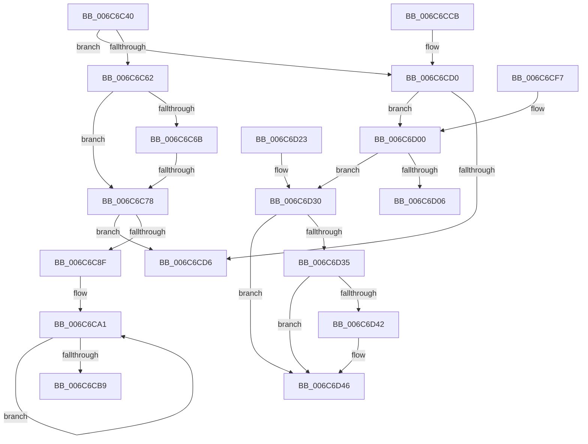

# memset

- RVA: `0x006C6C40`–`0x006C6D47` (길이 `263` bytes)
- VA: `0x00000001406C6C40`
- 실행 섹션: `.text`
- PDB 이름 있음: `예`; PDB Function 태그: `아니요`
- unwind 정보 RVA: `0x000BFAC8`
- 디코드: `68`개 명령, `263/263` bytes 표시
- 미해석 바이트: `0` (있으면 어셈블리에 `.byte`로 보존)

> 이 문서는 커널 이미지의 기계어와 PDB 기호를 분석해 생성했습니다. 4번과 5번은 함수 원형과 자료형을 바이너리 사용 방식에서 추정한 C 해석이며 원본 소스 복구 결과는 아닙니다.

## 1. Dependencies

- 직접 호출 지점: **0**; 고유 호출 대상: **0**
- 직접 호출자로 확인된 함수: **2659**
- RIP 상대 이미지 참조: **1**

### Outgoing calls
- 직접 디코드된 call 명령이 없습니다.

### Direct callers
- [KiDeferGroupSchedulingPreemption](../20/KiDeferGroupSchedulingPreemption_function_0020076C.md) at `0x002009C3`
- [KiSchedulerApc](../20/KiSchedulerApc_function_00202BC0.md) at `0x00202BFC`
- [KiHandleDeferredPreemption](../20/KiHandleDeferredPreemption_function_00202ECC.md) at `0x00202FF8`
- [IopAllocateIrpPrivate](../20/IopAllocateIrpPrivate_function_00207770.md) at `0x00207902`
- [KeYieldExecution](../20/KeYieldExecution_function_00209FA0.md) at `0x0020A252`
- [ExfAcquirePushLockExclusiveEx](../20/ExfAcquirePushLockExclusiveEx_function_0020FC90.md) at `0x0020FCBA`
- [ExfAcquirePushLockSharedEx](../21/ExfAcquirePushLockSharedEx_function_0021044C.md) at `0x0021047D`
- [ObpPushStackInfo](../21/ObpPushStackInfo_function_002109E4.md) at `0x00210A19`
- [ObpPushStackInfo](../21/ObpPushStackInfo_function_002109E4.md) at `0x00210A9A`
- [IoBoostThreadIoPriority](../21/IoBoostThreadIoPriority_function_00216110.md) at `0x0021615E`
- [IoBoostThreadIoPriority](../21/IoBoostThreadIoPriority_function_00216110.md) at `0x0021616D`
- [KiHaltOnAddressWakeEntireList](../21/KiHaltOnAddressWakeEntireList_function_00217AF4.md) at `0x00217B2A`
- [KiHaltOnAddressWakeEntireList](../21/KiHaltOnAddressWakeEntireList_function_00217AF4.md) at `0x00217B51`
- [sub_00217C3C](../21/Unknown_function_00217C3C.md) at `0x00217C76`
- [sub_00217CE7](../21/Unknown_function_00217CE7.md) at `0x00217D12`
- [KiRetireDpcList](../21/KiRetireDpcList_function_0021A0B0.md) at `0x0021A0FB`
- [sub_0021C00A](../21/Unknown_function_0021C00A.md) at `0x0021C030`
- [sub_0021D7F8](../21/Unknown_function_0021D7F8.md) at `0x0021DD7B`
- [ExpCenturyDpcRoutine](../22/ExpCenturyDpcRoutine_function_00223520.md) at `0x0022355D`
- [SepRmDispatchDataToLsa](../22/SepRmDispatchDataToLsa_function_0022395C.md) at `0x0022399A`
- [SepRmDispatchDataToLsa](../22/SepRmDispatchDataToLsa_function_0022395C.md) at `0x002239AE`
- [SeReportSecurityEventWithSubCategory](../22/SeReportSecurityEventWithSubCategory_function_002248B0.md) at `0x002249AF`
- [EtwpEventWriteFull](../22/EtwpEventWriteFull_function_00225C10.md) at `0x00225D2C`
- [EtwpEventWriteFull](../22/EtwpEventWriteFull_function_00225C10.md) at `0x00226C4C`
- [EtwpEventWriteFull](../22/EtwpEventWriteFull_function_00225C10.md) at `0x00227073`
- [EtwpEventWriteFull](../22/EtwpEventWriteFull_function_00225C10.md) at `0x002270AD`
- [EtwpEventWriteFull](../22/EtwpEventWriteFull_function_00225C10.md) at `0x00227205`
- [EtwpEventWriteFull](../22/EtwpEventWriteFull_function_00225C10.md) at `0x002273E4`
- [EtwpEventWriteFull](../22/EtwpEventWriteFull_function_00225C10.md) at `0x0022751E`
- [EtwpStackWalkApc](../22/EtwpStackWalkApc_function_00227870.md) at `0x0022792F`
- [MmProtectMdlSystemAddress](../22/MmProtectMdlSystemAddress_function_00227B50.md) at `0x00227B8B`
- [MmCopyMemory](../22/MmCopyMemory_function_002285B0.md) at `0x00228600`
- [MiTranslatePageForCopy](../22/MiTranslatePageForCopy_function_00228960.md) at `0x002289B7`
- [MiTranslatePageForCopy](../22/MiTranslatePageForCopy_function_00228960.md) at `0x002289C7`
- [MiCloneVads](../22/MiCloneVads_function_0022DC1C.md) at `0x0022DC77`
- [MiCloneVads](../22/MiCloneVads_function_0022DC1C.md) at `0x0022DC87`
- [PopPowerRequestCreateCommon](../23/PopPowerRequestCreateCommon_function_00230150.md) at `0x00230234`
- [PopUmpoSendPowerMessage](../23/PopUmpoSendPowerMessage_function_00230730.md) at `0x002307BB`
- [PopUmpoSendPowerMessage](../23/PopUmpoSendPowerMessage_function_00230730.md) at `0x0023088E`
- [KiSendClockInterruptToTargetProcessor](../23/KiSendClockInterruptToTargetProcessor_function_00234700.md) at `0x00234734`
- [KiSendClockInterruptToTargetProcessor](../23/KiSendClockInterruptToTargetProcessor_function_00234700.md) at `0x00234759`
- [sub_00235D65](../23/Unknown_function_00235D65.md) at `0x00235D7B`
- [sub_00235D85](../23/Unknown_function_00235D85.md) at `0x00235E3D`
- [MiReleasePteMappings](../23/MiReleasePteMappings_function_00237CE0.md) at `0x00237D19`
- [MiProbeAndLockPages](../23/MiProbeAndLockPages_function_0023B4F0.md) at `0x0023B521`
- [MmProbeAndLockPages](../23/MmProbeAndLockPages_function_0023B990.md) at `0x0023B9B8`
- [MiReferenceIoPages](../23/MiReferenceIoPages_function_0023C804.md) at `0x0023C867`
- [MmStoreProbeAndLockPages](../23/MmStoreProbeAndLockPages_function_0023E570.md) at `0x0023E59E`
- [MmProbeAndLockSelectedPages](../23/MmProbeAndLockSelectedPages_function_0023F790.md) at `0x0023F7D3`
- [MiDecommitPages](../24/MiDecommitPages_function_00241BD0.md) at `0x00241BFC`
- [MiDecommitHandleProtoFormatPte](../24/MiDecommitHandleProtoFormatPte_function_00242D54.md) at `0x00242E04`
- [sub_00243300](../24/Unknown_function_00243300.md) at `0x00243327`
- [MiWalkVaRange](../24/MiWalkVaRange_function_00243BF0.md) at `0x00243CCA`
- [MiActOnPte](../24/MiActOnPte_function_00244C90.md) at `0x00244F4F`
- [MiReleasePtes](../24/MiReleasePtes_function_00247240.md) at `0x00247289`
- [sub_00249B6A](../24/Unknown_function_00249B6A.md) at `0x00249B9D`
- [KiSetProcessConcurrencyCount](../24/KiSetProcessConcurrencyCount_function_00249F2C.md) at `0x00249F72`
- [KiSetProcessConcurrencyCount](../24/KiSetProcessConcurrencyCount_function_00249F2C.md) at `0x00249FDA`
- [MiUnlockMdlWritePages](../24/MiUnlockMdlWritePages_function_0024A7C0.md) at `0x0024A7E6`
- [PopPluginComponentActive](../24/PopPluginComponentActive_function_0024B800.md) at `0x0024B82E`
- [sub_0024D8B5](../24/Unknown_function_0024D8B5.md) at `0x0024D8DB`
- [IoReuseIrp](../24/IoReuseIrp_function_0024DD70.md) at `0x0024DE2E`
- [KiProcessDeferredReadyList](../25/KiProcessDeferredReadyList_function_00250800.md) at `0x00250930`
- [sub_002522D4](../25/Unknown_function_002522D4.md) at `0x002522E7`
- [HalpInterruptSendIpi](../25/HalpInterruptSendIpi_function_00252310.md) at `0x00252351`
- [HalpInterruptSendIpi](../25/HalpInterruptSendIpi_function_00252310.md) at `0x0025247F`
- [HalpInterruptSendIpi](../25/HalpInterruptSendIpi_function_00252310.md) at `0x002524E0`
- [HalpInterruptSendIpi](../25/HalpInterruptSendIpi_function_00252310.md) at `0x0025250F`
- [HalpInterruptSendIpi](../25/HalpInterruptSendIpi_function_00252310.md) at `0x00252548`
- [sub_00252A85](../25/Unknown_function_00252A85.md) at `0x00252ABB`
- [sub_00252A85](../25/Unknown_function_00252A85.md) at `0x00252BB4`
- [KiProcessThreadWaitList](../25/KiProcessThreadWaitList_function_00252CC0.md) at `0x00252F70`
- [sub_0025308F](../25/Unknown_function_0025308F.md) at `0x002533F9`
- [KiChooseTargetProcessor](../25/KiChooseTargetProcessor_function_002556D8.md) at `0x00255815`
- [KiChooseTargetProcessor](../25/KiChooseTargetProcessor_function_002556D8.md) at `0x0025589E`
- [KiChooseTargetProcessor](../25/KiChooseTargetProcessor_function_002556D8.md) at `0x0025590F`
- [KiChooseTargetProcessor](../25/KiChooseTargetProcessor_function_002556D8.md) at `0x00255D4D`
- [KeQueryNodeActiveAffinityEx](../25/KeQueryNodeActiveAffinityEx_function_00256740.md) at `0x0025677B`
- [KiSearchForNewThreadsForRescheduleContext](../25/KiSearchForNewThreadsForRescheduleContext_function_00258620.md) at `0x002586EC`
- [KiAttemptToScheduleThreadToBusyIsolationUnit](../25/KiAttemptToScheduleThreadToBusyIsolationUnit_function_00259B00.md) at `0x00259B85`
- [KiAttemptToScheduleThreadToBusyIsolationUnit](../25/KiAttemptToScheduleThreadToBusyIsolationUnit_function_00259B00.md) at `0x0025A1FC`
- [KiExecuteAllDpcs](../25/KiExecuteAllDpcs_function_0025B740.md) at `0x0025BD84`
- [KiExecuteAllDpcs](../25/KiExecuteAllDpcs_function_0025B740.md) at `0x0025C5E1`
- [EtwpLogKernelEvent](../25/EtwpLogKernelEvent_function_0025CC00.md) at `0x0025D370`
- [SMKM_STORE_MGR&lt;SM_TRAITS&gt;::SmFeAddInitiate](../26/SMKM_STORE_MGR_SM_TRAITS_SmFeAddInitiate_function_0026618C.md) at `0x002661D0`
- [SMKM_STORE_MGR&lt;SM_TRAITS&gt;::SmFeEvictComplete](../26/SMKM_STORE_MGR_SM_TRAITS_SmFeEvictComplete_function_00266854.md) at `0x00266897`
- [B_TREE&lt;_SM_PAGE_KEY,SMKM_STORE_MGR&lt;SM_TRAITS&gt;::SMKM_FRONTEND_ENTRY,4096,B_TREE_DUMMY_NODE_POOL,B_TREE_KEY_COMPARATOR&lt;_SM_PAGE_KEY&gt; &gt;::BTreeNewNode](../26/B_TREE__SM_PAGE_KEY_SMKM_STORE_MGR_SM_TRAITS_SMKM_FRONTEND_ENTRY_4096_B_TREE_DUMMY_NODE_POOL_B_TREE__function_0026788C.md) at `0x002678C8`
- [LZ4_compress_fast_extState](../26/LZ4_compress_fast_extState_function_0026A420.md) at `0x0026A461`
- [sub_0026A4AD](../26/Unknown_function_0026A4AD.md) at `0x0026A700`
- [sub_0026A9BC](../26/Unknown_function_0026A9BC.md) at `0x0026A9D1`
- [sub_0026A9FF](../26/Unknown_function_0026A9FF.md) at `0x0026ABB0`
- [sub_0026A9FF](../26/Unknown_function_0026A9FF.md) at `0x0026B02A`
- [sub_0026A9FF](../26/Unknown_function_0026A9FF.md) at `0x0026B4B6`
- [sub_0026A9FF](../26/Unknown_function_0026A9FF.md) at `0x0026B7AE`
- [sub_0026A9FF](../26/Unknown_function_0026A9FF.md) at `0x0026B810`
- [sub_0026A9FF](../26/Unknown_function_0026A9FF.md) at `0x0026B84A`
- [RtlCompressBufferXpressHuffStandard](../26/RtlCompressBufferXpressHuffStandard_function_0026BA60.md) at `0x0026BB55`
- [XpressBuildHuffmanEncodings](../26/XpressBuildHuffmanEncodings_function_0026C2C0.md) at `0x0026C2E4`
- [XpressBuildHuffmanEncodings](../26/XpressBuildHuffmanEncodings_function_0026C2C0.md) at `0x0026C2F8`
- [XpressBuildHuffmanEncodings](../26/XpressBuildHuffmanEncodings_function_0026C2C0.md) at `0x0026C316`
- [XpressBuildHuffmanEncodings](../26/XpressBuildHuffmanEncodings_function_0026C2C0.md) at `0x0026C375`
- [RtlCompressBufferXpressHuffMax](../26/RtlCompressBufferXpressHuffMax_function_0026CA10.md) at `0x0026CA80`
- [RtlCompressBufferXpressHuffMax](../26/RtlCompressBufferXpressHuffMax_function_0026CA10.md) at `0x0026CAF6`
- [CcExtendVacbArray](../26/CcExtendVacbArray_function_0026DCD0.md) at `0x0026DE15`
- [CcExtendVacbArray](../26/CcExtendVacbArray_function_0026DCD0.md) at `0x0026E07F`
- [PopLogNotifyDevice](../27/PopLogNotifyDevice_function_00270400.md) at `0x00270438`
- [IopCompleteUnloadOrDelete](../27/IopCompleteUnloadOrDelete_function_00270BC8.md) at `0x00270E0A`
- [PopAllocateIrp](../27/PopAllocateIrp_function_0027116C.md) at `0x002712DB`
- [PnpGetRelatedTargetDevice](../27/PnpGetRelatedTargetDevice_function_00271F54.md) at `0x00271FC1`
- [sub_00287607](../28/Unknown_function_00287607.md) at `0x00287618`
- [MiGetPerfectColorHeadPage](../28/MiGetPerfectColorHeadPage_function_00289CA8.md) at `0x00289CEE`
- [MiFindContiguousPagesEx](../28/MiFindContiguousPagesEx_function_0028BDE0.md) at `0x0028BE84`
- [MiFindContiguousPagesEx](../28/MiFindContiguousPagesEx_function_0028BDE0.md) at `0x0028BEE1`
- [MmUnmapViewInSystemCache](../29/MmUnmapViewInSystemCache_function_00293B70.md) at `0x00293BAA`
- [MiRemoveFromSystemSpace](../29/MiRemoveFromSystemSpace_function_002962FC.md) at `0x00296331`
- [MiGetHighestUltraLevel](../29/MiGetHighestUltraLevel_function_002972AC.md) at `0x002973F8`
- [sub_002977BA](../29/Unknown_function_002977BA.md) at `0x002977CE`
- [FsRtlReleaseFileForModWrite](../29/FsRtlReleaseFileForModWrite_function_00299100.md) at `0x00299145`
- [FsRtlReleaseFileForModWrite](../29/FsRtlReleaseFileForModWrite_function_00299100.md) at `0x00299212`
- [FsRtlAcquireFileForModWriteEx](../29/FsRtlAcquireFileForModWriteEx_function_00299E5C.md) at `0x00299EA6`
- [FsRtlAcquireFileForModWriteEx](../29/FsRtlAcquireFileForModWriteEx_function_00299E5C.md) at `0x00299F7A`
- [IoMakeAssociatedIrpPriv](../29/IoMakeAssociatedIrpPriv_function_0029D818.md) at `0x0029D965`
- [VslValidateSecureImagePages](../29/VslValidateSecureImagePages_function_0029DFA0.md) at `0x0029DFDF`
- [VslValidateSecureImagePages](../29/VslValidateSecureImagePages_function_0029DFA0.md) at `0x0029DFEF`
- [MiGetWorkingSetInfoEx](../29/MiGetWorkingSetInfoEx_function_0029E640.md) at `0x0029E6A8`
- [MiZeroPageWrite](../29/MiZeroPageWrite_function_0029F280.md) at `0x0029F2D1`
- [MmOutPageKernelStack](../29/MmOutPageKernelStack_function_0029FB40.md) at `0x0029FB70`
- [VslSetPlaceholderPages](../2A/VslSetPlaceholderPages_function_002A10C0.md) at `0x002A1100`
- [MiOutSwapKernelStackPage](../2A/MiOutSwapKernelStackPage_function_002A29BC.md) at `0x002A2A31`
- [ExBlockOnAddressPushLock](../2A/ExBlockOnAddressPushLock_function_002A43A0.md) at `0x002A43CF`
- [MiDeleteEmptyPageTables](../2A/MiDeleteEmptyPageTables_function_002A5220.md) at `0x002A527E`
- [MiDeleteEmptyPageTables](../2A/MiDeleteEmptyPageTables_function_002A5220.md) at `0x002A528F`
- [MiDeleteEmptyPageTables](../2A/MiDeleteEmptyPageTables_function_002A5220.md) at `0x002A52A0`
- [MmOutSwapWorkingSet](../2A/MmOutSwapWorkingSet_function_002A6BC8.md) at `0x002A6C3F`
- [MiEmptyWorkingSetInitiate](../2A/MiEmptyWorkingSetInitiate_function_002A7128.md) at `0x002A7166`
- [MmOutSwapVirtualAddresses](../2A/MmOutSwapVirtualAddresses_function_002A8C30.md) at `0x002A8CF2`
- [MiDeletePagablePteRange](../2A/MiDeletePagablePteRange_function_002A96B4.md) at `0x002A96FF`
- [MiDeletePagablePteRange](../2A/MiDeletePagablePteRange_function_002A96B4.md) at `0x002A9710`
- [MiDeletePagablePteRange](../2A/MiDeletePagablePteRange_function_002A96B4.md) at `0x002A9722`
- [MiFreePhysicalPageChain](../2A/MiFreePhysicalPageChain_function_002A9F1C.md) at `0x002A9F64`
- [MiTrimUnusedPageFileRegionsWorker](../2A/MiTrimUnusedPageFileRegionsWorker_function_002AA320.md) at `0x002AA35E`
- [MiUnlockOpportunisticPagesInPageTable](../2A/MiUnlockOpportunisticPagesInPageTable_function_002AA88C.md) at `0x002AA8D0`
- [MiInitializeImageProtos](../2A/MiInitializeImageProtos_function_002ABDAC.md) at `0x002ABF63`
- [MiTrimWorkingSet](../2A/MiTrimWorkingSet_function_002AD134.md) at `0x002AD179`
- [MiTrimWorkingSet](../2A/MiTrimWorkingSet_function_002AD134.md) at `0x002AD18B`
- [MiCopyDataPageToImagePage](../2A/MiCopyDataPageToImagePage_function_002AE818.md) at `0x002AEDE8`
- [MiReplaceTransitionPage](../2B/MiReplaceTransitionPage_function_002B1120.md) at `0x002B1162`
- [MiGetPteFromCopyList](../2B/MiGetPteFromCopyList_function_002B20E0.md) at `0x002B211A`
- [MiStealPage](../2B/MiStealPage_function_002B28D0.md) at `0x002B2930`
- [MiStealPage](../2B/MiStealPage_function_002B28D0.md) at `0x002B3A93`
- [MiCreateSharedZeroPages](../2B/MiCreateSharedZeroPages_function_002B6318.md) at `0x002B6381`
- [MiFinishHardFault](../2B/MiFinishHardFault_function_002B6F10.md) at `0x002B6F5B`
- [MiFinishHardFault](../2B/MiFinishHardFault_function_002B6F10.md) at `0x002B6F6A`
- [MiMakePageAvoidRead](../2B/MiMakePageAvoidRead_function_002B7DE0.md) at `0x002B838B`
- [MiMakePageAvoidRead](../2B/MiMakePageAvoidRead_function_002B7DE0.md) at `0x002B847B`
- [MiInsertPageInList](../2B/MiInsertPageInList_function_002BA000.md) at `0x002BA084`
- [PopFxDispatchPluginWorkOnce](../2B/PopFxDispatchPluginWorkOnce_function_002BC69C.md) at `0x002BC6CE`
- [PopFxDispatchPluginWorkOnce](../2B/PopFxDispatchPluginWorkOnce_function_002BC69C.md) at `0x002BC767`
- [sub_002BD95A](../2B/Unknown_function_002BD95A.md) at `0x002BDA64`
- [PopPluginComponentIdleState](../2B/PopPluginComponentIdleState_function_002BE310.md) at `0x002BE343`
- [PopPepUpdateIdleStateRefCount](../2B/PopPepUpdateIdleStateRefCount_function_002BF930.md) at `0x002BF97A`
- [MmQuerySystemWorkingSetInformation](../2C/MmQuerySystemWorkingSetInformation_function_002C0710.md) at `0x002C089E`
- [MiDeleteSystemPageTables](../2C/MiDeleteSystemPageTables_function_002C1110.md) at `0x002C115B`
- [MiOutSwapWorkingSet](../2C/MiOutSwapWorkingSet_function_002C1464.md) at `0x002C149B`
- [MiClearNonPagedPtes](../2C/MiClearNonPagedPtes_function_002C17A0.md) at `0x002C17DF`
- [MiClearNonPagedPtes](../2C/MiClearNonPagedPtes_function_002C17A0.md) at `0x002C17EF`
- [MiAgeWorkingSet](../2C/MiAgeWorkingSet_function_002C21E0.md) at `0x002C221A`
- [MiAgeWorkingSet](../2C/MiAgeWorkingSet_function_002C21E0.md) at `0x002C222C`
- [sub_002C2EF5](../2C/Unknown_function_002C2EF5.md) at `0x002C2F1B`
- [MiZeroInParallelWorker](../2C/MiZeroInParallelWorker_function_002C6600.md) at `0x002C664F`
- [MiZeroLargePage](../2C/MiZeroLargePage_function_002C6914.md) at `0x002C695F`
- [AccelGetStatusFromCompletionRecord](../2C/AccelGetStatusFromCompletionRecord_function_002C7B50.md) at `0x002C7B6D`
- [MiFillMemory](../2C/MiFillMemory_function_002C7BD0.md) at `0x002C7C69`
- [AccelBuildDescriptorMemoryFill](../2C/AccelBuildDescriptorMemoryFill_function_002C7CBC.md) at `0x002C7CF6`
- [AccelBuildDescriptorMemoryFill](../2C/AccelBuildDescriptorMemoryFill_function_002C7CBC.md) at `0x002C7D25`
- [AccelBuildDescriptorMemoryFill](../2C/AccelBuildDescriptorMemoryFill_function_002C7CBC.md) at `0x002C7D3E`
- [AccelSubmitWorkAsync](../2C/AccelSubmitWorkAsync_function_002C81E8.md) at `0x002C8205`
- [AccelWaitForWorkCompletion](../2C/AccelWaitForWorkCompletion_function_002C8270.md) at `0x002C8299`
- [KeGenericCallDpcEx](../2C/KeGenericCallDpcEx_function_002C99F4.md) at `0x002C9A2F`
- [MiAddZeroingThreads](../2C/MiAddZeroingThreads_function_002CBF78.md) at `0x002CBFBC`
- [MiFindBestZeroingProcessor](../2C/MiFindBestZeroingProcessor_function_002CC73C.md) at `0x002CC788`
- [KeSetUserGroupAffinityThread](../2C/KeSetUserGroupAffinityThread_function_002CD1C4.md) at `0x002CD205`
- [KeSetUserGroupAffinityThread](../2C/KeSetUserGroupAffinityThread_function_002CD1C4.md) at `0x002CD2D9`
- [KiSetLegacyAffinityThread](../2C/KiSetLegacyAffinityThread_function_002CDD94.md) at `0x002CDDDB`
- [KiSetLegacyAffinityThread](../2C/KiSetLegacyAffinityThread_function_002CDD94.md) at `0x002CDE05`
- [KeFlushProcessWriteBuffers](../2C/KeFlushProcessWriteBuffers_function_002CE4FC.md) at `0x002CE574`
- [KeQueryLogicalProcessorRelationship](../2C/KeQueryLogicalProcessorRelationship_function_002CEA60.md) at `0x002CEA9D`
- [KeQueryLogicalProcessorRelationship](../2C/KeQueryLogicalProcessorRelationship_function_002CEA60.md) at `0x002CED88`
- [KeQueryLogicalProcessorRelationship](../2C/KeQueryLogicalProcessorRelationship_function_002CEA60.md) at `0x002CF5DB`
- [PpmIdleSelectStates](../2C/PpmIdleSelectStates_function_002CFFE8.md) at `0x002D006B`
- [PpmIdleSelectStates](../2C/PpmIdleSelectStates_function_002CFFE8.md) at `0x002D0119`
- [PpmIdleSelectStates](../2C/PpmIdleSelectStates_function_002CFFE8.md) at `0x002D0202`
- [PpmIdleSelectStates](../2C/PpmIdleSelectStates_function_002CFFE8.md) at `0x002D0244`
- [PpmIdleSelectStates](../2C/PpmIdleSelectStates_function_002CFFE8.md) at `0x002D0540`
- [PpmIdleSelectStates](../2C/PpmIdleSelectStates_function_002CFFE8.md) at `0x002D05C4`
- [PpmWakeClockOwnerIfNeeded](../2D/PpmWakeClockOwnerIfNeeded_function_002D0924.md) at `0x002D0960`
- [PpmWakeClockOwnerIfNeeded](../2D/PpmWakeClockOwnerIfNeeded_function_002D0924.md) at `0x002D09C3`
- [PpmIdleExecuteTransition](../2D/PpmIdleExecuteTransition_function_002D0A1C.md) at `0x002D0A72`
- [KiIntRedirectQueueRequestOnProcessor](../2D/KiIntRedirectQueueRequestOnProcessor_function_002D1240.md) at `0x002D1274`
- [KiIntRedirectQueueRequestOnProcessor](../2D/KiIntRedirectQueueRequestOnProcessor_function_002D1240.md) at `0x002D1299`
- [PpmUnlockProcessors](../2D/PpmUnlockProcessors_function_002D15B0.md) at `0x002D15F6`
- [PpmUnlockProcessors](../2D/PpmUnlockProcessors_function_002D15B0.md) at `0x002D1616`
- [KiIntSteerConnect](../2D/KiIntSteerConnect_function_002D44F0.md) at `0x002D467E`
- [KeUpdateSoftParkRankList](../2D/KeUpdateSoftParkRankList_function_002D5998.md) at `0x002D59E0`
- [KeUpdateSoftParkRankList](../2D/KeUpdateSoftParkRankList_function_002D5998.md) at `0x002D5A5A`
- [PpmParkReportParkedCores](../2D/PpmParkReportParkedCores_function_002D5CB0.md) at `0x002D5CF6`
- [PpmParkReportParkedCores](../2D/PpmParkReportParkedCores_function_002D5CB0.md) at `0x002D5D07`
- [PpmParkReportParkedCores](../2D/PpmParkReportParkedCores_function_002D5CB0.md) at `0x002D5D18`
- [PpmParkReportParkedCores](../2D/PpmParkReportParkedCores_function_002D5CB0.md) at `0x002D5D26`
- [PpmParkReportParkedCores](../2D/PpmParkReportParkedCores_function_002D5CB0.md) at `0x002D5D58`
- [PpmParkReportParkedCores](../2D/PpmParkReportParkedCores_function_002D5CB0.md) at `0x002D5DEF`
- [PpmParkReportParkedCores](../2D/PpmParkReportParkedCores_function_002D5CB0.md) at `0x002D5E23`
- [PpmParkReportParkedCores](../2D/PpmParkReportParkedCores_function_002D5CB0.md) at `0x002D5EBE`
- [PpmParkSteerInterrupts](../2D/PpmParkSteerInterrupts_function_002D64B0.md) at `0x002D64E3`
- [PpmParkSteerInterrupts](../2D/PpmParkSteerInterrupts_function_002D64B0.md) at `0x002D6504`
- [PpmParkSteerInterrupts](../2D/PpmParkSteerInterrupts_function_002D64B0.md) at `0x002D6518`
- [PpmParkSteerInterrupts](../2D/PpmParkSteerInterrupts_function_002D64B0.md) at `0x002D652C`
- [PpmParkSteerInterrupts](../2D/PpmParkSteerInterrupts_function_002D64B0.md) at `0x002D653E`
- [PpmParkSteerInterrupts](../2D/PpmParkSteerInterrupts_function_002D64B0.md) at `0x002D6552`
- [sub_002D6584](../2D/Unknown_function_002D6584.md) at `0x002D65CF`
- [sub_002D6584](../2D/Unknown_function_002D6584.md) at `0x002D6651`
- [sub_002D6584](../2D/Unknown_function_002D6584.md) at `0x002D6758`
- [sub_002D6584](../2D/Unknown_function_002D6584.md) at `0x002D6940`
- [sub_002D6584](../2D/Unknown_function_002D6584.md) at `0x002D695F`
- [sub_002D6584](../2D/Unknown_function_002D6584.md) at `0x002D69C6`
- [sub_002D6AB0](../2D/Unknown_function_002D6AB0.md) at `0x002D6B06`
- [KeIntSteerSnapPerf](../2D/KeIntSteerSnapPerf_function_002D76C0.md) at `0x002D77B8`
- [KeIntSteerSnapPerf](../2D/KeIntSteerSnapPerf_function_002D76C0.md) at `0x002D79FC`
- [sub_002D7ADD](../2D/Unknown_function_002D7ADD.md) at `0x002D7AE5`
- [sub_002D7ADD](../2D/Unknown_function_002D7ADD.md) at `0x002D7B7B`
- [PpmCheckContinueExecution](../2D/PpmCheckContinueExecution_function_002D836C.md) at `0x002D8394`
- [PpmCheckContinueExecution](../2D/PpmCheckContinueExecution_function_002D836C.md) at `0x002D8440`
- [KeQuerySystemAllowedCpuSetAffinity](../2D/KeQuerySystemAllowedCpuSetAffinity_function_002D85F4.md) at `0x002D8653`
- [KiIntSteerCalculatePriorityDistribution](../2D/KiIntSteerCalculatePriorityDistribution_function_002D8760.md) at `0x002D87EE`
- [PpmPerfApplyProcessorStates](../2D/PpmPerfApplyProcessorStates_function_002D8EF0.md) at `0x002D8F52`
- [PpmIdleUpdateSystemLatencyLimit](../2D/PpmIdleUpdateSystemLatencyLimit_function_002D9204.md) at `0x002D9248`
- [PpmIdleUpdateSystemLatencyLimit](../2D/PpmIdleUpdateSystemLatencyLimit_function_002D9204.md) at `0x002D9256`
- [PpmIdleUpdateSystemLatencyLimit](../2D/PpmIdleUpdateSystemLatencyLimit_function_002D9204.md) at `0x002D9275`
- [PpmIdleUpdateSystemLatencyLimit](../2D/PpmIdleUpdateSystemLatencyLimit_function_002D9204.md) at `0x002D928D`
- [MiWorkingSetManager](../2D/MiWorkingSetManager_function_002DA7E0.md) at `0x002DA81C`
- [MiFreeUnusedSlabPages](../2D/MiFreeUnusedSlabPages_function_002DAE48.md) at `0x002DAE83`
- [PoGetPerfStateAndParkingInfo](../2D/PoGetPerfStateAndParkingInfo_function_002DD484.md) at `0x002DD4C3`
- [PoGetPerfStateAndParkingInfo](../2D/PoGetPerfStateAndParkingInfo_function_002DD484.md) at `0x002DD73E`
- [PpmSnapPerformanceAccumulation](../2D/PpmSnapPerformanceAccumulation_function_002DE090.md) at `0x002DE438`
- [PpmUpdatePerformanceFeedback](../2D/PpmUpdatePerformanceFeedback_function_002DE580.md) at `0x002DE747`
- [PoGetIdleTimes](../2D/PoGetIdleTimes_function_002DF570.md) at `0x002DF5B0`
- [PoGetIdleTimes](../2D/PoGetIdleTimes_function_002DF570.md) at `0x002DF778`
- [sub_002DF8DD](../2D/Unknown_function_002DF8DD.md) at `0x002DF90E`
- [SMKM_STORE_MGR&lt;SM_TRAITS&gt;::SmFeAddComplete](../2D/SMKM_STORE_MGR_SM_TRAITS_SmFeAddComplete_function_002DFEE0.md) at `0x002DFF20`
- [sub_002E03B8](../2E/Unknown_function_002E03B8.md) at `0x002E03D5`
- [MiTrimSharedPageFromViews](../2E/MiTrimSharedPageFromViews_function_002E16F8.md) at `0x002E1763`
- [RtlpHpLfhSubsegmentInitialize](../2E/RtlpHpLfhSubsegmentInitialize_function_002E806C.md) at `0x002E8168`
- [RtlpHpLfhBlockBitmapInitialize](../2E/RtlpHpLfhBlockBitmapInitialize_function_002E8418.md) at `0x002E843D`
- [RtlpHpLfhSubsegmentReformatAsMulti](../2E/RtlpHpLfhSubsegmentReformatAsMulti_function_002E8814.md) at `0x002E88CD`
- [ExpResizeBigPageTable](../2E/ExpResizeBigPageTable_function_002EE1B4.md) at `0x002EE218`
- [KasanPoolAllocate](../2E/KasanPoolAllocate_function_002EE3E0.md) at `0x002EE57D`
- [KasanPoolAllocate](../2E/KasanPoolAllocate_function_002EE3E0.md) at `0x002EE5DB`
- [KasanPoolAllocate](../2E/KasanPoolAllocate_function_002EE3E0.md) at `0x002EE5ED`
- [ExpFreeHeapSpecialPool](../2E/ExpFreeHeapSpecialPool_function_002EE600.md) at `0x002EE93D`
- [ExInsertPoolTag](../2E/ExInsertPoolTag_function_002EF3AC.md) at `0x002EF47E`
- [RtlpCSparseBitmapWaitOnAddress](../2E/RtlpCSparseBitmapWaitOnAddress_function_002EFF0C.md) at `0x002EFF41`
- [sub_002F1861](../2F/Unknown_function_002F1861.md) at `0x002F18A8`
- [VslGetNestedPageProtectionFlags](../2F/VslGetNestedPageProtectionFlags_function_002F2164.md) at `0x002F218D`
- [RtlDispatchException](../2F/RtlDispatchException_function_002F22A0.md) at `0x002F22EE`
- [RtlDispatchException](../2F/RtlDispatchException_function_002F22A0.md) at `0x002F2321`
- [RtlUnwindEx](../2F/RtlUnwindEx_function_002F2830.md) at `0x002F2895`
- [RtlUnwindEx](../2F/RtlUnwindEx_function_002F2830.md) at `0x002F28A9`
- [RtlInitializeExtendedContext2](../2F/RtlInitializeExtendedContext2_function_002F5D40.md) at `0x002F5EB3`
- [RtlRaiseStatus](../2F/RtlRaiseStatus_function_002F6A50.md) at `0x002F6A66`
- [KiContinuePreviousModeUser](../2F/KiContinuePreviousModeUser_function_002F9B10.md) at `0x002F9C7D`
- [EtwpApcPoolThunk](../2F/EtwpApcPoolThunk_function_002FA090.md) at `0x002FA193`
- [EtwpLogSystemEventUnsafe](../2F/EtwpLogSystemEventUnsafe_function_002FBF10.md) at `0x002FC61C`
- [EtwpReserveWithPmcCounters](../2F/EtwpReserveWithPmcCounters_function_002FCED0.md) at `0x002FD061`
- [AuthzBasepEvaluateAceCondition](../2F/AuthzBasepEvaluateAceCondition_function_002FEBD0.md) at `0x002FEC48`
- [AuthzBasepEvaluateAceCondition](../2F/AuthzBasepEvaluateAceCondition_function_002FEBD0.md) at `0x002FEC63`
- [AuthzBasepEvaluateAceCondition](../2F/AuthzBasepEvaluateAceCondition_function_002FEBD0.md) at `0x002FF74C`
- [AuthzBasepEvaluateAceCondition](../2F/AuthzBasepEvaluateAceCondition_function_002FEBD0.md) at `0x002FF94F`
- [SepGetProcUniqueLuidAndIndexFromAttributeInfo](../30/SepGetProcUniqueLuidAndIndexFromAttributeInfo_function_00300A78.md) at `0x00300AB9`
- [AuthzBasepDuplicateSecurityAttributes](../30/AuthzBasepDuplicateSecurityAttributes_function_003023C0.md) at `0x00302443`
- [AuthzBasepDuplicateSecurityAttributes](../30/AuthzBasepDuplicateSecurityAttributes_function_003023C0.md) at `0x0030254B`
- [AuthzBasepDuplicateSecurityAttributes](../30/AuthzBasepDuplicateSecurityAttributes_function_003023C0.md) at `0x003027C6`
- [PpmUpdatePlatformIdleVeto](../30/PpmUpdatePlatformIdleVeto_function_003047E0.md) at `0x0030481F`
- [KeChangeMemoryAttributes](../30/KeChangeMemoryAttributes_function_00304D08.md) at `0x00304D6E`
- [HvlParkedVirtualProcessors](../30/HvlParkedVirtualProcessors_function_00305724.md) at `0x00305760`
- [KiUpdateGlobalCpuSetConfiguration](../30/KiUpdateGlobalCpuSetConfiguration_function_00305AB8.md) at `0x00305B1C`
- [HvlRetargetDeviceInterrupt](../30/HvlRetargetDeviceInterrupt_function_003062A0.md) at `0x0030631C`
- [HvlRetargetDeviceInterrupt](../30/HvlRetargetDeviceInterrupt_function_003062A0.md) at `0x003063A6`
- [HvlpAffinityToHvProcessorSet](../30/HvlpAffinityToHvProcessorSet_function_003068F4.md) at `0x003069D6`
- [HalpBuddyAllocatorAllocateLogicalAddress](../30/HalpBuddyAllocatorAllocateLogicalAddress_function_00307EE0.md) at `0x00307F3C`
- [HalpIommuUnmapLogicalRange](../30/HalpIommuUnmapLogicalRange_function_00308660.md) at `0x003087A7`
- [KxFlushEntireTb](../30/KxFlushEntireTb_function_00309094.md) at `0x003091FA`
- [KiGroupSchedulingGenerationEnd](../30/KiGroupSchedulingGenerationEnd_function_0030A9B4.md) at `0x0030AA34`
- [KiGroupSchedulingQuantumEnd](../30/KiGroupSchedulingQuantumEnd_function_0030B220.md) at `0x0030B36C`
- [KiSoftParkElectionUnparkProcessor](../30/KiSoftParkElectionUnparkProcessor_function_0030B818.md) at `0x0030B93F`
- [KiEnterLongDpcProcessing](../30/KiEnterLongDpcProcessing_function_0030BE54.md) at `0x0030BF9E`
- [KiRescheduleThreadAfterAffinityChange](../30/KiRescheduleThreadAfterAffinityChange_function_0030C9E8.md) at `0x0030CAB3`
- [KiAttemptToStealStandbyThread](../30/KiAttemptToStealStandbyThread_function_0030D790.md) at `0x0030D7DC`
- [KiAttemptToStealStandbyThread](../30/KiAttemptToStealStandbyThread_function_0030D790.md) at `0x0030D950`
- [KiAttemptToStealStandbyThread](../30/KiAttemptToStealStandbyThread_function_0030D790.md) at `0x0030D983`
- [KiReadyDeferredReadyList](../30/KiReadyDeferredReadyList_function_0030DD80.md) at `0x0030DE91`
- [KiAbDeferredProcessingWorker](../30/KiAbDeferredProcessingWorker_function_0030DEB0.md) at `0x0030E5F9`
- [KiSearchForNewThreadsOnTarget](../30/KiSearchForNewThreadsOnTarget_function_0030F500.md) at `0x0030FD79`
- [KiSearchForNewThreadsOnTarget](../30/KiSearchForNewThreadsOnTarget_function_0030F500.md) at `0x0030FED1`
- [KiSearchForNewThreadsOnTarget](../30/KiSearchForNewThreadsOnTarget_function_0030F500.md) at `0x0030FF08`
- [KiSearchForNewThreadsOnTarget](../30/KiSearchForNewThreadsOnTarget_function_0030F500.md) at `0x00310046`
- [KiSearchForNewThreadsOnTarget](../30/KiSearchForNewThreadsOnTarget_function_0030F500.md) at `0x00310422`
- [KiSearchForNewThreadsOnTarget](../30/KiSearchForNewThreadsOnTarget_function_0030F500.md) at `0x00310BC1`
- [KiIpiSendRequest](../31/KiIpiSendRequest_function_003113C0.md) at `0x00311451`
- [KiIpiSendRequest](../31/KiIpiSendRequest_function_003113C0.md) at `0x0031146A`
- [sub_00312223](../31/Unknown_function_00312223.md) at `0x00312550`
- [sub_00312223](../31/Unknown_function_00312223.md) at `0x00312635`
- [KiPrepareFlushCurrentAffinity](../31/KiPrepareFlushCurrentAffinity_function_00313424.md) at `0x00313450`
- [KeFlushCurrentTbOnly](../31/KeFlushCurrentTbOnly_function_003134EC.md) at `0x0031351A`
- [MiFlushTbAsNeeded](../31/MiFlushTbAsNeeded_function_00313730.md) at `0x00313777`
- [VslSlowFlushSecureRangeList](../31/VslSlowFlushSecureRangeList_function_00314D44.md) at `0x00314D8A`
- [KxFlushNonGlobalTb](../31/KxFlushNonGlobalTb_function_00314E50.md) at `0x00314ECE`
- [MiWaitForVadDeletion](../31/MiWaitForVadDeletion_function_00316F1C.md) at `0x00316F3E`
- [MiReservePtes](../31/MiReservePtes_function_00318D20.md) at `0x00318E16`
- [sub_0031A6F6](../31/Unknown_function_0031A6F6.md) at `0x0031A735`
- [MiPfnsWorthTrying](../31/MiPfnsWorthTrying_function_0031B0C0.md) at `0x0031B788`
- [MmSetPfnListInfo](../31/MmSetPfnListInfo_function_0031D61C.md) at `0x0031D675`
- [MiGetLargePagesForChain](../31/MiGetLargePagesForChain_function_0031DF88.md) at `0x0031DFC3`
- [MiGetLargePage](../31/MiGetLargePage_function_0031E210.md) at `0x0031E270`
- [MiBackgroundZeroLocalPages](../31/MiBackgroundZeroLocalPages_function_0031EF30.md) at `0x0031EF7E`
- [sub_0031FE95](../31/Unknown_function_0031FE95.md) at `0x0031FF16`
- [MiLockOwnedProtoPage](../32/MiLockOwnedProtoPage_function_00322560.md) at `0x00322592`
- [RtlpHpSegMgrCommit](../32/RtlpHpSegMgrCommit_function_00326BE4.md) at `0x00326D20`
- [RtlpHpSegMgrCommit](../32/RtlpHpSegMgrCommit_function_00326BE4.md) at `0x00326ECF`
- [MiMapContiguousMemory](../32/MiMapContiguousMemory_function_0032787C.md) at `0x00327C8A`
- [MiMapContiguousMemory](../32/MiMapContiguousMemory_function_0032787C.md) at `0x00327CB5`
- [MiMapContiguousMemory](../32/MiMapContiguousMemory_function_0032787C.md) at `0x00327D29`
- [MiGetPoolPages](../32/MiGetPoolPages_function_00327D3C.md) at `0x00327D65`
- [MiFindActualFaultingPte](../32/MiFindActualFaultingPte_function_0032899C.md) at `0x003289E7`
- [sub_00328FA3](../32/Unknown_function_00328FA3.md) at `0x00328FFD`
- [MiQueryAddressState](../32/MiQueryAddressState_function_0032C380.md) at `0x0032C48B`
- [MiResolveSharedZeroFault](../32/MiResolveSharedZeroFault_function_0032EF20.md) at `0x0032EF52`
- [sub_0032F7AB](../32/Unknown_function_0032F7AB.md) at `0x0032FA37`
- [sub_0032FBA9](../32/Unknown_function_0032FBA9.md) at `0x0032FC77`
- [MiRemoveLowestPriorityStandbyPage](../33/MiRemoveLowestPriorityStandbyPage_function_00334600.md) at `0x00334645`
- [MiRemoveLowestPriorityStandbyPage](../33/MiRemoveLowestPriorityStandbyPage_function_00334600.md) at `0x003346B8`
- [MmDeleteKernelStack](../33/MmDeleteKernelStack_function_0033A960.md) at `0x0033AFF8`
- [MiDecayNodeNowEmpty](../33/MiDecayNodeNowEmpty_function_0033C938.md) at `0x0033CA2D`
- [sub_00347472](../34/Unknown_function_00347472.md) at `0x00347493`
- [MiSystemFault](../34/MiSystemFault_function_0034AA64.md) at `0x0034AB7B`
- [SMKM_STORE_MGR&lt;SM_TRAITS&gt;::SmPageWrite](../34/SMKM_STORE_MGR_SM_TRAITS_SmPageWrite_function_0034BA54.md) at `0x0034BBD6`
- [SMKM_STORE_MGR&lt;SM_TRAITS&gt;::SmFeCheckPresent](../34/SMKM_STORE_MGR_SM_TRAITS_SmFeCheckPresent_function_0034C574.md) at `0x0034C5B5`
- [NtSetInformationWorkerFactory](../35/NtSetInformationWorkerFactory_function_00350A30.md) at `0x00350A92`
- [KiExitThreadWaitReschedule](../35/KiExitThreadWaitReschedule_function_00352EC8.md) at `0x00352F0E`
- [KiParkCurrentProcessor](../35/KiParkCurrentProcessor_function_003533A4.md) at `0x0035347C`
- [CcWriteBehindAsync](../35/CcWriteBehindAsync_function_003549E8.md) at `0x00354A1D`
- [KiSearchForNewThread](../35/KiSearchForNewThread_function_00355C98.md) at `0x00355CDD`
- [CcWriteBehind](../35/CcWriteBehind_function_00356EAC.md) at `0x00357006`
- [CcWriteBehindInternal](../35/CcWriteBehindInternal_function_00357540.md) at `0x00357576`
- [CcFlushCachePriv](../35/CcFlushCachePriv_function_0035B040.md) at `0x0035B0F3`
- [ExAllocateHeapPool](../35/ExAllocateHeapPool_function_0035BA30.md) at `0x0035ED5F`
- [ExAllocateHeapPool](../35/ExAllocateHeapPool_function_0035BA30.md) at `0x0035EDBC`
- [ExAllocateHeapPool](../35/ExAllocateHeapPool_function_0035BA30.md) at `0x0035F222`
- [ExAllocateHeapPool](../35/ExAllocateHeapPool_function_0035BA30.md) at `0x0035F290`
- [ExAllocateHeapPool](../35/ExAllocateHeapPool_function_0035BA30.md) at `0x0035F2F0`
- [ExAllocateHeapPool](../35/ExAllocateHeapPool_function_0035BA30.md) at `0x0035F40D`
- [ExAllocateHeapPool](../35/ExAllocateHeapPool_function_0035BA30.md) at `0x0035F4B0`
- [sub_00360968](../36/Unknown_function_00360968.md) at `0x003612B2`
- [sub_00360968](../36/Unknown_function_00360968.md) at `0x003612D4`
- [MiGetHardFaultPages](../36/MiGetHardFaultPages_function_0036200C.md) at `0x003620BF`
- [MiGetInPageSupportBlock](../36/MiGetInPageSupportBlock_function_00362500.md) at `0x0036257F`
- [MiInitializeInPageSupport](../36/MiInitializeInPageSupport_function_00362728.md) at `0x00362747`
- [MiCopyOnWrite](../36/MiCopyOnWrite_function_00362A0C.md) at `0x00362B7C`
- [MiBuildMdlForMappedFileFault](../36/MiBuildMdlForMappedFileFault_function_0036380C.md) at `0x00363880`
- [MiReplacePageOfProtoPool](../36/MiReplacePageOfProtoPool_function_00364BB8.md) at `0x00364C12`
- [MiWalkEntireImage](../36/MiWalkEntireImage_function_00365D70.md) at `0x00365DCD`
- [MiWalkEntireImage](../36/MiWalkEntireImage_function_00365D70.md) at `0x003668D6`
- [MiZeroCfgSystemWideBitmapWorker](../36/MiZeroCfgSystemWideBitmapWorker_function_00367060.md) at `0x003673E4`
- [MiZeroCfgSystemWideBitmapWorker](../36/MiZeroCfgSystemWideBitmapWorker_function_00367060.md) at `0x00367537`
- [KeAddEnclavePage](../36/KeAddEnclavePage_function_003683F8.md) at `0x00368440`
- [MiInPageSingleKernelStack](../36/MiInPageSingleKernelStack_function_0036A3E8.md) at `0x0036A433`
- [MiPfCompleteInPageSupport](../36/MiPfCompleteInPageSupport_function_0036D738.md) at `0x0036D76A`
- [MiResolvePageFileFault](../36/MiResolvePageFileFault_function_0036D968.md) at `0x0036E537`
- [MiExpandSharedZeroCluster](../36/MiExpandSharedZeroCluster_function_0036F20C.md) at `0x0036F232`
- [MiDecommitSharedPageTail](../37/MiDecommitSharedPageTail_function_00370240.md) at `0x00370349`
- [MiZeroAndReleasePages](../37/MiZeroAndReleasePages_function_003748D0.md) at `0x0037491B`
- [MiCreateSlabEntry](../37/MiCreateSlabEntry_function_00374DEC.md) at `0x00374E30`
- [MiCreateSlabEntry](../37/MiCreateSlabEntry_function_00374DEC.md) at `0x00374E40`
- [MiGetRepurposedSlabStandbyPage](../37/MiGetRepurposedSlabStandbyPage_function_003755A8.md) at `0x003755FE`
- [KeQueryTotalCycleTimeThread](../37/KeQueryTotalCycleTimeThread_function_0037EF20.md) at `0x0037EF66`
- [KeQueryTotalCycleTimeThread](../37/KeQueryTotalCycleTimeThread_function_0037EF20.md) at `0x0037F907`
- [MiWaitForInPageComplete](../38/MiWaitForInPageComplete_function_00380AB8.md) at `0x00380E45`
- [CcPerfLogScheduleReadAhead](../38/CcPerfLogScheduleReadAhead_function_00386A38.md) at `0x00386A83`
- [ExFreeToPagedLookasideList](../38/ExFreeToPagedLookasideList_function_00387D30.md) at `0x00387E7B`
- [CcCanIWrite](../38/CcCanIWrite_function_00388250.md) at `0x00388561`
- [CcPurgeAndClearCacheSection](../38/CcPurgeAndClearCacheSection_function_0038A614.md) at `0x0038A710`
- [ExFreeToLookasideListEx](../38/ExFreeToLookasideListEx_function_0038ACC0.md) at `0x0038ADDF`
- [sub_0038BEEF](../38/Unknown_function_0038BEEF.md) at `0x0038BF3C`
- [sub_0038D785](../38/Unknown_function_0038D785.md) at `0x0038D7F5`
- [sub_0038D785](../38/Unknown_function_0038D785.md) at `0x0038D834`
- [ExFreeToNPagedLookasideList](../38/ExFreeToNPagedLookasideList_function_0038D9D0.md) at `0x0038DAFE`
- [sub_0038E7EE](../38/Unknown_function_0038E7EE.md) at `0x0038E7F6`
- [ExpUpdateTimerConfiguration](../39/ExpUpdateTimerConfiguration_function_00398B2C.md) at `0x00398B63`
- [ExpUpdateTimerConfiguration](../39/ExpUpdateTimerConfiguration_function_00398B2C.md) at `0x00398B8E`
- [KeGenericProcessorCallback](../39/KeGenericProcessorCallback_function_00398C2C.md) at `0x00398C84`
- [KeGenericProcessorCallback](../39/KeGenericProcessorCallback_function_00398C2C.md) at `0x00398CC3`
- [KiSetSystemAffinityThread](../39/KiSetSystemAffinityThread_function_003993E0.md) at `0x00399438`
- [KiSetSystemAffinityThread](../39/KiSetSystemAffinityThread_function_003993E0.md) at `0x00399748`
- [KiComputeThreadAffinity](../39/KiComputeThreadAffinity_function_00399DE0.md) at `0x00399E29`
- [KiComputeThreadAffinity](../39/KiComputeThreadAffinity_function_00399DE0.md) at `0x00399E73`
- [KiComputeCpuSetAffinity](../39/KiComputeCpuSetAffinity_function_0039A1C0.md) at `0x0039A20F`
- [KiComputeCpuSetAffinity](../39/KiComputeCpuSetAffinity_function_0039A1C0.md) at `0x0039A223`
- [KiComputeCpuSetAffinity](../39/KiComputeCpuSetAffinity_function_0039A1C0.md) at `0x0039A235`
- [KiComputeCpuSetAffinity](../39/KiComputeCpuSetAffinity_function_0039A1C0.md) at `0x0039A256`
- [KiComputeCpuSetAffinity](../39/KiComputeCpuSetAffinity_function_0039A1C0.md) at `0x0039A278`
- [KiComputeCpuSetAffinity](../39/KiComputeCpuSetAffinity_function_0039A1C0.md) at `0x0039A293`
- [KiComputeCpuSetAffinity](../39/KiComputeCpuSetAffinity_function_0039A1C0.md) at `0x0039A2A6`
- [KiComputeCpuSetAffinity](../39/KiComputeCpuSetAffinity_function_0039A1C0.md) at `0x0039A4D2`
- [KiComputeCpuSetAffinity](../39/KiComputeCpuSetAffinity_function_0039A1C0.md) at `0x0039A6A8`
- [HalpTimerWatchdogTriggerSystemReset](../39/HalpTimerWatchdogTriggerSystemReset_function_0039B410.md) at `0x0039B449`
- [HalpTimerWatchdogTriggerSystemReset](../39/HalpTimerWatchdogTriggerSystemReset_function_0039B410.md) at `0x0039B491`
- [KiUpdateTime](../39/KiUpdateTime_function_0039B530.md) at `0x0039B584`
- [KiUpdateTime](../39/KiUpdateTime_function_0039B530.md) at `0x0039B980`
- [PoExecuteIdleCheck](../39/PoExecuteIdleCheck_function_0039CF20.md) at `0x0039CF68`
- [PoExecuteIdleCheck](../39/PoExecuteIdleCheck_function_0039CF20.md) at `0x0039CF77`
- [PoExecuteIdleCheck](../39/PoExecuteIdleCheck_function_0039CF20.md) at `0x0039CF96`
- [PoExecuteIdleCheck](../39/PoExecuteIdleCheck_function_0039CF20.md) at `0x0039D00B`
- [KiForwardTick](../39/KiForwardTick_function_0039D40C.md) at `0x0039D461`
- [KiForwardTick](../39/KiForwardTick_function_0039D40C.md) at `0x0039D48D`
- [KiForwardTick](../39/KiForwardTick_function_0039D40C.md) at `0x0039D5C4`
- [KiCheckPreferredHeteroProcessor](../39/KiCheckPreferredHeteroProcessor_function_0039D72C.md) at `0x0039D788`
- [KiPerformHeteroSoftParkElection](../39/KiPerformHeteroSoftParkElection_function_0039E490.md) at `0x0039E4DA`
- [KiTallyHeteroSoftParkElectionVotes](../39/KiTallyHeteroSoftParkElectionVotes_function_0039E5B8.md) at `0x0039E5FE`
- [KiBuildShareCountListForSubNodeByAffinity](../39/KiBuildShareCountListForSubNodeByAffinity_function_0039EE1C.md) at `0x0039EE48`
- [KiInvokeInterruptServiceRoutine](../39/KiInvokeInterruptServiceRoutine_function_0039F8E0.md) at `0x0039F94A`
- [KeDisableTimer2](../39/KeDisableTimer2_function_0039FD58.md) at `0x0039FDA3`
- [KeDisableTimer2](../39/KeDisableTimer2_function_0039FD58.md) at `0x0039FF67`
- [IopTimerDispatch](../3A/IopTimerDispatch_function_003A3900.md) at `0x003A396C`
- [MiStoreEvictThread](../3A/MiStoreEvictThread_function_003A42D0.md) at `0x003A4317`
- [MiStoreAttemptContractPageFile](../3A/MiStoreAttemptContractPageFile_function_003A4584.md) at `0x003A45AC`
- [RtlCheckTokenCapability](../3A/RtlCheckTokenCapability_function_003A5520.md) at `0x003A5575`
- [RtlCheckTokenCapability](../3A/RtlCheckTokenCapability_function_003A5520.md) at `0x003A55B5`
- [RtlCheckTokenMembershipEx](../3A/RtlCheckTokenMembershipEx_function_003A5A30.md) at `0x003A5A7C`
- [RtlCheckTokenMembershipEx](../3A/RtlCheckTokenMembershipEx_function_003A5A30.md) at `0x003A5A8D`
- [SeQuerySecurityAttributesTokenAccessInformation](../3A/SeQuerySecurityAttributesTokenAccessInformation_function_003A5F90.md) at `0x003A5FD3`
- [SeAccessCheckFromState](../3A/SeAccessCheckFromState_function_003A6650.md) at `0x003A66B9`
- [SeAccessCheckFromState](../3A/SeAccessCheckFromState_function_003A6650.md) at `0x003A66CA`
- [SepTokenFromAccessInformation](../3A/SepTokenFromAccessInformation_function_003A67A0.md) at `0x003A67CD`
- [SepTokenFromAccessInformation](../3A/SepTokenFromAccessInformation_function_003A67A0.md) at `0x003A6897`
- [SepTokenFromAccessInformation](../3A/SepTokenFromAccessInformation_function_003A67A0.md) at `0x003A68E2`
- [SepTokenFromAccessInformation](../3A/SepTokenFromAccessInformation_function_003A67A0.md) at `0x003A692D`
- [sub_003A7982](../3A/Unknown_function_003A7982.md) at `0x003A7A29`
- [sub_003A7F1E](../3A/Unknown_function_003A7F1E.md) at `0x003A7FBE`
- [AuthzBasepCopyoutSecurityAttributes](../3A/AuthzBasepCopyoutSecurityAttributes_function_003A8100.md) at `0x003A815A`
- [sub_003A93DA](../3A/Unknown_function_003A93DA.md) at `0x003A93E6`
- [ST_STORE&lt;SM_TRAITS&gt;::StAcquireReadContext](../3A/ST_STORE_SM_TRAITS_StAcquireReadContext_function_003AA980.md) at `0x003AA9E9`
- [B_TREE&lt;_SM_PAGE_KEY,ST_STORE&lt;SM_TRAITS&gt;::_ST_PAGE_ENTRY,4096,NP_CONTEXT,B_TREE_KEY_COMPARATOR&lt;_SM_PAGE_KEY&gt; &gt;::BTreeNewNode](../3A/B_TREE__SM_PAGE_KEY_ST_STORE_SM_TRAITS__ST_PAGE_ENTRY_4096_NP_CONTEXT_B_TREE_KEY_COMPARATOR__SM_PAGE_function_003AAD60.md) at `0x003AAD9C`
- [sub_003ABBB5](../3A/Unknown_function_003ABBB5.md) at `0x003ABBED`
- [SmArrayGrow](../3A/SmArrayGrow_function_003AC6C8.md) at `0x003AC765`
- [B_TREE&lt;unsigned long,ST_STORE&lt;SM_TRAITS&gt;::_ST_REGION_ENTRY,4096,NP_CONTEXT,ST_STORE&lt;SM_TRAITS&gt;::ST_REGION_ENTRY_COMPARATOR&gt;::BTreeSearchKey](../3A/B_TREE_unsigned_long_ST_STORE_SM_TRAITS__ST_REGION_ENTRY_4096_NP_CONTEXT_ST_STORE_SM_TRAITS_ST_REGIO_function_003ACD20.md) at `0x003AD091`
- [B_TREE&lt;unsigned long,ST_STORE&lt;SM_TRAITS&gt;::_ST_HASH_ENTRY,4096,NP_CONTEXT,ST_STORE&lt;SM_TRAITS&gt;::ST_HASH_ENTRY_COMPARATOR&gt;::BTreeSearchKey](../3A/B_TREE_unsigned_long_ST_STORE_SM_TRAITS__ST_HASH_ENTRY_4096_NP_CONTEXT_ST_STORE_SM_TRAITS_ST_HASH_EN_function_003ADDB0.md) at `0x003AE151`
- [SMKM_STORE_MGR&lt;SM_TRAITS&gt;::SmFeStoreDelete](../3B/SMKM_STORE_MGR_SM_TRAITS_SmFeStoreDelete_function_003B12F0.md) at `0x003B132F`
- [SMKM_STORE&lt;SM_TRAITS&gt;::SmStStart](../3B/SMKM_STORE_SM_TRAITS_SmStStart_function_003B14DC.md) at `0x003B168D`
- [SMKM_STORE&lt;SM_TRAITS&gt;::SmStStart](../3B/SMKM_STORE_SM_TRAITS_SmStStart_function_003B14DC.md) at `0x003B16FB`
- [SMKM_STORE&lt;SM_TRAITS&gt;::SmStStart](../3B/SMKM_STORE_SM_TRAITS_SmStStart_function_003B14DC.md) at `0x003B180B`
- [SMKM_STORE&lt;SM_TRAITS&gt;::SmStStart](../3B/SMKM_STORE_SM_TRAITS_SmStStart_function_003B14DC.md) at `0x003B1874`
- [SMKM_STORE&lt;SM_TRAITS&gt;::SmStStart](../3B/SMKM_STORE_SM_TRAITS_SmStStart_function_003B14DC.md) at `0x003B1890`
- [SmKmStoreHelperInitialize](../3B/SmKmStoreHelperInitialize_function_003B1A68.md) at `0x003B1A80`
- [ST_STORE&lt;SM_TRAITS&gt;::StStart](../3B/ST_STORE_SM_TRAITS_StStart_function_003B1BBC.md) at `0x003B1D6C`
- [MiInsertInSystemSpace](../3B/MiInsertInSystemSpace_function_003B2F5C.md) at `0x003B2F9B`
- [ExpSaPageGroupDescriptorAllocate](../3B/ExpSaPageGroupDescriptorAllocate_function_003B4224.md) at `0x003B42EC`
- [MiMakeZeroedPageTablesEx](../3B/MiMakeZeroedPageTablesEx_function_003B59FC.md) at `0x003B5A50`
- [MiMakeZeroedPageTablesEx](../3B/MiMakeZeroedPageTablesEx_function_003B59FC.md) at `0x003B5A61`
- [sub_003B65E7](../3B/Unknown_function_003B65E7.md) at `0x003B65FE`
- [MiAllocateFastLargePagesForMdl](../3B/MiAllocateFastLargePagesForMdl_function_003B701C.md) at `0x003B7060`
- [MiAllocateFastLargePagesForMdl](../3B/MiAllocateFastLargePagesForMdl_function_003B701C.md) at `0x003B7072`
- [MiAllocateLargeZeroPages](../3B/MiAllocateLargeZeroPages_function_003B743C.md) at `0x003B747D`
- [MiAllocateLargeZeroPages](../3B/MiAllocateLargeZeroPages_function_003B743C.md) at `0x003B748C`
- [MiAllocateSkipPagesForMdl](../3B/MiAllocateSkipPagesForMdl_function_003B7C08.md) at `0x003B7C47`
- [MiGetLargePageChain](../3B/MiGetLargePageChain_function_003B82D0.md) at `0x003B8319`
- [MiGetNodeChannelPageCounts](../3B/MiGetNodeChannelPageCounts_function_003B8888.md) at `0x003B8918`
- [MiGetPartitionNodeInformation](../3B/MiGetPartitionNodeInformation_function_003B8D48.md) at `0x003B8D89`
- [MiGetPartitionNodeInformation](../3B/MiGetPartitionNodeInformation_function_003B8D48.md) at `0x003B8DA7`
- [EtwpLogMemInfo](../3B/EtwpLogMemInfo_function_003B9AC0.md) at `0x003B9AFD`
- [MmFillEtwNodeInformation](../3B/MmFillEtwNodeInformation_function_003B9C74.md) at `0x003B9CA3`
- [PfpMemoryListQuery](../3B/PfpMemoryListQuery_function_003B9DB8.md) at `0x003B9DE6`
- [MmQueryMemoryListInformation](../3B/MmQueryMemoryListInformation_function_003B9EDC.md) at `0x003B9F27`
- [MiUnlinkPageFromBadList](../3B/MiUnlinkPageFromBadList_function_003BD620.md) at `0x003BD687`
- [PpmHeteroUpdateHgsConfiguration](../3B/PpmHeteroUpdateHgsConfiguration_function_003BF344.md) at `0x003BF392`
- [PpmHeteroUpdateHgsConfiguration](../3B/PpmHeteroUpdateHgsConfiguration_function_003BF344.md) at `0x003BF3A3`
- [PpmHeteroUpdateHgsConfiguration](../3B/PpmHeteroUpdateHgsConfiguration_function_003BF344.md) at `0x003BF3B6`
- [PpmHeteroUpdateHgsConfiguration](../3B/PpmHeteroUpdateHgsConfiguration_function_003BF344.md) at `0x003BF3C7`
- [PpmHeteroUpdateHgsConfiguration](../3B/PpmHeteroUpdateHgsConfiguration_function_003BF344.md) at `0x003BF3D8`
- [PpmHeteroUpdateHgsConfiguration](../3B/PpmHeteroUpdateHgsConfiguration_function_003BF344.md) at `0x003BF3E9`
- [PpmHeteroUpdateHgsConfiguration](../3B/PpmHeteroUpdateHgsConfiguration_function_003BF344.md) at `0x003BF3FA`
- [PpmHeteroUpdateHgsConfiguration](../3B/PpmHeteroUpdateHgsConfiguration_function_003BF344.md) at `0x003BF408`
- [PpmHeteroUpdateHgsConfiguration](../3B/PpmHeteroUpdateHgsConfiguration_function_003BF344.md) at `0x003BF48C`
- [PpmHeteroUpdateHgsConfiguration](../3B/PpmHeteroUpdateHgsConfiguration_function_003BF344.md) at `0x003BF4A8`
- [PpmHeteroUpdateHgsConfiguration](../3B/PpmHeteroUpdateHgsConfiguration_function_003BF344.md) at `0x003BF543`
- [PpmHeteroUpdateHgsConfiguration](../3B/PpmHeteroUpdateHgsConfiguration_function_003BF344.md) at `0x003BF55F`
- [PpmHeteroUpdateHgsConfiguration](../3B/PpmHeteroUpdateHgsConfiguration_function_003BF344.md) at `0x003BF57B`
- [PpmHeteroUpdateHgsConfiguration](../3B/PpmHeteroUpdateHgsConfiguration_function_003BF344.md) at `0x003BF591`
- [PpmHeteroUpdateHgsConfiguration](../3B/PpmHeteroUpdateHgsConfiguration_function_003BF344.md) at `0x003BF5AD`
- [PpmHeteroUpdateHgsConfiguration](../3B/PpmHeteroUpdateHgsConfiguration_function_003BF344.md) at `0x003BFADF`
- [PpmHeteroUpdateHgsConfiguration](../3B/PpmHeteroUpdateHgsConfiguration_function_003BF344.md) at `0x003BFB15`
- [PpmHeteroUpdateHgsConfiguration](../3B/PpmHeteroUpdateHgsConfiguration_function_003BF344.md) at `0x003BFBCB`
- [PpmHeteroUpdateHgsConfiguration](../3B/PpmHeteroUpdateHgsConfiguration_function_003BF344.md) at `0x003BFC32`
- [KiQueryCpuPartitionAffinityProcess](../3C/KiQueryCpuPartitionAffinityProcess_function_003C01A0.md) at `0x003C01CD`
- [KeFlushQueuedDpcs](../3C/KeFlushQueuedDpcs_function_003C0300.md) at `0x003C0345`
- [KeFlushQueuedDpcs](../3C/KeFlushQueuedDpcs_function_003C0300.md) at `0x003C0354`
- [KeFlushQueuedDpcs](../3C/KeFlushQueuedDpcs_function_003C0300.md) at `0x003C0373`
- [KeFlushQueuedDpcs](../3C/KeFlushQueuedDpcs_function_003C0300.md) at `0x003C038B`
- [PoCopyDeepIdleMask](../3C/PoCopyDeepIdleMask_function_003C04C8.md) at `0x003C04FC`
- [KeSetAffinityProcess](../3C/KeSetAffinityProcess_function_003C0A60.md) at `0x003C0AA7`
- [KeSetAffinityProcess](../3C/KeSetAffinityProcess_function_003C0A60.md) at `0x003C0AD3`
- [KiHeteroAttemptPreemptionSwapOnSubNode](../3C/KiHeteroAttemptPreemptionSwapOnSubNode_function_003C1144.md) at `0x003C127C`
- [KeStartThread](../3C/KeStartThread_function_003C21B8.md) at `0x003C2200`
- [KeStartThread](../3C/KeStartThread_function_003C21B8.md) at `0x003C222E`
- [KiWaitForAllObjects](../3C/KiWaitForAllObjects_function_003C5800.md) at `0x003C5873`
- [CcNotifyEnhancedExternalCaches](../3C/CcNotifyEnhancedExternalCaches_function_003C9294.md) at `0x003C92CC`
- [CcSetDirtyInMask](../3C/CcSetDirtyInMask_function_003CB688.md) at `0x003CB960`
- [CcSetDirtyInMask](../3C/CcSetDirtyInMask_function_003CB688.md) at `0x003CBAF8`
- [CcFindBitmapRangeToDirty](../3C/CcFindBitmapRangeToDirty_function_003CBBC0.md) at `0x003CBC4F`
- [CcInitializeCacheMapInternal](../3C/CcInitializeCacheMapInternal_function_003CC720.md) at `0x003CC839`
- [CcInitializeCacheMapInternal](../3C/CcInitializeCacheMapInternal_function_003CC720.md) at `0x003CCD17`
- [sub_003CD4EA](../3C/Unknown_function_003CD4EA.md) at `0x003CD4F2`
- [CcInitializePrivateVolumeCacheMap](../3C/CcInitializePrivateVolumeCacheMap_function_003CE088.md) at `0x003CE0D2`
- [CcInitializePrivateVolumeCacheMap](../3C/CcInitializePrivateVolumeCacheMap_function_003CE088.md) at `0x003CE3C9`
- [CcInitializeNumaNodeForVolume](../3C/CcInitializeNumaNodeForVolume_function_003CEC44.md) at `0x003CEC75`
- [MiMapUserLargePages](../3D/MiMapUserLargePages_function_003D26F4.md) at `0x003D2737`
- [sub_003D4384](../3D/Unknown_function_003D4384.md) at `0x003D438C`
- [sub_003D4396](../3D/Unknown_function_003D4396.md) at `0x003D43A0`
- [VslKernelShadowStackAssist](../3D/VslKernelShadowStackAssist_function_003D5BA0.md) at `0x003D5BDE`
- [KiRaiseException](../3D/KiRaiseException_function_003D5CA0.md) at `0x003D5CDC`
- [KiInitializeContextThread](../3D/KiInitializeContextThread_function_003D6400.md) at `0x003D6499`
- [KiInitializeContextThread](../3D/KiInitializeContextThread_function_003D6400.md) at `0x003D6573`
- [KiInitializeContextThread](../3D/KiInitializeContextThread_function_003D6400.md) at `0x003D6587`
- [KiDispatchException](../3D/KiDispatchException_function_003D7650.md) at `0x003D76AB`
- [KiDispatchException](../3D/KiDispatchException_function_003D7650.md) at `0x003D7D4D`
- [KiInitializeUserApc](../3D/KiInitializeUserApc_function_003D8D38.md) at `0x003D8D94`
- [KiInitializeUserApc](../3D/KiInitializeUserApc_function_003D8D38.md) at `0x003D9080`
- [KiSaveExtendedAndSupervisorState](../3D/KiSaveExtendedAndSupervisorState_function_003D9A1C.md) at `0x003D9BFE`
- [KeAllocateXStateContext](../3D/KeAllocateXStateContext_function_003D9D60.md) at `0x003D9E2D`
- [HalpDmaFreeMapRegisters](../3D/HalpDmaFreeMapRegisters_function_003DF5F4.md) at `0x003DF7F6`
- [sub_003E167B](../3E/Unknown_function_003E167B.md) at `0x003E1691`
- [sub_003E1AFD](../3E/Unknown_function_003E1AFD.md) at `0x003E1B10`
- [HvpGrowDirtyVectors](../3E/HvpGrowDirtyVectors_function_003E2028.md) at `0x003E218C`
- [HvpGrowDirtyVectors](../3E/HvpGrowDirtyVectors_function_003E2028.md) at `0x003E219B`
- [RaspScanConvert](../3E/RaspScanConvert_function_003E3760.md) at `0x003E38AF`
- [RaspScanConvert](../3E/RaspScanConvert_function_003E3760.md) at `0x003E391F`
- [RaspCreateSegmentList](../3E/RaspCreateSegmentList_function_003E3ED8.md) at `0x003E3FA6`
- [MiInitializePagefileBitmapsCache](../3E/MiInitializePagefileBitmapsCache_function_003E5348.md) at `0x003E53A5`
- [RaspInitializeGlyphData](../3E/RaspInitializeGlyphData_function_003E54B8.md) at `0x003E56B4`
- [sub_003E67E6](../3E/Unknown_function_003E67E6.md) at `0x003E67F2`
- [sub_003E67E6](../3E/Unknown_function_003E67E6.md) at `0x003E682B`
- [MmFreeSecureKernelPages](../3E/MmFreeSecureKernelPages_function_003E7A98.md) at `0x003E7AD7`
- [HalpAllocateCommonBufferVectorInternal](../3E/HalpAllocateCommonBufferVectorInternal_function_003E848C.md) at `0x003E8538`
- [HalpAllocateCommonBufferVectorInternal](../3E/HalpAllocateCommonBufferVectorInternal_function_003E848C.md) at `0x003E8570`
- [MmFreeNonChargedSecurePages](../3E/MmFreeNonChargedSecurePages_function_003E9218.md) at `0x003E925B`
- [MiAllocateContiguousMemory](../3E/MiAllocateContiguousMemory_function_003E9FDC.md) at `0x003EA042`
- [MiAllocatePagesForMdl](../3E/MiAllocatePagesForMdl_function_003EABEC.md) at `0x003EAC3F`
- [EtwpInitializeBufferHeader](../3E/EtwpInitializeBufferHeader_function_003EB010.md) at `0x003EB029`
- [EtwpResetBufferHeader](../3E/EtwpResetBufferHeader_function_003EB558.md) at `0x003EB58E`
- [SepCreateAccessStateFromSubjectContext](../3E/SepCreateAccessStateFromSubjectContext_function_003EBF40.md) at `0x003EBF83`
- [SepCreateAccessStateFromSubjectContext](../3E/SepCreateAccessStateFromSubjectContext_function_003EBF40.md) at `0x003EBF93`
- [VfTargetDriversRemove](../3E/VfTargetDriversRemove_function_003EEF9C.md) at `0x003EEFC8`
- [MiInPagePageTable](../3E/MiInPagePageTable_function_003EF8DC.md) at `0x003EF933`
- [MiInPagePageTable](../3E/MiInPagePageTable_function_003EF8DC.md) at `0x003EF942`
- [MiLargePageFault](../3F/MiLargePageFault_function_003F01C4.md) at `0x003F01FC`
- [KasanMarkAddressInvalid](../3F/KasanMarkAddressInvalid_function_003F40C0.md) at `0x003F4189`
- [RtlpCopyXStateChunk](../3F/RtlpCopyXStateChunk_function_003F51D4.md) at `0x003F52A2`
- [HalpAcpiCheckAndMapTable](../3F/HalpAcpiCheckAndMapTable_function_003F75D8.md) at `0x003F76F4`
- [HalpAcpiCheckAndMapTable](../3F/HalpAcpiCheckAndMapTable_function_003F75D8.md) at `0x003F78DD`
- [MiUnmapContiguousMemory](../3F/MiUnmapContiguousMemory_function_003F7908.md) at `0x003F7B69`
- [HalpAcpiGetRsdt](../3F/HalpAcpiGetRsdt_function_003F806C.md) at `0x003F8213`
- [MiFreePagesFromMdl](../3F/MiFreePagesFromMdl_function_003F8300.md) at `0x003F8346`
- [HalpIommuAllocateAndZeroPageTable](../3F/HalpIommuAllocateAndZeroPageTable_function_003F8B30.md) at `0x003F8BBE`
- [sub_003FB87B](../3F/Unknown_function_003FB87B.md) at `0x003FB883`
- [KiSelectIdleProcessor](../3F/KiSelectIdleProcessor_function_003FE160.md) at `0x003FE1BD`
- [IopPopulateCopyWriteWorkerData](../40/IopPopulateCopyWriteWorkerData_function_00400B48.md) at `0x00400B7F`
- [MiFlushWaitForReadInProgress](../40/MiFlushWaitForReadInProgress_function_004032E0.md) at `0x00403313`
- [MiFlushSection](../40/MiFlushSection_function_004036B0.md) at `0x0040373D`
- [MiMappedPageWriter](../40/MiMappedPageWriter_function_00404AC0.md) at `0x00404B03`
- [VslRemoveProtectedPage](../40/VslRemoveProtectedPage_function_004079D0.md) at `0x00407A01`
- [VslMakeProtectedPageExecutable](../40/VslMakeProtectedPageExecutable_function_00407A50.md) at `0x00407A88`
- [VslSetPrivilegedPte](../40/VslSetPrivilegedPte_function_00407D0C.md) at `0x00407D41`
- [MiOrderTrimList](../40/MiOrderTrimList_function_00409F24.md) at `0x00409F61`
- [MiComputeAgeDistribution](../40/MiComputeAgeDistribution_function_0040A360.md) at `0x0040A395`
- [PpmPerfRecordMostActiveWorkloadClass](../40/PpmPerfRecordMostActiveWorkloadClass_function_0040B1A4.md) at `0x0040B25C`
- [PpmPerfRecordMostActiveWorkloadClass](../40/PpmPerfRecordMostActiveWorkloadClass_function_0040B1A4.md) at `0x0040B26A`
- [sub_0040C2C0](../40/Unknown_function_0040C2C0.md) at `0x0040C469`
- [sub_0040C65D](../40/Unknown_function_0040C65D.md) at `0x0040C7D8`
- [sub_0040DE18](../40/Unknown_function_0040DE18.md) at `0x0040DE20`
- [MiFaultInProbeAddress](../40/MiFaultInProbeAddress_function_0040E108.md) at `0x0040E138`
- [AdtpBuildAccessReasonAuditString](../40/AdtpBuildAccessReasonAuditString_function_0040EE04.md) at `0x0040EFBE`
- [ST_STORE&lt;SM_TRAITS&gt;::StCompactionPerformInMem](../41/ST_STORE_SM_TRAITS_StCompactionPerformInMem_function_004111D8.md) at `0x0041121B`
- [PpmHeteroComputeCoreParkingUtilities](../41/PpmHeteroComputeCoreParkingUtilities_function_00412AE0.md) at `0x00412B2B`
- [PpmHeteroComputeCoreParkingUtilities](../41/PpmHeteroComputeCoreParkingUtilities_function_00412AE0.md) at `0x00412B38`
- [RtlSidHashInitialize](../41/RtlSidHashInitialize_function_00416EA0.md) at `0x00416EC7`
- [EtwpCCSwapTrace](../41/EtwpCCSwapTrace_function_00417BBC.md) at `0x00417CAF`
- [EtwpCCSwapTrace](../41/EtwpCCSwapTrace_function_00417BBC.md) at `0x00417F22`
- [sub_0041A8A9](../41/Unknown_function_0041A8A9.md) at `0x0041A8C4`
- [RtlExpandHashTable](../41/RtlExpandHashTable_function_0041D3A0.md) at `0x0041D513`
- [sub_0041E36C](../41/Unknown_function_0041E36C.md) at `0x0041E3B4`
- [RtlStringExHandleOtherFlagsW](../41/RtlStringExHandleOtherFlagsW_function_0041E3F0.md) at `0x0041E447`
- [SepGetStackTraceHash](../41/SepGetStackTraceHash_function_0041E960.md) at `0x0041E998`
- [KeInitializeAffinityEx2](../41/KeInitializeAffinityEx2_function_0041EB60.md) at `0x0041EB82`
- [ExInitializeResourceLite2](../41/ExInitializeResourceLite2_function_0041F710.md) at `0x0041F734`
- [sub_0041F9A8](../41/Unknown_function_0041F9A8.md) at `0x0041F9B4`
- [CcPostVolumeTelemetry](../42/CcPostVolumeTelemetry_function_00420FF8.md) at `0x00421189`
- [CcPostVolumeTelemetry](../42/CcPostVolumeTelemetry_function_00420FF8.md) at `0x004211A8`
- [PopFxStopDeviceAccounting](../42/PopFxStopDeviceAccounting_function_004261D8.md) at `0x0042621F`
- [PpmEventTraceHeteroSets](../42/PpmEventTraceHeteroSets_function_00426DB4.md) at `0x00426FBB`
- [PpmEventTraceHeteroSets](../42/PpmEventTraceHeteroSets_function_00426DB4.md) at `0x00426FC9`
- [PpmEventTraceHeteroSets](../42/PpmEventTraceHeteroSets_function_00426DB4.md) at `0x00426FDA`
- [PpmEventTraceHeteroSets](../42/PpmEventTraceHeteroSets_function_00426DB4.md) at `0x00426FEB`
- [KiComputeHeteroConfig](../42/KiComputeHeteroConfig_function_00427544.md) at `0x004275DA`
- [KiComputeHeteroConfig](../42/KiComputeHeteroConfig_function_00427544.md) at `0x004275FC`
- [KiComputeHeteroConfig](../42/KiComputeHeteroConfig_function_00427544.md) at `0x00427617`
- [KiComputeHeteroConfig](../42/KiComputeHeteroConfig_function_00427544.md) at `0x00427636`
- [KiComputeHeteroConfig](../42/KiComputeHeteroConfig_function_00427544.md) at `0x00427658`
- [KiComputeHeteroConfig](../42/KiComputeHeteroConfig_function_00427544.md) at `0x0042767A`
- [KiComputeHeteroConfig](../42/KiComputeHeteroConfig_function_00427544.md) at `0x004276A8`
- [KiUpdateProcessorClasses](../42/KiUpdateProcessorClasses_function_00427A30.md) at `0x00427B18`
- [KiUpdateProcessorClasses](../42/KiUpdateProcessorClasses_function_00427A30.md) at `0x00427B27`
- [MiQueryVpabAccessedState](../42/MiQueryVpabAccessedState_function_00428E70.md) at `0x00428F3F`
- [VslQueryPrivilegedAccessedState](../42/VslQueryPrivilegedAccessedState_function_004292CC.md) at `0x00429307`
- [WheaInitializeRecordHeader](../42/WheaInitializeRecordHeader_function_0042DFF0.md) at `0x0042E001`
- [PopWriteBsdPoInfo](../43/PopWriteBsdPoInfo_function_00430768.md) at `0x004307A4`
- [MiInitializeImageHeaderPage](../43/MiInitializeImageHeaderPage_function_0043231C.md) at `0x0043235E`
- [ST_STORE&lt;SM_TRAITS&gt;::StGetStatsWorker](../43/ST_STORE_SM_TRAITS_StGetStatsWorker_function_00433C80.md) at `0x00433D93`
- [ST_STORE&lt;SM_TRAITS&gt;::StGetStatsWorker](../43/ST_STORE_SM_TRAITS_StGetStatsWorker_function_00433C80.md) at `0x00433E18`
- [KeCapturePersistentThreadState](../43/KeCapturePersistentThreadState_function_00435D90.md) at `0x00435E04`
- [FsFilterCtrlInit](../43/FsFilterCtrlInit_function_004364A0.md) at `0x004364FC`
- [sub_00436D00](../43/Unknown_function_00436D00.md) at `0x00436D25`
- [sub_00437E13](../43/Unknown_function_00437E13.md) at `0x00437E36`
- [HaliPciInterfaceReadConfig](../43/HaliPciInterfaceReadConfig_function_004391A0.md) at `0x00439355`
- [HaliPciInterfaceReadConfig](../43/HaliPciInterfaceReadConfig_function_004391A0.md) at `0x004393BD`
- [VslAccessPciDevice](../43/VslAccessPciDevice_function_004393E0.md) at `0x0043941C`
- [PopCaptureSleepStudyStatistics](../43/PopCaptureSleepStudyStatistics_function_004399F4.md) at `0x00439A62`
- [PopFxResumeDeviceAccounting](../43/PopFxResumeDeviceAccounting_function_0043D4D8.md) at `0x0043D5F2`
- [PopFxResumeDeviceAccounting](../43/PopFxResumeDeviceAccounting_function_0043D4D8.md) at `0x0043D610`
- [MiInitializeDpcGang](../43/MiInitializeDpcGang_function_0043E9DC.md) at `0x0043EA01`
- [MiComputeIdealDpcGang](../43/MiComputeIdealDpcGang_function_0043EAAC.md) at `0x0043ECF9`
- [IoInitializeIrpPriv](../44/IoInitializeIrpPriv_function_00443710.md) at `0x0044373B`
- [EtwpCovSampCaptureApcRelease](../44/EtwpCovSampCaptureApcRelease_function_00444214.md) at `0x0044423C`
- [KeReinitializeAffinityEx](../44/KeReinitializeAffinityEx_function_00444E40.md) at `0x00444E57`
- [IoInitializeIrp](../44/IoInitializeIrp_function_00445050.md) at `0x0044507B`
- [FsRtlUninitializeBaseMcb](../44/FsRtlUninitializeBaseMcb_function_00446CB0.md) at `0x00446E44`
- [PpmInstallNewIdleStates](../44/PpmInstallNewIdleStates_function_00446E80.md) at `0x00446EC7`
- [PpmInstallNewIdleStates](../44/PpmInstallNewIdleStates_function_00446E80.md) at `0x00447050`
- [PpmInstallNewIdleStates](../44/PpmInstallNewIdleStates_function_00446E80.md) at `0x004470A2`
- [PpmInstallNewIdleStates](../44/PpmInstallNewIdleStates_function_00446E80.md) at `0x00447260`
- [PpmResetProcessorIdleAccounting](../44/PpmResetProcessorIdleAccounting_function_00447594.md) at `0x004475F8`
- [MiDecayPfnFullyInitialized](../44/MiDecayPfnFullyInitialized_function_00447748.md) at `0x00447785`
- [LZNT1DecompressChunkWorkItem](../44/LZNT1DecompressChunkWorkItem_function_00448A20.md) at `0x00448B93`
- [RtlCreateRetpolineRelocationInformation](../44/RtlCreateRetpolineRelocationInformation_function_0044AC14.md) at `0x0044AC7D`
- [RtlCreateRetpolineRelocationInformation](../44/RtlCreateRetpolineRelocationInformation_function_0044AC14.md) at `0x0044AC8B`
- [HsaAttachDeviceDomainInternal](../44/HsaAttachDeviceDomainInternal_function_0044DD24.md) at `0x0044DD69`
- [CcSetLogHandleForFileEx](../44/CcSetLogHandleForFileEx_function_0044EA30.md) at `0x0044ED62`
- [RtlClearAllBits](../45/RtlClearAllBits_function_00450230.md) at `0x00450251`
- [KiSoftParkElectionDpcRoutine](../45/KiSoftParkElectionDpcRoutine_function_004508F0.md) at `0x00450A06`
- [MiInsertProtectedStandbyPage](../45/MiInsertProtectedStandbyPage_function_004527D8.md) at `0x004527F6`
- [MiFindBestLargePageStealCandidates](../45/MiFindBestLargePageStealCandidates_function_00453EEC.md) at `0x00453F1E`
- [RtlStringCbCopyExW](../45/RtlStringCbCopyExW_function_0045488C.md) at `0x00454A05`
- [LdrpResSearchResourceMappedFile](../45/LdrpResSearchResourceMappedFile_function_00454C98.md) at `0x00454D59`
- [LdrLoadAlternateResourceModuleEx](../45/LdrLoadAlternateResourceModuleEx_function_004557CC.md) at `0x00455822`
- [MmUpdateMdlTracker](../45/MmUpdateMdlTracker_function_00456468.md) at `0x004564EA`
- [CmpWaitForLateUnloadWorker](../45/CmpWaitForLateUnloadWorker_function_004573F8.md) at `0x00457433`
- [RtlVerifyVersionInfo](../45/RtlVerifyVersionInfo_function_00457670.md) at `0x004576BF`
- [ST_STORE&lt;SM_TRAITS&gt;::StCompactionPickPriority](../45/ST_STORE_SM_TRAITS_StCompactionPickPriority_function_004591A0.md) at `0x004591E0`
- [AdtpWriteToEtwEx](../45/AdtpWriteToEtwEx_function_004595EC.md) at `0x0045963E`
- [AdtpWriteToEtwEx](../45/AdtpWriteToEtwEx_function_004595EC.md) at `0x00459650`
- [MiReleaseOutSwapReservations](../45/MiReleaseOutSwapReservations_function_0045BAF4.md) at `0x0045BB23`
- [CcAsyncReadWorker](../45/CcAsyncReadWorker_function_0045DB10.md) at `0x0045DBA0`
- [CcAsyncReadWorker](../45/CcAsyncReadWorker_function_0045DB10.md) at `0x0045DBB1`
- [PpmParkUnblockIdle](../46/PpmParkUnblockIdle_function_00460270.md) at `0x0046040B`
- [PopSetWatchdog](../46/PopSetWatchdog_function_00460CAC.md) at `0x00460DA4`
- [HalGetBusDataByOffset](../46/HalGetBusDataByOffset_function_00461730.md) at `0x0046182E`
- [HalpReadPCIConfig](../46/HalpReadPCIConfig_function_00461978.md) at `0x004619F9`
- [RtlpHpLfhSubsegmentReformatCheck](../46/RtlpHpLfhSubsegmentReformatCheck_function_00461EA4.md) at `0x00461F3D`
- [VslFastFlushSecureRangeList](../46/VslFastFlushSecureRangeList_function_00462168.md) at `0x004621A7`
- [MiIssueSegmentDereferenceWork](../46/MiIssueSegmentDereferenceWork_function_00464AB0.md) at `0x00464AF9`
- [MiIssueSegmentDereferenceWork](../46/MiIssueSegmentDereferenceWork_function_00464AB0.md) at `0x00464B51`
- [RtlInitializeGenericTableAvl](../46/RtlInitializeGenericTableAvl_function_00466100.md) at `0x00466126`
- [PoFxCompleteIdleState](../46/PoFxCompleteIdleState_function_004666C0.md) at `0x004666DF`
- [ST_STORE&lt;SM_TRAITS&gt;::StInitialize](../46/ST_STORE_SM_TRAITS_StInitialize_function_00468158.md) at `0x00468170`
- [ST_STORE&lt;SM_TRAITS&gt;::StInitialize](../46/ST_STORE_SM_TRAITS_StInitialize_function_00468158.md) at `0x004681F1`
- [ST_STORE&lt;SM_TRAITS&gt;::StDmInitialize](../46/ST_STORE_SM_TRAITS_StDmInitialize_function_004682B4.md) at `0x004682E5`
- [ST_STORE&lt;SM_TRAITS&gt;::StDmInitialize](../46/ST_STORE_SM_TRAITS_StDmInitialize_function_004682B4.md) at `0x00468378`
- [ST_STORE&lt;SM_TRAITS&gt;::StDmInitialize](../46/ST_STORE_SM_TRAITS_StDmInitialize_function_004682B4.md) at `0x004683CC`
- [ST_STORE&lt;SM_TRAITS&gt;::StDmInitialize](../46/ST_STORE_SM_TRAITS_StDmInitialize_function_004682B4.md) at `0x00468419`
- [SmHpChunkHeapInitialize](../46/SmHpChunkHeapInitialize_function_0046857C.md) at `0x00468594`
- [ST_STORE&lt;SM_TRAITS&gt;::StLazyWorkMgrInitialize](../46/ST_STORE_SM_TRAITS_StLazyWorkMgrInitialize_function_00468674.md) at `0x00468685`
- [CmQueryLayeredKey](../46/CmQueryLayeredKey_function_0046A930.md) at `0x0046A99A`
- [CmpGetValueCountForKeyNodeStack](../46/CmpGetValueCountForKeyNodeStack_function_0046B118.md) at `0x0046B153`
- [CmpGetValueCountForKeyNodeStack](../46/CmpGetValueCountForKeyNodeStack_function_0046B118.md) at `0x0046B161`
- [KeRemoveQueueDpcEx](../46/KeRemoveQueueDpcEx_function_0046CDC0.md) at `0x0046CE2F`
- [KeRemoveQueueDpcEx](../46/KeRemoveQueueDpcEx_function_0046CDC0.md) at `0x0046CE50`
- [KiInitializeScb](../46/KiInitializeScb_function_0046D70C.md) at `0x0046D747`
- [PpmParkComputeUnparkMask](../46/PpmParkComputeUnparkMask_function_0046F9C4.md) at `0x0046FA44`
- [PpmParkComputeUnparkMask](../46/PpmParkComputeUnparkMask_function_0046F9C4.md) at `0x0046FA55`
- [PpmParkComputeUnparkMask](../46/PpmParkComputeUnparkMask_function_0046F9C4.md) at `0x0046FA66`
- [PpmParkComputeUnparkMask](../46/PpmParkComputeUnparkMask_function_0046F9C4.md) at `0x0046FA77`
- [PpmParkComputeUnparkMask](../46/PpmParkComputeUnparkMask_function_0046F9C4.md) at `0x0046FA88`
- [PpmParkComputeUnparkMask](../46/PpmParkComputeUnparkMask_function_0046F9C4.md) at `0x0046FA9F`
- [PpmParkComputeUnparkMask](../46/PpmParkComputeUnparkMask_function_0046F9C4.md) at `0x0046FAB0`
- [PpmParkComputeUnparkMask](../46/PpmParkComputeUnparkMask_function_0046F9C4.md) at `0x0046FF3D`
- [CBufferAllocate](../47/CBufferAllocate_function_00473E70.md) at `0x00473EB8`
- [MiCaptureAndResetWorkingSetAccessBits](../47/MiCaptureAndResetWorkingSetAccessBits_function_00473FC0.md) at `0x00473FFB`
- [MiIssuePageExtendRequest](../47/MiIssuePageExtendRequest_function_004752F4.md) at `0x00475328`
- [IopIrpStackProfilerDpcRoutine](../47/IopIrpStackProfilerDpcRoutine_function_00475420.md) at `0x00475464`
- [IopIrpStackProfilerDpcRoutine](../47/IopIrpStackProfilerDpcRoutine_function_00475420.md) at `0x0047548D`
- [KeUpdateThreadTag](../47/KeUpdateThreadTag_function_00475770.md) at `0x004757B3`
- [KeUpdateThreadTag](../47/KeUpdateThreadTag_function_00475770.md) at `0x00475B06`
- [SepCommonAccessCheckEx](../47/SepCommonAccessCheckEx_function_0047602C.md) at `0x004760D3`
- [SepCommonAccessCheckEx](../47/SepCommonAccessCheckEx_function_0047602C.md) at `0x004760E4`
- [SepCommonAccessCheckEx](../47/SepCommonAccessCheckEx_function_0047602C.md) at `0x004760F5`
- [SepCommonAccessCheckEx](../47/SepCommonAccessCheckEx_function_0047602C.md) at `0x00476A10`
- [RtlClearAllBitsEx](../47/RtlClearAllBitsEx_function_00477DC0.md) at `0x00477DE4`
- [RtlpHpLfhSubsegmentDelayFreeListBatch](../47/RtlpHpLfhSubsegmentDelayFreeListBatch_function_004792F4.md) at `0x00479352`
- [RtlIpv6StringToAddressW](../47/RtlIpv6StringToAddressW_function_0047C110.md) at `0x0047C262`
- [MmAdjustWorkingSetSizeEx](../47/MmAdjustWorkingSetSizeEx_function_0047D8D4.md) at `0x0047DB26`
- [BgpRasPrintGlyph](../47/BgpRasPrintGlyph_function_0047F3B4.md) at `0x0047F411`
- [BgpRasPrintGlyph](../47/BgpRasPrintGlyph_function_0047F3B4.md) at `0x0047F420`
- [MiHandlePageFileSizeChanges](../48/MiHandlePageFileSizeChanges_function_004811D0.md) at `0x004811F8`
- [MiAttemptPageFileReduction](../48/MiAttemptPageFileReduction_function_004813E4.md) at `0x00481420`
- [MiAttemptPageFileReduction](../48/MiAttemptPageFileReduction_function_004813E4.md) at `0x0048142F`
- [ExFlushLookasideListEx](../48/ExFlushLookasideListEx_function_00481E80.md) at `0x00481FA9`
- [MiUpdatePageAttributeStamp](../48/MiUpdatePageAttributeStamp_function_00482364.md) at `0x00482399`
- [HalInitializeDmaTransferContext](../48/HalInitializeDmaTransferContext_function_00483120.md) at `0x00483133`
- [MiDeleteEmptyPageTableTail](../48/MiDeleteEmptyPageTableTail_function_00483280.md) at `0x004833DF`
- [MiDeleteEmptyPageTableCommit](../48/MiDeleteEmptyPageTableCommit_function_004834F4.md) at `0x0048352D`
- [MiDeleteEmptyPageTableCommit](../48/MiDeleteEmptyPageTableCommit_function_004834F4.md) at `0x0048353B`
- [PfFbBufferListInsertInFree](../48/PfFbBufferListInsertInFree_function_00484210.md) at `0x00484250`
- [WheapCompressErrorRecord](../48/WheapCompressErrorRecord_function_004849C8.md) at `0x00484AB8`
- [SshpQueryAndResetBlockerAccounting](../48/SshpQueryAndResetBlockerAccounting_function_00484F4C.md) at `0x0048502F`
- [SshpQueryAndResetBlockerAccounting](../48/SshpQueryAndResetBlockerAccounting_function_00484F4C.md) at `0x0048503C`
- [MiInsertNewCombineBlocks](../48/MiInsertNewCombineBlocks_function_00485858.md) at `0x004858A5`
- [KiCompressSoftParkRankList](../48/KiCompressSoftParkRankList_function_00486E2C.md) at `0x00486E56`
- [HalpCmcInitializeErrorPacketContents](../48/HalpCmcInitializeErrorPacketContents_function_004870E8.md) at `0x004870F9`
- [HalpWheaInitProcessorGenericSection](../48/HalpWheaInitProcessorGenericSection_function_00487160.md) at `0x00487176`
- [HaliWheaInitProcessorGenericSection](../48/HaliWheaInitProcessorGenericSection_function_004871B8.md) at `0x004871E3`
- [HalpHvLpReadMultipleMsr](../48/HalpHvLpReadMultipleMsr_function_00487E4C.md) at `0x00487E7B`
- [KiRundownMutants](../48/KiRundownMutants_function_00488504.md) at `0x00488545`
- [CcAllocateVacbLevel](../48/CcAllocateVacbLevel_function_004885C4.md) at `0x00488624`
- [CcAllocateVacbLevel](../48/CcAllocateVacbLevel_function_004885C4.md) at `0x0048864C`
- [KeInitializeInterruptEx](../48/KeInitializeInterruptEx_function_00488664.md) at `0x00488691`
- [VslApplySecureImageFixups](../48/VslApplySecureImageFixups_function_00489500.md) at `0x00489537`
- [PpmCapturePerformanceDistribution](../48/PpmCapturePerformanceDistribution_function_00489C88.md) at `0x00489CDC`
- [PpmCapturePerformanceDistribution](../48/PpmCapturePerformanceDistribution_function_00489C88.md) at `0x00489DAD`
- [RtlpCreateHashTable](../48/RtlpCreateHashTable_function_0048C400.md) at `0x0048C509`
- [BgpGxDrawRectangle](../48/BgpGxDrawRectangle_function_0048C91C.md) at `0x0048C94E`
- [GxpWriteFrameBufferPixels](../48/GxpWriteFrameBufferPixels_function_0048C9F4.md) at `0x0048CA45`
- [KiForceIdleUpdateSchedulerParkState](../48/KiForceIdleUpdateSchedulerParkState_function_0048D874.md) at `0x0048D8BE`
- [KiForceIdleUpdateSchedulerParkState](../48/KiForceIdleUpdateSchedulerParkState_function_0048D874.md) at `0x0048D8CC`
- [KiForceIdleUpdateSchedulerParkState](../48/KiForceIdleUpdateSchedulerParkState_function_0048D874.md) at `0x0048D8F9`
- [KiForceIdleUpdateSchedulerParkState](../48/KiForceIdleUpdateSchedulerParkState_function_0048D874.md) at `0x0048D98D`
- [KiForceIdleUpdateSchedulerParkState](../48/KiForceIdleUpdateSchedulerParkState_function_0048D874.md) at `0x0048DA0F`
- [VslpSecureKernelPeriodicTick](../48/VslpSecureKernelPeriodicTick_function_0048E2D0.md) at `0x0048E2F4`
- [CcWorkerThread](../48/CcWorkerThread_function_0048F0F0.md) at `0x0048F709`
- [RawInitiateDeleteVolume](../48/RawInitiateDeleteVolume_function_0048FDFC.md) at `0x0048FF38`
- [DbgkPostModuleMessage](../49/DbgkPostModuleMessage_function_004913C4.md) at `0x00491431`
- [MiSimpleAging](../49/MiSimpleAging_function_004930C8.md) at `0x004930F4`
- [MiSimpleAging](../49/MiSimpleAging_function_004930C8.md) at `0x00493106`
- [McGenControlCallbackV2](../49/McGenControlCallbackV2_function_004949E0.md) at `0x00494ADC`
- [KiBalanceSetManagerDeferredRoutine](../49/KiBalanceSetManagerDeferredRoutine_function_00494F40.md) at `0x00494F7D`
- [RtlStdLogStackTrace](../49/RtlStdLogStackTrace_function_00495BF8.md) at `0x00495C1C`
- [KeInitializeAffinityEx](../49/KeInitializeAffinityEx_function_00497400.md) at `0x0049741A`
- [VslCopyProtectedPage](../49/VslCopyProtectedPage_function_0049781C.md) at `0x00497851`
- [KeSynchronizeAddressPolicy](../49/KeSynchronizeAddressPolicy_function_00498358.md) at `0x00498395`
- [KeSynchronizeAddressPolicy](../49/KeSynchronizeAddressPolicy_function_00498358.md) at `0x0049840F`
- [CcInitializeAsyncReadForNodeHelper](../49/CcInitializeAsyncReadForNodeHelper_function_00498CD0.md) at `0x00498F10`
- [PnpStartDevice](../49/PnpStartDevice_function_00499E60.md) at `0x00499EAF`
- [MiAddMdlTracker](../49/MiAddMdlTracker_function_0049A240.md) at `0x0049A276`
- [HalpDmaGetTranslationEntries](../49/HalpDmaGetTranslationEntries_function_0049AB3C.md) at `0x0049ABFF`
- [ExInitializeFastResource2](../49/ExInitializeFastResource2_function_0049AF90.md) at `0x0049AFEF`
- [VslIumEfiRuntimeService](../49/VslIumEfiRuntimeService_function_0049C0C0.md) at `0x0049C0F6`
- [VslIumEfiRuntimeService](../49/VslIumEfiRuntimeService_function_0049C0C0.md) at `0x0049C106`
- [SiValidateSystemPartition](../49/SiValidateSystemPartition_function_0049C280.md) at `0x0049C2BE`
- [MiReleaseLargePdeMappings](../49/MiReleaseLargePdeMappings_function_0049D0B0.md) at `0x0049D0F9`
- [ExtEnvSetVpptTarget](../49/ExtEnvSetVpptTarget_function_0049D8FC.md) at `0x0049D93C`
- [MiSetPagesModified](../49/MiSetPagesModified_function_0049DC2C.md) at `0x0049DC70`
- [PfSnTraceBufferAllocate](../49/PfSnTraceBufferAllocate_function_0049E594.md) at `0x0049E5C2`
- [FsRtlpOplockSendModernAppTermination](../49/FsRtlpOplockSendModernAppTermination_function_0049F22C.md) at `0x0049F32A`
- [KseHookMemcpy_s](../49/KseHookMemcpy_s_function_0049F9E0.md) at `0x0049FA31`
- [RtlCreateAtomTableEx](../4A/RtlCreateAtomTableEx_function_004A0670.md) at `0x004A06D2`
- [RtlCheckPortableOperatingSystem](../4A/RtlCheckPortableOperatingSystem_function_004A0FD0.md) at `0x004A102C`
- [ExpTimerDpcRoutine](../4A/ExpTimerDpcRoutine_function_004A1570.md) at `0x004A15AB`
- [MiValidateMdlAllocationRequest](../4A/MiValidateMdlAllocationRequest_function_004A280C.md) at `0x004A2839`
- [PopFxStartDeviceAccounting](../4A/PopFxStartDeviceAccounting_function_004A384C.md) at `0x004A3A10`
- [PopFxStartDeviceAccounting](../4A/PopFxStartDeviceAccounting_function_004A384C.md) at `0x004A3A22`
- [PopFxStartDeviceAccounting](../4A/PopFxStartDeviceAccounting_function_004A384C.md) at `0x004A3A5E`
- [PopFxStartDeviceAccounting](../4A/PopFxStartDeviceAccounting_function_004A384C.md) at `0x004A3A70`
- [ST_STORE&lt;SM_TRAITS&gt;::StCompactRegions](../4A/ST_STORE_SM_TRAITS_StCompactRegions_function_004A48E0.md) at `0x004A4934`
- [MiMapMemoryDumpMdl](../4A/MiMapMemoryDumpMdl_function_004A619C.md) at `0x004A61E2`
- [RtlIpv6StringToAddressA](../4A/RtlIpv6StringToAddressA_function_004A6BD0.md) at `0x004A705B`
- [KsepPoolAllocateNonPaged](../4A/KsepPoolAllocateNonPaged_function_004A8254.md) at `0x004A828B`
- [CmpLazyFlushDpcRoutine](../4A/CmpLazyFlushDpcRoutine_function_004A8900.md) at `0x004A8932`
- [MmRemoveExecuteGrants](../4A/MmRemoveExecuteGrants_function_004A8B60.md) at `0x004A8B76`
- [SmBinaryArrayGrow](../4A/SmBinaryArrayGrow_function_004A8EF8.md) at `0x004A8F7F`
- [RtlUnicodeStringPrintfEx](../4A/RtlUnicodeStringPrintfEx_function_004A8FD0.md) at `0x004A920D`
- [KsepPoolAllocatePaged](../4A/KsepPoolAllocatePaged_function_004A9EFC.md) at `0x004A9F33`
- [PopSqmAddToStream](../4A/PopSqmAddToStream_function_004AA044.md) at `0x004AA093`
- [VslFinalizeSecureImageHash](../4A/VslFinalizeSecureImageHash_function_004AA400.md) at `0x004AA430`
- [VslFinalizeSecureImageHash](../4A/VslFinalizeSecureImageHash_function_004AA400.md) at `0x004AA440`
- [EtwpTraceThreadRundownWithStack](../4A/EtwpTraceThreadRundownWithStack_function_004AB5A0.md) at `0x004AB5D8`
- [PpmParkComputeDiff](../4A/PpmParkComputeDiff_function_004ADCAC.md) at `0x004ADCE5`
- [PpmParkComputeDiff](../4A/PpmParkComputeDiff_function_004ADCAC.md) at `0x004ADD01`
- [SmFpInitialize](../4A/SmFpInitialize_function_004AE41C.md) at `0x004AE432`
- [KcsanMarkAddressIgnored](../4A/KcsanMarkAddressIgnored_function_004AE500.md) at `0x004AE602`
- [PopDirectedDripsDiagQueryAndResetPnpAccounting](../4A/PopDirectedDripsDiagQueryAndResetPnpAccounting_function_004AEF34.md) at `0x004AF05F`
- [PopDirectedDripsDiagQueryAndResetPnpAccounting](../4A/PopDirectedDripsDiagQueryAndResetPnpAccounting_function_004AEF34.md) at `0x004AF073`
- [PopFxReinitializeAccountingInstance](../4B/PopFxReinitializeAccountingInstance_function_004B0960.md) at `0x004B0985`
- [PopFxReinitializeAccountingInstance](../4B/PopFxReinitializeAccountingInstance_function_004B0960.md) at `0x004B0997`
- [KeSynchronizeSecurityDomain](../4B/KeSynchronizeSecurityDomain_function_004B0FE0.md) at `0x004B101E`
- [KeSynchronizeSecurityDomain](../4B/KeSynchronizeSecurityDomain_function_004B0FE0.md) at `0x004B1062`
- [BiOpenStoreKeyFromObject](../4B/BiOpenStoreKeyFromObject_function_004B1D14.md) at `0x004B1D4B`
- [PopIdleWakeNotifyModernStandbyEnter](../4B/PopIdleWakeNotifyModernStandbyEnter_function_004B30A0.md) at `0x004B316F`
- [PopIdleWakeNotifyModernStandbyEnter](../4B/PopIdleWakeNotifyModernStandbyEnter_function_004B30A0.md) at `0x004B319A`
- [PopIdleWakeStopActiveIntervalAccounting](../4B/PopIdleWakeStopActiveIntervalAccounting_function_004B40D4.md) at `0x004B4268`
- [PpmParkApplyPolicy](../4B/PpmParkApplyPolicy_function_004B613C.md) at `0x004B67F3`
- [PpmParkApplyPolicy](../4B/PpmParkApplyPolicy_function_004B613C.md) at `0x004B6808`
- [VslCreateSecureImageSection](../4B/VslCreateSecureImageSection_function_004B69D0.md) at `0x004B6A10`
- [VslCreateSecureImageSection](../4B/VslCreateSecureImageSection_function_004B69D0.md) at `0x004B6A20`
- [WmipAllocRegEntry](../4B/WmipAllocRegEntry_function_004B6D24.md) at `0x004B6D69`
- [EtwpSendTraceEvent](../4B/EtwpSendTraceEvent_function_004B6E10.md) at `0x004B6E37`
- [KiInitializeProcessAvailableCpuState](../4B/KiInitializeProcessAvailableCpuState_function_004B7154.md) at `0x004B7191`
- [PnpIrpDeviceEnumerated](../4B/PnpIrpDeviceEnumerated_function_004B77D0.md) at `0x004B77E7`
- [ExpTimeRefreshDpcRoutine](../4B/ExpTimeRefreshDpcRoutine_function_004B8DC0.md) at `0x004B8DFD`
- [AuthzBasepConvertRelativeToAbsoluteTokenAttribute](../4B/AuthzBasepConvertRelativeToAbsoluteTokenAttribute_function_004B97BC.md) at `0x004B9A81`
- [VslRelocateImage](../4B/VslRelocateImage_function_004BA470.md) at `0x004BA4A0`
- [VslFillSecureAllocation](../4B/VslFillSecureAllocation_function_004BA4F0.md) at `0x004BA52F`
- [VslFillSecureAllocation](../4B/VslFillSecureAllocation_function_004BA4F0.md) at `0x004BA53F`
- [KiInitializeIdealProcessorAssignmentBlock](../4B/KiInitializeIdealProcessorAssignmentBlock_function_004BA7B0.md) at `0x004BA7C1`
- [KiInitializeIdealProcessorAssignmentBlock](../4B/KiInitializeIdealProcessorAssignmentBlock_function_004BA7B0.md) at `0x004BA7E6`
- [VslCloseSecureHandle](../4B/VslCloseSecureHandle_function_004BBF40.md) at `0x004BBF69`
- [VslQueryVirtualMemory](../4B/VslQueryVirtualMemory_function_004BBFD8.md) at `0x004BC009`
- [VslFlushSecureAddressSpace](../4B/VslFlushSecureAddressSpace_function_004BC6FC.md) at `0x004BC720`
- [PpmGetIdleConstrainedMask](../4B/PpmGetIdleConstrainedMask_function_004BCC5C.md) at `0x004BCC99`
- [VslFreeSecureImageIat](../4B/VslFreeSecureImageIat_function_004BCD74.md) at `0x004BCD9D`
- [VslCreateSecureAllocation](../4B/VslCreateSecureAllocation_function_004BD7D0.md) at `0x004BD800`
- [VslIsTrustletRunning](../4B/VslIsTrustletRunning_function_004BDC88.md) at `0x004BDCB8`
- [RtlZeroMemory](../4B/RtlZeroMemory_function_004BE6F0.md) at `0x004BE6F9`
- [SMKM_STORE&lt;SM_TRAITS&gt;::SmStTrimWsStore](../4B/SMKM_STORE_SM_TRAITS_SmStTrimWsStore_function_004BEB4C.md) at `0x004BEB9A`
- [SepExpandSingletonArrays](../4B/SepExpandSingletonArrays_function_004BFCE0.md) at `0x004BFD24`
- [BiMapEfiDeviceForSpaces](../4C/BiMapEfiDeviceForSpaces_function_004C06F4.md) at `0x004C07F6`
- [MiSwitchToTransition](../4C/MiSwitchToTransition_function_004C0F5C.md) at `0x004C0FB6`
- [KasanDriverLoadImageInternal](../4C/KasanDriverLoadImageInternal_function_004C2840.md) at `0x004C2B05`
- [KasanDriverLoadImageInternal](../4C/KasanDriverLoadImageInternal_function_004C2840.md) at `0x004C2B33`
- [KasanDriverLoadImageInternal](../4C/KasanDriverLoadImageInternal_function_004C2840.md) at `0x004C2C48`
- [MiWritePteHighLevelIsr](../4C/MiWritePteHighLevelIsr_function_004C2FC0.md) at `0x004C3006`
- [VslTransferSecureImageVersionResource](../4C/VslTransferSecureImageVersionResource_function_004C3960.md) at `0x004C3997`
- [VslTransferSecureImageVersionResource](../4C/VslTransferSecureImageVersionResource_function_004C3960.md) at `0x004C39A7`
- [PopUmpoSendFlushSleepStudyLoggerNotification](../4C/PopUmpoSendFlushSleepStudyLoggerNotification_function_004C4314.md) at `0x004C4336`
- [sub_004C4874](../4C/Unknown_function_004C4874.md) at `0x004C498B`
- [MiWriteAwePtes](../4C/MiWriteAwePtes_function_004C51E0.md) at `0x004C525A`
- [HalpAllocatePmcCounterSetEx](../4C/HalpAllocatePmcCounterSetEx_function_004C5E70.md) at `0x004C5F5E`
- [SeSetLearningModeObjectInformation](../4C/SeSetLearningModeObjectInformation_function_004C7098.md) at `0x004C7242`
- [PpmEstimateIdleDuration](../4C/PpmEstimateIdleDuration_function_004C79DC.md) at `0x004C7A55`
- [PpmEstimateIdleDuration](../4C/PpmEstimateIdleDuration_function_004C79DC.md) at `0x004C7BD1`
- [VslMapKernelScpPages](../4C/VslMapKernelScpPages_function_004C8054.md) at `0x004C807D`
- [HvlRegisterLogicalProcessorFrequency](../4C/HvlRegisterLogicalProcessorFrequency_function_004C90C8.md) at `0x004C90EC`
- [PopPepInitializeVetoMasks](../4C/PopPepInitializeVetoMasks_function_004C9350.md) at `0x004C93AB`
- [PopPepInitializeVetoMasks](../4C/PopPepInitializeVetoMasks_function_004C9350.md) at `0x004C96EF`
- [VslExecuteWorkItems](../4C/VslExecuteWorkItems_function_004C98D8.md) at `0x004C98FC`
- [CmpThreadInfoLogStack](../4C/CmpThreadInfoLogStack_function_004CA590.md) at `0x004CA5BA`
- [CmpThreadInfoLogStack](../4C/CmpThreadInfoLogStack_function_004CA590.md) at `0x004CA5C9`
- [PopIdlePhaseWatchdogCallback](../4C/PopIdlePhaseWatchdogCallback_function_004CB090.md) at `0x004CB0D4`
- [MiReadyReservedView](../4C/MiReadyReservedView_function_004CC0D8.md) at `0x004CC15D`
- [IvtUpdateScalableModePasidTablesForPasid](../4C/IvtUpdateScalableModePasidTablesForPasid_function_004CD628.md) at `0x004CD660`
- [IvtBuildScalableModePasidTableS2Entry](../4C/IvtBuildScalableModePasidTableS2Entry_function_004CD720.md) at `0x004CD752`
- [RtlpHpLfhSlotInitialize](../4C/RtlpHpLfhSlotInitialize_function_004CE094.md) at `0x004CE0B2`
- [SmFpPreAllocate](../4C/SmFpPreAllocate_function_004CF32C.md) at `0x004CF36B`
- [VslPrepareSecureImageRelocations](../4D/VslPrepareSecureImageRelocations_function_004D0510.md) at `0x004D0568`
- [VslPrepareSecureImageRelocations](../4D/VslPrepareSecureImageRelocations_function_004D0510.md) at `0x004D057B`
- [VslPrepareSecureImageRelocations](../4D/VslPrepareSecureImageRelocations_function_004D0510.md) at `0x004D0589`
- [VslPrepareSecureImageRelocations](../4D/VslPrepareSecureImageRelocations_function_004D0510.md) at `0x004D0598`
- [MiMapMdlWithLargePages](../4D/MiMapMdlWithLargePages_function_004D10B8.md) at `0x004D110E`
- [CcAsyncLazywriteWorkerMulti](../4D/CcAsyncLazywriteWorkerMulti_function_004D1574.md) at `0x004D1655`
- [CcAsyncLazywriteWorkerMulti](../4D/CcAsyncLazywriteWorkerMulti_function_004D1574.md) at `0x004D1666`
- [VslRegisterLogPages](../4D/VslRegisterLogPages_function_004D32F0.md) at `0x004D3324`
- [VslRegisterLogPages](../4D/VslRegisterLogPages_function_004D32F0.md) at `0x004D3334`
- [RtlpHpVsContextInitialize](../4D/RtlpHpVsContextInitialize_function_004D4030.md) at `0x004D4056`
- [HalpIommuGetHardwareDomain](../4D/HalpIommuGetHardwareDomain_function_004D7BCC.md) at `0x004D7C71`
- [HalpHvInitMcaPcrContext](../4D/HalpHvInitMcaPcrContext_function_004D7D88.md) at `0x004D7E29`
- [MiDemoteSlabEntries](../4D/MiDemoteSlabEntries_function_004D89A0.md) at `0x004D8A1A`
- [KeRevertToUserMultipleGroupAffinityThread](../4D/KeRevertToUserMultipleGroupAffinityThread_function_004D8A90.md) at `0x004D8B79`
- [PsAllocateAffinityToken](../4D/PsAllocateAffinityToken_function_004DA4E0.md) at `0x004DA544`
- [MiGetClusterPage](../4D/MiGetClusterPage_function_004DC57C.md) at `0x004DC5F0`
- [MiGetClusterPage](../4D/MiGetClusterPage_function_004DC57C.md) at `0x004DC606`
- [MiMapKernelScp](../4D/MiMapKernelScp_function_004DCAD4.md) at `0x004DCB03`
- [sub_004DD3C8](../4D/Unknown_function_004DD3C8.md) at `0x004DD525`
- [KiAllocateXStateStack](../4D/KiAllocateXStateStack_function_004DD9F8.md) at `0x004DDA56`
- [MiDoGangAssignment](../4D/MiDoGangAssignment_function_004DE270.md) at `0x004DE363`
- [KeFreezeExecution](../4D/KeFreezeExecution_function_004DFA40.md) at `0x004DFA7F`
- [KeFreezeExecution](../4D/KeFreezeExecution_function_004DFA40.md) at `0x004DFC12`
- [PopDiagTraceCsResiliencyEnter](../4E/PopDiagTraceCsResiliencyEnter_function_004E0194.md) at `0x004E01DB`
- [PopIdleArmAoAcDozeS4Timer](../4E/PopIdleArmAoAcDozeS4Timer_function_004E03A8.md) at `0x004E03CB`
- [HalpCmciLoadThresholdConfiguration](../4E/HalpCmciLoadThresholdConfiguration_function_004E06A0.md) at `0x004E06F7`
- [KeStartProfile](../4E/KeStartProfile_function_004E1120.md) at `0x004E1159`
- [KeStartProfile](../4E/KeStartProfile_function_004E1120.md) at `0x004E1196`
- [RtlpCreateHeap](../4E/RtlpCreateHeap_function_004E1904.md) at `0x004E19BB`
- [RtlpCreateHeap](../4E/RtlpCreateHeap_function_004E1904.md) at `0x004E1B1A`
- [RtlpCreateHeap](../4E/RtlpCreateHeap_function_004E1904.md) at `0x004E1E20`
- [RtlpCreateHeap](../4E/RtlpCreateHeap_function_004E1904.md) at `0x004E1EB6`
- [RtlpCreateHeap](../4E/RtlpCreateHeap_function_004E1904.md) at `0x004E2182`
- [RtlpCreateHeap](../4E/RtlpCreateHeap_function_004E1904.md) at `0x004E230F`
- [KiSendThawExecution](../4E/KiSendThawExecution_function_004E2800.md) at `0x004E284E`
- [KiSendThawExecution](../4E/KiSendThawExecution_function_004E2800.md) at `0x004E28F7`
- [MiLockWorkingSetForLargeMapping](../4E/MiLockWorkingSetForLargeMapping_function_004E3110.md) at `0x004E3184`
- [IopCopyCompleteReadIrp](../4E/IopCopyCompleteReadIrp_function_004E83F0.md) at `0x004E86BF`
- [SepCreateTokenEx](../4E/SepCreateTokenEx_function_004E9CD0.md) at `0x004E9DAD`
- [SepCreateTokenEx](../4E/SepCreateTokenEx_function_004E9CD0.md) at `0x004E9DC1`
- [SepCreateTokenEx](../4E/SepCreateTokenEx_function_004E9CD0.md) at `0x004EA431`
- [SmFirstTimeInit](../4E/SmFirstTimeInit_function_004EA944.md) at `0x004EACF8`
- [SMKM_STORE&lt;SM_TRAITS&gt;::SmStInitialize](../4E/SMKM_STORE_SM_TRAITS_SmStInitialize_function_004EAE6C.md) at `0x004EAE86`
- [SMKM_STORE&lt;SM_TRAITS&gt;::SmStInitialize](../4E/SMKM_STORE_SM_TRAITS_SmStInitialize_function_004EAE6C.md) at `0x004EAF45`
- [ExpWorkerThread](../4E/ExpWorkerThread_function_004ECAF0.md) at `0x004ECB39`
- [ExpWorkerThread](../4E/ExpWorkerThread_function_004ECAF0.md) at `0x004ECEF6`
- [MiDeleteEmptySubsections](../4E/MiDeleteEmptySubsections_function_004ED818.md) at `0x004ED84E`
- [MmUpdateOldWorkingSetPages](../4E/MmUpdateOldWorkingSetPages_function_004EDF18.md) at `0x004EDF6F`
- [MmUpdateOldWorkingSetPages](../4E/MmUpdateOldWorkingSetPages_function_004EDF18.md) at `0x004EDF80`
- [MiFinishPteChangesInPageTable](../4E/MiFinishPteChangesInPageTable_function_004EE660.md) at `0x004EE86F`
- [PpmHeteroRestrictToFavoredClassEx](../4E/PpmHeteroRestrictToFavoredClassEx_function_004EF940.md) at `0x004EF987`
- [PpmHeteroRestrictToFavoredClassEx](../4E/PpmHeteroRestrictToFavoredClassEx_function_004EF940.md) at `0x004EFAB3`
- [PpmHeteroDistributeUtilityEx](../4E/PpmHeteroDistributeUtilityEx_function_004EFC00.md) at `0x004EFC48`
- [PpmHeteroDistributeUtilityEx](../4E/PpmHeteroDistributeUtilityEx_function_004EFC00.md) at `0x004EFC65`
- [PpmHeteroDistributeUtilityEx](../4E/PpmHeteroDistributeUtilityEx_function_004EFC00.md) at `0x004EFCB8`
- [PpmHeteroDistributeUtilityEx](../4E/PpmHeteroDistributeUtilityEx_function_004EFC00.md) at `0x004EFCCE`
- [PpmParkDistributeUtilityEx](../4F/PpmParkDistributeUtilityEx_function_004F020C.md) at `0x004F027E`
- [PpmParkDistributeUtilityEx](../4F/PpmParkDistributeUtilityEx_function_004F020C.md) at `0x004F0293`
- [PpmParkDistributeUtilityEx](../4F/PpmParkDistributeUtilityEx_function_004F020C.md) at `0x004F02B7`
- [PpmParkDistributeUtilityEx](../4F/PpmParkDistributeUtilityEx_function_004F020C.md) at `0x004F02DC`
- [PpmParkFindOverUtilizedProcessorsEx](../4F/PpmParkFindOverUtilizedProcessorsEx_function_004F1394.md) at `0x004F13C7`
- [PpmHeteroComputeCoreParkingUtilitiesEx](../4F/PpmHeteroComputeCoreParkingUtilitiesEx_function_004F1E44.md) at `0x004F1E92`
- [PpmHeteroComputeCoreParkingUtilitiesEx](../4F/PpmHeteroComputeCoreParkingUtilitiesEx_function_004F1E44.md) at `0x004F1EA7`
- [KeCpuSetQueryUnparkRecommendationEx](../4F/KeCpuSetQueryUnparkRecommendationEx_function_004F22B0.md) at `0x004F22EE`
- [PpmEventTraceSoftCoreParkingSelectionEx](../4F/PpmEventTraceSoftCoreParkingSelectionEx_function_004F2424.md) at `0x004F2489`
- [PpmEventTraceSoftCoreParkingSelectionEx](../4F/PpmEventTraceSoftCoreParkingSelectionEx_function_004F2424.md) at `0x004F249A`
- [PpmEventTraceSoftCoreParkingSelectionEx](../4F/PpmEventTraceSoftCoreParkingSelectionEx_function_004F2424.md) at `0x004F24A9`
- [PpmEventTraceSoftCoreParkingSelectionEx](../4F/PpmEventTraceSoftCoreParkingSelectionEx_function_004F2424.md) at `0x004F24F6`
- [PpmEventTraceSoftCoreParkingSelectionEx](../4F/PpmEventTraceSoftCoreParkingSelectionEx_function_004F2424.md) at `0x004F2512`
- [PpmEventTraceSoftCoreParkingSelectionEx](../4F/PpmEventTraceSoftCoreParkingSelectionEx_function_004F2424.md) at `0x004F252A`
- [PpmParkApplyPolicyEx](../4F/PpmParkApplyPolicyEx_function_004F3090.md) at `0x004F30E5`
- [PpmParkApplyPolicyEx](../4F/PpmParkApplyPolicyEx_function_004F3090.md) at `0x004F30F6`
- [PpmParkApplyPolicyEx](../4F/PpmParkApplyPolicyEx_function_004F3090.md) at `0x004F31D0`
- [PpmParkApplyPolicyEx](../4F/PpmParkApplyPolicyEx_function_004F3090.md) at `0x004F31F1`
- [PpmParkApplyPolicyEx](../4F/PpmParkApplyPolicyEx_function_004F3090.md) at `0x004F32AB`
- [PpmParkApplyPolicyEx](../4F/PpmParkApplyPolicyEx_function_004F3090.md) at `0x004F32CB`
- [PpmParkApplyPolicyEx](../4F/PpmParkApplyPolicyEx_function_004F3090.md) at `0x004F33F7`
- [PpmParkApplyPolicyEx](../4F/PpmParkApplyPolicyEx_function_004F3090.md) at `0x004F38C0`
- [PpmParkApplyPolicyEx](../4F/PpmParkApplyPolicyEx_function_004F3090.md) at `0x004F38D5`
- [KiQueryCpuPartitionAffinity](../4F/KiQueryCpuPartitionAffinity_function_004F548C.md) at `0x004F54B8`
- [IvtBuildScalableModePasidTableS1Entry](../4F/IvtBuildScalableModePasidTableS1Entry_function_004F6644.md) at `0x004F6674`
- [RtlpFcInitializeBuffers](../4F/RtlpFcInitializeBuffers_function_004F8240.md) at `0x004F824A`
- [VslExemptSecurePteRange](../4F/VslExemptSecurePteRange_function_004F8AFC.md) at `0x004F8B35`
- [VslRegisterProtectedPage](../4F/VslRegisterProtectedPage_function_004F99F4.md) at `0x004F9A24`
- [IopLoadDriverImage](../4F/IopLoadDriverImage_function_004FA0FC.md) at `0x004FA129`
- [KiWriteCpuSetMasks](../4F/KiWriteCpuSetMasks_function_004FA664.md) at `0x004FA6B2`
- [LZ4_initStreamHC](../4F/LZ4_initStreamHC_function_004FB668.md) at `0x004FB683`
- [AllocateZeroMemory](../4F/AllocateZeroMemory_function_004FC53C.md) at `0x004FC57F`
- [qsort](../50/qsort_function_005009F0.md) at `0x00500A2A`
- [qsort](../50/qsort_function_005009F0.md) at `0x00500A3F`
- [qsort_s](../50/qsort_s_function_00500DD0.md) at `0x00500E19`
- [qsort_s](../50/qsort_s_function_00500DD0.md) at `0x00500E2E`
- [wcsncpy](../50/wcsncpy_function_00501CE0.md) at `0x00501D34`
- [woutput_l](../50/woutput_l_function_0050293C.md) at `0x005029A7`
- [output_l](../50/output_l_function_00503368.md) at `0x005033D4`
- [memcpy_s](../50/memcpy_s_function_00505D40.md) at `0x00505D82`
- [output_s](../50/output_s_function_00506854.md) at `0x005068C3`
- [safecrt_wctomb_s](../50/safecrt_wctomb_s_function_005070A8.md) at `0x00507153`
- [woutput_s](../50/woutput_s_function_005073AC.md) at `0x00507418`
- [ReadStringDelimited](../50/ReadStringDelimited_function_00508BF8.md) at `0x00508C56`
- [sub_0051AC80](../51/Unknown_function_0051AC80.md) at `0x0051ACC5`
- [SymCryptSha256](../51/SymCryptSha256_function_0051CA8C.md) at `0x0051CAC3`
- [SymCryptSha256AppendBlocks](../51/SymCryptSha256AppendBlocks_function_0051CC00.md) at `0x0051CC2F`
- [SymCryptParallelSha256Append](../51/SymCryptParallelSha256Append_function_0051E450.md) at `0x0051E487`
- [SymCryptParallelSha256Append](../51/SymCryptParallelSha256Append_function_0051E450.md) at `0x0051E496`
- [SymCryptParallelSha256Process](../51/SymCryptParallelSha256Process_function_0051EF68.md) at `0x0051EFA7`
- [SymCryptParallelHashProcess](../52/SymCryptParallelHashProcess_function_00521BF4.md) at `0x00521C99`
- [SymCryptRsaPkcs1ApplySignaturePadding](../52/SymCryptRsaPkcs1ApplySignaturePadding_function_00525160.md) at `0x00525214`
- [SymCryptSha1Result](../52/SymCryptSha1Result_function_00529EA0.md) at `0x00529EE5`
- [SymCryptSha1Result](../52/SymCryptSha1Result_function_00529EA0.md) at `0x00529F0F`
- [SymCryptEcpointMultiScalarMulWnafWithInterleaving](../52/SymCryptEcpointMultiScalarMulWnafWithInterleaving_function_0052B920.md) at `0x0052B9C7`
- [SymCryptEcpointScalarMulFixedWindow](../52/SymCryptEcpointScalarMulFixedWindow_function_0052BE30.md) at `0x0052BEDB`
- [SymCryptShortWeierstrassAddSideChannelUnsafe](../53/SymCryptShortWeierstrassAddSideChannelUnsafe_function_00538188.md) at `0x00538218`
- [SymCryptTwistedEdwardsAdd](../53/SymCryptTwistedEdwardsAdd_function_005396D0.md) at `0x00539726`
- [SymCryptTwistedEdwardsDouble](../53/SymCryptTwistedEdwardsDouble_function_00539AF0.md) at `0x00539B41`
- [RtlStringExHandleFillBehindNullA](../53/RtlStringExHandleFillBehindNullA_function_0053BDE8.md) at `0x0053BDFF`
- [RtlStringExHandleOtherFlagsA](../53/RtlStringExHandleOtherFlagsA_function_0053BE14.md) at `0x0053BE72`
- [HalpInitializeTimers](../53/HalpInitializeTimers_function_0053C1E0.md) at `0x0053C202`
- [HalpInitializeTimers](../53/HalpInitializeTimers_function_0053C1E0.md) at `0x0053C33B`
- [HalpAcpiCopyBiosTable](../53/HalpAcpiCopyBiosTable_function_0053EDD0.md) at `0x0053EE0B`
- [HalpAcpiGetAllTablesWork](../53/HalpAcpiGetAllTablesWork_function_0053EEE8.md) at `0x0053F080`
- [HalpAddMcaToMemoryErrorSection](../54/HalpAddMcaToMemoryErrorSection_function_005401C4.md) at `0x005401DD`
- [HalpAddMcaToProcessorSpecificSection](../54/HalpAddMcaToProcessorSpecificSection_function_005403D8.md) at `0x0054076A`
- [HalpCreateMcaMemoryErrorRecord](../54/HalpCreateMcaMemoryErrorRecord_function_00540C78.md) at `0x00540CA7`
- [HalpCreateMcaMemoryErrorRecord](../54/HalpCreateMcaMemoryErrorRecord_function_00540C78.md) at `0x00540F4C`
- [HalpCreateMcaProcessorErrorRecord](../54/HalpCreateMcaProcessorErrorRecord_function_00541038.md) at `0x00541066`
- [HalpMcaReadError](../54/HalpMcaReadError_function_00541A2C.md) at `0x00541ACB`
- [HalpMcaReportError](../54/HalpMcaReportError_function_00541D04.md) at `0x00541D3E`
- [HalpMcaReportError](../54/HalpMcaReportError_function_00541D04.md) at `0x00541E13`
- [HalpTranslateToLegacyMcaException](../54/HalpTranslateToLegacyMcaException_function_00542360.md) at `0x0054237C`
- [HalpInterruptEnumerateUnmaskedInterrupts](../54/HalpInterruptEnumerateUnmaskedInterrupts_function_00542590.md) at `0x005425D3`
- [HalpInterruptConnect](../54/HalpInterruptConnect_function_005426F8.md) at `0x0054275A`
- [HalpInterruptConnect](../54/HalpInterruptConnect_function_005426F8.md) at `0x0054285A`
- [HalpMmAllocatePerProcessorMemory](../54/HalpMmAllocatePerProcessorMemory_function_00544AA8.md) at `0x00544AD8`
- [HalpMmZeroPageWithTemporaryMapping](../54/HalpMmZeroPageWithTemporaryMapping_function_00544CA8.md) at `0x00544D0B`
- [HalpAddPrmAddressTranslationToMemoryExtIntelSection](../54/HalpAddPrmAddressTranslationToMemoryExtIntelSection_function_00544DC8.md) at `0x00544DF2`
- [HalHandleNMI](../54/HalHandleNMI_function_00545800.md) at `0x0054589B`
- [HalpCreateNMIErrorRecord](../54/HalpCreateNMIErrorRecord_function_005459A8.md) at `0x005459DB`
- [HalSendNMI](../54/HalSendNMI_function_00545E80.md) at `0x00545EFB`
- [HalSendNMI](../54/HalSendNMI_function_00545E80.md) at `0x00545F25`
- [HalpInterruptInitializeIpis](../54/HalpInterruptInitializeIpis_function_005462AC.md) at `0x005463B1`
- [x86BiosInitializeBiosShadowed](../54/x86BiosInitializeBiosShadowed_function_00547D0C.md) at `0x00547D2B`
- [HalpTimerConfigureInterrupt](../54/HalpTimerConfigureInterrupt_function_00548AB0.md) at `0x00548B0E`
- [HalpTimerUnmapInterrupt](../54/HalpTimerUnmapInterrupt_function_0054A140.md) at `0x0054A19A`
- [HalpVpptTimerRegister](../54/HalpVpptTimerRegister_function_0054A42C.md) at `0x0054A4D9`
- [HalpTscReserveResources](../54/HalpTscReserveResources_function_0054AE20.md) at `0x0054AED8`
- [HalpTscSynchronizationWorker](../54/HalpTscSynchronizationWorker_function_0054B090.md) at `0x0054B0C7`
- [HalpEnlightenmentInitialize](../54/HalpEnlightenmentInitialize_function_0054C9C0.md) at `0x0054C9DE`
- [HalpIommuCreateDevice](../54/HalpIommuCreateDevice_function_0054ED60.md) at `0x0054F09C`
- [IommupPasidDeviceCreate](../54/IommupPasidDeviceCreate_function_0054FEEC.md) at `0x0054FF39`
- [HalpDmaCommitContiguousMapBuffers](../55/HalpDmaCommitContiguousMapBuffers_function_00550A84.md) at `0x00550CAF`
- [HalpDmaZeroMapBuffers](../55/HalpDmaZeroMapBuffers_function_005511EC.md) at `0x005512E9`
- [HalpDmaAllocateDomain](../55/HalpDmaAllocateDomain_function_00551C10.md) at `0x00551C68`
- [HalpDmaGetReservedRegionsForDeviceResources](../55/HalpDmaGetReservedRegionsForDeviceResources_function_00552018.md) at `0x0055204E`
- [HalpDmaInitializeObjectType](../55/HalpDmaInitializeObjectType_function_00552480.md) at `0x005524B5`
- [HalpDmaInitPowerManagement](../55/HalpDmaInitPowerManagement_function_005530E0.md) at `0x0055313E`
- [HalpDmaInitializeControllers](../55/HalpDmaInitializeControllers_function_005531E8.md) at `0x005532A0`
- [HalpIommuConfigureInterrupt](../55/HalpIommuConfigureInterrupt_function_00553464.md) at `0x005534AF`
- [HalpIommuGetDeviceId](../55/HalpIommuGetDeviceId_function_005536C0.md) at `0x005536EA`
- [HalpPciReadSecondaryBusNumber](../55/HalpPciReadSecondaryBusNumber_function_00553D1C.md) at `0x00553D5A`
- [HalpRegisterDmaController](../55/HalpRegisterDmaController_function_00554638.md) at `0x00554726`
- [HalpIommuAllocateDmaDomain](../55/HalpIommuAllocateDmaDomain_function_00554904.md) at `0x00554971`
- [HalpNumaQuerySystemLocalityLatencyAndBandwidthInfo](../55/HalpNumaQuerySystemLocalityLatencyAndBandwidthInfo_function_005597E0.md) at `0x00559A12`
- [HalpNumaQuerySystemLocalityLatencyAndBandwidthInfo](../55/HalpNumaQuerySystemLocalityLatencyAndBandwidthInfo_function_005597E0.md) at `0x00559D4F`
- [HalpHvStartProcessor](../55/HalpHvStartProcessor_function_0055A23C.md) at `0x0055A2B4`
- [HalpMcEnumerateAndSetPatchConfig](../55/HalpMcEnumerateAndSetPatchConfig_function_0055AB38.md) at `0x0055AD07`
- [HalpMcEnumerateAndSetPatchConfig](../55/HalpMcEnumerateAndSetPatchConfig_function_0055AB38.md) at `0x0055AE1C`
- [HalpMcGetLoadConfiguration](../55/HalpMcGetLoadConfiguration_function_0055AF34.md) at `0x0055AF57`
- [HalpMcGetRollbackRequest](../55/HalpMcGetRollbackRequest_function_0055AFEC.md) at `0x0055B008`
- [HalpNmiReboot](../55/HalpNmiReboot_function_0055B2D4.md) at `0x0055B305`
- [HalpNmiReboot](../55/HalpNmiReboot_function_0055B2D4.md) at `0x0055B35D`
- [EmonAddProfileSource](../55/EmonAddProfileSource_function_0055BEA0.md) at `0x0055BF38`
- [EmonAddProfileSource](../55/EmonAddProfileSource_function_0055BEA0.md) at `0x0055BFD1`
- [EmonAllocateCounters](../55/EmonAllocateCounters_function_0055C32C.md) at `0x0055C379`
- [EmonAllocateCounters](../55/EmonAllocateCounters_function_0055C32C.md) at `0x0055C3A1`
- [EmonAllocateResources](../55/EmonAllocateResources_function_0055C40C.md) at `0x0055C4A8`
- [EmonReleaseProfileResourcesInternal](../55/EmonReleaseProfileResourcesInternal_function_0055EF54.md) at `0x0055EF93`
- [EmonReleaseProfileResourcesInternal](../55/EmonReleaseProfileResourcesInternal_function_0055EF54.md) at `0x0055EFB1`
- [XmInitializeEmulator](../56/XmInitializeEmulator_function_00560188.md) at `0x0056019D`
- [HalpHvDiscover](../56/HalpHvDiscover_function_005606A0.md) at `0x005606EA`
- [HalpHvDiscover](../56/HalpHvDiscover_function_005606A0.md) at `0x00560760`
- [HalpWdatDiscover](../56/HalpWdatDiscover_function_005609A8.md) at `0x005609F0`
- [HalpWdatDiscover](../56/HalpWdatDiscover_function_005609A8.md) at `0x005609FF`
- [HalpWdatExecuteActionBeforeInitialize](../56/HalpWdatExecuteActionBeforeInitialize_function_00560C48.md) at `0x00560C77`
- [ExtEnvAllocateMemory](../56/ExtEnvAllocateMemory_function_005610B0.md) at `0x005610F9`
- [HalpTimerRegister](../56/HalpTimerRegister_function_005616BC.md) at `0x0056184D`
- [HalpPmTimerDiscover](../56/HalpPmTimerDiscover_function_00561AD0.md) at `0x00561B2A`
- [HalpHvWatchdogDiscover](../56/HalpHvWatchdogDiscover_function_00561C60.md) at `0x00561CEC`
- [HalpArtDiscover](../56/HalpArtDiscover_function_00561DB4.md) at `0x00561E01`
- [HalpHpetDiscover](../56/HalpHpetDiscover_function_00561E98.md) at `0x00562032`
- [HalpHpetDiscover](../56/HalpHpetDiscover_function_00561E98.md) at `0x00562222`
- [HalpApicTimerDiscover](../56/HalpApicTimerDiscover_function_005623D0.md) at `0x00562442`
- [HalpTscDiscover](../56/HalpTscDiscover_function_00562728.md) at `0x0056275E`
- [HalpUsbLegacyScanBusForHandoff](../56/HalpUsbLegacyScanBusForHandoff_function_0056395C.md) at `0x00563990`
- [HalpUsbLegacyStopOhciInterrupt](../56/HalpUsbLegacyStopOhciInterrupt_function_00563AA0.md) at `0x00563AD4`
- [HalpUsbLegacyStopUhciInterrupt](../56/HalpUsbLegacyStopUhciInterrupt_function_00563BD4.md) at `0x00563C08`
- [HalpInterruptRegisterController](../56/HalpInterruptRegisterController_function_005640F0.md) at `0x005643BF`
- [HalpInterruptRegisterLine](../56/HalpInterruptRegisterLine_function_005645B0.md) at `0x0056474D`
- [IommuEnableDevicePasid](../56/IommuEnableDevicePasid_function_00565150.md) at `0x00565229`
- [IommuGetLibraryContext](../56/IommuGetLibraryContext_function_00565990.md) at `0x00565A05`
- [IommupGetSystemContext](../56/IommupGetSystemContext_function_00566310.md) at `0x005663A8`
- [IommupMapDeviceInternal](../56/IommupMapDeviceInternal_function_00566478.md) at `0x005665BC`
- [IommupMapDeviceInternal](../56/IommupMapDeviceInternal_function_00566478.md) at `0x00566623`
- [HalpIommuCleanupPageTable](../56/HalpIommuCleanupPageTable_function_00568AC8.md) at `0x00568B2C`
- [HalpIommuCleanupPageTable](../56/HalpIommuCleanupPageTable_function_00568AC8.md) at `0x00568B83`
- [HalpIommuCleanupPageTable](../56/HalpIommuCleanupPageTable_function_00568AC8.md) at `0x00568BE1`
- [HalpIommuInitializeDmarPageTable](../56/HalpIommuInitializeDmarPageTable_function_00568F24.md) at `0x00568F57`
- [HalpApicRegisterIoUnit](../56/HalpApicRegisterIoUnit_function_0056A298.md) at `0x0056A2E6`
- [HalpPicDiscover](../56/HalpPicDiscover_function_0056A7C4.md) at `0x0056A815`
- [HalpPicDiscover](../56/HalpPicDiscover_function_0056A7C4.md) at `0x0056A8AE`
- [Amd64AddProfileSource](../56/Amd64AddProfileSource_function_0056B720.md) at `0x0056B7E8`
- [Amd64AddProfileSource](../56/Amd64AddProfileSource_function_0056B720.md) at `0x0056B84C`
- [Amd64InitializeCacheStatusEnhanced](../56/Amd64InitializeCacheStatusEnhanced_function_0056C804.md) at `0x0056C91E`
- [Amd64InitializeDataFabricStatusEnhanced](../56/Amd64InitializeDataFabricStatusEnhanced_function_0056CC3C.md) at `0x0056CCEE`
- [WdInstrDestroyInstruction](../56/WdInstrDestroyInstruction_function_0056DF14.md) at `0x0056DF2F`
- [WdInstrInitializeInstruction](../56/WdInstrInitializeInstruction_function_0056E074.md) at `0x0056E0AD`
- [IvtAllocateScalableModePasidTables](../56/IvtAllocateScalableModePasidTables_function_0056E8DC.md) at `0x0056EA73`
- [IvtAttachDeviceDomainInternal](../56/IvtAttachDeviceDomainInternal_function_0056ED90.md) at `0x0056EDE2`
- [IvtAttachDeviceDomainInternal](../56/IvtAttachDeviceDomainInternal_function_0056ED90.md) at `0x0056EDFA`
- [IvtConfigureAts](../56/IvtConfigureAts_function_0056F1F0.md) at `0x0056F248`
- [IvtFlushTb](../56/IvtFlushTb_function_0056F830.md) at `0x0056F85C`
- [IvtInitializeIdentityMappings](../57/IvtInitializeIdentityMappings_function_005702A8.md) at `0x00570332`
- [IvtInitializeIdentityMappings](../57/IvtInitializeIdentityMappings_function_005702A8.md) at `0x005703BA`
- [IvtInitializeScalableModePasidTables](../57/IvtInitializeScalableModePasidTables_function_00570728.md) at `0x0057075F`
- [IvtInitializeScalableModePasidTables](../57/IvtInitializeScalableModePasidTables_function_00570728.md) at `0x00570771`
- [IvtLegacyAllocateScalableModePasidTables](../57/IvtLegacyAllocateScalableModePasidTables_function_00570B20.md) at `0x00570CA4`
- [IvtLegacyAttachDeviceDomainInternal](../57/IvtLegacyAttachDeviceDomainInternal_function_00570EDC.md) at `0x00570F39`
- [IvtLegacyAttachDeviceDomainInternal](../57/IvtLegacyAttachDeviceDomainInternal_function_00570EDC.md) at `0x005710BF`
- [IvtLegacyInitializeScalableModePasidTables](../57/IvtLegacyInitializeScalableModePasidTables_function_00571DE4.md) at `0x00571E1B`
- [IvtLegacyInitializeScalableModePasidTables](../57/IvtLegacyInitializeScalableModePasidTables_function_00571DE4.md) at `0x00571E2D`
- [IvtLegacySetPasidAddressSpace](../57/IvtLegacySetPasidAddressSpace_function_00571FD0.md) at `0x00572020`
- [IvtSetPasidAddressSpace](../57/IvtSetPasidAddressSpace_function_00572630.md) at `0x00572680`
- [HalpHsapInitializeReservedDomain](../57/HalpHsapInitializeReservedDomain_function_00572B7C.md) at `0x00572BC8`
- [HalpIommuProcessIvhdEntry](../57/HalpIommuProcessIvhdEntry_function_00572F38.md) at `0x00572F78`
- [HalpIommuProcessIvhdEntry](../57/HalpIommuProcessIvhdEntry_function_00572F38.md) at `0x00572F89`
- [HalpIommuProcessIvhdEntry](../57/HalpIommuProcessIvhdEntry_function_00572F38.md) at `0x0057324F`
- [HsaAllocateRemappingTableEntry](../57/HsaAllocateRemappingTableEntry_function_00573820.md) at `0x005739E5`
- [HsaFreeRemappingTableEntry](../57/HsaFreeRemappingTableEntry_function_00574140.md) at `0x00574200`
- [HsaProcessDeviceExceptions](../57/HsaProcessDeviceExceptions_function_005747DC.md) at `0x00574801`
- [HsaProcessDeviceExceptions](../57/HsaProcessDeviceExceptions_function_005747DC.md) at `0x00574878`
- [HsaSetDevicePasidTable](../57/HsaSetDevicePasidTable_function_00574B30.md) at `0x00574B5D`
- [HalpIvtLegacyProcessDrhdEntry](../57/HalpIvtLegacyProcessDrhdEntry_function_00578C58.md) at `0x00578CA4`
- [HalpIvtLegacyProcessDrhdEntry](../57/HalpIvtLegacyProcessDrhdEntry_function_00578C58.md) at `0x00578CB5`
- [HalpIvtLegacyProcessDrhdEntry](../57/HalpIvtLegacyProcessDrhdEntry_function_00578C58.md) at `0x00578D98`
- [HalpIvtProcessDrhdEntry](../57/HalpIvtProcessDrhdEntry_function_005794B4.md) at `0x005794FE`
- [HalpIvtProcessDrhdEntry](../57/HalpIvtProcessDrhdEntry_function_005794B4.md) at `0x0057950F`
- [HalpIvtProcessDrhdEntry](../57/HalpIvtProcessDrhdEntry_function_005794B4.md) at `0x0057960C`
- [CcInitializePartition](../57/CcInitializePartition_function_0057E4D8.md) at `0x0057E516`
- [CcInitializePartition](../57/CcInitializePartition_function_0057E4D8.md) at `0x0057E735`
- [CcInitializeAsyncLazywriteForNodeHelper](../57/CcInitializeAsyncLazywriteForNodeHelper_function_0057F020.md) at `0x0057F0F8`
- [CcInitializeNumaNode](../57/CcInitializeNumaNode_function_0057F2AC.md) at `0x0057F2DD`
- [CcWriteBehindAsyncPreProcess](../57/CcWriteBehindAsyncPreProcess_function_0057FB6C.md) at `0x0057FBA8`
- [CcWriteBehindAsyncPreProcess](../57/CcWriteBehindAsyncPreProcess_function_0057FB6C.md) at `0x0057FC01`
- [DbgkpLkmdSnapKernelStack](../57/DbgkpLkmdSnapKernelStack_function_0057FED8.md) at `0x0057FF55`
- [DbgkpLkmdSnapKernelStack](../57/DbgkpLkmdSnapKernelStack_function_0057FED8.md) at `0x0057FFA8`
- [FsRtlpOplockAckTimeoutWorker](../58/FsRtlpOplockAckTimeoutWorker_function_00582950.md) at `0x00582982`
- [HvlDebuggerSupportInitialize](../58/HvlDebuggerSupportInitialize_function_00583790.md) at `0x00583853`
- [HvlDebuggerSupportInitialize](../58/HvlDebuggerSupportInitialize_function_00583790.md) at `0x00583A75`
- [HvlQueryMinrootInfo](../58/HvlQueryMinrootInfo_function_00584880.md) at `0x005848DB`
- [HvlSetupPhysicalFaultNotificationQueue](../58/HvlSetupPhysicalFaultNotificationQueue_function_00584CE0.md) at `0x00584D46`
- [HvlStartBootLogicalProcessors](../58/HvlStartBootLogicalProcessors_function_00584E18.md) at `0x00584F1C`
- [HvlStartBootLogicalProcessors](../58/HvlStartBootLogicalProcessors_function_00584E18.md) at `0x00584F4E`
- [HvlpInitializeBootProcessor](../58/HvlpInitializeBootProcessor_function_00585964.md) at `0x00585A8D`
- [HvlpSelectVpSet](../58/HvlpSelectVpSet_function_0058616C.md) at `0x005862F7`
- [HvlpWithdrawPages](../58/HvlpWithdrawPages_function_00586C90.md) at `0x00586CF2`
- [HvlGetEnlightenmentInfo](../58/HvlGetEnlightenmentInfo_function_00588020.md) at `0x00588031`
- [HvlMapDeviceInterrupt](../58/HvlMapDeviceInterrupt_function_00588A90.md) at `0x00588AFA`
- [HvlMapDeviceInterrupt](../58/HvlMapDeviceInterrupt_function_00588A90.md) at `0x00588B21`
- [HvlMapDeviceInterrupt](../58/HvlMapDeviceInterrupt_function_00588A90.md) at `0x00588B7A`
- [HvlMapDeviceInterrupt](../58/HvlMapDeviceInterrupt_function_00588A90.md) at `0x00588BF1`
- [HvlNotifyDebugDeviceAvailable](../58/HvlNotifyDebugDeviceAvailable_function_00588D80.md) at `0x00588E16`
- [HvlPrepareForRootCrashdump](../58/HvlPrepareForRootCrashdump_function_00588F84.md) at `0x00588FD6`
- [HvlRegisterDeviceId](../58/HvlRegisterDeviceId_function_005891C0.md) at `0x0058926A`
- [HvlResumeFromRootCrashdump](../58/HvlResumeFromRootCrashdump_function_005893E0.md) at `0x00589449`
- [HvlSetHpetConfig](../58/HvlSetHpetConfig_function_00589560.md) at `0x005895D0`
- [HvlConfigureIdleStates](../58/HvlConfigureIdleStates_function_0058A324.md) at `0x0058A349`
- [HvlPrepareForSecureHibernate](../58/HvlPrepareForSecureHibernate_function_0058A7EC.md) at `0x0058A862`
- [HvlRegisterPerfFeedbackCounters](../58/HvlRegisterPerfFeedbackCounters_function_0058A8D4.md) at `0x0058A906`
- [HvlSetLogicalProcessorCppcRequest](../58/HvlSetLogicalProcessorCppcRequest_function_0058A9C0.md) at `0x0058A9E5`
- [HvlSetPlatformIdleState](../58/HvlSetPlatformIdleState_function_0058AA20.md) at `0x0058AA3E`
- [HvlWakeVirtualProcessors](../58/HvlWakeVirtualProcessors_function_0058AA80.md) at `0x0058AAC3`
- [HvlpPowerPolicySettingCallback](../58/HvlpPowerPolicySettingCallback_function_0058AE90.md) at `0x0058AEC0`
- [HvlCollectLivedump](../58/HvlCollectLivedump_function_0058B460.md) at `0x0058B4D3`
- [HvlpInitializeHvCrashdump](../58/HvlpInitializeHvCrashdump_function_0058BCCC.md) at `0x0058BD57`
- [HvlpInitializeHvCrashdump](../58/HvlpInitializeHvCrashdump_function_0058BCCC.md) at `0x0058BDE3`
- [HvlpEndSecurePageListIteration](../58/HvlpEndSecurePageListIteration_function_0058D610.md) at `0x0058D654`
- [VslAbortLiveDump](../58/VslAbortLiveDump_function_0058DE64.md) at `0x0058DE88`
- [VslApplyHotPatch](../58/VslApplyHotPatch_function_0058DEC0.md) at `0x0058DF0D`
- [VslConfigureDynamicMemory](../58/VslConfigureDynamicMemory_function_0058DFA8.md) at `0x0058DFE0`
- [VslConfigureSecureAtsDevice](../58/VslConfigureSecureAtsDevice_function_0058E044.md) at `0x0058E074`
- [VslExchangeEntropy](../58/VslExchangeEntropy_function_0058E0D0.md) at `0x0058E0FD`
- [VslFinalizeLiveDumpInSk](../58/VslFinalizeLiveDumpInSk_function_0058E16C.md) at `0x0058E1A1`
- [VslFinishStartSecureProcessor](../58/VslFinishStartSecureProcessor_function_0058E25C.md) at `0x0058E28F`
- [VslFinishStartSecureProcessor](../58/VslFinishStartSecureProcessor_function_0058E25C.md) at `0x0058E29F`
- [VslFlushEntireTb](../58/VslFlushEntireTb_function_0058E358.md) at `0x0058E37C`
- [VslGetEtwDebugId](../58/VslGetEtwDebugId_function_0058E3B4.md) at `0x0058E3F6`
- [VslGetEtwDebugId](../58/VslGetEtwDebugId_function_0058E3B4.md) at `0x0058E406`
- [VslGetSecurePageList](../58/VslGetSecurePageList_function_0058E504.md) at `0x0058E53D`
- [VslGetSecurePciDeviceAlternateFunctionNumberForVtl0Dma](../58/VslGetSecurePciDeviceAlternateFunctionNumberForVtl0Dma_function_0058E5B0.md) at `0x0058E5E4`
- [VslGetSecurePciDeviceBootConfiguration](../58/VslGetSecurePciDeviceBootConfiguration_function_0058E650.md) at `0x0058E692`
- [VslGetSecurePciDeviceBootConfiguration](../58/VslGetSecurePciDeviceBootConfiguration_function_0058E650.md) at `0x0058E6CD`
- [VslGetSecurePciEnabled](../58/VslGetSecurePciEnabled_function_0058E770.md) at `0x0058E794`
- [VslInitializeSecureKernelCfg](../58/VslInitializeSecureKernelCfg_function_0058E8A8.md) at `0x0058E8D8`
- [VslInitializeSecurePool](../58/VslInitializeSecurePool_function_0058E970.md) at `0x0058E9A0`
- [VslInitializeSecureProcess](../58/VslInitializeSecureProcess_function_0058EA00.md) at `0x0058EA4D`
- [VslInitializeSecureProcess](../58/VslInitializeSecureProcess_function_0058EA00.md) at `0x0058EA5C`
- [VslLiveDumpQuerySecondaryDataSize](../58/VslLiveDumpQuerySecondaryDataSize_function_0058EB20.md) at `0x0058EB58`
- [VslNotifyShutdown](../58/VslNotifyShutdown_function_0058EBC8.md) at `0x0058EBF1`
- [VslPrepareDriverForPatch](../58/VslPrepareDriverForPatch_function_0058EC30.md) at `0x0058EC59`
- [VslProvisionDumpEncryption](../58/VslProvisionDumpEncryption_function_0058ECB8.md) at `0x0058ECDC`
- [VslQueryActiveSecurePatches](../58/VslQueryActiveSecurePatches_function_0058ED14.md) at `0x0058ED56`
- [VslQueryActiveSecurePatches](../58/VslQueryActiveSecurePatches_function_0058ED14.md) at `0x0058ED6F`
- [VslQuerySecureKernelProfileInformation](../58/VslQuerySecureKernelProfileInformation_function_0058EED8.md) at `0x0058EF10`
- [VslQuerySecureKernelProfileInformation](../58/VslQuerySecureKernelProfileInformation_function_0058EED8.md) at `0x0058EF20`
- [VslQueryTscAdjustment](../58/VslQueryTscAdjustment_function_0058EFE8.md) at `0x0058F00C`
- [VslReclaimPartitionPages](../58/VslReclaimPartitionPages_function_0058F054.md) at `0x0058F07D`
- [VslRegisterSecurePatch](../58/VslRegisterSecurePatch_function_0058F0BC.md) at `0x0058F0F1`
- [VslRegisterSecurePatch](../58/VslRegisterSecurePatch_function_0058F0BC.md) at `0x0058F100`
- [VslRegisterSecureSystemProcess](../58/VslRegisterSecureSystemProcess_function_0058F190.md) at `0x0058F1BD`
- [VslReportBugCheckProgress](../58/VslReportBugCheckProgress_function_0058F230.md) at `0x0058F28B`
- [VslRequestSecureKernelDebuggerBreakIn](../58/VslRequestSecureKernelDebuggerBreakIn_function_0058F380.md) at `0x0058F3AA`
- [VslRequestSecureThreadExit](../58/VslRequestSecureThreadExit_function_0058F438.md) at `0x0058F461`
- [VslRetrieveMailbox](../58/VslRetrieveMailbox_function_0058F4B0.md) at `0x0058F4F8`
- [VslRetrieveMailbox](../58/VslRetrieveMailbox_function_0058F4B0.md) at `0x0058F508`
- [VslStartSecurePageIteration](../58/VslStartSecurePageIteration_function_0058F5DC.md) at `0x0058F61C`
- [VslSvcEnterIumSecureMode](../58/VslSvcEnterIumSecureMode_function_0058F688.md) at `0x0058F6B5`
- [VslSwapHiberShadowStacks](../58/VslSwapHiberShadowStacks_function_0058F750.md) at `0x0058F779`
- [VslSynchronizeXSave](../58/VslSynchronizeXSave_function_0058F7C0.md) at `0x0058F7EF`
- [VslTerminateSecureServices](../58/VslTerminateSecureServices_function_0058F83C.md) at `0x0058F860`
- [VslTestRoutine](../58/VslTestRoutine_function_0058F8A0.md) at `0x0058F8C4`
- [VslVerifyPage](../58/VslVerifyPage_function_0058F900.md) at `0x0058F92F`
- [VslWriteProtectedPage](../58/VslWriteProtectedPage_function_0058F99C.md) at `0x0058F9D1`
- [VslpAddLiveDumpBufferChunk](../58/VslpAddLiveDumpBufferChunk_function_0058FA30.md) at `0x0058FA64`
- [VslpIumPhase4Initialize](../58/VslpIumPhase4Initialize_function_0058FAE0.md) at `0x0058FB04`
- [VslpKsrEnterIumSecureMode](../58/VslpKsrEnterIumSecureMode_function_0058FB90.md) at `0x0058FBBD`
- [VslpLiveDumpStart](../58/VslpLiveDumpStart_function_0058FC58.md) at `0x0058FC8E`
- [VslpSetupLiveDumpBuffer](../58/VslpSetupLiveDumpBuffer_function_0058FCE4.md) at `0x0058FD24`
- [VslCaptureImageHotPatchMetadata](../58/VslCaptureImageHotPatchMetadata_function_0058FD90.md) at `0x0058FDCB`
- [VslCaptureImageHotPatchMetadata](../58/VslCaptureImageHotPatchMetadata_function_0058FD90.md) at `0x0058FDDB`
- [VslFinishSecureImageValidation](../58/VslFinishSecureImageValidation_function_0058FEB0.md) at `0x0058FF12`
- [VslInitFunctionOverrideCapabilities](../58/VslInitFunctionOverrideCapabilities_function_0058FFA8.md) at `0x0058FFD4`
- [VslInitFunctionOverrideCapabilities](../58/VslInitFunctionOverrideCapabilities_function_0058FFA8.md) at `0x0058FFE4`
- [VslMakeCodeCatalog](../59/VslMakeCodeCatalog_function_00590070.md) at `0x005900A0`
- [BgkSetVirtualFrameBuffer](../59/BgkSetVirtualFrameBuffer_function_00590F50.md) at `0x00591032`
- [BgkpVgaBltRoutine](../59/BgkpVgaBltRoutine_function_00591300.md) at `0x00591316`
- [IoFillDumpHeader](../59/IoFillDumpHeader_function_00591ECC.md) at `0x005920EC`
- [IoFillDumpHeader](../59/IoFillDumpHeader_function_00591ECC.md) at `0x00592100`
- [IoFillTriageDumpBuffer](../59/IoFillTriageDumpBuffer_function_005921CC.md) at `0x0059224E`
- [IopAddBugcheckTriageDataFromParameters](../59/IopAddBugcheckTriageDataFromParameters_function_00593E54.md) at `0x00594093`
- [IopInitializeInMemoryDumpData](../59/IopInitializeInMemoryDumpData_function_005957E0.md) at `0x0059590C`
- [IoRevokeHandlesForProcess](../59/IoRevokeHandlesForProcess_function_005981A8.md) at `0x0059820F`
- [IopLiveDumpAllocAndInitResources](../59/IopLiveDumpAllocAndInitResources_function_005993B0.md) at `0x005995B2`
- [IopLiveDumpAllocateExtraBuffers](../59/IopLiveDumpAllocateExtraBuffers_function_00599A9C.md) at `0x00599D87`
- [IopLiveDumpAllocateIptBuffers](../59/IopLiveDumpAllocateIptBuffers_function_0059A694.md) at `0x0059A786`
- [IopLiveDumpAllocateIptBuffers](../59/IopLiveDumpAllocateIptBuffers_function_0059A694.md) at `0x0059A842`
- [IopLiveDumpCaptureMemoryPages](../59/IopLiveDumpCaptureMemoryPages_function_0059B0A0.md) at `0x0059B160`
- [IopLiveDumpCollectPages](../59/IopLiveDumpCollectPages_function_0059B328.md) at `0x0059B425`
- [IopLiveDumpEstimateMemoryPages](../59/IopLiveDumpEstimateMemoryPages_function_0059BA80.md) at `0x0059BD32`
- [IopLiveDumpEstimateMemoryPages](../59/IopLiveDumpEstimateMemoryPages_function_0059BA80.md) at `0x0059BD5B`
- [IopLiveDumpEstimateMemoryPages](../59/IopLiveDumpEstimateMemoryPages_function_0059BA80.md) at `0x0059BD84`
- [IopLiveDumpWriteDumpFileWithExtraPages](../59/IopLiveDumpWriteDumpFileWithExtraPages_function_0059F910.md) at `0x0059FA25`
- [IopLiveDumpWriteDumpFileWithExtraPages](../59/IopLiveDumpWriteDumpFileWithExtraPages_function_0059F910.md) at `0x0059FA5E`
- [IopLiveDumpWriteDumpFileWithExtraPages](../59/IopLiveDumpWriteDumpFileWithExtraPages_function_0059F910.md) at `0x0059FE88`
- [IopCompactRemovePagesArray](../5A/IopCompactRemovePagesArray_function_005A1A34.md) at `0x005A1B12`
- [IopMarkPagesForProcessorData](../5A/IopMarkPagesForProcessorData_function_005A21C8.md) at `0x005A227F`
- [SecureDump_ConvertParsedRSAPubKeyToBCryptPubKey](../5A/SecureDump_ConvertParsedRSAPubKeyToBCryptPubKey_function_005A25E8.md) at `0x005A267A`
- [SecureDump_Get_SecureDumpHeader](../5A/SecureDump_Get_SecureDumpHeader_function_005A2B60.md) at `0x005A2BBA`
- [IopLiveDumpTraceEventGeneric](../5A/IopLiveDumpTraceEventGeneric_function_005A41E4.md) at `0x005A4237`
- [RtlStringExHandleFillBehindNullW](../5A/RtlStringExHandleFillBehindNullW_function_005A4F94.md) at `0x005A4FAC`
- [RtlUnicodeStringCopyStringEx](../5A/RtlUnicodeStringCopyStringEx_function_005A4FC0.md) at `0x005A5108`
- [RtlUnicodeStringCopyStringEx](../5A/RtlUnicodeStringCopyStringEx_function_005A4FC0.md) at `0x005A51F2`
- [RtlUnicodeStringExHandleOtherFlags](../5A/RtlUnicodeStringExHandleOtherFlags_function_005A577C.md) at `0x005A57D0`
- [PnpInitializeTriageBlock](../5A/PnpInitializeTriageBlock_function_005A63C8.md) at `0x005A63D7`
- [PnpWatchdogBugcheck](../5A/PnpWatchdogBugcheck_function_005A6494.md) at `0x005A64B6`
- [PnpReleaseBootResourcesForFilteredRequirements](../5A/PnpReleaseBootResourcesForFilteredRequirements_function_005A79D4.md) at `0x005A7A04`
- [PnpReleaseBootResourcesForFilteredRequirements](../5A/PnpReleaseBootResourcesForFilteredRequirements_function_005A79D4.md) at `0x005A7A15`
- [PnprCopyReservedMapping](../5A/PnprCopyReservedMapping_function_005A8864.md) at `0x005A88E1`
- [PnprCopyReservedMapping](../5A/PnprCopyReservedMapping_function_005A8864.md) at `0x005A88EF`
- [sub_005AAA71](../5A/Unknown_function_005AAA71.md) at `0x005AAB19`
- [KasanHibernationResume](../5A/KasanHibernationResume_function_005AACE0.md) at `0x005AADAF`
- [KasaniBuildPc](../5A/KasaniBuildPc_function_005AAF40.md) at `0x005AAF66`
- [KasaniSendReport](../5A/KasaniSendReport_function_005AB2E0.md) at `0x005AB31D`
- [KasaniSendReport](../5A/KasaniSendReport_function_005AB2E0.md) at `0x005AB331`
- [sub_005AC059](../5A/Unknown_function_005AC059.md) at `0x005AC08C`
- [sub_005AC0A9](../5A/Unknown_function_005AC0A9.md) at `0x005AC0C5`
- [sub_005AC215](../5A/Unknown_function_005AC215.md) at `0x005AC239`
- [_asan_memset](../5A/_asan_memset_function_005AD290.md) at `0x005AD371`
- [_asan_set_shadow_f8](../5A/_asan_set_shadow_f8_function_005AD5E0.md) at `0x005AD5EC`
- [KcsaniSendReport](../5A/KcsaniSendReport_function_005AF980.md) at `0x005AF9B2`
- [KcsaniSendReport](../5A/KcsaniSendReport_function_005AF980.md) at `0x005AF9C6`
- [KdSetDbgPrintBufferSize](../5B/KdSetDbgPrintBufferSize_function_005B0F54.md) at `0x005B10ED`
- [KeAllocateProcessorProfileStructures](../5B/KeAllocateProcessorProfileStructures_function_005B14B0.md) at `0x005B1591`
- [KeQueryWakeSource](../5B/KeQueryWakeSource_function_005B19AC.md) at `0x005B19D4`
- [KeBugCheck2](../5B/KeBugCheck2_function_005B27D0.md) at `0x005B281B`
- [KeBugCheck2](../5B/KeBugCheck2_function_005B27D0.md) at `0x005B34E8`
- [KiDisplayBlueScreen](../5B/KiDisplayBlueScreen_function_005B494C.md) at `0x005B4991`
- [KeUpdateProcessorRestrictionsEx](../5B/KeUpdateProcessorRestrictionsEx_function_005B64E8.md) at `0x005B6537`
- [KeUpdateProcessorRestrictionsEx](../5B/KeUpdateProcessorRestrictionsEx_function_005B64E8.md) at `0x005B654F`
- [KeUpdateProcessorRestrictionsEx](../5B/KeUpdateProcessorRestrictionsEx_function_005B64E8.md) at `0x005B6560`
- [KeUpdateProcessorRestrictionsEx](../5B/KeUpdateProcessorRestrictionsEx_function_005B64E8.md) at `0x005B659E`
- [KeUpdateProcessorRestrictionsEx](../5B/KeUpdateProcessorRestrictionsEx_function_005B64E8.md) at `0x005B65BA`
- [KeUpdateProcessorRestrictionsEx](../5B/KeUpdateProcessorRestrictionsEx_function_005B64E8.md) at `0x005B65D6`
- [KeUpdateProcessorRestrictionsEx](../5B/KeUpdateProcessorRestrictionsEx_function_005B64E8.md) at `0x005B6664`
- [KeUpdateProcessorRestrictionsEx](../5B/KeUpdateProcessorRestrictionsEx_function_005B64E8.md) at `0x005B6684`
- [KiAllocateIdleSearchStructures](../5B/KiAllocateIdleSearchStructures_function_005B6A04.md) at `0x005B6ACC`
- [KiAllocateIdleSearchStructures](../5B/KiAllocateIdleSearchStructures_function_005B6A04.md) at `0x005B6B6D`
- [KiAllocateProcessorStacks](../5B/KiAllocateProcessorStacks_function_005B6D74.md) at `0x005B6E8B`
- [KiAssignCooperativeIdleSearchContexts](../5B/KiAssignCooperativeIdleSearchContexts_function_005B7088.md) at `0x005B70DC`
- [KiAssignCooperativeIdleSearchContexts](../5B/KiAssignCooperativeIdleSearchContexts_function_005B7088.md) at `0x005B719B`
- [KiAssignSubNodeSharedReadyQueues](../5B/KiAssignSubNodeSharedReadyQueues_function_005B737C.md) at `0x005B73F0`
- [KiConfigureCooperativeIdleSearchContextTargets](../5B/KiConfigureCooperativeIdleSearchContextTargets_function_005B78D8.md) at `0x005B7937`
- [KiConfigureCooperativeIdleSearchContextTargets](../5B/KiConfigureCooperativeIdleSearchContextTargets_function_005B78D8.md) at `0x005B7953`
- [KiFinalizeCoreControlBlockAssignment](../5B/KiFinalizeCoreControlBlockAssignment_function_005B7D0C.md) at `0x005B7D8E`
- [KiInitializeProcessorStateInitializationParameters](../5B/KiInitializeProcessorStateInitializationParameters_function_005B834C.md) at `0x005B8358`
- [KiInitializeSharedReadyQueue](../5B/KiInitializeSharedReadyQueue_function_005B836C.md) at `0x005B83B6`
- [KiAllocatePrcbThread](../5B/KiAllocatePrcbThread_function_005B9130.md) at `0x005B91CE`
- [KiAllocatePrcbThread](../5B/KiAllocatePrcbThread_function_005B9130.md) at `0x005B9215`
- [KiAllocatePrcbThread](../5B/KiAllocatePrcbThread_function_005B9130.md) at `0x005B923A`
- [KiStartPrcbThread](../5B/KiStartPrcbThread_function_005B941C.md) at `0x005B9452`
- [KiStartPrcbThread](../5B/KiStartPrcbThread_function_005B941C.md) at `0x005B9473`
- [KiStartPrcbThread](../5B/KiStartPrcbThread_function_005B941C.md) at `0x005B94A9`
- [KiStartPrcbThread](../5B/KiStartPrcbThread_function_005B941C.md) at `0x005B94C6`
- [KxEnableOptionalXStateFeatures](../5B/KxEnableOptionalXStateFeatures_function_005BA164.md) at `0x005BA20F`
- [KeCanChangeEnclavePageProtection](../5B/KeCanChangeEnclavePageProtection_function_005BB9E0.md) at `0x005BBA23`
- [KeChangeEnclavePageProtection](../5B/KeChangeEnclavePageProtection_function_005BBAA0.md) at `0x005BBAEB`
- [KeOutPageEnclavePage](../5B/KeOutPageEnclavePage_function_005BBBDC.md) at `0x005BBC20`
- [KeQueryActiveProcessorAffinity](../5B/KeQueryActiveProcessorAffinity_function_005BBD80.md) at `0x005BBD9F`
- [KiAdjustGroupConfiguration](../5B/KiAdjustGroupConfiguration_function_005BBF84.md) at `0x005BBFBF`
- [KiInitializeCoreControlBlock](../5B/KiInitializeCoreControlBlock_function_005BCB34.md) at `0x005BCB58`
- [KiInitializeSchedulerSubNode](../5B/KiInitializeSchedulerSubNode_function_005BCB74.md) at `0x005BCB8C`
- [KiInitializeSchedulerSubNode](../5B/KiInitializeSchedulerSubNode_function_005BCB74.md) at `0x005BCBC3`
- [KeFlushSingleCurrentTb](../5B/KeFlushSingleCurrentTb_function_005BDC9C.md) at `0x005BDD13`
- [KiInitializeSoftwareInterruptBatch](../5B/KiInitializeSoftwareInterruptBatch_function_005BE710.md) at `0x005BE721`
- [KiInitializeSoftwareInterruptBatch](../5B/KiInitializeSoftwareInterruptBatch_function_005BE710.md) at `0x005BE744`
- [KeQuerySecureSpeculationInformation](../5B/KeQuerySecureSpeculationInformation_function_005BEA14.md) at `0x005BEA44`
- [KeQuerySecureSpeculationInformation](../5B/KeQuerySecureSpeculationInformation_function_005BEA14.md) at `0x005BEA85`
- [KeStopProfile](../5C/KeStopProfile_function_005C0640.md) at `0x005C0670`
- [KeStopProfile](../5C/KeStopProfile_function_005C0640.md) at `0x005C06AD`
- [KeCreateCpuPartition](../5C/KeCreateCpuPartition_function_005C0E0C.md) at `0x005C0E7A`
- [KeCreateCpuPartition](../5C/KeCreateCpuPartition_function_005C0E0C.md) at `0x005C0E9F`
- [KeQueryCpuPartitionAffinity](../5C/KeQueryCpuPartitionAffinity_function_005C0EF8.md) at `0x005C0F37`
- [KeQueryCpuPartitionAffinity](../5C/KeQueryCpuPartitionAffinity_function_005C0EF8.md) at `0x005C0F67`
- [KeQueryCpuPartitionAffinity](../5C/KeQueryCpuPartitionAffinity_function_005C0EF8.md) at `0x005C0FCF`
- [KiAdjustProcessCpuSetsAfterCpuPartitionChange](../5C/KiAdjustProcessCpuSetsAfterCpuPartitionChange_function_005C12DC.md) at `0x005C1313`
- [KiCpuPartitionCheckAffinitization](../5C/KiCpuPartitionCheckAffinitization_function_005C1420.md) at `0x005C1494`
- [KiInitMachineDependent](../5C/KiInitMachineDependent_function_005C1880.md) at `0x005C1A14`
- [KiInitializeIdealProcessorRebalancer](../5C/KiInitializeIdealProcessorRebalancer_function_005C1BA0.md) at `0x005C1BB3`
- [KiSrcuReadUnlockRemote](../5C/KiSrcuReadUnlockRemote_function_005C2B1C.md) at `0x005C2B96`
- [KiFreezeTargetExecution](../5C/KiFreezeTargetExecution_function_005C30A0.md) at `0x005C30D8`
- [KiFreezeTargetExecution](../5C/KiFreezeTargetExecution_function_005C30A0.md) at `0x005C31D9`
- [KiAdjustCoreIsolationReasonThread](../5C/KiAdjustCoreIsolationReasonThread_function_005C3818.md) at `0x005C39BF`
- [KiAdjustUserIsolationDomainThread](../5C/KiAdjustUserIsolationDomainThread_function_005C3B54.md) at `0x005C3B9E`
- [KiAdjustUserIsolationDomainThread](../5C/KiAdjustUserIsolationDomainThread_function_005C3B54.md) at `0x005C3EBA`
- [KiInitializeAndStartInitialThread](../5C/KiInitializeAndStartInitialThread_function_005C42A4.md) at `0x005C4368`
- [KiInitializeAndStartInitialThread](../5C/KiInitializeAndStartInitialThread_function_005C42A4.md) at `0x005C4387`
- [KiStartIdleThread](../5C/KiStartIdleThread_function_005C46B0.md) at `0x005C46D3`
- [KiRequestApcInterruptSynchronously](../5C/KiRequestApcInterruptSynchronously_function_005C47CC.md) at `0x005C47F6`
- [KiRequestApcInterruptSynchronously](../5C/KiRequestApcInterruptSynchronously_function_005C47CC.md) at `0x005C4815`
- [KiIntSteerCallbackRecordTriageCallback](../5C/KiIntSteerCallbackRecordTriageCallback_function_005C5810.md) at `0x005C5843`
- [KiBugCheckRecoveryFreezeOtherProcessors](../5C/KiBugCheckRecoveryFreezeOtherProcessors_function_005C7120.md) at `0x005C7171`
- [KiBugCheckRecoveryFreezeOtherProcessors](../5C/KiBugCheckRecoveryFreezeOtherProcessors_function_005C7120.md) at `0x005C71CB`
- [KiGetRecoveryInformation](../5C/KiGetRecoveryInformation_function_005C7794.md) at `0x005C77B0`
- [KiExecuteDpc](../5C/KiExecuteDpc_function_005C84F0.md) at `0x005C8527`
- [KiTimerExpirationDpc](../5C/KiTimerExpirationDpc_function_005C86D0.md) at `0x005C8704`
- [KiFlushScbReferences](../5C/KiFlushScbReferences_function_005C89E8.md) at `0x005C8A13`
- [KiIpiTargetCall](../5C/KiIpiTargetCall_function_005C94B0.md) at `0x005C9529`
- [KiIpiTargetCall](../5C/KiIpiTargetCall_function_005C94B0.md) at `0x005C9548`
- [KiForceParkDutyCycleDpcCallback](../5C/KiForceParkDutyCycleDpcCallback_function_005C97D0.md) at `0x005C988F`
- [KiComputePartialSharedReadyQueueAssignments](../5C/KiComputePartialSharedReadyQueueAssignments_function_005C9AE8.md) at `0x005C9B19`
- [KiComputeSharedReadyQueueAssignments](../5C/KiComputeSharedReadyQueueAssignments_function_005C9BB0.md) at `0x005C9BEB`
- [KiMergeSmallSharedReadyQueueAssignments](../5C/KiMergeSmallSharedReadyQueueAssignments_function_005CA460.md) at `0x005CA491`
- [KxFlushSingleTb](../5C/KxFlushSingleTb_function_005CAE18.md) at `0x005CAEB0`
- [KseHookExAllocatePoolWithTag](../5C/KseHookExAllocatePoolWithTag_function_005CBE60.md) at `0x005CBE89`
- [PoInitiateProcessorWake](../5C/PoInitiateProcessorWake_function_005CF2D0.md) at `0x005CF30B`
- [PoInitiateProcessorWake](../5C/PoInitiateProcessorWake_function_005CF2D0.md) at `0x005CF38A`
- [PpmIdleRecheckCoordinatedIdleMask](../5D/PpmIdleRecheckCoordinatedIdleMask_function_005D00FC.md) at `0x005D0140`
- [PpmIdleRecheckCoordinatedIdleMask](../5D/PpmIdleRecheckCoordinatedIdleMask_function_005D00FC.md) at `0x005D016A`
- [PpmInstallNewIdleDomains](../5D/PpmInstallNewIdleDomains_function_005D0660.md) at `0x005D06C8`
- [PpmRemoveIdleStates](../5D/PpmRemoveIdleStates_function_005D0730.md) at `0x005D0764`
- [PpmRemoveIdleStates](../5D/PpmRemoveIdleStates_function_005D0730.md) at `0x005D0794`
- [PpmResetPlatformIdleAccounting](../5D/PpmResetPlatformIdleAccounting_function_005D0820.md) at `0x005D0844`
- [PpmUpdateProcessorIdleVeto](../5D/PpmUpdateProcessorIdleVeto_function_005D0C50.md) at `0x005D0C8C`
- [PpmUpdateProcessorIdleVeto](../5D/PpmUpdateProcessorIdleVeto_function_005D0C50.md) at `0x005D0D9D`
- [PopThermalZoneDpc](../5D/PopThermalZoneDpc_function_005D5950.md) at `0x005D598D`
- [PpmHeteroHgsDetectContainmentPresence](../5D/PpmHeteroHgsDetectContainmentPresence_function_005D8768.md) at `0x005D87C5`
- [PpmHeteroHgsDetectContainmentPresence](../5D/PpmHeteroHgsDetectContainmentPresence_function_005D8768.md) at `0x005D87D7`
- [PpmHeteroHgsDetectContainmentPresence](../5D/PpmHeteroHgsDetectContainmentPresence_function_005D8768.md) at `0x005D8827`
- [PpmHeteroHgsDetectContainmentPresence](../5D/PpmHeteroHgsDetectContainmentPresence_function_005D8768.md) at `0x005D898B`
- [PpmHeteroHgsRegisterContainmentGroups](../5D/PpmHeteroHgsRegisterContainmentGroups_function_005D8D14.md) at `0x005D8D8D`
- [PpmParkRegisterParking](../5D/PpmParkRegisterParking_function_005DB508.md) at `0x005DB54B`
- [PpmParkRegisterParking](../5D/PpmParkRegisterParking_function_005DB508.md) at `0x005DB613`
- [PpmParkRegisterParking](../5D/PpmParkRegisterParking_function_005DB508.md) at `0x005DB9E8`
- [PpmParkRegisterParking](../5D/PpmParkRegisterParking_function_005DB508.md) at `0x005DBA85`
- [PpmHeteroComputeMultiClassUnparkCountEx](../5D/PpmHeteroComputeMultiClassUnparkCountEx_function_005DF584.md) at `0x005DF5D2`
- [PpmHeteroComputeMultiClassUnparkCountEx](../5D/PpmHeteroComputeMultiClassUnparkCountEx_function_005DF584.md) at `0x005DF63F`
- [PpmParkCalculateCoreParkingMaskEx](../5D/PpmParkCalculateCoreParkingMaskEx_function_005DFBE0.md) at `0x005DFC38`
- [PpmParkCalculateCoreParkingMaskEx](../5D/PpmParkCalculateCoreParkingMaskEx_function_005DFBE0.md) at `0x005DFC8C`
- [PpmParkCalculateCoreParkingMaskEx](../5D/PpmParkCalculateCoreParkingMaskEx_function_005DFBE0.md) at `0x005DFCA8`
- [PpmParkCalculateCoreParkingMaskEx](../5D/PpmParkCalculateCoreParkingMaskEx_function_005DFBE0.md) at `0x005DFCC9`
- [PpmParkCalculateCoreParkingMaskEx](../5D/PpmParkCalculateCoreParkingMaskEx_function_005DFBE0.md) at `0x005DFCE1`
- [PpmParkCalculateCoreParkingMaskEx](../5D/PpmParkCalculateCoreParkingMaskEx_function_005DFBE0.md) at `0x005DFCFD`
- [PpmParkCalculateCoreParkingMaskEx](../5D/PpmParkCalculateCoreParkingMaskEx_function_005DFBE0.md) at `0x005DFD1A`
- [PpmParkCalculateCoreParkingMaskEx](../5D/PpmParkCalculateCoreParkingMaskEx_function_005DFBE0.md) at `0x005DFD35`
- [PpmParkCalculateCoreParkingMaskEx](../5D/PpmParkCalculateCoreParkingMaskEx_function_005DFBE0.md) at `0x005DFD4C`
- [PpmParkCalculateCoreParkingMaskEx](../5D/PpmParkCalculateCoreParkingMaskEx_function_005DFBE0.md) at `0x005DFD69`
- [PpmParkCalculateCoreParkingMaskEx](../5D/PpmParkCalculateCoreParkingMaskEx_function_005DFBE0.md) at `0x005DFDC5`
- [PpmParkCalculateCoreParkingMaskEx](../5D/PpmParkCalculateCoreParkingMaskEx_function_005DFBE0.md) at `0x005DFEFC`
- [PpmParkCalculateCoreParkingMaskEx](../5D/PpmParkCalculateCoreParkingMaskEx_function_005DFBE0.md) at `0x005DFFA6`
- [PpmParkCalculateCoreParkingMaskEx](../5D/PpmParkCalculateCoreParkingMaskEx_function_005DFBE0.md) at `0x005E0041`
- [PpmParkCalculateCoreParkingMaskEx](../5D/PpmParkCalculateCoreParkingMaskEx_function_005DFBE0.md) at `0x005E01B9`
- [PpmParkComputeUnparkMaskEx](../5E/PpmParkComputeUnparkMaskEx_function_005E05E0.md) at `0x005E0665`
- [PpmParkComputeUnparkMaskEx](../5E/PpmParkComputeUnparkMaskEx_function_005E05E0.md) at `0x005E0773`
- [PpmParkComputeUnparkMaskEx](../5E/PpmParkComputeUnparkMaskEx_function_005E05E0.md) at `0x005E078D`
- [PpmParkComputeUnparkMaskEx](../5E/PpmParkComputeUnparkMaskEx_function_005E05E0.md) at `0x005E07B0`
- [PpmParkComputeUnparkMaskEx](../5E/PpmParkComputeUnparkMaskEx_function_005E05E0.md) at `0x005E07CC`
- [PpmParkComputeUnparkMaskEx](../5E/PpmParkComputeUnparkMaskEx_function_005E05E0.md) at `0x005E07F0`
- [PpmParkComputeUnparkMaskEx](../5E/PpmParkComputeUnparkMaskEx_function_005E05E0.md) at `0x005E080E`
- [PpmParkComputeUnparkMaskEx](../5E/PpmParkComputeUnparkMaskEx_function_005E05E0.md) at `0x005E082F`
- [PpmParkComputeUnparkMaskEx](../5E/PpmParkComputeUnparkMaskEx_function_005E05E0.md) at `0x005E0852`
- [PpmParkComputeUnparkMaskEx](../5E/PpmParkComputeUnparkMaskEx_function_005E05E0.md) at `0x005E087C`
- [PpmParkComputeUnparkMaskEx](../5E/PpmParkComputeUnparkMaskEx_function_005E05E0.md) at `0x005E089F`
- [PpmParkComputeUnparkMaskEx](../5E/PpmParkComputeUnparkMaskEx_function_005E05E0.md) at `0x005E08C2`
- [PpmParkComputeUnparkMaskEx](../5E/PpmParkComputeUnparkMaskEx_function_005E05E0.md) at `0x005E08E9`
- [PpmParkComputeUnparkMaskEx](../5E/PpmParkComputeUnparkMaskEx_function_005E05E0.md) at `0x005E0906`
- [PpmParkComputeUnparkMaskEx](../5E/PpmParkComputeUnparkMaskEx_function_005E05E0.md) at `0x005E0927`
- [PpmParkComputeUnparkMaskEx](../5E/PpmParkComputeUnparkMaskEx_function_005E05E0.md) at `0x005E0951`
- [PpmParkComputeUnparkMaskEx](../5E/PpmParkComputeUnparkMaskEx_function_005E05E0.md) at `0x005E0981`
- [PpmParkComputeUnparkMaskEx](../5E/PpmParkComputeUnparkMaskEx_function_005E05E0.md) at `0x005E09E6`
- [PpmParkComputeUnparkMaskEx](../5E/PpmParkComputeUnparkMaskEx_function_005E05E0.md) at `0x005E0A02`
- [PpmParkComputeUnparkMaskEx](../5E/PpmParkComputeUnparkMaskEx_function_005E05E0.md) at `0x005E0AB4`
- [PpmParkComputeUnparkMaskEx](../5E/PpmParkComputeUnparkMaskEx_function_005E05E0.md) at `0x005E0BBD`
- [PpmParkComputeUnparkMaskEx](../5E/PpmParkComputeUnparkMaskEx_function_005E05E0.md) at `0x005E0C5D`
- [PpmParkComputeUnparkMaskEx](../5E/PpmParkComputeUnparkMaskEx_function_005E05E0.md) at `0x005E0C7C`
- [PpmParkComputeUnparkMaskEx](../5E/PpmParkComputeUnparkMaskEx_function_005E05E0.md) at `0x005E0EDB`
- [PpmParkComputeUnparkMaskEx](../5E/PpmParkComputeUnparkMaskEx_function_005E05E0.md) at `0x005E1144`
- [PpmParkComputeUnparkMaskEx](../5E/PpmParkComputeUnparkMaskEx_function_005E05E0.md) at `0x005E11E9`
- [PpmParkComputeUnparkMaskEx](../5E/PpmParkComputeUnparkMaskEx_function_005E05E0.md) at `0x005E1282`
- [PpmParkInitParkNode](../5E/PpmParkInitParkNode_function_005E1444.md) at `0x005E149C`
- [PpmParkInitParkNode](../5E/PpmParkInitParkNode_function_005E1444.md) at `0x005E14B8`
- [PpmParkInitParkNode](../5E/PpmParkInitParkNode_function_005E1444.md) at `0x005E14D4`
- [PpmParkInitParkNode](../5E/PpmParkInitParkNode_function_005E1444.md) at `0x005E1523`
- [PpmParkInitParkNode](../5E/PpmParkInitParkNode_function_005E1444.md) at `0x005E1546`
- [PpmParkInitParkNode](../5E/PpmParkInitParkNode_function_005E1444.md) at `0x005E168A`
- [PpmParkRegisterParkingEx](../5E/PpmParkRegisterParkingEx_function_005E183C.md) at `0x005E187F`
- [PpmParkRegisterParkingEx](../5E/PpmParkRegisterParkingEx_function_005E183C.md) at `0x005E1963`
- [PpmParkRegisterParkingEx](../5E/PpmParkRegisterParkingEx_function_005E183C.md) at `0x005E1A74`
- [PpmParkRegisterParkingEx](../5E/PpmParkRegisterParkingEx_function_005E183C.md) at `0x005E1AD5`
- [PspIumAlertMultipleThreadByThreadId](../5E/PspIumAlertMultipleThreadByThreadId_function_005E4324.md) at `0x005E434D`
- [PspVsmLogBugCheckCallback](../5E/PspVsmLogBugCheckCallback_function_005E49C0.md) at `0x005E4A04`
- [RtlShiftLeftBitMap](../5E/RtlShiftLeftBitMap_function_005E6580.md) at `0x005E65B6`
- [RtlShiftLeftBitMapEx](../5E/RtlShiftLeftBitMapEx_function_005E65F0.md) at `0x005E6629`
- [RtlGetAppContainerNamedObjectPath](../5E/RtlGetAppContainerNamedObjectPath_function_005E6F70.md) at `0x005E6FB7`
- [RtlGetAppContainerNamedObjectPath](../5E/RtlGetAppContainerNamedObjectPath_function_005E6F70.md) at `0x005E6FC5`
- [RtlpFindRegTziForCurrentYear](../5E/RtlpFindRegTziForCurrentYear_function_005E7754.md) at `0x005E77BF`
- [RtlpAllocateHeap](../5E/RtlpAllocateHeap_function_005E8B1C.md) at `0x005E9169`
- [RtlpAllocateHeap](../5E/RtlpAllocateHeap_function_005E8B1C.md) at `0x005E9186`
- [RtlpAllocateHeapRaiseException](../5E/RtlpAllocateHeapRaiseException_function_005E94A4.md) at `0x005E94CF`
- [RtlFillMemory](../5E/RtlFillMemory_function_005EC5C0.md) at `0x005EC5CE`
- [RtlFillNonVolatileMemory](../5E/RtlFillNonVolatileMemory_function_005EC5E0.md) at `0x005EC63C`
- [RtlFillNonVolatileMemory](../5E/RtlFillNonVolatileMemory_function_005EC5E0.md) at `0x005EC655`
- [RtlpEtcGetDwordFromRegistry](../5E/RtlpEtcGetDwordFromRegistry_function_005ED458.md) at `0x005ED47E`
- [RtlpEtcIsValidFeatureId](../5E/RtlpEtcIsValidFeatureId_function_005ED4D4.md) at `0x005ED512`
- [RtlpEtcIsValidFeatureId](../5E/RtlpEtcIsValidFeatureId_function_005ED4D4.md) at `0x005ED522`
- [RtlQueryPackageClaimsEx](../5E/RtlQueryPackageClaimsEx_function_005EDFE8.md) at `0x005EE06D`
- [RtlTraceDatabaseCreate](../5E/RtlTraceDatabaseCreate_function_005EE5E0.md) at `0x005EE67E`
- [RtlTraceDatabaseCreate](../5E/RtlTraceDatabaseCreate_function_005EE5E0.md) at `0x005EE700`
- [RtlCompressBufferDeflateInternal](../5F/RtlCompressBufferDeflateInternal_function_005F0694.md) at `0x005F06D6`
- [RtlCompressBufferDeflateInternal](../5F/RtlCompressBufferDeflateInternal_function_005F0694.md) at `0x005F06EB`
- [RtlDecompressBufferDeflateInternal](../5F/RtlDecompressBufferDeflateInternal_function_005F0858.md) at `0x005F088C`
- [RtlDecompressBufferDeflateInternal](../5F/RtlDecompressBufferDeflateInternal_function_005F0858.md) at `0x005F08A0`
- [RtlHpGlobalsInitialize](../5F/RtlHpGlobalsInitialize_function_005F09DC.md) at `0x005F09F8`
- [RtlHpHeapManagerInitialize](../5F/RtlHpHeapManagerInitialize_function_005F0B20.md) at `0x005F0B47`
- [RtlHpHeapManagerInitialize](../5F/RtlHpHeapManagerInitialize_function_005F0B20.md) at `0x005F0B60`
- [RtlHpHeapManagerInitialize](../5F/RtlHpHeapManagerInitialize_function_005F0B20.md) at `0x005F0B82`
- [RtlHpHeapManagerInitialize](../5F/RtlHpHeapManagerInitialize_function_005F0B20.md) at `0x005F0B91`
- [RtlpHpHeapHandleError](../5F/RtlpHpHeapHandleError_function_005F12F4.md) at `0x005F131A`
- [fill_window](../5F/fill_window_function_005F4EF0.md) at `0x005F5201`
- [fill_window](../5F/fill_window_function_005F4EF0.md) at `0x005F5236`
- [lm_init](../5F/lm_init_function_005F52D4.md) at `0x005F531A`
- [LZ4HC_compress_generic](../5F/LZ4HC_compress_generic_function_005F564C.md) at `0x005F71F6`
- [LZ4HC_compress_generic](../5F/LZ4HC_compress_generic_function_005F564C.md) at `0x005F7405`
- [LZ4HC_compress_generic](../5F/LZ4HC_compress_generic_function_005F564C.md) at `0x005F75D6`
- [LZ4HC_compress_generic](../5F/LZ4HC_compress_generic_function_005F564C.md) at `0x005F776A`
- [LZ4HC_compress_generic](../5F/LZ4HC_compress_generic_function_005F564C.md) at `0x005F7905`
- [LZ4HC_compress_generic](../5F/LZ4HC_compress_generic_function_005F564C.md) at `0x005F7B3D`
- [LZ4HC_compress_generic](../5F/LZ4HC_compress_generic_function_005F564C.md) at `0x005F7CEC`
- [LZ4HC_compress_generic_dictCtx](../5F/LZ4HC_compress_generic_dictCtx_function_005F7D94.md) at `0x005F996F`
- [LZ4HC_compress_generic_dictCtx](../5F/LZ4HC_compress_generic_dictCtx_function_005F7D94.md) at `0x005F9B76`
- [LZ4HC_compress_generic_dictCtx](../5F/LZ4HC_compress_generic_dictCtx_function_005F7D94.md) at `0x005F9D5C`
- [LZ4HC_compress_generic_dictCtx](../5F/LZ4HC_compress_generic_dictCtx_function_005F7D94.md) at `0x005F9EE9`
- [LZ4HC_compress_generic_dictCtx](../5F/LZ4HC_compress_generic_dictCtx_function_005F7D94.md) at `0x005FA07B`
- [LZ4HC_compress_generic_dictCtx](../5F/LZ4HC_compress_generic_dictCtx_function_005F7D94.md) at `0x005FA27D`
- [LZ4HC_compress_generic_dictCtx](../5F/LZ4HC_compress_generic_dictCtx_function_005F7D94.md) at `0x005FA441`
- [LZ4HC_compress_generic_dictCtx](../5F/LZ4HC_compress_generic_dictCtx_function_005F7D94.md) at `0x005FC04D`
- [LZ4HC_compress_generic_dictCtx](../5F/LZ4HC_compress_generic_dictCtx_function_005F7D94.md) at `0x005FC261`
- [LZ4HC_compress_generic_dictCtx](../5F/LZ4HC_compress_generic_dictCtx_function_005F7D94.md) at `0x005FC440`
- [LZ4HC_compress_generic_dictCtx](../5F/LZ4HC_compress_generic_dictCtx_function_005F7D94.md) at `0x005FC5D0`
- [LZ4HC_compress_generic_dictCtx](../5F/LZ4HC_compress_generic_dictCtx_function_005F7D94.md) at `0x005FC76B`
- [LZ4HC_compress_generic_dictCtx](../5F/LZ4HC_compress_generic_dictCtx_function_005F7D94.md) at `0x005FC968`
- [LZ4HC_compress_generic_dictCtx](../5F/LZ4HC_compress_generic_dictCtx_function_005F7D94.md) at `0x005FCB36`
- [LZ4HC_compress_generic_dictCtx](../5F/LZ4HC_compress_generic_dictCtx_function_005F7D94.md) at `0x005FEDF5`
- [LZ4HC_compress_generic_dictCtx](../5F/LZ4HC_compress_generic_dictCtx_function_005F7D94.md) at `0x005FF006`
- [LZ4HC_compress_generic_dictCtx](../5F/LZ4HC_compress_generic_dictCtx_function_005F7D94.md) at `0x005FF1DE`
- [LZ4HC_compress_generic_dictCtx](../5F/LZ4HC_compress_generic_dictCtx_function_005F7D94.md) at `0x005FF370`
- [LZ4HC_compress_generic_dictCtx](../5F/LZ4HC_compress_generic_dictCtx_function_005F7D94.md) at `0x005FF507`
- [LZ4HC_compress_generic_dictCtx](../5F/LZ4HC_compress_generic_dictCtx_function_005F7D94.md) at `0x005FF71B`
- [LZ4HC_compress_generic_dictCtx](../5F/LZ4HC_compress_generic_dictCtx_function_005F7D94.md) at `0x005FF8E1`
- [LZ4HC_init_internal](../5F/LZ4HC_init_internal_function_005FF9D0.md) at `0x005FFA04`
- [LZ4HC_init_internal](../5F/LZ4HC_init_internal_function_005FF9D0.md) at `0x005FFA1B`
- [RtlpHpHeapAllocate](../60/RtlpHpHeapAllocate_function_00602D98.md) at `0x00602F30`
- [RtlpHpHeapCreate](../60/RtlpHpHeapCreate_function_00602FDC.md) at `0x00603302`
- [RtlpHpFixedHeapCreate](../60/RtlpHpFixedHeapCreate_function_006038A0.md) at `0x006039FF`
- [RtlpHpSegContextInitialize](../60/RtlpHpSegContextInitialize_function_0060421C.md) at `0x00604243`
- [RtlpHpLfhBucketActivate](../60/RtlpHpLfhBucketActivate_function_0060453C.md) at `0x00604614`
- [RtlpHpLfhContextInitialize](../60/RtlpHpLfhContextInitialize_function_00604894.md) at `0x006048BC`
- [RtlCSparseBitmapInitialize](../60/RtlCSparseBitmapInitialize_function_006052F8.md) at `0x0060530C`
- [RtlpHpVsContextStart](../60/RtlpHpVsContextStart_function_006056F0.md) at `0x0060575E`
- [RtlpHpVsSlotCreate](../60/RtlpHpVsSlotCreate_function_006057C0.md) at `0x006057FB`
- [SeGetProcessAntiTamperUIPolicy](../60/SeGetProcessAntiTamperUIPolicy_function_00606800.md) at `0x006068A0`
- [SepAppIdentityFromImageHash](../60/SepAppIdentityFromImageHash_function_00607AA4.md) at `0x00607B07`
- [SepAppIdentityFromPackageInformation](../60/SepAppIdentityFromPackageInformation_function_00607D7C.md) at `0x00607DBD`
- [SepAppIdentityFromPackageInformation](../60/SepAppIdentityFromPackageInformation_function_00607D7C.md) at `0x00607DD6`
- [SepAppIdentityFromPackageInformation](../60/SepAppIdentityFromPackageInformation_function_00607D7C.md) at `0x00607DF3`
- [SepGetAntiTamperEntry](../60/SepGetAntiTamperEntry_function_0060AEE4.md) at `0x0060B02B`
- [SepInitializeAntiTamperTable](../60/SepInitializeAntiTamperTable_function_0060B1EC.md) at `0x0060B255`
- [SepBuildCapPolicyTable](../60/SepBuildCapPolicyTable_function_0060B8F0.md) at `0x0060BA16`
- [SMKM_STORE_MGR&lt;SM_TRAITS&gt;::SmCompressManagerStart](../60/SMKM_STORE_MGR_SM_TRAITS_SmCompressManagerStart_function_0060C418.md) at `0x0060C4AA`
- [SMKM_STORE_MGR&lt;SM_TRAITS&gt;::SmCompressManagerStart](../60/SMKM_STORE_MGR_SM_TRAITS_SmCompressManagerStart_function_0060C418.md) at `0x0060C501`
- [SMKM_STORE_MGR&lt;SM_TRAITS&gt;::SmCompressManagerUpdateTopology](../60/SMKM_STORE_MGR_SM_TRAITS_SmCompressManagerUpdateTopology_function_0060C634.md) at `0x0060C670`
- [SMKM_STORE_MGR&lt;SM_TRAITS&gt;::SmFeSetEvictFailed](../60/SMKM_STORE_MGR_SM_TRAITS_SmFeSetEvictFailed_function_0060C7A4.md) at `0x0060C7DE`
- [SMKM_STORE_MGR&lt;SM_TRAITS&gt;::SmInitialize](../60/SMKM_STORE_MGR_SM_TRAITS_SmInitialize_function_0060C8CC.md) at `0x0060C8F5`
- [SMKM_STORE_MGR&lt;SM_TRAITS&gt;::SmInitialize](../60/SMKM_STORE_MGR_SM_TRAITS_SmInitialize_function_0060C8CC.md) at `0x0060C93A`
- [SMKM_STORE_MGR&lt;SM_TRAITS&gt;::SmInitialize](../60/SMKM_STORE_MGR_SM_TRAITS_SmInitialize_function_0060C8CC.md) at `0x0060C96E`
- [SMKM_STORE_MGR&lt;SM_TRAITS&gt;::SmInitialize](../60/SMKM_STORE_MGR_SM_TRAITS_SmInitialize_function_0060C8CC.md) at `0x0060C9A0`
- [SMKM_STORE_MGR&lt;SM_TRAITS&gt;::SmInitialize](../60/SMKM_STORE_MGR_SM_TRAITS_SmInitialize_function_0060C8CC.md) at `0x0060C9DD`
- [SMKM_STORE_MGR&lt;SM_TRAITS&gt;::SmInitialize](../60/SMKM_STORE_MGR_SM_TRAITS_SmInitialize_function_0060C8CC.md) at `0x0060CA1F`
- [ST_STORE&lt;SM_TRAITS&gt;::StDeviceIoBuild](../60/ST_STORE_SM_TRAITS_StDeviceIoBuild_function_0060CDEC.md) at `0x0060CF33`
- [SmQueryStoreCommitUsage](../60/SmQueryStoreCommitUsage_function_0060EA80.md) at `0x0060EAB2`
- [SmKmStoreTerminateWorker](../60/SmKmStoreTerminateWorker_function_0060FB30.md) at `0x0060FB80`
- [SmKmStoreTerminateWorker](../60/SmKmStoreTerminateWorker_function_0060FB30.md) at `0x0060FBA2`
- [SmKmStoreTerminateWorker](../60/SmKmStoreTerminateWorker_function_0060FB30.md) at `0x0060FBB5`
- [SMKM_STORE_MGR&lt;SM_TRAITS&gt;::SmFeStoreEvictKeys](../61/SMKM_STORE_MGR_SM_TRAITS_SmFeStoreEvictKeys_function_0061041C.md) at `0x0061045C`
- [SmHwAcceleratorIssueRequest](../61/SmHwAcceleratorIssueRequest_function_006114C0.md) at `0x006114F9`
- [SmHwAcceleratorIssueRequest](../61/SmHwAcceleratorIssueRequest_function_006114C0.md) at `0x00611508`
- [CarCopyDriverName](../61/CarCopyDriverName_function_00617760.md) at `0x00617786`
- [CarCleanup](../61/CarCleanup_function_0061850C.md) at `0x00618571`
- [CarCreateRuleOverrideEntry](../61/CarCreateRuleOverrideEntry_function_0061870C.md) at `0x00618752`
- [CarInit](../61/CarInit_function_006189FC.md) at `0x00618A42`
- [CarInit](../61/CarInit_function_006189FC.md) at `0x00618A9C`
- [CarInitializeRuleViolationDetails](../61/CarInitializeRuleViolationDetails_function_00618B80.md) at `0x00618B9A`
- [CarRegisterRuleClassConfiguration](../61/CarRegisterRuleClassConfiguration_function_00618F50.md) at `0x00618FA9`
- [CarReportUnusualShutdown](../61/CarReportUnusualShutdown_function_0061951C.md) at `0x00619539`
- [DifObjTrkQeuryInvokeDeleteRange](../61/DifObjTrkQeuryInvokeDeleteRange_function_00619EA0.md) at `0x00619FAB`
- [DifRegisterObjectTracking](../61/DifRegisterObjectTracking_function_0061A360.md) at `0x0061A4D2`
- [DifUpdatePluginState](../61/DifUpdatePluginState_function_0061AF84.md) at `0x0061AFAB`
- [DifGetAvailableSystemPages](../61/DifGetAvailableSystemPages_function_0061B704.md) at `0x0061B73F`
- [CarReadRegistry](../61/CarReadRegistry_function_0061B978.md) at `0x0061BA05`
- [DifCmRegisterCallbackExWrapper](../61/DifCmRegisterCallbackExWrapper_function_0061C780.md) at `0x0061C7B6`
- [DifExAllocatePool2Wrapper](../61/DifExAllocatePool2Wrapper_function_0061E310.md) at `0x0061E349`
- [DifExAllocatePool3Wrapper](../61/DifExAllocatePool3Wrapper_function_0061E4E0.md) at `0x0061E519`
- [DifExAllocatePoolWithQuotaTagWrapper](../61/DifExAllocatePoolWithQuotaTagWrapper_function_0061E6B0.md) at `0x0061E6E9`
- [DifExAllocatePoolWithQuotaWrapper](../61/DifExAllocatePoolWithQuotaWrapper_function_0061E880.md) at `0x0061E8B9`
- [DifExAllocatePoolWithTagPriorityWrapper](../61/DifExAllocatePoolWithTagPriorityWrapper_function_0061EA50.md) at `0x0061EA89`
- [DifExAllocatePoolWithTagWrapper](../61/DifExAllocatePoolWithTagWrapper_function_0061EC20.md) at `0x0061EC59`
- [DifExAllocatePoolWrapper](../61/DifExAllocatePoolWrapper_function_0061EDF0.md) at `0x0061EE29`
- [DifExInitializeLookasideListExWrapper](../62/DifExInitializeLookasideListExWrapper_function_00620B40.md) at `0x00620B7A`
- [DifExInitializeNPagedLookasideListWrapper](../62/DifExInitializeNPagedLookasideListWrapper_function_00620D20.md) at `0x00620D5A`
- [DifExInitializePagedLookasideListWrapper](../62/DifExInitializePagedLookasideListWrapper_function_00620EF0.md) at `0x00620F2A`
- [DifIoBuildAsynchronousFsdRequestWrapper](../62/DifIoBuildAsynchronousFsdRequestWrapper_function_00628030.md) at `0x00628069`
- [DifIoBuildDeviceIoControlRequestWrapper](../62/DifIoBuildDeviceIoControlRequestWrapper_function_00628200.md) at `0x00628239`
- [DifIoBuildSynchronousFsdRequestWrapper](../62/DifIoBuildSynchronousFsdRequestWrapper_function_00628400.md) at `0x00628439`
- [DifIoConnectInterruptWrapper](../62/DifIoConnectInterruptWrapper_function_006288F0.md) at `0x0062892A`
- [DifIoCreateDeviceWrapper](../62/DifIoCreateDeviceWrapper_function_00628C60.md) at `0x00628C99`
- [DifIoCreateFileExWrapper](../62/DifIoCreateFileExWrapper_function_00628E20.md) at `0x00628E5A`
- [DifIoCreateFileSpecifyDeviceObjectHintWrapper](../62/DifIoCreateFileSpecifyDeviceObjectHintWrapper_function_00629070.md) at `0x006290AA`
- [DifIoCreateFileWrapper](../62/DifIoCreateFileWrapper_function_006292C0.md) at `0x006292FA`
- [DifMmAllocateContiguousMemoryExWrapper](../63/DifMmAllocateContiguousMemoryExWrapper_function_006339F0.md) at `0x00633A2A`
- [DifMmAllocateNodePagesForMdlExWrapper](../63/DifMmAllocateNodePagesForMdlExWrapper_function_00634560.md) at `0x00634599`
- [DifMmCreateSectionWrapper](../63/DifMmCreateSectionWrapper_function_00634EB0.md) at `0x00634EEA`
- [DifMmMapViewOfSectionWrapper](../63/DifMmMapViewOfSectionWrapper_function_006360A0.md) at `0x006360DA`
- [DifNtCreateFileWrapper](../63/DifNtCreateFileWrapper_function_00637260.md) at `0x0063729A`
- [DifNtCreateSectionWrapper](../63/DifNtCreateSectionWrapper_function_00637460.md) at `0x00637499`
- [DifNtMapViewOfSectionWrapper](../63/DifNtMapViewOfSectionWrapper_function_00637790.md) at `0x006377CA`
- [DifNtWriteFileWrapper](../63/DifNtWriteFileWrapper_function_00637CD0.md) at `0x00637D0A`
- [DifObReferenceObjectByHandleWrapper](../63/DifObReferenceObjectByHandleWrapper_function_00638040.md) at `0x00638079`
- [DifPoFxPowerControlWrapper](../63/DifPoFxPowerControlWrapper_function_006396B0.md) at `0x006396EA`
- [DifPsCreateSystemThreadWrapper](../63/DifPsCreateSystemThreadWrapper_function_0063A8F0.md) at `0x0063A92A`
- [DifRtlQueryRegistryValueWithFallbackWrapper](../63/DifRtlQueryRegistryValueWithFallbackWrapper_function_0063C0C0.md) at `0x0063C0FA`
- [DifZwAccessCheckAndAuditAlarmWrapper](../63/DifZwAccessCheckAndAuditAlarmWrapper_function_0063D200.md) at `0x0063D23A`
- [DifZwAdjustPrivilegesTokenWrapper](../63/DifZwAdjustPrivilegesTokenWrapper_function_0063D6F0.md) at `0x0063D726`
- [DifZwAlpcAcceptConnectPortWrapper](../63/DifZwAlpcAcceptConnectPortWrapper_function_0063DA50.md) at `0x0063DA8A`
- [DifZwAlpcConnectPortWrapper](../63/DifZwAlpcConnectPortWrapper_function_0063DC40.md) at `0x0063DC7A`
- [DifZwAlpcCreatePortSectionWrapper](../63/DifZwAlpcCreatePortSectionWrapper_function_0063DE50.md) at `0x0063DE86`
- [DifZwAlpcSendWaitReceivePortWrapper](../63/DifZwAlpcSendWaitReceivePortWrapper_function_0063E7C0.md) at `0x0063E7FA`
- [DifZwConnectPortWrapper](../63/DifZwConnectPortWrapper_function_0063F270.md) at `0x0063F2AA`
- [DifZwCreateEnlistmentWrapper](../63/DifZwCreateEnlistmentWrapper_function_0063F5D0.md) at `0x0063F60A`
- [DifZwCreateFileWrapper](../63/DifZwCreateFileWrapper_function_0063F940.md) at `0x0063F97A`
- [DifZwCreateKeyTransactedWrapper](../63/DifZwCreateKeyTransactedWrapper_function_0063FCC0.md) at `0x0063FCFA`
- [DifZwCreateKeyWrapper](../63/DifZwCreateKeyWrapper_function_0063FE90.md) at `0x0063FECA`
- [DifZwCreateResourceManagerWrapper](../64/DifZwCreateResourceManagerWrapper_function_00640050.md) at `0x0064008A`
- [DifZwCreateSectionWrapper](../64/DifZwCreateSectionWrapper_function_00640210.md) at `0x00640249`
- [DifZwCreateTransactionWrapper](../64/DifZwCreateTransactionWrapper_function_006408A0.md) at `0x006408DA`
- [DifZwDeviceIoControlFileWrapper](../64/DifZwDeviceIoControlFileWrapper_function_00641040.md) at `0x0064107A`
- [DifZwDuplicateObjectWrapper](../64/DifZwDuplicateObjectWrapper_function_006413A0.md) at `0x006413D9`
- [DifZwFsControlFileWrapper](../64/DifZwFsControlFileWrapper_function_00642680.md) at `0x006426BE`
- [DifZwGetNotificationResourceManagerWrapper](../64/DifZwGetNotificationResourceManagerWrapper_function_00642870.md) at `0x006428AA`
- [DifZwMapViewOfSectionWrapper](../64/DifZwMapViewOfSectionWrapper_function_00642D10.md) at `0x00642D4A`
- [DifZwNotifyChangeKeyWrapper](../64/DifZwNotifyChangeKeyWrapper_function_006431E0.md) at `0x0064321A`
- [DifZwOpenTransactionManagerWrapper](../64/DifZwOpenTransactionManagerWrapper_function_00645190.md) at `0x006451C6`
- [DifZwQueryDirectoryFileExWrapper](../64/DifZwQueryDirectoryFileExWrapper_function_006463C0.md) at `0x006463FA`
- [DifZwQueryDirectoryFileWrapper](../64/DifZwQueryDirectoryFileWrapper_function_006465B0.md) at `0x006465EA`
- [DifZwQueryEaFileWrapper](../64/DifZwQueryEaFileWrapper_function_00646AF0.md) at `0x00646B2A`
- [DifZwQueryValueKeyWrapper](../64/DifZwQueryValueKeyWrapper_function_00648A50.md) at `0x00648A86`
- [DifZwReadFileWrapper](../64/DifZwReadFileWrapper_function_00648DA0.md) at `0x00648DDA`
- [DifZwRemoveIoCompletionExWrapper](../64/DifZwRemoveIoCompletionExWrapper_function_00648F90.md) at `0x00648FC6`
- [DifZwSetTimerWrapper](../64/DifZwSetTimerWrapper_function_0064B260.md) at `0x0064B299`
- [DifZwWriteFileWrapper](../64/DifZwWriteFileWrapper_function_0064BF00.md) at `0x0064BF3A`
- [WdipSemClearFrequentScenarioTable](../64/WdipSemClearFrequentScenarioTable_function_0064E340.md) at `0x0064E353`
- [EtwpGetCurrentSiloMaxLoggers](../64/EtwpGetCurrentSiloMaxLoggers_function_0064E86C.md) at `0x0064E8EB`
- [EtwpQueryPartitionRegistryInformation](../64/EtwpQueryPartitionRegistryInformation_function_0064ECCC.md) at `0x0064EDA2`
- [EtwpQuerySiloRegistrySettings](../64/EtwpQuerySiloRegistrySettings_function_0064EF78.md) at `0x0064F00E`
- [EtwpTraceContextRegisters](../64/EtwpTraceContextRegisters_function_0064F108.md) at `0x0064F14F`
- [EtwTraceWorkQueueHealthMetrics](../65/EtwTraceWorkQueueHealthMetrics_function_006504D8.md) at `0x00650520`
- [EtwpCoverageInitializeStringBuffer](../65/EtwpCoverageInitializeStringBuffer_function_00651C30.md) at `0x00651C44`
- [EtwTimLogControlProtectionKernelModeReturnMismatch](../65/EtwTimLogControlProtectionKernelModeReturnMismatch_function_00651E84.md) at `0x00651F19`
- [EtwTimLogControlProtectionKernelModeReturnMismatch](../65/EtwTimLogControlProtectionKernelModeReturnMismatch_function_00651E84.md) at `0x00651FB7`
- [EtwpCreateKeyTreeForPath](../65/EtwpCreateKeyTreeForPath_function_0065287C.md) at `0x006528C2`
- [ExpTimeZoneDpcRoutine](../65/ExpTimeZoneDpcRoutine_function_00655710.md) at `0x0065574D`
- [HeadlessDispatch](../65/HeadlessDispatch_function_00655C40.md) at `0x00655C98`
- [ExpInitializePoolTrackerTable](../65/ExpInitializePoolTrackerTable_function_00656860.md) at `0x0065692D`
- [ExInitializeDeviceAts](../65/ExInitializeDeviceAts_function_00659B80.md) at `0x00659BC1`
- [ExpNodeHotAddProcessor](../65/ExpNodeHotAddProcessor_function_0065A664.md) at `0x0065A6DE`
- [ExpWorkQueueHealthMetricsMonitorCallback](../65/ExpWorkQueueHealthMetricsMonitorCallback_function_0065A7F0.md) at `0x0065A8C2`
- [ExpAllocateAsid](../65/ExpAllocateAsid_function_0065AF68.md) at `0x0065B055`
- [ExpShareAddressSpaceWithDevice](../65/ExpShareAddressSpaceWithDevice_function_0065B528.md) at `0x0065B55D`
- [KitLogFeatureUsage](../65/KitLogFeatureUsage_function_0065C030.md) at `0x0065C0C6`
- [ExpSaAllocatorInitialize](../65/ExpSaAllocatorInitialize_function_0065CA74.md) at `0x0065CA89`
- [ExpSaInitialize](../65/ExpSaInitialize_function_0065CADC.md) at `0x0065CB59`
- [ExpSaInitialize](../65/ExpSaInitialize_function_0065CADC.md) at `0x0065CC0D`
- [MigrateOOBELanguageToInstallationLanguage](../65/MigrateOOBELanguageToInstallationLanguage_function_0065CEA8.md) at `0x0065CF04`
- [WheaAddErrorSourceDeviceDriverV1](../65/WheaAddErrorSourceDeviceDriverV1_function_0065E450.md) at `0x0065E47D`
- [WheapInitErrorReportDeviceDriver](../65/WheapInitErrorReportDeviceDriver_function_0065ED88.md) at `0x0065EDC8`
- [WheapInitErrorReportDeviceDriver](../65/WheapInitErrorReportDeviceDriver_function_0065ED88.md) at `0x0065EED2`
- [WheapInitErrorReportDeviceDriver](../65/WheapInitErrorReportDeviceDriver_function_0065ED88.md) at `0x0065EF1A`
- [WheapAddRecoveryPacketToErrorRecord](../65/WheapAddRecoveryPacketToErrorRecord_function_0065F98C.md) at `0x0065F9D1`
- [WheapCreateRecordFromGenericErrorData](../65/WheapCreateRecordFromGenericErrorData_function_0065FCE4.md) at `0x0065FD26`
- [WheapCreateRecordFromGenericErrorData](../65/WheapCreateRecordFromGenericErrorData_function_0065FCE4.md) at `0x0065FDD7`
- [WheaFlushETWEventsDpcWorkerInit](../66/WheaFlushETWEventsDpcWorkerInit_function_00660414.md) at `0x0066042A`
- [WheapLogIpmiSELEvent](../66/WheapLogIpmiSELEvent_function_00660910.md) at `0x00660949`
- [WheapPrmTranslateDimmAddressIntel](../66/WheapPrmTranslateDimmAddressIntel_function_00660B50.md) at `0x00660B95`
- [WheapPrmTranslatePhysicalAddressIntel](../66/WheapPrmTranslatePhysicalAddressIntel_function_00660D98.md) at `0x00660DD6`
- [WheaRegisterErrorSourceOverride](../66/WheaRegisterErrorSourceOverride_function_00660EE0.md) at `0x00661000`
- [WheapWmiRegisterInfo](../66/WheapWmiRegisterInfo_function_00661CA0.md) at `0x00661CDD`
- [ApiSetComposeSchema](../66/ApiSetComposeSchema_function_00662684.md) at `0x0066290E`
- [AsiAddDataToSchema](../66/AsiAddDataToSchema_function_00662D78.md) at `0x00662DDF`
- [ApiSetComposeSchema_V7](../66/ApiSetComposeSchema_V7_function_00663CCC.md) at `0x00663D8F`
- [ApiSetComposeSchema_V7](../66/ApiSetComposeSchema_V7_function_00663CCC.md) at `0x00663E04`
- [ApiSetpInsertHashEntry](../66/ApiSetpInsertHashEntry_function_006662DC.md) at `0x006665B3`
- [AccelBuildDescriptorMemoryCompress](../66/AccelBuildDescriptorMemoryCompress_function_00667F44.md) at `0x00667F71`
- [AccelBuildDescriptorMemoryCompress](../66/AccelBuildDescriptorMemoryCompress_function_00667F44.md) at `0x00667FC6`
- [AccelBuildDescriptorMemoryCompress](../66/AccelBuildDescriptorMemoryCompress_function_00667F44.md) at `0x00667FDF`
- [AccelBuildDescriptorMemoryDecompress](../66/AccelBuildDescriptorMemoryDecompress_function_00668078.md) at `0x006680A5`
- [AccelBuildDescriptorMemoryDecompress](../66/AccelBuildDescriptorMemoryDecompress_function_00668078.md) at `0x006680FA`
- [AccelBuildDescriptorMemoryDecompress](../66/AccelBuildDescriptorMemoryDecompress_function_00668078.md) at `0x00668113`
- [AccelBuildDescriptorNop](../66/AccelBuildDescriptorNop_function_006681AC.md) at `0x006681C9`
- [AccelBuildDescriptorNop](../66/AccelBuildDescriptorNop_function_006681AC.md) at `0x006681EE`
- [AccelBuildDescriptorNop](../66/AccelBuildDescriptorNop_function_006681AC.md) at `0x00668207`
- [AccelInitializeCompressionWorkspace](../66/AccelInitializeCompressionWorkspace_function_006684D0.md) at `0x006684F4`
- [AccelQueryCompletionInformation](../66/AccelQueryCompletionInformation_function_006686A4.md) at `0x006686C8`
- [AccelQueryDescriptorSize](../66/AccelQueryDescriptorSize_function_00668750.md) at `0x0066877C`
- [AccelpBuildDescriptorComputeHistogram](../66/AccelpBuildDescriptorComputeHistogram_function_00668804.md) at `0x0066883E`
- [AccelpBuildDescriptorComputeHistogram](../66/AccelpBuildDescriptorComputeHistogram_function_00668804.md) at `0x0066886A`
- [AccelpBuildDescriptorComputeHistogram](../66/AccelpBuildDescriptorComputeHistogram_function_00668804.md) at `0x00668883`
- [AccelpBuildHuffmanEncoding](../66/AccelpBuildHuffmanEncoding_function_00668900.md) at `0x00668920`
- [AccelpSiovSetCompressionWorkspace](../66/AccelpSiovSetCompressionWorkspace_function_006693D4.md) at `0x006693F8`
- [IaaBuildDescriptorFixedCompress](../66/IaaBuildDescriptorFixedCompress_function_006695CC.md) at `0x00669663`
- [IaaBuildDescriptorHuffmanCompress](../66/IaaBuildDescriptorHuffmanCompress_function_00669790.md) at `0x00669849`
- [IaapSetAecsDecompressionHuffmanTable](../66/IaapSetAecsDecompressionHuffmanTable_function_00669A28.md) at `0x00669A5D`
- [IaapSetAecsDecompressionHuffmanTable](../66/IaapSetAecsDecompressionHuffmanTable_function_00669A28.md) at `0x00669A75`
- [IaapSetAecsDecompressionHuffmanTable](../66/IaapSetAecsDecompressionHuffmanTable_function_00669A28.md) at `0x00669AFB`
- [CmpEnableLazyFlushDpcRoutine](../66/CmpEnableLazyFlushDpcRoutine_function_0066A990.md) at `0x0066A9C9`
- [CmpCreateTombstone](../66/CmpCreateTombstone_function_0066AF50.md) at `0x0066B02B`
- [CmSiWaitForMultipleEvents](../66/CmSiWaitForMultipleEvents_function_0066DE98.md) at `0x0066DEC3`
- [MiInitializeNuma](../66/MiInitializeNuma_function_0066E0E0.md) at `0x0066E237`
- [MiReadPagefilePage](../66/MiReadPagefilePage_function_0066F78C.md) at `0x0066F7D6`
- [MiWalkResetCommitPages](../66/MiWalkResetCommitPages_function_0066FC58.md) at `0x0066FC83`
- [MiLockDriverPageRange](../67/MiLockDriverPageRange_function_00670160.md) at `0x00670191`
- [MiProtectDriverSectionPte](../67/MiProtectDriverSectionPte_function_006706C0.md) at `0x00670703`
- [MiProtectDriverSectionPte](../67/MiProtectDriverSectionPte_function_006706C0.md) at `0x006709F8`
- [MmProtectDriverSection](../67/MmProtectDriverSection_function_00670A80.md) at `0x00670AD6`
- [MmProtectDriverSection](../67/MmProtectDriverSection_function_00670A80.md) at `0x00670D0E`
- [MiZeroPageFile](../67/MiZeroPageFile_function_00671180.md) at `0x006711C1`
- [MiInitializeDynamicPfns](../67/MiInitializeDynamicPfns_function_00672BD0.md) at `0x00672E23`
- [MiPfnRangeIsZero](../67/MiPfnRangeIsZero_function_006735C0.md) at `0x006735FA`
- [MiDeliverPicoExceptionForProbedPage](../67/MiDeliverPicoExceptionForProbedPage_function_00673DE4.md) at `0x00673E15`
- [MmMarkPhysicalMemoryAsBad](../67/MmMarkPhysicalMemoryAsBad_function_0067AA50.md) at `0x0067ADEC`
- [MiStackTheftFreezeProcessors](../67/MiStackTheftFreezeProcessors_function_0067B274.md) at `0x0067B2AD`
- [MiFlushCachedIoPfnRange](../67/MiFlushCachedIoPfnRange_function_0067BC24.md) at `0x0067BC7B`
- [MiFlushStaleCacheMap](../67/MiFlushStaleCacheMap_function_0067BCB0.md) at `0x0067BCE4`
- [MiIoPfnTreeExclusionCompatible](../67/MiIoPfnTreeExclusionCompatible_function_0067BE9C.md) at `0x0067BEDD`
- [MmAddRangeToCrashDump](../67/MmAddRangeToCrashDump_function_0067D8B0.md) at `0x0067D8E0`
- [MmRemoveSystemCacheFromDump](../67/MmRemoveSystemCacheFromDump_function_0067DD58.md) at `0x0067DD79`
- [MiReapplyImportOptimizationForDriverVerifier](../68/MiReapplyImportOptimizationForDriverVerifier_function_00682268.md) at `0x0068229C`
- [MiReapplyImportOptimizationForDriverVerifier](../68/MiReapplyImportOptimizationForDriverVerifier_function_00682268.md) at `0x006822B0`
- [MmAllocateSecurePoolMemory](../68/MmAllocateSecurePoolMemory_function_00682CC8.md) at `0x00682CFD`
- [MmWriteSystemImageTracepoint](../68/MmWriteSystemImageTracepoint_function_00684150.md) at `0x0068419C`
- [MmWriteSystemImageTracepoint](../68/MmWriteSystemImageTracepoint_function_00684150.md) at `0x006842EE`
- [MiDemoteValidLargePageOneLevel](../68/MiDemoteValidLargePageOneLevel_function_0068A3F4.md) at `0x0068A44B`
- [MiWritePteHighLevel](../68/MiWritePteHighLevel_function_0068AA08.md) at `0x0068AA42`
- [MiContractWsSwapPageFileWorker](../68/MiContractWsSwapPageFileWorker_function_0068B860.md) at `0x0068B8A1`
- [MiCombineWorkingSet](../68/MiCombineWorkingSet_function_0068BB18.md) at `0x0068BB5F`
- [MiCombiningInProgress](../68/MiCombiningInProgress_function_0068BD6C.md) at `0x0068BDED`
- [MiHugePageOperation](../68/MiHugePageOperation_function_0068C490.md) at `0x0068C4D6`
- [MiDefragmentAllSlabsHelper](../68/MiDefragmentAllSlabsHelper_function_0068D550.md) at `0x0068D635`
- [MiDefragmentSlabAllocator](../68/MiDefragmentSlabAllocator_function_0068D6A0.md) at `0x0068D6D2`
- [MiDefragmentSlabWorker](../68/MiDefragmentSlabWorker_function_0068D730.md) at `0x0068D76F`
- [MiInitializeSlabAllocator](../68/MiInitializeSlabAllocator_function_0068E85C.md) at `0x0068E8C9`
- [MiInitializeSlabAllocator](../68/MiInitializeSlabAllocator_function_0068E85C.md) at `0x0068EA98`
- [MiInitializeSlabDefragmentContext](../68/MiInitializeSlabDefragmentContext_function_0068EB1C.md) at `0x0068EB44`
- [MiClearPartitionPageBitMap](../69/MiClearPartitionPageBitMap_function_00690614.md) at `0x0069063D`
- [MiFreePartitionNodePages](../69/MiFreePartitionNodePages_function_00690D14.md) at `0x00690D37`
- [MiInsertPartitionPages](../69/MiInsertPartitionPages_function_006911A0.md) at `0x006911DC`
- [MiInsertPartitionPages](../69/MiInsertPartitionPages_function_006911A0.md) at `0x006911EA`
- [MiReturnPartitionPagesToParent](../69/MiReturnPartitionPagesToParent_function_00691B5C.md) at `0x00691B85`
- [MiStoreDeletePartition](../69/MiStoreDeletePartition_function_006926F4.md) at `0x00692720`
- [MiStoreDiscardPoisonedPage](../69/MiStoreDiscardPoisonedPage_function_00692858.md) at `0x006928CB`
- [MiScrubLargePage](../69/MiScrubLargePage_function_006942E8.md) at `0x00694399`
- [MiCalibrateTbFlush](../69/MiCalibrateTbFlush_function_006955EC.md) at `0x00695628`
- [MiAbsorbPossibleEngineChanges](../69/MiAbsorbPossibleEngineChanges_function_006958B4.md) at `0x006958D4`
- [MiCaptureStackTraceEx](../69/MiCaptureStackTraceEx_function_0069709C.md) at `0x006970C2`
- [MiUnloadSystemImageSoftWsles](../69/MiUnloadSystemImageSoftWsles_function_00697978.md) at `0x006979E4`
- [MiInsertPteTracker](../69/MiInsertPteTracker_function_00697BE4.md) at `0x00697C17`
- [MiAllocateLargeProcessPagesFromCache](../69/MiAllocateLargeProcessPagesFromCache_function_0069818C.md) at `0x006981DD`
- [MiFreeLargeProcessPagesToCache](../69/MiFreeLargeProcessPagesToCache_function_00698F24.md) at `0x006990D6`
- [MiFreeProcessLargePageCache](../69/MiFreeProcessLargePageCache_function_00699204.md) at `0x00699245`
- [MiFreeProcessLargePageCache](../69/MiFreeProcessLargePageCache_function_00699204.md) at `0x006992A8`
- [MiComputeCacheAttributeSpeeds](../69/MiComputeCacheAttributeSpeeds_function_006999E8.md) at `0x00699A36`
- [MiZeroPageCalibrate](../69/MiZeroPageCalibrate_function_0069A69C.md) at `0x0069A6E4`
- [MiZeroPageCalibrate](../69/MiZeroPageCalibrate_function_0069A69C.md) at `0x0069A8F1`
- [UcpRetrieveCurrentConfigSettings](../69/UcpRetrieveCurrentConfigSettings_function_0069B484.md) at `0x0069B531`
- [StringCchPrintfExW](../69/StringCchPrintfExW_function_0069DE98.md) at `0x0069E040`
- [RaspCreatePointList](../6A/RaspCreatePointList_function_006A1A24.md) at `0x006A1A6C`
- [RaspGetXExtent](../6A/RaspGetXExtent_function_006A1F7C.md) at `0x006A1FB6`
- [RaspInitializeCompositeGlyphData](../6A/RaspInitializeCompositeGlyphData_function_006A2138.md) at `0x006A21AC`
- [RaspLoadGlyphData](../6A/RaspLoadGlyphData_function_006A2818.md) at `0x006A2876`
- [SC_GPT::CreatePartitionTable](../6A/SC_GPT_CreatePartitionTable_function_006A3238.md) at `0x006A326A`
- [SC_GPT::ReadPartitionTable](../6A/SC_GPT_ReadPartitionTable_function_006A34E4.md) at `0x006A3627`
- [SC_GPT::WritePartitionTable](../6A/SC_GPT_WritePartitionTable_function_006A3AD4.md) at `0x006A3F1B`
- [SC_MBR::CreatePartitionTable](../6A/SC_MBR_CreatePartitionTable_function_006A4FEC.md) at `0x006A5023`
- [SC_MBR::CreatePartitionTable](../6A/SC_MBR_CreatePartitionTable_function_006A4FEC.md) at `0x006A503F`
- [SC_MBR::ReadPartitionTable](../6A/SC_MBR_ReadPartitionTable_function_006A5100.md) at `0x006A5175`
- [SC_MBR::ReadPartitionTable](../6A/SC_MBR_ReadPartitionTable_function_006A5100.md) at `0x006A5359`
- [SC_DEVICE::SaveStorageProperty](../6A/SC_DEVICE_SaveStorageProperty_function_006A5A20.md) at `0x006A5AC4`
- [SC_RAW::CreatePartitionTable](../6A/SC_RAW_CreatePartitionTable_function_006A5B84.md) at `0x006A5BAD`
- [SC_RAW::CreatePartitionTable](../6A/SC_RAW_CreatePartitionTable_function_006A5B84.md) at `0x006A5BFD`
- [SC_RAW::ReadPartitionTable](../6A/SC_RAW_ReadPartitionTable_function_006A5C54.md) at `0x006A5CAC`
- [MinCryptCopyAsn1IntToFixedBuffer](../6A/MinCryptCopyAsn1IntToFixedBuffer_function_006A5E28.md) at `0x006A5E72`
- [MinCryptCheckCertsAndKeys](../6A/MinCryptCheckCertsAndKeys_function_006A61F8.md) at `0x006A6247`
- [IpmiLibpKcsRequestAndReceive](../6A/IpmiLibpKcsRequestAndReceive_function_006A7210.md) at `0x006A7247`
- [RtlpDynamicLookasideInitialize](../6A/RtlpDynamicLookasideInitialize_function_006A88E8.md) at `0x006A8902`
- [sub_006D831E](../6D/Unknown_function_006D831E.md) at `0x006D8438`
- [sub_006D831E](../6D/Unknown_function_006D831E.md) at `0x006D87D8`
- [sub_006D831E](../6D/Unknown_function_006D831E.md) at `0x006D881C`
- [sub_006D831E](../6D/Unknown_function_006D831E.md) at `0x006D884B`
- [sub_006DA772](../6D/Unknown_function_006DA772.md) at `0x006DA7BE`
- [sub_006DB99C](../6D/Unknown_function_006DB99C.md) at `0x006DB9E4`
- [sub_006DCA72](../6D/Unknown_function_006DCA72.md) at `0x006DCA98`
- [sub_006DD630](../6D/Unknown_function_006DD630.md) at `0x006DD66D`
- [sub_006DDE00](../6D/Unknown_function_006DDE00.md) at `0x006DDE0B`
- [sub_006DE040](../6D/Unknown_function_006DE040.md) at `0x006DE0BA`
- [sub_006DEB9E](../6D/Unknown_function_006DEB9E.md) at `0x006DEC63`
- [sub_006E0608](../6E/Unknown_function_006E0608.md) at `0x006E0631`
- [sub_006E25FA](../6E/Unknown_function_006E25FA.md) at `0x006E2643`
- [sub_006E4818](../6E/Unknown_function_006E4818.md) at `0x006E4886`
- [sub_006E5110](../6E/Unknown_function_006E5110.md) at `0x006E5151`
- [sub_006E708E](../6E/Unknown_function_006E708E.md) at `0x006E70B7`
- [sub_006E708E](../6E/Unknown_function_006E708E.md) at `0x006E70E1`
- [sub_006E91C2](../6E/Unknown_function_006E91C2.md) at `0x006E92D2`
- [sub_006E97E8](../6E/Unknown_function_006E97E8.md) at `0x006E97F4`
- [sub_006EBA20](../6E/Unknown_function_006EBA20.md) at `0x006EBA6C`
- [sub_006ED8E6](../6E/Unknown_function_006ED8E6.md) at `0x006ED8F5`
- [sub_006EDD50](../6E/Unknown_function_006EDD50.md) at `0x006EDD6B`
- [sub_006EDD50](../6E/Unknown_function_006EDD50.md) at `0x006EDD86`
- [sub_006EDD50](../6E/Unknown_function_006EDD50.md) at `0x006EDDA5`
- [sub_006EEAD8](../6E/Unknown_function_006EEAD8.md) at `0x006EEBA8`
- [sub_006EEFB0](../6E/Unknown_function_006EEFB0.md) at `0x006EF024`
- [sub_006F13AA](../6F/Unknown_function_006F13AA.md) at `0x006F14AF`
- [sub_006F13AA](../6F/Unknown_function_006F13AA.md) at `0x006F15A3`
- [sub_006F23BA](../6F/Unknown_function_006F23BA.md) at `0x006F2407`
- [sub_006F322E](../6F/Unknown_function_006F322E.md) at `0x006F32E1`
- [sub_006F322E](../6F/Unknown_function_006F322E.md) at `0x006F32F7`
- [sub_006F3648](../6F/Unknown_function_006F3648.md) at `0x006F3662`
- [sub_006F3648](../6F/Unknown_function_006F3648.md) at `0x006F3687`
- [sub_006F3648](../6F/Unknown_function_006F3648.md) at `0x006F36AC`
- [sub_006F3648](../6F/Unknown_function_006F3648.md) at `0x006F36D1`
- [sub_006F3648](../6F/Unknown_function_006F3648.md) at `0x006F36F6`
- [sub_006F3648](../6F/Unknown_function_006F3648.md) at `0x006F381D`
- [sub_006F6620](../6F/Unknown_function_006F6620.md) at `0x006F6686`
- [sub_006F88AE](../6F/Unknown_function_006F88AE.md) at `0x006F8AA9`
- [sub_006F962E](../6F/Unknown_function_006F962E.md) at `0x006F96DE`
- [sub_006F962E](../6F/Unknown_function_006F962E.md) at `0x006F9736`
- [KeInitializeProfileCallback](../../page/6F/KeInitializeProfileCallback_function_006FF624.md) at `0x006FF651`
- [KeInitializeProfileCallback](../../page/6F/KeInitializeProfileCallback_function_006FF624.md) at `0x006FF682`
- [PfpRpCHashGrow](../../page/70/PfpRpCHashGrow_function_0070189C.md) at `0x007019B2`
- [EtwpCoverageEnsureContext](../../page/70/EtwpCoverageEnsureContext_function_007028E4.md) at `0x007029AE`
- [EtwpCoverageEnsureContext](../../page/70/EtwpCoverageEnsureContext_function_007028E4.md) at `0x007029ED`
- [CmpReserveRollbackPacketSpace](../../page/70/CmpReserveRollbackPacketSpace_function_00703A5C.md) at `0x00703AD3`
- [PiCMCaptureProblemInputData](../../page/70/PiCMCaptureProblemInputData_function_00704E10.md) at `0x00704F05`
- [PopFreeHiberContext](../../page/70/PopFreeHiberContext_function_00704F1C.md) at `0x0070511F`
- [SmKmFileInfoInit](../../page/70/SmKmFileInfoInit_function_00705250.md) at `0x0070525A`
- [PopSmartSuspendResetData](../../page/70/PopSmartSuspendResetData_function_00705580.md) at `0x0070558F`
- [PiDqSameUserHive](../../page/70/PiDqSameUserHive_function_007055B0.md) at `0x007055E9`
- [PiDqSameUserHive](../../page/70/PiDqSameUserHive_function_007055B0.md) at `0x007055F8`
- [HalpDmaAllocateChildAdapterV3](../../page/70/HalpDmaAllocateChildAdapterV3_function_007066A0.md) at `0x00706711`
- [HalpDmaAllocateChildAdapterV3](../../page/70/HalpDmaAllocateChildAdapterV3_function_007066A0.md) at `0x00706859`
- [HalAllocateHardwareCounters](../../page/70/HalAllocateHardwareCounters_function_00707050.md) at `0x0070708E`
- [HalAllocateHardwareCounters](../../page/70/HalAllocateHardwareCounters_function_00707050.md) at `0x00707118`
- [HalpPmuArbiterQueryRegistryQuantum](../../page/70/HalpPmuArbiterQueryRegistryQuantum_function_00707D04.md) at `0x00707D20`
- [HalpDmaAllocateLocalContiguousPool](../../page/70/HalpDmaAllocateLocalContiguousPool_function_00708EE4.md) at `0x00708FF5`
- [HalpDmaAllocateLocalScatterPool](../../page/70/HalpDmaAllocateLocalScatterPool_function_007091D4.md) at `0x00709256`
- [HalpDmaAllocateChildAdapterV2](../../page/70/HalpDmaAllocateChildAdapterV2_function_0070A200.md) at `0x0070A2AE`
- [HalpMcExportAndChargeNeededData](../../page/70/HalpMcExportAndChargeNeededData_function_0070B524.md) at `0x0070B591`
- [HalpQueryPccInterface](../../page/70/HalpQueryPccInterface_function_0070D79C.md) at `0x0070D7DE`
- [HalpStartPccCommand](../../page/70/HalpStartPccCommand_function_0070D8D4.md) at `0x0070D8F0`
- [ArbBootAllocation](../../page/70/ArbBootAllocation_function_0070E290.md) at `0x0070E2C8`
- [ArbBootAllocation](../../page/70/ArbBootAllocation_function_0070E290.md) at `0x0070E2D7`
- [ArbQueryConflict](../../page/70/ArbQueryConflict_function_0070F410.md) at `0x0070F44A`
- [ArbQueryConflict](../../page/70/ArbQueryConflict_function_0070F410.md) at `0x0070F459`
- [ArbQueryConflict](../../page/70/ArbQueryConflict_function_0070F410.md) at `0x0070F47D`
- [ArbRetestAllocation](../../page/70/ArbRetestAllocation_function_0070F940.md) at `0x0070F97D`
- [ArbRetestAllocation](../../page/70/ArbRetestAllocation_function_0070F940.md) at `0x0070F98C`
- [ArbpBuildAllocationStack](../../page/70/ArbpBuildAllocationStack_function_0070FF10.md) at `0x0070FFBC`
- [DbgkCreateMinimalProcess](../../page/71/DbgkCreateMinimalProcess_function_007108F8.md) at `0x00710923`
- [DbgkExitProcess](../../page/71/DbgkExitProcess_function_00710998.md) at `0x007109C2`
- [DbgkExitThread](../../page/71/DbgkExitThread_function_00710A54.md) at `0x00710A7E`
- [DbgkpWerCaptureLiveTriageDump](../../page/71/DbgkpWerCaptureLiveTriageDump_function_00712000.md) at `0x00712054`
- [DbgkpTriageDumpInitialize](../../page/71/DbgkpTriageDumpInitialize_function_00712A74.md) at `0x00712AC4`
- [FsRtlCheckUpperOplock](../../page/71/FsRtlCheckUpperOplock_function_007145F0.md) at `0x0071467D`
- [FsRtlpOplockPerfSummarizeData](../../page/71/FsRtlpOplockPerfSummarizeData_function_007153DC.md) at `0x00715410`
- [FsRtlpOplockTryPrepForAckTimeout](../../page/71/FsRtlpOplockTryPrepForAckTimeout_function_007156C0.md) at `0x00715814`
- [FsRtlOpenFileSystemRegistryKeyFromFsGuid](../../page/71/FsRtlOpenFileSystemRegistryKeyFromFsGuid_function_00715980.md) at `0x007159E9`
- [IoReadPartitionTable](../../page/71/IoReadPartitionTable_function_00717400.md) at `0x007174D3`
- [IoSetPartitionInformation](../../page/71/IoSetPartitionInformation_function_00717680.md) at `0x007176E4`
- [HvlQueryDetailInfo](../../page/71/HvlQueryDetailInfo_function_00717BDC.md) at `0x00717C40`
- [HvlInitializeProcessor](../../page/71/HvlInitializeProcessor_function_0071804C.md) at `0x007181C2`
- [HvlAllocateHibernateResources](../../page/71/HvlAllocateHibernateResources_function_007186D4.md) at `0x00718734`
- [VslAllocateSecureHibernateResources](../../page/71/VslAllocateSecureHibernateResources_function_00718788.md) at `0x007187BE`
- [VslCapturePgoData](../../page/71/VslCapturePgoData_function_00718860.md) at `0x0071889B`
- [VslCapturePgoData](../../page/71/VslCapturePgoData_function_00718860.md) at `0x007188AB`
- [VslCapturePgoData](../../page/71/VslCapturePgoData_function_00718860.md) at `0x007188BC`
- [VslDetermineHotPatchType](../../page/71/VslDetermineHotPatchType_function_0071899C.md) at `0x007189D2`
- [VslEnableOnDemandDebugWithResponse](../../page/71/VslEnableOnDemandDebugWithResponse_function_00718A48.md) at `0x00718A80`
- [VslFreeSecureHibernateResources](../../page/71/VslFreeSecureHibernateResources_function_00718AF4.md) at `0x00718B18`
- [VslGetOnDemandDebugChallenge](../../page/71/VslGetOnDemandDebugChallenge_function_00718B58.md) at `0x00718B94`
- [VslGetOnDemandDebugChallenge](../../page/71/VslGetOnDemandDebugChallenge_function_00718B58.md) at `0x00718BA4`
- [VslGetSetSecureContext](../../page/71/VslGetSetSecureContext_function_00718C8C.md) at `0x00718CC1`
- [VslGetSetSecureContext](../../page/71/VslGetSetSecureContext_function_00718C8C.md) at `0x00718CD1`
- [VslInitializeEnclave](../../page/71/VslInitializeEnclave_function_00718D64.md) at `0x00718DA4`
- [VslInitializeEnclave](../../page/71/VslInitializeEnclave_function_00718D64.md) at `0x00718DB4`
- [VslLoadEnclaveData](../../page/71/VslLoadEnclaveData_function_00718E54.md) at `0x00718EA3`
- [VslLoadEnclaveData](../../page/71/VslLoadEnclaveData_function_00718E54.md) at `0x00718EB3`
- [VslObtainHotPatchUndoTable](../../page/71/VslObtainHotPatchUndoTable_function_00718F50.md) at `0x00718F93`
- [VslObtainHotPatchUndoTable](../../page/71/VslObtainHotPatchUndoTable_function_00718F50.md) at `0x00718FA3`
- [VslQueryRuntimeAttestationReport](../../page/71/VslQueryRuntimeAttestationReport_function_00719100.md) at `0x0071914F`
- [VslQueryRuntimeAttestationReport](../../page/71/VslQueryRuntimeAttestationReport_function_00719100.md) at `0x00719166`
- [VslQuerySecureDevice](../../page/71/VslQuerySecureDevice_function_00719320.md) at `0x00719350`
- [VslQueryTrustedAppRuntimeInformation](../../page/71/VslQueryTrustedAppRuntimeInformation_function_007193C4.md) at `0x007193ED`
- [VslRegisterSyscallProviderServiceTableMetadata](../../page/71/VslRegisterSyscallProviderServiceTableMetadata_function_00719450.md) at `0x00719489`
- [VslRegisterSyscallProviderServiceTableMetadata](../../page/71/VslRegisterSyscallProviderServiceTableMetadata_function_00719450.md) at `0x00719499`
- [VslRelaxQuotas](../../page/71/VslRelaxQuotas_function_00719530.md) at `0x00719554`
- [VslRevokeSyscallProviderServiceTables](../../page/71/VslRevokeSyscallProviderServiceTables_function_007195B0.md) at `0x007195D9`
- [VslRundownSecureProcess](../../page/71/VslRundownSecureProcess_function_00719618.md) at `0x00719641`
- [VslSendDebugAttachNotifications](../../page/71/VslSendDebugAttachNotifications_function_00719680.md) at `0x007196B8`
- [VslStartSecureProcessor](../../page/71/VslStartSecureProcessor_function_00719714.md) at `0x0071974F`
- [VslStartSecureProcessor](../../page/71/VslStartSecureProcessor_function_00719714.md) at `0x0071975E`
- [VslStartSecureProcessor](../../page/71/VslStartSecureProcessor_function_00719714.md) at `0x0071976D`
- [VslTerminateSecureThread](../../page/71/VslTerminateSecureThread_function_00719974.md) at `0x007199A3`
- [VslTransformDumpKey](../../page/71/VslTransformDumpKey_function_00719A08.md) at `0x00719A4E`
- [VslTransformDumpKey](../../page/71/VslTransformDumpKey_function_00719A08.md) at `0x00719A60`
- [VslReapplyImportOptimizationForDriverVerifier](../../page/71/VslReapplyImportOptimizationForDriverVerifier_function_00719BD4.md) at `0x00719C0F`
- [VslReapplyImportOptimizationForDriverVerifier](../../page/71/VslReapplyImportOptimizationForDriverVerifier_function_00719BD4.md) at `0x00719C1F`
- [VslSetCodeIntegrityPolicy](../../page/71/VslSetCodeIntegrityPolicy_function_00719CF0.md) at `0x00719D1F`
- [IoInitializeProcessor](../../page/71/IoInitializeProcessor_function_0071A91C.md) at `0x0071AB2D`
- [IoInitializeProcessor](../../page/71/IoInitializeProcessor_function_0071A91C.md) at `0x0071AB45`
- [IopSetRemoteLink](../../page/71/IopSetRemoteLink_function_0071C690.md) at `0x0071C6CE`
- [IoCreateController](../../page/71/IoCreateController_function_0071D190.md) at `0x0071D25E`
- [IopIoRingDispatchRegisterBuffers](../../page/71/IopIoRingDispatchRegisterBuffers_function_0071FC18.md) at `0x0071FE0A`
- [NtCreateIoRing](../../page/72/NtCreateIoRing_function_00720530.md) at `0x00720758`
- [IoReserveKsrPersistentMemoryEx](../../page/72/IoReserveKsrPersistentMemoryEx_function_007248C0.md) at `0x00724C7A`
- [IopConnectInterruptFullySpecified](../../page/72/IopConnectInterruptFullySpecified_function_007273E8.md) at `0x00727434`
- [IoReplacePartitionUnit](../../page/72/IoReplacePartitionUnit_function_00727FD0.md) at `0x00727FFD`
- [PiGetDeviceRegistryProperty](../../page/72/PiGetDeviceRegistryProperty_function_007280A8.md) at `0x00728255`
- [IoGetDmaAdapter](../../page/72/IoGetDmaAdapter_function_00729450.md) at `0x0072948E`
- [PiGetDmaAdapterFromBusInterface](../../page/72/PiGetDmaAdapterFromBusInterface_function_00729744.md) at `0x00729770`
- [IopQueryPassiveInterruptRegistryOptions](../../page/72/IopQueryPassiveInterruptRegistryOptions_function_0072BBB4.md) at `0x0072BBDD`
- [PiPagePathSetState](../../page/72/PiPagePathSetState_function_0072BDE0.md) at `0x0072BE07`
- [IopAllocateBootResourcesInternal](../../page/72/IopAllocateBootResourcesInternal_function_0072E708.md) at `0x0072E736`
- [PiDqObjectManagerInit](../../page/73/PiDqObjectManagerInit_function_00731A18.md) at `0x00731A2F`
- [PiDevCfgCheckDeviceNeedsUpdate](../../page/73/PiDevCfgCheckDeviceNeedsUpdate_function_00731DDC.md) at `0x00731F00`
- [PiDevCfgCheckDeviceNeedsUpdate](../../page/73/PiDevCfgCheckDeviceNeedsUpdate_function_00731DDC.md) at `0x0073202B`
- [PiDevCfgFindDeviceMigrationNode](../../page/73/PiDevCfgFindDeviceMigrationNode_function_00732920.md) at `0x00732D20`
- [PiDevCfgFindDeviceMigrationNode](../../page/73/PiDevCfgFindDeviceMigrationNode_function_00732920.md) at `0x00732DFA`
- [PiDevCfgFindDeviceMigrationNode](../../page/73/PiDevCfgFindDeviceMigrationNode_function_00732920.md) at `0x00732F61`
- [PiDevCfgInitDeviceCallback](../../page/73/PiDevCfgInitDeviceCallback_function_00733800.md) at `0x00733827`
- [PiDevCfgProcessDeviceCallback](../../page/73/PiDevCfgProcessDeviceCallback_function_00734080.md) at `0x007340A5`
- [PiDevCfgQueryDriverNode](../../page/73/PiDevCfgQueryDriverNode_function_0073435C.md) at `0x00734459`
- [PiDevCfgQueryDriverNode](../../page/73/PiDevCfgQueryDriverNode_function_0073435C.md) at `0x00734696`
- [PiDevCfgQueryDriverNode](../../page/73/PiDevCfgQueryDriverNode_function_0073435C.md) at `0x00734818`
- [PiDevCfgQueryDriverNode](../../page/73/PiDevCfgQueryDriverNode_function_0073435C.md) at `0x007348BA`
- [PiDevCfgQueryDriverNode](../../page/73/PiDevCfgQueryDriverNode_function_0073435C.md) at `0x00734A2C`
- [PiDevCfgQueryDriverNode](../../page/73/PiDevCfgQueryDriverNode_function_0073435C.md) at `0x00734ADC`
- [PiDevCfgQueryDriverNode](../../page/73/PiDevCfgQueryDriverNode_function_0073435C.md) at `0x00734BF0`
- [PpDevCfgCheckDeviceNeedsUpdate](../../page/73/PpDevCfgCheckDeviceNeedsUpdate_function_007367AC.md) at `0x007367D2`
- [PpDevCfgProcessDeviceClass](../../page/73/PpDevCfgProcessDeviceClass_function_00736824.md) at `0x00736862`
- [PpDevCfgProcessDeviceExtensions](../../page/73/PpDevCfgProcessDeviceExtensions_function_00736C2C.md) at `0x00736C70`
- [PnpReplacePartitionUnit](../../page/73/PnpReplacePartitionUnit_function_00738550.md) at `0x0073859F`
- [PnpReplacePartitionUnit](../../page/73/PnpReplacePartitionUnit_function_00738550.md) at `0x007385B6`
- [PnpReplacePartitionUnit](../../page/73/PnpReplacePartitionUnit_function_00738550.md) at `0x00738DA4`
- [PnprLoadPluginDriver](../../page/73/PnprLoadPluginDriver_function_00739FC4.md) at `0x0073A07A`
- [PnprReplaceStart](../../page/73/PnprReplaceStart_function_0073A8BC.md) at `0x0073A980`
- [PiSwStartCreate](../../page/73/PiSwStartCreate_function_0073B2CC.md) at `0x0073B301`
- [IopEjectDevice](../../page/73/IopEjectDevice_function_0073DC84.md) at `0x0073DDB9`
- [IopQueryDockRemovalInterface](../../page/73/IopQueryDockRemovalInterface_function_0073DED0.md) at `0x0073DF43`
- [IopQueryReconfiguration](../../page/73/IopQueryReconfiguration_function_0073DFD0.md) at `0x0073E01F`
- [PiIrpQueryRemoveDevice](../../page/73/PiIrpQueryRemoveDevice_function_0073E088.md) at `0x0073E0D2`
- [PnpReallocateResources](../../page/73/PnpReallocateResources_function_0073E924.md) at `0x0073E949`
- [PnpRestoreResourcesInternal](../../page/73/PnpRestoreResourcesInternal_function_0073EB10.md) at `0x0073EB68`
- [PnpQueryRebalanceWorker](../../page/73/PnpQueryRebalanceWorker_function_0073F2EC.md) at `0x0073F37E`
- [PnpRebalance](../../page/73/PnpRebalance_function_0073F508.md) at `0x0073F566`
- [PnpRebalance](../../page/73/PnpRebalance_function_0073F508.md) at `0x0073F577`
- [PipSendGuestAssignedNotification](../../page/74/PipSendGuestAssignedNotification_function_007404B4.md) at `0x007404CF`
- [PipUnprotectDevice](../../page/74/PipUnprotectDevice_function_007409BC.md) at `0x00740A43`
- [PiDrvDbOverlayNodeHive](../../page/74/PiDrvDbOverlayNodeHive_function_00741990.md) at `0x007419D5`
- [PiDrvDbQuerySystemPathWin32](../../page/74/PiDrvDbQuerySystemPathWin32_function_007421F4.md) at `0x007424EF`
- [KiPrepareUpdateCoresHeteroMask](../../page/74/KiPrepareUpdateCoresHeteroMask_function_0074508C.md) at `0x00745132`
- [KiPrepareUpdateCoresHeteroMask](../../page/74/KiPrepareUpdateCoresHeteroMask_function_0074508C.md) at `0x00745148`
- [KiStartDynamicProcessor](../../page/74/KiStartDynamicProcessor_function_007456C8.md) at `0x00745720`
- [KiStartDynamicProcessor](../../page/74/KiStartDynamicProcessor_function_007456C8.md) at `0x00745731`
- [KiStartDynamicProcessor](../../page/74/KiStartDynamicProcessor_function_007456C8.md) at `0x00745745`
- [KeCreateEnclave](../../page/74/KeCreateEnclave_function_007461E4.md) at `0x0074629F`
- [KeQuerySpeculationControlInformation](../../page/74/KeQuerySpeculationControlInformation_function_007468A8.md) at `0x00746F03`
- [KeDeleteCpuPartition](../../page/74/KeDeleteCpuPartition_function_00747158.md) at `0x0074719C`
- [KeDeleteCpuPartition](../../page/74/KeDeleteCpuPartition_function_00747158.md) at `0x007471C1`
- [KiInitializeProcessorState](../../page/74/KiInitializeProcessorState_function_00747390.md) at `0x007473DA`
- [KiInitializeProcessorState](../../page/74/KiInitializeProcessorState_function_00747390.md) at `0x007473EE`
- [KsepDbCacheInsertDevice](../../page/74/KsepDbCacheInsertDevice_function_00748C64.md) at `0x00748C8F`
- [AlpcpQueryTokenModifiedIdMessage](../../page/74/AlpcpQueryTokenModifiedIdMessage_function_0074C0C0.md) at `0x0074C0F4`
- [AlpcpAllocateMessageFromExtendedTables](../../page/74/AlpcpAllocateMessageFromExtendedTables_function_0074C500.md) at `0x0074C548`
- [AlpcpInitSystem](../../page/74/AlpcpInitSystem_function_0074CB9C.md) at `0x0074CBCE`
- [AlpcpInitSystem](../../page/74/AlpcpInitSystem_function_0074CB9C.md) at `0x0074CC57`
- [AlpcpLogWaitForNewMessage](../../page/74/AlpcpLogWaitForNewMessage_function_0074D294.md) at `0x0074D300`
- [ObpCreateDefaultObjectTypeSD](../../page/74/ObpCreateDefaultObjectTypeSD_function_0074F04C.md) at `0x0074F0D7`
- [ObpInitStackAndObjectTables](../../page/74/ObpInitStackAndObjectTables_function_0074FCF4.md) at `0x0074FD43`
- [ObpStartRuntimeStackTrace](../../page/75/ObpStartRuntimeStackTrace_function_00750134.md) at `0x0075016E`
- [ObpStopRuntimeStackTrace](../../page/75/ObpStopRuntimeStackTrace_function_00750574.md) at `0x00750623`
- [PfpScenCtxInitialize](../../page/75/PfpScenCtxInitialize_function_00750FA0.md) at `0x00750FAF`
- [PfTAllocateBuffers](../../page/75/PfTAllocateBuffers_function_0075110C.md) at `0x00751182`
- [PfpPartitionInitialize](../../page/75/PfpPartitionInitialize_function_0075221C.md) at `0x00752240`
- [PfSnPrefetchCacheCtxInitialize](../../page/75/PfSnPrefetchCacheCtxInitialize_function_007523E8.md) at `0x007523F9`
- [PfSnSetAltPrefetchParam](../../page/75/PfSnSetAltPrefetchParam_function_00752424.md) at `0x0075246A`
- [PfSnSetAltPrefetchParam](../../page/75/PfSnSetAltPrefetchParam_function_00752424.md) at `0x00752645`
- [PfFbBufferListInitialize](../../page/75/PfFbBufferListInitialize_function_0075371C.md) at `0x00753751`
- [PopDefaultPolicy](../../page/75/PopDefaultPolicy_function_00753924.md) at `0x00753935`
- [PpmInstallCoordinatedIdleStates](../../page/75/PpmInstallCoordinatedIdleStates_function_007552A0.md) at `0x0075554D`
- [PopEvaluatePowerLimitChange](../../page/75/PopEvaluatePowerLimitChange_function_00756224.md) at `0x00756265`
- [PoFxEnableDStateReporting](../../page/75/PoFxEnableDStateReporting_function_007586A0.md) at `0x007586E6`
- [PoFxRegisterCoreDevice](../../page/75/PoFxRegisterCoreDevice_function_00758800.md) at `0x0075886C`
- [PoFxRegisterDevice](../../page/75/PoFxRegisterDevice_function_00758940.md) at `0x00758984`
- [PopFxInitializeSocSubsystemStaticInfo](../../page/75/PopFxInitializeSocSubsystemStaticInfo_function_00758EC8.md) at `0x00758F21`
- [PopFxInitializeWorkPool](../../page/75/PopFxInitializeWorkPool_function_00759290.md) at `0x007592B1`
- [PpmRegisterPerfStates](../../page/75/PpmRegisterPerfStates_function_0075B084.md) at `0x0075B0D1`
- [PpmRegisterPerfStates](../../page/75/PpmRegisterPerfStates_function_0075B084.md) at `0x0075B0E7`
- [PpmRegisterPerfStates](../../page/75/PpmRegisterPerfStates_function_0075B084.md) at `0x0075B130`
- [PpmRegisterPerfStates](../../page/75/PpmRegisterPerfStates_function_0075B084.md) at `0x0075B14F`
- [PpmRegisterPerfStates](../../page/75/PpmRegisterPerfStates_function_0075B084.md) at `0x0075B615`
- [PopHiberInitializeResources](../../page/75/PopHiberInitializeResources_function_0075D5FC.md) at `0x0075D7EC`
- [PopHiberInitializeResources](../../page/75/PopHiberInitializeResources_function_0075D5FC.md) at `0x0075D889`
- [PopHiberInitializeResources](../../page/75/PopHiberInitializeResources_function_0075D5FC.md) at `0x0075D89E`
- [PpmWmiRegisterInfo](../../page/76/PpmWmiRegisterInfo_function_007686A4.md) at `0x007686EA`
- [PopUmpoQuerySmartSuspendPrediction](../../page/76/PopUmpoQuerySmartSuspendPrediction_function_0076927C.md) at `0x00769296`
- [PopUmpoSendPowerRequestAction](../../page/76/PopUmpoSendPowerRequestAction_function_007692D4.md) at `0x007692F5`
- [PoTtmInitiatePowerStateTransition](../../page/76/PoTtmInitiatePowerStateTransition_function_007695E8.md) at `0x00769612`
- [PopEtEnergyTrackerCreate](../../page/76/PopEtEnergyTrackerCreate_function_00769EE0.md) at `0x00769FE7`
- [PopEtEnergyTrackerCreate](../../page/76/PopEtEnergyTrackerCreate_function_00769EE0.md) at `0x0076A013`
- [PpmParkApplyForcedMask](../../page/76/PpmParkApplyForcedMask_function_0076A904.md) at `0x0076A950`
- [PpmParkApplyForcedMask](../../page/76/PpmParkApplyForcedMask_function_0076A904.md) at `0x0076A965`
- [PpmParkApplyForcedMask](../../page/76/PpmParkApplyForcedMask_function_0076A904.md) at `0x0076AA19`
- [PpmParkApplyForcedMask](../../page/76/PpmParkApplyForcedMask_function_0076A904.md) at `0x0076AA2F`
- [PopAdaptiveStandbyQueryReserveConfiguration](../../page/76/PopAdaptiveStandbyQueryReserveConfiguration_function_0076E6D0.md) at `0x0076E871`
- [PpmEventTraceParkNodeRundownEx](../../page/77/PpmEventTraceParkNodeRundownEx_function_00772E5C.md) at `0x00772EC2`
- [PpmEventTraceParkNodeRundownEx](../../page/77/PpmEventTraceParkNodeRundownEx_function_00772E5C.md) at `0x00772F06`
- [SshpAlpcMessageCallback](../../page/77/SshpAlpcMessageCallback_function_00774E80.md) at `0x00774EED`
- [SshpAlpcMessageCallback](../../page/77/SshpAlpcMessageCallback_function_00774E80.md) at `0x00774EFA`
- [SshpAlpcProcessAlpcMessage](../../page/77/SshpAlpcProcessAlpcMessage_function_0077506C.md) at `0x0077510C`
- [SshpAlpcSendMessage](../../page/77/SshpAlpcSendMessage_function_007753E8.md) at `0x00775480`
- [TtmpCommitTerminalDisplayStateUpdateWorker](../../page/77/TtmpCommitTerminalDisplayStateUpdateWorker_function_00776390.md) at `0x007763D5`
- [TtmpPublishDeviceEvent](../../page/77/TtmpPublishDeviceEvent_function_00776718.md) at `0x00776753`
- [TtmpStartCallout](../../page/77/TtmpStartCallout_function_00776AA4.md) at `0x00776B77`
- [TtmpStopCallout](../../page/77/TtmpStopCallout_function_00776C24.md) at `0x00776C64`
- [TtmiWriteEnumerationEventsToQueue](../../page/77/TtmiWriteEnumerationEventsToQueue_function_00777510.md) at `0x00777566`
- [TtmpWriteDisplayRequiredPowerRequestUpdatedEvent](../../page/77/TtmpWriteDisplayRequiredPowerRequestUpdatedEvent_function_00778498.md) at `0x007784C0`
- [TtmiCreateTerminal](../../page/77/TtmiCreateTerminal_function_0077C748.md) at `0x0077C889`
- [TtmiInitTerminals](../../page/77/TtmiInitTerminals_function_0077CA40.md) at `0x0077CAF1`
- [TtmiSessionTerminalListWorker](../../page/77/TtmiSessionTerminalListWorker_function_0077CE14.md) at `0x0077CFBE`
- [TtmiCreateEventQueue](../../page/77/TtmiCreateEventQueue_function_0077DA14.md) at `0x0077DAD5`
- [TtmiInitQueues](../../page/77/TtmiInitQueues_function_0077DB68.md) at `0x0077DBCF`
- [PsRegisterSyscallProvider](../../page/77/PsRegisterSyscallProvider_function_0077E140.md) at `0x0077E1D0`
- [PsRegisterSyscallProvider](../../page/77/PsRegisterSyscallProvider_function_0077E140.md) at `0x0077E221`
- [PspLocateSystemDll](../../page/77/PspLocateSystemDll_function_0077F0D0.md) at `0x0077F114`
- [PspSiloGetMultiUserTsFromRegistry](../../page/78/PspSiloGetMultiUserTsFromRegistry_function_00780428.md) at `0x00780449`
- [PspSiloGetSuiteMaskStringFromRegistry](../../page/78/PspSiloGetSuiteMaskStringFromRegistry_function_007804C4.md) at `0x007804E3`
- [NtCreateThread](../../page/78/NtCreateThread_function_00780B40.md) at `0x00780B97`
- [PspInitializeQuotaBlock](../../page/78/PspInitializeQuotaBlock_function_00780EB0.md) at `0x00780EE0`
- [PspQueryForwardersEnabled](../../page/78/PspQueryForwardersEnabled_function_00781A0C.md) at `0x00781A25`
- [NtSetInformationCpuPartition](../../page/78/NtSetInformationCpuPartition_function_00783510.md) at `0x007836B3`
- [PspCheckCpuPartitionCreateAccess](../../page/78/PspCheckCpuPartitionCreateAccess_function_00784130.md) at `0x0078415A`
- [PspCheckCpuPartitionCreateAccess](../../page/78/PspCheckCpuPartitionCreateAccess_function_00784130.md) at `0x0078416F`
- [PspReferenceCpuPartitionByHandle](../../page/78/PspReferenceCpuPartitionByHandle_function_007846F4.md) at `0x00784732`
- [PspReferenceCpuPartitionByHandle](../../page/78/PspReferenceCpuPartitionByHandle_function_007846F4.md) at `0x00784747`
- [PsCreateMinimalProcess](../../page/78/PsCreateMinimalProcess_function_00786D14.md) at `0x00786DC1`
- [PsCreateMinimalProcess](../../page/78/PsCreateMinimalProcess_function_00786D14.md) at `0x00786DE3`
- [PsCreateMinimalProcess](../../page/78/PsCreateMinimalProcess_function_00786D14.md) at `0x00786FBD`
- [PspAllocatePartition](../../page/78/PspAllocatePartition_function_0078802C.md) at `0x007880D6`
- [PsRundownVsmEnclave](../../page/78/PsRundownVsmEnclave_function_007889F8.md) at `0x00788A21`
- [PsTerminateVsmEnclave](../../page/78/PsTerminateVsmEnclave_function_00788A64.md) at `0x00788BDD`
- [NtAlertMultipleThreadByThreadId](../../page/78/NtAlertMultipleThreadByThreadId_function_00789650.md) at `0x007896A0`
- [NtAlertMultipleThreadByThreadId](../../page/78/NtAlertMultipleThreadByThreadId_function_00789650.md) at `0x007897F0`
- [PspSetContextState](../../page/78/PspSetContextState_function_00789FBC.md) at `0x0078A015`
- [RawQueryFileSystemInformation](../../page/78/RawQueryFileSystemInformation_function_0078A350.md) at `0x0078A3C7`
- [RtlCompressChunks](../../page/78/RtlCompressChunks_function_0078B3E0.md) at `0x0078B4B3`
- [RtlDecompressChunks](../../page/78/RtlDecompressChunks_function_0078B550.md) at `0x0078B6F7`
- [RtlDecompressChunks](../../page/78/RtlDecompressChunks_function_0078B550.md) at `0x0078B730`
- [RtlNlsInitState](../../page/78/RtlNlsInitState_function_0078BEC4.md) at `0x0078BEF4`
- [RtlNlsInitState](../../page/78/RtlNlsInitState_function_0078BEC4.md) at `0x0078BF1F`
- [RtlStdInitializeStackDatabase](../../page/78/RtlStdInitializeStackDatabase_function_0078C7CC.md) at `0x0078C873`
- [RtlAddResourceAttributeAce](../../page/78/RtlAddResourceAttributeAce_function_0078D7F0.md) at `0x0078D865`
- [RtlpConvertAbsoluteToRelativeSecurityAttribute](../../page/78/RtlpConvertAbsoluteToRelativeSecurityAttribute_function_0078DD5C.md) at `0x0078DF05`
- [RtlGetSessionProperties](../../page/78/RtlGetSessionProperties_function_0078E580.md) at `0x0078E59F`
- [RtlpGetTokenNamedObjectPath](../../page/78/RtlpGetTokenNamedObjectPath_function_0078ED40.md) at `0x0078ED94`
- [RtlpGetTokenNamedObjectPath](../../page/78/RtlpGetTokenNamedObjectPath_function_0078ED40.md) at `0x0078EDB3`
- [RtlpGetTokenNamedObjectPath](../../page/78/RtlpGetTokenNamedObjectPath_function_0078ED40.md) at `0x0078EDC4`
- [RtlpGetTokenNamedObjectPath](../../page/78/RtlpGetTokenNamedObjectPath_function_0078ED40.md) at `0x0078EDD3`
- [RtlpGetTokenNamedObjectPath](../../page/78/RtlpGetTokenNamedObjectPath_function_0078ED40.md) at `0x0078F254`
- [RtlpFcUpdateGovernedFeaturesEffectiveStates](../../page/78/RtlpFcUpdateGovernedFeaturesEffectiveStates_function_0078F658.md) at `0x0078F6D7`
- [RtlSetActiveTimeBias](../../page/78/RtlSetActiveTimeBias_function_0078FA2C.md) at `0x0078FA65`
- [RtlpUpdateDynamicTimeZones](../../page/79/RtlpUpdateDynamicTimeZones_function_0079019C.md) at `0x007901F9`
- [RtlpUpdateDynamicTimeZones](../../page/79/RtlpUpdateDynamicTimeZones_function_0079019C.md) at `0x0079023C`
- [RtlInitializeBootStatusDataBlackBox](../../page/79/RtlInitializeBootStatusDataBlackBox_function_00790694.md) at `0x007906CB`
- [RtlRestoreBootStatusDefaults](../../page/79/RtlRestoreBootStatusDefaults_function_00790758.md) at `0x00790795`
- [RtlInitializeCorrelationVector](../../page/79/RtlInitializeCorrelationVector_function_00791BC0.md) at `0x00791BEE`
- [Normalization__LoadTables](../../page/79/Normalization__LoadTables_function_007939AC.md) at `0x007939D4`
- [Normalization__Normalize](../../page/79/Normalization__Normalize_function_00793B70.md) at `0x00793BA5`
- [Xp10BuildAndWriteHuffmanEncodings](../../page/79/Xp10BuildAndWriteHuffmanEncodings_function_00795DB0.md) at `0x007960E9`
- [Xp10BuildAndWriteHuffmanTables](../../page/79/Xp10BuildAndWriteHuffmanTables_function_0079617C.md) at `0x007961CC`
- [Xp10BuildAndWriteHuffmanTables](../../page/79/Xp10BuildAndWriteHuffmanTables_function_0079617C.md) at `0x007961DA`
- [Xp10BuildHuffmanEncodings](../../page/79/Xp10BuildHuffmanEncodings_function_00796EA4.md) at `0x00796ED4`
- [Xp10CompressBuffer](../../page/79/Xp10CompressBuffer_function_007972F4.md) at `0x00797349`
- [Xp10CompressBuffer](../../page/79/Xp10CompressBuffer_function_007972F4.md) at `0x00797381`
- [Xp10CompressBuffer](../../page/79/Xp10CompressBuffer_function_007972F4.md) at `0x007973EB`
- [Xp10CompressBuffer](../../page/79/Xp10CompressBuffer_function_007972F4.md) at `0x007973FF`
- [Xp10ReadAndDecodeHuffmanTables](../../page/79/Xp10ReadAndDecodeHuffmanTables_function_007993D4.md) at `0x00799489`
- [Xp10ReadAndDecodeHuffmanTables](../../page/79/Xp10ReadAndDecodeHuffmanTables_function_007993D4.md) at `0x00799668`
- [Xp10ReadAndDecodeHuffmanTables](../../page/79/Xp10ReadAndDecodeHuffmanTables_function_007993D4.md) at `0x00799A3C`
- [Xp10ReadAndDecodeHuffmanTables](../../page/79/Xp10ReadAndDecodeHuffmanTables_function_007993D4.md) at `0x00799AB7`
- [Xp10ReadAndDecodeHuffmanTables](../../page/79/Xp10ReadAndDecodeHuffmanTables_function_007993D4.md) at `0x00799AD6`
- [RtlpFcInitializeDelayedUsageReportBuffer](../../page/79/RtlpFcInitializeDelayedUsageReportBuffer_function_0079A8A0.md) at `0x0079A8AC`
- [Pdcv2ActivationClientRenewActivation](../../page/79/Pdcv2ActivationClientRenewActivation_function_0079B0F0.md) at `0x0079B12C`
- [PdcTaskClientRegister](../../page/79/PdcTaskClientRegister_function_0079B49C.md) at `0x0079B4DE`
- [PdcPortOpenCommon](../../page/79/PdcPortOpenCommon_function_0079B544.md) at `0x0079B57B`
- [PdcpPortReleaseResources](../../page/79/PdcpPortReleaseResources_function_0079B6D0.md) at `0x0079B6E9`
- [SepInitializeCodeIntegrity](../../page/79/SepInitializeCodeIntegrity_function_0079BACC.md) at `0x0079BB12`
- [SepGetMandatoryAccessControlList](../../page/79/SepGetMandatoryAccessControlList_function_0079D5EC.md) at `0x0079D83A`
- [SeAdtRegistryValueChangedAuditAlarm](../../page/79/SeAdtRegistryValueChangedAuditAlarm_function_0079DDD4.md) at `0x0079DE2B`
- [SeAuditBootConfiguration](../../page/79/SeAuditBootConfiguration_function_0079E374.md) at `0x0079E3D9`
- [SeAuditFipsCryptoSelftests](../../page/79/SeAuditFipsCryptoSelftests_function_0079E820.md) at `0x0079E882`
- [SeAuditProcessExit](../../page/79/SeAuditProcessExit_function_0079EA08.md) at `0x0079EA4F`
- [SeAuditSystemTimeChange](../../page/79/SeAuditSystemTimeChange_function_0079EB8C.md) at `0x0079EC14`
- [SeAuditTransactionStateChange](../../page/79/SeAuditTransactionStateChange_function_0079ED50.md) at `0x0079EDBA`
- [SepAdtGenerateDiscardAudit](../../page/79/SepAdtGenerateDiscardAudit_function_0079EF90.md) at `0x0079EFD2`
- [SepAdtLogAuditFailureEvent](../../page/79/SepAdtLogAuditFailureEvent_function_0079F084.md) at `0x0079F0C0`
- [SepAdtObjectReferenceAuditAlarm](../../page/79/SepAdtObjectReferenceAuditAlarm_function_0079F27C.md) at `0x0079F2FE`
- [SepAdtOpenObjectForDeleteAuditAlarm](../../page/79/SepAdtOpenObjectForDeleteAuditAlarm_function_0079F5EC.md) at `0x0079F67B`
- [SepAuditAssignPrimaryToken](../../page/79/SepAuditAssignPrimaryToken_function_0079F828.md) at `0x0079F88B`
- [SepCreateSidValuesBlock](../../page/7A/SepCreateSidValuesBlock_function_007A0C84.md) at `0x007A0D49`
- [SepGetAgentIdClaimValue](../../page/7A/SepGetAgentIdClaimValue_function_007A0FDC.md) at `0x007A1040`
- [SepReadAndPopulateCapes](../../page/7A/SepReadAndPopulateCapes_function_007A3CB8.md) at `0x007A4051`
- [SddlpReAlloc](../../page/7A/SddlpReAlloc_function_007A5278.md) at `0x007A52BF`
- [SddlpUuidFromString](../../page/7A/SddlpUuidFromString_function_007A5300.md) at `0x007A5364`
- [SmPartitionInitialize](../../page/7A/SmPartitionInitialize_function_007A5D04.md) at `0x007A5D19`
- [SmPartitionInitialize](../../page/7A/SmPartitionInitialize_function_007A5D04.md) at `0x007A5E0B`
- [SmProcessCompressionReadStatsRequest](../../page/7A/SmProcessCompressionReadStatsRequest_function_007A6090.md) at `0x007A60D0`
- [SmProcessListRequest](../../page/7A/SmProcessListRequest_function_007A67A8.md) at `0x007A680F`
- [SmStoreCreate](../../page/7A/SmStoreCreate_function_007A7198.md) at `0x007A71F4`
- [SmcProcessCreateRequest](../../page/7A/SmcProcessCreateRequest_function_007A764C.md) at `0x007A769C`
- [SmcProcessCreateRequest](../../page/7A/SmcProcessCreateRequest_function_007A764C.md) at `0x007A77DA`
- [SmcProcessListRequest](../../page/7A/SmcProcessListRequest_function_007A7988.md) at `0x007A79BD`
- [SmcProcessStatsRequest](../../page/7A/SmcProcessStatsRequest_function_007A7BFC.md) at `0x007A7C36`
- [SmKmEtwLogStoreChange](../../page/7A/SmKmEtwLogStoreChange_function_007A8194.md) at `0x007A81D7`
- [SmKmEtwLogStoreChange](../../page/7A/SmKmEtwLogStoreChange_function_007A8194.md) at `0x007A81E9`
- [SmKmEtwLogStoreStats](../../page/7A/SmKmEtwLogStoreStats_function_007A82AC.md) at `0x007A8305`
- [SmKmFileInfoGetPath](../../page/7A/SmKmFileInfoGetPath_function_007A83AC.md) at `0x007A83E8`
- [SmKmFileInfoGetPath](../../page/7A/SmKmFileInfoGetPath_function_007A83AC.md) at `0x007A8423`
- [SmKmInitialize](../../page/7A/SmKmInitialize_function_007A8484.md) at `0x007A8495`
- [SmKmKeyGenLoadKey](../../page/7A/SmKmKeyGenLoadKey_function_007A8814.md) at `0x007A8872`
- [SmKmKeyGenNewKey](../../page/7A/SmKmKeyGenNewKey_function_007A8990.md) at `0x007A8A08`
- [SmKmStoreFileCreate](../../page/7A/SmKmStoreFileCreate_function_007A8F14.md) at `0x007A8FD6`
- [SmKmStoreFileCreate](../../page/7A/SmKmStoreFileCreate_function_007A8F14.md) at `0x007A9022`
- [SmKmStoreFileCreate](../../page/7A/SmKmStoreFileCreate_function_007A8F14.md) at `0x007A9338`
- [SmKmStoreFileCreateForIoType](../../page/7A/SmKmStoreFileCreateForIoType_function_007A93C8.md) at `0x007A9438`
- [SmKmStoreFileCreateForIoType](../../page/7A/SmKmStoreFileCreateForIoType_function_007A93C8.md) at `0x007A95E7`
- [SmKmStoreFileCreateForIoType](../../page/7A/SmKmStoreFileCreateForIoType_function_007A93C8.md) at `0x007A966F`
- [SmKmStoreFileOpenVolume](../../page/7A/SmKmStoreFileOpenVolume_function_007A9C14.md) at `0x007A9C73`
- [SmKmStoreFileWriteHeader](../../page/7A/SmKmStoreFileWriteHeader_function_007A9DB4.md) at `0x007A9E77`
- [SmCrEncStart](../../page/7A/SmCrEncStart_function_007AA208.md) at `0x007AA2F5`
- [SmCrEncStart](../../page/7A/SmCrEncStart_function_007AA208.md) at `0x007AA349`
- [SmHwAcceleratorCreate](../../page/7A/SmHwAcceleratorCreate_function_007AA40C.md) at `0x007AA455`
- [SmHwAcceleratorCreate](../../page/7A/SmHwAcceleratorCreate_function_007AA40C.md) at `0x007AA4C4`
- [SmHwAcceleratorCreate](../../page/7A/SmHwAcceleratorCreate_function_007AA40C.md) at `0x007AA59C`
- [SmHwAcceleratorMgrAcquireAccelerators](../../page/7A/SmHwAcceleratorMgrAcquireAccelerators_function_007AA628.md) at `0x007AA685`
- [SmHwAcceleratorMgrAcquireAccelerators](../../page/7A/SmHwAcceleratorMgrAcquireAccelerators_function_007AA628.md) at `0x007AA6AC`
- [SmHwAcceleratorMgrAcquireAccelerators](../../page/7A/SmHwAcceleratorMgrAcquireAccelerators_function_007AA628.md) at `0x007AA9C6`
- [SmHwAcceleratorMgrAcquireAccelerators](../../page/7A/SmHwAcceleratorMgrAcquireAccelerators_function_007AA628.md) at `0x007AAA28`
- [SmHwAcceleratorMgrAcquireAccelerators](../../page/7A/SmHwAcceleratorMgrAcquireAccelerators_function_007AA628.md) at `0x007AAA8E`
- [SmHwAcceleratorMgrAcquireAccelerators](../../page/7A/SmHwAcceleratorMgrAcquireAccelerators_function_007AA628.md) at `0x007AAAF0`
- [SmHwAcceleratorParitionCtxCreate](../../page/7A/SmHwAcceleratorParitionCtxCreate_function_007AB0A8.md) at `0x007AB1A6`
- [SmHwAcceleratorPartitionMgrInitialize](../../page/7A/SmHwAcceleratorPartitionMgrInitialize_function_007AB464.md) at `0x007AB46E`
- [SmcCacheManagerInitialize](../../page/7A/SmcCacheManagerInitialize_function_007AB8CC.md) at `0x007AB8E6`
- [SmcGetCacheStats](../../page/7A/SmcGetCacheStats_function_007ABE0C.md) at `0x007ABE3A`
- [SmcStoreCreate](../../page/7A/SmcStoreCreate_function_007ABFB4.md) at `0x007ABFEB`
- [SmcStoreCreate](../../page/7A/SmcStoreCreate_function_007ABFB4.md) at `0x007AC008`
- [VmpProcessContextSetup](../../page/7A/VmpProcessContextSetup_function_007ADDC0.md) at `0x007ADE4B`
- [PerfDiagpInitializeLoggerInfo](../../page/7A/PerfDiagpInitializeLoggerInfo_function_007AEE3C.md) at `0x007AEE60`
- [PerfDiagpUpdatePerfDiagLoggerEnableFlags](../../page/7A/PerfDiagpUpdatePerfDiagLoggerEnableFlags_function_007AF21C.md) at `0x007AF264`
- [WdipSemInitializeGlobalState](../../page/7A/WdipSemInitializeGlobalState_function_007AF5FC.md) at `0x007AF654`
- [WdipSemInitializeGlobalState](../../page/7A/WdipSemInitializeGlobalState_function_007AF5FC.md) at `0x007AF699`
- [WdipSemInitializeGlobalState](../../page/7A/WdipSemInitializeGlobalState_function_007AF5FC.md) at `0x007AF6AD`
- [WdipSemLoadNextContextProvider](../../page/7A/WdipSemLoadNextContextProvider_function_007AF820.md) at `0x007AF896`
- [WdipSemLoadNextEndEvent](../../page/7A/WdipSemLoadNextEndEvent_function_007AFAD0.md) at `0x007AFB49`
- [WdipSemLoadNextEndEvent](../../page/7A/WdipSemLoadNextEndEvent_function_007AFAD0.md) at `0x007AFBA7`
- [WdipSemLoadNextEndEvent](../../page/7A/WdipSemLoadNextEndEvent_function_007AFAD0.md) at `0x007AFBB8`
- [WdipSemLoadNextScenario](../../page/7A/WdipSemLoadNextScenario_function_007AFDE0.md) at `0x007AFE73`
- [WdipSemLoadNextScenario](../../page/7A/WdipSemLoadNextScenario_function_007AFDE0.md) at `0x007AFECF`
- [WdipSemLoadNextScenario](../../page/7A/WdipSemLoadNextScenario_function_007AFDE0.md) at `0x007AFEE0`
- [WdipSemLoadScenarioTable](../../page/7B/WdipSemLoadScenarioTable_function_007B02D8.md) at `0x007B0351`
- [WdipSemLoadScenarioTable](../../page/7B/WdipSemLoadScenarioTable_function_007B02D8.md) at `0x007B03C4`
- [WdipSemLoadScenarioTable](../../page/7B/WdipSemLoadScenarioTable_function_007B02D8.md) at `0x007B0564`
- [WdipSemLoadScenarioTable](../../page/7B/WdipSemLoadScenarioTable_function_007B02D8.md) at `0x007B062F`
- [WdipSemShutdown](../../page/7B/WdipSemShutdown_function_007B0954.md) at `0x007B099A`
- [WdipSemShutdown](../../page/7B/WdipSemShutdown_function_007B0954.md) at `0x007B09AE`
- [WdipSemUpdateProviderTableWithEvent](../../page/7B/WdipSemUpdateProviderTableWithEvent_function_007B09F8.md) at `0x007B0AEB`
- [WdipSemLogInflightLimitExceededInformation](../../page/7B/WdipSemLogInflightLimitExceededInformation_function_007B0B38.md) at `0x007B0B72`
- [WdipSemLoadLocalGroupPolicy](../../page/7B/WdipSemLoadLocalGroupPolicy_function_007B11CC.md) at `0x007B123F`
- [WdipSemQueryValueFromRegistry](../../page/7B/WdipSemQueryValueFromRegistry_function_007B185C.md) at `0x007B1917`
- [IoWMIAllocateInstanceIds](../../page/7B/IoWMIAllocateInstanceIds_function_007B1F70.md) at `0x007B2056`
- [IoWMIQueryAllDataMultiple](../../page/7B/IoWMIQueryAllDataMultiple_function_007B20D0.md) at `0x007B2109`
- [WmipQuerySingleMultiple](../../page/7B/WmipQuerySingleMultiple_function_007B36F0.md) at `0x007B379C`
- [WmipQuerySingleMultiple](../../page/7B/WmipQuerySingleMultiple_function_007B36F0.md) at `0x007B39A2`
- [WmipGenerateBinaryMofNotification](../../page/7B/WmipGenerateBinaryMofNotification_function_007B4348.md) at `0x007B43F6`
- [WmipInsertMofResource](../../page/7B/WmipInsertMofResource_function_007B44FC.md) at `0x007B45CA`
- [WmipUpdateModifyGuid](../../page/7B/WmipUpdateModifyGuid_function_007B4798.md) at `0x007B47D0`
- [EtwShutdown](../../page/7B/EtwShutdown_function_007B50B0.md) at `0x007B5130`
- [EtwpFindMatchingPmcRegistryGroup](../../page/7B/EtwpFindMatchingPmcRegistryGroup_function_007B644C.md) at `0x007B64A7`
- [EtwpFindMatchingPmcRegistryGroup](../../page/7B/EtwpFindMatchingPmcRegistryGroup_function_007B644C.md) at `0x007B6664`
- [EtwpGetPmcCpuHierarchyRegistry](../../page/7B/EtwpGetPmcCpuHierarchyRegistry_function_007B687C.md) at `0x007B68DC`
- [EtwpLoadMicroarchitecturalPmcs](../../page/7B/EtwpLoadMicroarchitecturalPmcs_function_007B6D48.md) at `0x007B6D94`
- [EtwpLoadMicroarchitecturalProfileGroup](../../page/7B/EtwpLoadMicroarchitecturalProfileGroup_function_007B6F74.md) at `0x007B6FC1`
- [EtwpLoadMicroarchitecturalProfileGroup](../../page/7B/EtwpLoadMicroarchitecturalProfileGroup_function_007B6F74.md) at `0x007B701B`
- [EtwpLoadMicroarchitecturalProfileGroup](../../page/7B/EtwpLoadMicroarchitecturalProfileGroup_function_007B6F74.md) at `0x007B7052`
- [EtwpLoadMicroarchitecturalProfileGroup](../../page/7B/EtwpLoadMicroarchitecturalProfileGroup_function_007B6F74.md) at `0x007B7113`
- [EtwpLoadMicroarchitecturalProfileSource](../../page/7B/EtwpLoadMicroarchitecturalProfileSource_function_007B7288.md) at `0x007B731E`
- [EtwpLoadMicroarchitecturalProfileSource](../../page/7B/EtwpLoadMicroarchitecturalProfileSource_function_007B7288.md) at `0x007B75A6`
- [EtwpRemoveMicroarchitecturalPmcFromPmcGroup](../../page/7B/EtwpRemoveMicroarchitecturalPmcFromPmcGroup_function_007B7844.md) at `0x007B789A`
- [EtwpLogProcessPerfCtrs](../../page/7B/EtwpLogProcessPerfCtrs_function_007B85C0.md) at `0x007B85F6`
- [EtwpSendNoReplyReply](../../page/7B/EtwpSendNoReplyReply_function_007B9134.md) at `0x007B914F`
- [EtwpCoverageFreeStringBuffers](../../page/7B/EtwpCoverageFreeStringBuffers_function_007B9EA0.md) at `0x007B9EEC`
- [EtwpCoverageReset](../../page/7B/EtwpCoverageReset_function_007B9F4C.md) at `0x007BA082`
- [EtwpCoverageResetCP](../../page/7B/EtwpCoverageResetCP_function_007BA154.md) at `0x007BA392`
- [EtwWmitraceWorker](../../page/7B/EtwWmitraceWorker_function_007BBD3C.md) at `0x007BBD6E`
- [EtwpPrepareWmitraceLoggerInfo](../../page/7B/EtwpPrepareWmitraceLoggerInfo_function_007BC064.md) at `0x007BC075`
- [EtwpSendBufferToDebugger](../../page/7B/EtwpSendBufferToDebugger_function_007BC0AC.md) at `0x007BC0D7`
- [EtwpInitializePrivateSessionDemuxObject](../../page/7B/EtwpInitializePrivateSessionDemuxObject_function_007BC7E4.md) at `0x007BC819`
- [SendCaptureStateNotificationsWorker](../../page/7B/SendCaptureStateNotificationsWorker_function_007BCF30.md) at `0x007BCF7D`
- [EtwStartAutoLogger](../../page/7B/EtwStartAutoLogger_function_007BD2F8.md) at `0x007BD4C5`
- [EtwpEnableKeyProviders](../../page/7B/EtwpEnableKeyProviders_function_007BE28C.md) at `0x007BE2C2`
- [EtwpEnableKeyProviders](../../page/7B/EtwpEnableKeyProviders_function_007BE28C.md) at `0x007BE2D7`
- [EtwpEnumerateAutologgerPath](../../page/7B/EtwpEnumerateAutologgerPath_function_007BE398.md) at `0x007BE401`
- [EtwpInitializeAutoLoggers](../../page/7B/EtwpInitializeAutoLoggers_function_007BE694.md) at `0x007BE7AB`
- [EtwpSavePersistedLogger](../../page/7B/EtwpSavePersistedLogger_function_007BF374.md) at `0x007BF40A`
- [EtwpSavePersistedLogger](../../page/7B/EtwpSavePersistedLogger_function_007BF374.md) at `0x007BF697`
- [EtwpWriteRemainingCompressedData](../../page/7B/EtwpWriteRemainingCompressedData_function_007BFD34.md) at `0x007BFD6C`
- [EtwpProcessorRundown](../../page/7C/EtwpProcessorRundown_function_007C0868.md) at `0x007C08A6`
- [EtwpRealtimeUpdateReferenceTime](../../page/7C/EtwpRealtimeUpdateReferenceTime_function_007C0CC0.md) at `0x007C0CDB`
- [EtwpCovSampCaptureAllocateApc](../../page/7C/EtwpCovSampCaptureAllocateApc_function_007C1350.md) at `0x007C1383`
- [EtwpCovSampCaptureAllocateCaptureBuffer](../../page/7C/EtwpCovSampCaptureAllocateCaptureBuffer_function_007C13B0.md) at `0x007C13F3`
- [EtwpCovSampCaptureAllocateSampleBuffer](../../page/7C/EtwpCovSampCaptureAllocateSampleBuffer_function_007C1430.md) at `0x007C1463`
- [EtwpCovSampCaptureContextStart](../../page/7C/EtwpCovSampCaptureContextStart_function_007C14AC.md) at `0x007C1524`
- [EtwpCovSampCaptureContextStart](../../page/7C/EtwpCovSampCaptureContextStart_function_007C14AC.md) at `0x007C17F1`
- [EtwpCovSampLookasideControlInitialize](../../page/7C/EtwpCovSampLookasideControlInitialize_function_007C1B24.md) at `0x007C1B4D`
- [EtwpCovSampLookasideInitialize](../../page/7C/EtwpCovSampLookasideInitialize_function_007C1BB8.md) at `0x007C1BD9`
- [EtwpCovSampStackHashTableAlloc](../../page/7C/EtwpCovSampStackHashTableAlloc_function_007C1D3C.md) at `0x007C1DA3`
- [EtwpSetCoverageSamplerInformation](../../page/7C/EtwpSetCoverageSamplerInformation_function_007C288C.md) at `0x007C2D60`
- [EtwpSetCoverageSamplerInformation](../../page/7C/EtwpSetCoverageSamplerInformation_function_007C288C.md) at `0x007C2D77`
- [ExpInitBootEntropyInformation](../../page/7C/ExpInitBootEntropyInformation_function_007C42C0.md) at `0x007C42FE`
- [ExpInitFullProcessSecurityInfo](../../page/7C/ExpInitFullProcessSecurityInfo_function_007C43D0.md) at `0x007C440D`
- [ExpSetTimeZoneInformation](../../page/7C/ExpSetTimeZoneInformation_function_007C5240.md) at `0x007C527D`
- [ExpSetTimeZoneInformation](../../page/7C/ExpSetTimeZoneInformation_function_007C5240.md) at `0x007C528F`
- [ExpSetTimeZoneInformation](../../page/7C/ExpSetTimeZoneInformation_function_007C5240.md) at `0x007C5349`
- [ExInitializeLeapSecondData](../../page/7C/ExInitializeLeapSecondData_function_007C562C.md) at `0x007C57D7`
- [ExInitializeUtcTimeZoneBias](../../page/7C/ExInitializeUtcTimeZoneBias_function_007C5818.md) at `0x007C586A`
- [ExpReadTimeZoneInformation](../../page/7C/ExpReadTimeZoneInformation_function_007C61D8.md) at `0x007C61FA`
- [ExpTimeZoneInitSiloState](../../page/7C/ExpTimeZoneInitSiloState_function_007C6430.md) at `0x007C6482`
- [ExIsStateSeparationEnabled](../../page/7C/ExIsStateSeparationEnabled_function_007C75E0.md) at `0x007C75FF`
- [ExpGetNumberOfInitialSessionsFromRegistry](../../page/7C/ExpGetNumberOfInitialSessionsFromRegistry_function_007C7678.md) at `0x007C7694`
- [ExCreatePoolTagTable](../../page/7C/ExCreatePoolTagTable_function_007C76FC.md) at `0x007C7757`
- [sub_007C8C1C](../../page/7C/Unknown_function_007C8C1C.md) at `0x007C8C54`
- [SLUpdateLicenseDataInternal](../../page/7C/SLUpdateLicenseDataInternal_function_007C9C04.md) at `0x007CA737`
- [ExpTranslateNtPath](../../page/7C/ExpTranslateNtPath_function_007CCEF4.md) at `0x007CCF54`
- [NtEnumerateDriverEntries](../../page/7C/NtEnumerateDriverEntries_function_007CD5D0.md) at `0x007CD923`
- [ExpPrmNotifyInterfaceChange](../../page/7C/ExpPrmNotifyInterfaceChange_function_007CEDE0.md) at `0x007CEEAC`
- [ExpPrmTargetDeviceChangeCallback](../../page/7C/ExpPrmTargetDeviceChangeCallback_function_007CEED0.md) at `0x007CEF2B`
- [ExpPrmTargetDeviceChangeCallback](../../page/7C/ExpPrmTargetDeviceChangeCallback_function_007CEED0.md) at `0x007CEF86`
- [ExpQueryPrmInterface](../../page/7C/ExpQueryPrmInterface_function_007CF018.md) at `0x007CF058`
- [ExpNodeInitialize](../../page/7C/ExpNodeInitialize_function_007CF8A0.md) at `0x007CF8D0`
- [ExpNodeInitialize](../../page/7C/ExpNodeInitialize_function_007CF8A0.md) at `0x007CF934`
- [ExpWorkQueueInitialize](../../page/7D/ExpWorkQueueInitialize_function_007D004C.md) at `0x007D0077`
- [ExpWorkQueueManagerInitialize](../../page/7D/ExpWorkQueueManagerInitialize_function_007D01D4.md) at `0x007D0200`
- [ExpUuidLoadSequenceNumber](../../page/7D/ExpUuidLoadSequenceNumber_function_007D0B18.md) at `0x007D0B71`
- [ExpUuidSaveSequenceNumber](../../page/7D/ExpUuidSaveSequenceNumber_function_007D0C84.md) at `0x007D0CE3`
- [ExpProfileCreate](../../page/7D/ExpProfileCreate_function_007D1AB8.md) at `0x007D1B1F`
- [ExpProfileCreate](../../page/7D/ExpProfileCreate_function_007D1AB8.md) at `0x007D1CF9`
- [ExpProfileCreate](../../page/7D/ExpProfileCreate_function_007D1AB8.md) at `0x007D1F04`
- [NtStartProfile](../../page/7D/NtStartProfile_function_007D22C0.md) at `0x007D24D8`
- [CMFCheckAccess](../../page/7D/CMFCheckAccess_function_007D28B4.md) at `0x007D28FA`
- [CMFCheckAccess](../../page/7D/CMFCheckAccess_function_007D28B4.md) at `0x007D290B`
- [NtMapCMFModule](../../page/7D/NtMapCMFModule_function_007D4310.md) at `0x007D47D6`
- [ExpQueryOriginalImageFeatureInformation](../../page/7D/ExpQueryOriginalImageFeatureInformation_function_007D59E0.md) at `0x007D5A41`
- [ExpPrivatePoolCreate](../../page/7D/ExpPrivatePoolCreate_function_007D5F98.md) at `0x007D6063`
- [WheaAddErrorSource](../../page/7D/WheaAddErrorSource_function_007D69D0.md) at `0x007D6A16`
- [WheaRemoveErrorSource](../../page/7D/WheaRemoveErrorSource_function_007D6C70.md) at `0x007D6CAA`
- [WheaAddErrorSourceDeviceDriver](../../page/7D/WheaAddErrorSourceDeviceDriver_function_007D6E70.md) at `0x007D6EF6`
- [WheapLogInitEvent](../../page/7D/WheapLogInitEvent_function_007D83F8.md) at `0x007D8453`
- [WheaRegChangeNotifyCallback](../../page/7D/WheaRegChangeNotifyCallback_function_007D8A50.md) at `0x007D8A87`
- [CmpCreatePredefined](../../page/7D/CmpCreatePredefined_function_007DA0CC.md) at `0x007DA11C`
- [CmpFinishSystemHivesLoad](../../page/7D/CmpFinishSystemHivesLoad_function_007DA210.md) at `0x007DA290`
- [CmpLoadHiveThread](../../page/7D/CmpLoadHiveThread_function_007DB040.md) at `0x007DB0AB`
- [CmpMountPreloadedHives](../../page/7D/CmpMountPreloadedHives_function_007DBE18.md) at `0x007DBE70`
- [CmRestoreKey](../../page/7D/CmRestoreKey_function_007DCF04.md) at `0x007DCFA1`
- [CmSaveKey](../../page/7D/CmSaveKey_function_007DDBDC.md) at `0x007DDC38`
- [CmpCreateTemporaryHive](../../page/7D/CmpCreateTemporaryHive_function_007DE528.md) at `0x007DE569`
- [CmpLoadHiveVolatile](../../page/7D/CmpLoadHiveVolatile_function_007DE5F0.md) at `0x007DE664`
- [NtQueryOpenSubKeys](../../page/7D/NtQueryOpenSubKeys_function_007DFF80.md) at `0x007DFFCD`
- [NtQueryOpenSubKeysEx](../../page/7E/NtQueryOpenSubKeysEx_function_007E0190.md) at `0x007E01E2`
- [CmRegisterMachineHiveLoadedNotification](../../page/7E/CmRegisterMachineHiveLoadedNotification_function_007E1A90.md) at `0x007E1B4D`
- [CmpAddProcessorConfigurationEntry](../../page/7E/CmpAddProcessorConfigurationEntry_function_007E4CF8.md) at `0x007E4D6E`
- [CmpAddProcessorConfigurationEntry](../../page/7E/CmpAddProcessorConfigurationEntry_function_007E4CF8.md) at `0x007E4E4A`
- [CmpLoadLayerVersion](../../page/7E/CmpLoadLayerVersion_function_007E6A74.md) at `0x007E6AB5`
- [CmpLoadLayerVersion](../../page/7E/CmpLoadLayerVersion_function_007E6A74.md) at `0x007E6B25`
- [CmpLoadLayerVersions](../../page/7E/CmpLoadLayerVersions_function_007E6EC4.md) at `0x007E6F32`
- [CmpLoadSystemVersionData](../../page/7E/CmpLoadSystemVersionData_function_007E70BC.md) at `0x007E710A`
- [CmpLoadSystemVersionData](../../page/7E/CmpLoadSystemVersionData_function_007E70BC.md) at `0x007E711F`
- [CmpQueryLayerVersionString](../../page/7E/CmpQueryLayerVersionString_function_007E7480.md) at `0x007E74CE`
- [CmpQueryLayerVersionUlong](../../page/7E/CmpQueryLayerVersionUlong_function_007E75B4.md) at `0x007E75F4`
- [CmpVolumeContextCreate](../../page/7E/CmpVolumeContextCreate_function_007E86F4.md) at `0x007E8738`
- [CmpBuildMachineHiveCache](../../page/7E/CmpBuildMachineHiveCache_function_007E8B74.md) at `0x007E8BFD`
- [CmpBuildMachineHiveCache](../../page/7E/CmpBuildMachineHiveCache_function_007E8B74.md) at `0x007E8C0D`
- [CmRenameKey](../../page/7E/CmRenameKey_function_007E8F48.md) at `0x007E8FBD`
- [CmpAddValueKeyTombstone](../../page/7E/CmpAddValueKeyTombstone_function_007EA488.md) at `0x007EA50D`
- [CmpDoAccessCheckOnKCB](../../page/7E/CmpDoAccessCheckOnKCB_function_007EB348.md) at `0x007EB391`
- [CmpDoAccessCheckOnKCB](../../page/7E/CmpDoAccessCheckOnKCB_function_007EB348.md) at `0x007EB3A2`
- [CmpDoBuildVirtualStack](../../page/7E/CmpDoBuildVirtualStack_function_007EB4C4.md) at `0x007EB517`
- [CmpDoBuildVirtualStack](../../page/7E/CmpDoBuildVirtualStack_function_007EB4C4.md) at `0x007EB538`
- [CmpDoBuildVirtualStack](../../page/7E/CmpDoBuildVirtualStack_function_007EB4C4.md) at `0x007EB54C`
- [CmpFlushBackupHive](../../page/7E/CmpFlushBackupHive_function_007EC1A8.md) at `0x007EC221`
- [CmpGenerateAppHiveSecurityDescriptor](../../page/7E/CmpGenerateAppHiveSecurityDescriptor_function_007ECEAC.md) at `0x007ECEE7`
- [CmpGenerateAppHiveSecurityDescriptor](../../page/7E/CmpGenerateAppHiveSecurityDescriptor_function_007ECEAC.md) at `0x007ECF0B`
- [CmpReportAuditVirtualizationEvent](../../page/7E/CmpReportAuditVirtualizationEvent_function_007ED758.md) at `0x007ED79B`
- [CmpInitializeLightWeightTransactionType](../../page/7E/CmpInitializeLightWeightTransactionType_function_007EE204.md) at `0x007EE232`
- [HvRecoverFlushProtocolStateFromFiles](../../page/7E/HvRecoverFlushProtocolStateFromFiles_function_007EF224.md) at `0x007EF291`
- [HvpAddDummyBinToHive](../../page/7E/HvpAddDummyBinToHive_function_007EF80C.md) at `0x007EF85F`
- [CmpFullPromoteHiveRootFromKcbStack](../../page/7F/CmpFullPromoteHiveRootFromKcbStack_function_007F3F90.md) at `0x007F3FCA`
- [CmpPartialPromoteSubkeys](../../page/7F/CmpPartialPromoteSubkeys_function_007F4070.md) at `0x007F40B2`
- [CmpPromoteSingleKeyFromParentKcbAndChildKeyNode](../../page/7F/CmpPromoteSingleKeyFromParentKcbAndChildKeyNode_function_007F426C.md) at `0x007F42B3`
- [CmFcManagerOverwriteFeatureConfigurationSection](../../page/7F/CmFcManagerOverwriteFeatureConfigurationSection_function_007F4450.md) at `0x007F44B3`
- [CmFcManagerUpdateFeatureConfigurations](../../page/7F/CmFcManagerUpdateFeatureConfigurations_function_007F4CF4.md) at `0x007F4DC3`
- [CmFcpInitializeFeatureUsageProviderSubscription](../../page/7F/CmFcpInitializeFeatureUsageProviderSubscription_function_007F530C.md) at `0x007F5331`
- [CmFcpInitializeFeatureUsageProviderSubscription](../../page/7F/CmFcpInitializeFeatureUsageProviderSubscription_function_007F530C.md) at `0x007F536D`
- [CmpDeleteCorruptedLogfile](../../page/7F/CmpDeleteCorruptedLogfile_function_007F6C80.md) at `0x007F6E10`
- [CmpDeleteCorruptedLogfile](../../page/7F/CmpDeleteCorruptedLogfile_function_007F6C80.md) at `0x007F7018`
- [CmpDeleteCorruptedLogfile](../../page/7F/CmpDeleteCorruptedLogfile_function_007F6C80.md) at `0x007F7077`
- [CmpDoReOpenTransKey](../../page/7F/CmpDoReOpenTransKey_function_007F78E8.md) at `0x007F7941`
- [MiAddPhysicalMemory](../../page/7F/MiAddPhysicalMemory_function_007F95FC.md) at `0x007F963C`
- [MiRemovePhysicalMemory](../../page/7F/MiRemovePhysicalMemory_function_007FAD3C.md) at `0x007FAD81`
- [MiZeroHotAddMemory](../../page/7F/MiZeroHotAddMemory_function_007FB324.md) at `0x007FB361`
- [MmLockPhysicalPagesByVa](../../page/7F/MmLockPhysicalPagesByVa_function_007FB930.md) at `0x007FB968`
- [MmUnlockPhysicalPagesByVa](../../page/7F/MmUnlockPhysicalPagesByVa_function_007FBA3C.md) at `0x007FBAB8`
- [MiMapImageInSystemProcess](../../page/7F/MiMapImageInSystemProcess_function_007FE4F8.md) at `0x007FE58A`
- [MmCommitDecommitSecuredMemory](../../page/7F/MmCommitDecommitSecuredMemory_function_007FE904.md) at `0x007FE986`
- [MiCreatePagefile](../../page/7F/MiCreatePagefile_function_007FEC30.md) at `0x007FEC7E`
- [MiApplyDriverHotPatch](../../page/80/MiApplyDriverHotPatch_function_008018EC.md) at `0x0080193E`
- [MiApplyDriverHotPatch](../../page/80/MiApplyDriverHotPatch_function_008018EC.md) at `0x008019CE`
- [MiApplyDriverHotPatch](../../page/80/MiApplyDriverHotPatch_function_008018EC.md) at `0x008019FD`
- [MiApplyDriverHotPatch](../../page/80/MiApplyDriverHotPatch_function_008018EC.md) at `0x00801A3B`
- [MiApplyImageHotPatchRequest](../../page/80/MiApplyImageHotPatchRequest_function_008025AC.md) at `0x008025E0`
- [MiApplyImageHotPatchRequest](../../page/80/MiApplyImageHotPatchRequest_function_008025AC.md) at `0x008025EE`
- [MiApplyImageHotPatchRequest](../../page/80/MiApplyImageHotPatchRequest_function_008025AC.md) at `0x008025FD`
- [MiPrepareToHotPatchImage](../../page/80/MiPrepareToHotPatchImage_function_00806820.md) at `0x00806869`
- [MmPrepareImagePagesForHotPatch](../../page/80/MmPrepareImagePagesForHotPatch_function_008074E8.md) at `0x0080751B`
- [MmRemoveSecureImageActivePatch](../../page/80/MmRemoveSecureImageActivePatch_function_0080760C.md) at `0x0080762A`
- [MmCreateShadowMapping](../../page/80/MmCreateShadowMapping_function_00807AB0.md) at `0x00807B11`
- [MmDeleteShadowMapping](../../page/80/MmDeleteShadowMapping_function_00807D00.md) at `0x00807D4E`
- [MmLogSystemShareablePfnInfo](../../page/80/MmLogSystemShareablePfnInfo_function_008093F4.md) at `0x0080949F`
- [MiAllocateFastAwePages](../../page/80/MiAllocateFastAwePages_function_0080969C.md) at `0x008096DC`
- [MiAllocateUserPhysicalPages](../../page/80/MiAllocateUserPhysicalPages_function_00809828.md) at `0x008098A1`
- [MiAllocateUserPhysicalPages](../../page/80/MiAllocateUserPhysicalPages_function_00809828.md) at `0x008098B4`
- [NtFreeUserPhysicalPages](../../page/80/NtFreeUserPhysicalPages_function_0080AF30.md) at `0x0080AF90`
- [NtMapUserPhysicalPagesScatter](../../page/80/NtMapUserPhysicalPagesScatter_function_0080B750.md) at `0x0080B792`
- [MiExpandPartitionIds](../../page/80/MiExpandPartitionIds_function_0080D258.md) at `0x0080D3AC`
- [MiHotAddPartitionMemory](../../page/80/MiHotAddPartitionMemory_function_0080D5B4.md) at `0x0080D5F7`
- [MiMakePartitionMemoryBlock](../../page/80/MiMakePartitionMemoryBlock_function_0080D94C.md) at `0x0080D986`
- [MiMakePartitionMemoryBlock](../../page/80/MiMakePartitionMemoryBlock_function_0080D94C.md) at `0x0080D994`
- [MiUpdatePartitionLargePfnBitMap](../../page/80/MiUpdatePartitionLargePfnBitMap_function_0080DB50.md) at `0x0080DB79`
- [MmStoreRegister](../../page/80/MmStoreRegister_function_0080E6D8.md) at `0x0080E99F`
- [MiReferenceNonPagedMemoryProcessList](../../page/80/MiReferenceNonPagedMemoryProcessList_function_0080EAF8.md) at `0x0080EB33`
- [MiInitializeZeroEngines](../../page/81/MiInitializeZeroEngines_function_008106F4.md) at `0x0081072B`
- [MiQueryAcceleratorHandle](../../page/81/MiQueryAcceleratorHandle_function_00811470.md) at `0x008114B6`
- [SdbOpenDatabaseEx](../../page/81/SdbOpenDatabaseEx_function_00812284.md) at `0x00812326`
- [SdbpGetFileTimestamp](../../page/81/SdbpGetFileTimestamp_function_00812558.md) at `0x008125C2`
- [SdbpCheckMatchingWildcardFiles](../../page/81/SdbpCheckMatchingWildcardFiles_function_00814E30.md) at `0x00814F9F`
- [SdbGetPathCustomSdb](../../page/81/SdbGetPathCustomSdb_function_0081795C.md) at `0x0081798D`
- [AslUnicodeStringFree](../../page/81/AslUnicodeStringFree_function_00819AB8.md) at `0x00819AD8`
- [AslPathToSystemPathBuf](../../page/81/AslPathToSystemPathBuf_function_0081B430.md) at `0x0081B453`
- [AslPathWildcardFindFirst](../../page/81/AslPathWildcardFindFirst_function_0081B534.md) at `0x0081B819`
- [AslPathWildcardFindFirst](../../page/81/AslPathWildcardFindFirst_function_0081B534.md) at `0x0081B841`
- [AslPathWildcardFindFirst](../../page/81/AslPathWildcardFindFirst_function_0081B534.md) at `0x0081B9D4`
- [AslPathWildcardFindFirst](../../page/81/AslPathWildcardFindFirst_function_0081B534.md) at `0x0081B9FC`
- [AslPathWildcardFindNext](../../page/81/AslPathWildcardFindNext_function_0081BB2C.md) at `0x0081BD6E`
- [AslPathWildcardFindNext](../../page/81/AslPathWildcardFindNext_function_0081BB2C.md) at `0x0081BE18`
- [AslPathWildcardFindNext](../../page/81/AslPathWildcardFindNext_function_0081BB2C.md) at `0x0081BE48`
- [AslPathWildcardFindNext](../../page/81/AslPathWildcardFindNext_function_0081BB2C.md) at `0x0081C068`
- [AslPathWildcardFindNext](../../page/81/AslPathWildcardFindNext_function_0081BB2C.md) at `0x0081C0A4`
- [AslEnvGetSysNativeDirPathForGuestBuf](../../page/81/AslEnvGetSysNativeDirPathForGuestBuf_function_0081D184.md) at `0x0081D1BE`
- [AslEnvGetSystem32DirPathBuf](../../page/81/AslEnvGetSystem32DirPathBuf_function_0081D2BC.md) at `0x0081D2F6`
- [AslFileFreeAttributes](../../page/81/AslFileFreeAttributes_function_0081DE28.md) at `0x0081DE76`
- [AslpFileGet16BitDescription](../../page/81/AslpFileGet16BitDescription_function_0081DE94.md) at `0x0081DEDA`
- [AslpFileGet16BitModuleName](../../page/81/AslpFileGet16BitModuleName_function_0081DF78.md) at `0x0081DFBE`
- [AslpFileGetClrVersionAttribute](../../page/81/AslpFileGetClrVersionAttribute_function_0081E54C.md) at `0x0081E581`
- [AslpFileGetExportName](../../page/81/AslpFileGetExportName_function_0081ED30.md) at `0x0081ED62`
- [AslpFileGetVersionBlock](../../page/81/AslpFileGetVersionBlock_function_0081FA50.md) at `0x0081FBDC`
- [BiConvertBootEnvironmentDeviceToNt](../../page/82/BiConvertBootEnvironmentDeviceToNt_function_00823E44.md) at `0x00823F0C`
- [BiConvertBootEnvironmentDeviceToNt](../../page/82/BiConvertBootEnvironmentDeviceToNt_function_00823E44.md) at `0x00823F78`
- [BiConvertBootEnvironmentDeviceToNt](../../page/82/BiConvertBootEnvironmentDeviceToNt_function_00823E44.md) at `0x00823FDA`
- [BiConvertBootEnvironmentDeviceToNt](../../page/82/BiConvertBootEnvironmentDeviceToNt_function_00823E44.md) at `0x00824043`
- [BiConvertBootEnvironmentDeviceToNt](../../page/82/BiConvertBootEnvironmentDeviceToNt_function_00823E44.md) at `0x00824192`
- [BiConvertBootEnvironmentDeviceToNt](../../page/82/BiConvertBootEnvironmentDeviceToNt_function_00823E44.md) at `0x008242C6`
- [BiConvertBootEnvironmentDeviceToNt](../../page/82/BiConvertBootEnvironmentDeviceToNt_function_00823E44.md) at `0x008243AA`
- [BiConvertBootEnvironmentDeviceToNt](../../page/82/BiConvertBootEnvironmentDeviceToNt_function_00823E44.md) at `0x008243FD`
- [BiConvertBootEnvironmentDeviceToNt](../../page/82/BiConvertBootEnvironmentDeviceToNt_function_00823E44.md) at `0x008244C8`
- [BiConvertBootEnvironmentDeviceToNt](../../page/82/BiConvertBootEnvironmentDeviceToNt_function_00823E44.md) at `0x0082457A`
- [BiConvertBootEnvironmentDeviceToNt](../../page/82/BiConvertBootEnvironmentDeviceToNt_function_00823E44.md) at `0x008246FC`
- [BiConvertBootEnvironmentDeviceToNt](../../page/82/BiConvertBootEnvironmentDeviceToNt_function_00823E44.md) at `0x00824883`
- [BiConvertBootEnvironmentDeviceToUnknown](../../page/82/BiConvertBootEnvironmentDeviceToUnknown_function_008249C0.md) at `0x00824A19`
- [BiCreateFileDeviceElement](../../page/82/BiCreateFileDeviceElement_function_00824B64.md) at `0x00824C60`
- [BiCreatePartitionDevice](../../page/82/BiCreatePartitionDevice_function_00824D10.md) at `0x00824D81`
- [BiCreatePartitionDevice](../../page/82/BiCreatePartitionDevice_function_00824D10.md) at `0x00824DCD`
- [BiCreatePartitionDevice](../../page/82/BiCreatePartitionDevice_function_00824D10.md) at `0x00825057`
- [BiCreateVhdRamdiskBootDevice](../../page/82/BiCreateVhdRamdiskBootDevice_function_0082518C.md) at `0x008251D4`
- [BiCreateVhdRamdiskBootDevice](../../page/82/BiCreateVhdRamdiskBootDevice_function_0082518C.md) at `0x008252EA`
- [BiIsBootRamdisk](../../page/82/BiIsBootRamdisk_function_00825AF4.md) at `0x00825B2D`
- [PnpCtxRegisterMachineNode](../../page/82/PnpCtxRegisterMachineNode_function_008292BC.md) at `0x008293FD`
- [PnpCtxUnregisterMachineNode](../../page/82/PnpCtxUnregisterMachineNode_function_008294DC.md) at `0x00829569`
- [CmCreateInstallerClass](../../page/82/CmCreateInstallerClass_function_00829594.md) at `0x008295D3`
- [CmDeleteCommonClassRegKey](../../page/82/CmDeleteCommonClassRegKey_function_008297AC.md) at `0x008297E5`
- [CmDeleteDevice](../../page/82/CmDeleteDevice_function_00829BB8.md) at `0x00829BED`
- [CmDeleteDeviceInterfaceRegKey](../../page/82/CmDeleteDeviceInterfaceRegKey_function_00829CE4.md) at `0x00829D18`
- [CmDeleteInstallerClass](../../page/82/CmDeleteInstallerClass_function_0082A338.md) at `0x0082A36D`
- [CmDeleteInterfaceClass](../../page/82/CmDeleteInterfaceClass_function_0082A6E0.md) at `0x0082A715`
- [CmSetInstallerClassRegProp](../../page/82/CmSetInstallerClassRegProp_function_0082AA90.md) at `0x0082AACF`
- [CmDeleteDeviceContainer](../../page/82/CmDeleteDeviceContainer_function_0082AEF4.md) at `0x0082AF26`
- [CmDeleteDeviceContainerRegKey](../../page/82/CmDeleteDeviceContainerRegKey_function_0082B01C.md) at `0x0082B051`
- [CmEnumDevicesInContainerWithCallback](../../page/82/CmEnumDevicesInContainerWithCallback_function_0082B538.md) at `0x0082B577`
- [CmGetMatchingDeviceContainerList](../../page/82/CmGetMatchingDeviceContainerList_function_0082BCC4.md) at `0x0082BD05`
- [CmRemoveDeviceFromContainer](../../page/82/CmRemoveDeviceFromContainer_function_0082BF40.md) at `0x0082BF79`
- [PnpCreateObject](../../page/82/PnpCreateObject_function_0082C27C.md) at `0x0082C2B9`
- [PnpCreateObjectDispatch](../../page/82/PnpCreateObjectDispatch_function_0082C3EC.md) at `0x0082C423`
- [PnpDeleteObject](../../page/82/PnpDeleteObject_function_0082C4F4.md) at `0x0082C527`
- [PnpDeleteObjectDispatch](../../page/82/PnpDeleteObjectDispatch_function_0082C618.md) at `0x0082C64F`
- [CmGetMatchingCommonClassList](../../page/82/CmGetMatchingCommonClassList_function_0082D120.md) at `0x0082D165`
- [CmGetMatchingDeviceInterfaceList](../../page/82/CmGetMatchingDeviceInterfaceList_function_0082D41C.md) at `0x0082D45B`
- [CmAddPanelDevice](../../page/82/CmAddPanelDevice_function_0082DDEC.md) at `0x0082DE21`
- [CmCreateDevicePanel](../../page/82/CmCreateDevicePanel_function_0082E0E0.md) at `0x0082E11C`
- [CmDeleteDevicePanel](../../page/82/CmDeleteDevicePanel_function_0082E2EC.md) at `0x0082E31E`
- [CmDeleteDevicePanelRegKey](../../page/82/CmDeleteDevicePanelRegKey_function_0082E414.md) at `0x0082E449`
- [CmGetMatchingDevicePanelList](../../page/82/CmGetMatchingDevicePanelList_function_0082EF30.md) at `0x0082EF6F`
- [CmOpenDevicePanelRegKey](../../page/82/CmOpenDevicePanelRegKey_function_0082F1C0.md) at `0x0082F1FE`
- [CmRemovePanelDevice](../../page/82/CmRemovePanelDevice_function_0082F32C.md) at `0x0082F361`
- [SysCtxOpenMachine](../../page/83/SysCtxOpenMachine_function_00831D24.md) at `0x00831E38`
- [DrvDbSetDriverPackageMappedProperty](../../page/83/DrvDbSetDriverPackageMappedProperty_function_00834848.md) at `0x00834A42`
- [CreateTlgAggregateSession](../../page/83/CreateTlgAggregateSession_function_00835FFC.md) at `0x00836057`
- [CreateTlgAggregateSession](../../page/83/CreateTlgAggregateSession_function_00835FFC.md) at `0x0083609A`
- [MinCryptParseRevocationList](../../page/83/MinCryptParseRevocationList_function_008377D0.md) at `0x008379E0`
- [MinCrypK_VerifySignedDataKModeEx](../../page/83/MinCrypK_VerifySignedDataKModeEx_function_00838568.md) at `0x008385F7`
- [AhcCacheQueryHwId](../../page/83/AhcCacheQueryHwId_function_0083ACB8.md) at `0x0083ACE2`
- [AhcCacheQueryHwId](../../page/83/AhcCacheQueryHwId_function_0083ACB8.md) at `0x0083ADC9`
- [VRegSetup](../../page/83/VRegSetup_function_0083AE90.md) at `0x0083AFE9`
- [VhdiMountVhdFile](../../page/83/VhdiMountVhdFile_function_0083BED0.md) at `0x0083BF99`
- [RtlpLoadInstallLanguageFallback](../../page/83/RtlpLoadInstallLanguageFallback_function_0083D278.md) at `0x0083D2F0`
- [RtlpMuiRegInitLIPLanguage](../../page/83/RtlpMuiRegInitLIPLanguage_function_0083F8D8.md) at `0x0083F931`
- [RtlpMuiRegPopulateBaseLanguages](../../page/83/RtlpMuiRegPopulateBaseLanguages_function_0083FC4C.md) at `0x0083FCA7`
- [RtlpMuiRegPopulateBaseLanguages](../../page/83/RtlpMuiRegPopulateBaseLanguages_function_0083FC4C.md) at `0x0083FCB8`
- [RtlpMuiRegPopulateBaseLanguages](../../page/83/RtlpMuiRegPopulateBaseLanguages_function_0083FC4C.md) at `0x0083FCC9`
- [RtlpMuiRegSerializeRegistryInfo](../../page/84/RtlpMuiRegSerializeRegistryInfo_function_00840088.md) at `0x008401E9`
- [RtlpMuiRegValidateInstalled](../../page/84/RtlpMuiRegValidateInstalled_function_008404D4.md) at `0x0084054D`
- [LkmdTelCreateReport](../../page/84/LkmdTelCreateReport_function_008414CC.md) at `0x00841512`
- [HashpHashMemory](../../page/84/HashpHashMemory_function_008419AC.md) at `0x00841A9D`
- [CmpComputeLogFillLevel](../../page/84/CmpComputeLogFillLevel_function_00842BB8.md) at `0x00842BFA`
- [CmpLogCheckpoint](../../page/84/CmpLogCheckpoint_function_00842F04.md) at `0x00842F6B`
- [HvDuplicateCell](../../page/84/HvDuplicateCell_function_00843238.md) at `0x0084334B`
- [CmKeyBodyReplicateToVirtual](../../page/84/CmKeyBodyReplicateToVirtual_function_00843FE4.md) at `0x00844052`
- [CmKeyBodyReplicateToVirtual](../../page/84/CmKeyBodyReplicateToVirtual_function_00843FE4.md) at `0x00844083`
- [CmKeyBodyReplicateToVirtual](../../page/84/CmKeyBodyReplicateToVirtual_function_00843FE4.md) at `0x00844097`
- [NtSetValueKey](../../page/84/NtSetValueKey_function_00844EA0.md) at `0x00844F94`
- [HvpAdjustBitmap](../../page/84/HvpAdjustBitmap_function_0084DBFC.md) at `0x0084DC9C`
- [CmpCreateKeyControlBlock](../../page/85/CmpCreateKeyControlBlock_function_00851DB0.md) at `0x00851FA9`
- [CmpGetSymbolicLinkTarget](../../page/85/CmpGetSymbolicLinkTarget_function_008570A0.md) at `0x008571AE`
- [sub_0085AC29](../../page/85/Unknown_function_0085AC29.md) at `0x0085ACD2`
- [CmpAllocateLayerInfoForKcb](../../page/85/CmpAllocateLayerInfoForKcb_function_0085CB90.md) at `0x0085CBD1`
- [CmpExpandPathInfo](../../page/85/CmpExpandPathInfo_function_0085D4DC.md) at `0x0085D56D`
- [sub_0085F45E](../../page/85/Unknown_function_0085F45E.md) at `0x0085F65F`
- [CmpDoParseKey](../../page/85/CmpDoParseKey_function_0085F750.md) at `0x0085F8BD`
- [CmpDoParseKey](../../page/85/CmpDoParseKey_function_0085F750.md) at `0x0085F8CF`
- [CmpDoParseKey](../../page/85/CmpDoParseKey_function_0085F750.md) at `0x008606FE`
- [NtQueryKey](../../page/86/NtQueryKey_function_008676E0.md) at `0x00867C77`
- [NtQueryKey](../../page/86/NtQueryKey_function_008676E0.md) at `0x00867D5A`
- [ObWaitForMultipleObjects](../../page/86/ObWaitForMultipleObjects_function_00868DF0.md) at `0x00868E56`
- [ObWaitForMultipleObjects](../../page/86/ObWaitForMultipleObjects_function_00868DF0.md) at `0x00868E6D`
- [ExpUpdateDebugInfo](../../page/86/ExpUpdateDebugInfo_function_0086B174.md) at `0x0086B211`
- [ExpUpdateDebugInfo](../../page/86/ExpUpdateDebugInfo_function_0086B174.md) at `0x0086B3D8`
- [SepAdtCloseObjectAuditAlarm](../../page/86/SepAdtCloseObjectAuditAlarm_function_0086B4E8.md) at `0x0086B5C6`
- [SepAdtPrivilegeObjectAuditAlarm](../../page/86/SepAdtPrivilegeObjectAuditAlarm_function_0086E3F0.md) at `0x0086E598`
- [SepAdtPrivilegedServiceAuditAlarm](../../page/87/SepAdtPrivilegedServiceAuditAlarm_function_008714F0.md) at `0x0087154C`
- [CmLoadDifferencingKey](../../page/87/CmLoadDifferencingKey_function_00875670.md) at `0x00875752`
- [CmLoadDifferencingKey](../../page/87/CmLoadDifferencingKey_function_00875670.md) at `0x00875B76`
- [CmpInitializeParseContext](../../page/87/CmpInitializeParseContext_function_008767F0.md) at `0x00876839`
- [CmLoadAppKey](../../page/87/CmLoadAppKey_function_00876FFC.md) at `0x00877089`
- [CmpLinkHiveToMaster](../../page/87/CmpLinkHiveToMaster_function_00877D6C.md) at `0x00877DF5`
- [CmpInitHiveFromFile](../../page/87/CmpInitHiveFromFile_function_008794D4.md) at `0x0087980B`
- [CmpLogHiveFileInaccessible](../../page/87/CmpLogHiveFileInaccessible_function_0087AEAC.md) at `0x0087AEF3`
- [CmpHiveInitialize](../../page/87/CmpHiveInitialize_function_0087B7AC.md) at `0x0087B7C4`
- [HvHiveInitialize](../../page/87/HvHiveInitialize_function_0087B8AC.md) at `0x0087B8BD`
- [HvHiveStartMemoryBacked](../../page/87/HvHiveStartMemoryBacked_function_0087BF38.md) at `0x0087C182`
- [PspSetEffectiveJobLimits](../../page/87/PspSetEffectiveJobLimits_function_0087E738.md) at `0x0087E777`
- [PspSetEffectiveJobLimits](../../page/87/PspSetEffectiveJobLimits_function_0087E738.md) at `0x0087E9A5`
- [PspFreeUserFiberShadowStack](../../page/87/PspFreeUserFiberShadowStack_function_0087F9A0.md) at `0x0087F9D4`
- [NtProtectVirtualMemory](../../page/88/NtProtectVirtualMemory_function_00880CA0.md) at `0x00880FBC`
- [EtwTiLogProtectExecVm](../../page/88/EtwTiLogProtectExecVm_function_00881A48.md) at `0x00881A91`
- [MiCommitFileBackedSection](../../page/88/MiCommitFileBackedSection_function_00882238.md) at `0x0088230F`
- [MmAllocateUserStack](../../page/88/MmAllocateUserStack_function_00882B30.md) at `0x00882B69`
- [MmAllocateUserStack](../../page/88/MmAllocateUserStack_function_00882B30.md) at `0x00882BAB`
- [MiFindEmptyAddressRangeDownTree](../../page/88/MiFindEmptyAddressRangeDownTree_function_008867B0.md) at `0x008867D2`
- [LpcRequestPort](../../page/88/LpcRequestPort_function_0088A940.md) at `0x0088A95B`
- [AlpcpCreateView](../../page/88/AlpcpCreateView_function_0088A9B8.md) at `0x0088AA88`
- [AlpcpCreateView](../../page/88/AlpcpCreateView_function_0088A9B8.md) at `0x0088AAE1`
- [AlpcpCreateView](../../page/88/AlpcpCreateView_function_0088A9B8.md) at `0x0088ADFF`
- [AlpcpSendMessage](../../page/88/AlpcpSendMessage_function_0088BD40.md) at `0x0088C34F`
- [AlpcpCaptureMessageDataSafe](../../page/88/AlpcpCaptureMessageDataSafe_function_0088F3B0.md) at `0x0088F5B8`
- [AlpcpCaptureMessageDataSafe](../../page/88/AlpcpCaptureMessageDataSafe_function_0088F3B0.md) at `0x0088F5DC`
- [AlpcpCreateSecurityContext](../../page/89/AlpcpCreateSecurityContext_function_00890D94.md) at `0x00890E2B`
- [sub_00892205](../../page/89/Unknown_function_00892205.md) at `0x00892244`
- [sub_008926FB](../../page/89/Unknown_function_008926FB.md) at `0x008927BB`
- [AlpcpCaptureHandleAttributeInternal](../../page/89/AlpcpCaptureHandleAttributeInternal_function_00892CDC.md) at `0x00892D61`
- [AlpcpAllocateMessageFunction](../../page/89/AlpcpAllocateMessageFunction_function_00892FF0.md) at `0x0089301B`
- [AlpcpCreateSection](../../page/89/AlpcpCreateSection_function_0089307C.md) at `0x008930FF`
- [AlpcpCreateRegion](../../page/89/AlpcpCreateRegion_function_008933B0.md) at `0x00893492`
- [PsOpenProcess](../../page/89/PsOpenProcess_function_00894A30.md) at `0x00894A7C`
- [PsOpenProcess](../../page/89/PsOpenProcess_function_00894A30.md) at `0x00894A91`
- [NtReplyWaitReceivePortEx](../../page/89/NtReplyWaitReceivePortEx_function_00895850.md) at `0x00895882`
- [DbgkMapViewOfSection](../../page/89/DbgkMapViewOfSection_function_00897460.md) at `0x0089749D`
- [IopAllocRealFileObject](../../page/89/IopAllocRealFileObject_function_00899720.md) at `0x0089993E`
- [CmpParseKey](../../page/89/CmpParseKey_function_0089DDC0.md) at `0x0089DE51`
- [IopParseDevice](../../page/89/IopParseDevice_function_0089E510.md) at `0x0089F622`
- [NtQueryFullAttributesFile](../../page/8A/NtQueryFullAttributesFile_function_008A0D10.md) at `0x008A0D4E`
- [NtQueryFullAttributesFile](../../page/8A/NtQueryFullAttributesFile_function_008A0D10.md) at `0x008A0DAD`
- [NtQueryAttributesFile](../../page/8A/NtQueryAttributesFile_function_008A0FA0.md) at `0x008A0FDE`
- [NtQueryAttributesFile](../../page/8A/NtQueryAttributesFile_function_008A0FA0.md) at `0x008A103C`
- [PspCombineSecurityDomains](../../page/8A/PspCombineSecurityDomains_function_008A18C0.md) at `0x008A1900`
- [PspCombineSecurityDomains](../../page/8A/PspCombineSecurityDomains_function_008A18C0.md) at `0x008A1911`
- [PspOneDirectionSecurityDomainCombine](../../page/8A/PspOneDirectionSecurityDomainCombine_function_008A23BC.md) at `0x008A23FB`
- [PspOneDirectionSecurityDomainCombine](../../page/8A/PspOneDirectionSecurityDomainCombine_function_008A23BC.md) at `0x008A240C`
- [DbgkForwardException](../../page/8A/DbgkForwardException_function_008A2D60.md) at `0x008A2DAB`
- [DbgkpQueueMessage](../../page/8A/DbgkpQueueMessage_function_008A31C0.md) at `0x008A320C`
- [EtwpPsProvTraceProcess](../../page/8A/EtwpPsProvTraceProcess_function_008A3954.md) at `0x008A39C0`
- [EtwTraceProcess](../../page/8A/EtwTraceProcess_function_008A4004.md) at `0x008A404C`
- [EtwTraceProcess](../../page/8A/EtwTraceProcess_function_008A4004.md) at `0x008A40CA`
- [EtwpSysModuleRunDown](../../page/8A/EtwpSysModuleRunDown_function_008A43C0.md) at `0x008A4402`
- [EtwTraceAppStateChange](../../page/8A/EtwTraceAppStateChange_function_008A452C.md) at `0x008A4568`
- [EtwTraceAppStateChange](../../page/8A/EtwTraceAppStateChange_function_008A452C.md) at `0x008A4681`
- [EtwTraceAppStateChange](../../page/8A/EtwTraceAppStateChange_function_008A452C.md) at `0x008A47B8`
- [EtwpInitStateChangeInfo](../../page/8A/EtwpInitStateChangeInfo_function_008A48D4.md) at `0x008A48F2`
- [EtwpTraceProcessRundown](../../page/8A/EtwpTraceProcessRundown_function_008A5024.md) at `0x008A507F`
- [EtwQueryProcessTelemetryInfo](../../page/8A/EtwQueryProcessTelemetryInfo_function_008A51A0.md) at `0x008A5208`
- [EtwQueryProcessTelemetryInfo](../../page/8A/EtwQueryProcessTelemetryInfo_function_008A51A0.md) at `0x008A521B`
- [EtwQueryProcessTelemetryInfo](../../page/8A/EtwQueryProcessTelemetryInfo_function_008A51A0.md) at `0x008A537C`
- [EtwpEnumerateAddressSpace](../../page/8A/EtwpEnumerateAddressSpace_function_008A7590.md) at `0x008A7975`
- [PfpOpenHandleCreate](../../page/8A/PfpOpenHandleCreate_function_008A9EDC.md) at `0x008A9F15`
- [PfpOpenHandleCreate](../../page/8A/PfpOpenHandleCreate_function_008A9EDC.md) at `0x008A9F54`
- [PfSnOpenVolumesForPrefetch](../../page/8A/PfSnOpenVolumesForPrefetch_function_008AA4AC.md) at `0x008AA595`
- [PfSnOpenVolumesForPrefetch](../../page/8A/PfSnOpenVolumesForPrefetch_function_008AA4AC.md) at `0x008AA6E7`
- [IoQueryInformationByName](../../page/8A/IoQueryInformationByName_function_008AE840.md) at `0x008AE892`
- [IoQueryInformationByName](../../page/8A/IoQueryInformationByName_function_008AE840.md) at `0x008AE925`
- [PfSnBuildDumpFromTrace](../../page/8B/PfSnBuildDumpFromTrace_function_008B0820.md) at `0x008B08B4`
- [NtQueryMultipleValueKey](../../page/8B/NtQueryMultipleValueKey_function_008B13B0.md) at `0x008B1451`
- [NtQueryMultipleValueKey](../../page/8B/NtQueryMultipleValueKey_function_008B13B0.md) at `0x008B149E`
- [CmpFullPromoteSingleKeyFromKeyNodeStacks](../../page/8B/CmpFullPromoteSingleKeyFromKeyNodeStacks_function_008B1A40.md) at `0x008B1AAB`
- [NtEnumerateKey](../../page/8B/NtEnumerateKey_function_008B1F70.md) at `0x008B1FE5`
- [NtEnumerateKey](../../page/8B/NtEnumerateKey_function_008B1F70.md) at `0x008B2033`
- [sub_008B2845](../../page/8B/Unknown_function_008B2845.md) at `0x008B285F`
- [sub_008B288E](../../page/8B/Unknown_function_008B288E.md) at `0x008B28BB`
- [NtQueryValueKey](../../page/8B/NtQueryValueKey_function_008B2A00.md) at `0x008B2A77`
- [NtQueryValueKey](../../page/8B/NtQueryValueKey_function_008B2A00.md) at `0x008B2B03`
- [CmEnumerateValueFromLayeredKey](../../page/8B/CmEnumerateValueFromLayeredKey_function_008B31FC.md) at `0x008B326E`
- [NtEnumerateValueKey](../../page/8B/NtEnumerateValueKey_function_008B3B50.md) at `0x008B3BE2`
- [NtEnumerateValueKey](../../page/8B/NtEnumerateValueKey_function_008B3B50.md) at `0x008B3C3C`
- [NtEnumerateValueKey](../../page/8B/NtEnumerateValueKey_function_008B3B50.md) at `0x008B3E9B`
- [NtEnumerateValueKey](../../page/8B/NtEnumerateValueKey_function_008B3B50.md) at `0x008B42AA`
- [sub_008B46E6](../../page/8B/Unknown_function_008B46E6.md) at `0x008B4720`
- [sub_008B46E6](../../page/8B/Unknown_function_008B46E6.md) at `0x008B4734`
- [sub_008B46E6](../../page/8B/Unknown_function_008B46E6.md) at `0x008B477E`
- [SepAppendAceToTokenObjectAcl](../../page/8B/SepAppendAceToTokenObjectAcl_function_008B6430.md) at `0x008B6692`
- [ObOpenObjectByPointer](../../page/8B/ObOpenObjectByPointer_function_008B7420.md) at `0x008B7469`
- [ObOpenObjectByPointer](../../page/8B/ObOpenObjectByPointer_function_008B7420.md) at `0x008B747E`
- [SepCreateImpersonationTokenDacl](../../page/8B/SepCreateImpersonationTokenDacl_function_008B8140.md) at `0x008B822A`
- [SepDuplicateToken](../../page/8B/SepDuplicateToken_function_008B87EC.md) at `0x008B8BC9`
- [ObInsertObjectEx](../../page/8B/ObInsertObjectEx_function_008B97A0.md) at `0x008B9806`
- [ObInsertObjectEx](../../page/8B/ObInsertObjectEx_function_008B97A0.md) at `0x008B9817`
- [sub_008BC3C4](../../page/8B/Unknown_function_008BC3C4.md) at `0x008BC805`
- [sub_008BC3C4](../../page/8B/Unknown_function_008BC3C4.md) at `0x008BC81D`
- [sub_008BC997](../../page/8B/Unknown_function_008BC997.md) at `0x008BCC13`
- [ExpWnfCreateNameInstance](../../page/8B/ExpWnfCreateNameInstance_function_008BF590.md) at `0x008BF60E`
- [sub_008C0C36](../../page/8C/Unknown_function_008C0C36.md) at `0x008C0C64`
- [EtwpClearSessionAndUnreferenceEntry](../../page/8C/EtwpClearSessionAndUnreferenceEntry_function_008C1438.md) at `0x008C1652`
- [sub_008C3C89](../../page/8C/Unknown_function_008C3C89.md) at `0x008C3E1A`
- [ObReferenceObjectByName](../../page/8C/ObReferenceObjectByName_function_008C4A00.md) at `0x008C4A5D`
- [ObReferenceObjectByName](../../page/8C/ObReferenceObjectByName_function_008C4A00.md) at `0x008C4A7C`
- [ObDuplicateObject](../../page/8C/ObDuplicateObject_function_008C4FA0.md) at `0x008C500C`
- [ObDuplicateObject](../../page/8C/ObDuplicateObject_function_008C4FA0.md) at `0x008C5020`
- [WmipCreateGuidObject](../../page/8C/WmipCreateGuidObject_function_008C7930.md) at `0x008C798A`
- [WmipCreateGuidObject](../../page/8C/WmipCreateGuidObject_function_008C7930.md) at `0x008C799B`
- [WmipCreateGuidObject](../../page/8C/WmipCreateGuidObject_function_008C7930.md) at `0x008C7A8D`
- [WmipGetGuidSecurityDescriptor](../../page/8C/WmipGetGuidSecurityDescriptor_function_008C7B4C.md) at `0x008C7B9B`
- [NtGetNextThread](../../page/8C/NtGetNextThread_function_008C7D40.md) at `0x008C7D9E`
- [NtGetNextThread](../../page/8C/NtGetNextThread_function_008C7D40.md) at `0x008C7DB3`
- [EtwpNotifyGuid](../../page/8C/EtwpNotifyGuid_function_008C8110.md) at `0x008C815E`
- [IopCancelIrpsInThreadListForCurrentProcess](../../page/8C/IopCancelIrpsInThreadListForCurrentProcess_function_008C9C18.md) at `0x008C9C59`
- [NtSetInformationThread](../../page/8C/NtSetInformationThread_function_008C9F60.md) at `0x008C9FBE`
- [NtSetInformationThread](../../page/8C/NtSetInformationThread_function_008C9F60.md) at `0x008CB198`
- [PspWow64SetContextThread](../../page/8C/PspWow64SetContextThread_function_008CCC88.md) at `0x008CD090`
- [NtImpersonateThread](../../page/8C/NtImpersonateThread_function_008CD230.md) at `0x008CD269`
- [PspWow64InitThreadGuestx86](../../page/8C/PspWow64InitThreadGuestx86_function_008CE004.md) at `0x008CE0A6`
- [PspWow64InitThreadGuestx86](../../page/8C/PspWow64InitThreadGuestx86_function_008CE004.md) at `0x008CE0CB`
- [MiUpdateCfgSystemWideBitmapWorker](../../page/8C/MiUpdateCfgSystemWideBitmapWorker_function_008CE650.md) at `0x008CE9D3`
- [MiEliminateZeroPages](../../page/8C/MiEliminateZeroPages_function_008CF1A0.md) at `0x008CF1E8`
- [MmInitializeProcessAddressSpace](../../page/8C/MmInitializeProcessAddressSpace_function_008CF6B0.md) at `0x008CF704`
- [MmInitializeProcessAddressSpace](../../page/8C/MmInitializeProcessAddressSpace_function_008CF6B0.md) at `0x008CF752`
- [sub_008D0600](../../page/8D/Unknown_function_008D0600.md) at `0x008D06BA`
- [PsGetSupportedProcessorArchitectures](../../page/8D/PsGetSupportedProcessorArchitectures_function_008D1F90.md) at `0x008D1FF9`
- [sub_008D215C](../../page/8D/Unknown_function_008D215C.md) at `0x008D21CC`
- [sub_008D27AD](../../page/8D/Unknown_function_008D27AD.md) at `0x008D27E6`
- [WbValidateHeapExecuteCallArguments](../../page/8D/WbValidateHeapExecuteCallArguments_function_008D2C50.md) at `0x008D2C7B`
- [PspSetContextThreadInternal](../../page/8D/PspSetContextThreadInternal_function_008D4420.md) at `0x008D447A`
- [PspSetContextThreadInternal](../../page/8D/PspSetContextThreadInternal_function_008D4420.md) at `0x008D448B`
- [PspSetContextThreadInternal](../../page/8D/PspSetContextThreadInternal_function_008D4420.md) at `0x008D462E`
- [PspGetContextThreadInternal](../../page/8D/PspGetContextThreadInternal_function_008D4770.md) at `0x008D47C0`
- [PspGetContextThreadInternal](../../page/8D/PspGetContextThreadInternal_function_008D4770.md) at `0x008D47D1`
- [WbCreateHeapExecutedBlock](../../page/8D/WbCreateHeapExecutedBlock_function_008D4BE8.md) at `0x008D4CAE`
- [PspInitializeThunkContext](../../page/8D/PspInitializeThunkContext_function_008D5418.md) at `0x008D5461`
- [PspInitializeThunkContext](../../page/8D/PspInitializeThunkContext_function_008D5418.md) at `0x008D54F6`
- [PspInitializeThunkContext](../../page/8D/PspInitializeThunkContext_function_008D5418.md) at `0x008D5526`
- [DbgkCreateThread](../../page/8D/DbgkCreateThread_function_008D5E34.md) at `0x008D5E79`
- [DbgkCreateThread](../../page/8D/DbgkCreateThread_function_008D5E34.md) at `0x008D610A`
- [DbgkCreateMinimalThread](../../page/8D/DbgkCreateMinimalThread_function_008D6748.md) at `0x008D6777`
- [DbgkCreateMinimalThread](../../page/8D/DbgkCreateMinimalThread_function_008D6748.md) at `0x008D6798`
- [EtwpCovSampContextGetModule](../../page/8D/EtwpCovSampContextGetModule_function_008D7FEC.md) at `0x008D8244`
- [EtwpCoverageSamplerAllocateTable](../../page/8D/EtwpCoverageSamplerAllocateTable_function_008D9654.md) at `0x008D96B6`
- [PiPnpRtlObjectEventCreate](../../page/8D/PiPnpRtlObjectEventCreate_function_008DF7E0.md) at `0x008DF826`
- [PiPnpRtlObjectEventCreate](../../page/8D/PiPnpRtlObjectEventCreate_function_008DF7E0.md) at `0x008DF83A`
- [sub_008E078C](../../page/8E/Unknown_function_008E078C.md) at `0x008E07A7`
- [sub_008E078C](../../page/8E/Unknown_function_008E078C.md) at `0x008E07B9`
- [PnpGetObjectProperty](../../page/8E/PnpGetObjectProperty_function_008E1110.md) at `0x008E1356`
- [PnpOpenObjectRegKey](../../page/8E/PnpOpenObjectRegKey_function_008E15E8.md) at `0x008E1621`
- [PnpOpenObjectRegKey](../../page/8E/PnpOpenObjectRegKey_function_008E15E8.md) at `0x008E1699`
- [PnpGetObjectProperty](../../page/8E/PnpGetObjectProperty_function_008E2180.md) at `0x008E2315`
- [sub_008E2AB2](../../page/8E/Unknown_function_008E2AB2.md) at `0x008E2AF4`
- [PiDmEnumObjectsWithCallback](../../page/8E/PiDmEnumObjectsWithCallback_function_008E3920.md) at `0x008E3968`
- [sub_008E41B3](../../page/8E/Unknown_function_008E41B3.md) at `0x008E4269`
- [sub_008E4A5E](../../page/8E/Unknown_function_008E4A5E.md) at `0x008E4AAB`
- [PiUEventNotifyTargetDeviceChange](../../page/8E/PiUEventNotifyTargetDeviceChange_function_008E65B0.md) at `0x008E67E6`
- [PnpGetObjectList](../../page/8E/PnpGetObjectList_function_008E7520.md) at `0x008E7553`
- [IopXxxControlFile](../../page/8E/IopXxxControlFile_function_008E9AD0.md) at `0x008EA3EB`
- [IopXxxControlFile](../../page/8E/IopXxxControlFile_function_008E9AD0.md) at `0x008EABCC`
- [PiCMHandleIoctl](../../page/8E/PiCMHandleIoctl_function_008EB880.md) at `0x008EB939`
- [CmGetDeviceRegProp](../../page/8E/CmGetDeviceRegProp_function_008ED870.md) at `0x008ED8C5`
- [CmOpenCommonClassRegKey](../../page/8E/CmOpenCommonClassRegKey_function_008EFF5C.md) at `0x008EFFA9`
- [IopGetDeviceInterfaces](../../page/8F/IopGetDeviceInterfaces_function_008F0120.md) at `0x008F0226`
- [IopGetDeviceInterfaces](../../page/8F/IopGetDeviceInterfaces_function_008F0120.md) at `0x008F0448`
- [_CmOpenDeviceInterfaceRegKey](../../page/8F/_CmOpenDeviceInterfaceRegKey_function_008F31F4.md) at `0x008F3234`
- [PnpSetDeviceInterfacePropertyData](../../page/8F/PnpSetDeviceInterfacePropertyData_function_008F5328.md) at `0x008F536C`
- [_CmOpenDeviceContainerRegKey](../../page/8F/_CmOpenDeviceContainerRegKey_function_008F5C80.md) at `0x008F5CBE`
- [PnpSetDevicePropertyData](../../page/8F/PnpSetDevicePropertyData_function_008F6114.md) at `0x008F615A`
- [PnpSetObjectProperty](../../page/8F/PnpSetObjectProperty_function_008F66E8.md) at `0x008F671D`
- [PnpGetDeviceInterfacePropertyData](../../page/8F/PnpGetDeviceInterfacePropertyData_function_008F6BD4.md) at `0x008F6C2D`
- [PnpQueryDeviceRelations](../../page/8F/PnpQueryDeviceRelations_function_008F9FE0.md) at `0x008FA00C`
- [PiProcessQueryDeviceState](../../page/8F/PiProcessQueryDeviceState_function_008FA0F8.md) at `0x008FA14B`
- [IoGetDeviceProperty](../../page/8F/IoGetDeviceProperty_function_008FA720.md) at `0x008FA76E`
- [PiGetDeviceRegProperty](../../page/8F/PiGetDeviceRegProperty_function_008FAC6C.md) at `0x008FAF57`
- [PpIrpQueryCapabilities](../../page/8F/PpIrpQueryCapabilities_function_008FAF8C.md) at `0x008FAFAD`
- [PpIrpQueryCapabilities](../../page/8F/PpIrpQueryCapabilities_function_008FAF8C.md) at `0x008FAFCC`
- [IopQueryDeviceState](../../page/8F/IopQueryDeviceState_function_008FB2F0.md) at `0x008FB314`
- [PnpIrpQueryID](../../page/8F/PnpIrpQueryID_function_008FB714.md) at `0x008FB73D`
- [PnpQueryAndSaveDeviceNodeCapabilities](../../page/8F/PnpQueryAndSaveDeviceNodeCapabilities_function_008FBCE8.md) at `0x008FBD0B`
- [IopQueryDeviceResources](../../page/8F/IopQueryDeviceResources_function_008FC344.md) at `0x008FC395`
- [PpIrpQueryResourceRequirements](../../page/8F/PpIrpQueryResourceRequirements_function_008FC784.md) at `0x008FC7A6`
- [IopRemoveDevice](../../page/8F/IopRemoveDevice_function_008FC7FC.md) at `0x008FC86A`
- [CmSetDeviceRegProp](../../page/8F/CmSetDeviceRegProp_function_008FD68C.md) at `0x008FD6CB`
- [CmAddDeviceToContainer](../../page/8F/CmAddDeviceToContainer_function_008FF190.md) at `0x008FF1CF`
- [CmCreateDeviceContainer](../../page/8F/CmCreateDeviceContainer_function_008FF718.md) at `0x008FF754`
- [CmCreateDevice](../../page/8F/CmCreateDevice_function_008FFABC.md) at `0x008FFAFB`
- [IopConnectLineBasedInterrupt](../../page/8F/IopConnectLineBasedInterrupt_function_008FFE64.md) at `0x008FFF42`
- [IoConnectInterruptEx](../../page/90/IoConnectInterruptEx_function_009001F0.md) at `0x0090031E`
- [PnpGetDevicePropertyData](../../page/90/PnpGetDevicePropertyData_function_009006D0.md) at `0x00900722`
- [IoDisconnectInterrupt](../../page/90/IoDisconnectInterrupt_function_00900890.md) at `0x009008BD`
- [IopConnectInterrupt](../../page/90/IopConnectInterrupt_function_00900B40.md) at `0x00900B79`
- [IopConnectInterrupt](../../page/90/IopConnectInterrupt_function_00900B40.md) at `0x00900EB9`
- [IopInitializeActiveConnectBlock](../../page/90/IopInitializeActiveConnectBlock_function_00901138.md) at `0x0090115C`
- [IopConnectMessageBasedInterrupt](../../page/90/IopConnectMessageBasedInterrupt_function_0090124C.md) at `0x009012C5`
- [CmCreateDeviceInterface](../../page/90/CmCreateDeviceInterface_function_00901578.md) at `0x009015B7`
- [CmCreateInterfaceClass](../../page/90/CmCreateInterfaceClass_function_00901838.md) at `0x00901877`
- [MmRelocatePfnList](../../page/90/MmRelocatePfnList_function_00901E70.md) at `0x00901F22`
- [PfpCopyUserPfnPrioRequest](../../page/90/PfpCopyUserPfnPrioRequest_function_00902690.md) at `0x00902843`
- [NtManagePartition](../../page/90/NtManagePartition_function_00902FC0.md) at `0x00903000`
- [MmManagePartitionMemoryInformation](../../page/90/MmManagePartitionMemoryInformation_function_0090343C.md) at `0x0090347F`
- [MmManagePartitionMemoryInformation](../../page/90/MmManagePartitionMemoryInformation_function_0090343C.md) at `0x00903785`
- [MmManagePartitionMemoryInformation](../../page/90/MmManagePartitionMemoryInformation_function_0090343C.md) at `0x00903796`
- [SepAdtTokenRightAdjusted](../../page/90/SepAdtTokenRightAdjusted_function_0090445C.md) at `0x0090457C`
- [PspCallProcessNotifyRoutines](../../page/90/PspCallProcessNotifyRoutines_function_00904928.md) at `0x0090495C`
- [PspRemoveProcessFromJobChain](../../page/90/PspRemoveProcessFromJobChain_function_00907288.md) at `0x009072E4`
- [ExpWnfAllocateScopeMap](../../page/90/ExpWnfAllocateScopeMap_function_00909D60.md) at `0x00909DA0`
- [RtlLargeIntegerToChar](../../page/90/RtlLargeIntegerToChar_function_0090BD30.md) at `0x0090BE87`
- [PopEnableHiberFile](../../page/90/PopEnableHiberFile_function_0090F850.md) at `0x0090FD61`
- [PopEnableHiberFile](../../page/90/PopEnableHiberFile_function_0090F850.md) at `0x0090FD94`
- [PopResetCurrentPolicies](../../page/90/PopResetCurrentPolicies_function_0090FF64.md) at `0x0090FFA6`
- [PopPowerAggregatorDetermineTargetSystemPowerState](../../page/91/PopPowerAggregatorDetermineTargetSystemPowerState_function_009106A8.md) at `0x009106D1`
- [PopApplyPolicy](../../page/91/PopApplyPolicy_function_009107B0.md) at `0x00910803`
- [PopVerifyPowerActionPolicy](../../page/91/PopVerifyPowerActionPolicy_function_0091114C.md) at `0x00911179`
- [PopUpdateSystemIdleContext](../../page/91/PopUpdateSystemIdleContext_function_00911BB4.md) at `0x00911BDB`
- [PopInvokeWin32Callout](../../page/91/PopInvokeWin32Callout_function_009125F4.md) at `0x00912632`
- [PopInvokeWin32Callout](../../page/91/PopInvokeWin32Callout_function_009125F4.md) at `0x009126D4`
- [PopSessionDisconnected](../../page/91/PopSessionDisconnected_function_00912BD8.md) at `0x00912C12`
- [PopPowerRequestDelete](../../page/91/PopPowerRequestDelete_function_00913030.md) at `0x00913134`
- [PopUmpoSendPowerRequestOverrideCleanup](../../page/91/PopUmpoSendPowerRequestOverrideCleanup_function_00913230.md) at `0x00913244`
- [PopInvokeWin32CalloutWithWatchdog](../../page/91/PopInvokeWin32CalloutWithWatchdog_function_00913920.md) at `0x0091395E`
- [PopInvokeWin32CalloutWithWatchdog](../../page/91/PopInvokeWin32CalloutWithWatchdog_function_00913920.md) at `0x0091398D`
- [PopNotifyConsoleUserPresent](../../page/91/PopNotifyConsoleUserPresent_function_00913C50.md) at `0x00913D0D`
- [PopNotifyConsoleUserPresent](../../page/91/PopNotifyConsoleUserPresent_function_00913C50.md) at `0x00913DA9`
- [PopDisarmIdlePhaseWatchdog](../../page/91/PopDisarmIdlePhaseWatchdog_function_00914408.md) at `0x00914428`
- [PopPowerAggregatorAllocateLogEntry](../../page/91/PopPowerAggregatorAllocateLogEntry_function_00915F7C.md) at `0x00915FC2`
- [PiUEventInitClientRegistrationContext](../../page/91/PiUEventInitClientRegistrationContext_function_00916A54.md) at `0x00916ADF`
- [sub_00916F20](../../page/91/Unknown_function_00916F20.md) at `0x00916F38`
- [NtCreateJobObject](../../page/91/NtCreateJobObject_function_009177E0.md) at `0x009178B3`
- [NtCreateJobObject](../../page/91/NtCreateJobObject_function_009177E0.md) at `0x00917924`
- [NtCreateJobObject](../../page/91/NtCreateJobObject_function_009177E0.md) at `0x00917940`
- [PspQueryJobHierarchyAccountingInformation](../../page/91/PspQueryJobHierarchyAccountingInformation_function_0091864C.md) at `0x0091869D`
- [PspQueryJobHierarchyAccountingInformation](../../page/91/PspQueryJobHierarchyAccountingInformation_function_0091864C.md) at `0x00918974`
- [PspEnforceLimitsJobPreCallback](../../page/91/PspEnforceLimitsJobPreCallback_function_00918C10.md) at `0x00918C6C`
- [PspQueryRateControlHistory](../../page/91/PspQueryRateControlHistory_function_00918D1C.md) at `0x00918EFD`
- [PspQueryRateControlHistory](../../page/91/PspQueryRateControlHistory_function_00918D1C.md) at `0x00918F16`
- [PspEnforceLimitsProcessCallback](../../page/91/PspEnforceLimitsProcessCallback_function_00919030.md) at `0x00919057`
- [PspEnforceLimitsJobPostCallback](../../page/91/PspEnforceLimitsJobPostCallback_function_00919720.md) at `0x00919798`
- [PspEnforceLimitsJobPostCallback](../../page/91/PspEnforceLimitsJobPostCallback_function_00919720.md) at `0x009199CB`
- [PspEnforceLimitsJobPostCallback](../../page/91/PspEnforceLimitsJobPostCallback_function_00919720.md) at `0x00919A7D`
- [PspQueryProcessAccountingInformationCallback](../../page/91/PspQueryProcessAccountingInformationCallback_function_00919E50.md) at `0x00919E82`
- [PspEnforceLimits](../../page/91/PspEnforceLimits_function_00919FC0.md) at `0x00919FEA`
- [PspEnforceLimits](../../page/91/PspEnforceLimits_function_00919FC0.md) at `0x0091A044`
- [PsQueryProcessEnergyValues](../../page/91/PsQueryProcessEnergyValues_function_0091A4E0.md) at `0x0091A50A`
- [ExpGetProcessInformation](../../page/91/ExpGetProcessInformation_function_0091A878.md) at `0x0091A8DF`
- [ExpGetProcessInformation](../../page/91/ExpGetProcessInformation_function_0091A878.md) at `0x0091A90E`
- [ExpGetProcessInformation](../../page/91/ExpGetProcessInformation_function_0091A878.md) at `0x0091A94D`
- [ExpGetProcessInformation](../../page/91/ExpGetProcessInformation_function_0091A878.md) at `0x0091AA76`
- [PfpPrivSourceEnum](../../page/91/PfpPrivSourceEnum_function_0091BF00.md) at `0x0091BF4C`
- [PfpPrivSourceEnum](../../page/91/PfpPrivSourceEnum_function_0091BF00.md) at `0x0091C0DE`
- [PfpPrivSourceEnum](../../page/91/PfpPrivSourceEnum_function_0091BF00.md) at `0x0091C1E0`
- [EtwpLogMemInfoWs](../../page/91/EtwpLogMemInfoWs_function_0091C594.md) at `0x0091C600`
- [EtwpLogMemInfoWs](../../page/91/EtwpLogMemInfoWs_function_0091C594.md) at `0x0091C7AD`
- [PopEtProcessEnumSnapshotCallback](../../page/91/PopEtProcessEnumSnapshotCallback_function_0091CCA0.md) at `0x0091CCD8`
- [ExProcessCounterSetCallback](../../page/91/ExProcessCounterSetCallback_function_0091CDF0.md) at `0x0091CE89`
- [ExProcessCounterSetCallback](../../page/91/ExProcessCounterSetCallback_function_0091CDF0.md) at `0x0091CE9A`
- [ExProcessCounterSetCallback](../../page/91/ExProcessCounterSetCallback_function_0091CDF0.md) at `0x0091CEAC`
- [SmProcessQueryStoreStats](../../page/91/SmProcessQueryStoreStats_function_0091D324.md) at `0x0091D357`
- [RtlIntegerToChar](../../page/91/RtlIntegerToChar_function_0091D470.md) at `0x0091D59D`
- [NtGetNextProcess](../../page/91/NtGetNextProcess_function_0091DF50.md) at `0x0091DFA2`
- [NtGetNextProcess](../../page/91/NtGetNextProcess_function_0091DF50.md) at `0x0091DFB7`
- [SepAdtSecurityDescriptorChangedAuditAlarm](../../page/91/SepAdtSecurityDescriptorChangedAuditAlarm_function_0091E3E8.md) at `0x0091E479`
- [SepAdtDeleteObjectAuditAlarm](../../page/91/SepAdtDeleteObjectAuditAlarm_function_0091E824.md) at `0x0091E8E8`
- [SeOperationAuditAlarm](../../page/91/SeOperationAuditAlarm_function_0091EA78.md) at `0x0091EACA`
- [SepAdtOpenObjectAuditAlarm](../../page/91/SepAdtOpenObjectAuditAlarm_function_0091F23C.md) at `0x0091F2C5`
- [SepAdtOpenObjectAuditAlarm](../../page/91/SepAdtOpenObjectAuditAlarm_function_0091F23C.md) at `0x0091F573`
- [SepAdtStagingEvent](../../page/91/SepAdtStagingEvent_function_0091F948.md) at `0x0091F9A4`
- [DbgkpSendErrorMessage](../../page/92/DbgkpSendErrorMessage_function_009210A8.md) at `0x009210EB`
- [DbgkpSendErrorMessage](../../page/92/DbgkpSendErrorMessage_function_009210A8.md) at `0x0092113C`
- [MmGetSectionInformation](../../page/92/MmGetSectionInformation_function_00921910.md) at `0x0092193E`
- [AlpcpProcessSynchronousRequest](../../page/92/AlpcpProcessSynchronousRequest_function_00921FCC.md) at `0x00922006`
- [AlpcpGetDataFromUserVaSafe](../../page/92/AlpcpGetDataFromUserVaSafe_function_00922908.md) at `0x00922946`
- [NtSecureConnectPort](../../page/92/NtSecureConnectPort_function_00922F20.md) at `0x00922FAE`
- [AlpcpSendLegacySynchronousRequest](../../page/92/AlpcpSendLegacySynchronousRequest_function_0092376C.md) at `0x009238D3`
- [AlpcpSendCloseMessage](../../page/92/AlpcpSendCloseMessage_function_0092524C.md) at `0x0092526D`
- [AlpcInitializeHandleTable](../../page/92/AlpcInitializeHandleTable_function_00925D70.md) at `0x00925DA9`
- [SddlpAlloc](../../page/92/SddlpAlloc_function_00925F88.md) at `0x00925FB8`
- [AlpcpProcessConnectionRequest](../../page/92/AlpcpProcessConnectionRequest_function_00925FD4.md) at `0x00926010`
- [AlpcpConnectPort](../../page/92/AlpcpConnectPort_function_00926C8C.md) at `0x00926D67`
- [AlpcpCreateClientPort](../../page/92/AlpcpCreateClientPort_function_009270AC.md) at `0x00927275`
- [SeCaptureSecurityDescriptor](../../page/92/SeCaptureSecurityDescriptor_function_00929F40.md) at `0x0092A2B9`
- [RtlpNewSecurityObject](../../page/92/RtlpNewSecurityObject_function_0092AB50.md) at `0x0092B4B3`
- [RtlpNewSecurityObject](../../page/92/RtlpNewSecurityObject_function_0092AB50.md) at `0x0092B913`
- [RtlpNewSecurityObject](../../page/92/RtlpNewSecurityObject_function_0092AB50.md) at `0x0092BEBD`
- [sub_0092CDFD](../../page/92/Unknown_function_0092CDFD.md) at `0x0092D19C`
- [RtlpInheritAcl2](../../page/92/RtlpInheritAcl2_function_0092D4D0.md) at `0x0092D55D`
- [DrvDbGetObjectSubKeyList](../../page/92/DrvDbGetObjectSubKeyList_function_0092F0C8.md) at `0x0092F12F`
- [VrpDestroyNamespaceNode](../../page/93/VrpDestroyNamespaceNode_function_00934A50.md) at `0x00934B7F`
- [VrpHandleIoctlInitializeJobForVreg](../../page/93/VrpHandleIoctlInitializeJobForVreg_function_00937254.md) at `0x009372ED`
- [VrpHandleIoctlInitializeJobForVreg](../../page/93/VrpHandleIoctlInitializeJobForVreg_function_00937254.md) at `0x00937506`
- [PfpPrefetchRequestPerform](../../page/93/PfpPrefetchRequestPerform_function_00938F74.md) at `0x00938FC4`
- [PfpPrefetchRequestPerform](../../page/93/PfpPrefetchRequestPerform_function_00938F74.md) at `0x009390C7`
- [PfSnAsyncPrefetchWorker](../../page/93/PfSnAsyncPrefetchWorker_function_009394B0.md) at `0x0093950D`
- [PfSnPreallocatePrefetchHeader](../../page/93/PfSnPreallocatePrefetchHeader_function_009399C8.md) at `0x00939A65`
- [PfSnPreallocatePrefetchHeader](../../page/93/PfSnPreallocatePrefetchHeader_function_009399C8.md) at `0x00939A9C`
- [PfpPrefetchSharedInitialize](../../page/93/PfpPrefetchSharedInitialize_function_00939E30.md) at `0x00939E41`
- [PfpPrefetchFiles](../../page/93/PfpPrefetchFiles_function_0093AD58.md) at `0x0093AEF9`
- [PfSnPrefetchSections](../../page/93/PfSnPrefetchSections_function_0093BCF4.md) at `0x0093BD87`
- [PfSnPrefetchSections](../../page/93/PfSnPrefetchSections_function_0093BCF4.md) at `0x0093BD9B`
- [PfSnPrefetchSectionsCleanup](../../page/93/PfSnPrefetchSectionsCleanup_function_0093C0B0.md) at `0x0093C0E8`
- [PfpUpdateRepurposedByPrefetch](../../page/93/PfpUpdateRepurposedByPrefetch_function_0093C838.md) at `0x0093C86A`
- [MiPfPrepareSequentialReadList](../../page/93/MiPfPrepareSequentialReadList_function_0093D8E8.md) at `0x0093D9EB`
- [MiValidateSectionCreate](../../page/94/MiValidateSectionCreate_function_00940190.md) at `0x00940214`
- [MiParseImageLoadConfig](../../page/94/MiParseImageLoadConfig_function_00940D18.md) at `0x00940DB0`
- [MiParseImageLoadConfig](../../page/94/MiParseImageLoadConfig_function_00940D18.md) at `0x00940DFC`
- [MiParseComAndCetHeaders](../../page/94/MiParseComAndCetHeaders_function_00941974.md) at `0x009419B5`
- [MiMapImageInSystemSpace](../../page/94/MiMapImageInSystemSpace_function_00941DD8.md) at `0x00941E0A`
- [RtlCreateRvaList](../../page/94/RtlCreateRvaList_function_00942490.md) at `0x0094257C`
- [CmpGetSubKeyCountForKcbStack](../../page/94/CmpGetSubKeyCountForKcbStack_function_00944628.md) at `0x00944657`
- [CmpPromoteSingleKeyFromKcbStacks](../../page/94/CmpPromoteSingleKeyFromKcbStacks_function_009446E8.md) at `0x00944731`
- [CmpPromoteSingleKeyFromKcbStacks](../../page/94/CmpPromoteSingleKeyFromKcbStacks_function_009446E8.md) at `0x0094475C`
- [CmpValueEnumStackStartFromKcbStack](../../page/94/CmpValueEnumStackStartFromKcbStack_function_00944AA4.md) at `0x00944ADC`
- [CmpPromoteSubtree](../../page/94/CmpPromoteSubtree_function_00944D60.md) at `0x00944D96`
- [CmpKeyEnumStackStartFromKcbStack](../../page/94/CmpKeyEnumStackStartFromKcbStack_function_00944F18.md) at `0x00944F5D`
- [CmpSubtreeEnumeratorStart](../../page/94/CmpSubtreeEnumeratorStart_function_009450E0.md) at `0x0094514B`
- [CmpDoAccessCheckOnLayeredSubtree](../../page/94/CmpDoAccessCheckOnLayeredSubtree_function_00945488.md) at `0x009454C1`
- [CmpGetSubKeyCountForKeyNodeStack](../../page/94/CmpGetSubKeyCountForKeyNodeStack_function_00945624.md) at `0x00945667`
- [CmpEnumerateLayeredKey](../../page/94/CmpEnumerateLayeredKey_function_00945E58.md) at `0x00945EC0`
- [CmpInitializeKeyNodeStack](../../page/94/CmpInitializeKeyNodeStack_function_00946804.md) at `0x00946813`
- [CmpKeyEnumStackInitialize](../../page/94/CmpKeyEnumStackInitialize_function_00946D38.md) at `0x00946D4D`
- [CmpKeyEnumStackEntryInitialize](../../page/94/CmpKeyEnumStackEntryInitialize_function_00946D88.md) at `0x00946D99`
- [CmpCheckKeySecurityDescriptorAccess](../../page/94/CmpCheckKeySecurityDescriptorAccess_function_0094715C.md) at `0x009471B1`
- [CmpCheckKeySecurityDescriptorAccess](../../page/94/CmpCheckKeySecurityDescriptorAccess_function_0094715C.md) at `0x009471C2`
- [SeAuditProcessCreation](../../page/94/SeAuditProcessCreation_function_00947624.md) at `0x00947811`
- [CmpCreateChild](../../page/94/CmpCreateChild_function_0094817C.md) at `0x00948494`
- [NtCopyFileChunk](../../page/94/NtCopyFileChunk_function_0094B600.md) at `0x0094B961`
- [sub_0094D08D](../../page/94/Unknown_function_0094D08D.md) at `0x0094D0CE`
- [ExpAllocateTablePagedPool](../../page/94/ExpAllocateTablePagedPool_function_0094D634.md) at `0x0094D656`
- [PnpInitializeTargetDeviceRemoveEvent](../../page/94/PnpInitializeTargetDeviceRemoveEvent_function_0094FBC8.md) at `0x0094FC23`
- [PiDmAddCacheReferenceForObject](../../page/95/PiDmAddCacheReferenceForObject_function_00950FB4.md) at `0x00950FF7`
- [Pdcv2ActivationClientActivate](../../page/95/Pdcv2ActivationClientActivate_function_00953C70.md) at `0x00953CB0`
- [Pdcv2ActivationClientDeactivate](../../page/95/Pdcv2ActivationClientDeactivate_function_009552E0.md) at `0x0095530D`
- [NtPowerInformation](../../page/95/NtPowerInformation_function_00955D80.md) at `0x00955DCF`
- [SdbGetDatabaseMatch](../../page/95/SdbGetDatabaseMatch_function_00958240.md) at `0x00958275`
- [SdbGetDatabaseMatch](../../page/95/SdbGetDatabaseMatch_function_00958240.md) at `0x00958286`
- [KseShimDriverIoCallbacks](../../page/95/KseShimDriverIoCallbacks_function_00958BFC.md) at `0x00958C32`
- [KsepGetShimCallbacksForDriver](../../page/95/KsepGetShimCallbacksForDriver_function_00958E64.md) at `0x00958E9D`
- [KseQueryDeviceDataList](../../page/95/KseQueryDeviceDataList_function_00959390.md) at `0x009593C7`
- [KsepDbCacheQueryDevice](../../page/95/KsepDbCacheQueryDevice_function_00959D20.md) at `0x00959D5D`
- [SdbpCheckKObject](../../page/95/SdbpCheckKObject_function_00959F04.md) at `0x00959F36`
- [SdbpFindNextIndexedWildCardTag](../../page/95/SdbpFindNextIndexedWildCardTag_function_0095A078.md) at `0x0095A0B6`
- [AslAlloc](../../page/95/AslAlloc_function_0095BD34.md) at `0x0095BD61`
- [EtwpCoverageSamplerQuery](../../page/95/EtwpCoverageSamplerQuery_function_0095C4A0.md) at `0x0095C57D`
- [EtwpCoverageSamplerQuery](../../page/95/EtwpCoverageSamplerQuery_function_0095C4A0.md) at `0x0095CB49`
- [EtwpCoverageSamplerQuery](../../page/95/EtwpCoverageSamplerQuery_function_0095C4A0.md) at `0x0095CC19`
- [EtwpCoverageSamplerQuery](../../page/95/EtwpCoverageSamplerQuery_function_0095C4A0.md) at `0x0095CCB7`
- [EtwpCoverageSamplerQuery](../../page/95/EtwpCoverageSamplerQuery_function_0095C4A0.md) at `0x0095D259`
- [InitOnceScanIndexes](../../page/95/InitOnceScanIndexes_function_0095D4C0.md) at `0x0095D502`
- [SdbpFindFirstIndexedWildCardTag](../../page/95/SdbpFindFirstIndexedWildCardTag_function_0095DE58.md) at `0x0095DF11`
- [PfSnBeginAppLaunch](../../page/95/PfSnBeginAppLaunch_function_0095EC44.md) at `0x0095ECA7`
- [PfSnBeginAppLaunch](../../page/95/PfSnBeginAppLaunch_function_0095EC44.md) at `0x0095ECBF`
- [PfSnLogScenarioDecision](../../page/95/PfSnLogScenarioDecision_function_0095F2BC.md) at `0x0095F308`
- [PfSnCheckActionsNeeded](../../page/95/PfSnCheckActionsNeeded_function_0095F538.md) at `0x0095F58E`
- [PfSnPrefetchCacheEntryGet](../../page/95/PfSnPrefetchCacheEntryGet_function_0095F890.md) at `0x0095FA07`
- [PfSnLogStreamCreate](../../page/96/PfSnLogStreamCreate_function_009605B0.md) at `0x0096066D`
- [PfSnGetNLLogEntry](../../page/96/PfSnGetNLLogEntry_function_00960D38.md) at `0x00960D64`
- [PfSnBeginTrace](../../page/96/PfSnBeginTrace_function_00960DE8.md) at `0x00960E56`
- [PfSnAsyncContextInitialize](../../page/96/PfSnAsyncContextInitialize_function_00961168.md) at `0x00961191`
- [PfSnOperationProcess](../../page/96/PfSnOperationProcess_function_009615A4.md) at `0x009615DE`
- [PiCMSetObjectProperty](../../page/96/PiCMSetObjectProperty_function_00962564.md) at `0x009625A8`
- [PpDevCfgProcessDeviceReset](../../page/96/PpDevCfgProcessDeviceReset_function_00965498.md) at `0x009654D2`
- [PiDevCfgClearDeviceMigrationNode](../../page/96/PiDevCfgClearDeviceMigrationNode_function_00965780.md) at `0x00965847`
- [sub_009669C4](../../page/96/Unknown_function_009669C4.md) at `0x00966D53`
- [PiDevCfgQueryDriverConfiguration](../../page/97/PiDevCfgQueryDriverConfiguration_function_0097584C.md) at `0x00975907`
- [PiDevCfgQueryDriverConfiguration](../../page/97/PiDevCfgQueryDriverConfiguration_function_0097584C.md) at `0x00975C8B`
- [PiDevCfgProcessDevice](../../page/97/PiDevCfgProcessDevice_function_00976D34.md) at `0x00976D6A`
- [PiDevCfgProcessDevice](../../page/97/PiDevCfgProcessDevice_function_00976D34.md) at `0x009771BB`
- [PiDevCfgInitDeviceContext](../../page/97/PiDevCfgInitDeviceContext_function_00977518.md) at `0x0097754B`
- [PiDevCfgInitDeviceContext](../../page/97/PiDevCfgInitDeviceContext_function_00977518.md) at `0x009775BD`
- [PiDevCfgConfigureDevice](../../page/97/PiDevCfgConfigureDevice_function_00977BB4.md) at `0x00978297`
- [PiDevCfgConfigureDevice](../../page/97/PiDevCfgConfigureDevice_function_00977BB4.md) at `0x009783DE`
- [PiDevCfgConfigureDevice](../../page/97/PiDevCfgConfigureDevice_function_00977BB4.md) at `0x009785E3`
- [PiDevCfgConfigureDevice](../../page/97/PiDevCfgConfigureDevice_function_00977BB4.md) at `0x00978707`
- [PiDevCfgConfigureDevice](../../page/97/PiDevCfgConfigureDevice_function_00977BB4.md) at `0x00978FF1`
- [PfTCreateTraceDump](../../page/97/PfTCreateTraceDump_function_0097B450.md) at `0x0097B47E`
- [PfTCreateTraceDump](../../page/97/PfTCreateTraceDump_function_0097B450.md) at `0x0097B4E6`
- [PfTFreeBufferList](../../page/97/PfTFreeBufferList_function_0097BC4C.md) at `0x0097BCB1`
- [PfTFreeBufferList](../../page/97/PfTFreeBufferList_function_0097BC4C.md) at `0x0097BCF0`
- [PfTFreeBufferList](../../page/97/PfTFreeBufferList_function_0097BC4C.md) at `0x0097BD27`
- [MiMapViewOfImageSection](../../page/97/MiMapViewOfImageSection_function_0097E92C.md) at `0x0097E972`
- [MmCreatePeb](../../page/98/MmCreatePeb_function_00980FB4.md) at `0x0098102C`
- [MmMapViewOfSection](../../page/98/MmMapViewOfSection_function_00981680.md) at `0x009816CB`
- [PspSchedulerSharedDataRegionCreate](../../page/98/PspSchedulerSharedDataRegionCreate_function_009825DC.md) at `0x00982696`
- [MiInitializePrototypePtes](../../page/98/MiInitializePrototypePtes_function_009829AC.md) at `0x009829DF`
- [MmCreateSectionEx](../../page/98/MmCreateSectionEx_function_009839CC.md) at `0x00983AB3`
- [MmCreateCacheManagerSection](../../page/98/MmCreateCacheManagerSection_function_00983CB8.md) at `0x00983CFE`
- [MiCreateSection](../../page/98/MiCreateSection_function_00983EC0.md) at `0x00983F18`
- [MiCreateImageOrDataSection](../../page/98/MiCreateImageOrDataSection_function_00984880.md) at `0x009848AE`
- [MiCreatePagingFileMap](../../page/98/MiCreatePagingFileMap_function_009852F8.md) at `0x0098533C`
- [MiCreatePagingFileMap](../../page/98/MiCreatePagingFileMap_function_009852F8.md) at `0x00985575`
- [FsRtlReleaseFile](../../page/98/FsRtlReleaseFile_function_00985B70.md) at `0x00985BB1`
- [MiCreateNewSection](../../page/98/MiCreateNewSection_function_00985DB0.md) at `0x00985DF8`
- [MiBuildImageControlArea](../../page/98/MiBuildImageControlArea_function_009878A4.md) at `0x00987998`
- [MiReadImageHeaders](../../page/98/MiReadImageHeaders_function_00987DAC.md) at `0x00987E91`
- [MiRelocateImage](../../page/98/MiRelocateImage_function_00988E14.md) at `0x00988E67`
- [PopArmIdlePhaseWatchdog](../../page/98/PopArmIdlePhaseWatchdog_function_0098A10C.md) at `0x0098A1A5`
- [PopPowerAggregatorNotifyCsStateExited](../../page/98/PopPowerAggregatorNotifyCsStateExited_function_0098A434.md) at `0x0098A509`
- [PopPowerAggregatorNotifyCsStateExited](../../page/98/PopPowerAggregatorNotifyCsStateExited_function_0098A434.md) at `0x0098A5A7`
- [PopEtEnergyTrackerQuery](../../page/98/PopEtEnergyTrackerQuery_function_0098B668.md) at `0x0098BAA5`
- [PoEnergyContextUpdateComponentPower](../../page/98/PoEnergyContextUpdateComponentPower_function_0098CA08.md) at `0x0098CA4E`
- [PopEtEnergyTrackerCleanupAggregates](../../page/98/PopEtEnergyTrackerCleanupAggregates_function_0098D1D8.md) at `0x0098D2E0`
- [PopEtEnergyTrackerUpdateAggregate](../../page/98/PopEtEnergyTrackerUpdateAggregate_function_0098D724.md) at `0x0098D763`
- [PopEtAggregateGet](../../page/98/PopEtAggregateGet_function_0098DEEC.md) at `0x0098DF6B`
- [PopEtEnergyContextProcessStateUpdate](../../page/98/PopEtEnergyContextProcessStateUpdate_function_0098E418.md) at `0x0098E459`
- [PopEtProcessSnapshotCreate](../../page/98/PopEtProcessSnapshotCreate_function_0098E4C8.md) at `0x0098E51D`
- [RtlpInternEntryCreate](../../page/98/RtlpInternEntryCreate_function_0098E8CC.md) at `0x0098E93B`
- [RtlpInternEntryCreate](../../page/98/RtlpInternEntryCreate_function_0098E8CC.md) at `0x0098EA16`
- [PopEtGetProcessAppId](../../page/98/PopEtGetProcessAppId_function_0098EBDC.md) at `0x0098EC31`
- [PopEtGetProcessAppId](../../page/98/PopEtGetProcessAppId_function_0098EBDC.md) at `0x0098EC40`
- [PopEtAppIdIntern](../../page/98/PopEtAppIdIntern_function_0098ED74.md) at `0x0098EDCA`
- [CmpGetVirtualizationID](../../page/99/CmpGetVirtualizationID_function_00990338.md) at `0x00990370`
- [PiDqOpenUserObjectRegKey](../../page/99/PiDqOpenUserObjectRegKey_function_00990444.md) at `0x009904CA`
- [PnpValidateObjectName](../../page/99/PnpValidateObjectName_function_00990798.md) at `0x009907CB`
- [PnpValidateObjectNameDispatch](../../page/99/PnpValidateObjectNameDispatch_function_009908B8.md) at `0x009908E2`
- [PnpGetObjectPropertyKeys](../../page/99/PnpGetObjectPropertyKeys_function_009919B4.md) at `0x009919E9`
- [PnpGetMappedPropertyKeysDispatch](../../page/99/PnpGetMappedPropertyKeysDispatch_function_0099229C.md) at `0x009922C6`
- [CmGetInstallerClassRegProp](../../page/99/CmGetInstallerClassRegProp_function_00994940.md) at `0x0099498B`
- [PnpGetObjectPropertyLocales](../../page/99/PnpGetObjectPropertyLocales_function_00995A1C.md) at `0x00995A55`
- [IopLoadDriver](../../page/99/IopLoadDriver_function_00997B54.md) at `0x00998088`
- [PnpQueryDeviceText](../../page/99/PnpQueryDeviceText_function_0099B150.md) at `0x0099B188`
- [NtWaitForMultipleObjects](../../page/99/NtWaitForMultipleObjects_function_0099E400.md) at `0x0099E453`
- [ObpInsertOrLocateNamedObject](../../page/99/ObpInsertOrLocateNamedObject_function_0099F2C0.md) at `0x0099F333`
- [sub_009A0908](../../page/9A/Unknown_function_009A0908.md) at `0x009A096D`
- [sub_009A0C94](../../page/9A/Unknown_function_009A0C94.md) at `0x009A0D41`
- [sub_009A17F0](../../page/9A/Unknown_function_009A17F0.md) at `0x009A1931`
- [MmAllocateVirtualMemory](../../page/9A/MmAllocateVirtualMemory_function_009A1A40.md) at `0x009A1A72`
- [MiMapViewOfSectionExCommon](../../page/9A/MiMapViewOfSectionExCommon_function_009A1C60.md) at `0x009A1C97`
- [MiMapViewOfSectionExCommon](../../page/9A/MiMapViewOfSectionExCommon_function_009A1C60.md) at `0x009A1CBC`
- [MiCaptureAllocateMapExtendedParameters](../../page/9A/MiCaptureAllocateMapExtendedParameters_function_009A2110.md) at `0x009A214C`
- [IoCreateDevice](../../page/9A/IoCreateDevice_function_009A4B00.md) at `0x009A4CC7`
- [RawInitializeVcb](../../page/9A/RawInitializeVcb_function_009A5658.md) at `0x009A567D`
- [sub_009A5974](../../page/9A/Unknown_function_009A5974.md) at `0x009A59FB`
- [sub_009A623D](../../page/9A/Unknown_function_009A623D.md) at `0x009A62A3`
- [NtCreateWorkerFactory](../../page/9A/NtCreateWorkerFactory_function_009A7E10.md) at `0x009A8048`
- [sub_009A8E8D](../../page/9A/Unknown_function_009A8E8D.md) at `0x009A8F10`
- [sub_009A9D17](../../page/9A/Unknown_function_009A9D17.md) at `0x009A9D21`
- [NtQueryInformationProcess](../../page/9A/NtQueryInformationProcess_function_009AA250.md) at `0x009AA2E6`
- [NtQueryInformationProcess](../../page/9A/NtQueryInformationProcess_function_009AA250.md) at `0x009AA31C`
- [NtQueryInformationProcess](../../page/9A/NtQueryInformationProcess_function_009AA250.md) at `0x009AA391`
- [NtQueryInformationProcess](../../page/9A/NtQueryInformationProcess_function_009AA250.md) at `0x009AA3A4`
- [NtQueryInformationProcess](../../page/9A/NtQueryInformationProcess_function_009AA250.md) at `0x009AA66A`
- [NtQueryInformationProcess](../../page/9A/NtQueryInformationProcess_function_009AA250.md) at `0x009AD998`
- [NtQueryInformationProcess](../../page/9A/NtQueryInformationProcess_function_009AA250.md) at `0x009ADCDF`
- [NtQueryInformationProcess](../../page/9A/NtQueryInformationProcess_function_009AA250.md) at `0x009ADD95`
- [CmUnloadKey](../../page/9A/CmUnloadKey_function_009AF2FC.md) at `0x009AF347`
- [HvpViewMapCreateView](../../page/9B/HvpViewMapCreateView_function_009B6310.md) at `0x009B6363`
- [HvpGenerateLogEntry](../../page/9B/HvpGenerateLogEntry_function_009B65F0.md) at `0x009B6742`
- [HvpAllocateNonPagedBin](../../page/9B/HvpAllocateNonPagedBin_function_009B7904.md) at `0x009B7965`
- [HvLoadHive](../../page/9B/HvLoadHive_function_009B8138.md) at `0x009B81B9`
- [HvpGetHiveHeader](../../page/9B/HvpGetHiveHeader_function_009B8758.md) at `0x009B87AE`
- [HvpInitMap](../../page/9B/HvpInitMap_function_009B8A68.md) at `0x009B8B1F`
- [HvpInitMap](../../page/9B/HvpInitMap_function_009B8A68.md) at `0x009B8B2C`
- [HvpInitMap](../../page/9B/HvpInitMap_function_009B8A68.md) at `0x009B8B7B`
- [HvpInitMap](../../page/9B/HvpInitMap_function_009B8A68.md) at `0x009B8C0B`
- [HvpRemapAndEnlistHiveBins](../../page/9B/HvpRemapAndEnlistHiveBins_function_009B8E0C.md) at `0x009B8FC9`
- [HvpFillFileName](../../page/9B/HvpFillFileName_function_009B9A2C.md) at `0x009B9A4F`
- [HvAnalyzeLogFiles](../../page/9B/HvAnalyzeLogFiles_function_009B9A9C.md) at `0x009B9AFF`
- [HvpAllocateMap](../../page/9B/HvpAllocateMap_function_009BA14C.md) at `0x009BA1A7`
- [PspSetQuotaLimits](../../page/9B/PspSetQuotaLimits_function_009BA8A8.md) at `0x009BA8F7`
- [PspSetQuotaLimits](../../page/9B/PspSetQuotaLimits_function_009BA8A8.md) at `0x009BAD10`
- [EtwTiLogReadWriteVm](../../page/9B/EtwTiLogReadWriteVm_function_009BB7C8.md) at `0x009BB810`
- [MiCopyVirtualMemory](../../page/9B/MiCopyVirtualMemory_function_009BBB50.md) at `0x009BBBF6`
- [VslDebugReadWriteSecureProcess](../../page/9B/VslDebugReadWriteSecureProcess_function_009BC670.md) at `0x009BC6BB`
- [VslDebugReadWriteSecureProcess](../../page/9B/VslDebugReadWriteSecureProcess_function_009BC670.md) at `0x009BC6CB`
- [EtwpRealtimeSaveState](../../page/9B/EtwpRealtimeSaveState_function_009BCBD4.md) at `0x009BCC12`
- [PiDevCfgQueryDeviceMigrationNode](../../page/9B/PiDevCfgQueryDeviceMigrationNode_function_009BD328.md) at `0x009BD428`
- [EtwpBufferingModeFlush](../../page/9B/EtwpBufferingModeFlush_function_009BD8F4.md) at `0x009BDA61`
- [EtwpPrepareHeader](../../page/9B/EtwpPrepareHeader_function_009BDD20.md) at `0x009BDD75`
- [EtwpFlushActiveBuffers](../../page/9B/EtwpFlushActiveBuffers_function_009BDEF4.md) at `0x009BDF3C`
- [EtwpRealtimeSendEmptyMarker](../../page/9B/EtwpRealtimeSendEmptyMarker_function_009BF4CC.md) at `0x009BF4E0`
- [EtwpFlushBuffer](../../page/9B/EtwpFlushBuffer_function_009BF570.md) at `0x009BF5E7`
- [EtwpSendSessionNotification](../../page/9B/EtwpSendSessionNotification_function_009BFE28.md) at `0x009BFE68`
- [EtwpAddLogHeader](../../page/9C/EtwpAddLogHeader_function_009C0BD0.md) at `0x009C0D0E`
- [PiUEventFreeClientRegistrationContext](../../page/9C/PiUEventFreeClientRegistrationContext_function_009C3A2C.md) at `0x009C3B1B`
- [NtWaitForMultipleObjects32](../../page/9C/NtWaitForMultipleObjects32_function_009C4290.md) at `0x009C42DE`
- [ObpInsertHandleCount](../../page/9C/ObpInsertHandleCount_function_009C4FA0.md) at `0x009C505F`
- [PsOpenThread](../../page/9C/PsOpenThread_function_009C5CC0.md) at `0x009C5D23`
- [PsOpenThread](../../page/9C/PsOpenThread_function_009C5CC0.md) at `0x009C5D38`
- [SepFilterToken](../../page/9C/SepFilterToken_function_009C6B80.md) at `0x009C7054`
- [SepAdjustPrivileges](../../page/9C/SepAdjustPrivileges_function_009C8DFC.md) at `0x009C8EAE`
- [SepAdjustPrivileges](../../page/9C/SepAdjustPrivileges_function_009C8DFC.md) at `0x009C8EC2`
- [SepSetTokenCapabilities](../../page/9C/SepSetTokenCapabilities_function_009C9AF4.md) at `0x009C9C50`
- [ObpVerifyCreatorAccessCheck](../../page/9C/ObpVerifyCreatorAccessCheck_function_009CA524.md) at `0x009CA556`
- [NtCreatePrivateNamespace](../../page/9C/NtCreatePrivateNamespace_function_009CA6D0.md) at `0x009CA7AA`
- [AlpcpPortQueryConnectedSidInfo](../../page/9C/AlpcpPortQueryConnectedSidInfo_function_009CAC3C.md) at `0x009CAC86`
- [PspAllocateAndQueryProcessNotificationChannel](../../page/9D/PspAllocateAndQueryProcessNotificationChannel_function_009D0140.md) at `0x009D01B2`
- [ExpWnfSubscribeNameInstance](../../page/9D/ExpWnfSubscribeNameInstance_function_009D50E8.md) at `0x009D522A`
- [PspQueryQuotaLimits](../../page/9D/PspQueryQuotaLimits_function_009D6280.md) at `0x009D62BD`
- [ExpQuerySystemPerformanceInformation](../../page/9D/ExpQuerySystemPerformanceInformation_function_009D648C.md) at `0x009D64E5`
- [FsRtlAcquireFileForCcFlushEx](../../page/9D/FsRtlAcquireFileForCcFlushEx_function_009D72F0.md) at `0x009D7331`
- [FsRtlReleaseFileForCcFlush](../../page/9D/FsRtlReleaseFileForCcFlush_function_009D75A0.md) at `0x009D75E1`
- [FsRtlQueryOpen](../../page/9D/FsRtlQueryOpen_function_009D85A4.md) at `0x009D85EE`
- [FsRtlAcquireFileExclusiveCommon](../../page/9D/FsRtlAcquireFileExclusiveCommon_function_009D8E50.md) at `0x009D8E9F`
- [NtNotifyChangeMultipleKeys](../../page/9D/NtNotifyChangeMultipleKeys_function_009DC6B0.md) at `0x009DC747`
- [WmipAllocEntry](../../page/9D/WmipAllocEntry_function_009DDF70.md) at `0x009DDF96`
- [WmipSendGuidUpdateNotifications](../../page/9D/WmipSendGuidUpdateNotifications_function_009DE50C.md) at `0x009DE569`
- [WmipQueryAllDataMultiple](../../page/9D/WmipQueryAllDataMultiple_function_009DF11C.md) at `0x009DF19B`
- [WmipQueryAllDataMultiple](../../page/9D/WmipQueryAllDataMultiple_function_009DF11C.md) at `0x009DF2A7`
- [IoWMIQuerySingleInstance](../../page/9D/IoWMIQuerySingleInstance_function_009DFD70.md) at `0x009DFDBB`
- [WmipQuerySetExecuteSI](../../page/9E/WmipQuerySetExecuteSI_function_009E0574.md) at `0x009E05C5`
- [WmipQueryAllData](../../page/9E/WmipQueryAllData_function_009E086C.md) at `0x009E08CA`
- [WmipQueryAllData](../../page/9E/WmipQueryAllData_function_009E086C.md) at `0x009E08E0`
- [WmipQueryAllData](../../page/9E/WmipQueryAllData_function_009E086C.md) at `0x009E09EB`
- [PpmWmiGetAllData](../../page/9E/PpmWmiGetAllData_function_009E1470.md) at `0x009E160B`
- [WmipSendEnableDisableRequest](../../page/9E/WmipSendEnableDisableRequest_function_009E3800.md) at `0x009E3845`
- [EtwpProcessThreadImageRundown](../../page/9E/EtwpProcessThreadImageRundown_function_009E4568.md) at `0x009E45A1`
- [ExProcessorCounterSetCallback](../../page/9E/ExProcessorCounterSetCallback_function_009E4880.md) at `0x009E48C9`
- [ExProcessorCounterSetCallback](../../page/9E/ExProcessorCounterSetCallback_function_009E4880.md) at `0x009E48DD`
- [ExProcessorCounterSetCallback](../../page/9E/ExProcessorCounterSetCallback_function_009E4880.md) at `0x009E4907`
- [ExProcessorCounterSetCallback](../../page/9E/ExProcessorCounterSetCallback_function_009E4880.md) at `0x009E491B`
- [ExProcessorCounterSetCallback](../../page/9E/ExProcessorCounterSetCallback_function_009E4880.md) at `0x009E4ADF`
- [ExProcessorCounterSetCallback](../../page/9E/ExProcessorCounterSetCallback_function_009E4880.md) at `0x009E4B0F`
- [PspCaptureUserProcessParameters](../../page/9E/PspCaptureUserProcessParameters_function_009E63C0.md) at `0x009E6B40`
- [PspCopyUnicodeString](../../page/9E/PspCopyUnicodeString_function_009E6C94.md) at `0x009E6CDA`
- [AlpcpCreateConnectionPort](../../page/9E/AlpcpCreateConnectionPort_function_009E70B0.md) at `0x009E70F1`
- [AlpcpCreatePort](../../page/9E/AlpcpCreatePort_function_009E7358.md) at `0x009E73A2`
- [AlpcpValidateAndSetPortAttributes](../../page/9E/AlpcpValidateAndSetPortAttributes_function_009E73BC.md) at `0x009E73F8`
- [CmpStartSiloRegistryNamespace](../../page/9E/CmpStartSiloRegistryNamespace_function_009E85D0.md) at `0x009E8612`
- [sub_009E8C24](../../page/9E/Unknown_function_009E8C24.md) at `0x009E8C5F`
- [sub_009E8C24](../../page/9E/Unknown_function_009E8C24.md) at `0x009E8CF7`
- [SepCopyTokenAccessInformation](../../page/9E/SepCopyTokenAccessInformation_function_009E9C0C.md) at `0x009E9CC3`
- [AuthzBasepCopyoutInternalSecurityAttributes](../../page/9E/AuthzBasepCopyoutInternalSecurityAttributes_function_009EA280.md) at `0x009EA2CC`
- [CmpAllocateKeyControlBlock](../../page/9E/CmpAllocateKeyControlBlock_function_009EB5A0.md) at `0x009EB5D5`
- [NtGetMUIRegistryInfo](../../page/9E/NtGetMUIRegistryInfo_function_009EC780.md) at `0x009EC8F7`
- [PsCreateSystemThreadEx](../../page/9E/PsCreateSystemThreadEx_function_009ED120.md) at `0x009ED195`
- [NtCreateThreadEx](../../page/9E/NtCreateThreadEx_function_009ED3D0.md) at `0x009ED488`
- [NtCreateThreadEx](../../page/9E/NtCreateThreadEx_function_009ED3D0.md) at `0x009ED561`
- [NtCreateThreadEx](../../page/9E/NtCreateThreadEx_function_009ED3D0.md) at `0x009ED5D5`
- [PspCreateThread](../../page/9E/PspCreateThread_function_009EF034.md) at `0x009EF0CB`
- [PspDeleteCreateProcessContext](../../page/9E/PspDeleteCreateProcessContext_function_009EF4C4.md) at `0x009EF69E`
- [PspDeleteCreateProcessContext](../../page/9E/PspDeleteCreateProcessContext_function_009EF4C4.md) at `0x009EF6BF`
- [PspAllocateThread](../../page/9E/PspAllocateThread_function_009EF72C.md) at `0x009EFA33`
- [PspAllocateThread](../../page/9E/PspAllocateThread_function_009EF72C.md) at `0x009EFAC1`
- [PspAllocateThread](../../page/9E/PspAllocateThread_function_009EF72C.md) at `0x009EFAF3`
- [PspInsertThread](../../page/9F/PspInsertThread_function_009F0314.md) at `0x009F0463`
- [PspCreatePicoThread](../../page/9F/PspCreatePicoThread_function_009F0D70.md) at `0x009F0DB5`
- [PspCreatePicoThread](../../page/9F/PspCreatePicoThread_function_009F0D70.md) at `0x009F0DD4`
- [PspCreatePicoThread](../../page/9F/PspCreatePicoThread_function_009F0D70.md) at `0x009F0EB2`
- [PspCreatePicoThread](../../page/9F/PspCreatePicoThread_function_009F0D70.md) at `0x009F1076`
- [PspFoldProcessAccountingIntoJob](../../page/9F/PspFoldProcessAccountingIntoJob_function_009F59F8.md) at `0x009F5A32`
- [NtReplyPort](../../page/9F/NtReplyPort_function_009F5BE0.md) at `0x009F5BFB`
- [FsRtlCheckOplockForFsFilterCallback](../../page/9F/FsRtlCheckOplockForFsFilterCallback_function_009F67A0.md) at `0x009F6838`
- [NtSetInformationJobObject](../../page/9F/NtSetInformationJobObject_function_009F84C0.md) at `0x009F8516`
- [NtSetInformationJobObject](../../page/9F/NtSetInformationJobObject_function_009F84C0.md) at `0x009F854B`
- [NtSetInformationJobObject](../../page/9F/NtSetInformationJobObject_function_009F84C0.md) at `0x009F8580`
- [NtSetInformationJobObject](../../page/9F/NtSetInformationJobObject_function_009F84C0.md) at `0x009F85C4`
- [NtSetInformationJobObject](../../page/9F/NtSetInformationJobObject_function_009F84C0.md) at `0x009F8B97`
- [NtSetInformationJobObject](../../page/9F/NtSetInformationJobObject_function_009F84C0.md) at `0x009F8BE0`
- [NtSetInformationJobObject](../../page/9F/NtSetInformationJobObject_function_009F84C0.md) at `0x009F8EC7`
- [NtSetInformationJobObject](../../page/9F/NtSetInformationJobObject_function_009F84C0.md) at `0x009F960A`
- [NtSetInformationJobObject](../../page/9F/NtSetInformationJobObject_function_009F84C0.md) at `0x009FA5F9`
- [PspFreezeJobTree](../../page/9F/PspFreezeJobTree_function_009FB074.md) at `0x009FB0BD`
- [NtQueryInformationJobObject](../../page/9F/NtQueryInformationJobObject_function_009FB860.md) at `0x009FB8CC`
- [NtQueryInformationJobObject](../../page/9F/NtQueryInformationJobObject_function_009FB860.md) at `0x009FB8F2`
- [NtQueryInformationJobObject](../../page/9F/NtQueryInformationJobObject_function_009FB860.md) at `0x009FB972`
- [NtQueryInformationJobObject](../../page/9F/NtQueryInformationJobObject_function_009FB860.md) at `0x009FB9A5`
- [NtQueryInformationJobObject](../../page/9F/NtQueryInformationJobObject_function_009FB860.md) at `0x009FB9C4`
- [NtQueryInformationJobObject](../../page/9F/NtQueryInformationJobObject_function_009FB860.md) at `0x009FB9D7`
- [NtQueryInformationJobObject](../../page/9F/NtQueryInformationJobObject_function_009FB860.md) at `0x009FB9EA`
- [NtQueryInformationJobObject](../../page/9F/NtQueryInformationJobObject_function_009FB860.md) at `0x009FBA22`
- [NtQueryInformationJobObject](../../page/9F/NtQueryInformationJobObject_function_009FB860.md) at `0x009FBAA3`
- [NtQueryInformationJobObject](../../page/9F/NtQueryInformationJobObject_function_009FB860.md) at `0x009FC273`
- [NtQueryInformationJobObject](../../page/9F/NtQueryInformationJobObject_function_009FB860.md) at `0x009FC607`
- [CcCreateVacbArray](../../page/9F/CcCreateVacbArray_function_009FE10C.md) at `0x009FE17C`
- [PspIumResolveVirtualFault](../../page/9F/PspIumResolveVirtualFault_function_009FF5E4.md) at `0x009FF67B`
- [VmpAccessFaultBatchResolve](../../page/9F/VmpAccessFaultBatchResolve_function_009FF710.md) at `0x009FF83C`
- [MmVirtualAccessFault](../../page/9F/MmVirtualAccessFault_function_009FF98C.md) at `0x009FF9B2`
- [LocalpGetStringForCondition](../../page/A0/LocalpGetStringForCondition_function_00A0122C.md) at `0x00A012AD`
- [LocalGetStringForRelativeAttribute](../../page/A0/LocalGetStringForRelativeAttribute_function_00A02C38.md) at `0x00A02C89`
- [LocalGetStringForRelativeAttribute](../../page/A0/LocalGetStringForRelativeAttribute_function_00A02C38.md) at `0x00A02C9A`
- [PipSendTargetDeviceQueryRemoveNotification](../../page/A0/PipSendTargetDeviceQueryRemoveNotification_function_00A04518.md) at `0x00A045E0`
- [IopLegacyResourceAllocation](../../page/A0/IopLegacyResourceAllocation_function_00A07224.md) at `0x00A07304`
- [_CmGetMatchingDeviceList](../../page/A0/_CmGetMatchingDeviceList_function_00A0951C.md) at `0x00A0955B`
- [_CmGetMatchingFilteredDeviceInterfaceList](../../page/A0/_CmGetMatchingFilteredDeviceInterfaceList_function_00A09610.md) at `0x00A09662`
- [_CmDeleteDeviceRegKey](../../page/A0/_CmDeleteDeviceRegKey_function_00A09A2C.md) at `0x00A09A65`
- [PiClearDeviceObjectList](../../page/A0/PiClearDeviceObjectList_function_00A09AD0.md) at `0x00A09AF4`
- [CmDeleteDeviceInterface](../../page/A0/CmDeleteDeviceInterface_function_00A09E98.md) at `0x00A09ECD`
- [VslCallEnclave](../../page/A0/VslCallEnclave_function_00A0D838.md) at `0x00A0D8AD`
- [PiPnpRtlServiceFilterCallback](../../page/A0/PiPnpRtlServiceFilterCallback_function_00A0DB80.md) at `0x00A0DBBD`
- [SmProcessCompressionInfoRequest](../../page/A0/SmProcessCompressionInfoRequest_function_00A0E980.md) at `0x00A0E9C3`
- [NtRemoveProcessDebug](../../page/A0/NtRemoveProcessDebug_function_00A0FAF0.md) at `0x00A0FBA9`
- [NtDebugActiveProcess](../../page/A0/NtDebugActiveProcess_function_00A0FC60.md) at `0x00A0FE50`
- [DbgkpPostFakeThreadMessages](../../page/A1/DbgkpPostFakeThreadMessages_function_00A108CC.md) at `0x00A1094B`
- [DbgkpPostFakeThreadMessages](../../page/A1/DbgkpPostFakeThreadMessages_function_00A108CC.md) at `0x00A10A2C`
- [RtlMakeSelfRelativeSD](../../page/A1/RtlMakeSelfRelativeSD_function_00A119D4.md) at `0x00A11AD0`
- [PspWow64GetContextThread](../../page/A1/PspWow64GetContextThread_function_00A11E90.md) at `0x00A121D8`
- [PspWow64GetContextThread](../../page/A1/PspWow64GetContextThread_function_00A11E90.md) at `0x00A12237`
- [PspCreateProcess](../../page/A1/PspCreateProcess_function_00A12758.md) at `0x00A12901`
- [PspAllocateProcess](../../page/A1/PspAllocateProcess_function_00A13B3C.md) at `0x00A13C62`
- [PspAllocateProcess](../../page/A1/PspAllocateProcess_function_00A13B3C.md) at `0x00A13D02`
- [PspAllocateProcess](../../page/A1/PspAllocateProcess_function_00A13B3C.md) at `0x00A13DF1`
- [PspAllocateProcess](../../page/A1/PspAllocateProcess_function_00A13B3C.md) at `0x00A1409B`
- [PspAllocateProcess](../../page/A1/PspAllocateProcess_function_00A13B3C.md) at `0x00A14D91`
- [AuthzBasepQueryClaimAttributesToken](../../page/A1/AuthzBasepQueryClaimAttributesToken_function_00A1830C.md) at `0x00A18392`
- [AuthzBasepCopyoutClaimAttributes](../../page/A1/AuthzBasepCopyoutClaimAttributes_function_00A18570.md) at `0x00A185BC`
- [SdbpMatchOsVersion](../../page/A1/SdbpMatchOsVersion_function_00A18FC0.md) at `0x00A18FF8`
- [NtGetNlsSectionPtr](../../page/A1/NtGetNlsSectionPtr_function_00A195B0.md) at `0x00A197BD`
- [NtAlpcSetInformation](../../page/A1/NtAlpcSetInformation_function_00A19DC0.md) at `0x00A19E03`
- [AlpcpAllocateCompletionPacketLookaside](../../page/A1/AlpcpAllocateCompletionPacketLookaside_function_00A1A4FC.md) at `0x00A1A557`
- [AlpcpInitializeCompletionList](../../page/A1/AlpcpInitializeCompletionList_function_00A1A6D0.md) at `0x00A1A780`
- [AlpcpInitializeCompletionList](../../page/A1/AlpcpInitializeCompletionList_function_00A1A6D0.md) at `0x00A1A869`
- [AlpcpInitializeCompletionList](../../page/A1/AlpcpInitializeCompletionList_function_00A1A6D0.md) at `0x00A1ABD0`
- [FsRtlNotifyFilterReportChange](../../page/A1/FsRtlNotifyFilterReportChange_function_00A1E880.md) at `0x00A1F1CD`
- [FsRtlNotifyFilterReportChangeLiteEx](../../page/A1/FsRtlNotifyFilterReportChangeLiteEx_function_00A1F2B0.md) at `0x00A1F5D4`
- [RtlpGetPolicyValueForSystemCapability](../../page/A2/RtlpGetPolicyValueForSystemCapability_function_00A207F8.md) at `0x00A20882`
- [AlpcpQuerySidMessage](../../page/A2/AlpcpQuerySidMessage_function_00A20F28.md) at `0x00A20F5B`
- [AlpcpQuerySidToken](../../page/A2/AlpcpQuerySidToken_function_00A20FE0.md) at `0x00A21015`
- [AlpcpCheckConnectionSecurity](../../page/A2/AlpcpCheckConnectionSecurity_function_00A227A0.md) at `0x00A227EE`
- [NtEnumerateBootEntries](../../page/A2/NtEnumerateBootEntries_function_00A25040.md) at `0x00A253C2`
- [CmpSetValueDataNew](../../page/A2/CmpSetValueDataNew_function_00A26550.md) at `0x00A26806`
- [PspSchedulerSharedDataRegionSlotAllocate](../../page/A2/PspSchedulerSharedDataRegionSlotAllocate_function_00A268C8.md) at `0x00A26A4F`
- [PipCallDriverAddDevice](../../page/A2/PipCallDriverAddDevice_function_00A272E0.md) at `0x00A27351`
- [IopQueryLegacyBusInformation](../../page/A2/IopQueryLegacyBusInformation_function_00A28078.md) at `0x00A280AB`
- [PnpQueryInterface](../../page/A2/PnpQueryInterface_function_00A28D38.md) at `0x00A28D8A`
- [PiProcessNewDeviceNode](../../page/A2/PiProcessNewDeviceNode_function_00A28F20.md) at `0x00A28F70`
- [PiProcessNewDeviceNode](../../page/A2/PiProcessNewDeviceNode_function_00A28F20.md) at `0x00A2A141`
- [PnpProcessAssignResources](../../page/A2/PnpProcessAssignResources_function_00A2A950.md) at `0x00A2AA1C`
- [PpIrpQueryBusInformation](../../page/A2/PpIrpQueryBusInformation_function_00A2B01C.md) at `0x00A2B03E`
- [CmGetMatchingFilteredDeviceList](../../page/A2/CmGetMatchingFilteredDeviceList_function_00A2C11C.md) at `0x00A2C16D`
- [PiDqSerializationAlloc](../../page/A2/PiDqSerializationAlloc_function_00A2C9A0.md) at `0x00A2CA23`
- [PlugPlayGetDeviceProperty](../../page/A2/PlugPlayGetDeviceProperty_function_00A2CBD0.md) at `0x00A2CC4E`
- [SepCreateLogonSessionTrack](../../page/A2/SepCreateLogonSessionTrack_function_00A2CD3C.md) at `0x00A2CD80`
- [PspReadOptionsMapFromIFEO](../../page/A2/PspReadOptionsMapFromIFEO_function_00A2D078.md) at `0x00A2D0F3`
- [PopUmpoProcessMessages](../../page/A2/PopUmpoProcessMessages_function_00A2E790.md) at `0x00A2E7FC`
- [EtwpTiParseContextRecord](../../page/A2/EtwpTiParseContextRecord_function_00A2FEE0.md) at `0x00A2FF0E`
- [CmQueryFeatureConfigurationSections](../../page/A3/CmQueryFeatureConfigurationSections_function_00A300C4.md) at `0x00A3011A`
- [CmQueryFeatureConfigurationSections](../../page/A3/CmQueryFeatureConfigurationSections_function_00A300C4.md) at `0x00A301CA`
- [CmFcManagerQueryFeatureConfigurationSectionInformation](../../page/A3/CmFcManagerQueryFeatureConfigurationSectionInformation_function_00A30240.md) at `0x00A3028A`
- [CmFcManagerQueryFeatureConfigurationSectionInformation](../../page/A3/CmFcManagerQueryFeatureConfigurationSectionInformation_function_00A30240.md) at `0x00A303C8`
- [PopDripsWatchdogStartWatchdog](../../page/A3/PopDripsWatchdogStartWatchdog_function_00A32148.md) at `0x00A32259`
- [PfpRpCHashDeleteEntries](../../page/A3/PfpRpCHashDeleteEntries_function_00A322A8.md) at `0x00A323A0`
- [AlpcpAcceptConnectPort](../../page/A3/AlpcpAcceptConnectPort_function_00A34290.md) at `0x00A3432F`
- [AlpcpAcceptConnectPort](../../page/A3/AlpcpAcceptConnectPort_function_00A34290.md) at `0x00A34361`
- [AlpcpAcceptConnectPort](../../page/A3/AlpcpAcceptConnectPort_function_00A34290.md) at `0x00A34373`
- [RtlQueryModuleInformation](../../page/A3/RtlQueryModuleInformation_function_00A35040.md) at `0x00A35086`
- [PopConfigureHeteroPolicies](../../page/A3/PopConfigureHeteroPolicies_function_00A35B30.md) at `0x00A35BB1`
- [IopTrackLink](../../page/A3/IopTrackLink_function_00A36764.md) at `0x00A367D9`
- [IopTrackLink](../../page/A3/IopTrackLink_function_00A36764.md) at `0x00A367EB`
- [IopTrackLink](../../page/A3/IopTrackLink_function_00A36764.md) at `0x00A36811`
- [IopTrackLink](../../page/A3/IopTrackLink_function_00A36764.md) at `0x00A36826`
- [IopGetVolumeId](../../page/A3/IopGetVolumeId_function_00A372CC.md) at `0x00A37318`
- [SepCopyAnonymousTokenAndSetSilo](../../page/A3/SepCopyAnonymousTokenAndSetSilo_function_00A3A510.md) at `0x00A3A56D`
- [SepCopyAnonymousTokenAndSetSilo](../../page/A3/SepCopyAnonymousTokenAndSetSilo_function_00A3A510.md) at `0x00A3A57E`
- [PopEtIsrDpcQuery](../../page/A3/PopEtIsrDpcQuery_function_00A3AA3C.md) at `0x00A3AA75`
- [PopEtIsrDpcQuery](../../page/A3/PopEtIsrDpcQuery_function_00A3AA3C.md) at `0x00A3AA85`
- [DbgkUnMapViewOfSection](../../page/A3/DbgkUnMapViewOfSection_function_00A3B18C.md) at `0x00A3B1BE`
- [BiConvertQualifiedPartitionToBootEnvironment](../../page/A4/BiConvertQualifiedPartitionToBootEnvironment_function_00A41684.md) at `0x00A416DD`
- [BiConvertNtDeviceToBootEnvironment](../../page/A4/BiConvertNtDeviceToBootEnvironment_function_00A41760.md) at `0x00A4188E`
- [BiConvertNtDeviceToBootEnvironment](../../page/A4/BiConvertNtDeviceToBootEnvironment_function_00A41760.md) at `0x00A41936`
- [BiConvertNtDeviceToBootEnvironment](../../page/A4/BiConvertNtDeviceToBootEnvironment_function_00A41760.md) at `0x00A419E5`
- [BiConvertNtDeviceToBootEnvironment](../../page/A4/BiConvertNtDeviceToBootEnvironment_function_00A41760.md) at `0x00A41A28`
- [BiConvertNtDeviceToBootEnvironment](../../page/A4/BiConvertNtDeviceToBootEnvironment_function_00A41760.md) at `0x00A41B0E`
- [BiConvertNtDeviceToBootEnvironment](../../page/A4/BiConvertNtDeviceToBootEnvironment_function_00A41760.md) at `0x00A41B82`
- [BiConvertNtDeviceToBootEnvironment](../../page/A4/BiConvertNtDeviceToBootEnvironment_function_00A41760.md) at `0x00A41CF2`
- [MiFindProcessImageHotPatchRecord](../../page/A4/MiFindProcessImageHotPatchRecord_function_00A4206C.md) at `0x00A420C2`
- [NtGetCachedSigningLevel](../../page/A4/NtGetCachedSigningLevel_function_00A42820.md) at `0x00A42885`
- [PspInitializeFullProcessImageName](../../page/A4/PspInitializeFullProcessImageName_function_00A4345C.md) at `0x00A43497`
- [CmFcManagerUpdateFeatureUsageSubscriptions](../../page/A4/CmFcManagerUpdateFeatureUsageSubscriptions_function_00A4490C.md) at `0x00A4495E`
- [RtlUpdateSwapReference](../../page/A4/RtlUpdateSwapReference_function_00A45260.md) at `0x00A45294`
- [VslEnableKernelCfgTarget](../../page/A4/VslEnableKernelCfgTarget_function_00A4585C.md) at `0x00A45885`
- [NtWaitForDebugEvent](../../page/A4/NtWaitForDebugEvent_function_00A464E0.md) at `0x00A46538`
- [MiCopyPagesIntoEnclave](../../page/A4/MiCopyPagesIntoEnclave_function_00A472AC.md) at `0x00A47360`
- [ExpWnfCreateProcessContext](../../page/A4/ExpWnfCreateProcessContext_function_00A48B54.md) at `0x00A48B9E`
- [VslpConnectedStandbyWnfCallback](../../page/A4/VslpConnectedStandbyWnfCallback_function_00A49D90.md) at `0x00A49DCF`
- [MiCompleteSecureDriverLoad](../../page/A4/MiCompleteSecureDriverLoad_function_00A4B920.md) at `0x00A4B93B`
- [VslUnloadSecureDriver](../../page/A4/VslUnloadSecureDriver_function_00A4BA04.md) at `0x00A4BA2D`
- [VslCompleteSecureDriverLoad](../../page/A4/VslCompleteSecureDriverLoad_function_00A4BB18.md) at `0x00A4BB50`
- [CcPreparePinWrite](../../page/A4/CcPreparePinWrite_function_00A4C1C0.md) at `0x00A4C2EB`
- [PopBootStatGet](../../page/A4/PopBootStatGet_function_00A4C398.md) at `0x00A4C640`
- [RtlGetSetBootStatusData](../../page/A4/RtlGetSetBootStatusData_function_00A4CBE0.md) at `0x00A4CC2C`
- [SmpDirtyStoreCreate](../../page/A5/SmpDirtyStoreCreate_function_00A50CB8.md) at `0x00A50CEC`
- [SmProcessCreateRequest](../../page/A5/SmProcessCreateRequest_function_00A50DD0.md) at `0x00A50E20`
- [SmProcessCreateRequest](../../page/A5/SmProcessCreateRequest_function_00A50DD0.md) at `0x00A50E62`
- [PpmEventTraceControlCallback](../../page/A5/PpmEventTraceControlCallback_function_00A51F60.md) at `0x00A51FB8`
- [PpmEventTraceControlCallback](../../page/A5/PpmEventTraceControlCallback_function_00A51F60.md) at `0x00A521BF`
- [PpmPostProcessMediaBuffering](../../page/A5/PpmPostProcessMediaBuffering_function_00A53004.md) at `0x00A53042`
- [PpmPostProcessMediaBuffering](../../page/A5/PpmPostProcessMediaBuffering_function_00A53004.md) at `0x00A53050`
- [PpmPostProcessMediaBuffering](../../page/A5/PpmPostProcessMediaBuffering_function_00A53004.md) at `0x00A53078`
- [PpmPostProcessMediaBuffering](../../page/A5/PpmPostProcessMediaBuffering_function_00A53004.md) at `0x00A5309D`
- [PpmUpdateProcessorPolicy](../../page/A5/PpmUpdateProcessorPolicy_function_00A53324.md) at `0x00A5336B`
- [PpmUpdateProcessorPolicy](../../page/A5/PpmUpdateProcessorPolicy_function_00A53324.md) at `0x00A5344B`
- [PopInitializeHeteroProcessors](../../page/A5/PopInitializeHeteroProcessors_function_00A53570.md) at `0x00A5364A`
- [PopInitializeHeteroProcessors](../../page/A5/PopInitializeHeteroProcessors_function_00A53570.md) at `0x00A5380B`
- [PopInitializeHeteroProcessors](../../page/A5/PopInitializeHeteroProcessors_function_00A53570.md) at `0x00A53819`
- [PopInitializeHeteroProcessors](../../page/A5/PopInitializeHeteroProcessors_function_00A53570.md) at `0x00A53827`
- [VslAllocateKernelShadowStack](../../page/A5/VslAllocateKernelShadowStack_function_00A54174.md) at `0x00A541B2`
- [ObpCreateDirectoryObject](../../page/A5/ObpCreateDirectoryObject_function_00A56230.md) at `0x00A5632F`
- [VslValidateDynamicCodePages](../../page/A5/VslValidateDynamicCodePages_function_00A5687C.md) at `0x00A568B5`
- [VslValidateDynamicCodePages](../../page/A5/VslValidateDynamicCodePages_function_00A5687C.md) at `0x00A568E4`
- [HvpExpandMap](../../page/A5/HvpExpandMap_function_00A56B90.md) at `0x00A56C27`
- [ExpQuerySystemInformation](../../page/A5/ExpQuerySystemInformation_function_00A57858.md) at `0x00A57923`
- [ExpQuerySystemInformation](../../page/A5/ExpQuerySystemInformation_function_00A57858.md) at `0x00A58A3B`
- [ExpQuerySystemInformation](../../page/A5/ExpQuerySystemInformation_function_00A57858.md) at `0x00A5A6A2`
- [ExpQuerySystemInformation](../../page/A5/ExpQuerySystemInformation_function_00A57858.md) at `0x00A5AD13`
- [EtwpEnableGuid](../../page/A5/EtwpEnableGuid_function_00A5CD28.md) at `0x00A5CDBC`
- [WdipSemBuildScenarioInstance](../../page/A5/WdipSemBuildScenarioInstance_function_00A5DB90.md) at `0x00A5DBD1`
- [EtwWriteErrorLogEntry](../../page/A5/EtwWriteErrorLogEntry_function_00A5E030.md) at `0x00A5E2AC`
- [ObpVerifyAccessToBoundaryEntry](../../page/A5/ObpVerifyAccessToBoundaryEntry_function_00A5E500.md) at `0x00A5E54D`
- [ObpVerifyAccessToBoundaryEntry](../../page/A5/ObpVerifyAccessToBoundaryEntry_function_00A5E500.md) at `0x00A5E593`
- [CmQueryBuildVersionInformation](../../page/A5/CmQueryBuildVersionInformation_function_00A5E884.md) at `0x00A5E8F9`
- [SshNotifySystemSessionChange](../../page/A6/SshNotifySystemSessionChange_function_00A602BC.md) at `0x00A6030E`
- [SshNotifySystemSessionChange](../../page/A6/SshNotifySystemSessionChange_function_00A602BC.md) at `0x00A6031F`
- [SshNotifySystemSessionChange](../../page/A6/SshNotifySystemSessionChange_function_00A602BC.md) at `0x00A60335`
- [SshNotifySystemSessionChange](../../page/A6/SshNotifySystemSessionChange_function_00A602BC.md) at `0x00A60577`
- [PspSetProcessAffinitySafe](../../page/A6/PspSetProcessAffinitySafe_function_00A60904.md) at `0x00A6094E`
- [PspSetProcessAffinitySafe](../../page/A6/PspSetProcessAffinitySafe_function_00A60904.md) at `0x00A6097A`
- [PfpSectInfoHandleFullBuffer](../../page/A6/PfpSectInfoHandleFullBuffer_function_00A60D40.md) at `0x00A60D77`
- [FsRtlGetSectorSizeInformation](../../page/A6/FsRtlGetSectorSizeInformation_function_00A62EB0.md) at `0x00A62F0E`
- [FsRtlGetSectorSizeInformation](../../page/A6/FsRtlGetSectorSizeInformation_function_00A62EB0.md) at `0x00A63316`
- [VslFreeKernelShadowStack](../../page/A6/VslFreeKernelShadowStack_function_00A6373C.md) at `0x00A63765`
- [KeInitializeProcess](../../page/A6/KeInitializeProcess_function_00A63CF4.md) at `0x00A63D8F`
- [KeInitializeProcess](../../page/A6/KeInitializeProcess_function_00A63CF4.md) at `0x00A63DBF`
- [KeInitializeProcess](../../page/A6/KeInitializeProcess_function_00A63CF4.md) at `0x00A63E01`
- [ExRaiseHardError](../../page/A6/ExRaiseHardError_function_00A64520.md) at `0x00A645D1`
- [VslResetKernelShadowStack](../../page/A6/VslResetKernelShadowStack_function_00A6577C.md) at `0x00A657AB`
- [EtwpRealtimeConnect](../../page/A6/EtwpRealtimeConnect_function_00A65C88.md) at `0x00A65F5F`
- [MiAllocatePerSessionProtos](../../page/A6/MiAllocatePerSessionProtos_function_00A66830.md) at `0x00A668CE`
- [MmStoreAllocateVirtualMemory](../../page/A6/MmStoreAllocateVirtualMemory_function_00A68238.md) at `0x00A68286`
- [NtAllocateReserveObject](../../page/A6/NtAllocateReserveObject_function_00A687A0.md) at `0x00A6884A`
- [ExSwapinWorkerThreads](../../page/A6/ExSwapinWorkerThreads_function_00A68C40.md) at `0x00A68C61`
- [SepRmCommandServerThread](../../page/A6/SepRmCommandServerThread_function_00A6A8D0.md) at `0x00A6A916`
- [SepRmCommandServerThread](../../page/A6/SepRmCommandServerThread_function_00A6A8D0.md) at `0x00A6A927`
- [SepRmCommandServerThread](../../page/A6/SepRmCommandServerThread_function_00A6A8D0.md) at `0x00A6AA4A`
- [SepRmLsaConnectRequest](../../page/A6/SepRmLsaConnectRequest_function_00A6AB54.md) at `0x00A6AD37`
- [CmpValueEnumStackInitialize](../../page/A6/CmpValueEnumStackInitialize_function_00A6B288.md) at `0x00A6B29B`
- [ExpRefreshTimeZoneInformation](../../page/A6/ExpRefreshTimeZoneInformation_function_00A6B46C.md) at `0x00A6B4B4`
- [RtlpQueryTimeZoneInformationWorker](../../page/A6/RtlpQueryTimeZoneInformationWorker_function_00A6BB6C.md) at `0x00A6BBDA`
- [RtlpQueryTimeZoneInformationWorker](../../page/A6/RtlpQueryTimeZoneInformationWorker_function_00A6BB6C.md) at `0x00A6BBEC`
- [SPCallServerHandleGetAppPolicyValue](../../page/A6/SPCallServerHandleGetAppPolicyValue_function_00A6CCD0.md) at `0x00A6D007`
- [WmipQueueNotification](../../page/A6/WmipQueueNotification_function_00A6D684.md) at `0x00A6D716`
- [NtSystemDebugControl](../../page/A6/NtSystemDebugControl_function_00A6E760.md) at `0x00A6E7C8`
- [PopFxTraceDeviceRegistration](../../page/A6/PopFxTraceDeviceRegistration_function_00A6F888.md) at `0x00A6FA23`
- [PfTLbInitialize](../../page/A7/PfTLbInitialize_function_00A712F8.md) at `0x00A71316`
- [PfTLbInitialize](../../page/A7/PfTLbInitialize_function_00A712F8.md) at `0x00A71337`
- [VslGetSecurePebAddress](../../page/A7/VslGetSecurePebAddress_function_00A71B64.md) at `0x00A71B94`
- [VslCreateSecureSection](../../page/A7/VslCreateSecureSection_function_00A722A0.md) at `0x00A722D7`
- [VslCreateSecureSection](../../page/A7/VslCreateSecureSection_function_00A722A0.md) at `0x00A722E7`
- [MiGetSystemAddressForImage](../../page/A7/MiGetSystemAddressForImage_function_00A74EEC.md) at `0x00A74F30`
- [MiGetSystemAddressForImage](../../page/A7/MiGetSystemAddressForImage_function_00A74EEC.md) at `0x00A74F40`
- [VmpAllocateMemoryRanges](../../page/A7/VmpAllocateMemoryRanges_function_00A75660.md) at `0x00A756A0`
- [VmpAllocateMemoryRanges](../../page/A7/VmpAllocateMemoryRanges_function_00A75660.md) at `0x00A756E0`
- [RtlDeleteAce](../../page/A7/RtlDeleteAce_function_00A76040.md) at `0x00A760D7`
- [AuthzBasepAllocateClaimCollectionNoLists](../../page/A7/AuthzBasepAllocateClaimCollectionNoLists_function_00A7648C.md) at `0x00A764B5`
- [EtwpPsProvProcessEnumCallback](../../page/A7/EtwpPsProvProcessEnumCallback_function_00A76690.md) at `0x00A766EC`
- [KiSynchNumaCounterSetCallback](../../page/A7/KiSynchNumaCounterSetCallback_function_00A77BE0.md) at `0x00A77C3B`
- [KiSynchNumaCounterSetCallback](../../page/A7/KiSynchNumaCounterSetCallback_function_00A77BE0.md) at `0x00A77C4C`
- [KiSynchNumaCounterSetCallback](../../page/A7/KiSynchNumaCounterSetCallback_function_00A77BE0.md) at `0x00A77CE2`
- [PiControlGetDevicePowerData](../../page/A7/PiControlGetDevicePowerData_function_00A7A808.md) at `0x00A7A849`
- [PfSnLogIdentifier](../../page/A7/PfSnLogIdentifier_function_00A7AAC8.md) at `0x00A7AB09`
- [ExpWnfAllocateScopeInstance](../../page/A7/ExpWnfAllocateScopeInstance_function_00A7BF30.md) at `0x00A7BF78`
- [MiReplaceRotateWithDemandZero](../../page/A7/MiReplaceRotateWithDemandZero_function_00A7C010.md) at `0x00A7C06D`
- [MiReplaceRotateWithDemandZero](../../page/A7/MiReplaceRotateWithDemandZero_function_00A7C010.md) at `0x00A7C07F`
- [EtwpGetDisallowList](../../page/A7/EtwpGetDisallowList_function_00A7DE80.md) at `0x00A7DECA`
- [PpmUpdateIdleStates](../../page/A7/PpmUpdateIdleStates_function_00A7E370.md) at `0x00A7E3A9`
- [PpmUpdateIdleStates](../../page/A7/PpmUpdateIdleStates_function_00A7E370.md) at `0x00A7E462`
- [NtNotifyChangeSession](../../page/A7/NtNotifyChangeSession_function_00A7E630.md) at `0x00A7E690`
- [PoRegisterPowerSettingCallback](../../page/A8/PoRegisterPowerSettingCallback_function_00A82150.md) at `0x00A82208`
- [IoReplaceFileObjectName](../../page/A8/IoReplaceFileObjectName_function_00A82490.md) at `0x00A824D5`
- [IopResourceRequirementsListToReqList](../../page/A8/IopResourceRequirementsListToReqList_function_00A82954.md) at `0x00A82A7E`
- [IopResourceRequirementsListToReqList](../../page/A8/IopResourceRequirementsListToReqList_function_00A82954.md) at `0x00A82A97`
- [IopResourceRequirementsListToReqList](../../page/A8/IopResourceRequirementsListToReqList_function_00A82954.md) at `0x00A82AAD`
- [IopResourceRequirementsListToReqList](../../page/A8/IopResourceRequirementsListToReqList_function_00A82954.md) at `0x00A82B01`
- [CmpSortedValueEnumStackInitialize](../../page/A8/CmpSortedValueEnumStackInitialize_function_00A833B0.md) at `0x00A833D3`
- [MiReserveWorkingSetSwapSpace](../../page/A8/MiReserveWorkingSetSwapSpace_function_00A833E4.md) at `0x00A83475`
- [PopIdleWakeTraceWakeSourceDiagnostic](../../page/A8/PopIdleWakeTraceWakeSourceDiagnostic_function_00A8357C.md) at `0x00A835C3`
- [PpmCheckInitProcessors](../../page/A8/PpmCheckInitProcessors_function_00A84AE8.md) at `0x00A84B3D`
- [PpmCheckInitProcessors](../../page/A8/PpmCheckInitProcessors_function_00A84AE8.md) at `0x00A84B61`
- [PpmParkUpdateConcurrencyTracking](../../page/A8/PpmParkUpdateConcurrencyTracking_function_00A850B8.md) at `0x00A850FD`
- [PpmParkUpdateConcurrencyTracking](../../page/A8/PpmParkUpdateConcurrencyTracking_function_00A850B8.md) at `0x00A85171`
- [PpmParkUpdateConcurrencyTracking](../../page/A8/PpmParkUpdateConcurrencyTracking_function_00A850B8.md) at `0x00A85205`
- [SeAuditPlugAndPlay](../../page/A8/SeAuditPlugAndPlay_function_00A86BA0.md) at `0x00A86C0D`
- [ExpSetPendingUILanguage](../../page/A8/ExpSetPendingUILanguage_function_00A87E70.md) at `0x00A87EE0`
- [VslDeleteSecureSection](../../page/A8/VslDeleteSecureSection_function_00A8AA20.md) at `0x00A8AA49`
- [IoWMIQueryAllData](../../page/A8/IoWMIQueryAllData_function_00A8D480.md) at `0x00A8D4B6`
- [EtwpCreateUmReplyObject](../../page/A8/EtwpCreateUmReplyObject_function_00A8DBE4.md) at `0x00A8DCAE`
- [KeQueryCpuSetInformation](../../page/A8/KeQueryCpuSetInformation_function_00A8ED54.md) at `0x00A8EDC6`
- [sub_00A8F270](../../page/A8/Unknown_function_00A8F270.md) at `0x00A8F2DC`
- [VslReserveProtectedPages](../../page/A9/VslReserveProtectedPages_function_00A90ACC.md) at `0x00A90B0C`
- [SeAuditHardLinkCreationWithTransaction](../../page/A9/SeAuditHardLinkCreationWithTransaction_function_00A90E40.md) at `0x00A90EAD`
- [EtwpEnableAutoLoggerProvider](../../page/A9/EtwpEnableAutoLoggerProvider_function_00A92B00.md) at `0x00A92BB8`
- [EtwpEnableAutoLoggerProvider](../../page/A9/EtwpEnableAutoLoggerProvider_function_00A92B00.md) at `0x00A92BC7`
- [EtwpGetAutoLoggerProviderFilter](../../page/A9/EtwpGetAutoLoggerProviderFilter_function_00A93248.md) at `0x00A9355B`
- [EtwpGetAutoLoggerLevelKwFilter](../../page/A9/EtwpGetAutoLoggerLevelKwFilter_function_00A93AA8.md) at `0x00A93CA3`
- [EtwpGetAutoLoggerEventNameFilter](../../page/A9/EtwpGetAutoLoggerEventNameFilter_function_00A93E78.md) at `0x00A940CB`
- [PspPostFreezeOperationWorker](../../page/A9/PspPostFreezeOperationWorker_function_00A94CB0.md) at `0x00A94CFE`
- [PspPostFreezeOperationWorker](../../page/A9/PspPostFreezeOperationWorker_function_00A94CB0.md) at `0x00A94D10`
- [EtwpApplyPackageIdFilter](../../page/A9/EtwpApplyPackageIdFilter_function_00A961F4.md) at `0x00A9623F`
- [SmCrEncInitialize](../../page/A9/SmCrEncInitialize_function_00A96290.md) at `0x00A962A1`
- [PopMonitorProcessLoop](../../page/A9/PopMonitorProcessLoop_function_00A97228.md) at `0x00A97269`
- [PopMonitorProcessBrightnessAction](../../page/A9/PopMonitorProcessBrightnessAction_function_00A97340.md) at `0x00A9736D`
- [NtDeleteFile](../../page/A9/NtDeleteFile_function_00A97B20.md) at `0x00A97B5E`
- [NtDeleteFile](../../page/A9/NtDeleteFile_function_00A97B20.md) at `0x00A97B7F`
- [PpDevCfgProcessDeviceOperations](../../page/A9/PpDevCfgProcessDeviceOperations_function_00A97CFC.md) at `0x00A97D2B`
- [NtRequestPort](../../page/A9/NtRequestPort_function_00A98DA0.md) at `0x00A98DBB`
- [VslCreateEnclave](../../page/A9/VslCreateEnclave_function_00A9C18C.md) at `0x00A9C1DF`
- [VslCreateEnclave](../../page/A9/VslCreateEnclave_function_00A9C18C.md) at `0x00A9C1EF`
- [VslCreateSecureProcess](../../page/A9/VslCreateSecureProcess_function_00A9C308.md) at `0x00A9C340`
- [DbgkRegisterErrorPort](../../page/A9/DbgkRegisterErrorPort_function_00A9C39C.md) at `0x00A9C41E`
- [PiSwFindSwDevice](../../page/A9/PiSwFindSwDevice_function_00A9CA84.md) at `0x00A9CAB3`
- [VslCreateSecureThread](../../page/A9/VslCreateSecureThread_function_00A9CB70.md) at `0x00A9CBAF`
- [PopIssueActionRequest](../../page/A9/PopIssueActionRequest_function_00A9CE54.md) at `0x00A9D064`
- [SdbpCreateSearchDBContext](../../page/A9/SdbpCreateSearchDBContext_function_00A9D544.md) at `0x00A9D58B`
- [SdbpCreateSearchDBContext](../../page/A9/SdbpCreateSearchDBContext_function_00A9D544.md) at `0x00A9D59D`
- [VslpConnectedStandbyPoCallback](../../page/A9/VslpConnectedStandbyPoCallback_function_00A9DC70.md) at `0x00A9DCA0`
- [CmpResolveHiveLoadConflict](../../page/A9/CmpResolveHiveLoadConflict_function_00A9E78C.md) at `0x00A9E7F8`
- [PerfDiagpSaveActiveDCLLogFileName](../../page/A9/PerfDiagpSaveActiveDCLLogFileName_function_00A9EB80.md) at `0x00A9EBC0`
- [PopEtEnergyTrackerQueryDxgProcessEnergyValues](../../page/A9/PopEtEnergyTrackerQueryDxgProcessEnergyValues_function_00A9FBD4.md) at `0x00A9FCEC`
- [PopEtEnergyTrackerQueryDxgProcessEnergyValues](../../page/A9/PopEtEnergyTrackerQueryDxgProcessEnergyValues_function_00A9FBD4.md) at `0x00A9FDE9`
- [PopEtEnergyTrackerQueryDxgProcessEnergyValues](../../page/A9/PopEtEnergyTrackerQueryDxgProcessEnergyValues_function_00A9FBD4.md) at `0x00A9FE5B`
- [BiIssueGetDriveLayoutIoctl](../../page/AA/BiIssueGetDriveLayoutIoctl_function_00AA1240.md) at `0x00AA13B0`
- [VslIsEncryptionKeyAvailable](../../page/AA/VslIsEncryptionKeyAvailable_function_00AA1924.md) at `0x00AA1948`
- [MiUnloadSystemImage](../../page/AA/MiUnloadSystemImage_function_00AA2FD4.md) at `0x00AA2FFC`
- [MmUnmapProtectedKernelPageRange](../../page/AA/MmUnmapProtectedKernelPageRange_function_00AA36DC.md) at `0x00AA3713`
- [PdcTaskClientRequest](../../page/AA/PdcTaskClientRequest_function_00AA37E4.md) at `0x00AA3809`
- [PopUmpoSendLegacyEvent](../../page/AA/PopUmpoSendLegacyEvent_function_00AA48E8.md) at `0x00AA4902`
- [VslLiveDumpCaptureProcess](../../page/AA/VslLiveDumpCaptureProcess_function_00AA4C48.md) at `0x00AA4C71`
- [PnpReleaseResourcesInternal](../../page/AA/PnpReleaseResourcesInternal_function_00AA5140.md) at `0x00AA5169`
- [PopIdleWakeNotifyModernStandbyExitWorker](../../page/AA/PopIdleWakeNotifyModernStandbyExitWorker_function_00AA55E0.md) at `0x00AA5627`
- [PopIdleWakeNotifyModernStandbyExitWorker](../../page/AA/PopIdleWakeNotifyModernStandbyExitWorker_function_00AA55E0.md) at `0x00AA5847`
- [WmipProcessLegacyEtwCallback](../../page/AA/WmipProcessLegacyEtwCallback_function_00AA59E8.md) at `0x00AA5A33`
- [KiConfigureHeteroMultiCoreProcessors](../../page/AA/KiConfigureHeteroMultiCoreProcessors_function_00AA7938.md) at `0x00AA7985`
- [KiConfigureHeteroMultiCoreProcessors](../../page/AA/KiConfigureHeteroMultiCoreProcessors_function_00AA7938.md) at `0x00AA7996`
- [KiConfigureHeteroMultiCoreProcessors](../../page/AA/KiConfigureHeteroMultiCoreProcessors_function_00AA7938.md) at `0x00AA79A5`
- [KiConfigureHeteroMultiCoreProcessors](../../page/AA/KiConfigureHeteroMultiCoreProcessors_function_00AA7938.md) at `0x00AA79B6`
- [KiConfigureHeteroMultiCoreProcessors](../../page/AA/KiConfigureHeteroMultiCoreProcessors_function_00AA7938.md) at `0x00AA79C7`
- [KiConfigureHeteroMultiCoreProcessors](../../page/AA/KiConfigureHeteroMultiCoreProcessors_function_00AA7938.md) at `0x00AA79D8`
- [KiConfigureHeteroMultiCoreProcessors](../../page/AA/KiConfigureHeteroMultiCoreProcessors_function_00AA7938.md) at `0x00AA79FA`
- [KiConfigureHeteroMultiCoreProcessors](../../page/AA/KiConfigureHeteroMultiCoreProcessors_function_00AA7938.md) at `0x00AA7A1C`
- [KiConfigureHeteroMultiCoreProcessors](../../page/AA/KiConfigureHeteroMultiCoreProcessors_function_00AA7938.md) at `0x00AA7A3E`
- [KiConfigureHeteroMultiCoreProcessors](../../page/AA/KiConfigureHeteroMultiCoreProcessors_function_00AA7938.md) at `0x00AA7A5A`
- [KiConfigureHeteroMultiCoreProcessors](../../page/AA/KiConfigureHeteroMultiCoreProcessors_function_00AA7938.md) at `0x00AA7A7C`
- [KiConfigureHeteroMultiCoreProcessors](../../page/AA/KiConfigureHeteroMultiCoreProcessors_function_00AA7938.md) at `0x00AA7A9E`
- [KiConfigureHeteroMultiCoreProcessors](../../page/AA/KiConfigureHeteroMultiCoreProcessors_function_00AA7938.md) at `0x00AA7AC3`
- [KiConfigureHeteroMultiCoreProcessors](../../page/AA/KiConfigureHeteroMultiCoreProcessors_function_00AA7938.md) at `0x00AA7AE9`
- [KiConfigureHeteroMultiCoreProcessors](../../page/AA/KiConfigureHeteroMultiCoreProcessors_function_00AA7938.md) at `0x00AA7B0F`
- [KiConfigureHeteroMultiCoreProcessors](../../page/AA/KiConfigureHeteroMultiCoreProcessors_function_00AA7938.md) at `0x00AA7B31`
- [KiConfigureHeteroMultiCoreProcessors](../../page/AA/KiConfigureHeteroMultiCoreProcessors_function_00AA7938.md) at `0x00AA7B55`
- [KiConfigureHeteroMultiCoreProcessors](../../page/AA/KiConfigureHeteroMultiCoreProcessors_function_00AA7938.md) at `0x00AA7B7B`
- [VslUpdateFreezeTimeBias](../../page/AA/VslUpdateFreezeTimeBias_function_00AA7CF0.md) at `0x00AA7D20`
- [MiFindLargePageMemory](../../page/AA/MiFindLargePageMemory_function_00AA8334.md) at `0x00AA8378`
- [MiConstructLoaderEntry](../../page/AA/MiConstructLoaderEntry_function_00AAA264.md) at `0x00AAA633`
- [VslStartSecureThread](../../page/AA/VslStartSecureThread_function_00AABE64.md) at `0x00AABE88`
- [PoQueryProcessEnergyTrackingState](../../page/AA/PoQueryProcessEnergyTrackingState_function_00AAC8D0.md) at `0x00AAC8F0`
- [SeSubProcessToken](../../page/AA/SeSubProcessToken_function_00AAD570.md) at `0x00AAD609`
- [SeSubProcessToken](../../page/AA/SeSubProcessToken_function_00AAD570.md) at `0x00AAD61D`
- [NtCreateKeyTransacted](../../page/AA/NtCreateKeyTransacted_function_00AAF830.md) at `0x00AAF879`
- [MiInitializeDriverPatchState](../../page/AB/MiInitializeDriverPatchState_function_00AB07A4.md) at `0x00AB07BE`
- [PopIdleWakeSourceAccountingToDiagnostic](../../page/AB/PopIdleWakeSourceAccountingToDiagnostic_function_00AB1C44.md) at `0x00AB1C64`
- [VslLoadEnclaveModule](../../page/AB/VslLoadEnclaveModule_function_00AB200C.md) at `0x00AB2068`
- [VslLoadEnclaveModule](../../page/AB/VslLoadEnclaveModule_function_00AB200C.md) at `0x00AB2078`
- [MiCombineIdenticalPages](../../page/AB/MiCombineIdenticalPages_function_00AB2324.md) at `0x00AB2381`
- [SdbpCheckExe](../../page/AB/SdbpCheckExe_function_00AB31A0.md) at `0x00AB321C`
- [SdbpSearchDB](../../page/AB/SdbpSearchDB_function_00AB3294.md) at `0x00AB32EC`
- [ObCreateObjectTypeEx](../../page/AB/ObCreateObjectTypeEx_function_00AB46D0.md) at `0x00AB472C`
- [ObCreateObjectTypeEx](../../page/AB/ObCreateObjectTypeEx_function_00AB46D0.md) at `0x00AB4912`
- [ObCreateObjectTypeEx](../../page/AB/ObCreateObjectTypeEx_function_00AB46D0.md) at `0x00AB4A55`
- [ObCreateObjectTypeEx](../../page/AB/ObCreateObjectTypeEx_function_00AB46D0.md) at `0x00AB4B07`
- [MiOpenHotPatchFile](../../page/AB/MiOpenHotPatchFile_function_00AB5684.md) at `0x00AB572C`
- [IopCancelSynchronousIrpsForThread](../../page/AB/IopCancelSynchronousIrpsForThread_function_00AB5DC4.md) at `0x00AB5DF2`
- [SmHwAcceleratorMgrInitialize](../../page/AB/SmHwAcceleratorMgrInitialize_function_00AB5F48.md) at `0x00AB5F59`
- [PopHardDiskPowerSettingCallback](../../page/AB/PopHardDiskPowerSettingCallback_function_00AB6F60.md) at `0x00AB6F88`
- [VslCaptureSecureImageIat](../../page/AB/VslCaptureSecureImageIat_function_00AB79F4.md) at `0x00AB7A2F`
- [VslCaptureSecureImageIat](../../page/AB/VslCaptureSecureImageIat_function_00AB79F4.md) at `0x00AB7A3F`
- [VslIumEtwEnableCallback](../../page/AB/VslIumEtwEnableCallback_function_00AB8E20.md) at `0x00AB8E60`
- [CmFcpManagerAllocateChangeSubscription](../../page/AB/CmFcpManagerAllocateChangeSubscription_function_00AB92E8.md) at `0x00AB9371`
- [EtwTimLogRedirectionTrustPolicy](../../page/AB/EtwTimLogRedirectionTrustPolicy_function_00ABA7E0.md) at `0x00ABA865`
- [EtwTimLogRedirectionTrustPolicy](../../page/AB/EtwTimLogRedirectionTrustPolicy_function_00ABA7E0.md) at `0x00ABAB48`
- [PiCreateDriverSwDeviceCallback](../../page/AB/PiCreateDriverSwDeviceCallback_function_00ABB420.md) at `0x00ABB52A`
- [WdipSemWriteSemActionsEvent](../../page/AB/WdipSemWriteSemActionsEvent_function_00ABC618.md) at `0x00ABC65D`
- [RtlpFcUpdateFeatureConfiguration](../../page/AB/RtlpFcUpdateFeatureConfiguration_function_00ABD7A0.md) at `0x00ABD8B2`
- [IopFastQueryNetworkAttributes](../../page/AB/IopFastQueryNetworkAttributes_function_00ABDDD0.md) at `0x00ABDE2C`
- [IopFastQueryNetworkAttributes](../../page/AB/IopFastQueryNetworkAttributes_function_00ABDDD0.md) at `0x00ABDE3E`
- [PiDevCfgLogDeviceStarted](../../page/AB/PiDevCfgLogDeviceStarted_function_00ABEC8C.md) at `0x00ABED03`
- [PsPicoWalkUserStack](../../page/AB/PsPicoWalkUserStack_function_00ABF288.md) at `0x00ABF2B9`
- [CmpCreateHiveRootCell](../../page/AB/CmpCreateHiveRootCell_function_00ABF568.md) at `0x00ABF61A`
- [IopUnloadDriver](../../page/AB/IopUnloadDriver_function_00ABF868.md) at `0x00ABFBD4`
- [FseInitializeGovernedFeaturesEffectiveStates](../../page/AC/FseInitializeGovernedFeaturesEffectiveStates_function_00AC0DAC.md) at `0x00AC0DF0`
- [SeAuditHandleDuplication](../../page/AC/SeAuditHandleDuplication_function_00AC1458.md) at `0x00AC14DD`
- [EtwpGetPsmKeyExtendedHeaderItem](../../page/AC/EtwpGetPsmKeyExtendedHeaderItem_function_00AC3EE0.md) at `0x00AC3FB3`
- [PopSleepstudyStartNextSession](../../page/AC/PopSleepstudyStartNextSession_function_00AC4720.md) at `0x00AC476E`
- [PopSleepstudyStartNextSession](../../page/AC/PopSleepstudyStartNextSession_function_00AC4720.md) at `0x00AC48F3`
- [EtwpRealtimeRestoreState](../../page/AC/EtwpRealtimeRestoreState_function_00AC6A74.md) at `0x00AC6AB2`
- [WmipGenerateMofResourceNotification](../../page/AC/WmipGenerateMofResourceNotification_function_00AC83F4.md) at `0x00AC8476`
- [PopReadResumeContext](../../page/AC/PopReadResumeContext_function_00AC8E20.md) at `0x00AC8F0D`
- [CmKeyBodyRemapToVirtual](../../page/AC/CmKeyBodyRemapToVirtual_function_00AC9494.md) at `0x00AC94E4`
- [CmKeyBodyRemapToVirtual](../../page/AC/CmKeyBodyRemapToVirtual_function_00AC9494.md) at `0x00AC9500`
- [CmKeyBodyRemapToVirtual](../../page/AC/CmKeyBodyRemapToVirtual_function_00AC9494.md) at `0x00AC9514`
- [PnpGetDeviceInstancePropertyData](../../page/AC/PnpGetDeviceInstancePropertyData_function_00AC9730.md) at `0x00AC9788`
- [SmKmFileInfoDuplicate](../../page/AC/SmKmFileInfoDuplicate_function_00AC98FC.md) at `0x00AC9924`
- [SmKmFileInfoDuplicate](../../page/AC/SmKmFileInfoDuplicate_function_00AC98FC.md) at `0x00AC9A50`
- [IoCreateDriver](../../page/AC/IoCreateDriver_function_00AC9D70.md) at `0x00AC9EDE`
- [PspQueryPooledQuotaLimits](../../page/AC/PspQueryPooledQuotaLimits_function_00ACB678.md) at `0x00ACB6AF`
- [PopClearHibernateDiagnosticInfo](../../page/AC/PopClearHibernateDiagnosticInfo_function_00ACDE5C.md) at `0x00ACDE6F`
- [BiGetPartitionInformation](../../page/AC/BiGetPartitionInformation_function_00ACE1C8.md) at `0x00ACE218`
- [WmipDereferenceEvent](../../page/AC/WmipDereferenceEvent_function_00ACE6E4.md) at `0x00ACE83A`
- [MiForceCrashForInvalidAccess](../../page/AC/MiForceCrashForInvalidAccess_function_00ACEFA4.md) at `0x00ACF05E`
- [ObpRegisterObject](../../page/AC/ObpRegisterObject_function_00ACF3EC.md) at `0x00ACF585`
- [PopLoadResumeContext](../../page/AD/PopLoadResumeContext_function_00AD1C0C.md) at `0x00AD1D23`
- [sub_00AD1D78](../../page/AD/Unknown_function_00AD1D78.md) at `0x00AD206E`
- [sub_00AD34D0](../../page/AD/Unknown_function_00AD34D0.md) at `0x00AD3674`
- [sub_00AD3B00](../../page/AD/Unknown_function_00AD3B00.md) at `0x00AD3CF8`
- [MiInitializeForkMaps](../../page/AD/MiInitializeForkMaps_function_00AD4A40.md) at `0x00AD4A72`
- [CmpSubtreeEnumeratorInitialize](../../page/AD/CmpSubtreeEnumeratorInitialize_function_00AD4CF8.md) at `0x00AD4D0B`
- [PopSleepstudyCaptureResiliencyStatistics](../../page/AD/PopSleepstudyCaptureResiliencyStatistics_function_00AD6B74.md) at `0x00AD6BC7`
- [PopSleepstudyCaptureResiliencyStatistics](../../page/AD/PopSleepstudyCaptureResiliencyStatistics_function_00AD6B74.md) at `0x00AD6CA5`
- [MiCloneProcessAddressSpace](../../page/AD/MiCloneProcessAddressSpace_function_00AD6F7C.md) at `0x00AD7174`
- [PopSleepstudyCaptureSessionStatistics](../../page/AD/PopSleepstudyCaptureSessionStatistics_function_00AD7554.md) at `0x00AD7593`
- [PopFxTracePerfRegistration](../../page/AD/PopFxTracePerfRegistration_function_00AD81B0.md) at `0x00AD8314`
- [PopSmartSuspendMakePredictions](../../page/AD/PopSmartSuspendMakePredictions_function_00AD9168.md) at `0x00AD91A7`
- [PopSmartSuspendMakePredictions](../../page/AD/PopSmartSuspendMakePredictions_function_00AD9168.md) at `0x00AD91BA`
- [PopSmartSuspendMakePredictions](../../page/AD/PopSmartSuspendMakePredictions_function_00AD9168.md) at `0x00AD9221`
- [VslDebugProtectSecureProcessMemory](../../page/AD/VslDebugProtectSecureProcessMemory_function_00AD9580.md) at `0x00AD95C7`
- [MiInitializeImageHotPatchContext](../../page/AD/MiInitializeImageHotPatchContext_function_00ADA2DC.md) at `0x00ADA2FC`
- [PopUmpoSendUserPresencePredictionAction](../../page/AD/PopUmpoSendUserPresencePredictionAction_function_00ADA83C.md) at `0x00ADA84F`
- [PiCMSetDeviceProblem](../../page/AD/PiCMSetDeviceProblem_function_00ADA9E0.md) at `0x00ADAA22`
- [PopAllocateHiberContext](../../page/AD/PopAllocateHiberContext_function_00ADC05C.md) at `0x00ADC0B0`
- [PiDevCfgLogDeviceConfigured](../../page/AD/PiDevCfgLogDeviceConfigured_function_00ADCDD4.md) at `0x00ADCEDD`
- [PiDevCfgLogDeviceConfigured](../../page/AD/PiDevCfgLogDeviceConfigured_function_00ADCDD4.md) at `0x00ADD8DC`
- [PiDevCfgLogDeviceConfigured](../../page/AD/PiDevCfgLogDeviceConfigured_function_00ADCDD4.md) at `0x00ADD965`
- [PiDevCfgLogDeviceConfigured](../../page/AD/PiDevCfgLogDeviceConfigured_function_00ADCDD4.md) at `0x00ADDE48`
- [PspAssignProcessQuotaBlock](../../page/AE/PspAssignProcessQuotaBlock_function_00AE3124.md) at `0x00AE3171`
- [NtQueryInformationThread](../../page/AE/NtQueryInformationThread_function_00AE3760.md) at `0x00AE381B`
- [NtQueryInformationThread](../../page/AE/NtQueryInformationThread_function_00AE3760.md) at `0x00AE3B8C`
- [NtCreateUserProcess](../../page/AE/NtCreateUserProcess_function_00AEA680.md) at `0x00AEA752`
- [NtCreateUserProcess](../../page/AE/NtCreateUserProcess_function_00AEA680.md) at `0x00AEA793`
- [NtCreateUserProcess](../../page/AE/NtCreateUserProcess_function_00AEA680.md) at `0x00AEA826`
- [NtCreateUserProcess](../../page/AE/NtCreateUserProcess_function_00AEA680.md) at `0x00AEA8F6`
- [NtCreateUserProcess](../../page/AE/NtCreateUserProcess_function_00AEA680.md) at `0x00AEB2E7`
- [sub_00AEC8DA](../../page/AE/Unknown_function_00AEC8DA.md) at `0x00AECA22`
- [NtSetInformationToken](../../page/AF/NtSetInformationToken_function_00AF0530.md) at `0x00AF1752`
- [NtSetInformationToken](../../page/AF/NtSetInformationToken_function_00AF0530.md) at `0x00AF1D28`
- [NtSetInformationToken](../../page/AF/NtSetInformationToken_function_00AF0530.md) at `0x00AF1E14`
- [EtwpWriteUserEvent](../../page/AF/EtwpWriteUserEvent_function_00AF2FEC.md) at `0x00AF309B`
- [EtwpWriteUserEvent](../../page/AF/EtwpWriteUserEvent_function_00AF2FEC.md) at `0x00AF30B1`
- [EtwpWriteUserEvent](../../page/AF/EtwpWriteUserEvent_function_00AF2FEC.md) at `0x00AF3E41`
- [EtwpWriteUserEvent](../../page/AF/EtwpWriteUserEvent_function_00AF2FEC.md) at `0x00AF4271`
- [EtwpWriteUserEvent](../../page/AF/EtwpWriteUserEvent_function_00AF2FEC.md) at `0x00AF4329`
- [ExpInitializeSessionDriver](../../page/AF/ExpInitializeSessionDriver_function_00AF49D4.md) at `0x00AF49FC`
- [NtSetSystemInformation](../../page/AF/NtSetSystemInformation_function_00AF4A60.md) at `0x00AF4AEB`
- [ExpWorkQueueManagerThread](../../page/AF/ExpWorkQueueManagerThread_function_00AF6D60.md) at `0x00AF6DA7`
- [ExpWorkQueueManagerThread](../../page/AF/ExpWorkQueueManagerThread_function_00AF6D60.md) at `0x00AF71ED`
- [HvpAddBin](../../page/AF/HvpAddBin_function_00AF7D48.md) at `0x00AF8277`
- [HvpAddBin](../../page/AF/HvpAddBin_function_00AF7D48.md) at `0x00AF8384`
- [NtManageHotPatch](../../page/AF/NtManageHotPatch_function_00AF8660.md) at `0x00AF86C4`
- [AdtpWriteToEtw](../../page/AF/AdtpWriteToEtw_function_00AF98B0.md) at `0x00AF9904`
- [AdtpWriteToEtw](../../page/AF/AdtpWriteToEtw_function_00AF98B0.md) at `0x00AF9916`
- [sub_00B18AF6](../../page/B1/Unknown_function_00B18AF6.md) at `0x00B18B28`
- [sub_00B1BA80](../../page/B1/Unknown_function_00B1BA80.md) at `0x00B1BA8E`
- [sub_00B1BC18](../../page/B1/Unknown_function_00B1BC18.md) at `0x00B1BE20`
- [sub_00B1BF5E](../../page/B1/Unknown_function_00B1BF5E.md) at `0x00B1C16E`
- [sub_00B1D9AC](../../page/B1/Unknown_function_00B1D9AC.md) at `0x00B1DABC`
- [sub_00B21E9E](../../page/B2/Unknown_function_00B21E9E.md) at `0x00B220F1`
- [sub_00B245EE](../../page/B2/Unknown_function_00B245EE.md) at `0x00B246C8`
- [sub_00B24914](../../page/B2/Unknown_function_00B24914.md) at `0x00B249A4`
- [sub_00B24914](../../page/B2/Unknown_function_00B24914.md) at `0x00B249C1`
- [sub_00B24B82](../../page/B2/Unknown_function_00B24B82.md) at `0x00B24C06`
- [sub_00B24B82](../../page/B2/Unknown_function_00B24B82.md) at `0x00B24C46`
- [sub_00B24B82](../../page/B2/Unknown_function_00B24B82.md) at `0x00B24CFE`
- [sub_00B24B82](../../page/B2/Unknown_function_00B24B82.md) at `0x00B24D48`
- [sub_00B256F6](../../page/B2/Unknown_function_00B256F6.md) at `0x00B25748`
- [sub_00B260E4](../../page/B2/Unknown_function_00B260E4.md) at `0x00B260ED`
- [sub_00B27A94](../../page/B2/Unknown_function_00B27A94.md) at `0x00B27A9C`
- [sub_00B29CDC](../../page/B2/Unknown_function_00B29CDC.md) at `0x00B29CED`
- [sub_00B2CB5C](../../page/B2/Unknown_function_00B2CB5C.md) at `0x00B2CB86`
- [sub_00B2DE6C](../../page/B2/Unknown_function_00B2DE6C.md) at `0x00B2DE76`
- [sub_00B2E0F0](../../page/B2/Unknown_function_00B2E0F0.md) at `0x00B2E115`
- [sub_00B2E0F0](../../page/B2/Unknown_function_00B2E0F0.md) at `0x00B2E200`
- [sub_00B2E3D0](../../page/B2/Unknown_function_00B2E3D0.md) at `0x00B2E4B5`
- [sub_00B3032C](../../page/B3/Unknown_function_00B3032C.md) at `0x00B3037D`
- [sub_00B316B4](../../page/B3/Unknown_function_00B316B4.md) at `0x00B31BEB`
- [sub_00B39570](../../page/B3/Unknown_function_00B39570.md) at `0x00B39598`
- [sub_00B3A40A](../../page/B3/Unknown_function_00B3A40A.md) at `0x00B3A425`
- [sub_00B3A4C8](../../page/B3/Unknown_function_00B3A4C8.md) at `0x00B3A4D0`
- [sub_00B3B096](../../page/B3/Unknown_function_00B3B096.md) at `0x00B3B0B0`
- [sub_00B3B244](../../page/B3/Unknown_function_00B3B244.md) at `0x00B3B36E`
- [sub_00B3B244](../../page/B3/Unknown_function_00B3B244.md) at `0x00B3B620`
- [sub_00B3B882](../../page/B3/Unknown_function_00B3B882.md) at `0x00B3B88F`
- [sub_00B3C216](../../page/B3/Unknown_function_00B3C216.md) at `0x00B3C411`
- [sub_00B3C988](../../page/B3/Unknown_function_00B3C988.md) at `0x00B3CF5B`
- [sub_00B3C988](../../page/B3/Unknown_function_00B3C988.md) at `0x00B3D000`
- [sub_00B3C988](../../page/B3/Unknown_function_00B3C988.md) at `0x00B3D20A`
- [sub_00B3D876](../../page/B3/Unknown_function_00B3D876.md) at `0x00B3D8C2`
- [sub_00B42738](../../page/B4/Unknown_function_00B42738.md) at `0x00B4279A`
- [sub_00B43D12](../../page/B4/Unknown_function_00B43D12.md) at `0x00B43D41`
- [sub_00B44C1A](../../page/B4/Unknown_function_00B44C1A.md) at `0x00B44EC1`
- [sub_00B44C1A](../../page/B4/Unknown_function_00B44C1A.md) at `0x00B44F48`
- [sub_00B44C1A](../../page/B4/Unknown_function_00B44C1A.md) at `0x00B44FE4`
- [sub_00B47C52](../../page/B4/Unknown_function_00B47C52.md) at `0x00B47C5C`
- [sub_00B49312](../../page/B4/Unknown_function_00B49312.md) at `0x00B495E1`
- [PopTransitionSystemPowerState](../../pagelk/B5/PopTransitionSystemPowerState_function_00B5B0A0.md) at `0x00B5B0D1`
- [HalpMcaInitializePcrContext](../../pagelk/B5/HalpMcaInitializePcrContext_function_00B5BDD0.md) at `0x00B5BE41`
- [InitCounterGroupBspEnhanced](../../pagelk/B5/InitCounterGroupBspEnhanced_function_00B5CCC8.md) at `0x00B5CD6C`
- [HalpBuildResumeStructures](../../pagelk/B5/HalpBuildResumeStructures_function_00B5D0F0.md) at `0x00B5D125`
- [HalpMapCR3Ex](../../pagelk/B5/HalpMapCR3Ex_function_00B5E95C.md) at `0x00B5E9CA`
- [HalpMmBuildTiledMemoryMap](../../pagelk/B5/HalpMmBuildTiledMemoryMap_function_00B5EA50.md) at `0x00B5EA7D`
- [HalpCheckLowMemoryPreSleep](../../pagelk/B5/HalpCheckLowMemoryPreSleep_function_00B5EB88.md) at `0x00B5EC32`
- [HalpInitializeProfiling](../../pagelk/B5/HalpInitializeProfiling_function_00B5EF00.md) at `0x00B5EF7A`
- [EmonCompleteInitializeProfiling](../../pagelk/B5/EmonCompleteInitializeProfiling_function_00B5F0D0.md) at `0x00B5F1C8`
- [EmonCompleteInitializeProfiling](../../pagelk/B5/EmonCompleteInitializeProfiling_function_00B5F0D0.md) at `0x00B5F1EC`
- [EmonCompleteInitializeProfiling](../../pagelk/B5/EmonCompleteInitializeProfiling_function_00B5F0D0.md) at `0x00B5F1FA`
- [HalpStopLegacyUsbInterruptsInternal](../../pagelk/B6/HalpStopLegacyUsbInterruptsInternal_function_00B60A40.md) at `0x00B60A6E`
- [HalpBlkInitializeIdt](../../pagelk/B6/HalpBlkInitializeIdt_function_00B60B34.md) at `0x00B60B52`
- [HalpBlkInitializeProcessorState](../../pagelk/B6/HalpBlkInitializeProcessorState_function_00B60C10.md) at `0x00B60C40`
- [HalpBlkInitializeProcessorState](../../pagelk/B6/HalpBlkInitializeProcessorState_function_00B60C10.md) at `0x00B60C50`
- [HalpBlkStartBlockedProcessor](../../pagelk/B6/HalpBlkStartBlockedProcessor_function_00B60E10.md) at `0x00B60E2E`
- [Amd64InitializeProfilingEnhanced](../../pagelk/B6/Amd64InitializeProfilingEnhanced_function_00B61318.md) at `0x00B6156B`
- [Amd64InitializeProfilingEnhanced](../../pagelk/B6/Amd64InitializeProfilingEnhanced_function_00B61318.md) at `0x00B615B6`
- [Amd64InitializeProfilingEnhanced](../../pagelk/B6/Amd64InitializeProfilingEnhanced_function_00B61318.md) at `0x00B615FA`
- [Amd64InitializeProfilingEnhanced](../../pagelk/B6/Amd64InitializeProfilingEnhanced_function_00B61318.md) at `0x00B61690`
- [IvtInitializeIommu](../../pagelk/B6/IvtInitializeIommu_function_00B61FE0.md) at `0x00B622C6`
- [IvtInitializeIommu](../../pagelk/B6/IvtInitializeIommu_function_00B61FE0.md) at `0x00B62320`
- [IvtInitializeIommu](../../pagelk/B6/IvtInitializeIommu_function_00B61FE0.md) at `0x00B6254C`
- [IvtInitializeIommu](../../pagelk/B6/IvtInitializeIommu_function_00B61FE0.md) at `0x00B62682`
- [IvtInitializeIommu](../../pagelk/B6/IvtInitializeIommu_function_00B61FE0.md) at `0x00B6279A`
- [IvtLegacyProcessDeviceExceptions](../../pagelk/B6/IvtLegacyProcessDeviceExceptions_function_00B62944.md) at `0x00B62969`
- [IvtLegacyProcessDeviceExceptions](../../pagelk/B6/IvtLegacyProcessDeviceExceptions_function_00B62944.md) at `0x00B629B7`
- [IvtProcessDeviceExceptions](../../pagelk/B6/IvtProcessDeviceExceptions_function_00B62C34.md) at `0x00B62C5D`
- [IvtProcessDeviceExceptions](../../pagelk/B6/IvtProcessDeviceExceptions_function_00B62C34.md) at `0x00B62CAB`
- [HsaInitializeInterruptRemapping](../../pagelk/B6/HsaInitializeInterruptRemapping_function_00B62FA8.md) at `0x00B63063`
- [HsaInitializeIommu](../../pagelk/B6/HsaInitializeIommu_function_00B63140.md) at `0x00B63243`
- [HsaInitializeIommu](../../pagelk/B6/HsaInitializeIommu_function_00B63140.md) at `0x00B6331A`
- [HalpIvtpInitializeReservedDomain](../../pagelk/B6/HalpIvtpInitializeReservedDomain_function_00B63838.md) at `0x00B63884`
- [HalpIvtpLegacyInitializeReservedDomain](../../pagelk/B6/HalpIvtpLegacyInitializeReservedDomain_function_00B63924.md) at `0x00B63976`
- [PnprQuiesceDevices](../../pagelk/B6/PnprQuiesceDevices_function_00B649E4.md) at `0x00B64A13`
- [PnprQuiesceProcessors](../../pagelk/B6/PnprQuiesceProcessors_function_00B64FB4.md) at `0x00B64FF7`
- [PnprQuiesceWorker](../../pagelk/B6/PnprQuiesceWorker_function_00B654E0.md) at `0x00B6550D`
- [KiAllocateHeteroConfigBuffer](../../pagelk/B6/KiAllocateHeteroConfigBuffer_function_00B65DDC.md) at `0x00B65E72`
- [KiAllocateHeteroConfigBuffer](../../pagelk/B6/KiAllocateHeteroConfigBuffer_function_00B65DDC.md) at `0x00B65E97`
- [KiAllocateHeteroConfigBuffer](../../pagelk/B6/KiAllocateHeteroConfigBuffer_function_00B65DDC.md) at `0x00B65EBC`
- [KiAllocateHeteroConfigBuffer](../../pagelk/B6/KiAllocateHeteroConfigBuffer_function_00B65DDC.md) at `0x00B65EE1`
- [KiAllocateHeteroConfigBuffer](../../pagelk/B6/KiAllocateHeteroConfigBuffer_function_00B65DDC.md) at `0x00B65F21`
- [KiAllocateHeteroConfigBuffer](../../pagelk/B6/KiAllocateHeteroConfigBuffer_function_00B65DDC.md) at `0x00B65F39`
- [KiAllocateHeteroConfigBuffer](../../pagelk/B6/KiAllocateHeteroConfigBuffer_function_00B65DDC.md) at `0x00B65F5B`
- [KiAllocateHeteroConfigBuffer](../../pagelk/B6/KiAllocateHeteroConfigBuffer_function_00B65DDC.md) at `0x00B65F7D`
- [KiAllocateHeteroConfigBuffer](../../pagelk/B6/KiAllocateHeteroConfigBuffer_function_00B65DDC.md) at `0x00B65F9F`
- [KiAllocateHeteroConfigBuffer](../../pagelk/B6/KiAllocateHeteroConfigBuffer_function_00B65DDC.md) at `0x00B65FC1`
- [KiCompleteKernelInit](../../pagelk/B6/KiCompleteKernelInit_function_00B66090.md) at `0x00B66288`
- [KiInitPrcb](../../pagelk/B6/KiInitPrcb_function_00B66644.md) at `0x00B6696A`
- [KiInitPrcb](../../pagelk/B6/KiInitPrcb_function_00B66644.md) at `0x00B669D3`
- [KiInitializePrcbContext](../../pagelk/B6/KiInitializePrcbContext_function_00B66D70.md) at `0x00B66DEB`
- [KiInitializeXSaveConfiguration](../../pagelk/B6/KiInitializeXSaveConfiguration_function_00B66F10.md) at `0x00B66F5D`
- [KiUpdateSavedSupervisorState](../../pagelk/B6/KiUpdateSavedSupervisorState_function_00B677A0.md) at `0x00B67876`
- [KiInitializeDynamicProcessorDpc](../../pagelk/B6/KiInitializeDynamicProcessorDpc_function_00B67A30.md) at `0x00B67A67`
- [KiInitializeDynamicProcessorDpc](../../pagelk/B6/KiInitializeDynamicProcessorDpc_function_00B67A30.md) at `0x00B67B10`
- [KiInitializeBootStructures](../../pagelk/B6/KiInitializeBootStructures_function_00B68530.md) at `0x00B689DA`
- [KiInitializeKernel](../../pagelk/B6/KiInitializeKernel_function_00B68D20.md) at `0x00B68E0A`
- [KiInitializeTopologyStructures](../../pagelk/B6/KiInitializeTopologyStructures_function_00B69708.md) at `0x00B698CD`
- [PopBuildMemoryImageHeader](../../pagelk/B6/PopBuildMemoryImageHeader_function_00B6CA20.md) at `0x00B6CA78`
- [PopCompressHiberBlocks](../../pagelk/B6/PopCompressHiberBlocks_function_00B6CD74.md) at `0x00B6CDAB`
- [PopDecompressHiberBlocks](../../pagelk/B6/PopDecompressHiberBlocks_function_00B6D074.md) at `0x00B6D0CA`
- [PopHiberCheckResume](../../pagelk/B6/PopHiberCheckResume_function_00B6D840.md) at `0x00B6D876`
- [PopSaveHiberContext](../../pagelk/B6/PopSaveHiberContext_function_00B6F050.md) at `0x00B6F0B0`
- [PopSaveHiberContext](../../pagelk/B6/PopSaveHiberContext_function_00B6F050.md) at `0x00B6F708`
- [PopSaveHiberContext](../../pagelk/B6/PopSaveHiberContext_function_00B6F050.md) at `0x00B6F92C`
- [PopWriteHeaderPages](../../pagelk/B6/PopWriteHeaderPages_function_00B6FC14.md) at `0x00B6FC8B`
- [PopWriteHeaderPages](../../pagelk/B6/PopWriteHeaderPages_function_00B6FC14.md) at `0x00B6FD3E`
- [PopWriteHiberImage](../../pagelk/B6/PopWriteHiberImage_function_00B6FE30.md) at `0x00B6FE6F`
- [PopWriteHiberPages](../../pagelk/B6/PopWriteHiberPages_function_00B6FF78.md) at `0x00B6FFC7`
- [PoInitializePrcb](../../pagelk/B7/PoInitializePrcb_function_00B715E4.md) at `0x00B71612`
- [MiZeroAllPageFiles](../../pagelk/B7/MiZeroAllPageFiles_function_00B73B2C.md) at `0x00B73B6B`
- [MiConvertHiberPhasePages](../../pagelk/B7/MiConvertHiberPhasePages_function_00B73E24.md) at `0x00B73E3D`
- [MiMarkKernelPageTablePages](../../pagelk/B7/MiMarkKernelPageTablePages_function_00B73F68.md) at `0x00B73F7C`
- [MiMarkNonPagedHiberPhasePages](../../pagelk/B7/MiMarkNonPagedHiberPhasePages_function_00B73FEC.md) at `0x00B74014`
- [MmMarkHiberPhase](../../pagelk/B7/MmMarkHiberPhase_function_00B74578.md) at `0x00B7487D`
- [PopEndMirroring](../../pagelk/B7/PopEndMirroring_function_00B75E50.md) at `0x00B75FF0`
- [PopInvokeSystemStateHandler](../../pagelk/B7/PopInvokeSystemStateHandler_function_00B76A6C.md) at `0x00B76ADA`
- [PopInvokeSystemStateHandler](../../pagelk/B7/PopInvokeSystemStateHandler_function_00B76A6C.md) at `0x00B76BA2`
- [PopInvokeStateHandlerTargetProcessor](../../pagelk/B7/PopInvokeStateHandlerTargetProcessor_function_00B77270.md) at `0x00B7729B`
- [PopRestoreHiberContext](../../pagelk/B7/PopRestoreHiberContext_function_00B777F0.md) at `0x00B778FE`
- [PopBuildDeviceNotifyList](../../pagelk/B7/PopBuildDeviceNotifyList_function_00B789E8.md) at `0x00B78A32`
- [IoBuildPoDeviceNotifyList](../../pagelk/B7/IoBuildPoDeviceNotifyList_function_00B78B0C.md) at `0x00B78B60`
- [HalpPiix4Detect](../../pagelk/B7/HalpPiix4Detect_function_00B79E00.md) at `0x00B79E7D`
- [HaliQuerySystemInformation](../../pagelk/B7/HaliQuerySystemInformation_function_00B7A990.md) at `0x00B7A9CE`
- [PopFlushVolumeWorker](../../pagelk/B7/PopFlushVolumeWorker_function_00B7AEB0.md) at `0x00B7AF10`
- [HalpMcaResumeProcessorConfig](../../pagelk/B7/HalpMcaResumeProcessorConfig_function_00B7B31C.md) at `0x00B7B34F`
- [HalpMcaResumeProcessorConfig](../../pagelk/B7/HalpMcaResumeProcessorConfig_function_00B7B31C.md) at `0x00B7B38C`
- [PopFlushVolumes](../../pagelk/B7/PopFlushVolumes_function_00B7B938.md) at `0x00B7B989`
- [HalpMceInitializeErrorPacketContents](../../pagelk/B7/HalpMceInitializeErrorPacketContents_function_00B7D548.md) at `0x00B7D559`
- [PopTransitionSystemPowerStateEx](../../pagelk/B7/PopTransitionSystemPowerStateEx_function_00B7E8C0.md) at `0x00B7F352`
- [sub_00B8371E](../../poolcode/B8/Unknown_function_00B8371E.md) at `0x00B84048`
- [sub_00B8371E](../../poolcode/B8/Unknown_function_00B8371E.md) at `0x00B8406A`
- [HalpKdEnumerateDebuggingDevices](../../pagekd/B8/HalpKdEnumerateDebuggingDevices_function_00B85850.md) at `0x00B859C7`
- [HalpRegisterDeviceInUse](../../pagekd/B8/HalpRegisterDeviceInUse_function_00B85C94.md) at `0x00B85D2D`
- [KdpCloseRemoteFile](../../pagekd/B8/KdpCloseRemoteFile_function_00B866D0.md) at `0x00B8670A`
- [KdpCreateRemoteFile](../../pagekd/B8/KdpCreateRemoteFile_function_00B86920.md) at `0x00B86962`
- [KdpReadRemoteFile](../../pagekd/B8/KdpReadRemoteFile_function_00B86D18.md) at `0x00B86D59`
- [KdSendTraceData](../../pagekd/B8/KdSendTraceData_function_00B86F48.md) at `0x00B86F9B`
- [KdpReportCommandStringStateChange](../../pagekd/B8/KdpReportCommandStringStateChange_function_00B87AAC.md) at `0x00B87AFA`
- [KdpReportCommandStringStateChange](../../pagekd/B8/KdpReportCommandStringStateChange_function_00B87AAC.md) at `0x00B87B38`
- [KdpReportLoadSymbolsStateChange](../../pagekd/B8/KdpReportLoadSymbolsStateChange_function_00B87C44.md) at `0x00B87C95`
- [KdLogDbgPrint](../../pagekd/B8/KdLogDbgPrint_function_00B88C20.md) at `0x00B88D88`
- [KdLogDbgPrint](../../pagekd/B8/KdLogDbgPrint_function_00B88C20.md) at `0x00B88DE0`
- [KdpInitializeExtendedContext](../../pagekd/B8/KdpInitializeExtendedContext_function_00B8939C.md) at `0x00B89406`
- [KdpReportExceptionStateChange](../../pagekd/B8/KdpReportExceptionStateChange_function_00B8A1E0.md) at `0x00B8A236`
- [ViPtLogPoolTraceWrapper](../../pagevrfy/B9/ViPtLogPoolTraceWrapper_function_00B92100.md) at `0x00B9212F`
- [IoVerifierCheckForSettingsChange](../../pagevrfy/B9/IoVerifierCheckForSettingsChange_function_00B92258.md) at `0x00B922FA`
- [IovpCallDriverWithStackBuffer](../../pagevrfy/B9/IovpCallDriverWithStackBuffer_function_00B92940.md) at `0x00B92978`
- [IovpUnloadDriver](../../pagevrfy/B9/IovpUnloadDriver_function_00B92AE8.md) at `0x00B92B88`
- [VfAllocateAdapterChannel](../../pagevrfy/B9/VfAllocateAdapterChannel_function_00B95180.md) at `0x00B951EF`
- [VfAllocateAdapterChannelEx](../../pagevrfy/B9/VfAllocateAdapterChannelEx_function_00B95360.md) at `0x00B953E9`
- [ViCheckTag](../../pagevrfy/B9/ViCheckTag_function_00B98614.md) at `0x00B98739`
- [ViFreeMapRegisterFile](../../pagevrfy/B9/ViFreeMapRegisterFile_function_00B98B8C.md) at `0x00B98CC6`
- [ViInitializePadding](../../pagevrfy/B9/ViInitializePadding_function_00B99598.md) at `0x00B995C8`
- [ViInitializePadding](../../pagevrfy/B9/ViInitializePadding_function_00B99598.md) at `0x00B995E0`
- [ViInitializePadding](../../pagevrfy/B9/ViInitializePadding_function_00B99598.md) at `0x00B99618`
- [ViSpecialFreeCommonBuffer](../../pagevrfy/B9/ViSpecialFreeCommonBuffer_function_00B99D2C.md) at `0x00B99E0A`
- [VfFillAllocatedMemory](../../pagevrfy/B9/VfFillAllocatedMemory_function_00B9BCF4.md) at `0x00B9BD5A`
- [VfPtAddStackInfoIfNotExist](../../pagevrfy/B9/VfPtAddStackInfoIfNotExist_function_00B9BD74.md) at `0x00B9BDB8`
- [ViPtDeleteAvlTrees](../../pagevrfy/B9/ViPtDeleteAvlTrees_function_00B9C730.md) at `0x00B9C7D7`
- [ViPtDeleteAvlTrees](../../pagevrfy/B9/ViPtDeleteAvlTrees_function_00B9C730.md) at `0x00B9C85B`
- [IovpAdvanceStackDownwards](../../pagevrfy/B9/IovpAdvanceStackDownwards_function_00B9CB1C.md) at `0x00B9CB65`
- [IovpAdvanceStackDownwards](../../pagevrfy/B9/IovpAdvanceStackDownwards_function_00B9CB1C.md) at `0x00B9CC12`
- [CarReportRuleViolationFromNt](../../pagevrfy/B9/CarReportRuleViolationFromNt_function_00B9D904.md) at `0x00B9D935`
- [VfIrpAllocateCallDriverData](../../pagevrfy/B9/VfIrpAllocateCallDriverData_function_00B9DE90.md) at `0x00B9DED2`
- [VerifierIoInitializeRemoveLockEx](../../pagevrfy/BA/VerifierIoInitializeRemoveLockEx_function_00BA2610.md) at `0x00BA2721`
- [VfMajorInit](../../pagevrfy/BA/VfMajorInit_function_00BA2F00.md) at `0x00BA2F13`
- [VfBranchTracingPluginEntry](../../pagevrfy/BA/VfBranchTracingPluginEntry_function_00BA37D0.md) at `0x00BA3823`
- [VfThunkApplyDriverAddedThunks](../../pagevrfy/BA/VfThunkApplyDriverAddedThunks_function_00BA7008.md) at `0x00BA706F`
- [ViThunkApplyPristineCurrentSession](../../pagevrfy/BA/ViThunkApplyPristineCurrentSession_function_00BA72E4.md) at `0x00BA735E`
- [ViThunkApplyWdmThunksCurrentSession](../../pagevrfy/BA/ViThunkApplyWdmThunksCurrentSession_function_00BA7414.md) at `0x00BA7478`
- [VfDeadlockInitializeResource](../../pagevrfy/BA/VfDeadlockInitializeResource_function_00BA80A0.md) at `0x00BA80E2`
- [IovpSessionDataCreate](../../pagevrfy/BA/IovpSessionDataCreate_function_00BAC6FC.md) at `0x00BAC781`
- [VerifierIoConnectInterruptEx](../../pagevrfy/BB/VerifierIoConnectInterruptEx_function_00BB1BD0.md) at `0x00BB1BF4`
- [VfCtxInit](../../pagevrfy/BB/VfCtxInit_function_00BB1D74.md) at `0x00BB1E0A`
- [VfCtxInit](../../pagevrfy/BB/VfCtxInit_function_00BB1D74.md) at `0x00BB1E1C`
- [VfPnpTestStartedPdoStack](../../pagevrfy/BB/VfPnpTestStartedPdoStack_function_00BB5590.md) at `0x00BB55BA`
- [VfPowerTestStartedPdoStack](../../pagevrfy/BB/VfPowerTestStartedPdoStack_function_00BB5EF0.md) at `0x00BB5F07`
- [VfWmiTestStartedPdoStack](../../pagevrfy/BB/VfWmiTestStartedPdoStack_function_00BB6110.md) at `0x00BB6127`
- [IovCompleteRequest](../../pagevrfy/BB/IovCompleteRequest_function_00BB6758.md) at `0x00BB6790`
- [ViPtCaptureStackTraceCallout](../../pagevrfy/BB/ViPtCaptureStackTraceCallout_function_00BB7370.md) at `0x00BB739F`
- [VfDeadlockReleaseResource](../../pagevrfy/BB/VfDeadlockReleaseResource_function_00BB759C.md) at `0x00BB75E3`
- [VfDeadlockAcquireResource](../../pagevrfy/BB/VfDeadlockAcquireResource_function_00BB83B4.md) at `0x00BB8400`
- [VfCheckUserHandle](../../pagevrfy/BB/VfCheckUserHandle_function_00BB9218.md) at `0x00BB924D`
- [sub_00BBBE00](../../pagevrfy/BB/Unknown_function_00BBBE00.md) at `0x00BBBF96`
- [BgpConsoleInitialize](../../pagebgfx/BC/BgpConsoleInitialize_function_00BC10B0.md) at `0x00BC1172`
- [BgpTxtCreateRegion](../../pagebgfx/BC/BgpTxtCreateRegion_function_00BC2908.md) at `0x00BC29B5`
- [LogFwInitialize](../../pagebgfx/BC/LogFwInitialize_function_00BC2E70.md) at `0x00BC2F3A`
- [AnFwDisplayFade](../../pagebgfx/BC/AnFwDisplayFade_function_00BC36EC.md) at `0x00BC3A66`
- [AnFwDisplayFade](../../pagebgfx/BC/AnFwDisplayFade_function_00BC36EC.md) at `0x00BC3AA9`
- [BgpFwLibraryInitialize](../../pagebgfx/BC/BgpFwLibraryInitialize_function_00BC5400.md) at `0x00BC59D7`
- [sub_00BC65EE](../../pagebgfx/BC/Unknown_function_00BC65EE.md) at `0x00BC66DF`
- [CcInitializeTelemetry](../../init/BE/CcInitializeTelemetry_function_00BEE848.md) at `0x00BEE864`
- [sub_00BF16D0](../../init/BF/Unknown_function_00BF16D0.md) at `0x00BF36FF`
- [InitBootProcessor](../../init/C1/InitBootProcessor_function_00C1B1C8.md) at `0x00C1B729`
- [InitBootProcessor](../../init/C1/InitBootProcessor_function_00C1B1C8.md) at `0x00C1BCFC`
- [Phase1InitializationDiscard](../../init/C1/Phase1InitializationDiscard_function_00C1C728.md) at `0x00C1C7A9`
- [Phase1InitializationDiscard](../../init/C1/Phase1InitializationDiscard_function_00C1C728.md) at `0x00C1D469`
- [HalpInitializeInterrupts](../../init/C1/HalpInitializeInterrupts_function_00C1E4F8.md) at `0x00C1E559`
- [HalpInitializeInterrupts](../../init/C1/HalpInitializeInterrupts_function_00C1E4F8.md) at `0x00C1E5C7`
- [HalpInitializeInterrupts](../../init/C1/HalpInitializeInterrupts_function_00C1E4F8.md) at `0x00C1E5F7`
- [HalpInitializeInterrupts](../../init/C1/HalpInitializeInterrupts_function_00C1E4F8.md) at `0x00C1E629`
- [HalpInitializeInterrupts](../../init/C1/HalpInitializeInterrupts_function_00C1E4F8.md) at `0x00C1E650`
- [HalpInitializeInterrupts](../../init/C1/HalpInitializeInterrupts_function_00C1E4F8.md) at `0x00C1E684`
- [HalpInitializeInterrupts](../../init/C1/HalpInitializeInterrupts_function_00C1E4F8.md) at `0x00C1E6B8`
- [HalpInitializePmcCounterSetInfo](../../init/C1/HalpInitializePmcCounterSetInfo_function_00C1EEC4.md) at `0x00C1EF91`
- [HalpReportResourceUsage](../../init/C1/HalpReportResourceUsage_function_00C1F034.md) at `0x00C1F07B`
- [HalpReportResourceUsage](../../init/C1/HalpReportResourceUsage_function_00C1F034.md) at `0x00C1F1F6`
- [HalpExtInitExtensions](../../init/C1/HalpExtInitExtensions_function_00C1F7FC.md) at `0x00C1F88B`
- [HalpDmaAllocateTranslationBuffer](../../init/C2/HalpDmaAllocateTranslationBuffer_function_00C20B48.md) at `0x00C20B9F`
- [HalpDmaCvmQueryRegistryKeys](../../init/C2/HalpDmaCvmQueryRegistryKeys_function_00C20BD0.md) at `0x00C20C08`
- [ExtEnvRegisterIommu](../../init/C2/ExtEnvRegisterIommu_function_00C213EC.md) at `0x00C215BB`
- [HalpAllocateNumaConfigData](../../init/C2/HalpAllocateNumaConfigData_function_00C2190C.md) at `0x00C219D0`
- [HalpInitializeConfigurationFromMadt](../../init/C2/HalpInitializeConfigurationFromMadt_function_00C21D54.md) at `0x00C21ED4`
- [HalpInitializeConfigurationFromMadt](../../init/C2/HalpInitializeConfigurationFromMadt_function_00C21D54.md) at `0x00C21EE6`
- [HalpNumaInitializeStaticConfiguration](../../init/C2/HalpNumaInitializeStaticConfiguration_function_00C220D8.md) at `0x00C22226`
- [HalpNumaParseHmat](../../init/C2/HalpNumaParseHmat_function_00C22980.md) at `0x00C22A1C`
- [HalpNumaParseHmat](../../init/C2/HalpNumaParseHmat_function_00C22980.md) at `0x00C22A61`
- [HalpBlkAllocateAndShadowMemory](../../init/C2/HalpBlkAllocateAndShadowMemory_function_00C23314.md) at `0x00C233A9`
- [HalpBlkAllocatePageTablePage](../../init/C2/HalpBlkAllocatePageTablePage_function_00C23410.md) at `0x00C2348F`
- [HalpBlkAllocateShadowData](../../init/C2/HalpBlkAllocateShadowData_function_00C23578.md) at `0x00C235AF`
- [HalpCopyDebugDescriptor](../../init/C2/HalpCopyDebugDescriptor_function_00C24CC0.md) at `0x00C24D2C`
- [ArbInitializeOsInaccessibleRange](../../init/C2/ArbInitializeOsInaccessibleRange_function_00C25F9C.md) at `0x00C260C6`
- [DbgkpInitializePhase0](../../init/C2/DbgkpInitializePhase0_function_00C26268.md) at `0x00C262A9`
- [VslApplyDynamicRelocations](../../init/C2/VslApplyDynamicRelocations_function_00C29AE8.md) at `0x00C29B20`
- [VslBindNtIum](../../init/C2/VslBindNtIum_function_00C29B74.md) at `0x00C29BA2`
- [VslInitializeSyscallProviders](../../init/C2/VslInitializeSyscallProviders_function_00C29CF4.md) at `0x00C29D18`
- [VslReapplyBootIndirectPatches](../../init/C2/VslReapplyBootIndirectPatches_function_00C29D68.md) at `0x00C29D91`
- [VslpIumPhase0Initialize](../../init/C2/VslpIumPhase0Initialize_function_00C2A0A4.md) at `0x00C2A137`
- [IoCreateObjectTypes](../../init/C2/IoCreateObjectTypes_function_00C2A854.md) at `0x00C2A896`
- [IoInitSystemPreDrivers](../../init/C2/IoInitSystemPreDrivers_function_00C2AC3C.md) at `0x00C2B84A`
- [IopInitCrashDumpDuringSysInit](../../init/C2/IopInitCrashDumpDuringSysInit_function_00C2CAE4.md) at `0x00C2CBB6`
- [IopGetBootDiskInformationLite](../../init/C2/IopGetBootDiskInformationLite_function_00C2DF64.md) at `0x00C2DFDE`
- [IopCreateIoRingObjectType](../../init/C2/IopCreateIoRingObjectType_function_00C2E2D4.md) at `0x00C2E302`
- [IopInitializePlugPlayServices](../../init/C2/IopInitializePlugPlayServices_function_00C2F298.md) at `0x00C2F905`
- [PnpInitPhase0](../../init/C3/PnpInitPhase0_function_00C32820.md) at `0x00C3288A`
- [PnpInitPhase0](../../init/C3/PnpInitPhase0_function_00C32820.md) at `0x00C328E0`
- [PnpNotifyEarlyLaunchImageLoad](../../init/C3/PnpNotifyEarlyLaunchImageLoad_function_00C32DE4.md) at `0x00C32E02`
- [PiLastGoodRevertLastKnownDirectory](../../init/C3/PiLastGoodRevertLastKnownDirectory_function_00C33980.md) at `0x00C339F1`
- [PpInitializeBootDDB](../../init/C3/PpInitializeBootDDB_function_00C34018.md) at `0x00C3406C`
- [PiDcInit](../../init/C3/PiDcInit_function_00C344DC.md) at `0x00C3451C`
- [PiAuCreateStandardSecurityObject](../../init/C3/PiAuCreateStandardSecurityObject_function_00C34710.md) at `0x00C34777`
- [PiAuCreateUserSids](../../init/C3/PiAuCreateUserSids_function_00C34C2C.md) at `0x00C34C6C`
- [PpDevCfgInit](../../init/C3/PpDevCfgInit_function_00C351A4.md) at `0x00C3520A`
- [PiSwInit](../../init/C3/PiSwInit_function_00C3567C.md) at `0x00C356A0`
- [PiSwInit](../../init/C3/PiSwInit_function_00C3567C.md) at `0x00C356EE`
- [PiDaDriverEntry](../../init/C3/PiDaDriverEntry_function_00C357E0.md) at `0x00C3582A`
- [KeStartAllProcessors](../../init/C3/KeStartAllProcessors_function_00C36F78.md) at `0x00C36FC8`
- [KeStartAllProcessors](../../init/C3/KeStartAllProcessors_function_00C36F78.md) at `0x00C3707B`
- [KeStartAllProcessors](../../init/C3/KeStartAllProcessors_function_00C36F78.md) at `0x00C371B6`
- [KeStartAllProcessors](../../init/C3/KeStartAllProcessors_function_00C36F78.md) at `0x00C37664`
- [KiComputeNumaCosts](../../init/C3/KiComputeNumaCosts_function_00C37AD4.md) at `0x00C37B78`
- [KiInitializeIdleProcess](../../init/C3/KiInitializeIdleProcess_function_00C38900.md) at `0x00C3892F`
- [KiInitializeIdleProcess](../../init/C3/KiInitializeIdleProcess_function_00C38900.md) at `0x00C38953`
- [KiInitializeReservedCpuSets](../../init/C3/KiInitializeReservedCpuSets_function_00C39DAC.md) at `0x00C39DDE`
- [KiInitializeReservedCpuSets](../../init/C3/KiInitializeReservedCpuSets_function_00C39DAC.md) at `0x00C39E3F`
- [KiIntSteerInit](../../init/C3/KiIntSteerInit_function_00C3A1CC.md) at `0x00C3A224`
- [KiIntSteerInit](../../init/C3/KiIntSteerInit_function_00C3A1CC.md) at `0x00C3A251`
- [KseShimDatabaseBootInitialize](../../init/C3/KseShimDatabaseBootInitialize_function_00C3C124.md) at `0x00C3C223`
- [ObpInitStackTrace](../../init/C3/ObpInitStackTrace_function_00C3C86C.md) at `0x00C3C905`
- [ObpInitStackTrace](../../init/C3/ObpInitStackTrace_function_00C3C86C.md) at `0x00C3C916`
- [ObpInitStackTrace](../../init/C3/ObpInitStackTrace_function_00C3C86C.md) at `0x00C3CA7F`
- [PfInitializeSuperfetch](../../init/C3/PfInitializeSuperfetch_function_00C3CACC.md) at `0x00C3CAED`
- [PfpParametersInitialize](../../init/C3/PfpParametersInitialize_function_00C3CEF0.md) at `0x00C3CF2E`
- [PopPowerRequestInitialize](../../init/C3/PopPowerRequestInitialize_function_00C3E2AC.md) at `0x00C3E2E1`
- [PopPowerRequestInitialize](../../init/C3/PopPowerRequestInitialize_function_00C3E2AC.md) at `0x00C3E3C0`
- [PoFxInitPowerManagement](../../init/C3/PoFxInitPowerManagement_function_00C3E83C.md) at `0x00C3E9C0`
- [PpmCheckInit](../../init/C4/PpmCheckInit_function_00C40578.md) at `0x00C405FE`
- [PopReadLegacySimulatedArchitecturalClasses](../../init/C4/PopReadLegacySimulatedArchitecturalClasses_function_00C41138.md) at `0x00C4118F`
- [PopReadLegacySimulatedArchitecturalClasses](../../init/C4/PopReadLegacySimulatedArchitecturalClasses_function_00C41138.md) at `0x00C411BF`
- [PopReadSimulatedHGSClasses](../../init/C4/PopReadSimulatedHGSClasses_function_00C41470.md) at `0x00C4174E`
- [PopReadSimulatedHGSClasses](../../init/C4/PopReadSimulatedHGSClasses_function_00C41470.md) at `0x00C417B2`
- [PopReadSimulatedHGSClasses](../../init/C4/PopReadSimulatedHGSClasses_function_00C41470.md) at `0x00C41838`
- [PopInitializePowerButtonHold](../../init/C4/PopInitializePowerButtonHold_function_00C425A8.md) at `0x00C4262C`
- [PopInitializePowerButtonHold](../../init/C4/PopInitializePowerButtonHold_function_00C425A8.md) at `0x00C42640`
- [PopUmpoInitializeChannel](../../init/C4/PopUmpoInitializeChannel_function_00C428F0.md) at `0x00C4293C`
- [PopUmpoInitializeMonitorChannel](../../init/C4/PopUmpoInitializeMonitorChannel_function_00C42B6C.md) at `0x00C42BDB`
- [PopCreateIdlePhaseWatchdog](../../init/C4/PopCreateIdlePhaseWatchdog_function_00C42D20.md) at `0x00C42D39`
- [PopEtInit](../../init/C4/PopEtInit_function_00C43018.md) at `0x00C43092`
- [PopEtInit](../../init/C4/PopEtInit_function_00C43018.md) at `0x00C430B4`
- [PopEtInit](../../init/C4/PopEtInit_function_00C43018.md) at `0x00C43273`
- [PoFxRegisterDebugger](../../init/C4/PoFxRegisterDebugger_function_00C434E0.md) at `0x00C43529`
- [PoFxRegisterDebugger](../../init/C4/PoFxRegisterDebugger_function_00C434E0.md) at `0x00C4369D`
- [PpmParkInitialize](../../init/C4/PpmParkInitialize_function_00C437EC.md) at `0x00C438C9`
- [PopInitializeAdpm](../../init/C4/PopInitializeAdpm_function_00C43B1C.md) at `0x00C43B3C`
- [PopPowerRequestStatsInitialize](../../init/C4/PopPowerRequestStatsInitialize_function_00C43D34.md) at `0x00C43D9F`
- [PopDirectedDripsDiagInitialize](../../init/C4/PopDirectedDripsDiagInitialize_function_00C43E34.md) at `0x00C43E6B`
- [PpmHeteroInitializeIntelWpsSupport](../../init/C4/PpmHeteroInitializeIntelWpsSupport_function_00C440C8.md) at `0x00C4411E`
- [PpmHeteroInitializeIntelWpsSupport](../../init/C4/PpmHeteroInitializeIntelWpsSupport_function_00C440C8.md) at `0x00C4415D`
- [SshpSessionManagerInitialize](../../init/C4/SshpSessionManagerInitialize_function_00C44820.md) at `0x00C4483F`
- [SshpAlpcInitialize](../../init/C4/SshpAlpcInitialize_function_00C448B4.md) at `0x00C44900`
- [SshpAlpcInitialize](../../init/C4/SshpAlpcInitialize_function_00C448B4.md) at `0x00C449E7`
- [PsInitializeBootCpuPartitions](../../init/C4/PsInitializeBootCpuPartitions_function_00C44D94.md) at `0x00C44E52`
- [PsInitializeBootCpuPartitions](../../init/C4/PsInitializeBootCpuPartitions_function_00C44D94.md) at `0x00C44E6E`
- [PsInitializeBootCpuPartitions](../../init/C4/PsInitializeBootCpuPartitions_function_00C44D94.md) at `0x00C45001`
- [PsInitializeBootCpuPartitions](../../init/C4/PsInitializeBootCpuPartitions_function_00C44D94.md) at `0x00C45131`
- [PspCopyNodeRelativeMaskToAffinityEx](../../init/C4/PspCopyNodeRelativeMaskToAffinityEx_function_00C451AC.md) at `0x00C451F6`
- [PspCopyNodeRelativeMaskToAffinityEx](../../init/C4/PspCopyNodeRelativeMaskToAffinityEx_function_00C451AC.md) at `0x00C4520E`
- [PspCopyNodeRelativeMaskToAffinityEx](../../init/C4/PspCopyNodeRelativeMaskToAffinityEx_function_00C451AC.md) at `0x00C45231`
- [PspInitPhase3](../../init/C4/PspInitPhase3_function_00C455F8.md) at `0x00C456BE`
- [PspInitializeSiloStructures](../../init/C4/PspInitializeSiloStructures_function_00C461B0.md) at `0x00C46296`
- [PspLocateNtdllAddressesForScpCfg](../../init/C4/PspLocateNtdllAddressesForScpCfg_function_00C46CB0.md) at `0x00C46CED`
- [PsInitializeScpCfgPages](../../init/C4/PsInitializeScpCfgPages_function_00C46EEC.md) at `0x00C46F35`
- [PsInitializeScpCfgPages](../../init/C4/PsInitializeScpCfgPages_function_00C46EEC.md) at `0x00C46F45`
- [PsInitializeScpCfgPages](../../init/C4/PsInitializeScpCfgPages_function_00C46EEC.md) at `0x00C46FC0`
- [RtlpCreateUserProcess](../../init/C4/RtlpCreateUserProcess_function_00C473EC.md) at `0x00C47434`
- [RtlpCreateUserProcess](../../init/C4/RtlpCreateUserProcess_function_00C473EC.md) at `0x00C4746C`
- [RtlpCreateUserProcess](../../init/C4/RtlpCreateUserProcess_function_00C473EC.md) at `0x00C474A4`
- [SepVariableInitialization](../../init/C4/SepVariableInitialization_function_00C483A4.md) at `0x00C49636`
- [SepTokenInitialization](../../init/C4/SepTokenInitialization_function_00C4B34C.md) at `0x00C4B383`
- [SepInitializeSingletonAttributesStructures](../../init/C4/SepInitializeSingletonAttributesStructures_function_00C4B9A0.md) at `0x00C4BA3D`
- [SepRmDbInitialization](../../init/C4/SepRmDbInitialization_function_00C4BAF4.md) at `0x00C4BB9D`
- [SepRmDbInitialization](../../init/C4/SepRmDbInitialization_function_00C4BAF4.md) at `0x00C4BBD5`
- [ViInitPickRandomTargets](../../init/C4/ViInitPickRandomTargets_function_00C4C064.md) at `0x00C4C0CD`
- [WmipInitializeDataStructs](../../init/C4/WmipInitializeDataStructs_function_00C4D6BC.md) at `0x00C4D781`
- [WmipInitializeSecurity](../../init/C4/WmipInitializeSecurity_function_00C4D840.md) at `0x00C4DA35`
- [EtwpReadConfigParameters](../../init/C4/EtwpReadConfigParameters_function_00C4E32C.md) at `0x00C4E3D2`
- [EtwpTraceSystemInitialization](../../init/C4/EtwpTraceSystemInitialization_function_00C4E720.md) at `0x00C4E75B`
- [EtwpInitializeRegistration](../../init/C4/EtwpInitializeRegistration_function_00C4ECEC.md) at `0x00C4ED52`
- [EtwpInitializeRealTimeConnection](../../init/C4/EtwpInitializeRealTimeConnection_function_00C4F4FC.md) at `0x00C4F531`
- [EtwpInitializeCoverageSampler](../../init/C4/EtwpInitializeCoverageSampler_function_00C4F5D4.md) at `0x00C4F652`
- [ExpUpdateProductSuiteTypeInRegistry](../../init/C5/ExpUpdateProductSuiteTypeInRegistry_function_00C51BC0.md) at `0x00C51C1D`
- [HeadlessInit](../../init/C5/HeadlessInit_function_00C52C28.md) at `0x00C52DA9`
- [ExpInitializeCallbacks](../../init/C5/ExpInitializeCallbacks_function_00C532CC.md) at `0x00C53347`
- [ExpWin32Initialization](../../init/C5/ExpWin32Initialization_function_00C534C0.md) at `0x00C53505`
- [ExpTimerInitialization](../../init/C5/ExpTimerInitialization_function_00C5372C.md) at `0x00C53792`
- [ExpEventInitialization](../../init/C5/ExpEventInitialization_function_00C538E4.md) at `0x00C53929`
- [ExpSemaphoreInitialization](../../init/C5/ExpSemaphoreInitialization_function_00C53DBC.md) at `0x00C53E01`
- [ExpWorkerFactoryInitialization](../../init/C5/ExpWorkerFactoryInitialization_function_00C54250.md) at `0x00C5437D`
- [ExpProfileInitialization](../../init/C5/ExpProfileInitialization_function_00C54448.md) at `0x00C544A1`
- [ExpMutantInitialization](../../init/C5/ExpMutantInitialization_function_00C54520.md) at `0x00C54565`
- [ExpMutantInitialization](../../init/C5/ExpMutantInitialization_function_00C54520.md) at `0x00C54587`
- [ExpKeyedEventInitialization](../../init/C5/ExpKeyedEventInitialization_function_00C5460C.md) at `0x00C5464F`
- [ExpAeThresholdInitialization](../../init/C5/ExpAeThresholdInitialization_function_00C54A0C.md) at `0x00C54A4D`
- [WheaInitialize](../../init/C5/WheaInitialize_function_00C54C08.md) at `0x00C54E1D`
- [WheapInitializeEventing](../../init/C5/WheapInitializeEventing_function_00C55610.md) at `0x00C5571B`
- [CmInitSystem1](../../init/C5/CmInitSystem1_function_00C559CC.md) at `0x00C55A37`
- [CmInitSystem1](../../init/C5/CmInitSystem1_function_00C559CC.md) at `0x00C55A4F`
- [CmInitSystem1](../../init/C5/CmInitSystem1_function_00C559CC.md) at `0x00C56139`
- [CmpCreateObjectTypes](../../init/C5/CmpCreateObjectTypes_function_00C57780.md) at `0x00C577AE`
- [CmpInitializePreloadedHive](../../init/C5/CmpInitializePreloadedHive_function_00C58070.md) at `0x00C580B2`
- [CmSelectQualifiedInstallLanguage](../../init/C5/CmSelectQualifiedInstallLanguage_function_00C58F58.md) at `0x00C5900C`
- [CmSelectQualifiedInstallLanguage](../../init/C5/CmSelectQualifiedInstallLanguage_function_00C58F58.md) at `0x00C5901A`
- [CmSelectQualifiedInstallLanguage](../../init/C5/CmSelectQualifiedInstallLanguage_function_00C58F58.md) at `0x00C5902B`
- [CmpGetSystemControlValues](../../init/C5/CmpGetSystemControlValues_function_00C5959C.md) at `0x00C5961C`
- [CmpGetSystemControlValues](../../init/C5/CmpGetSystemControlValues_function_00C5959C.md) at `0x00C5963C`
- [CmpAddDriverToList](../../init/C5/CmpAddDriverToList_function_00C5B758.md) at `0x00C5B858`
- [CmFcManagerInitialize](../../init/C5/CmFcManagerInitialize_function_00C5D93C.md) at `0x00C5D958`
- [CmFcManagerInitialize](../../init/C5/CmFcManagerInitialize_function_00C5D93C.md) at `0x00C5D99F`
- [CmFcManagerInitialize](../../init/C5/CmFcManagerInitialize_function_00C5D93C.md) at `0x00C5D9BD`
- [CmFcManagerInitialize](../../init/C5/CmFcManagerInitialize_function_00C5D93C.md) at `0x00C5D9CF`
- [CmFcManagerStartRuntimePhase](../../init/C5/CmFcManagerStartRuntimePhase_function_00C5DC70.md) at `0x00C5DCDD`
- [CmFcManagerStartRuntimePhase](../../init/C5/CmFcManagerStartRuntimePhase_function_00C5DC70.md) at `0x00C5DE9D`
- [CmFcManagerStartRuntimePhase](../../init/C5/CmFcManagerStartRuntimePhase_function_00C5DC70.md) at `0x00C5E0F8`
- [MiAddLoaderHalIoMappings](../../init/C5/MiAddLoaderHalIoMappings_function_00C5E568.md) at `0x00C5E58D`
- [MiInitializeSharedUserData](../../init/C5/MiInitializeSharedUserData_function_00C5F098.md) at `0x00C5F2AE`
- [MiInitializeSharedUserData](../../init/C5/MiInitializeSharedUserData_function_00C5F098.md) at `0x00C5F2C0`
- [MiMarkLargePageMappings](../../init/C6/MiMarkLargePageMappings_function_00C60BC8.md) at `0x00C60BDE`
- [MiInitializeLoaderDescriptors](../../init/C6/MiInitializeLoaderDescriptors_function_00C625B4.md) at `0x00C6261F`
- [MiInitializePfnsForValidMappings](../../init/C6/MiInitializePfnsForValidMappings_function_00C6267C.md) at `0x00C626A6`
- [MxComputeFreeNodeDescriptorRequirements](../../init/C6/MxComputeFreeNodeDescriptorRequirements_function_00C62F78.md) at `0x00C62F9D`
- [MiCreateInitialSystemWsles](../../init/C6/MiCreateInitialSystemWsles_function_00C642C8.md) at `0x00C642E2`
- [MiSectionInitialization](../../init/C6/MiSectionInitialization_function_00C644A4.md) at `0x00C64520`
- [MiSectionInitialization](../../init/C6/MiSectionInitialization_function_00C644A4.md) at `0x00C645C9`
- [MiSectionInitialization](../../init/C6/MiSectionInitialization_function_00C644A4.md) at `0x00C645DD`
- [MmInitializeImageViewExtensionCfg](../../init/C6/MmInitializeImageViewExtensionCfg_function_00C64FC4.md) at `0x00C65132`
- [MiAssignHalEntropy](../../init/C6/MiAssignHalEntropy_function_00C65344.md) at `0x00C65378`
- [MiAssignTopLevelRanges](../../init/C6/MiAssignTopLevelRanges_function_00C65560.md) at `0x00C655A5`
- [MiCountBootDriverRegions](../../init/C6/MiCountBootDriverRegions_function_00C659B4.md) at `0x00C659C8`
- [MiFillGapAddresses](../../init/C6/MiFillGapAddresses_function_00C65A3C.md) at `0x00C65A5C`
- [MiApplyDynamicFixupsToKernelAndHal](../../init/C6/MiApplyDynamicFixupsToKernelAndHal_function_00C65EBC.md) at `0x00C65F32`
- [MiApplyImportOptimizationToBootDriver](../../init/C6/MiApplyImportOptimizationToBootDriver_function_00C66108.md) at `0x00C66202`
- [MiApplyRetpolineToBootDriver](../../init/C6/MiApplyRetpolineToBootDriver_function_00C66264.md) at `0x00C6636D`
- [MmReapplyBootPatchImports](../../init/C6/MmReapplyBootPatchImports_function_00C67768.md) at `0x00C67799`
- [MmReapplyBootPatchImports](../../init/C6/MmReapplyBootPatchImports_function_00C67768.md) at `0x00C677A7`
- [MmRegisterHotPatches](../../init/C6/MmRegisterHotPatches_function_00C678DC.md) at `0x00C67A51`
- [MiCreateSlabAllocationsFromLoaderBlock](../../init/C6/MiCreateSlabAllocationsFromLoaderBlock_function_00C69E3C.md) at `0x00C6A01C`
- [MiInitializeCacheFlushing](../../init/C6/MiInitializeCacheFlushing_function_00C6ACF8.md) at `0x00C6AF1D`
- [MiApplyFunctionOverrideToBootDriver](../../init/C6/MiApplyFunctionOverrideToBootDriver_function_00C6B19C.md) at `0x00C6B1FC`
- [MiInitializeLoadedModuleList](../../init/C6/MiInitializeLoadedModuleList_function_00C6BCDC.md) at `0x00C6BFAB`
- [MiInitializeUltraSpace](../../init/C6/MiInitializeUltraSpace_function_00C6CDFC.md) at `0x00C6CEB4`
- [VhdAutoAttachVirtualDisks](../../init/C6/VhdAutoAttachVirtualDisks_function_00C6D934.md) at `0x00C6D9CA`
- [VhdAutoAttachVirtualDisks](../../init/C6/VhdAutoAttachVirtualDisks_function_00C6D934.md) at `0x00C6DA53`
- [VhdAutoAttachVirtualDisks](../../init/C6/VhdAutoAttachVirtualDisks_function_00C6D934.md) at `0x00C6DB29`
- [VhdInitialize](../../init/C6/VhdInitialize_function_00C6DBB4.md) at `0x00C6DBEE`
- [VhdiGetDiskParameters](../../init/C6/VhdiGetDiskParameters_function_00C6DEB8.md) at `0x00C6DF7E`
- [VhdiGetDiskParameters](../../init/C6/VhdiGetDiskParameters_function_00C6DEB8.md) at `0x00C6DFA0`
- [CimfsGetDiskParameters](../../init/C6/CimfsGetDiskParameters_function_00C6E574.md) at `0x00C6E5C3`
- [CimfsInitialize](../../init/C6/CimfsInitialize_function_00C6E64C.md) at `0x00C6E6B3`
- [CimfsInitialize](../../init/C6/CimfsInitialize_function_00C6E64C.md) at `0x00C6E6E4`
- [RamdiskStart](../../init/C6/RamdiskStart_function_00C6EF68.md) at `0x00C6EFA5`
- [StartFirstUserProcess](../../init/C7/StartFirstUserProcess_function_00C70848.md) at `0x00C7087D`
- [SeRmInitPhase1](../../init/C7/SeRmInitPhase1_function_00C70B2C.md) at `0x00C70B81`
- [ObInitSystem](../../init/C7/ObInitSystem_function_00C71C7C.md) at `0x00C71E9F`
- [PoInitSystem](../../init/C7/PoInitSystem_function_00C72358.md) at `0x00C724DE`
- [CmGetSystemDriverList](../../init/C7/CmGetSystemDriverList_function_00C7380C.md) at `0x00C73893`
- [CmGetSystemDriverList](../../init/C7/CmGetSystemDriverList_function_00C7380C.md) at `0x00C738A7`
- [CmGetSystemDriverList](../../init/C7/CmGetSystemDriverList_function_00C7380C.md) at `0x00C73A3F`
- [PipInitializeCoreDriversAndElam](../../init/C7/PipInitializeCoreDriversAndElam_function_00C73F84.md) at `0x00C73FA8`
- [PipInitializeCoreDriversAndElam](../../init/C7/PipInitializeCoreDriversAndElam_function_00C73F84.md) at `0x00C7404F`
- [PipInitializeDriverDependentDLLs](../../init/C7/PipInitializeDriverDependentDLLs_function_00C74398.md) at `0x00C743CA`
- [PipInitializeDriverDependentDLLs](../../init/C7/PipInitializeDriverDependentDLLs_function_00C74398.md) at `0x00C74451`
- [VslRegisterBootDrivers](../../init/C7/VslRegisterBootDrivers_function_00C7453C.md) at `0x00C74572`
- [VslRegisterBootDrivers](../../init/C7/VslRegisterBootDrivers_function_00C7453C.md) at `0x00C74582`
- [PipInitComputerIds](../../init/C7/PipInitComputerIds_function_00C74734.md) at `0x00C747D7`
- [VslConnectSwInterrupt](../../init/C7/VslConnectSwInterrupt_function_00C75C70.md) at `0x00C75CC6`
- [VslConnectSwInterrupt](../../init/C7/VslConnectSwInterrupt_function_00C75C70.md) at `0x00C75CE2`
- [VslConnectSwInterrupt](../../init/C7/VslConnectSwInterrupt_function_00C75C70.md) at `0x00C75D6D`
- [PnpInitializeBootStartDriver](../../init/C7/PnpInitializeBootStartDriver_function_00C760F0.md) at `0x00C76125`
- [IopInitializeBuiltinDriver](../../init/C7/IopInitializeBuiltinDriver_function_00C7625C.md) at `0x00C76336`
- [SmInitSystem](../../init/C7/SmInitSystem_function_00C7673C.md) at `0x00C76774`
- [HalpAllocPhysicalMemoryEx](../../init/C7/HalpAllocPhysicalMemoryEx_function_00C771DC.md) at `0x00C7726D`
- [HalpAcpiTableCacheInit](../../init/C7/HalpAcpiTableCacheInit_function_00C77650.md) at `0x00C7773C`
- [PopPowerAggregatorInitialize](../../init/C7/PopPowerAggregatorInitialize_function_00C77B94.md) at `0x00C77BD7`
- [PspInitPhase0](../../init/C7/PspInitPhase0_function_00C77E2C.md) at `0x00C77F5D`
- [PspInitPhase0](../../init/C7/PspInitPhase0_function_00C77E2C.md) at `0x00C77FF5`
- [PspInitPhase0](../../init/C7/PspInitPhase0_function_00C77E2C.md) at `0x00C78027`
- [PspInitPhase0](../../init/C7/PspInitPhase0_function_00C77E2C.md) at `0x00C781AD`
- [PspInitPhase0](../../init/C7/PspInitPhase0_function_00C77E2C.md) at `0x00C783FC`
- [PspInitPhase0](../../init/C7/PspInitPhase0_function_00C77E2C.md) at `0x00C7847F`
- [PspInitPhase0](../../init/C7/PspInitPhase0_function_00C77E2C.md) at `0x00C78524`
- [PspInitPhase0](../../init/C7/PspInitPhase0_function_00C77E2C.md) at `0x00C785A3`
- [PspInitPhase0](../../init/C7/PspInitPhase0_function_00C77E2C.md) at `0x00C7862C`
- [PspInitPhase0](../../init/C7/PspInitPhase0_function_00C77E2C.md) at `0x00C786AB`
- [PspInitPhase0](../../init/C7/PspInitPhase0_function_00C77E2C.md) at `0x00C7872D`
- [FopInitializeFonts](../../init/C8/FopInitializeFonts_function_00C808FC.md) at `0x00C80949`

### Static image references
- `0x006C6C62` → RVA `0x00E0A6C0` (`.data`; read)

## 2. Other-region calls and transfers

- 다른 실행 섹션으로 향하는 call: **0**
- call이 아닌 외부 분기/꼬리 이동: **1**
  - `0x006C6C72` → [_memset_repmovs](_memset_repmovs_function_006C6D80.md) (`tail-transfer`)

## 3. Assembly (complete function range)

```asm
006C6C40  48 8B C1                        mov rax, rcx
006C6C43  0F B6 D2                        movzx edx, dl
006C6C46  49 B9 01 01 01 01 01 01 01 01   movabs r9, 0x101010101010101
006C6C50  49 0F AF D1                     imul rdx, r9
006C6C54  66 48 0F 6E C2                  movq xmm0, rdx
006C6C59  0F 16 C0                        movlhps xmm0, xmm0
006C6C5C  49 83 F8 40                     cmp r8, 0x40
006C6C60  72 6E                           jb 0x1406c6cd0
006C6C62  F6 05 57 3A 74 00 02            test byte ptr [rip + 0x743a57], 2
006C6C69  74 0D                           je 0x1406c6c78
006C6C6B  49 81 F8 20 03 00 00            cmp r8, 0x320
006C6C72  0F 83 08 01 00 00               jae 0x1406c6d80
006C6C78  0F 11 01                        movups xmmword ptr [rcx], xmm0
006C6C7B  4C 03 C1                        add r8, rcx
006C6C7E  48 83 C1 10                     add rcx, 0x10
006C6C82  48 83 E1 F0                     and rcx, 0xfffffffffffffff0
006C6C86  4C 2B C1                        sub r8, rcx
006C6C89  49 83 F8 40                     cmp r8, 0x40
006C6C8D  72 47                           jb 0x1406c6cd6
006C6C8F  4A 8D 54 01 F0                  lea rdx, [rcx + r8 - 0x10]
006C6C94  4E 8D 4C 01 D0                  lea r9, [rcx + r8 - 0x30]
006C6C99  49 83 E1 F0                     and r9, 0xfffffffffffffff0
006C6C9D  49 C1 E8 06                     shr r8, 6
006C6CA1  0F 29 01                        movaps xmmword ptr [rcx], xmm0
006C6CA4  0F 29 41 10                     movaps xmmword ptr [rcx + 0x10], xmm0
006C6CA8  48 83 C1 40                     add rcx, 0x40
006C6CAC  49 FF C8                        dec r8
006C6CAF  0F 29 41 E0                     movaps xmmword ptr [rcx - 0x20], xmm0
006C6CB3  0F 29 41 F0                     movaps xmmword ptr [rcx - 0x10], xmm0
006C6CB7  75 E8                           jne 0x1406c6ca1
006C6CB9  41 0F 29 01                     movaps xmmword ptr [r9], xmm0
006C6CBD  41 0F 29 41 10                  movaps xmmword ptr [r9 + 0x10], xmm0
006C6CC2  41 0F 29 41 20                  movaps xmmword ptr [r9 + 0x20], xmm0
006C6CC7  0F 11 02                        movups xmmword ptr [rdx], xmm0
006C6CCA  C3                              ret
006C6CCB  0F 1F 44 00 00                  nop dword ptr [rax + rax]
006C6CD0  49 83 F8 10                     cmp r8, 0x10
006C6CD4  72 2A                           jb 0x1406c6d00
006C6CD6  4D 8D 4C 08 F0                  lea r9, [r8 + rcx - 0x10]
006C6CDB  49 83 E0 20                     and r8, 0x20
006C6CDF  0F 11 01                        movups xmmword ptr [rcx], xmm0
006C6CE2  49 D1 E8                        shr r8, 1
006C6CE5  41 0F 11 01                     movups xmmword ptr [r9], xmm0
006C6CE9  42 0F 11 04 01                  movups xmmword ptr [rcx + r8], xmm0
006C6CEE  49 F7 D8                        neg r8
006C6CF1  43 0F 11 04 01                  movups xmmword ptr [r9 + r8], xmm0
006C6CF6  C3                              ret
006C6CF7  66 0F 1F 84 00 00 00 00 00      nop word ptr [rax + rax]
006C6D00  49 83 F8 04                     cmp r8, 4
006C6D04  72 2A                           jb 0x1406c6d30
006C6D06  4D 8D 4C 08 FC                  lea r9, [r8 + rcx - 4]
006C6D0B  49 83 E0 08                     and r8, 8
006C6D0F  89 11                           mov dword ptr [rcx], edx
006C6D11  49 D1 E8                        shr r8, 1
006C6D14  41 89 11                        mov dword ptr [r9], edx
006C6D17  42 89 14 01                     mov dword ptr [rcx + r8], edx
006C6D1B  49 F7 D8                        neg r8
006C6D1E  43 89 14 01                     mov dword ptr [r9 + r8], edx
006C6D22  C3                              ret
006C6D23  66 66 66 66 66 0F 1F 84 00 00 00 00 00  nop word ptr [rax + rax]
006C6D30  4D 85 C0                        test r8, r8
006C6D33  74 11                           je 0x1406c6d46
006C6D35  88 11                           mov byte ptr [rcx], dl
006C6D37  4E 8D 4C 01 FE                  lea r9, [rcx + r8 - 2]
006C6D3C  49 83 F8 01                     cmp r8, 1
006C6D40  74 04                           je 0x1406c6d46
006C6D42  66 41 89 11                     mov word ptr [r9], dx
006C6D46  C3                              ret
```

## 4. C-style interpretation (structured pseudocode)

```c
__int64 __fastcall memset(__int64 a1, unsigned __int8 a2, __int64 a3)
{
    a2 = (a2) * (a4);
    if (a3 < 64) goto loc_006C6CD0;
    if (((*(unsigned __int8 *)(v_rip + 7617111)) & (2)) == 0) goto loc_006C6C78;
loc_006C6C78:
    *(unsigned __int64 *)(a1) = v_xmm0;
    a3 = (a3) + (a1);
    a1 = (a1) + (16);
    a1 = (a1) & (-16);
    a3 = (a3) - (a1);
    if (a3 < 64) goto loc_006C6CD6;
    a4 = (a1 + a3 * 1 - 48) & (-16);
    a3 = (a3) >> (6);
loc_006C6CA1:
    *(unsigned __int64 *)(a1) = v_xmm0;
    *(unsigned __int64 *)(a1 + 16) = v_xmm0;
    a1 = (a1) + (64);
    a3 = (a3) - 1;
    *(unsigned __int64 *)(a1 - 32) = v_xmm0;
    *(unsigned __int64 *)(a1 - 16) = v_xmm0;
    if (condition_is_not_equal) goto loc_006C6CA1;
    *(unsigned __int64 *)(a4) = v_xmm0;
    *(unsigned __int64 *)(a4 + 16) = v_xmm0;
    *(unsigned __int64 *)(a4 + 32) = v_xmm0;
    *(unsigned __int64 *)(a1 + a3 * 1 - 16) = v_xmm0;
    return a1;
loc_006C6CD0:
    if (a3 < 16) goto loc_006C6D00;
loc_006C6CD6:
    a3 = (a3) & (32);
    *(unsigned __int64 *)(a1) = v_xmm0;
    a3 = (a3) >> (1);
    *(unsigned __int64 *)(a3 + a1 * 1 - 16) = v_xmm0;
    *(unsigned __int64 *)(a1 + a3 * 1) = v_xmm0;
    a3 = -(a3);
    *(unsigned __int64 *)(a3 + a1 * 1 - 16 + a3 * 1) = v_xmm0;
    return a1;
loc_006C6D00:
    if (a3 < 4) goto loc_006C6D30;
    a3 = (a3) & (8);
    *(unsigned int *)(a1) = (unsigned int)(a1 + a3 * 1 - 16);
    a3 = (a3) >> (1);
    *(unsigned int *)(a3 + a1 * 1 - 4) = (unsigned int)(a1 + a3 * 1 - 16);
    *(unsigned int *)(a1 + a3 * 1) = (unsigned int)(a1 + a3 * 1 - 16);
    a3 = -(a3);
    *(unsigned int *)(a3 + a1 * 1 - 4 + a3 * 1) = (unsigned int)(a1 + a3 * 1 - 16);
    return a1;
loc_006C6D30:
    if (a3 == 0) goto loc_006C6D46;
    *(unsigned __int8 *)(a1) = (unsigned __int8)(a1 + a3 * 1 - 16);
    if (a3 != 1) {
        *(unsigned __int16 *)(a1 + a3 * 1 - 2) = (unsigned __int16)(a1 + a3 * 1 - 16);
    }
    return a1;
}
```

## 5. (Beta) C Style

```c
void *memset(void *Arg1, uint8_t Arg2, int64_t Arg3)
{
    uint8_t *arg1 = (uint8_t *)Arg1;

    Arg2 = (Arg2) * (a4);
    if (Arg3 < 64) goto loc_006C6CD0;
    if (((*(uint8_t *)(v_rip + 0x743A57)) & (2)) == 0) goto loc_006C6C78;
loc_006C6C78:
    *(uint64_t *)(arg1) = v_xmm0;
    Arg3 = (Arg3) + (Arg1);
    Arg1 = (Arg1) + (16);
    Arg1 = (Arg1) & (-16);
    Arg3 = (Arg3) - (Arg1);
    if (Arg3 < 64) goto loc_006C6CD6;
    a4 = (Arg1 + Arg3 * 1 - 48) & (-16);
    Arg3 = (Arg3) >> (6);
loc_006C6CA1:
    *(uint64_t *)(arg1) = v_xmm0;
    *(uint64_t *)(arg1 + 0x10) = v_xmm0;
    Arg1 = (Arg1) + (64);
    Arg3 = (Arg3) - 1;
    *(uint64_t *)(arg1 - 0x20) = v_xmm0;
    *(uint64_t *)(arg1 - 0x10) = v_xmm0;
    if (condition_is_not_equal) goto loc_006C6CA1;
    *(uint64_t *)(a4) = v_xmm0;
    *(uint64_t *)(a4 + 0x10) = v_xmm0;
    *(uint64_t *)(a4 + 0x20) = v_xmm0;
    *(uint64_t *)(arg1 + Arg3 * 1 - 0x10) = v_xmm0;
    return Arg1;
loc_006C6CD0:
    if (Arg3 < 16) goto loc_006C6D00;
loc_006C6CD6:
    Arg3 = (Arg3) & (32);
    *(uint64_t *)(arg1) = v_xmm0;
    Arg3 = (Arg3) >> (1);
    *(uint64_t *)(Arg3 + arg1 * 1 - 0x10) = v_xmm0;
    *(uint64_t *)(arg1 + Arg3 * 1) = v_xmm0;
    Arg3 = -(Arg3);
    *(uint64_t *)(Arg3 + arg1 * 1 - 0x10 + Arg3 * 1) = v_xmm0;
    return Arg1;
loc_006C6D00:
    if (Arg3 < 4) goto loc_006C6D30;
    Arg3 = (Arg3) & (8);
    *(uint32_t *)(arg1) = (uint32_t)(Arg1 + Arg3 * 1 - 16);
    Arg3 = (Arg3) >> (1);
    *(uint32_t *)(Arg3 + arg1 * 1 - 0x4) = (uint32_t)(Arg1 + Arg3 * 1 - 16);
    *(uint32_t *)(arg1 + Arg3 * 1) = (uint32_t)(Arg1 + Arg3 * 1 - 16);
    Arg3 = -(Arg3);
    *(uint32_t *)(Arg3 + arg1 * 1 - 0x4 + Arg3 * 1) = (uint32_t)(Arg1 + Arg3 * 1 - 16);
    return Arg1;
loc_006C6D30:
    if (Arg3 == 0) goto loc_006C6D46;
    *(uint8_t *)(arg1) = (uint8_t)(Arg1 + Arg3 * 1 - 16);
    if (Arg3 != 1) {
        *(uint16_t *)(arg1 + Arg3 * 1 - 0x2) = (uint16_t)(Arg1 + Arg3 * 1 - 16);
    }
    return Arg1;
}
```

### 관측된 메모리 오프셋

구조체 형식이 확인되지 않은 접근은 인자 기준의 오프셋으로만 기록했습니다.

| 기준 인자 | 오프셋 표현 | 폭 (bit) | 접근 |
|---|---:|---:|---|
| `Arg1` | `- 0x30 + r8*1` | `64` | `R` |
| `Arg1` | `- 0x20` | `128` | `W` |
| `Arg1` | `- 0x10` | `128` | `W` |
| `Arg1` | `- 0x10 + r8*1` | `64` | `R` |
| `Arg1` | `- 0x2 + r8*1` | `64` | `R` |
| `Arg1` | `+ 0x0` | `8` | `W` |
| `Arg1` | `+ 0x0` | `16` | `W` |
| `Arg1` | `+ 0x0` | `32` | `W` |
| `Arg1` | `+ 0x0` | `128` | `R` |
| `Arg1` | `+ 0x0` | `128` | `W` |
| `Arg1` | `+ 0x0 + r8*1` | `32` | `W` |
| `Arg1` | `+ 0x0 + r8*1` | `128` | `R` |
| `Arg1` | `+ 0x10` | `128` | `W` |
| `Arg1` | `+ 0x20` | `128` | `W` |

## 6. Execution-region graph

[열기: 2D/3D 그래프와 함수 탐색 컨트롤 패널](../../../control-panel.html?section=text&rva=0x006C6C40&view=graph)

- 2D 그래프는 위에서 아래로 흐르고, 3D 그래프는 빈 공간을 드래그해 회전합니다. Shift+드래그는 이동, 휠은 확대·축소, 함수 노드 선택은 대상 보고서 이동입니다.

### Static fallback


