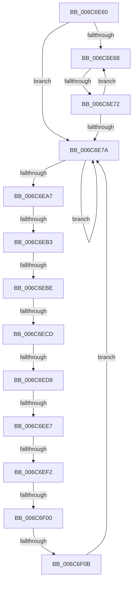

# strcat

- RVA: `0x006C6E60`–`0x006C6F13` (길이 `179` bytes)
- VA: `0x00000001406C6E60`
- 실행 섹션: `.text`
- PDB 이름 있음: `예`; PDB Function 태그: `아니요`
- unwind 정보 RVA: `0x000BFAC8`
- 디코드: `48`개 명령, `179/179` bytes 표시
- 미해석 바이트: `0` (있으면 어셈블리에 `.byte`로 보존)

> 이 문서는 커널 이미지의 기계어와 PDB 기호를 분석해 생성했습니다. 4번과 5번은 함수 원형과 자료형을 바이너리 사용 방식에서 추정한 C 해석이며 원본 소스 복구 결과는 아닙니다.

## 1. Dependencies

- 직접 호출 지점: **0**; 고유 호출 대상: **0**
- 직접 호출자로 확인된 함수: **0**
- RIP 상대 이미지 참조: **0**

### Outgoing calls
- 직접 디코드된 call 명령이 없습니다.

### Direct callers
- 이 함수 시작 RVA로 연결되는 직접 call은 확인되지 않았습니다. 간접 호출은 완전히 역산할 수 없습니다.

### Static image references
- 디코드된 RIP-relative 메모리 참조가 없습니다.

## 2. Other-region calls and transfers

- 다른 실행 섹션으로 향하는 call: **0**
- call이 아닌 외부 분기/꼬리 이동: **9**
  - `0x006C6E6C` → [strcpy + 0x3](strcpy_function_006C6F20.md) (`tail-transfer`)
  - `0x006C6EAD` → [strcpy + 0x3](strcpy_function_006C6F20.md) (`tail-transfer`)
  - `0x006C6EB8` → [strcpy + 0x3](strcpy_function_006C6F20.md) (`tail-transfer`)
  - `0x006C6EC7` → [strcpy + 0x3](strcpy_function_006C6F20.md) (`tail-transfer`)
  - `0x006C6ED2` → [strcpy + 0x3](strcpy_function_006C6F20.md) (`tail-transfer`)
  - `0x006C6EE1` → [strcpy + 0x3](strcpy_function_006C6F20.md) (`tail-transfer`)
  - `0x006C6EEC` → [strcpy + 0x3](strcpy_function_006C6F20.md) (`tail-transfer`)
  - `0x006C6EFA` → [strcpy + 0x3](strcpy_function_006C6F20.md) (`tail-transfer`)
  - `0x006C6F05` → [strcpy + 0x3](strcpy_function_006C6F20.md) (`tail-transfer`)

## 3. Assembly (complete function range)

```asm
006C6E60  4C 8B D9                        mov r11, rcx
006C6E63  F6 C1 07                        test cl, 7
006C6E66  74 12                           je 0x1406c6e7a
006C6E68  8A 01                           mov al, byte ptr [rcx]
006C6E6A  84 C0                           test al, al
006C6E6C  0F 84 B1 00 00 00               je 0x1406c6f23
006C6E72  48 FF C1                        inc rcx
006C6E75  F6 C1 07                        test cl, 7
006C6E78  75 EE                           jne 0x1406c6e68
006C6E7A  48 8B 01                        mov rax, qword ptr [rcx]
006C6E7D  4C 8B D0                        mov r10, rax
006C6E80  49 B9 FF FE FE FE FE FE FE 7E   movabs r9, 0x7efefefefefefeff
006C6E8A  4D 03 CA                        add r9, r10
006C6E8D  49 83 F2 FF                     xor r10, 0xffffffffffffffff
006C6E91  4D 33 D1                        xor r10, r9
006C6E94  48 83 C1 08                     add rcx, 8
006C6E98  49 B9 00 01 01 01 01 01 01 81   movabs r9, 0x8101010101010100
006C6EA2  4D 85 D1                        test r9, r10
006C6EA5  74 D3                           je 0x1406c6e7a
006C6EA7  48 83 E9 08                     sub rcx, 8
006C6EAB  84 C0                           test al, al
006C6EAD  0F 84 70 00 00 00               je 0x1406c6f23
006C6EB3  48 FF C1                        inc rcx
006C6EB6  84 E4                           test ah, ah
006C6EB8  0F 84 65 00 00 00               je 0x1406c6f23
006C6EBE  48 FF C1                        inc rcx
006C6EC1  48 C1 E8 10                     shr rax, 0x10
006C6EC5  84 C0                           test al, al
006C6EC7  0F 84 56 00 00 00               je 0x1406c6f23
006C6ECD  48 FF C1                        inc rcx
006C6ED0  84 E4                           test ah, ah
006C6ED2  0F 84 4B 00 00 00               je 0x1406c6f23
006C6ED8  48 FF C1                        inc rcx
006C6EDB  48 C1 E8 10                     shr rax, 0x10
006C6EDF  84 C0                           test al, al
006C6EE1  0F 84 3C 00 00 00               je 0x1406c6f23
006C6EE7  48 FF C1                        inc rcx
006C6EEA  84 E4                           test ah, ah
006C6EEC  0F 84 31 00 00 00               je 0x1406c6f23
006C6EF2  48 FF C1                        inc rcx
006C6EF5  C1 E8 10                        shr eax, 0x10
006C6EF8  84 C0                           test al, al
006C6EFA  0F 84 23 00 00 00               je 0x1406c6f23
006C6F00  48 FF C1                        inc rcx
006C6F03  84 E4                           test ah, ah
006C6F05  0F 84 18 00 00 00               je 0x1406c6f23
006C6F0B  48 FF C1                        inc rcx
006C6F0E  E9 67 FF FF FF                  jmp 0x1406c6e7a
```

## 4. C-style interpretation (structured pseudocode)

```c
__int64 __fastcall strcat(__int64 a1)
{
    __int64 result;
    __int64 v_r10;

    if ((((unsigned __int8)(a1)) & (7)) == 0) goto loc_006C6E7A;
loc_006C6E68:
    a1 = (a1) + 1;
    if ((((unsigned __int8)(a1)) & (7)) != 0) goto loc_006C6E68;
loc_006C6E7A:
    a4 = (a4) + (*(unsigned __int64 *)(a1));
    v_r10 = (*(unsigned __int64 *)(a1)) ^ (-1);
    v_r10 = (v_r10) ^ (a4);
    a1 = (a1) + (8);
    if (((a4) & (v_r10)) == 0) goto loc_006C6E7A;
    a1 = (a1) - (8);
    a1 = (a1) + 1;
    a1 = (a1) + 1;
    result = (*(unsigned __int64 *)(a1)) >> (16);
    a1 = (a1) + 1;
    a1 = (a1) + 1;
    result = (result) >> (16);
    a1 = (a1) + 1;
    a1 = (a1) + 1;
    result = (unsigned int)((result) >> (16));
    a1 = (a1) + 1;
    a1 = (a1) + 1;
    goto loc_006C6E7A;
}
```

## 5. (Beta) C Style

```c
int64_t strcat(int64_t Arg1)
{
    int64_t result;
    int64_t local_r10;

    if ((((uint8_t)(Arg1)) & (7)) == 0) goto loc_006C6E7A;
loc_006C6E68:
    Arg1 = (Arg1) + 1;
    if ((((uint8_t)(Arg1)) & (7)) != 0) goto loc_006C6E68;
loc_006C6E7A:
    a4 = (a4) + (*(uint64_t *)(Arg1));
    local_r10 = (*(uint64_t *)(Arg1)) ^ (-1);
    local_r10 = (local_r10) ^ (a4);
    Arg1 = (Arg1) + (8);
    if (((a4) & (local_r10)) == 0) goto loc_006C6E7A;
    Arg1 = (Arg1) - (8);
    Arg1 = (Arg1) + 1;
    Arg1 = (Arg1) + 1;
    result = (*(uint64_t *)(Arg1)) >> (16);
    Arg1 = (Arg1) + 1;
    Arg1 = (Arg1) + 1;
    result = (result) >> (16);
    Arg1 = (Arg1) + 1;
    Arg1 = (Arg1) + 1;
    result = (uint32_t)((result) >> (16));
    Arg1 = (Arg1) + 1;
    Arg1 = (Arg1) + 1;
    goto loc_006C6E7A;
}
```

## 6. Execution-region graph

[열기: 2D/3D 그래프와 함수 탐색 컨트롤 패널](../../../control-panel.html?section=text&rva=0x006C6E60&view=graph)

- 2D 그래프는 위에서 아래로 흐르고, 3D 그래프는 빈 공간을 드래그해 회전합니다. Shift+드래그는 이동, 휠은 확대·축소, 함수 노드 선택은 대상 보고서 이동입니다.

### Static fallback


