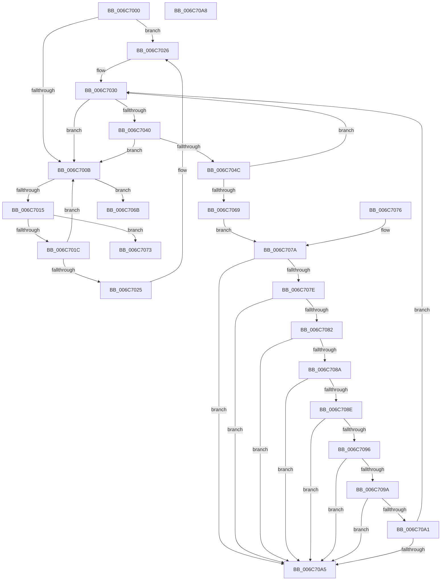

# strcmp

- RVA: `0x006C7000`–`0x006C70B0` (길이 `176` bytes)
- VA: `0x00000001406C7000`
- 실행 섹션: `.text`
- PDB 이름 있음: `예`; PDB Function 태그: `아니요`
- unwind 정보 RVA: `0x000BFAC8`
- 디코드: `61`개 명령, `176/176` bytes 표시
- 미해석 바이트: `0` (있으면 어셈블리에 `.byte`로 보존)

> 이 문서는 커널 이미지의 기계어와 PDB 기호를 분석해 생성했습니다. 4번과 5번은 함수 원형과 자료형을 바이너리 사용 방식에서 추정한 C 해석이며 원본 소스 복구 결과는 아닙니다.

## 1. Dependencies

- 직접 호출 지점: **0**; 고유 호출 대상: **0**
- 직접 호출자로 확인된 함수: **6**
- RIP 상대 이미지 참조: **0**

### Outgoing calls
- 직접 디코드된 call 명령이 없습니다.

### Direct callers
- [PopWatchdogDumpControlRoutine](../5D/PopWatchdogDumpControlRoutine_function_005DFAA0.md) at `0x005DFAD1`
- [ExpSetBootEntry](../../page/7C/ExpSetBootEntry_function_007CBD2C.md) at `0x007CBEFF`
- [NtEnumerateBootEntries](../../page/A2/NtEnumerateBootEntries_function_00A25040.md) at `0x00A25568`
- [ViXdvDriverLoadImage](../../pagevrfy/B9/ViXdvDriverLoadImage_function_00B9A9A0.md) at `0x00B9AA08`
- [ViXdvDriverLoadImage](../../pagevrfy/B9/ViXdvDriverLoadImage_function_00B9A9A0.md) at `0x00B9AA56`
- [ViXdvDriverLoadImage](../../pagevrfy/B9/ViXdvDriverLoadImage_function_00B9A9A0.md) at `0x00B9AA90`
- [ViXdvDriverLoadImage](../../pagevrfy/B9/ViXdvDriverLoadImage_function_00B9A9A0.md) at `0x00B9AAC6`
- [ViXdvDriverLoadImage](../../pagevrfy/B9/ViXdvDriverLoadImage_function_00B9A9A0.md) at `0x00B9AB0A`
- [HdlspDispatch](../../pagehdls/BB/HdlspDispatch_function_00BBD320.md) at `0x00BBD50E`
- [HdlspDispatch](../../pagehdls/BB/HdlspDispatch_function_00BBD320.md) at `0x00BBD523`
- [HalpAcpiFindRsdp](../../init/C1/HalpAcpiFindRsdp_function_00C1DF48.md) at `0x00C1DF99`

### Static image references
- 디코드된 RIP-relative 메모리 참조가 없습니다.

## 2. Other-region calls and transfers

- 다른 실행 섹션으로 향하는 call: **0**
- 별도 외부 분기/꼬리 이동을 확인하지 못했습니다.

## 3. Assembly (complete function range)

```asm
006C7000  48 2B D1                        sub rdx, rcx
006C7003  4C 8B CA                        mov r9, rdx
006C7006  F6 C1 07                        test cl, 7
006C7009  74 1B                           je 0x1406c7026
006C700B  8A 01                           mov al, byte ptr [rcx]
006C700D  41 8A 14 09                     mov dl, byte ptr [r9 + rcx]
006C7011  3A C2                           cmp al, dl
006C7013  75 56                           jne 0x1406c706b
006C7015  48 FF C1                        inc rcx
006C7018  84 C0                           test al, al
006C701A  74 57                           je 0x1406c7073
006C701C  48 F7 C1 07 00 00 00            test rcx, 7
006C7023  75 E6                           jne 0x1406c700b
006C7025  90                              nop
006C7026  49 BB 00 01 01 01 01 01 01 81   movabs r11, 0x8101010101010100
006C7030  49 8D 14 09                     lea rdx, [r9 + rcx]
006C7034  66 81 E2 FF 0F                  and dx, 0xfff
006C7039  66 81 FA F8 0F                  cmp dx, 0xff8
006C703E  77 CB                           ja 0x1406c700b
006C7040  48 8B 01                        mov rax, qword ptr [rcx]
006C7043  49 8B 14 09                     mov rdx, qword ptr [r9 + rcx]
006C7047  48 3B C2                        cmp rax, rdx
006C704A  75 BF                           jne 0x1406c700b
006C704C  49 BA FF FE FE FE FE FE FE 7E   movabs r10, 0x7efefefefefefeff
006C7056  4C 03 D2                        add r10, rdx
006C7059  48 83 F0 FF                     xor rax, 0xffffffffffffffff
006C705D  48 83 C1 08                     add rcx, 8
006C7061  49 33 C2                        xor rax, r10
006C7064  49 85 C3                        test r11, rax
006C7067  74 C7                           je 0x1406c7030
006C7069  EB 0F                           jmp 0x1406c707a
006C706B  48 1B C0                        sbb rax, rax
006C706E  48 83 D8 FF                     sbb rax, -1
006C7072  C3                              ret
006C7073  33 C0                           xor eax, eax
006C7075  C3                              ret
006C7076  66 66 66 90                     nop
006C707A  84 D2                           test dl, dl
006C707C  74 27                           je 0x1406c70a5
006C707E  84 F6                           test dh, dh
006C7080  74 23                           je 0x1406c70a5
006C7082  48 C1 EA 10                     shr rdx, 0x10
006C7086  84 D2                           test dl, dl
006C7088  74 1B                           je 0x1406c70a5
006C708A  84 F6                           test dh, dh
006C708C  74 17                           je 0x1406c70a5
006C708E  48 C1 EA 10                     shr rdx, 0x10
006C7092  84 D2                           test dl, dl
006C7094  74 0F                           je 0x1406c70a5
006C7096  84 F6                           test dh, dh
006C7098  74 0B                           je 0x1406c70a5
006C709A  C1 EA 10                        shr edx, 0x10
006C709D  84 D2                           test dl, dl
006C709F  74 04                           je 0x1406c70a5
006C70A1  84 F6                           test dh, dh
006C70A3  75 8B                           jne 0x1406c7030
006C70A5  33 C0                           xor eax, eax
006C70A7  C3                              ret
006C70A8  48 1B C0                        sbb rax, rax
006C70AB  48 83 D8 FF                     sbb rax, -1
006C70AF  C3                              ret
```

## 4. C-style interpretation (structured pseudocode)

```c
__int64 __fastcall strcmp(__int64 a1, __int64 a2)
{
    __int64 result;
    __int64 v_r10;

    a2 = (a2) - (a1);
    if ((((unsigned __int8)(a1)) & (7)) == 0) goto loc_006C7026;
loc_006C700B:
    if (((unsigned __int8)(*(unsigned __int8 *)(a1))) != ((unsigned __int8)(*(unsigned __int8 *)(a2 + a1 * 1)))) goto loc_006C706B;
    a1 = (a1) + 1;
    if ((unsigned __int8)(*(unsigned __int8 *)(a1)) == 0) goto loc_006C7073;
    if (((a1) & (7)) != 0) goto loc_006C700B;
loc_006C7026:
loc_006C7030:
    a2 = (unsigned __int16)((a2 + a1 * 1) & (0xFFFULL));
    if (((unsigned __int16)(a2)) > 0xFF8ULL) goto loc_006C700B;
    if ((*(unsigned __int64 *)(a1)) != (*(unsigned __int64 *)(a2 + a1 * 1))) goto loc_006C700B;
    v_r10 = (v_r10) + (*(unsigned __int64 *)(a2 + a1 * 1));
    result = (*(unsigned __int64 *)(a1)) ^ (-1);
    a1 = (a1) + (8);
    result = (result) ^ (v_r10);
    if (((v_r11) & (result)) == 0) goto loc_006C7030;
    goto loc_006C707A;
loc_006C706B:
    return result;
loc_006C7073:
    result = 0;
    return result;
loc_006C707A:
    if ((unsigned __int8)(*(unsigned __int64 *)(a2 + a1 * 1)) == 0) goto loc_006C70A5;
    if ((unsigned __int8)(*(unsigned __int64 *)(a2 + a1 * 1)) == 0) goto loc_006C70A5;
    a2 = (*(unsigned __int64 *)(a2 + a1 * 1)) >> (16);
    if ((unsigned __int8)(a2) == 0) goto loc_006C70A5;
    if ((unsigned __int8)(a2) == 0) goto loc_006C70A5;
    a2 = (a2) >> (16);
    if ((unsigned __int8)(a2) == 0) goto loc_006C70A5;
    if ((unsigned __int8)(a2) == 0) goto loc_006C70A5;
    a2 = (unsigned int)((a2) >> (16));
    if ((unsigned __int8)(a2) == 0) goto loc_006C70A5;
    if ((unsigned __int8)(a2) != 0) goto loc_006C7030;
loc_006C70A5:
    result = 0;
    return result;
}
```

## 5. (Beta) C Style

```c
int64_t strcmp(int64_t Arg1, void *Arg2)
{
    uint8_t *arg2 = (uint8_t *)Arg2;

    int64_t result;
    int64_t local_r10;

    Arg2 = (Arg2) - (Arg1);
    if ((((uint8_t)(Arg1)) & (7)) == 0) goto loc_006C7026;
loc_006C700B:
    if (((uint8_t)(*(uint8_t *)(Arg1))) != ((uint8_t)(*(uint8_t *)(arg2 + Arg1 * 1)))) goto loc_006C706B;
    Arg1 = (Arg1) + 1;
    if ((uint8_t)(*(uint8_t *)(Arg1)) == 0) goto loc_006C7073;
    if (((Arg1) & (7)) != 0) goto loc_006C700B;
loc_006C7026:
loc_006C7030:
    Arg2 = (uint16_t)((Arg2 + Arg1 * 1) & (0xFFFULL));
    if (((uint16_t)(Arg2)) > 0xFF8ULL) goto loc_006C700B;
    if ((*(uint64_t *)(Arg1)) != (*(uint64_t *)(arg2 + Arg1 * 1))) goto loc_006C700B;
    local_r10 = (local_r10) + (*(uint64_t *)(arg2 + Arg1 * 1));
    result = (*(uint64_t *)(Arg1)) ^ (-1);
    Arg1 = (Arg1) + (8);
    result = (result) ^ (local_r10);
    if (((local_r11) & (result)) == 0) goto loc_006C7030;
    goto loc_006C707A;
loc_006C706B:
    return result;
loc_006C7073:
    result = 0;
    return result;
loc_006C707A:
    if ((uint8_t)(*(uint64_t *)(arg2 + Arg1 * 1)) == 0) goto loc_006C70A5;
    if ((uint8_t)(*(uint64_t *)(arg2 + Arg1 * 1)) == 0) goto loc_006C70A5;
    Arg2 = (*(uint64_t *)(arg2 + Arg1 * 1)) >> (16);
    if ((uint8_t)(Arg2) == 0) goto loc_006C70A5;
    if ((uint8_t)(Arg2) == 0) goto loc_006C70A5;
    Arg2 = (Arg2) >> (16);
    if ((uint8_t)(Arg2) == 0) goto loc_006C70A5;
    if ((uint8_t)(Arg2) == 0) goto loc_006C70A5;
    Arg2 = (uint32_t)((Arg2) >> (16));
    if ((uint8_t)(Arg2) == 0) goto loc_006C70A5;
    if ((uint8_t)(Arg2) != 0) goto loc_006C7030;
loc_006C70A5:
    result = 0;
    return result;
}
```

### 관측된 메모리 오프셋

구조체 형식이 확인되지 않은 접근은 인자 기준의 오프셋으로만 기록했습니다.

| 기준 인자 | 오프셋 표현 | 폭 (bit) | 접근 |
|---|---:|---:|---|
| `Arg2` | `+ 0x0 + rcx*1` | `8` | `R` |
| `Arg2` | `+ 0x0 + rcx*1` | `64` | `R` |

## 6. Execution-region graph

[열기: 2D/3D 그래프와 함수 탐색 컨트롤 패널](../../../control-panel.html?section=text&rva=0x006C7000&view=graph)

- 2D 그래프는 위에서 아래로 흐르고, 3D 그래프는 빈 공간을 드래그해 회전합니다. Shift+드래그는 이동, 휠은 확대·축소, 함수 노드 선택은 대상 보고서 이동입니다.

### Static fallback


