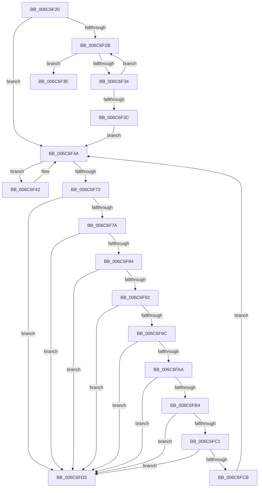

# strcpy

- RVA: `0x006C6F20`–`0x006C6FD7` (길이 `183` bytes)
- VA: `0x00000001406C6F20`
- 실행 섹션: `.text`
- PDB 이름 있음: `예`; PDB Function 태그: `아니요`
- unwind 정보 RVA: `0x000BFAC8`
- 디코드: `63`개 명령, `183/183` bytes 표시
- 미해석 바이트: `0` (있으면 어셈블리에 `.byte`로 보존)

> 이 문서는 커널 이미지의 기계어와 PDB 기호를 분석해 생성했습니다. 4번과 5번은 함수 원형과 자료형을 바이너리 사용 방식에서 추정한 C 해석이며 원본 소스 복구 결과는 아닙니다.

## 1. Dependencies

- 직접 호출 지점: **0**; 고유 호출 대상: **0**
- 직접 호출자로 확인된 함수: **0**
- RIP 상대 이미지 참조: **0**

### Outgoing calls
- 직접 디코드된 call 명령이 없습니다.

### Direct callers
- 이 함수 시작 RVA로 연결되는 직접 call은 확인되지 않았습니다. 간접 호출은 완전히 역산할 수 없습니다.

### Static image references
- 디코드된 RIP-relative 메모리 참조가 없습니다.

## 2. Other-region calls and transfers

- 다른 실행 섹션으로 향하는 call: **0**
- 별도 외부 분기/꼬리 이동을 확인하지 못했습니다.

## 3. Assembly (complete function range)

```asm
006C6F20  4C 8B D9                        mov r11, rcx
006C6F23  48 2B CA                        sub rcx, rdx
006C6F26  F6 C2 07                        test dl, 7
006C6F29  74 1F                           je 0x1406c6f4a
006C6F2B  8A 02                           mov al, byte ptr [rdx]
006C6F2D  88 04 0A                        mov byte ptr [rdx + rcx], al
006C6F30  84 C0                           test al, al
006C6F32  74 0A                           je 0x1406c6f3e
006C6F34  48 FF C2                        inc rdx
006C6F37  F6 C2 07                        test dl, 7
006C6F3A  75 EF                           jne 0x1406c6f2b
006C6F3C  EB 0C                           jmp 0x1406c6f4a
006C6F3E  49 8B C3                        mov rax, r11
006C6F41  C3                              ret
006C6F42  48 89 04 0A                     mov qword ptr [rdx + rcx], rax
006C6F46  48 83 C2 08                     add rdx, 8
006C6F4A  48 8B 02                        mov rax, qword ptr [rdx]
006C6F4D  49 B9 FF FE FE FE FE FE FE 7E   movabs r9, 0x7efefefefefefeff
006C6F57  4C 03 C8                        add r9, rax
006C6F5A  4C 8B D0                        mov r10, rax
006C6F5D  49 83 F2 FF                     xor r10, 0xffffffffffffffff
006C6F61  4D 33 D1                        xor r10, r9
006C6F64  49 B9 00 01 01 01 01 01 01 81   movabs r9, 0x8101010101010100
006C6F6E  4D 85 D1                        test r9, r10
006C6F71  74 CF                           je 0x1406c6f42
006C6F73  84 C0                           test al, al
006C6F75  88 04 0A                        mov byte ptr [rdx + rcx], al
006C6F78  74 59                           je 0x1406c6fd3
006C6F7A  48 FF C2                        inc rdx
006C6F7D  84 E4                           test ah, ah
006C6F7F  88 24 0A                        mov byte ptr [rdx + rcx], ah
006C6F82  74 4F                           je 0x1406c6fd3
006C6F84  48 FF C2                        inc rdx
006C6F87  48 C1 E8 10                     shr rax, 0x10
006C6F8B  84 C0                           test al, al
006C6F8D  88 04 0A                        mov byte ptr [rdx + rcx], al
006C6F90  74 41                           je 0x1406c6fd3
006C6F92  48 FF C2                        inc rdx
006C6F95  84 E4                           test ah, ah
006C6F97  88 24 0A                        mov byte ptr [rdx + rcx], ah
006C6F9A  74 37                           je 0x1406c6fd3
006C6F9C  48 FF C2                        inc rdx
006C6F9F  48 C1 E8 10                     shr rax, 0x10
006C6FA3  84 C0                           test al, al
006C6FA5  88 04 0A                        mov byte ptr [rdx + rcx], al
006C6FA8  74 29                           je 0x1406c6fd3
006C6FAA  48 FF C2                        inc rdx
006C6FAD  84 E4                           test ah, ah
006C6FAF  88 24 0A                        mov byte ptr [rdx + rcx], ah
006C6FB2  74 1F                           je 0x1406c6fd3
006C6FB4  48 FF C2                        inc rdx
006C6FB7  C1 E8 10                        shr eax, 0x10
006C6FBA  84 C0                           test al, al
006C6FBC  88 04 0A                        mov byte ptr [rdx + rcx], al
006C6FBF  74 12                           je 0x1406c6fd3
006C6FC1  48 FF C2                        inc rdx
006C6FC4  84 E4                           test ah, ah
006C6FC6  88 24 0A                        mov byte ptr [rdx + rcx], ah
006C6FC9  74 08                           je 0x1406c6fd3
006C6FCB  48 FF C2                        inc rdx
006C6FCE  E9 77 FF FF FF                  jmp 0x1406c6f4a
006C6FD3  49 8B C3                        mov rax, r11
006C6FD6  C3                              ret
```

## 4. C-style interpretation (structured pseudocode)

```c
__int64 __fastcall strcpy(__int64 a1, __int64 a2)
{
    __int64 result;
    __int64 v_r10;

    a1 = (a1) - (a2);
    if ((((unsigned __int8)(a2)) & (7)) == 0) goto loc_006C6F4A;
loc_006C6F2B:
    *(unsigned __int8 *)(a2 + a1 * 1) = (unsigned __int8)(*(unsigned __int8 *)(a2));
    if ((unsigned __int8)(*(unsigned __int8 *)(a2)) == 0) goto loc_006C6F3E;
    a2 = (a2) + 1;
    if ((((unsigned __int8)(a2)) & (7)) != 0) goto loc_006C6F2B;
    goto loc_006C6F4A;
loc_006C6F3E:
    return a1;
loc_006C6F42:
    *(unsigned __int64 *)(a2 + a1 * 1) = a1;
    a2 = (a2) + (8);
loc_006C6F4A:
    a4 = (a4) + (*(unsigned __int64 *)(a2));
    v_r10 = (*(unsigned __int64 *)(a2)) ^ (-1);
    v_r10 = (v_r10) ^ (a4);
    if (((a4) & (v_r10)) == 0) goto loc_006C6F42;
    *(unsigned __int8 *)(a2 + a1 * 1) = (unsigned __int8)(*(unsigned __int64 *)(a2));
    if ((unsigned __int8)(*(unsigned __int64 *)(a2)) == 0) goto loc_006C6FD3;
    a2 = (a2) + 1;
    *(unsigned __int8 *)(a2 + a1 * 1) = (unsigned __int8)(*(unsigned __int64 *)(a2));
    if ((unsigned __int8)(*(unsigned __int64 *)(a2)) == 0) goto loc_006C6FD3;
    a2 = (a2) + 1;
    result = (*(unsigned __int64 *)(a2)) >> (16);
    *(unsigned __int8 *)(a2 + a1 * 1) = (unsigned __int8)(result);
    if ((unsigned __int8)(result) == 0) goto loc_006C6FD3;
    a2 = (a2) + 1;
    *(unsigned __int8 *)(a2 + a1 * 1) = (unsigned __int8)(result);
    if ((unsigned __int8)(result) == 0) goto loc_006C6FD3;
    a2 = (a2) + 1;
    result = (result) >> (16);
    *(unsigned __int8 *)(a2 + a1 * 1) = (unsigned __int8)(result);
    if ((unsigned __int8)(result) == 0) goto loc_006C6FD3;
    a2 = (a2) + 1;
    *(unsigned __int8 *)(a2 + a1 * 1) = (unsigned __int8)(result);
    if ((unsigned __int8)(result) == 0) goto loc_006C6FD3;
    a2 = (a2) + 1;
    result = (unsigned int)((result) >> (16));
    *(unsigned __int8 *)(a2 + a1 * 1) = (unsigned __int8)(result);
    if ((unsigned __int8)(result) == 0) goto loc_006C6FD3;
    a2 = (a2) + 1;
    *(unsigned __int8 *)(a2 + a1 * 1) = (unsigned __int8)(result);
    if ((unsigned __int8)(result) == 0) goto loc_006C6FD3;
    a2 = (a2) + 1;
    goto loc_006C6F4A;
loc_006C6FD3:
    return a1;
}
```

## 5. (Beta) C Style

```c
int64_t strcpy(int64_t Arg1, int64_t Arg2)
{
    int64_t result;
    int64_t local_r10;

    Arg1 = (Arg1) - (Arg2);
    if ((((uint8_t)(Arg2)) & (7)) == 0) goto loc_006C6F4A;
loc_006C6F2B:
    *(uint8_t *)(Arg2 + Arg1 * 1) = (uint8_t)(*(uint8_t *)(Arg2));
    if ((uint8_t)(*(uint8_t *)(Arg2)) == 0) goto loc_006C6F3E;
    Arg2 = (Arg2) + 1;
    if ((((uint8_t)(Arg2)) & (7)) != 0) goto loc_006C6F2B;
    goto loc_006C6F4A;
loc_006C6F3E:
    return Arg1;
loc_006C6F42:
    *(uint64_t *)(Arg2 + Arg1 * 1) = Arg1;
    Arg2 = (Arg2) + (8);
loc_006C6F4A:
    a4 = (a4) + (*(uint64_t *)(Arg2));
    local_r10 = (*(uint64_t *)(Arg2)) ^ (-1);
    local_r10 = (local_r10) ^ (a4);
    if (((a4) & (local_r10)) == 0) goto loc_006C6F42;
    *(uint8_t *)(Arg2 + Arg1 * 1) = (uint8_t)(*(uint64_t *)(Arg2));
    if ((uint8_t)(*(uint64_t *)(Arg2)) == 0) goto loc_006C6FD3;
    Arg2 = (Arg2) + 1;
    *(uint8_t *)(Arg2 + Arg1 * 1) = (uint8_t)(*(uint64_t *)(Arg2));
    if ((uint8_t)(*(uint64_t *)(Arg2)) == 0) goto loc_006C6FD3;
    Arg2 = (Arg2) + 1;
    result = (*(uint64_t *)(Arg2)) >> (16);
    *(uint8_t *)(Arg2 + Arg1 * 1) = (uint8_t)(result);
    if ((uint8_t)(result) == 0) goto loc_006C6FD3;
    Arg2 = (Arg2) + 1;
    *(uint8_t *)(Arg2 + Arg1 * 1) = (uint8_t)(result);
    if ((uint8_t)(result) == 0) goto loc_006C6FD3;
    Arg2 = (Arg2) + 1;
    result = (result) >> (16);
    *(uint8_t *)(Arg2 + Arg1 * 1) = (uint8_t)(result);
    if ((uint8_t)(result) == 0) goto loc_006C6FD3;
    Arg2 = (Arg2) + 1;
    *(uint8_t *)(Arg2 + Arg1 * 1) = (uint8_t)(result);
    if ((uint8_t)(result) == 0) goto loc_006C6FD3;
    Arg2 = (Arg2) + 1;
    result = (uint32_t)((result) >> (16));
    *(uint8_t *)(Arg2 + Arg1 * 1) = (uint8_t)(result);
    if ((uint8_t)(result) == 0) goto loc_006C6FD3;
    Arg2 = (Arg2) + 1;
    *(uint8_t *)(Arg2 + Arg1 * 1) = (uint8_t)(result);
    if ((uint8_t)(result) == 0) goto loc_006C6FD3;
    Arg2 = (Arg2) + 1;
    goto loc_006C6F4A;
loc_006C6FD3:
    return Arg1;
}
```

## 6. Execution-region graph

[열기: 2D/3D 그래프와 함수 탐색 컨트롤 패널](../../../control-panel.html?section=text&rva=0x006C6F20&view=graph)

- 2D 그래프는 위에서 아래로 흐르고, 3D 그래프는 빈 공간을 드래그해 회전합니다. Shift+드래그는 이동, 휠은 확대·축소, 함수 노드 선택은 대상 보고서 이동입니다.

### Static fallback


