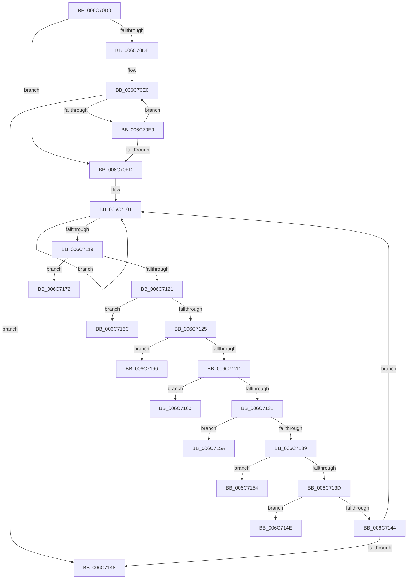

# strlen

- RVA: `0x006C70D0`–`0x006C7178` (길이 `168` bytes)
- VA: `0x00000001406C70D0`
- 실행 섹션: `.text`
- PDB 이름 있음: `예`; PDB Function 태그: `아니요`
- unwind 정보 RVA: `0x000BFAC8`
- 디코드: `57`개 명령, `168/168` bytes 표시
- 미해석 바이트: `0` (있으면 어셈블리에 `.byte`로 보존)

> 이 문서는 커널 이미지의 기계어와 PDB 기호를 분석해 생성했습니다. 4번과 5번은 함수 원형과 자료형을 바이너리 사용 방식에서 추정한 C 해석이며 원본 소스 복구 결과는 아닙니다.

## 1. Dependencies

- 직접 호출 지점: **0**; 고유 호출 대상: **0**
- 직접 호출자로 확인된 함수: **4**
- RIP 상대 이미지 참조: **0**

### Outgoing calls
- 직접 디코드된 call 명령이 없습니다.

### Direct callers
- [HalMatchAcpiOemId](../3F/HalMatchAcpiOemId_function_003F6A90.md) at `0x003F6B50`
- [HalMatchAcpiOemId](../3F/HalMatchAcpiOemId_function_003F6A90.md) at `0x003F6B85`
- [RtlInitAnsiString](../47/RtlInitAnsiString_function_00470F40.md) at `0x00470F59`
- [RtlInitAnsiStringEx](../4B/RtlInitAnsiStringEx_function_004B3220.md) at `0x004B3242`
- [RtlAppendAsciizToString](../../page/78/RtlAppendAsciizToString_function_0078B910.md) at `0x0078B92D`

### Static image references
- 디코드된 RIP-relative 메모리 참조가 없습니다.

## 2. Other-region calls and transfers

- 다른 실행 섹션으로 향하는 call: **0**
- 별도 외부 분기/꼬리 이동을 확인하지 못했습니다.

## 3. Assembly (complete function range)

```asm
006C70D0  48 8B C1                        mov rax, rcx
006C70D3  48 F7 D9                        neg rcx
006C70D6  48 A9 07 00 00 00               test rax, 7
006C70DC  74 0F                           je 0x1406c70ed
006C70DE  66 90                           nop
006C70E0  8A 10                           mov dl, byte ptr [rax]
006C70E2  48 FF C0                        inc rax
006C70E5  84 D2                           test dl, dl
006C70E7  74 5F                           je 0x1406c7148
006C70E9  A8 07                           test al, 7
006C70EB  75 F3                           jne 0x1406c70e0
006C70ED  49 B8 FF FE FE FE FE FE FE 7E   movabs r8, 0x7efefefefefefeff
006C70F7  49 BB 00 01 01 01 01 01 01 81   movabs r11, 0x8101010101010100
006C7101  48 8B 10                        mov rdx, qword ptr [rax]
006C7104  4D 8B C8                        mov r9, r8
006C7107  48 83 C0 08                     add rax, 8
006C710B  4C 03 CA                        add r9, rdx
006C710E  48 F7 D2                        not rdx
006C7111  49 33 D1                        xor rdx, r9
006C7114  49 23 D3                        and rdx, r11
006C7117  74 E8                           je 0x1406c7101
006C7119  48 8B 50 F8                     mov rdx, qword ptr [rax - 8]
006C711D  84 D2                           test dl, dl
006C711F  74 51                           je 0x1406c7172
006C7121  84 F6                           test dh, dh
006C7123  74 47                           je 0x1406c716c
006C7125  48 C1 EA 10                     shr rdx, 0x10
006C7129  84 D2                           test dl, dl
006C712B  74 39                           je 0x1406c7166
006C712D  84 F6                           test dh, dh
006C712F  74 2F                           je 0x1406c7160
006C7131  48 C1 EA 10                     shr rdx, 0x10
006C7135  84 D2                           test dl, dl
006C7137  74 21                           je 0x1406c715a
006C7139  84 F6                           test dh, dh
006C713B  74 17                           je 0x1406c7154
006C713D  C1 EA 10                        shr edx, 0x10
006C7140  84 D2                           test dl, dl
006C7142  74 0A                           je 0x1406c714e
006C7144  84 F6                           test dh, dh
006C7146  75 B9                           jne 0x1406c7101
006C7148  48 8D 44 08 FF                  lea rax, [rax + rcx - 1]
006C714D  C3                              ret
006C714E  48 8D 44 08 FE                  lea rax, [rax + rcx - 2]
006C7153  C3                              ret
006C7154  48 8D 44 08 FD                  lea rax, [rax + rcx - 3]
006C7159  C3                              ret
006C715A  48 8D 44 08 FC                  lea rax, [rax + rcx - 4]
006C715F  C3                              ret
006C7160  48 8D 44 08 FB                  lea rax, [rax + rcx - 5]
006C7165  C3                              ret
006C7166  48 8D 44 08 FA                  lea rax, [rax + rcx - 6]
006C716B  C3                              ret
006C716C  48 8D 44 08 F9                  lea rax, [rax + rcx - 7]
006C7171  C3                              ret
006C7172  48 8D 44 08 F8                  lea rax, [rax + rcx - 8]
006C7177  C3                              ret
```

## 4. C-style interpretation (structured pseudocode)

```c
__int64 __fastcall strlen(__int64 a1)
{
    __int64 result;

    a1 = -(a1);
    if (((a1) & (7)) == 0) goto loc_006C70ED;
loc_006C70E0:
    result = (a1) + 1;
    if ((unsigned __int8)(*(unsigned __int8 *)(a1)) == 0) goto loc_006C7148;
    if ((((unsigned __int8)(result)) & (7)) != 0) goto loc_006C70E0;
loc_006C70ED:
loc_006C7101:
    result = (result) + (8);
    a4 = (a3) + (*(unsigned __int64 *)(result));
    a2 = ~(*(unsigned __int64 *)(result));
    a2 = (a2) ^ (a4);
    a2 = (a2) & (v_r11);
    if (condition_is_equal) goto loc_006C7101;
    if ((unsigned __int8)(*(unsigned __int64 *)(result - 8)) == 0) goto loc_006C7172;
    if ((unsigned __int8)(*(unsigned __int64 *)(result - 8)) == 0) goto loc_006C716C;
    a2 = (*(unsigned __int64 *)(result - 8)) >> (16);
    if ((unsigned __int8)(a2) == 0) goto loc_006C7166;
    if ((unsigned __int8)(a2) == 0) goto loc_006C7160;
    a2 = (a2) >> (16);
    if ((unsigned __int8)(a2) == 0) goto loc_006C715A;
    if ((unsigned __int8)(a2) == 0) goto loc_006C7154;
    a2 = (unsigned int)((a2) >> (16));
    if ((unsigned __int8)(a2) == 0) goto loc_006C714E;
    if ((unsigned __int8)(a2) != 0) goto loc_006C7101;
loc_006C7148:
    return result + a1 * 1 - 1;
loc_006C714E:
    return result + a1 * 1 - 1 + a1 * 1 - 2;
loc_006C7154:
    return result + a1 * 1 - 1 + a1 * 1 - 2 + a1 * 1 - 3;
loc_006C715A:
    return result + a1 * 1 - 1 + a1 * 1 - 2 + a1 * 1 - 3 + a1 * 1 - 4;
loc_006C7160:
    return result + a1 * 1 - 1 + a1 * 1 - 2 + a1 * 1 - 3 + a1 * 1 - 4 + a1 * 1 - 5;
loc_006C7166:
    return result + a1 * 1 - 1 + a1 * 1 - 2 + a1 * 1 - 3 + a1 * 1 - 4 + a1 * 1 - 5 + a1 * 1 - 6;
loc_006C716C:
    return result + a1 * 1 - 1 + a1 * 1 - 2 + a1 * 1 - 3 + a1 * 1 - 4 + a1 * 1 - 5 + a1 * 1 - 6 + a1 * 1 - 7;
loc_006C7172:
    return result + a1 * 1 - 1 + a1 * 1 - 2 + a1 * 1 - 3 + a1 * 1 - 4 + a1 * 1 - 5 + a1 * 1 - 6 + a1 * 1 - 7 + a1 * 1 - 8;
}
```

## 5. (Beta) C Style

```c
int64_t strlen(int64_t Arg1)
{
    int64_t result;

    Arg1 = -(Arg1);
    if (((Arg1) & (7)) == 0) goto loc_006C70ED;
loc_006C70E0:
    result = (Arg1) + 1;
    if ((uint8_t)(*(uint8_t *)(Arg1)) == 0) goto loc_006C7148;
    if ((((uint8_t)(result)) & (7)) != 0) goto loc_006C70E0;
loc_006C70ED:
loc_006C7101:
    result = (result) + (8);
    a4 = (a3) + (*(uint64_t *)(result));
    a2 = ~(*(uint64_t *)(result));
    a2 = (a2) ^ (a4);
    a2 = (a2) & (local_r11);
    if (condition_is_equal) goto loc_006C7101;
    if ((uint8_t)(*(uint64_t *)(result - 0x8)) == 0) goto loc_006C7172;
    if ((uint8_t)(*(uint64_t *)(result - 0x8)) == 0) goto loc_006C716C;
    a2 = (*(uint64_t *)(result - 0x8)) >> (16);
    if ((uint8_t)(a2) == 0) goto loc_006C7166;
    if ((uint8_t)(a2) == 0) goto loc_006C7160;
    a2 = (a2) >> (16);
    if ((uint8_t)(a2) == 0) goto loc_006C715A;
    if ((uint8_t)(a2) == 0) goto loc_006C7154;
    a2 = (uint32_t)((a2) >> (16));
    if ((uint8_t)(a2) == 0) goto loc_006C714E;
    if ((uint8_t)(a2) != 0) goto loc_006C7101;
loc_006C7148:
    return result + Arg1 * 1 - 1;
loc_006C714E:
    return result + Arg1 * 1 - 1 + Arg1 * 1 - 2;
loc_006C7154:
    return result + Arg1 * 1 - 1 + Arg1 * 1 - 2 + Arg1 * 1 - 3;
loc_006C715A:
    return result + Arg1 * 1 - 1 + Arg1 * 1 - 2 + Arg1 * 1 - 3 + Arg1 * 1 - 4;
loc_006C7160:
    return result + Arg1 * 1 - 1 + Arg1 * 1 - 2 + Arg1 * 1 - 3 + Arg1 * 1 - 4 + Arg1 * 1 - 5;
loc_006C7166:
    return result + Arg1 * 1 - 1 + Arg1 * 1 - 2 + Arg1 * 1 - 3 + Arg1 * 1 - 4 + Arg1 * 1 - 5 + Arg1 * 1 - 6;
loc_006C716C:
    return result + Arg1 * 1 - 1 + Arg1 * 1 - 2 + Arg1 * 1 - 3 + Arg1 * 1 - 4 + Arg1 * 1 - 5 + Arg1 * 1 - 6 + Arg1 * 1 - 7;
loc_006C7172:
    return result + Arg1 * 1 - 1 + Arg1 * 1 - 2 + Arg1 * 1 - 3 + Arg1 * 1 - 4 + Arg1 * 1 - 5 + Arg1 * 1 - 6 + Arg1 * 1 - 7 + Arg1 * 1 - 8;
}
```

## 6. Execution-region graph

[열기: 2D/3D 그래프와 함수 탐색 컨트롤 패널](../../../control-panel.html?section=text&rva=0x006C70D0&view=graph)

- 2D 그래프는 위에서 아래로 흐르고, 3D 그래프는 빈 공간을 드래그해 회전합니다. Shift+드래그는 이동, 휠은 확대·축소, 함수 노드 선택은 대상 보고서 이동입니다.

### Static fallback


