# strncat

- RVA: `0x006C71A0`–`0x006C733D` (길이 `413` bytes)
- VA: `0x00000001406C71A0`
- 실행 섹션: `.text`
- PDB 이름 있음: `예`; PDB Function 태그: `아니요`
- unwind 정보 RVA: `0x000BFAC8`
- 디코드: `139`개 명령, `413/413` bytes 표시
- 미해석 바이트: `0` (있으면 어셈블리에 `.byte`로 보존)

> 이 문서는 커널 이미지의 기계어와 PDB 기호를 분석해 생성했습니다. 4번과 5번은 함수 원형과 자료형을 바이너리 사용 방식에서 추정한 C 해석이며 원본 소스 복구 결과는 아닙니다.

## 1. Dependencies

- 직접 호출 지점: **0**; 고유 호출 대상: **0**
- 직접 호출자로 확인된 함수: **0**
- RIP 상대 이미지 참조: **0**

### Outgoing calls
- 직접 디코드된 call 명령이 없습니다.

### Direct callers
- 이 함수 시작 RVA로 연결되는 직접 call은 확인되지 않았습니다. 간접 호출은 완전히 역산할 수 없습니다.

### Static image references
- 디코드된 RIP-relative 메모리 참조가 없습니다.

## 2. Other-region calls and transfers

- 다른 실행 섹션으로 향하는 call: **0**
- 별도 외부 분기/꼬리 이동을 확인하지 못했습니다.

## 3. Assembly (complete function range)

```asm
006C71A0  4C 8B D9                        mov r11, rcx
006C71A3  4D 0B C0                        or r8, r8
006C71A6  0F 84 AF 00 00 00               je 0x1406c725b
006C71AC  F6 C1 07                        test cl, 7
006C71AF  74 0F                           je 0x1406c71c0
006C71B1  8A 01                           mov al, byte ptr [rcx]
006C71B3  84 C0                           test al, al
006C71B5  74 7F                           je 0x1406c7236
006C71B7  48 FF C1                        inc rcx
006C71BA  F6 C1 07                        test cl, 7
006C71BD  75 F2                           jne 0x1406c71b1
006C71BF  90                              nop
006C71C0  48 8B 01                        mov rax, qword ptr [rcx]
006C71C3  4C 8B D0                        mov r10, rax
006C71C6  49 B9 FF FE FE FE FE FE FE 7E   movabs r9, 0x7efefefefefefeff
006C71D0  4D 03 CA                        add r9, r10
006C71D3  49 83 F2 FF                     xor r10, 0xffffffffffffffff
006C71D7  4D 33 D1                        xor r10, r9
006C71DA  48 83 C1 08                     add rcx, 8
006C71DE  49 B9 00 01 01 01 01 01 01 81   movabs r9, 0x8101010101010100
006C71E8  4D 85 D1                        test r9, r10
006C71EB  74 D3                           je 0x1406c71c0
006C71ED  48 83 E9 08                     sub rcx, 8
006C71F1  84 C0                           test al, al
006C71F3  74 41                           je 0x1406c7236
006C71F5  48 FF C1                        inc rcx
006C71F8  84 E4                           test ah, ah
006C71FA  74 3A                           je 0x1406c7236
006C71FC  48 FF C1                        inc rcx
006C71FF  48 C1 E8 10                     shr rax, 0x10
006C7203  84 C0                           test al, al
006C7205  74 2F                           je 0x1406c7236
006C7207  48 FF C1                        inc rcx
006C720A  84 E4                           test ah, ah
006C720C  74 28                           je 0x1406c7236
006C720E  48 FF C1                        inc rcx
006C7211  48 C1 E8 10                     shr rax, 0x10
006C7215  84 C0                           test al, al
006C7217  74 1D                           je 0x1406c7236
006C7219  48 FF C1                        inc rcx
006C721C  84 E4                           test ah, ah
006C721E  74 16                           je 0x1406c7236
006C7220  48 FF C1                        inc rcx
006C7223  C1 E8 10                        shr eax, 0x10
006C7226  84 C0                           test al, al
006C7228  74 0C                           je 0x1406c7236
006C722A  48 FF C1                        inc rcx
006C722D  84 E4                           test ah, ah
006C722F  74 05                           je 0x1406c7236
006C7231  48 FF C1                        inc rcx
006C7234  EB 8A                           jmp 0x1406c71c0
006C7236  48 2B CA                        sub rcx, rdx
006C7239  F6 C2 07                        test dl, 7
006C723C  74 2A                           je 0x1406c7268
006C723E  8A 02                           mov al, byte ptr [rdx]
006C7240  88 04 0A                        mov byte ptr [rdx + rcx], al
006C7243  84 C0                           test al, al
006C7245  74 14                           je 0x1406c725b
006C7247  48 FF C2                        inc rdx
006C724A  49 FF C8                        dec r8
006C724D  74 07                           je 0x1406c7256
006C724F  F6 C2 07                        test dl, 7
006C7252  75 EA                           jne 0x1406c723e
006C7254  EB 12                           jmp 0x1406c7268
006C7256  32 C0                           xor al, al
006C7258  88 04 0A                        mov byte ptr [rdx + rcx], al
006C725B  49 8B C3                        mov rax, r11
006C725E  C3                              ret
006C725F  90                              nop
006C7260  48 89 04 0A                     mov qword ptr [rdx + rcx], rax
006C7264  48 83 C2 08                     add rdx, 8
006C7268  48 8B 02                        mov rax, qword ptr [rdx]
006C726B  49 83 E8 08                     sub r8, 8
006C726F  72 26                           jb 0x1406c7297
006C7271  49 B9 FF FE FE FE FE FE FE 7E   movabs r9, 0x7efefefefefefeff
006C727B  4C 03 C8                        add r9, rax
006C727E  4C 8B D0                        mov r10, rax
006C7281  49 83 F2 FF                     xor r10, 0xffffffffffffffff
006C7285  4D 33 D1                        xor r10, r9
006C7288  49 B9 00 01 01 01 01 01 01 81   movabs r9, 0x8101010101010100
006C7292  4D 85 D1                        test r9, r10
006C7295  74 C9                           je 0x1406c7260
006C7297  49 83 C0 08                     add r8, 8
006C729B  0F 84 93 00 00 00               je 0x1406c7334
006C72A1  84 C0                           test al, al
006C72A3  88 04 0A                        mov byte ptr [rdx + rcx], al
006C72A6  0F 84 8D 00 00 00               je 0x1406c7339
006C72AC  48 FF C2                        inc rdx
006C72AF  49 FF C8                        dec r8
006C72B2  0F 84 7C 00 00 00               je 0x1406c7334
006C72B8  84 E4                           test ah, ah
006C72BA  88 24 0A                        mov byte ptr [rdx + rcx], ah
006C72BD  0F 84 76 00 00 00               je 0x1406c7339
006C72C3  48 FF C2                        inc rdx
006C72C6  49 FF C8                        dec r8
006C72C9  74 69                           je 0x1406c7334
006C72CB  48 C1 E8 10                     shr rax, 0x10
006C72CF  84 C0                           test al, al
006C72D1  88 04 0A                        mov byte ptr [rdx + rcx], al
006C72D4  74 63                           je 0x1406c7339
006C72D6  48 FF C2                        inc rdx
006C72D9  49 FF C8                        dec r8
006C72DC  74 56                           je 0x1406c7334
006C72DE  84 E4                           test ah, ah
006C72E0  88 24 0A                        mov byte ptr [rdx + rcx], ah
006C72E3  74 54                           je 0x1406c7339
006C72E5  48 FF C2                        inc rdx
006C72E8  49 FF C8                        dec r8
006C72EB  74 47                           je 0x1406c7334
006C72ED  48 C1 E8 10                     shr rax, 0x10
006C72F1  84 C0                           test al, al
006C72F3  88 04 0A                        mov byte ptr [rdx + rcx], al
006C72F6  74 41                           je 0x1406c7339
006C72F8  48 FF C2                        inc rdx
006C72FB  49 FF C8                        dec r8
006C72FE  74 34                           je 0x1406c7334
006C7300  84 E4                           test ah, ah
006C7302  88 24 0A                        mov byte ptr [rdx + rcx], ah
006C7305  74 32                           je 0x1406c7339
006C7307  48 FF C2                        inc rdx
006C730A  49 FF C8                        dec r8
006C730D  74 25                           je 0x1406c7334
006C730F  C1 E8 10                        shr eax, 0x10
006C7312  84 C0                           test al, al
006C7314  88 04 0A                        mov byte ptr [rdx + rcx], al
006C7317  74 20                           je 0x1406c7339
006C7319  48 FF C2                        inc rdx
006C731C  49 FF C8                        dec r8
006C731F  74 13                           je 0x1406c7334
006C7321  84 E4                           test ah, ah
006C7323  88 24 0A                        mov byte ptr [rdx + rcx], ah
006C7326  74 11                           je 0x1406c7339
006C7328  48 FF C2                        inc rdx
006C732B  49 FF C8                        dec r8
006C732E  0F 85 34 FF FF FF               jne 0x1406c7268
006C7334  32 C0                           xor al, al
006C7336  88 04 0A                        mov byte ptr [rdx + rcx], al
006C7339  49 8B C3                        mov rax, r11
006C733C  C3                              ret
```

## 4. C-style interpretation (structured pseudocode)

```c
__int64 __fastcall strncat(__int64 a1, __int64 a2, __int64 a3)
{
    __int64 result;
    __int64 v_r10;

    a3 = (a3) | (a3);
    if (condition_is_equal) goto loc_006C725B;
    if ((((unsigned __int8)(a1)) & (7)) == 0) goto loc_006C71C0;
loc_006C71B1:
    if ((unsigned __int8)(*(unsigned __int8 *)(a1)) == 0) goto loc_006C7236;
    a1 = (a1) + 1;
    if ((((unsigned __int8)(a1)) & (7)) != 0) goto loc_006C71B1;
loc_006C71C0:
    a4 = (a4) + (*(unsigned __int64 *)(a1));
    v_r10 = (*(unsigned __int64 *)(a1)) ^ (-1);
    v_r10 = (v_r10) ^ (a4);
    a1 = (a1) + (8);
    if (((a4) & (v_r10)) == 0) goto loc_006C71C0;
    a1 = (a1) - (8);
    if ((unsigned __int8)(*(unsigned __int64 *)(a1)) == 0) goto loc_006C7236;
    a1 = (a1) + 1;
    if ((unsigned __int8)(*(unsigned __int64 *)(a1)) == 0) goto loc_006C7236;
    a1 = (a1) + 1;
    result = (*(unsigned __int64 *)(a1)) >> (16);
    if ((unsigned __int8)(result) == 0) goto loc_006C7236;
    a1 = (a1) + 1;
    if ((unsigned __int8)(result) == 0) goto loc_006C7236;
    a1 = (a1) + 1;
    result = (result) >> (16);
    if ((unsigned __int8)(result) == 0) goto loc_006C7236;
    a1 = (a1) + 1;
    if ((unsigned __int8)(result) == 0) goto loc_006C7236;
    a1 = (a1) + 1;
    result = (unsigned int)((result) >> (16));
    if ((unsigned __int8)(result) == 0) goto loc_006C7236;
    a1 = (a1) + 1;
    if ((unsigned __int8)(result) == 0) goto loc_006C7236;
    a1 = (a1) + 1;
    goto loc_006C71C0;
loc_006C7236:
    a1 = (a1) - (a2);
    if ((((unsigned __int8)(a2)) & (7)) == 0) goto loc_006C7268;
loc_006C723E:
    *(unsigned __int8 *)(a2 + a1 * 1) = (unsigned __int8)(*(unsigned __int8 *)(a2));
    if ((unsigned __int8)(*(unsigned __int8 *)(a2)) == 0) goto loc_006C725B;
    a2 = (a2) + 1;
    a3 = (a3) - 1;
    if ((unsigned __int8)(*(unsigned __int8 *)(a2)) == 0) goto loc_006C7256;
    if ((((unsigned __int8)(a2)) & (7)) != 0) goto loc_006C723E;
    goto loc_006C7268;
loc_006C7256:
    result = 0;
    *(unsigned __int8 *)(a2 + a1 * 1) = 0;
loc_006C725B:
    return a1;
loc_006C7260:
    *(unsigned __int64 *)(a2 + a1 * 1) = a1;
    a2 = (a2) + (8);
loc_006C7268:
    a3 = (a3) - (8);
    if (condition_is_below) goto loc_006C7297;
    a4 = (a4) + (*(unsigned __int64 *)(a2));
    v_r10 = (*(unsigned __int64 *)(a2)) ^ (-1);
    v_r10 = (v_r10) ^ (a4);
    if (((a4) & (v_r10)) == 0) goto loc_006C7260;
loc_006C7297:
    a3 = (a3) + (8);
    if (condition_is_equal) goto loc_006C7334;
    *(unsigned __int8 *)(a2 + a1 * 1) = (unsigned __int8)(*(unsigned __int64 *)(a2));
    if ((unsigned __int8)(*(unsigned __int64 *)(a2)) == 0) goto loc_006C7339;
    a2 = (a2) + 1;
    a3 = (a3) - 1;
    if ((unsigned __int8)(*(unsigned __int64 *)(a2)) == 0) goto loc_006C7334;
    *(unsigned __int8 *)(a2 + a1 * 1) = (unsigned __int8)(*(unsigned __int64 *)(a2));
    if ((unsigned __int8)(*(unsigned __int64 *)(a2)) == 0) goto loc_006C7339;
    a2 = (a2) + 1;
    a3 = (a3) - 1;
    if ((unsigned __int8)(*(unsigned __int64 *)(a2)) == 0) goto loc_006C7334;
    result = (*(unsigned __int64 *)(a2)) >> (16);
    *(unsigned __int8 *)(a2 + a1 * 1) = (unsigned __int8)(result);
    if ((unsigned __int8)(result) == 0) goto loc_006C7339;
    a2 = (a2) + 1;
    a3 = (a3) - 1;
    if ((unsigned __int8)(result) == 0) goto loc_006C7334;
    *(unsigned __int8 *)(a2 + a1 * 1) = (unsigned __int8)(result);
    if ((unsigned __int8)(result) == 0) goto loc_006C7339;
    a2 = (a2) + 1;
    a3 = (a3) - 1;
    if ((unsigned __int8)(result) == 0) goto loc_006C7334;
    result = (result) >> (16);
    *(unsigned __int8 *)(a2 + a1 * 1) = (unsigned __int8)(result);
    if ((unsigned __int8)(result) == 0) goto loc_006C7339;
    a2 = (a2) + 1;
    a3 = (a3) - 1;
    if ((unsigned __int8)(result) == 0) goto loc_006C7334;
    *(unsigned __int8 *)(a2 + a1 * 1) = (unsigned __int8)(result);
    if ((unsigned __int8)(result) == 0) goto loc_006C7339;
    a2 = (a2) + 1;
    a3 = (a3) - 1;
    if ((unsigned __int8)(result) == 0) goto loc_006C7334;
    result = (unsigned int)((result) >> (16));
    *(unsigned __int8 *)(a2 + a1 * 1) = (unsigned __int8)(result);
    if ((unsigned __int8)(result) == 0) goto loc_006C7339;
    a2 = (a2) + 1;
    a3 = (a3) - 1;
    if ((unsigned __int8)(result) == 0) goto loc_006C7334;
    *(unsigned __int8 *)(a2 + a1 * 1) = (unsigned __int8)(result);
    if ((unsigned __int8)(result) == 0) goto loc_006C7339;
    a2 = (a2) + 1;
    a3 = (a3) - 1;
    if ((unsigned __int8)(result) != 0) goto loc_006C7268;
loc_006C7334:
    result = 0;
    *(unsigned __int8 *)(a2 + a1 * 1) = 0;
loc_006C7339:
    return a1;
}
```

## 5. (Beta) C Style

```c
int64_t strncat(int64_t Arg1, int64_t Arg2, int64_t Arg3)
{
    int64_t result;
    int64_t local_r10;

    Arg3 = (Arg3) | (Arg3);
    if (condition_is_equal) goto loc_006C725B;
    if ((((uint8_t)(Arg1)) & (7)) == 0) goto loc_006C71C0;
loc_006C71B1:
    if ((uint8_t)(*(uint8_t *)(Arg1)) == 0) goto loc_006C7236;
    Arg1 = (Arg1) + 1;
    if ((((uint8_t)(Arg1)) & (7)) != 0) goto loc_006C71B1;
loc_006C71C0:
    a4 = (a4) + (*(uint64_t *)(Arg1));
    local_r10 = (*(uint64_t *)(Arg1)) ^ (-1);
    local_r10 = (local_r10) ^ (a4);
    Arg1 = (Arg1) + (8);
    if (((a4) & (local_r10)) == 0) goto loc_006C71C0;
    Arg1 = (Arg1) - (8);
    if ((uint8_t)(*(uint64_t *)(Arg1)) == 0) goto loc_006C7236;
    Arg1 = (Arg1) + 1;
    if ((uint8_t)(*(uint64_t *)(Arg1)) == 0) goto loc_006C7236;
    Arg1 = (Arg1) + 1;
    result = (*(uint64_t *)(Arg1)) >> (16);
    if ((uint8_t)(result) == 0) goto loc_006C7236;
    Arg1 = (Arg1) + 1;
    if ((uint8_t)(result) == 0) goto loc_006C7236;
    Arg1 = (Arg1) + 1;
    result = (result) >> (16);
    if ((uint8_t)(result) == 0) goto loc_006C7236;
    Arg1 = (Arg1) + 1;
    if ((uint8_t)(result) == 0) goto loc_006C7236;
    Arg1 = (Arg1) + 1;
    result = (uint32_t)((result) >> (16));
    if ((uint8_t)(result) == 0) goto loc_006C7236;
    Arg1 = (Arg1) + 1;
    if ((uint8_t)(result) == 0) goto loc_006C7236;
    Arg1 = (Arg1) + 1;
    goto loc_006C71C0;
loc_006C7236:
    Arg1 = (Arg1) - (Arg2);
    if ((((uint8_t)(Arg2)) & (7)) == 0) goto loc_006C7268;
loc_006C723E:
    *(uint8_t *)(Arg2 + Arg1 * 1) = (uint8_t)(*(uint8_t *)(Arg2));
    if ((uint8_t)(*(uint8_t *)(Arg2)) == 0) goto loc_006C725B;
    Arg2 = (Arg2) + 1;
    Arg3 = (Arg3) - 1;
    if ((uint8_t)(*(uint8_t *)(Arg2)) == 0) goto loc_006C7256;
    if ((((uint8_t)(Arg2)) & (7)) != 0) goto loc_006C723E;
    goto loc_006C7268;
loc_006C7256:
    result = 0;
    *(uint8_t *)(Arg2 + Arg1 * 1) = 0;
loc_006C725B:
    return Arg1;
loc_006C7260:
    *(uint64_t *)(Arg2 + Arg1 * 1) = Arg1;
    Arg2 = (Arg2) + (8);
loc_006C7268:
    Arg3 = (Arg3) - (8);
    if (condition_is_below) goto loc_006C7297;
    a4 = (a4) + (*(uint64_t *)(Arg2));
    local_r10 = (*(uint64_t *)(Arg2)) ^ (-1);
    local_r10 = (local_r10) ^ (a4);
    if (((a4) & (local_r10)) == 0) goto loc_006C7260;
loc_006C7297:
    Arg3 = (Arg3) + (8);
    if (condition_is_equal) goto loc_006C7334;
    *(uint8_t *)(Arg2 + Arg1 * 1) = (uint8_t)(*(uint64_t *)(Arg2));
    if ((uint8_t)(*(uint64_t *)(Arg2)) == 0) goto loc_006C7339;
    Arg2 = (Arg2) + 1;
    Arg3 = (Arg3) - 1;
    if ((uint8_t)(*(uint64_t *)(Arg2)) == 0) goto loc_006C7334;
    *(uint8_t *)(Arg2 + Arg1 * 1) = (uint8_t)(*(uint64_t *)(Arg2));
    if ((uint8_t)(*(uint64_t *)(Arg2)) == 0) goto loc_006C7339;
    Arg2 = (Arg2) + 1;
    Arg3 = (Arg3) - 1;
    if ((uint8_t)(*(uint64_t *)(Arg2)) == 0) goto loc_006C7334;
    result = (*(uint64_t *)(Arg2)) >> (16);
    *(uint8_t *)(Arg2 + Arg1 * 1) = (uint8_t)(result);
    if ((uint8_t)(result) == 0) goto loc_006C7339;
    Arg2 = (Arg2) + 1;
    Arg3 = (Arg3) - 1;
    if ((uint8_t)(result) == 0) goto loc_006C7334;
    *(uint8_t *)(Arg2 + Arg1 * 1) = (uint8_t)(result);
    if ((uint8_t)(result) == 0) goto loc_006C7339;
    Arg2 = (Arg2) + 1;
    Arg3 = (Arg3) - 1;
    if ((uint8_t)(result) == 0) goto loc_006C7334;
    result = (result) >> (16);
    *(uint8_t *)(Arg2 + Arg1 * 1) = (uint8_t)(result);
    if ((uint8_t)(result) == 0) goto loc_006C7339;
    Arg2 = (Arg2) + 1;
    Arg3 = (Arg3) - 1;
    if ((uint8_t)(result) == 0) goto loc_006C7334;
    *(uint8_t *)(Arg2 + Arg1 * 1) = (uint8_t)(result);
    if ((uint8_t)(result) == 0) goto loc_006C7339;
    Arg2 = (Arg2) + 1;
    Arg3 = (Arg3) - 1;
    if ((uint8_t)(result) == 0) goto loc_006C7334;
    result = (uint32_t)((result) >> (16));
    *(uint8_t *)(Arg2 + Arg1 * 1) = (uint8_t)(result);
    if ((uint8_t)(result) == 0) goto loc_006C7339;
    Arg2 = (Arg2) + 1;
    Arg3 = (Arg3) - 1;
    if ((uint8_t)(result) == 0) goto loc_006C7334;
    *(uint8_t *)(Arg2 + Arg1 * 1) = (uint8_t)(result);
    if ((uint8_t)(result) == 0) goto loc_006C7339;
    Arg2 = (Arg2) + 1;
    Arg3 = (Arg3) - 1;
    if ((uint8_t)(result) != 0) goto loc_006C7268;
loc_006C7334:
    result = 0;
    *(uint8_t *)(Arg2 + Arg1 * 1) = 0;
loc_006C7339:
    return Arg1;
}
```

## 6. Execution-region graph

[열기: 2D/3D 그래프와 함수 탐색 컨트롤 패널](../../../control-panel.html?section=text&rva=0x006C71A0&view=graph)

- 2D 그래프는 위에서 아래로 흐르고, 3D 그래프는 빈 공간을 드래그해 회전합니다. Shift+드래그는 이동, 휠은 확대·축소, 함수 노드 선택은 대상 보고서 이동입니다.

### Static fallback

```mermaid
flowchart TD
  bb_006C71A0[BB_006C71A0]
  bb_006C71AC[BB_006C71AC]
  bb_006C71B1[BB_006C71B1]
  bb_006C71B7[BB_006C71B7]
  bb_006C71BF[BB_006C71BF]
  bb_006C71C0[BB_006C71C0]
  bb_006C71ED[BB_006C71ED]
  bb_006C71F5[BB_006C71F5]
  bb_006C71FC[BB_006C71FC]
  bb_006C7207[BB_006C7207]
  bb_006C720E[BB_006C720E]
  bb_006C7219[BB_006C7219]
  bb_006C7220[BB_006C7220]
  bb_006C722A[BB_006C722A]
  bb_006C7231[BB_006C7231]
  bb_006C7236[BB_006C7236]
  bb_006C723E[BB_006C723E]
  bb_006C7247[BB_006C7247]
  bb_006C724F[BB_006C724F]
  bb_006C7254[BB_006C7254]
  bb_006C7256[BB_006C7256]
  bb_006C725B[BB_006C725B]
  bb_006C725F[BB_006C725F]
  bb_006C7260[BB_006C7260]
  bb_006C7268[BB_006C7268]
  bb_006C7271[BB_006C7271]
  bb_006C7297[BB_006C7297]
  bb_006C72A1[BB_006C72A1]
  bb_006C72AC[BB_006C72AC]
  bb_006C72B8[BB_006C72B8]
  bb_006C72C3[BB_006C72C3]
  bb_006C72CB[BB_006C72CB]
  bb_006C72D6[BB_006C72D6]
  bb_006C72DE[BB_006C72DE]
  bb_006C72E5[BB_006C72E5]
  bb_006C72ED[BB_006C72ED]
  bb_006C72F8[BB_006C72F8]
  bb_006C7300[BB_006C7300]
  bb_006C7307[BB_006C7307]
  bb_006C730F[BB_006C730F]
  bb_006C7319[BB_006C7319]
  bb_006C7321[BB_006C7321]
  bb_006C7328[BB_006C7328]
  bb_006C7334[BB_006C7334]
  bb_006C7339[BB_006C7339]
  bb_006C71A0 -->|branch| bb_006C725B
  bb_006C71A0 -->|fallthrough| bb_006C71AC
  bb_006C71AC -->|branch| bb_006C71C0
  bb_006C71AC -->|fallthrough| bb_006C71B1
  bb_006C71B1 -->|branch| bb_006C7236
  bb_006C71B1 -->|fallthrough| bb_006C71B7
  bb_006C71B7 -->|branch| bb_006C71B1
  bb_006C71B7 -->|fallthrough| bb_006C71BF
  bb_006C71BF -->|flow| bb_006C71C0
  bb_006C71C0 -->|branch| bb_006C71C0
  bb_006C71C0 -->|fallthrough| bb_006C71ED
  bb_006C71ED -->|branch| bb_006C7236
  bb_006C71ED -->|fallthrough| bb_006C71F5
  bb_006C71F5 -->|branch| bb_006C7236
  bb_006C71F5 -->|fallthrough| bb_006C71FC
  bb_006C71FC -->|branch| bb_006C7236
  bb_006C71FC -->|fallthrough| bb_006C7207
  bb_006C7207 -->|branch| bb_006C7236
  bb_006C7207 -->|fallthrough| bb_006C720E
  bb_006C720E -->|branch| bb_006C7236
  bb_006C720E -->|fallthrough| bb_006C7219
  bb_006C7219 -->|branch| bb_006C7236
  bb_006C7219 -->|fallthrough| bb_006C7220
  bb_006C7220 -->|branch| bb_006C7236
  bb_006C7220 -->|fallthrough| bb_006C722A
  bb_006C722A -->|branch| bb_006C7236
  bb_006C722A -->|fallthrough| bb_006C7231
  bb_006C7231 -->|branch| bb_006C71C0
  bb_006C7236 -->|branch| bb_006C7268
  bb_006C7236 -->|fallthrough| bb_006C723E
  bb_006C723E -->|branch| bb_006C725B
  bb_006C723E -->|fallthrough| bb_006C7247
  bb_006C7247 -->|branch| bb_006C7256
  bb_006C7247 -->|fallthrough| bb_006C724F
  bb_006C724F -->|branch| bb_006C723E
  bb_006C724F -->|fallthrough| bb_006C7254
  bb_006C7254 -->|branch| bb_006C7268
  bb_006C7256 -->|flow| bb_006C725B
  bb_006C725F -->|flow| bb_006C7260
  bb_006C7260 -->|flow| bb_006C7268
  bb_006C7268 -->|branch| bb_006C7297
  bb_006C7268 -->|fallthrough| bb_006C7271
  bb_006C7271 -->|branch| bb_006C7260
  bb_006C7271 -->|fallthrough| bb_006C7297
  bb_006C7297 -->|branch| bb_006C7334
  bb_006C7297 -->|fallthrough| bb_006C72A1
  bb_006C72A1 -->|branch| bb_006C7339
  bb_006C72A1 -->|fallthrough| bb_006C72AC
  bb_006C72AC -->|branch| bb_006C7334
  bb_006C72AC -->|fallthrough| bb_006C72B8
  bb_006C72B8 -->|branch| bb_006C7339
  bb_006C72B8 -->|fallthrough| bb_006C72C3
  bb_006C72C3 -->|branch| bb_006C7334
  bb_006C72C3 -->|fallthrough| bb_006C72CB
  bb_006C72CB -->|branch| bb_006C7339
  bb_006C72CB -->|fallthrough| bb_006C72D6
  bb_006C72D6 -->|branch| bb_006C7334
  bb_006C72D6 -->|fallthrough| bb_006C72DE
  bb_006C72DE -->|branch| bb_006C7339
  bb_006C72DE -->|fallthrough| bb_006C72E5
  bb_006C72E5 -->|branch| bb_006C7334
  bb_006C72E5 -->|fallthrough| bb_006C72ED
  bb_006C72ED -->|branch| bb_006C7339
  bb_006C72ED -->|fallthrough| bb_006C72F8
  bb_006C72F8 -->|branch| bb_006C7334
  bb_006C72F8 -->|fallthrough| bb_006C7300
  bb_006C7300 -->|branch| bb_006C7339
  bb_006C7300 -->|fallthrough| bb_006C7307
  bb_006C7307 -->|branch| bb_006C7334
  bb_006C7307 -->|fallthrough| bb_006C730F
  bb_006C730F -->|branch| bb_006C7339
  bb_006C730F -->|fallthrough| bb_006C7319
  bb_006C7319 -->|branch| bb_006C7334
  bb_006C7319 -->|fallthrough| bb_006C7321
  bb_006C7321 -->|branch| bb_006C7339
  bb_006C7321 -->|fallthrough| bb_006C7328
  bb_006C7328 -->|branch| bb_006C7268
  bb_006C7328 -->|fallthrough| bb_006C7334
  bb_006C7334 -->|flow| bb_006C7339
```


