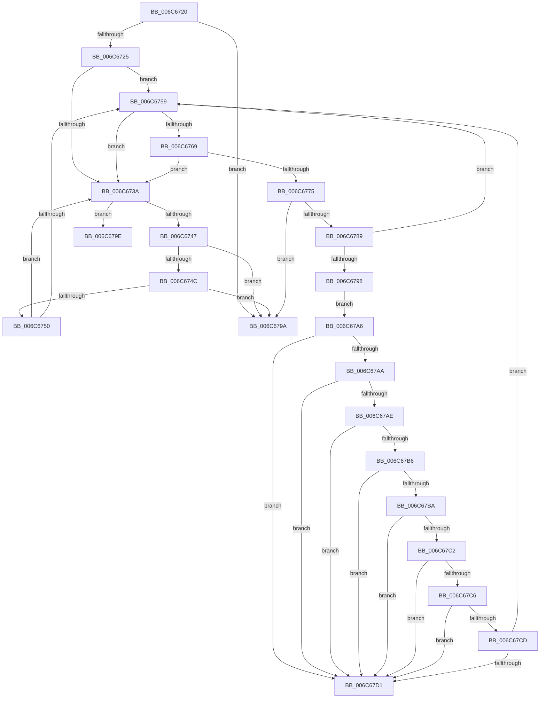

# strncmp

- RVA: `0x006C6720`–`0x006C67D5` (길이 `181` bytes)
- VA: `0x00000001406C6720`
- 실행 섹션: `.text`
- PDB 이름 있음: `예`; PDB Function 태그: `아니요`
- unwind 정보 RVA: `0x000BFAC8`
- 디코드: `62`개 명령, `181/181` bytes 표시
- 미해석 바이트: `0` (있으면 어셈블리에 `.byte`로 보존)

> 이 문서는 커널 이미지의 기계어와 PDB 기호를 분석해 생성했습니다. 4번과 5번은 함수 원형과 자료형을 바이너리 사용 방식에서 추정한 C 해석이며 원본 소스 복구 결과는 아닙니다.

## 1. Dependencies

- 직접 호출 지점: **0**; 고유 호출 대상: **0**
- 직접 호출자로 확인된 함수: **19**
- RIP 상대 이미지 참조: **0**

### Outgoing calls
- 직접 디코드된 call 명령이 없습니다.

### Direct callers
- [HalpAcpiGetCachedTable](../3F/HalpAcpiGetCachedTable_function_003F6DD4.md) at `0x003F6E4D`
- [HalpAcpiGetCachedTable](../3F/HalpAcpiGetCachedTable_function_003F6DD4.md) at `0x003F6E65`
- [HalpAcpiCheckAndMapTable](../3F/HalpAcpiCheckAndMapTable_function_003F75D8.md) at `0x003F785F`
- [HalpAcpiCheckAndMapTable](../3F/HalpAcpiCheckAndMapTable_function_003F75D8.md) at `0x003F787B`
- [RtlLookupImageSectionByName](../4B/RtlLookupImageSectionByName_function_004B4F20.md) at `0x004B4F63`
- [KasanDriverLoadImageInternal](../4C/KasanDriverLoadImageInternal_function_004C2840.md) at `0x004C2909`
- [HvlDebuggerSupportInitialize](../58/HvlDebuggerSupportInitialize_function_00583790.md) at `0x00583A36`
- [HvlDebuggerSupportInitialize](../58/HvlDebuggerSupportInitialize_function_00583790.md) at `0x00583A5A`
- [_asan_wrap_strncmp](../5A/_asan_wrap_strncmp_function_005AEDD0.md) at `0x005AEF2A`
- [sub_006EAEDE](../6E/Unknown_function_006EAEDE.md) at `0x006EB2CD`
- [RtlValidateCorrelationVector](../../page/70/RtlValidateCorrelationVector_function_007052E0.md) at `0x007053A4`
- [PopPowerRequestStatsIsDetailedRequestReason](../../page/70/PopPowerRequestStatsIsDetailedRequestReason_function_00705490.md) at `0x007054F7`
- [ApiSetLoadSchemaEx](../../page/7D/ApiSetLoadSchemaEx_function_007D96F4.md) at `0x007D9774`
- [AslpFileHasSecuromWrapper](../../page/82/AslpFileHasSecuromWrapper_function_00820634.md) at `0x0082067C`
- [AslpFileIsArm64XBinary](../../page/82/AslpFileIsArm64XBinary_function_008206B0.md) at `0x008207C3`
- [AslpHasStarForceWrapper](../../page/82/AslpHasStarForceWrapper_function_00821440.md) at `0x00821488`
- [BiIsWindowsEfiEntry](../../page/A3/BiIsWindowsEfiEntry_function_00A3FBEC.md) at `0x00A3FC16`
- [HalpInitializeProfiling](../../pagelk/B5/HalpInitializeProfiling_function_00B5EF00.md) at `0x00B5EFB4`
- [HalpInitializeProfiling](../../pagelk/B5/HalpInitializeProfiling_function_00B5EF00.md) at `0x00B5EFE1`
- [RtlGetCpuVendor](../../pagelk/B7/RtlGetCpuVendor_function_00B72180.md) at `0x00B721C7`
- [RtlGetCpuVendor](../../pagelk/B7/RtlGetCpuVendor_function_00B72180.md) at `0x00B721DF`
- [RtlGetCpuVendor](../../pagelk/B7/RtlGetCpuVendor_function_00B72180.md) at `0x00B721FB`
- [RtlGetCpuVendor](../../pagelk/B7/RtlGetCpuVendor_function_00B72180.md) at `0x00B72213`
- [RtlGetCpuVendor](../../pagelk/B7/RtlGetCpuVendor_function_00B72180.md) at `0x00B7222B`
- [KiGetCpuVendor](../../pagelk/B7/KiGetCpuVendor_function_00B7D5B4.md) at `0x00B7D62C`
- [KiGetCpuVendor](../../pagelk/B7/KiGetCpuVendor_function_00B7D5B4.md) at `0x00B7D643`
- [KiGetCpuVendor](../../pagelk/B7/KiGetCpuVendor_function_00B7D5B4.md) at `0x00B7D65F`
- [KiGetCpuVendor](../../pagelk/B7/KiGetCpuVendor_function_00B7D5B4.md) at `0x00B7D676`
- [KiGetCpuVendor](../../pagelk/B7/KiGetCpuVendor_function_00B7D5B4.md) at `0x00B7D68D`
- [KdInitSystem](../../pagekd/B8/KdInitSystem_function_00B85E30.md) at `0x00B8618B`
- [KdInitSystem](../../pagekd/B8/KdInitSystem_function_00B85E30.md) at `0x00B861B2`
- [KdInitSystem](../../pagekd/B8/KdInitSystem_function_00B85E30.md) at `0x00B861D9`
- [Phase1InitializationDiscard](../../init/C1/Phase1InitializationDiscard_function_00C1C728.md) at `0x00C1D843`
- [Phase1InitializationDiscard](../../init/C1/Phase1InitializationDiscard_function_00C1C728.md) at `0x00C1D862`
- [Phase1InitializationDiscard](../../init/C1/Phase1InitializationDiscard_function_00C1C728.md) at `0x00C1D887`
- [Phase1InitializationDiscard](../../init/C1/Phase1InitializationDiscard_function_00C1C728.md) at `0x00C1D8BD`

### Static image references
- 디코드된 RIP-relative 메모리 참조가 없습니다.

## 2. Other-region calls and transfers

- 다른 실행 섹션으로 향하는 call: **0**
- 별도 외부 분기/꼬리 이동을 확인하지 못했습니다.

## 3. Assembly (complete function range)

```asm
006C6720  4D 85 C0                        test r8, r8
006C6723  74 75                           je 0x1406c679a
006C6725  48 2B D1                        sub rdx, rcx
006C6728  4C 8B CA                        mov r9, rdx
006C672B  49 BB 00 01 01 01 01 01 01 81   movabs r11, 0x8101010101010100
006C6735  F6 C1 07                        test cl, 7
006C6738  74 1F                           je 0x1406c6759
006C673A  8A 01                           mov al, byte ptr [rcx]
006C673C  41 8A 14 09                     mov dl, byte ptr [r9 + rcx]
006C6740  48 FF C1                        inc rcx
006C6743  3A C2                           cmp al, dl
006C6745  75 57                           jne 0x1406c679e
006C6747  49 FF C8                        dec r8
006C674A  74 4E                           je 0x1406c679a
006C674C  84 C0                           test al, al
006C674E  74 4A                           je 0x1406c679a
006C6750  48 F7 C1 07 00 00 00            test rcx, 7
006C6757  75 E1                           jne 0x1406c673a
006C6759  49 8D 14 09                     lea rdx, [r9 + rcx]
006C675D  66 81 E2 FF 0F                  and dx, 0xfff
006C6762  66 81 FA F8 0F                  cmp dx, 0xff8
006C6767  77 D1                           ja 0x1406c673a
006C6769  48 8B 01                        mov rax, qword ptr [rcx]
006C676C  49 8B 14 09                     mov rdx, qword ptr [r9 + rcx]
006C6770  48 3B C2                        cmp rax, rdx
006C6773  75 C5                           jne 0x1406c673a
006C6775  48 83 C1 08                     add rcx, 8
006C6779  49 83 E8 08                     sub r8, 8
006C677D  49 BA FF FE FE FE FE FE FE 7E   movabs r10, 0x7efefefefefefeff
006C6787  76 11                           jbe 0x1406c679a
006C6789  48 83 F0 FF                     xor rax, 0xffffffffffffffff
006C678D  4C 03 D2                        add r10, rdx
006C6790  49 33 C2                        xor rax, r10
006C6793  49 85 C3                        test r11, rax
006C6796  74 C1                           je 0x1406c6759
006C6798  EB 0C                           jmp 0x1406c67a6
006C679A  48 33 C0                        xor rax, rax
006C679D  C3                              ret
006C679E  48 1B C0                        sbb rax, rax
006C67A1  48 83 D8 FF                     sbb rax, -1
006C67A5  C3                              ret
006C67A6  84 D2                           test dl, dl
006C67A8  74 27                           je 0x1406c67d1
006C67AA  84 F6                           test dh, dh
006C67AC  74 23                           je 0x1406c67d1
006C67AE  48 C1 EA 10                     shr rdx, 0x10
006C67B2  84 D2                           test dl, dl
006C67B4  74 1B                           je 0x1406c67d1
006C67B6  84 F6                           test dh, dh
006C67B8  74 17                           je 0x1406c67d1
006C67BA  48 C1 EA 10                     shr rdx, 0x10
006C67BE  84 D2                           test dl, dl
006C67C0  74 0F                           je 0x1406c67d1
006C67C2  84 F6                           test dh, dh
006C67C4  74 0B                           je 0x1406c67d1
006C67C6  C1 EA 10                        shr edx, 0x10
006C67C9  84 D2                           test dl, dl
006C67CB  74 04                           je 0x1406c67d1
006C67CD  84 F6                           test dh, dh
006C67CF  75 88                           jne 0x1406c6759
006C67D1  48 33 C0                        xor rax, rax
006C67D4  C3                              ret
```

## 4. C-style interpretation (structured pseudocode)

```c
__int64 __fastcall strncmp(__int64 a1, __int64 a2, __int64 a3)
{
    __int64 result;
    __int64 v_r10;

    if (a3 == 0) goto loc_006C679A;
    a2 = (a2) - (a1);
    if ((((unsigned __int8)(a1)) & (7)) == 0) goto loc_006C6759;
loc_006C673A:
    a1 = (a1) + 1;
    if (((unsigned __int8)(*(unsigned __int8 *)(a1))) != ((unsigned __int8)(*(unsigned __int8 *)(a2 + a1 * 1)))) goto loc_006C679E;
    a3 = (a3) - 1;
    if (((unsigned __int8)(*(unsigned __int8 *)(a1))) == ((unsigned __int8)(*(unsigned __int8 *)(a2 + a1 * 1)))) goto loc_006C679A;
    if ((unsigned __int8)(*(unsigned __int8 *)(a1)) == 0) goto loc_006C679A;
    if (((a1) & (7)) != 0) goto loc_006C673A;
loc_006C6759:
    a2 = (unsigned __int16)((a2 + a1 * 1) & (0xFFFULL));
    if (((unsigned __int16)(a2)) > 0xFF8ULL) goto loc_006C673A;
    if ((*(unsigned __int64 *)(a1)) != (*(unsigned __int64 *)(a2 + a1 * 1))) goto loc_006C673A;
    a1 = (a1) + (8);
    a3 = (a3) - (8);
    if (condition_is_below_or_equal) goto loc_006C679A;
    result = (*(unsigned __int64 *)(a1)) ^ (-1);
    v_r10 = (v_r10) + (*(unsigned __int64 *)(a2 + a1 * 1));
    result = (result) ^ (v_r10);
    if (((v_r11) & (result)) == 0) goto loc_006C6759;
    goto loc_006C67A6;
loc_006C679A:
    result = 0;
    return result;
loc_006C679E:
    return result;
loc_006C67A6:
    if ((unsigned __int8)(*(unsigned __int64 *)(a2 + a1 * 1)) == 0) goto loc_006C67D1;
    if ((unsigned __int8)(*(unsigned __int64 *)(a2 + a1 * 1)) == 0) goto loc_006C67D1;
    a2 = (*(unsigned __int64 *)(a2 + a1 * 1)) >> (16);
    if ((unsigned __int8)(a2) == 0) goto loc_006C67D1;
    if ((unsigned __int8)(a2) == 0) goto loc_006C67D1;
    a2 = (a2) >> (16);
    if ((unsigned __int8)(a2) == 0) goto loc_006C67D1;
    if ((unsigned __int8)(a2) == 0) goto loc_006C67D1;
    a2 = (unsigned int)((a2) >> (16));
    if ((unsigned __int8)(a2) == 0) goto loc_006C67D1;
    if ((unsigned __int8)(a2) != 0) goto loc_006C6759;
loc_006C67D1:
    result = 0;
    return result;
}
```

## 5. (Beta) C Style

```c
int64_t strncmp(int64_t Arg1, void *Arg2, int64_t Arg3)
{
    uint8_t *arg2 = (uint8_t *)Arg2;

    int64_t result;
    int64_t local_r10;

    if (Arg3 == 0) goto loc_006C679A;
    Arg2 = (Arg2) - (Arg1);
    if ((((uint8_t)(Arg1)) & (7)) == 0) goto loc_006C6759;
loc_006C673A:
    Arg1 = (Arg1) + 1;
    if (((uint8_t)(*(uint8_t *)(Arg1))) != ((uint8_t)(*(uint8_t *)(arg2 + Arg1 * 1)))) goto loc_006C679E;
    Arg3 = (Arg3) - 1;
    if (((uint8_t)(*(uint8_t *)(Arg1))) == ((uint8_t)(*(uint8_t *)(arg2 + Arg1 * 1)))) goto loc_006C679A;
    if ((uint8_t)(*(uint8_t *)(Arg1)) == 0) goto loc_006C679A;
    if (((Arg1) & (7)) != 0) goto loc_006C673A;
loc_006C6759:
    Arg2 = (uint16_t)((Arg2 + Arg1 * 1) & (0xFFFULL));
    if (((uint16_t)(Arg2)) > 0xFF8ULL) goto loc_006C673A;
    if ((*(uint64_t *)(Arg1)) != (*(uint64_t *)(arg2 + Arg1 * 1))) goto loc_006C673A;
    Arg1 = (Arg1) + (8);
    Arg3 = (Arg3) - (8);
    if (condition_is_below_or_equal) goto loc_006C679A;
    result = (*(uint64_t *)(Arg1)) ^ (-1);
    local_r10 = (local_r10) + (*(uint64_t *)(arg2 + Arg1 * 1));
    result = (result) ^ (local_r10);
    if (((local_r11) & (result)) == 0) goto loc_006C6759;
    goto loc_006C67A6;
loc_006C679A:
    result = 0;
    return result;
loc_006C679E:
    return result;
loc_006C67A6:
    if ((uint8_t)(*(uint64_t *)(arg2 + Arg1 * 1)) == 0) goto loc_006C67D1;
    if ((uint8_t)(*(uint64_t *)(arg2 + Arg1 * 1)) == 0) goto loc_006C67D1;
    Arg2 = (*(uint64_t *)(arg2 + Arg1 * 1)) >> (16);
    if ((uint8_t)(Arg2) == 0) goto loc_006C67D1;
    if ((uint8_t)(Arg2) == 0) goto loc_006C67D1;
    Arg2 = (Arg2) >> (16);
    if ((uint8_t)(Arg2) == 0) goto loc_006C67D1;
    if ((uint8_t)(Arg2) == 0) goto loc_006C67D1;
    Arg2 = (uint32_t)((Arg2) >> (16));
    if ((uint8_t)(Arg2) == 0) goto loc_006C67D1;
    if ((uint8_t)(Arg2) != 0) goto loc_006C6759;
loc_006C67D1:
    result = 0;
    return result;
}
```

### 관측된 메모리 오프셋

구조체 형식이 확인되지 않은 접근은 인자 기준의 오프셋으로만 기록했습니다.

| 기준 인자 | 오프셋 표현 | 폭 (bit) | 접근 |
|---|---:|---:|---|
| `Arg2` | `+ 0x0 + rcx*1` | `8` | `R` |
| `Arg2` | `+ 0x0 + rcx*1` | `64` | `R` |

## 6. Execution-region graph

[열기: 2D/3D 그래프와 함수 탐색 컨트롤 패널](../../../control-panel.html?section=text&rva=0x006C6720&view=graph)

- 2D 그래프는 위에서 아래로 흐르고, 3D 그래프는 빈 공간을 드래그해 회전합니다. Shift+드래그는 이동, 휠은 확대·축소, 함수 노드 선택은 대상 보고서 이동입니다.

### Static fallback


