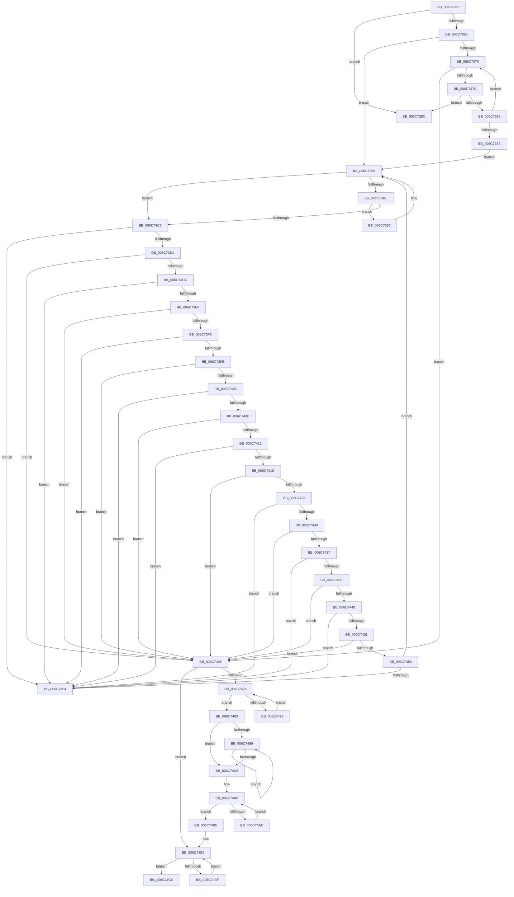

# strncpy

- RVA: `0x006C7360`–`0x006C74CA` (길이 `362` bytes)
- VA: `0x00000001406C7360`
- 실행 섹션: `.text`
- PDB 이름 있음: `예`; PDB Function 태그: `아니요`
- unwind 정보 RVA: `0x000BFAC8`
- 디코드: `119`개 명령, `362/362` bytes 표시
- 미해석 바이트: `0` (있으면 어셈블리에 `.byte`로 보존)

> 이 문서는 커널 이미지의 기계어와 PDB 기호를 분석해 생성했습니다. 4번과 5번은 함수 원형과 자료형을 바이너리 사용 방식에서 추정한 C 해석이며 원본 소스 복구 결과는 아닙니다.

## 1. Dependencies

- 직접 호출 지점: **0**; 고유 호출 대상: **0**
- 직접 호출자로 확인된 함수: **1**
- RIP 상대 이미지 참조: **0**

### Outgoing calls
- 직접 디코드된 call 명령이 없습니다.

### Direct callers
- [_asan_wrap_strncpy](../5A/_asan_wrap_strncpy_function_005AEF60.md) at `0x005AF0DA`

### Static image references
- 디코드된 RIP-relative 메모리 참조가 없습니다.

## 2. Other-region calls and transfers

- 다른 실행 섹션으로 향하는 call: **0**
- 별도 외부 분기/꼬리 이동을 확인하지 못했습니다.

## 3. Assembly (complete function range)

```asm
006C7360  4C 8B D9                        mov r11, rcx
006C7363  4D 0B C0                        or r8, r8
006C7366  74 24                           je 0x1406c738c
006C7368  48 2B CA                        sub rcx, rdx
006C736B  F6 C2 07                        test dl, 7
006C736E  74 28                           je 0x1406c7398
006C7370  8A 02                           mov al, byte ptr [rdx]
006C7372  84 C0                           test al, al
006C7374  88 04 0A                        mov byte ptr [rdx + rcx], al
006C7377  0F 84 EB 00 00 00               je 0x1406c7468
006C737D  48 FF C2                        inc rdx
006C7380  49 FF C8                        dec r8
006C7383  74 07                           je 0x1406c738c
006C7385  F6 C2 07                        test dl, 7
006C7388  75 E6                           jne 0x1406c7370
006C738A  EB 0C                           jmp 0x1406c7398
006C738C  49 8B C3                        mov rax, r11
006C738F  C3                              ret
006C7390  48 89 04 0A                     mov qword ptr [rdx + rcx], rax
006C7394  48 83 C2 08                     add rdx, 8
006C7398  48 8B 02                        mov rax, qword ptr [rdx]
006C739B  49 83 E8 08                     sub r8, 8
006C739F  72 26                           jb 0x1406c73c7
006C73A1  49 B9 FF FE FE FE FE FE FE 7E   movabs r9, 0x7efefefefefefeff
006C73AB  4C 03 C8                        add r9, rax
006C73AE  4C 8B D0                        mov r10, rax
006C73B1  49 83 F2 FF                     xor r10, 0xffffffffffffffff
006C73B5  4D 33 D1                        xor r10, r9
006C73B8  49 B9 00 01 01 01 01 01 01 81   movabs r9, 0x8101010101010100
006C73C2  4D 85 D1                        test r9, r10
006C73C5  74 C9                           je 0x1406c7390
006C73C7  49 83 C0 08                     add r8, 8
006C73CB  0F 84 93 00 00 00               je 0x1406c7464
006C73D1  84 C0                           test al, al
006C73D3  88 04 0A                        mov byte ptr [rdx + rcx], al
006C73D6  0F 84 8C 00 00 00               je 0x1406c7468
006C73DC  48 FF C2                        inc rdx
006C73DF  49 FF C8                        dec r8
006C73E2  0F 84 7C 00 00 00               je 0x1406c7464
006C73E8  84 E4                           test ah, ah
006C73EA  88 24 0A                        mov byte ptr [rdx + rcx], ah
006C73ED  0F 84 75 00 00 00               je 0x1406c7468
006C73F3  48 FF C2                        inc rdx
006C73F6  49 FF C8                        dec r8
006C73F9  74 69                           je 0x1406c7464
006C73FB  48 C1 E8 10                     shr rax, 0x10
006C73FF  84 C0                           test al, al
006C7401  88 04 0A                        mov byte ptr [rdx + rcx], al
006C7404  74 62                           je 0x1406c7468
006C7406  48 FF C2                        inc rdx
006C7409  49 FF C8                        dec r8
006C740C  74 56                           je 0x1406c7464
006C740E  84 E4                           test ah, ah
006C7410  88 24 0A                        mov byte ptr [rdx + rcx], ah
006C7413  74 53                           je 0x1406c7468
006C7415  48 FF C2                        inc rdx
006C7418  49 FF C8                        dec r8
006C741B  74 47                           je 0x1406c7464
006C741D  48 C1 E8 10                     shr rax, 0x10
006C7421  84 C0                           test al, al
006C7423  88 04 0A                        mov byte ptr [rdx + rcx], al
006C7426  74 40                           je 0x1406c7468
006C7428  48 FF C2                        inc rdx
006C742B  49 FF C8                        dec r8
006C742E  74 34                           je 0x1406c7464
006C7430  84 E4                           test ah, ah
006C7432  88 24 0A                        mov byte ptr [rdx + rcx], ah
006C7435  74 31                           je 0x1406c7468
006C7437  48 FF C2                        inc rdx
006C743A  49 FF C8                        dec r8
006C743D  74 25                           je 0x1406c7464
006C743F  C1 E8 10                        shr eax, 0x10
006C7442  84 C0                           test al, al
006C7444  88 04 0A                        mov byte ptr [rdx + rcx], al
006C7447  74 1F                           je 0x1406c7468
006C7449  48 FF C2                        inc rdx
006C744C  49 FF C8                        dec r8
006C744F  74 13                           je 0x1406c7464
006C7451  84 E4                           test ah, ah
006C7453  88 24 0A                        mov byte ptr [rdx + rcx], ah
006C7456  74 10                           je 0x1406c7468
006C7458  48 FF C2                        inc rdx
006C745B  49 FF C8                        dec r8
006C745E  0F 85 34 FF FF FF               jne 0x1406c7398
006C7464  49 8B C3                        mov rax, r11
006C7467  C3                              ret
006C7468  48 03 CA                        add rcx, rdx
006C746B  48 33 D2                        xor rdx, rdx
006C746E  49 83 F8 10                     cmp r8, 0x10
006C7472  72 45                           jb 0x1406c74b9
006C7474  F6 C1 07                        test cl, 7
006C7477  74 0A                           je 0x1406c7483
006C7479  48 FF C1                        inc rcx
006C747C  88 11                           mov byte ptr [rcx], dl
006C747E  49 FF C8                        dec r8
006C7481  EB F1                           jmp 0x1406c7474
006C7483  49 83 E8 20                     sub r8, 0x20
006C7487  72 19                           jb 0x1406c74a2
006C7489  48 89 11                        mov qword ptr [rcx], rdx
006C748C  48 89 51 08                     mov qword ptr [rcx + 8], rdx
006C7490  48 89 51 10                     mov qword ptr [rcx + 0x10], rdx
006C7494  48 89 51 18                     mov qword ptr [rcx + 0x18], rdx
006C7498  48 83 C1 20                     add rcx, 0x20
006C749C  49 83 E8 20                     sub r8, 0x20
006C74A0  73 E7                           jae 0x1406c7489
006C74A2  49 83 C0 20                     add r8, 0x20
006C74A6  49 83 E8 08                     sub r8, 8
006C74AA  72 09                           jb 0x1406c74b5
006C74AC  48 89 11                        mov qword ptr [rcx], rdx
006C74AF  48 83 C1 08                     add rcx, 8
006C74B3  EB F1                           jmp 0x1406c74a6
006C74B5  49 83 C0 08                     add r8, 8
006C74B9  49 83 E8 01                     sub r8, 1
006C74BD  72 07                           jb 0x1406c74c6
006C74BF  88 11                           mov byte ptr [rcx], dl
006C74C1  48 FF C1                        inc rcx
006C74C4  EB F3                           jmp 0x1406c74b9
006C74C6  49 8B C3                        mov rax, r11
006C74C9  C3                              ret
```

## 4. C-style interpretation (structured pseudocode)

```c
__int64 __fastcall strncpy(__int64 a1, __int64 a2, __int64 a3)
{
    __int64 result;
    __int64 v_r10;

    a3 = (a3) | (a3);
    if (condition_is_equal) goto loc_006C738C;
    a1 = (a1) - (a2);
    if ((((unsigned __int8)(a2)) & (7)) == 0) goto loc_006C7398;
loc_006C7370:
    *(unsigned __int8 *)(a2 + a1 * 1) = (unsigned __int8)(*(unsigned __int8 *)(a2));
    if ((unsigned __int8)(*(unsigned __int8 *)(a2)) == 0) goto loc_006C7468;
    a2 = (a2) + 1;
    a3 = (a3) - 1;
    if ((unsigned __int8)(*(unsigned __int8 *)(a2)) == 0) goto loc_006C738C;
    if ((((unsigned __int8)(a2)) & (7)) != 0) goto loc_006C7370;
    goto loc_006C7398;
loc_006C738C:
    return a1;
loc_006C7390:
    *(unsigned __int64 *)(a2 + a1 * 1) = a1;
    a2 = (a2) + (8);
loc_006C7398:
    a3 = (a3) - (8);
    if (condition_is_below) goto loc_006C73C7;
    a4 = (a4) + (*(unsigned __int64 *)(a2));
    v_r10 = (*(unsigned __int64 *)(a2)) ^ (-1);
    v_r10 = (v_r10) ^ (a4);
    if (((a4) & (v_r10)) == 0) goto loc_006C7390;
loc_006C73C7:
    a3 = (a3) + (8);
    if (condition_is_equal) goto loc_006C7464;
    *(unsigned __int8 *)(a2 + a1 * 1) = (unsigned __int8)(*(unsigned __int64 *)(a2));
    if ((unsigned __int8)(*(unsigned __int64 *)(a2)) == 0) goto loc_006C7468;
    a2 = (a2) + 1;
    a3 = (a3) - 1;
    if ((unsigned __int8)(*(unsigned __int64 *)(a2)) == 0) goto loc_006C7464;
    *(unsigned __int8 *)(a2 + a1 * 1) = (unsigned __int8)(*(unsigned __int64 *)(a2));
    if ((unsigned __int8)(*(unsigned __int64 *)(a2)) == 0) goto loc_006C7468;
    a2 = (a2) + 1;
    a3 = (a3) - 1;
    if ((unsigned __int8)(*(unsigned __int64 *)(a2)) == 0) goto loc_006C7464;
    result = (*(unsigned __int64 *)(a2)) >> (16);
    *(unsigned __int8 *)(a2 + a1 * 1) = (unsigned __int8)(result);
    if ((unsigned __int8)(result) == 0) goto loc_006C7468;
    a2 = (a2) + 1;
    a3 = (a3) - 1;
    if ((unsigned __int8)(result) == 0) goto loc_006C7464;
    *(unsigned __int8 *)(a2 + a1 * 1) = (unsigned __int8)(result);
    if ((unsigned __int8)(result) == 0) goto loc_006C7468;
    a2 = (a2) + 1;
    a3 = (a3) - 1;
    if ((unsigned __int8)(result) == 0) goto loc_006C7464;
    result = (result) >> (16);
    *(unsigned __int8 *)(a2 + a1 * 1) = (unsigned __int8)(result);
    if ((unsigned __int8)(result) == 0) goto loc_006C7468;
    a2 = (a2) + 1;
    a3 = (a3) - 1;
    if ((unsigned __int8)(result) == 0) goto loc_006C7464;
    *(unsigned __int8 *)(a2 + a1 * 1) = (unsigned __int8)(result);
    if ((unsigned __int8)(result) == 0) goto loc_006C7468;
    a2 = (a2) + 1;
    a3 = (a3) - 1;
    if ((unsigned __int8)(result) == 0) goto loc_006C7464;
    result = (unsigned int)((result) >> (16));
    *(unsigned __int8 *)(a2 + a1 * 1) = (unsigned __int8)(result);
    if ((unsigned __int8)(result) == 0) goto loc_006C7468;
    a2 = (a2) + 1;
    a3 = (a3) - 1;
    if ((unsigned __int8)(result) == 0) goto loc_006C7464;
    *(unsigned __int8 *)(a2 + a1 * 1) = (unsigned __int8)(result);
    if ((unsigned __int8)(result) == 0) goto loc_006C7468;
    a2 = (a2) + 1;
    a3 = (a3) - 1;
    if ((unsigned __int8)(result) != 0) goto loc_006C7398;
loc_006C7464:
    return a1;
loc_006C7468:
    a1 = (a1) + (a2);
    a2 = 0;
    if (a3 < 16) goto loc_006C74B9;
loc_006C7474:
    if ((((unsigned __int8)(a1)) & (7)) == 0) goto loc_006C7483;
    a1 = (a1) + 1;
    *(unsigned __int8 *)(a1) = 0;
    a3 = (a3) - 1;
    goto loc_006C7474;
loc_006C7483:
    a3 = (a3) - (32);
    if (condition_is_below) goto loc_006C74A2;
loc_006C7489:
    *(unsigned __int64 *)(a1) = 0;
    *(unsigned __int64 *)(a1 + 8) = 0;
    *(unsigned __int64 *)(a1 + 16) = 0;
    *(unsigned __int64 *)(a1 + 24) = 0;
    a1 = (a1) + (32);
    a3 = (a3) - (32);
    if (condition_is_above_or_equal) goto loc_006C7489;
loc_006C74A2:
    a3 = (a3) + (32);
loc_006C74A6:
    a3 = (a3) - (8);
    if (condition_is_below) goto loc_006C74B5;
    *(unsigned __int64 *)(a1) = 0;
    a1 = (a1) + (8);
    goto loc_006C74A6;
loc_006C74B5:
    a3 = (a3) + (8);
loc_006C74B9:
    a3 = (a3) - (1);
    if (condition_is_below) goto loc_006C74C6;
    *(unsigned __int8 *)(a1) = 0;
    a1 = (a1) + 1;
    goto loc_006C74B9;
loc_006C74C6:
    return a1;
}
```

## 5. (Beta) C Style

```c
int64_t strncpy(int64_t Arg1, int64_t Arg2, int64_t Arg3)
{
    int64_t result;
    int64_t local_r10;

    Arg3 = (Arg3) | (Arg3);
    if (condition_is_equal) goto loc_006C738C;
    Arg1 = (Arg1) - (Arg2);
    if ((((uint8_t)(Arg2)) & (7)) == 0) goto loc_006C7398;
loc_006C7370:
    *(uint8_t *)(Arg2 + Arg1 * 1) = (uint8_t)(*(uint8_t *)(Arg2));
    if ((uint8_t)(*(uint8_t *)(Arg2)) == 0) goto loc_006C7468;
    Arg2 = (Arg2) + 1;
    Arg3 = (Arg3) - 1;
    if ((uint8_t)(*(uint8_t *)(Arg2)) == 0) goto loc_006C738C;
    if ((((uint8_t)(Arg2)) & (7)) != 0) goto loc_006C7370;
    goto loc_006C7398;
loc_006C738C:
    return Arg1;
loc_006C7390:
    *(uint64_t *)(Arg2 + Arg1 * 1) = Arg1;
    Arg2 = (Arg2) + (8);
loc_006C7398:
    Arg3 = (Arg3) - (8);
    if (condition_is_below) goto loc_006C73C7;
    a4 = (a4) + (*(uint64_t *)(Arg2));
    local_r10 = (*(uint64_t *)(Arg2)) ^ (-1);
    local_r10 = (local_r10) ^ (a4);
    if (((a4) & (local_r10)) == 0) goto loc_006C7390;
loc_006C73C7:
    Arg3 = (Arg3) + (8);
    if (condition_is_equal) goto loc_006C7464;
    *(uint8_t *)(Arg2 + Arg1 * 1) = (uint8_t)(*(uint64_t *)(Arg2));
    if ((uint8_t)(*(uint64_t *)(Arg2)) == 0) goto loc_006C7468;
    Arg2 = (Arg2) + 1;
    Arg3 = (Arg3) - 1;
    if ((uint8_t)(*(uint64_t *)(Arg2)) == 0) goto loc_006C7464;
    *(uint8_t *)(Arg2 + Arg1 * 1) = (uint8_t)(*(uint64_t *)(Arg2));
    if ((uint8_t)(*(uint64_t *)(Arg2)) == 0) goto loc_006C7468;
    Arg2 = (Arg2) + 1;
    Arg3 = (Arg3) - 1;
    if ((uint8_t)(*(uint64_t *)(Arg2)) == 0) goto loc_006C7464;
    result = (*(uint64_t *)(Arg2)) >> (16);
    *(uint8_t *)(Arg2 + Arg1 * 1) = (uint8_t)(result);
    if ((uint8_t)(result) == 0) goto loc_006C7468;
    Arg2 = (Arg2) + 1;
    Arg3 = (Arg3) - 1;
    if ((uint8_t)(result) == 0) goto loc_006C7464;
    *(uint8_t *)(Arg2 + Arg1 * 1) = (uint8_t)(result);
    if ((uint8_t)(result) == 0) goto loc_006C7468;
    Arg2 = (Arg2) + 1;
    Arg3 = (Arg3) - 1;
    if ((uint8_t)(result) == 0) goto loc_006C7464;
    result = (result) >> (16);
    *(uint8_t *)(Arg2 + Arg1 * 1) = (uint8_t)(result);
    if ((uint8_t)(result) == 0) goto loc_006C7468;
    Arg2 = (Arg2) + 1;
    Arg3 = (Arg3) - 1;
    if ((uint8_t)(result) == 0) goto loc_006C7464;
    *(uint8_t *)(Arg2 + Arg1 * 1) = (uint8_t)(result);
    if ((uint8_t)(result) == 0) goto loc_006C7468;
    Arg2 = (Arg2) + 1;
    Arg3 = (Arg3) - 1;
    if ((uint8_t)(result) == 0) goto loc_006C7464;
    result = (uint32_t)((result) >> (16));
    *(uint8_t *)(Arg2 + Arg1 * 1) = (uint8_t)(result);
    if ((uint8_t)(result) == 0) goto loc_006C7468;
    Arg2 = (Arg2) + 1;
    Arg3 = (Arg3) - 1;
    if ((uint8_t)(result) == 0) goto loc_006C7464;
    *(uint8_t *)(Arg2 + Arg1 * 1) = (uint8_t)(result);
    if ((uint8_t)(result) == 0) goto loc_006C7468;
    Arg2 = (Arg2) + 1;
    Arg3 = (Arg3) - 1;
    if ((uint8_t)(result) != 0) goto loc_006C7398;
loc_006C7464:
    return Arg1;
loc_006C7468:
    Arg1 = (Arg1) + (Arg2);
    Arg2 = 0;
    if (Arg3 < 16) goto loc_006C74B9;
loc_006C7474:
    if ((((uint8_t)(Arg1)) & (7)) == 0) goto loc_006C7483;
    Arg1 = (Arg1) + 1;
    *(uint8_t *)(Arg1) = 0;
    Arg3 = (Arg3) - 1;
    goto loc_006C7474;
loc_006C7483:
    Arg3 = (Arg3) - (32);
    if (condition_is_below) goto loc_006C74A2;
loc_006C7489:
    *(uint64_t *)(Arg1) = 0;
    *(uint64_t *)(Arg1 + 0x8) = 0;
    *(uint64_t *)(Arg1 + 0x10) = 0;
    *(uint64_t *)(Arg1 + 0x18) = 0;
    Arg1 = (Arg1) + (32);
    Arg3 = (Arg3) - (32);
    if (condition_is_above_or_equal) goto loc_006C7489;
loc_006C74A2:
    Arg3 = (Arg3) + (32);
loc_006C74A6:
    Arg3 = (Arg3) - (8);
    if (condition_is_below) goto loc_006C74B5;
    *(uint64_t *)(Arg1) = 0;
    Arg1 = (Arg1) + (8);
    goto loc_006C74A6;
loc_006C74B5:
    Arg3 = (Arg3) + (8);
loc_006C74B9:
    Arg3 = (Arg3) - (1);
    if (condition_is_below) goto loc_006C74C6;
    *(uint8_t *)(Arg1) = 0;
    Arg1 = (Arg1) + 1;
    goto loc_006C74B9;
loc_006C74C6:
    return Arg1;
}
```

## 6. Execution-region graph

[열기: 2D/3D 그래프와 함수 탐색 컨트롤 패널](../../../control-panel.html?section=text&rva=0x006C7360&view=graph)

- 2D 그래프는 위에서 아래로 흐르고, 3D 그래프는 빈 공간을 드래그해 회전합니다. Shift+드래그는 이동, 휠은 확대·축소, 함수 노드 선택은 대상 보고서 이동입니다.

### Static fallback


