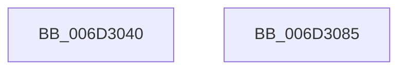

# CcAcquireByteRangeForWrite$filt$0

- RVA: `0x006D3040`–`0x006D3086` (길이 `70` bytes)
- VA: `0x00000001406D3040`
- 실행 섹션: `.text`
- PDB 이름 있음: `예`; PDB Function 태그: `예`
- unwind 정보 RVA: `0x0009A668`
- 디코드: `19`개 명령, `70/70` bytes 표시
- 미해석 바이트: `0` (있으면 어셈블리에 `.byte`로 보존)

> 이 문서는 커널 이미지의 기계어와 PDB 기호를 분석해 생성했습니다. 4번과 5번은 함수 원형과 자료형을 바이너리 사용 방식에서 추정한 C 해석이며 원본 소스 복구 결과는 아닙니다.

## 1. Dependencies

- 직접 호출 지점: **1**; 고유 호출 대상: **1**
- 직접 호출자로 확인된 함수: **0**
- RIP 상대 이미지 참조: **0**

### Outgoing calls
- `0x006D3067` → [FsRtlIsNtstatusExpected](../26/FsRtlIsNtstatusExpected_function_0026D390.md) (function, `0x0026D390`)

### Direct callers
- 이 함수 시작 RVA로 연결되는 직접 call은 확인되지 않았습니다. 간접 호출은 완전히 역산할 수 없습니다.

### Static image references
- 디코드된 RIP-relative 메모리 참조가 없습니다.

## 2. Other-region calls and transfers

- 다른 실행 섹션으로 향하는 call: **0**
- 별도 외부 분기/꼬리 이동을 확인하지 못했습니다.

## 3. Assembly (complete function range)

```asm
006D3040  40 55                           push rbp
006D3042  48 83 EC 50                     sub rsp, 0x50
006D3046  48 8B EA                        mov rbp, rdx
006D3049  48 89 8D 08 01 00 00            mov qword ptr [rbp + 0x108], rcx
006D3050  48 8B 01                        mov rax, qword ptr [rcx]
006D3053  8B 08                           mov ecx, dword ptr [rax]
006D3055  89 8D C0 00 00 00               mov dword ptr [rbp + 0xc0], ecx
006D305B  89 8D 80 00 00 00               mov dword ptr [rbp + 0x80], ecx
006D3061  8B 8D 80 00 00 00               mov ecx, dword ptr [rbp + 0x80]
006D3067  E8 24 A3 B9 FF                  call 0x14026d390
006D306C  33 C9                           xor ecx, ecx
006D306E  84 C0                           test al, al
006D3070  0F 95 C1                        setne cl
006D3073  89 8D 88 00 00 00               mov dword ptr [rbp + 0x88], ecx
006D3079  8B 85 88 00 00 00               mov eax, dword ptr [rbp + 0x88]
006D307F  48 83 C4 50                     add rsp, 0x50
006D3083  5D                              pop rbp
006D3084  C3                              ret
006D3085  CC                              int3
```

## 4. C-style interpretation (structured pseudocode)

```c
__int64 __fastcall CcAcquireByteRangeForWrite_filt_0(__int64 a1, __int64 a2)
{
    __int64 result;
    __int64 v_rsp;

    v_rsp = (v_rsp) - (80);
    *(unsigned __int64 *)(a2 + 264) = a1;
    *(unsigned int *)(a2 + 192) = (unsigned int)((unsigned int)(*(unsigned int *)(*(unsigned __int64 *)(a1))));
    *(unsigned int *)(a2 + 128) = (unsigned int)((unsigned int)(*(unsigned int *)(*(unsigned __int64 *)(a1))));
    result = FsRtlIsNtstatusExpected((unsigned int)(*(unsigned int *)(a2 + 128)), a2, a3, a4);
    a1 = 0;
    a1 = ((unsigned __int8)(result) != 0) ? 1 : 0;
    *(unsigned int *)(a2 + 136) = (unsigned int)(a1);
    v_rsp = (v_rsp) + (80);
    return (unsigned int)(*(unsigned int *)(a2 + 136));
}
```

## 5. (Beta) C Style

```c
int64_t CcAcquireByteRangeForWrite_filt_0(void *Arg1, void *Arg2)
{
    uint8_t *arg1 = (uint8_t *)Arg1;
    uint8_t *arg2 = (uint8_t *)Arg2;

    int64_t result;
    int64_t local_rsp;

    local_rsp = (local_rsp) - (80);
    *(void **)(arg2 + 0x108) = Arg1;
    *(uint32_t *)(arg2 + 0xC0) = (uint32_t)((uint32_t)(*(uint32_t *)(*(uint64_t *)(arg1))));
    *(uint32_t *)(arg2 + 0x80) = (uint32_t)((uint32_t)(*(uint32_t *)(*(uint64_t *)(arg1))));
    result = FsRtlIsNtstatusExpected((uint32_t)(*(uint32_t *)(arg2 + 0x80)), Arg2, a3, a4);
    Arg1 = 0;
    Arg1 = ((uint8_t)(result) != 0) ? 1 : 0;
    *(uint32_t *)(arg2 + 0x88) = (uint32_t)(Arg1);
    local_rsp = (local_rsp) + (80);
    return (uint32_t)(*(uint32_t *)(arg2 + 0x88));
}
```

### 관측된 메모리 오프셋

구조체 형식이 확인되지 않은 접근은 인자 기준의 오프셋으로만 기록했습니다.

| 기준 인자 | 오프셋 표현 | 폭 (bit) | 접근 |
|---|---:|---:|---|
| `Arg1` | `+ 0x0` | `64` | `R` |
| `Arg2` | `+ 0x80` | `32` | `R` |
| `Arg2` | `+ 0x80` | `32` | `W` |
| `Arg2` | `+ 0x88` | `32` | `R` |
| `Arg2` | `+ 0x88` | `32` | `W` |
| `Arg2` | `+ 0xC0` | `32` | `W` |
| `Arg2` | `+ 0x108` | `64` | `W` |

## 6. Execution-region graph

[열기: 2D/3D 그래프와 함수 탐색 컨트롤 패널](../../../control-panel.html?section=text&rva=0x006D3040&view=graph)

- 2D 그래프는 위에서 아래로 흐르고, 3D 그래프는 빈 공간을 드래그해 회전합니다. Shift+드래그는 이동, 휠은 확대·축소, 함수 노드 선택은 대상 보고서 이동입니다.

### Static fallback


