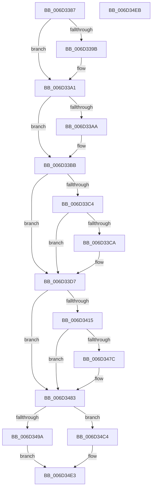

# CcCompleteAsyncRead$fin$1

- RVA: `0x006D3387`–`0x006D34EC` (길이 `357` bytes)
- VA: `0x00000001406D3387`
- 실행 섹션: `.text`
- PDB 이름 있음: `예`; PDB Function 태그: `예`
- unwind 정보 RVA: `0x000A97B4`
- 디코드: `81`개 명령, `357/357` bytes 표시
- 미해석 바이트: `0` (있으면 어셈블리에 `.byte`로 보존)

> 이 문서는 커널 이미지의 기계어와 PDB 기호를 분석해 생성했습니다. 4번과 5번은 함수 원형과 자료형을 바이너리 사용 방식에서 추정한 C 해석이며 원본 소스 복구 결과는 아닙니다.

## 1. Dependencies

- 직접 호출 지점: **9**; 고유 호출 대상: **9**
- 직접 호출자로 확인된 함수: **0**
- RIP 상대 이미지 참조: **4**

### Outgoing calls
- `0x006D339B` → [IoDiskIoAttributionDereference](../34/IoDiskIoAttributionDereference_function_00349978.md) (function, `0x00349978`)
- `0x006D33D1` → [guard_dispatch_icall](../6B/guard_dispatch_icall_function_006BAAD0.md) (function, `0x006BAAD0`)
- `0x006D33F9` → [PsSetPagePriorityThread](../3C/PsSetPagePriorityThread_function_003C4138.md) (function, `0x003C4138`)
- `0x006D3425` → [KeQueryPerformanceCounter](../37/KeQueryPerformanceCounter_function_0037E7E0.md) (function, `0x0037E7E0`)
- `0x006D3456` → [CcTelemetryBucketizeLatency](../../page/A6/CcTelemetryBucketizeLatency_function_00A67334.md) (function, `0x00A67334`)
- `0x006D34A8` → [KeAcquireInStackQueuedSpinLock](../27/KeAcquireInStackQueuedSpinLock_function_002757A0.md) (function, `0x002757A0`)
- `0x006D34B0` → [CcDecrementOpenCount](../38/CcDecrementOpenCount_function_0038B75C.md) (function, `0x0038B75C`)
- `0x006D34BC` → [KeReleaseInStackQueuedSpinLock](../34/KeReleaseInStackQueuedSpinLock_function_00342CE0.md) (function, `0x00342CE0`)
- `0x006D34DD` → [KeBugCheckEx](../4F/KeBugCheckEx_function_004FD660.md) (function, `0x004FD660`)

### Direct callers
- 이 함수 시작 RVA로 연결되는 직접 call은 확인되지 않았습니다. 간접 호출은 완전히 역산할 수 없습니다.

### Static image references
- `0x006D33AA` → RVA `0x00E65B98` (`.data`; read)
- `0x006D33B4` → RVA `0x00E65B98` (`.data`; write)
- `0x006D340C` → RVA `0x00F8F2A1` (`.data`; read)
- `0x006D343A` → RVA `0x00F8F268` (`.data`; read)

## 2. Other-region calls and transfers

- 다른 실행 섹션으로 향하는 call: **1**
  - `0x006D3456` → [CcTelemetryBucketizeLatency](../../page/A6/CcTelemetryBucketizeLatency_function_00A67334.md) (`.text` → `PAGE`)
- 별도 외부 분기/꼬리 이동을 확인하지 못했습니다.

## 3. Assembly (complete function range)

```asm
006D3387  40 53                           push rbx
006D3389  55                              push rbp
006D338A  57                              push rdi
006D338B  48 83 EC 50                     sub rsp, 0x50
006D338F  48 8B EA                        mov rbp, rdx
006D3392  48 8B 4D 68                     mov rcx, qword ptr [rbp + 0x68]
006D3396  48 85 C9                        test rcx, rcx
006D3399  74 06                           je 0x1406d33a1
006D339B  E8 D8 65 C7 FF                  call 0x140349978
006D33A0  90                              nop
006D33A1  83 BD 28 01 00 00 00            cmp dword ptr [rbp + 0x128], 0
006D33A8  74 11                           je 0x1406d33bb
006D33AA  48 8B 05 E7 27 79 00            mov rax, qword ptr [rip + 0x7927e7]
006D33B1  48 FF C0                        inc rax
006D33B4  48 89 05 DD 27 79 00            mov qword ptr [rip + 0x7927dd], rax
006D33BB  48 8B 4D 70                     mov rcx, qword ptr [rbp + 0x70]
006D33BF  48 85 C9                        test rcx, rcx
006D33C2  74 13                           je 0x1406d33d7
006D33C4  48 83 39 00                     cmp qword ptr [rcx], 0
006D33C8  74 0D                           je 0x1406d33d7
006D33CA  48 8B 01                        mov rax, qword ptr [rcx]
006D33CD  48 8B 49 08                     mov rcx, qword ptr [rcx + 8]
006D33D1  E8 FA 76 FE FF                  call 0x1406baad0
006D33D6  90                              nop
006D33D7  65 48 8B 04 25 88 01 00 00      mov rax, qword ptr gs:[0x188]
006D33E0  48 89 85 D8 00 00 00            mov qword ptr [rbp + 0xd8], rax
006D33E7  48 83 A0 50 05 00 00 00         and qword ptr [rax + 0x550], 0
006D33EF  8B 95 38 01 00 00               mov edx, dword ptr [rbp + 0x138]
006D33F5  48 8B 4D 78                     mov rcx, qword ptr [rbp + 0x78]
006D33F9  E8 3A 0D CF FF                  call 0x1403c4138
006D33FE  48 8B 9D 80 00 00 00            mov rbx, qword ptr [rbp + 0x80]
006D3405  F0 FF 8B 10 02 00 00            lock dec dword ptr [rbx + 0x210]
006D340C  80 3D 8E BE 8B 00 00            cmp byte ptr [rip + 0x8bbe8e], 0
006D3413  75 6E                           jne 0x1406d3483
006D3415  48 8B BB 00 02 00 00            mov rdi, qword ptr [rbx + 0x200]
006D341C  48 81 C7 E8 00 00 00            add rdi, 0xe8
006D3423  33 C9                           xor ecx, ecx
006D3425  E8 B6 B3 CA FF                  call 0x14037e7e0
006D342A  48 2B 85 88 00 00 00            sub rax, qword ptr [rbp + 0x88]
006D3431  48 69 C0 40 42 0F 00            imul rax, rax, 0xf4240
006D3438  48 99                           cqo
006D343A  48 F7 3D 27 BE 8B 00            idiv qword ptr [rip + 0x8bbe27]
006D3441  48 89 45 60                     mov qword ptr [rbp + 0x60], rax
006D3445  4C 8D 87 80 04 00 00            lea r8, [rdi + 0x480]
006D344C  48 8D 97 20 04 00 00            lea rdx, [rdi + 0x420]
006D3453  48 8B C8                        mov rcx, rax
006D3456  E8 D9 3E 39 00                  call 0x140a67334
006D345B  48 8B 87 10 04 00 00            mov rax, qword ptr [rdi + 0x410]
006D3462  48 FF C0                        inc rax
006D3465  48 89 87 10 04 00 00            mov qword ptr [rdi + 0x410], rax
006D346C  48 8B 8F 18 04 00 00            mov rcx, qword ptr [rdi + 0x418]
006D3473  48 8B 45 60                     mov rax, qword ptr [rbp + 0x60]
006D3477  48 3B C1                        cmp rax, rcx
006D347A  76 07                           jbe 0x1406d3483
006D347C  48 89 87 18 04 00 00            mov qword ptr [rdi + 0x418], rax
006D3483  48 8B 85 20 01 00 00            mov rax, qword ptr [rbp + 0x120]
006D348A  48 8B 88 88 00 00 00            mov rcx, qword ptr [rax + 0x88]
006D3491  48 3B 8B 18 02 00 00            cmp rcx, qword ptr [rbx + 0x218]
006D3498  75 2A                           jne 0x1406d34c4
006D349A  48 81 C1 00 03 00 00            add rcx, 0x300
006D34A1  48 8D 95 B0 00 00 00            lea rdx, [rbp + 0xb0]
006D34A8  E8 F3 22 BA FF                  call 0x1402757a0
006D34AD  48 8B CB                        mov rcx, rbx
006D34B0  E8 A7 82 CB FF                  call 0x14038b75c
006D34B5  48 8D 8D B0 00 00 00            lea rcx, [rbp + 0xb0]
006D34BC  E8 1F F8 C6 FF                  call 0x140342ce0
006D34C1  90                              nop
006D34C2  EB 1F                           jmp 0x1406d34e3
006D34C4  48 83 64 24 20 00               and qword ptr [rsp + 0x20], 0
006D34CA  45 33 C9                        xor r9d, r9d
006D34CD  BA 1C 07 00 00                  mov edx, 0x71c
006D34D2  41 8D 49 34                     lea ecx, [r9 + 0x34]
006D34D6  49 C7 C0 20 04 00 C0            mov r8, 0xffffffffc0000420
006D34DD  E8 7E A1 E2 FF                  call 0x1404fd660
006D34E2  90                              nop
006D34E3  48 83 C4 50                     add rsp, 0x50
006D34E7  5F                              pop rdi
006D34E8  5D                              pop rbp
006D34E9  5B                              pop rbx
006D34EA  C3                              ret
006D34EB  CC                              int3
```

## 4. C-style interpretation (structured pseudocode)

```c
__int64 __fastcall CcCompleteAsyncRead_fin_1(__int64 a1, __int64 a2, __int64 a3, int a4)
{
    __int64 result;
    __int64 v_rdi;
    __int64 v_rsp;
    unsigned __int64 v_stack_m48;

    v_rsp = (v_rsp) - (80);
    if (*(unsigned __int64 *)(a2 + 104) != 0) {
        result = IoDiskIoAttributionDereference(*(unsigned __int64 *)(a2 + 104), a2, a3, a4);
    }
    if ((*(unsigned int *)(a2 + 296)) != 0) {
        result = *(unsigned __int64 *)(v_rip + 7940071);
        result = (result) + 1;
        *(unsigned __int64 *)(v_rip + 7940061) = result;
    }
    if (*(unsigned __int64 *)(a2 + 112) == 0) goto loc_006D33D7;
    if ((*(unsigned __int64 *)(*(unsigned __int64 *)(a2 + 112))) != 0) {
        result = *(unsigned __int64 *)(*(unsigned __int64 *)(a2 + 112));
        a1 = *(unsigned __int64 *)(*(unsigned __int64 *)(a2 + 112) + 8);
        result = guard_dispatch_icall(a1, a2, a3, a4);
    }
    *(unsigned __int64 *)(a2 + 216) = *(unsigned __int64 *)(gs_base + (0 + 392));
    result = PsSetPagePriorityThread(*(unsigned __int64 *)(a2 + 120), (unsigned int)(*(unsigned int *)(a2 + 312)), a3, a4);
    if ((*(unsigned __int8 *)(v_rip + 9158286)) != 0) goto loc_006D3483;
    v_rdi = (*(unsigned __int64 *)(*(unsigned __int64 *)(a2 + 128) + 512)) + (232);
    a1 = 0;
    result = KeQueryPerformanceCounter(a1, (unsigned int)(*(unsigned int *)(a2 + 312)), a3, a4);
    result = (result) - (*(unsigned __int64 *)(a2 + 136));
    result = (result) * (result);
    *(unsigned __int64 *)(a2 + 96) = result;
    result = CcTelemetryBucketizeLatency(result, v_rdi + 1056, v_rdi + 1152, a4);
    result = (*(unsigned __int64 *)(v_rdi + 1040)) + 1;
    *(unsigned __int64 *)(v_rdi + 1040) = result;
    if ((*(unsigned __int64 *)(a2 + 96)) >= = (*(unsigned __int64 *)(v_rdi + 1048))) {
        *(unsigned __int64 *)(v_rdi + 1048) = *(unsigned __int64 *)(a2 + 96);
    }
    if ((*(unsigned __int64 *)(*(unsigned __int64 *)(a2 + 288) + 136)) != (*(unsigned __int64 *)(*(unsigned __int64 *)(a2 + 128) + 536))) goto loc_006D34C4;
    a1 = (*(unsigned __int64 *)(*(unsigned __int64 *)(a2 + 288) + 136)) + (768);
    result = KeAcquireInStackQueuedSpinLock(a1, a2 + 176, v_rdi + 1152, a4);
    result = CcDecrementOpenCount(*(unsigned __int64 *)(a2 + 128), a2 + 176, v_rdi + 1152, a4);
    result = KeReleaseInStackQueuedSpinLock(a2 + 176, a2 + 176, v_rdi + 1152, a4);
    goto loc_006D34E3;
loc_006D34C4:
    a4 = 0;
    result = KeBugCheckEx(a4 + 52, (unsigned int)(0x71CULL), 0xFFFFFFFFC0000420ULL, a4);
loc_006D34E3:
    v_rsp = (v_rsp) + (80);
    return result;
}
```

## 5. (Beta) C Style

```c
int64_t CcCompleteAsyncRead_fin_1(int64_t Arg1, void *Arg2, int64_t Arg3, int32_t Arg4)
{
    uint8_t *arg2 = (uint8_t *)Arg2;

    int64_t result;
    int64_t local_rdi;
    int64_t local_rsp;
    uint64_t v_stack_m48;

    local_rsp = (local_rsp) - (80);
    if (*(uint64_t *)(arg2 + 0x68) != 0) {
        result = IoDiskIoAttributionDereference(*(uint64_t *)(arg2 + 0x68), Arg2, Arg3, Arg4);
    }
    if ((*(uint32_t *)(arg2 + 0x128)) != 0) {
        result = *(uint64_t *)(v_rip + 0x7927E7);
        result = (result) + 1;
        *(uint64_t *)(v_rip + 0x7927DD) = result;
    }
    if (*(uint64_t *)(arg2 + 0x70) == 0) goto loc_006D33D7;
    if ((*(uint64_t *)(*(uint64_t *)(arg2 + 0x70))) != 0) {
        result = *(uint64_t *)(*(uint64_t *)(arg2 + 0x70));
        Arg1 = *(uint64_t *)(*(uint64_t *)(arg2 + 0x70) + 0x8);
        result = guard_dispatch_icall(Arg1, Arg2, Arg3, Arg4);
    }
    *(uint64_t *)(arg2 + 0xD8) = *(uint64_t *)(gs_base + (0 + 0x188));
    result = PsSetPagePriorityThread(*(uint64_t *)(arg2 + 0x78), (uint32_t)(*(uint32_t *)(arg2 + 0x138)), Arg3, Arg4);
    if ((*(uint8_t *)(v_rip + 0x8BBE8E)) != 0) goto loc_006D3483;
    local_rdi = (*(uint64_t *)(*(uint64_t *)(arg2 + 0x80) + 0x200)) + (232);
    Arg1 = 0;
    result = KeQueryPerformanceCounter(Arg1, (uint32_t)(*(uint32_t *)(arg2 + 0x138)), Arg3, Arg4);
    result = (result) - (*(uint64_t *)(arg2 + 0x88));
    result = (result) * (result);
    *(uint64_t *)(arg2 + 0x60) = result;
    result = CcTelemetryBucketizeLatency(result, local_rdi + 1056, local_rdi + 1152, Arg4);
    result = (*(uint64_t *)(local_rdi + 0x410)) + 1;
    *(uint64_t *)(local_rdi + 0x410) = result;
    if ((*(uint64_t *)(arg2 + 0x60)) >= = (*(uint64_t *)(local_rdi + 0x418))) {
        *(uint64_t *)(local_rdi + 0x418) = *(uint64_t *)(arg2 + 0x60);
    }
    if ((*(uint64_t *)(*(uint64_t *)(arg2 + 0x120) + 0x88)) != (*(uint64_t *)(*(uint64_t *)(arg2 + 0x80) + 0x218))) goto loc_006D34C4;
    Arg1 = (*(uint64_t *)(*(uint64_t *)(arg2 + 0x120) + 0x88)) + (768);
    result = KeAcquireInStackQueuedSpinLock(Arg1, Arg2 + 176, local_rdi + 1152, Arg4);
    result = CcDecrementOpenCount(*(uint64_t *)(arg2 + 0x80), Arg2 + 176, local_rdi + 1152, Arg4);
    result = KeReleaseInStackQueuedSpinLock(Arg2 + 176, Arg2 + 176, local_rdi + 1152, Arg4);
    goto loc_006D34E3;
loc_006D34C4:
    Arg4 = 0;
    result = KeBugCheckEx(Arg4 + 52, (uint32_t)(0x71CULL), 0xFFFFFFFFC0000420ULL, Arg4);
loc_006D34E3:
    local_rsp = (local_rsp) + (80);
    return result;
}
```

### 관측된 메모리 오프셋

구조체 형식이 확인되지 않은 접근은 인자 기준의 오프셋으로만 기록했습니다.

| 기준 인자 | 오프셋 표현 | 폭 (bit) | 접근 |
|---|---:|---:|---|
| `Arg2` | `+ 0x60` | `64` | `R` |
| `Arg2` | `+ 0x60` | `64` | `W` |
| `Arg2` | `+ 0x68` | `64` | `R` |
| `Arg2` | `+ 0x70` | `64` | `R` |
| `Arg2` | `+ 0x78` | `64` | `R` |
| `Arg2` | `+ 0x80` | `64` | `R` |
| `Arg2` | `+ 0x88` | `64` | `R` |
| `Arg2` | `+ 0xB0` | `64` | `R` |
| `Arg2` | `+ 0xD8` | `64` | `W` |
| `Arg2` | `+ 0x120` | `64` | `R` |
| `Arg2` | `+ 0x128` | `32` | `R` |
| `Arg2` | `+ 0x138` | `32` | `R` |

## 6. Execution-region graph

[열기: 2D/3D 그래프와 함수 탐색 컨트롤 패널](../../../control-panel.html?section=text&rva=0x006D3387&view=graph)

- 2D 그래프는 위에서 아래로 흐르고, 3D 그래프는 빈 공간을 드래그해 회전합니다. Shift+드래그는 이동, 휠은 확대·축소, 함수 노드 선택은 대상 보고서 이동입니다.

### Static fallback


