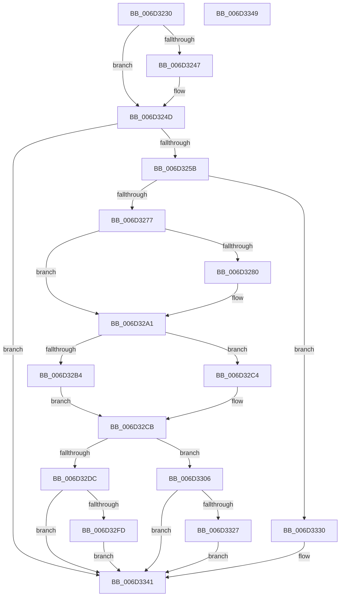

# CcCopyReadEx$fin$0

- RVA: `0x006D3230`–`0x006D334A` (길이 `282` bytes)
- VA: `0x00000001406D3230`
- 실행 섹션: `.text`
- PDB 이름 있음: `예`; PDB Function 태그: `예`
- unwind 정보 RVA: `0x000A970C`
- 디코드: `65`개 명령, `282/282` bytes 표시
- 미해석 바이트: `0` (있으면 어셈블리에 `.byte`로 보존)

> 이 문서는 커널 이미지의 기계어와 PDB 기호를 분석해 생성했습니다. 4번과 5번은 함수 원형과 자료형을 바이너리 사용 방식에서 추정한 C 해석이며 원본 소스 복구 결과는 아닙니다.

## 1. Dependencies

- 직접 호출 지점: **3**; 고유 호출 대상: **3**
- 직접 호출자로 확인된 함수: **0**
- RIP 상대 이미지 참조: **2**

### Outgoing calls
- `0x006D3247` → [IoDiskIoAttributionDereference](../34/IoDiskIoAttributionDereference_function_00349978.md) (function, `0x00349978`)
- `0x006D3282` → [KeQueryPerformanceCounter](../37/KeQueryPerformanceCounter_function_0037E7E0.md) (function, `0x0037E7E0`)
- `0x006D32D2` → [CcTelemetryBucketizeLatency](../../page/A6/CcTelemetryBucketizeLatency_function_00A67334.md) (function, `0x00A67334`)

### Direct callers
- 이 함수 시작 RVA로 연결되는 직접 call은 확인되지 않았습니다. 간접 호출은 완전히 역산할 수 없습니다.

### Static image references
- `0x006D324D` → RVA `0x00F8F2A1` (`.data`; read)
- `0x006D3293` → RVA `0x00F8F268` (`.data`; read)

## 2. Other-region calls and transfers

- 다른 실행 섹션으로 향하는 call: **1**
  - `0x006D32D2` → [CcTelemetryBucketizeLatency](../../page/A6/CcTelemetryBucketizeLatency_function_00A67334.md) (`.text` → `PAGE`)
- 별도 외부 분기/꼬리 이동을 확인하지 못했습니다.

## 3. Assembly (complete function range)

```asm
006D3230  40 53                           push rbx
006D3232  55                              push rbp
006D3233  57                              push rdi
006D3234  48 83 EC 50                     sub rsp, 0x50
006D3238  48 8B EA                        mov rbp, rdx
006D323B  48 8B 8D D8 00 00 00            mov rcx, qword ptr [rbp + 0xd8]
006D3242  48 85 C9                        test rcx, rcx
006D3245  74 06                           je 0x1406d324d
006D3247  E8 2C 67 C7 FF                  call 0x140349978
006D324C  90                              nop
006D324D  8A 05 4E C0 8B 00               mov al, byte ptr [rip + 0x8bc04e]
006D3253  84 C0                           test al, al
006D3255  0F 85 E6 00 00 00               jne 0x1406d3341
006D325B  48 8B 45 68                     mov rax, qword ptr [rbp + 0x68]
006D325F  48 8B B8 00 02 00 00            mov rdi, qword ptr [rax + 0x200]
006D3266  48 81 C7 E8 00 00 00            add rdi, 0xe8
006D326D  80 7D 50 00                     cmp byte ptr [rbp + 0x50], 0
006D3271  0F 84 B9 00 00 00               je 0x1406d3330
006D3277  48 8B 5D 58                     mov rbx, qword ptr [rbp + 0x58]
006D327B  48 85 DB                        test rbx, rbx
006D327E  74 21                           je 0x1406d32a1
006D3280  33 C9                           xor ecx, ecx
006D3282  E8 59 B5 CA FF                  call 0x14037e7e0
006D3287  48 2B C3                        sub rax, rbx
006D328A  48 69 C0 40 42 0F 00            imul rax, rax, 0xf4240
006D3291  48 99                           cqo
006D3293  48 F7 3D CE BF 8B 00            idiv qword ptr [rip + 0x8bbfce]
006D329A  48 89 85 D0 00 00 00            mov qword ptr [rbp + 0xd0], rax
006D32A1  44 8A 9D E8 00 00 00            mov r11b, byte ptr [rbp + 0xe8]
006D32A8  45 84 DB                        test r11b, r11b
006D32AB  4C 8D 87 48 01 00 00            lea r8, [rdi + 0x148]
006D32B2  75 10                           jne 0x1406d32c4
006D32B4  4C 8D 87 08 02 00 00            lea r8, [rdi + 0x208]
006D32BB  48 8D 97 A8 01 00 00            lea rdx, [rdi + 0x1a8]
006D32C2  EB 07                           jmp 0x1406d32cb
006D32C4  48 8D 97 E8 00 00 00            lea rdx, [rdi + 0xe8]
006D32CB  48 8B 8D D0 00 00 00            mov rcx, qword ptr [rbp + 0xd0]
006D32D2  E8 5D 40 39 00                  call 0x140a67334
006D32D7  45 84 DB                        test r11b, r11b
006D32DA  74 2A                           je 0x1406d3306
006D32DC  48 8B 87 88 00 00 00            mov rax, qword ptr [rdi + 0x88]
006D32E3  48 FF C0                        inc rax
006D32E6  48 89 87 88 00 00 00            mov qword ptr [rdi + 0x88], rax
006D32ED  48 8B 85 D0 00 00 00            mov rax, qword ptr [rbp + 0xd0]
006D32F4  48 3B 87 D8 00 00 00            cmp rax, qword ptr [rdi + 0xd8]
006D32FB  76 44                           jbe 0x1406d3341
006D32FD  48 89 87 D8 00 00 00            mov qword ptr [rdi + 0xd8], rax
006D3304  EB 3B                           jmp 0x1406d3341
006D3306  48 8B 87 90 00 00 00            mov rax, qword ptr [rdi + 0x90]
006D330D  48 FF C0                        inc rax
006D3310  48 89 87 90 00 00 00            mov qword ptr [rdi + 0x90], rax
006D3317  48 8B 85 D0 00 00 00            mov rax, qword ptr [rbp + 0xd0]
006D331E  48 3B 87 E0 00 00 00            cmp rax, qword ptr [rdi + 0xe0]
006D3325  76 1A                           jbe 0x1406d3341
006D3327  48 89 87 E0 00 00 00            mov qword ptr [rdi + 0xe0], rax
006D332E  EB 11                           jmp 0x1406d3341
006D3330  48 8B 87 98 00 00 00            mov rax, qword ptr [rdi + 0x98]
006D3337  48 FF C0                        inc rax
006D333A  48 89 87 98 00 00 00            mov qword ptr [rdi + 0x98], rax
006D3341  48 83 C4 50                     add rsp, 0x50
006D3345  5F                              pop rdi
006D3346  5D                              pop rbp
006D3347  5B                              pop rbx
006D3348  C3                              ret
006D3349  CC                              int3
```

## 4. C-style interpretation (structured pseudocode)

```c
__int64 __fastcall CcCopyReadEx_fin_0(__int64 a1, __int64 a2)
{
    __int64 result;
    __int64 v_rdi;
    __int64 v_rsp;

    v_rsp = (v_rsp) - (80);
    if (*(unsigned __int64 *)(a2 + 216) != 0) {
        result = IoDiskIoAttributionDereference(*(unsigned __int64 *)(a2 + 216), a2, a3, a4);
    }
    if ((unsigned __int8)(*(unsigned __int8 *)(v_rip + 9158734)) != 0) goto loc_006D3341;
    v_rdi = (*(unsigned __int64 *)(*(unsigned __int64 *)(a2 + 104) + 512)) + (232);
    if ((*(unsigned __int8 *)(a2 + 80)) == 0) goto loc_006D3330;
    result = *(unsigned __int64 *)(a2 + 104);
    if (*(unsigned __int64 *)(a2 + 88) != 0) {
        a1 = 0;
        result = KeQueryPerformanceCounter(a1, a2, a3, a4);
        result = (result) - (*(unsigned __int64 *)(a2 + 88));
        result = (result) * (result);
        *(unsigned __int64 *)(a2 + 208) = result;
    }
    if ((unsigned __int8)(*(unsigned __int8 *)(a2 + 232)) != 0) goto loc_006D32C4;
    goto loc_006D32CB;
loc_006D32C4:
loc_006D32CB:
    result = CcTelemetryBucketizeLatency(*(unsigned __int64 *)(a2 + 208), v_rdi + 232, v_rdi + 520, a4);
    if ((unsigned __int8)(*(unsigned __int8 *)(a2 + 232)) == 0) goto loc_006D3306;
    result = (*(unsigned __int64 *)(v_rdi + 136)) + 1;
    *(unsigned __int64 *)(v_rdi + 136) = result;
    if ((*(unsigned __int64 *)(a2 + 208)) <= (*(unsigned __int64 *)(v_rdi + 216))) goto loc_006D3341;
    *(unsigned __int64 *)(v_rdi + 216) = *(unsigned __int64 *)(a2 + 208);
    goto loc_006D3341;
loc_006D3306:
    result = (*(unsigned __int64 *)(v_rdi + 144)) + 1;
    *(unsigned __int64 *)(v_rdi + 144) = result;
    if ((*(unsigned __int64 *)(a2 + 208)) <= (*(unsigned __int64 *)(v_rdi + 224))) goto loc_006D3341;
    *(unsigned __int64 *)(v_rdi + 224) = *(unsigned __int64 *)(a2 + 208);
    goto loc_006D3341;
loc_006D3330:
    result = (*(unsigned __int64 *)(v_rdi + 152)) + 1;
    *(unsigned __int64 *)(v_rdi + 152) = result;
loc_006D3341:
    v_rsp = (v_rsp) + (80);
    return result;
}
```

## 5. (Beta) C Style

```c
int64_t CcCopyReadEx_fin_0(int64_t Arg1, void *Arg2)
{
    uint8_t *arg2 = (uint8_t *)Arg2;

    int64_t result;
    int64_t local_rdi;
    int64_t local_rsp;

    local_rsp = (local_rsp) - (80);
    if (*(uint64_t *)(arg2 + 0xD8) != 0) {
        result = IoDiskIoAttributionDereference(*(uint64_t *)(arg2 + 0xD8), Arg2, a3, a4);
    }
    if ((uint8_t)(*(uint8_t *)(v_rip + 0x8BC04E)) != 0) goto loc_006D3341;
    local_rdi = (*(uint64_t *)(*(uint64_t *)(arg2 + 0x68) + 0x200)) + (232);
    if ((*(uint8_t *)(arg2 + 0x50)) == 0) goto loc_006D3330;
    result = *(uint64_t *)(arg2 + 0x68);
    if (*(uint64_t *)(arg2 + 0x58) != 0) {
        Arg1 = 0;
        result = KeQueryPerformanceCounter(Arg1, Arg2, a3, a4);
        result = (result) - (*(uint64_t *)(arg2 + 0x58));
        result = (result) * (result);
        *(uint64_t *)(arg2 + 0xD0) = result;
    }
    if ((uint8_t)(*(uint8_t *)(arg2 + 0xE8)) != 0) goto loc_006D32C4;
    goto loc_006D32CB;
loc_006D32C4:
loc_006D32CB:
    result = CcTelemetryBucketizeLatency(*(uint64_t *)(arg2 + 0xD0), local_rdi + 232, local_rdi + 520, a4);
    if ((uint8_t)(*(uint8_t *)(arg2 + 0xE8)) == 0) goto loc_006D3306;
    result = (*(uint64_t *)(local_rdi + 0x88)) + 1;
    *(uint64_t *)(local_rdi + 0x88) = result;
    if ((*(uint64_t *)(arg2 + 0xD0)) <= (*(uint64_t *)(local_rdi + 0xD8))) goto loc_006D3341;
    *(uint64_t *)(local_rdi + 0xD8) = *(uint64_t *)(arg2 + 0xD0);
    goto loc_006D3341;
loc_006D3306:
    result = (*(uint64_t *)(local_rdi + 0x90)) + 1;
    *(uint64_t *)(local_rdi + 0x90) = result;
    if ((*(uint64_t *)(arg2 + 0xD0)) <= (*(uint64_t *)(local_rdi + 0xE0))) goto loc_006D3341;
    *(uint64_t *)(local_rdi + 0xE0) = *(uint64_t *)(arg2 + 0xD0);
    goto loc_006D3341;
loc_006D3330:
    result = (*(uint64_t *)(local_rdi + 0x98)) + 1;
    *(uint64_t *)(local_rdi + 0x98) = result;
loc_006D3341:
    local_rsp = (local_rsp) + (80);
    return result;
}
```

### 관측된 메모리 오프셋

구조체 형식이 확인되지 않은 접근은 인자 기준의 오프셋으로만 기록했습니다.

| 기준 인자 | 오프셋 표현 | 폭 (bit) | 접근 |
|---|---:|---:|---|
| `Arg2` | `+ 0x50` | `8` | `R` |
| `Arg2` | `+ 0x58` | `64` | `R` |
| `Arg2` | `+ 0x68` | `64` | `R` |
| `Arg2` | `+ 0xD0` | `64` | `R` |
| `Arg2` | `+ 0xD0` | `64` | `W` |
| `Arg2` | `+ 0xD8` | `64` | `R` |
| `Arg2` | `+ 0xE8` | `8` | `R` |

## 6. Execution-region graph

[열기: 2D/3D 그래프와 함수 탐색 컨트롤 패널](../../../control-panel.html?section=text&rva=0x006D3230&view=graph)

- 2D 그래프는 위에서 아래로 흐르고, 3D 그래프는 빈 공간을 드래그해 회전합니다. Shift+드래그는 이동, 휠은 확대·축소, 함수 노드 선택은 대상 보고서 이동입니다.

### Static fallback


