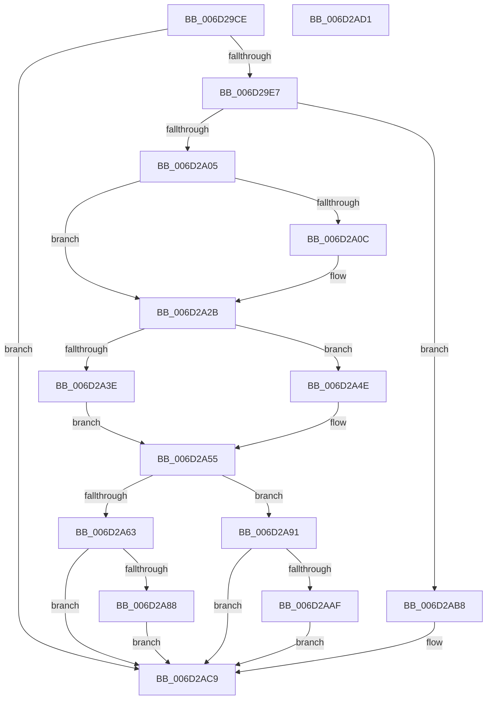

# CcCopyWriteEx$fin$0

- RVA: `0x006D29CE`–`0x006D2AD2` (길이 `260` bytes)
- VA: `0x00000001406D29CE`
- 실행 섹션: `.text`
- PDB 이름 있음: `예`; PDB Function 태그: `예`
- unwind 정보 RVA: `0x0008F6CC`
- 디코드: `60`개 명령, `260/260` bytes 표시
- 미해석 바이트: `0` (있으면 어셈블리에 `.byte`로 보존)

> 이 문서는 커널 이미지의 기계어와 PDB 기호를 분석해 생성했습니다. 4번과 5번은 함수 원형과 자료형을 바이너리 사용 방식에서 추정한 C 해석이며 원본 소스 복구 결과는 아닙니다.

## 1. Dependencies

- 직접 호출 지점: **2**; 고유 호출 대상: **2**
- 직접 호출자로 확인된 함수: **0**
- RIP 상대 이미지 참조: **2**

### Outgoing calls
- `0x006D2A0E` → [KeQueryPerformanceCounter](../37/KeQueryPerformanceCounter_function_0037E7E0.md) (function, `0x0037E7E0`)
- `0x006D2A59` → [CcTelemetryBucketizeLatency](../../page/A6/CcTelemetryBucketizeLatency_function_00A67334.md) (function, `0x00A67334`)

### Direct callers
- 이 함수 시작 RVA로 연결되는 직접 call은 확인되지 않았습니다. 간접 호출은 완전히 역산할 수 없습니다.

### Static image references
- `0x006D29D9` → RVA `0x00F8F2A1` (`.data`; read)
- `0x006D2A20` → RVA `0x00F8F268` (`.data`; read)

## 2. Other-region calls and transfers

- 다른 실행 섹션으로 향하는 call: **1**
  - `0x006D2A59` → [CcTelemetryBucketizeLatency](../../page/A6/CcTelemetryBucketizeLatency_function_00A67334.md) (`.text` → `PAGE`)
- 별도 외부 분기/꼬리 이동을 확인하지 못했습니다.

## 3. Assembly (complete function range)

```asm
006D29CE  40 53                           push rbx
006D29D0  55                              push rbp
006D29D1  57                              push rdi
006D29D2  48 83 EC 50                     sub rsp, 0x50
006D29D6  48 8B EA                        mov rbp, rdx
006D29D9  8A 05 C2 C8 8B 00               mov al, byte ptr [rip + 0x8bc8c2]
006D29DF  84 C0                           test al, al
006D29E1  0F 85 E2 00 00 00               jne 0x1406d2ac9
006D29E7  48 8B BD 80 00 00 00            mov rdi, qword ptr [rbp + 0x80]
006D29EE  48 8B 9F 00 02 00 00            mov rbx, qword ptr [rdi + 0x200]
006D29F5  48 81 C3 E8 00 00 00            add rbx, 0xe8
006D29FC  38 45 50                        cmp byte ptr [rbp + 0x50], al
006D29FF  0F 84 B3 00 00 00               je 0x1406d2ab8
006D2A05  48 83 7D 60 00                  cmp qword ptr [rbp + 0x60], 0
006D2A0A  74 1F                           je 0x1406d2a2b
006D2A0C  33 C9                           xor ecx, ecx
006D2A0E  E8 CD BD CA FF                  call 0x14037e7e0
006D2A13  48 2B 45 60                     sub rax, qword ptr [rbp + 0x60]
006D2A17  48 69 C0 40 42 0F 00            imul rax, rax, 0xf4240
006D2A1E  48 99                           cqo
006D2A20  48 F7 3D 41 C8 8B 00            idiv qword ptr [rip + 0x8bc841]
006D2A27  48 89 45 58                     mov qword ptr [rbp + 0x58], rax
006D2A2B  44 8A 9D C8 00 00 00            mov r11b, byte ptr [rbp + 0xc8]
006D2A32  45 84 DB                        test r11b, r11b
006D2A35  4C 8D 83 F0 02 00 00            lea r8, [rbx + 0x2f0]
006D2A3C  75 10                           jne 0x1406d2a4e
006D2A3E  4C 8D 83 B0 03 00 00            lea r8, [rbx + 0x3b0]
006D2A45  48 8D 93 50 03 00 00            lea rdx, [rbx + 0x350]
006D2A4C  EB 07                           jmp 0x1406d2a55
006D2A4E  48 8D 93 90 02 00 00            lea rdx, [rbx + 0x290]
006D2A55  48 8B 4D 58                     mov rcx, qword ptr [rbp + 0x58]
006D2A59  E8 D6 48 39 00                  call 0x140a67334
006D2A5E  45 84 DB                        test r11b, r11b
006D2A61  74 2E                           je 0x1406d2a91
006D2A63  48 8B 83 68 02 00 00            mov rax, qword ptr [rbx + 0x268]
006D2A6A  48 FF C0                        inc rax
006D2A6D  48 89 83 68 02 00 00            mov qword ptr [rbx + 0x268], rax
006D2A74  48 8B 8F 00 02 00 00            mov rcx, qword ptr [rdi + 0x200]
006D2A7B  48 8B 45 58                     mov rax, qword ptr [rbp + 0x58]
006D2A7F  48 3B 81 68 03 00 00            cmp rax, qword ptr [rcx + 0x368]
006D2A86  76 41                           jbe 0x1406d2ac9
006D2A88  48 89 83 80 02 00 00            mov qword ptr [rbx + 0x280], rax
006D2A8F  EB 38                           jmp 0x1406d2ac9
006D2A91  48 8B 83 70 02 00 00            mov rax, qword ptr [rbx + 0x270]
006D2A98  48 FF C0                        inc rax
006D2A9B  48 89 83 70 02 00 00            mov qword ptr [rbx + 0x270], rax
006D2AA2  48 8B 45 58                     mov rax, qword ptr [rbp + 0x58]
006D2AA6  48 3B 83 88 02 00 00            cmp rax, qword ptr [rbx + 0x288]
006D2AAD  76 1A                           jbe 0x1406d2ac9
006D2AAF  48 89 83 88 02 00 00            mov qword ptr [rbx + 0x288], rax
006D2AB6  EB 11                           jmp 0x1406d2ac9
006D2AB8  48 8B 83 78 02 00 00            mov rax, qword ptr [rbx + 0x278]
006D2ABF  48 FF C0                        inc rax
006D2AC2  48 89 83 78 02 00 00            mov qword ptr [rbx + 0x278], rax
006D2AC9  48 83 C4 50                     add rsp, 0x50
006D2ACD  5F                              pop rdi
006D2ACE  5D                              pop rbp
006D2ACF  5B                              pop rbx
006D2AD0  C3                              ret
006D2AD1  CC                              int3
```

## 4. C-style interpretation (structured pseudocode)

```c
__int64 __fastcall CcCopyWriteEx_fin_0(int a1, __int64 a2)
{
    __int64 result;
    __int64 v_rbx;
    __int64 v_rsp;

    v_rsp = (v_rsp) - (80);
    if ((unsigned __int8)(*(unsigned __int8 *)(v_rip + 9160898)) != 0) goto loc_006D2AC9;
    v_rbx = (*(unsigned __int64 *)(*(unsigned __int64 *)(a2 + 128) + 512)) + (232);
    if ((*(unsigned __int8 *)(a2 + 80)) == ((unsigned __int8)(*(unsigned __int8 *)(v_rip + 9160898)))) goto loc_006D2AB8;
    result = *(unsigned __int8 *)(v_rip + 9160898);
    if ((*(unsigned __int64 *)(a2 + 96)) != 0) {
        a1 = 0;
        result = KeQueryPerformanceCounter(a1, a2, a3, a4);
        result = (result) - (*(unsigned __int64 *)(a2 + 96));
        result = (result) * (result);
        *(unsigned __int64 *)(a2 + 88) = result;
    }
    if ((unsigned __int8)(*(unsigned __int8 *)(a2 + 200)) != 0) goto loc_006D2A4E;
    goto loc_006D2A55;
loc_006D2A4E:
loc_006D2A55:
    result = CcTelemetryBucketizeLatency(*(unsigned __int64 *)(a2 + 88), v_rbx + 656, v_rbx + 944, a4);
    if ((unsigned __int8)(*(unsigned __int8 *)(a2 + 200)) == 0) goto loc_006D2A91;
    result = (*(unsigned __int64 *)(v_rbx + 616)) + 1;
    *(unsigned __int64 *)(v_rbx + 616) = result;
    if ((*(unsigned __int64 *)(a2 + 88)) <= (*(unsigned __int64 *)(*(unsigned __int64 *)(*(unsigned __int64 *)(a2 + 128) + 512) + 872))) goto loc_006D2AC9;
    *(unsigned __int64 *)(v_rbx + 640) = *(unsigned __int64 *)(a2 + 88);
    goto loc_006D2AC9;
loc_006D2A91:
    result = (*(unsigned __int64 *)(v_rbx + 624)) + 1;
    *(unsigned __int64 *)(v_rbx + 624) = result;
    if ((*(unsigned __int64 *)(a2 + 88)) <= (*(unsigned __int64 *)(v_rbx + 648))) goto loc_006D2AC9;
    *(unsigned __int64 *)(v_rbx + 648) = *(unsigned __int64 *)(a2 + 88);
    goto loc_006D2AC9;
loc_006D2AB8:
    result = (*(unsigned __int64 *)(v_rbx + 632)) + 1;
    *(unsigned __int64 *)(v_rbx + 632) = result;
loc_006D2AC9:
    v_rsp = (v_rsp) + (80);
    return result;
}
```

## 5. (Beta) C Style

```c
int64_t CcCopyWriteEx_fin_0(int32_t Arg1, void *Arg2)
{
    uint8_t *arg2 = (uint8_t *)Arg2;

    int64_t result;
    int64_t local_rbx;
    int64_t local_rsp;

    local_rsp = (local_rsp) - (80);
    if ((uint8_t)(*(uint8_t *)(v_rip + 0x8BC8C2)) != 0) goto loc_006D2AC9;
    local_rbx = (*(uint64_t *)(*(uint64_t *)(arg2 + 0x80) + 0x200)) + (232);
    if ((*(uint8_t *)(arg2 + 0x50)) == ((uint8_t)(*(uint8_t *)(v_rip + 0x8BC8C2)))) goto loc_006D2AB8;
    result = *(uint8_t *)(v_rip + 0x8BC8C2);
    if ((*(uint64_t *)(arg2 + 0x60)) != 0) {
        Arg1 = 0;
        result = KeQueryPerformanceCounter(Arg1, Arg2, a3, a4);
        result = (result) - (*(uint64_t *)(arg2 + 0x60));
        result = (result) * (result);
        *(uint64_t *)(arg2 + 0x58) = result;
    }
    if ((uint8_t)(*(uint8_t *)(arg2 + 0xC8)) != 0) goto loc_006D2A4E;
    goto loc_006D2A55;
loc_006D2A4E:
loc_006D2A55:
    result = CcTelemetryBucketizeLatency(*(uint64_t *)(arg2 + 0x58), local_rbx + 656, local_rbx + 944, a4);
    if ((uint8_t)(*(uint8_t *)(arg2 + 0xC8)) == 0) goto loc_006D2A91;
    result = (*(uint64_t *)(local_rbx + 0x268)) + 1;
    *(uint64_t *)(local_rbx + 0x268) = result;
    if ((*(uint64_t *)(arg2 + 0x58)) <= (*(uint64_t *)(*(uint64_t *)(*(uint64_t *)(arg2 + 0x80) + 0x200) + 0x368))) goto loc_006D2AC9;
    *(uint64_t *)(local_rbx + 0x280) = *(uint64_t *)(arg2 + 0x58);
    goto loc_006D2AC9;
loc_006D2A91:
    result = (*(uint64_t *)(local_rbx + 0x270)) + 1;
    *(uint64_t *)(local_rbx + 0x270) = result;
    if ((*(uint64_t *)(arg2 + 0x58)) <= (*(uint64_t *)(local_rbx + 0x288))) goto loc_006D2AC9;
    *(uint64_t *)(local_rbx + 0x288) = *(uint64_t *)(arg2 + 0x58);
    goto loc_006D2AC9;
loc_006D2AB8:
    result = (*(uint64_t *)(local_rbx + 0x278)) + 1;
    *(uint64_t *)(local_rbx + 0x278) = result;
loc_006D2AC9:
    local_rsp = (local_rsp) + (80);
    return result;
}
```

### 관측된 메모리 오프셋

구조체 형식이 확인되지 않은 접근은 인자 기준의 오프셋으로만 기록했습니다.

| 기준 인자 | 오프셋 표현 | 폭 (bit) | 접근 |
|---|---:|---:|---|
| `Arg2` | `+ 0x50` | `8` | `R` |
| `Arg2` | `+ 0x58` | `64` | `R` |
| `Arg2` | `+ 0x58` | `64` | `W` |
| `Arg2` | `+ 0x60` | `64` | `R` |
| `Arg2` | `+ 0x80` | `64` | `R` |
| `Arg2` | `+ 0xC8` | `8` | `R` |

## 6. Execution-region graph

[열기: 2D/3D 그래프와 함수 탐색 컨트롤 패널](../../../control-panel.html?section=text&rva=0x006D29CE&view=graph)

- 2D 그래프는 위에서 아래로 흐르고, 3D 그래프는 빈 공간을 드래그해 회전합니다. Shift+드래그는 이동, 휠은 확대·축소, 함수 노드 선택은 대상 보고서 이동입니다.

### Static fallback


