# CcMapAndCopyInToCache$fin$1

- RVA: `0x006D2AF9`–`0x006D2CBA` (길이 `449` bytes)
- VA: `0x00000001406D2AF9`
- 실행 섹션: `.text`
- PDB 이름 있음: `예`; PDB Function 태그: `예`
- unwind 정보 RVA: `0x0008F72C`
- 디코드: `113`개 명령, `449/449` bytes 표시
- 미해석 바이트: `0` (있으면 어셈블리에 `.byte`로 보존)

> 이 문서는 커널 이미지의 기계어와 PDB 기호를 분석해 생성했습니다. 4번과 5번은 함수 원형과 자료형을 바이너리 사용 방식에서 추정한 C 해석이며 원본 소스 복구 결과는 아닙니다.

## 1. Dependencies

- 직접 호출 지점: **7**; 고유 호출 대상: **7**
- 직접 호출자로 확인된 함수: **0**
- RIP 상대 이미지 참조: **1**

### Outgoing calls
- `0x006D2B5A` → [KeSetEvent](../33/KeSetEvent_function_0033F310.md) (function, `0x0033F310`)
- `0x006D2B8F` → [CcSetDirtyInMask](../3C/CcSetDirtyInMask_function_003CB688.md) (function, `0x003CB688`)
- `0x006D2C3D` → [CcFlushCachePriv](../35/CcFlushCachePriv_function_0035B040.md) (function, `0x0035B040`)
- `0x006D2C63` → [KeAcquireInStackQueuedSpinLock](../27/KeAcquireInStackQueuedSpinLock_function_002757A0.md) (function, `0x002757A0`)
- `0x006D2C84` → [KeReleaseInStackQueuedSpinLock](../34/KeReleaseInStackQueuedSpinLock_function_00342CE0.md) (function, `0x00342CE0`)
- `0x006D2C9D` → [FsRtlIsNtstatusExpected](../26/FsRtlIsNtstatusExpected_function_0026D390.md) (function, `0x0026D390`)
- `0x006D2CAC` → [RtlRaiseStatus](../2F/RtlRaiseStatus_function_002F6A50.md) (function, `0x002F6A50`)

### Direct callers
- 이 함수 시작 RVA로 연결되는 직접 call은 확인되지 않았습니다. 간접 호출은 완전히 역산할 수 없습니다.

### Static image references
- `0x006D2B95` → RVA `0x00E0A86C` (`.data`; read)

## 2. Other-region calls and transfers

- 다른 실행 섹션으로 향하는 call: **0**
- 별도 외부 분기/꼬리 이동을 확인하지 못했습니다.

## 3. Assembly (complete function range)

```asm
006D2AF9  40 53                           push rbx
006D2AFB  55                              push rbp
006D2AFC  48 83 EC 48                     sub rsp, 0x48
006D2B00  48 8B EA                        mov rbp, rdx
006D2B03  88 4D 4B                        mov byte ptr [rbp + 0x4b], cl
006D2B06  8B 95 BC 00 00 00               mov edx, dword ptr [rbp + 0xbc]
006D2B0C  8A C2                           mov al, dl
006D2B0E  24 01                           and al, 1
006D2B10  48 8B 8D B0 00 00 00            mov rcx, qword ptr [rbp + 0xb0]
006D2B17  88 81 AC 05 00 00               mov byte ptr [rcx + 0x5ac], al
006D2B1D  D1 EA                           shr edx, 1
006D2B1F  89 91 98 05 00 00               mov dword ptr [rcx + 0x598], edx
006D2B25  48 8B 8D 98 00 00 00            mov rcx, qword ptr [rbp + 0x98]
006D2B2C  48 85 C9                        test rcx, rcx
006D2B2F  74 36                           je 0x1406d2b67
006D2B31  48 8B 59 08                     mov rbx, qword ptr [rcx + 8]
006D2B35  83 C8 FF                        or eax, 0xffffffff
006D2B38  F0 0F C1 41 10                  lock xadd dword ptr [rcx + 0x10], eax
006D2B3D  FF C8                           dec eax
006D2B3F  66 85 C0                        test ax, ax
006D2B42  75 23                           jne 0x1406d2b67
006D2B44  48 83 BB C0 00 00 00 00         cmp qword ptr [rbx + 0xc0], 0
006D2B4C  74 12                           je 0x1406d2b60
006D2B4E  45 33 C0                        xor r8d, r8d
006D2B51  33 D2                           xor edx, edx
006D2B53  48 8B 8B C0 00 00 00            mov rcx, qword ptr [rbx + 0xc0]
006D2B5A  E8 B1 C7 C6 FF                  call 0x14033f310
006D2B5F  90                              nop
006D2B60  F0 FF 8B 28 02 00 00            lock dec dword ptr [rbx + 0x228]
006D2B67  0F B6 45 4B                     movzx eax, byte ptr [rbp + 0x4b]
006D2B6B  85 C0                           test eax, eax
006D2B6D  75 05                           jne 0x1406d2b74
006D2B6F  38 45 41                        cmp byte ptr [rbp + 0x41], al
006D2B72  74 21                           je 0x1406d2b95
006D2B74  44 8B 45 58                     mov r8d, dword ptr [rbp + 0x58]
006D2B78  45 85 C0                        test r8d, r8d
006D2B7B  74 18                           je 0x1406d2b95
006D2B7D  4C 8B 8D C0 01 00 00            mov r9, qword ptr [rbp + 0x1c0]
006D2B84  48 8D 55 68                     lea rdx, [rbp + 0x68]
006D2B88  48 8B 8D 80 01 00 00            mov rcx, qword ptr [rbp + 0x180]
006D2B8F  E8 F4 8A CF FF                  call 0x1403cb688
006D2B94  90                              nop
006D2B95  8B 15 D1 7C 73 00               mov edx, dword ptr [rip + 0x737cd1]
006D2B9B  83 FA FF                        cmp edx, -1
006D2B9E  74 2A                           je 0x1406d2bca
006D2BA0  48 8B 85 A8 01 00 00            mov rax, qword ptr [rbp + 0x1a8]
006D2BA7  F7 40 50 00 00 00 01            test dword ptr [rax + 0x50], 0x1000000
006D2BAE  74 1A                           je 0x1406d2bca
006D2BB0  80 7D 40 00                     cmp byte ptr [rbp + 0x40], 0
006D2BB4  75 14                           jne 0x1406d2bca
006D2BB6  48 8B 85 80 01 00 00            mov rax, qword ptr [rbp + 0x180]
006D2BBD  39 50 70                        cmp dword ptr [rax + 0x70], edx
006D2BC0  72 08                           jb 0x1406d2bca
006D2BC2  C6 45 44 01                     mov byte ptr [rbp + 0x44], 1
006D2BC6  C6 45 45 01                     mov byte ptr [rbp + 0x45], 1
006D2BCA  80 7D 48 00                     cmp byte ptr [rbp + 0x48], 0
006D2BCE  75 0A                           jne 0x1406d2bda
006D2BD0  80 7D 45 00                     cmp byte ptr [rbp + 0x45], 0
006D2BD4  0F 84 D8 00 00 00               je 0x1406d2cb2
006D2BDA  33 DB                           xor ebx, ebx
006D2BDC  89 9D A0 00 00 00               mov dword ptr [rbp + 0xa0], ebx
006D2BE2  38 5D 40                        cmp byte ptr [rbp + 0x40], bl
006D2BE5  74 13                           je 0x1406d2bfa
006D2BE7  48 8B 85 80 01 00 00            mov rax, qword ptr [rbp + 0x180]
006D2BEE  F7 80 98 00 00 00 00 00 00 40   test dword ptr [rax + 0x98], 0x40000000
006D2BF8  75 4E                           jne 0x1406d2c48
006D2BFA  44 8B 85 C0 00 00 00            mov r8d, dword ptr [rbp + 0xc0]
006D2C01  33 C9                           xor ecx, ecx
006D2C03  8A 45 44                        mov al, byte ptr [rbp + 0x44]
006D2C06  84 C0                           test al, al
006D2C08  44 0F 45 C1                     cmovne r8d, ecx
006D2C0C  48 8B 95 90 01 00 00            mov rdx, qword ptr [rbp + 0x190]
006D2C13  48 0F 45 D1                     cmovne rdx, rcx
006D2C17  48 21 4C 24 30                  and qword ptr [rsp + 0x30], rcx
006D2C1C  48 8D 85 A0 00 00 00            lea rax, [rbp + 0xa0]
006D2C23  48 89 44 24 28                  mov qword ptr [rsp + 0x28], rax
006D2C28  8A 45 40                        mov al, byte ptr [rbp + 0x40]
006D2C2B  88 44 24 20                     mov byte ptr [rsp + 0x20], al
006D2C2F  45 33 C9                        xor r9d, r9d
006D2C32  48 8B 8D A8 01 00 00            mov rcx, qword ptr [rbp + 0x1a8]
006D2C39  48 8B 49 28                     mov rcx, qword ptr [rcx + 0x28]
006D2C3D  E8 FE 83 C8 FF                  call 0x14035b040
006D2C42  8B 9D A0 00 00 00               mov ebx, dword ptr [rbp + 0xa0]
006D2C48  80 7D 49 00                     cmp byte ptr [rbp + 0x49], 0
006D2C4C  74 41                           je 0x1406d2c8f
006D2C4E  48 8B 8D 10 01 00 00            mov rcx, qword ptr [rbp + 0x110]
006D2C55  48 81 C1 00 03 00 00            add rcx, 0x300
006D2C5C  48 8D 95 E0 00 00 00            lea rdx, [rbp + 0xe0]
006D2C63  E8 38 2B BA FF                  call 0x1402757a0
006D2C68  48 8B 8D 80 01 00 00            mov rcx, qword ptr [rbp + 0x180]
006D2C6F  8B 81 0C 02 00 00               mov eax, dword ptr [rcx + 0x20c]
006D2C75  FF C8                           dec eax
006D2C77  89 81 0C 02 00 00               mov dword ptr [rcx + 0x20c], eax
006D2C7D  48 8D 8D E0 00 00 00            lea rcx, [rbp + 0xe0]
006D2C84  E8 57 00 C7 FF                  call 0x140342ce0
006D2C89  8B 9D A0 00 00 00               mov ebx, dword ptr [rbp + 0xa0]
006D2C8F  85 DB                           test ebx, ebx
006D2C91  79 1F                           jns 0x1406d2cb2
006D2C93  0F B6 45 4B                     movzx eax, byte ptr [rbp + 0x4b]
006D2C97  85 C0                           test eax, eax
006D2C99  75 17                           jne 0x1406d2cb2
006D2C9B  8B CB                           mov ecx, ebx
006D2C9D  E8 EE A6 B9 FF                  call 0x14026d390
006D2CA2  B9 E9 00 00 C0                  mov ecx, 0xc00000e9
006D2CA7  84 C0                           test al, al
006D2CA9  0F 45 CB                        cmovne ecx, ebx
006D2CAC  E8 9F 3D C2 FF                  call 0x1402f6a50
006D2CB1  90                              nop
006D2CB2  48 83 C4 48                     add rsp, 0x48
006D2CB6  5D                              pop rbp
006D2CB7  5B                              pop rbx
006D2CB8  C3                              ret
006D2CB9  CC                              int3
```

## 4. C-style interpretation (structured pseudocode)

```c
__int64 __fastcall CcMapAndCopyInToCache_fin_1(unsigned __int8 a1, __int64 a2, int a3)
{
    __int64 result;
    __int64 v_rbx;
    __int64 v_rsp;
    unsigned __int64 v_stack_m28;
    unsigned __int64 v_stack_m30;
    unsigned __int8 v_stack_m38;

    v_rsp = (v_rsp) - (72);
    *(unsigned __int8 *)(a2 + 75) = a1;
    result = (unsigned __int8)(((unsigned __int8)((unsigned int)(*(unsigned int *)(a2 + 188)))) & (1));
    *(unsigned __int8 *)(*(unsigned __int64 *)(a2 + 176) + 1452) = (unsigned __int8)(result);
    a2 = (unsigned int)(((unsigned int)(*(unsigned int *)(a2 + 188))) >> (1));
    *(unsigned int *)(*(unsigned __int64 *)(a2 + 176) + 1432) = (unsigned int)(a2);
    if (*(unsigned __int64 *)(a2 + 152) == 0) goto loc_006D2B67;
    result = (unsigned int)((result) | (0xFFFFFFFFULL));
    result = (unsigned int)((result) - 1);
    if ((unsigned __int16)(result) != 0) goto loc_006D2B67;
    if ((*(unsigned __int64 *)(*(unsigned __int64 *)(*(unsigned __int64 *)(a2 + 152) + 8) + 192)) != 0) {
        a3 = 0;
        a2 = 0;
        a1 = *(unsigned __int64 *)(*(unsigned __int64 *)(*(unsigned __int64 *)(a2 + 152) + 8) + 192);
        result = KeSetEvent(a1, a2, a3, a4);
    }
loc_006D2B67:
    if ((unsigned int)(*(unsigned __int8 *)(a2 + 75)) != 0) goto loc_006D2B74;
    if ((*(unsigned __int8 *)(a2 + 65)) == ((unsigned __int8)(*(unsigned __int8 *)(a2 + 75)))) goto loc_006D2B95;
loc_006D2B74:
    result = *(unsigned __int8 *)(a2 + 75);
    if ((unsigned int)((unsigned int)(*(unsigned int *)(a2 + 88))) != 0) {
        a4 = *(unsigned __int64 *)(a2 + 448);
        a2 = a2 + 104;
        a1 = *(unsigned __int64 *)(a2 + 384);
        result = CcSetDirtyInMask(a1, a2, (unsigned int)(*(unsigned int *)(a2 + 88)), a4);
    }
    if (((unsigned int)((unsigned int)(*(unsigned int *)(v_rip + 7568593)))) == -1) goto loc_006D2BCA;
    if (((*(unsigned int *)(*(unsigned __int64 *)(a2 + 424) + 80)) & (0x1000000ULL)) == 0) goto loc_006D2BCA;
    if ((*(unsigned __int8 *)(a2 + 64)) != 0) goto loc_006D2BCA;
    if ((*(unsigned int *)(*(unsigned __int64 *)(a2 + 384) + 112)) >= ((unsigned int)((unsigned int)(*(unsigned int *)(v_rip + 7568593))))) {
        *(unsigned __int8 *)(a2 + 68) = 1;
        *(unsigned __int8 *)(a2 + 69) = 1;
    }
    if ((*(unsigned __int8 *)(a2 + 72)) != 0) goto loc_006D2BDA;
    if ((*(unsigned __int8 *)(a2 + 69)) == 0) goto loc_006D2CB2;
loc_006D2BDA:
    v_rbx = 0;
    *(unsigned int *)(a2 + 160) = 0;
    if ((*(unsigned __int8 *)(a2 + 64)) == 0) goto loc_006D2BFA;
    result = *(unsigned __int64 *)(a2 + 384);
    if (((*(unsigned int *)(*(unsigned __int64 *)(a2 + 384) + 152)) & (0x40000000ULL)) == 0) {
        a3 = *(unsigned int *)(a2 + 192);
        a1 = 0;
        result = *(unsigned __int8 *)(a2 + 68);
        if ((unsigned __int8)(result) != 0) { a3 = 0; }
        a2 = *(unsigned __int64 *)(a2 + 400);
        if ((unsigned __int8)(result) != 0) { a2 = 0; }
        result = a2 + 160;
        v_stack_m30 = result;
        result = *(unsigned __int8 *)(a2 + 64);
        v_stack_m38 = (unsigned __int8)(result);
        a4 = 0;
        a1 = *(unsigned __int64 *)(a2 + 424);
        a1 = *(unsigned __int64 *)(a1 + 40);
        result = CcFlushCachePriv(a1, a2, a3, a4);
        v_rbx = *(unsigned int *)(a2 + 160);
    }
    if ((*(unsigned __int8 *)(a2 + 73)) != 0) {
        a1 = *(unsigned __int64 *)(a2 + 272);
        a1 = (a1) + (768);
        a2 = a2 + 224;
        result = KeAcquireInStackQueuedSpinLock(a1, a2, a3, a4);
        a1 = *(unsigned __int64 *)(a2 + 384);
        result = *(unsigned int *)(a1 + 524);
        result = (unsigned int)((result) - 1);
        *(unsigned int *)(a1 + 524) = (unsigned int)(result);
        a1 = a2 + 224;
        result = KeReleaseInStackQueuedSpinLock(a1, a2, a3, a4);
        v_rbx = *(unsigned int *)(a2 + 160);
    }
    if (!sign_flag) goto loc_006D2CB2;
    result = *(unsigned __int8 *)(a2 + 75);
    if ((unsigned int)(*(unsigned __int8 *)(a2 + 75)) == 0) {
        a1 = (unsigned int)(v_rbx);
        result = FsRtlIsNtstatusExpected(a1, a2, a3, a4);
        a1 = 0xC00000E9ULL;
        if ((unsigned __int8)(result) != 0) { a1 = (unsigned int)(v_rbx); }
        result = RtlRaiseStatus(a1, a2, a3, a4);
    }
    v_rsp = (v_rsp) + (72);
    return result;
}
```

## 5. (Beta) C Style

```c
int64_t CcMapAndCopyInToCache_fin_1(uint8_t Arg1, void *Arg2, int32_t Arg3)
{
    uint8_t *arg2 = (uint8_t *)Arg2;

    int64_t result;
    int64_t local_rbx;
    int64_t local_rsp;
    uint64_t v_stack_m28;
    uint64_t v_stack_m30;
    uint8_t v_stack_m38;

    local_rsp = (local_rsp) - (72);
    *(uint8_t *)(arg2 + 0x4B) = Arg1;
    result = (uint8_t)(((uint8_t)((uint32_t)(*(uint32_t *)(arg2 + 0xBC)))) & (1));
    *(uint8_t *)(*(uint64_t *)(arg2 + 0xB0) + 0x5AC) = (uint8_t)(result);
    Arg2 = (uint32_t)(((uint32_t)(*(uint32_t *)(arg2 + 0xBC))) >> (1));
    *(uint32_t *)(*(uint64_t *)(arg2 + 0xB0) + 0x598) = (uint32_t)(Arg2);
    if (*(uint64_t *)(arg2 + 0x98) == 0) goto loc_006D2B67;
    result = (uint32_t)((result) | (0xFFFFFFFFULL));
    result = (uint32_t)((result) - 1);
    if ((uint16_t)(result) != 0) goto loc_006D2B67;
    if ((*(uint64_t *)(*(uint64_t *)(*(uint64_t *)(arg2 + 0x98) + 0x8) + 0xC0)) != 0) {
        Arg3 = 0;
        Arg2 = 0;
        Arg1 = *(uint64_t *)(*(uint64_t *)(*(uint64_t *)(arg2 + 0x98) + 0x8) + 0xC0);
        result = KeSetEvent(Arg1, Arg2, Arg3, a4);
    }
loc_006D2B67:
    if ((uint32_t)(*(uint8_t *)(arg2 + 0x4B)) != 0) goto loc_006D2B74;
    if ((*(uint8_t *)(arg2 + 0x41)) == ((uint8_t)(*(uint8_t *)(arg2 + 0x4B)))) goto loc_006D2B95;
loc_006D2B74:
    result = *(uint8_t *)(arg2 + 0x4B);
    if ((uint32_t)((uint32_t)(*(uint32_t *)(arg2 + 0x58))) != 0) {
        a4 = *(uint64_t *)(arg2 + 0x1C0);
        Arg2 = Arg2 + 104;
        Arg1 = *(uint64_t *)(arg2 + 0x180);
        result = CcSetDirtyInMask(Arg1, Arg2, (uint32_t)(*(uint32_t *)(arg2 + 0x58)), a4);
    }
    if (((uint32_t)((uint32_t)(*(uint32_t *)(v_rip + 0x737CD1)))) == -1) goto loc_006D2BCA;
    if (((*(uint32_t *)(*(uint64_t *)(arg2 + 0x1A8) + 0x50)) & (0x1000000ULL)) == 0) goto loc_006D2BCA;
    if ((*(uint8_t *)(arg2 + 0x40)) != 0) goto loc_006D2BCA;
    if ((*(uint32_t *)(*(uint64_t *)(arg2 + 0x180) + 0x70)) >= ((uint32_t)((uint32_t)(*(uint32_t *)(v_rip + 0x737CD1))))) {
        *(uint8_t *)(arg2 + 0x44) = 1;
        *(uint8_t *)(arg2 + 0x45) = 1;
    }
    if ((*(uint8_t *)(arg2 + 0x48)) != 0) goto loc_006D2BDA;
    if ((*(uint8_t *)(arg2 + 0x45)) == 0) goto loc_006D2CB2;
loc_006D2BDA:
    local_rbx = 0;
    *(uint32_t *)(arg2 + 0xA0) = 0;
    if ((*(uint8_t *)(arg2 + 0x40)) == 0) goto loc_006D2BFA;
    result = *(uint64_t *)(arg2 + 0x180);
    if (((*(uint32_t *)(*(uint64_t *)(arg2 + 0x180) + 0x98)) & (0x40000000ULL)) == 0) {
        Arg3 = *(uint32_t *)(arg2 + 0xC0);
        Arg1 = 0;
        result = *(uint8_t *)(arg2 + 0x44);
        if ((uint8_t)(result) != 0) { Arg3 = 0; }
        Arg2 = *(uint64_t *)(arg2 + 0x190);
        if ((uint8_t)(result) != 0) { Arg2 = 0; }
        result = Arg2 + 160;
        v_stack_m30 = result;
        result = *(uint8_t *)(arg2 + 0x40);
        v_stack_m38 = (uint8_t)(result);
        a4 = 0;
        Arg1 = *(uint64_t *)(arg2 + 0x1A8);
        Arg1 = *(uint64_t *)(Arg1 + 0x28);
        result = CcFlushCachePriv(Arg1, Arg2, Arg3, a4);
        local_rbx = *(uint32_t *)(arg2 + 0xA0);
    }
    if ((*(uint8_t *)(arg2 + 0x49)) != 0) {
        Arg1 = *(uint64_t *)(arg2 + 0x110);
        Arg1 = (Arg1) + (768);
        Arg2 = Arg2 + 224;
        result = KeAcquireInStackQueuedSpinLock(Arg1, Arg2, Arg3, a4);
        Arg1 = *(uint64_t *)(arg2 + 0x180);
        result = *(uint32_t *)(Arg1 + 0x20C);
        result = (uint32_t)((result) - 1);
        *(uint32_t *)(Arg1 + 0x20C) = (uint32_t)(result);
        Arg1 = Arg2 + 224;
        result = KeReleaseInStackQueuedSpinLock(Arg1, Arg2, Arg3, a4);
        local_rbx = *(uint32_t *)(arg2 + 0xA0);
    }
    if (!sign_flag) goto loc_006D2CB2;
    result = *(uint8_t *)(arg2 + 0x4B);
    if ((uint32_t)(*(uint8_t *)(arg2 + 0x4B)) == 0) {
        Arg1 = (uint32_t)(local_rbx);
        result = FsRtlIsNtstatusExpected(Arg1, Arg2, Arg3, a4);
        Arg1 = 0xC00000E9ULL;
        if ((uint8_t)(result) != 0) { Arg1 = (uint32_t)(local_rbx); }
        result = RtlRaiseStatus(Arg1, Arg2, Arg3, a4);
    }
    local_rsp = (local_rsp) + (72);
    return result;
}
```

### 관측된 메모리 오프셋

구조체 형식이 확인되지 않은 접근은 인자 기준의 오프셋으로만 기록했습니다.

| 기준 인자 | 오프셋 표현 | 폭 (bit) | 접근 |
|---|---:|---:|---|
| `Arg2` | `+ 0x40` | `8` | `R` |
| `Arg2` | `+ 0x41` | `8` | `R` |
| `Arg2` | `+ 0x44` | `8` | `R` |
| `Arg2` | `+ 0x44` | `8` | `W` |
| `Arg2` | `+ 0x45` | `8` | `R` |
| `Arg2` | `+ 0x45` | `8` | `W` |
| `Arg2` | `+ 0x48` | `8` | `R` |
| `Arg2` | `+ 0x49` | `8` | `R` |
| `Arg2` | `+ 0x4B` | `8` | `R` |
| `Arg2` | `+ 0x4B` | `8` | `W` |
| `Arg2` | `+ 0x58` | `32` | `R` |
| `Arg2` | `+ 0x68` | `64` | `R` |
| `Arg2` | `+ 0x98` | `64` | `R` |
| `Arg2` | `+ 0xA0` | `32` | `R` |
| `Arg2` | `+ 0xA0` | `32` | `W` |
| `Arg2` | `+ 0xA0` | `64` | `R` |
| `Arg2` | `+ 0xB0` | `64` | `R` |
| `Arg2` | `+ 0xBC` | `32` | `R` |
| `Arg2` | `+ 0xC0` | `32` | `R` |
| `Arg2` | `+ 0xE0` | `64` | `R` |
| `Arg2` | `+ 0x110` | `64` | `R` |
| `Arg2` | `+ 0x180` | `64` | `R` |
| `Arg2` | `+ 0x190` | `64` | `R` |
| `Arg2` | `+ 0x1A8` | `64` | `R` |
| `Arg2` | `+ 0x1C0` | `64` | `R` |

## 6. Execution-region graph

[열기: 2D/3D 그래프와 함수 탐색 컨트롤 패널](../../../control-panel.html?section=text&rva=0x006D2AF9&view=graph)

- 2D 그래프는 위에서 아래로 흐르고, 3D 그래프는 빈 공간을 드래그해 회전합니다. Shift+드래그는 이동, 휠은 확대·축소, 함수 노드 선택은 대상 보고서 이동입니다.

### Static fallback

```mermaid
flowchart TD
  bb_006D2AF9[BB_006D2AF9]
  bb_006D2B31[BB_006D2B31]
  bb_006D2B44[BB_006D2B44]
  bb_006D2B4E[BB_006D2B4E]
  bb_006D2B60[BB_006D2B60]
  bb_006D2B67[BB_006D2B67]
  bb_006D2B6F[BB_006D2B6F]
  bb_006D2B74[BB_006D2B74]
  bb_006D2B7D[BB_006D2B7D]
  bb_006D2B95[BB_006D2B95]
  bb_006D2BA0[BB_006D2BA0]
  bb_006D2BB0[BB_006D2BB0]
  bb_006D2BB6[BB_006D2BB6]
  bb_006D2BC2[BB_006D2BC2]
  bb_006D2BCA[BB_006D2BCA]
  bb_006D2BD0[BB_006D2BD0]
  bb_006D2BDA[BB_006D2BDA]
  bb_006D2BE7[BB_006D2BE7]
  bb_006D2BFA[BB_006D2BFA]
  bb_006D2C48[BB_006D2C48]
  bb_006D2C4E[BB_006D2C4E]
  bb_006D2C8F[BB_006D2C8F]
  bb_006D2C93[BB_006D2C93]
  bb_006D2C9B[BB_006D2C9B]
  bb_006D2CB2[BB_006D2CB2]
  bb_006D2CB9[BB_006D2CB9]
  bb_006D2AF9 -->|branch| bb_006D2B67
  bb_006D2AF9 -->|fallthrough| bb_006D2B31
  bb_006D2B31 -->|branch| bb_006D2B67
  bb_006D2B31 -->|fallthrough| bb_006D2B44
  bb_006D2B44 -->|branch| bb_006D2B60
  bb_006D2B44 -->|fallthrough| bb_006D2B4E
  bb_006D2B4E -->|flow| bb_006D2B60
  bb_006D2B60 -->|flow| bb_006D2B67
  bb_006D2B67 -->|branch| bb_006D2B74
  bb_006D2B67 -->|fallthrough| bb_006D2B6F
  bb_006D2B6F -->|branch| bb_006D2B95
  bb_006D2B6F -->|fallthrough| bb_006D2B74
  bb_006D2B74 -->|branch| bb_006D2B95
  bb_006D2B74 -->|fallthrough| bb_006D2B7D
  bb_006D2B7D -->|flow| bb_006D2B95
  bb_006D2B95 -->|branch| bb_006D2BCA
  bb_006D2B95 -->|fallthrough| bb_006D2BA0
  bb_006D2BA0 -->|branch| bb_006D2BCA
  bb_006D2BA0 -->|fallthrough| bb_006D2BB0
  bb_006D2BB0 -->|branch| bb_006D2BCA
  bb_006D2BB0 -->|fallthrough| bb_006D2BB6
  bb_006D2BB6 -->|branch| bb_006D2BCA
  bb_006D2BB6 -->|fallthrough| bb_006D2BC2
  bb_006D2BC2 -->|flow| bb_006D2BCA
  bb_006D2BCA -->|branch| bb_006D2BDA
  bb_006D2BCA -->|fallthrough| bb_006D2BD0
  bb_006D2BD0 -->|branch| bb_006D2CB2
  bb_006D2BD0 -->|fallthrough| bb_006D2BDA
  bb_006D2BDA -->|branch| bb_006D2BFA
  bb_006D2BDA -->|fallthrough| bb_006D2BE7
  bb_006D2BE7 -->|branch| bb_006D2C48
  bb_006D2BE7 -->|fallthrough| bb_006D2BFA
  bb_006D2BFA -->|flow| bb_006D2C48
  bb_006D2C48 -->|branch| bb_006D2C8F
  bb_006D2C48 -->|fallthrough| bb_006D2C4E
  bb_006D2C4E -->|flow| bb_006D2C8F
  bb_006D2C8F -->|branch| bb_006D2CB2
  bb_006D2C8F -->|fallthrough| bb_006D2C93
  bb_006D2C93 -->|branch| bb_006D2CB2
  bb_006D2C93 -->|fallthrough| bb_006D2C9B
  bb_006D2C9B -->|flow| bb_006D2CB2
```


