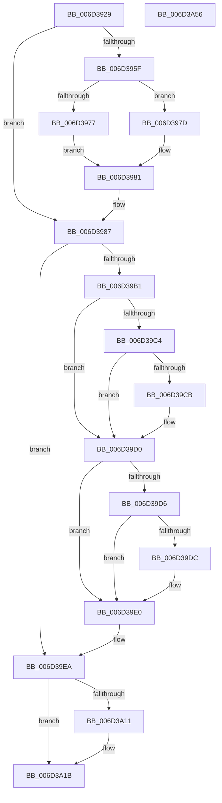

# CcPerformReadAhead$fin$1

- RVA: `0x006D3929`–`0x006D3A57` (길이 `302` bytes)
- VA: `0x00000001406D3929`
- 실행 섹션: `.text`
- PDB 이름 있음: `예`; PDB Function 태그: `예`
- unwind 정보 RVA: `0x000B2B00`
- 디코드: `77`개 명령, `302/302` bytes 표시
- 미해석 바이트: `0` (있으면 어셈블리에 `.byte`로 보존)

> 이 문서는 커널 이미지의 기계어와 PDB 기호를 분석해 생성했습니다. 4번과 5번은 함수 원형과 자료형을 바이너리 사용 방식에서 추정한 C 해석이며 원본 소스 복구 결과는 아닙니다.

## 1. Dependencies

- 직접 호출 지점: **10**; 고유 호출 대상: **8**
- 직접 호출자로 확인된 함수: **0**
- RIP 상대 이미지 참조: **0**

### Outgoing calls
- `0x006D3981` → [guard_dispatch_icall](../6B/guard_dispatch_icall_function_006BAAD0.md) (function, `0x006BAAD0`)
- `0x006D399C` → [KeAcquireInStackQueuedSpinLock](../27/KeAcquireInStackQueuedSpinLock_function_002757A0.md) (function, `0x002757A0`)
- `0x006D39B5` → [KeAcquireSpinLockAtDpcLevel](../20/KeAcquireSpinLockAtDpcLevel_function_00208430.md) (function, `0x00208430`)
- `0x006D39E4` → [KxReleaseSpinLock](../20/KxReleaseSpinLock_function_00206670.md) (function, `0x00206670`)
- `0x006D39F1` → [KeReleaseInStackQueuedSpinLock](../34/KeReleaseInStackQueuedSpinLock_function_00342CE0.md) (function, `0x00342CE0`)
- `0x006D39FE` → [ObfDereferenceObjectWithTag](../2F/ObfDereferenceObjectWithTag_function_002F78E0.md) (function, `0x002F78E0`)
- `0x006D3A15` → [IoDiskIoAttributionDereference](../34/IoDiskIoAttributionDereference_function_00349978.md) (function, `0x00349978`)
- `0x006D3A29` → [KeAcquireInStackQueuedSpinLock](../27/KeAcquireInStackQueuedSpinLock_function_002757A0.md) (function, `0x002757A0`)
- `0x006D3A31` → [CcDecrementOpenCount](../38/CcDecrementOpenCount_function_0038B75C.md) (function, `0x0038B75C`)
- `0x006D3A45` → [KeReleaseInStackQueuedSpinLock](../34/KeReleaseInStackQueuedSpinLock_function_00342CE0.md) (function, `0x00342CE0`)

### Direct callers
- 이 함수 시작 RVA로 연결되는 직접 call은 확인되지 않았습니다. 간접 호출은 완전히 역산할 수 없습니다.

### Static image references
- 디코드된 RIP-relative 메모리 참조가 없습니다.

## 2. Other-region calls and transfers

- 다른 실행 섹션으로 향하는 call: **0**
- 별도 외부 분기/꼬리 이동을 확인하지 못했습니다.

## 3. Assembly (complete function range)

```asm
006D3929  40 53                           push rbx
006D392B  55                              push rbp
006D392C  56                              push rsi
006D392D  57                              push rdi
006D392E  41 56                           push r14
006D3930  48 83 EC 50                     sub rsp, 0x50
006D3934  48 8B EA                        mov rbp, rdx
006D3937  65 48 8B 04 25 88 01 00 00      mov rax, qword ptr gs:[0x188]
006D3940  48 89 85 20 01 00 00            mov qword ptr [rbp + 0x120], rax
006D3947  8B 80 DC 05 00 00               mov eax, dword ptr [rax + 0x5dc]
006D394D  65 01 04 25 A4 89 00 00         add dword ptr gs:[0x89a4], eax
006D3955  48 8B 7D 70                     mov rdi, qword ptr [rbp + 0x70]
006D3959  83 7D 58 00                     cmp dword ptr [rbp + 0x58], 0
006D395D  74 28                           je 0x1406d3987
006D395F  8B 87 9C 00 00 00               mov eax, dword ptr [rdi + 0x9c]
006D3965  48 8B 8D 98 00 00 00            mov rcx, qword ptr [rbp + 0x98]
006D396C  A8 01                           test al, 1
006D396E  48 8B 87 D8 00 00 00            mov rax, qword ptr [rdi + 0xd8]
006D3975  75 06                           jne 0x1406d397d
006D3977  48 8B 40 18                     mov rax, qword ptr [rax + 0x18]
006D397B  EB 04                           jmp 0x1406d3981
006D397D  48 8B 40 20                     mov rax, qword ptr [rax + 0x20]
006D3981  E8 4A 71 FE FF                  call 0x1406baad0
006D3986  90                              nop
006D3987  4C 8B B5 A0 00 00 00            mov r14, qword ptr [rbp + 0xa0]
006D398E  49 8D 8E 00 03 00 00            lea rcx, [r14 + 0x300]
006D3995  48 8D 95 C8 00 00 00            lea rdx, [rbp + 0xc8]
006D399C  E8 FF 1D BA FF                  call 0x1402757a0
006D39A1  48 8B B5 78 01 00 00            mov rsi, qword ptr [rbp + 0x178]
006D39A8  48 8B 5E 30                     mov rbx, qword ptr [rsi + 0x30]
006D39AC  48 85 DB                        test rbx, rbx
006D39AF  74 39                           je 0x1406d39ea
006D39B1  48 8D 4B 50                     lea rcx, [rbx + 0x50]
006D39B5  E8 76 4A B3 FF                  call 0x140208430
006D39BA  0F BA 33 10                     btr dword ptr [rbx], 0x10
006D39BE  83 7D 64 00                     cmp dword ptr [rbp + 0x64], 0
006D39C2  74 0C                           je 0x1406d39d0
006D39C4  8B 46 50                        mov eax, dword ptr [rsi + 0x50]
006D39C7  A8 20                           test al, 0x20
006D39C9  74 05                           je 0x1406d39d0
006D39CB  48 83 63 40 00                  and qword ptr [rbx + 0x40], 0
006D39D0  83 7D 68 00                     cmp dword ptr [rbp + 0x68], 0
006D39D4  74 0A                           je 0x1406d39e0
006D39D6  83 7D 5C 00                     cmp dword ptr [rbp + 0x5c], 0
006D39DA  75 04                           jne 0x1406d39e0
006D39DC  0F BA 33 11                     btr dword ptr [rbx], 0x11
006D39E0  48 8D 4B 50                     lea rcx, [rbx + 0x50]
006D39E4  E8 87 2C B3 FF                  call 0x140206670
006D39E9  90                              nop
006D39EA  48 8D 8D C8 00 00 00            lea rcx, [rbp + 0xc8]
006D39F1  E8 EA F2 C6 FF                  call 0x140342ce0
006D39F6  BA 44 66 6C 74                  mov edx, 0x746c6644
006D39FB  48 8B CE                        mov rcx, rsi
006D39FE  E8 DD 3E C2 FF                  call 0x1402f78e0
006D3A03  48 8B 8D 70 01 00 00            mov rcx, qword ptr [rbp + 0x170]
006D3A0A  48 83 79 18 00                  cmp qword ptr [rcx + 0x18], 0
006D3A0F  74 0A                           je 0x1406d3a1b
006D3A11  48 8B 49 18                     mov rcx, qword ptr [rcx + 0x18]
006D3A15  E8 5E 5F C7 FF                  call 0x140349978
006D3A1A  90                              nop
006D3A1B  49 8D 8E 00 03 00 00            lea rcx, [r14 + 0x300]
006D3A22  48 8D 95 C8 00 00 00            lea rdx, [rbp + 0xc8]
006D3A29  E8 72 1D BA FF                  call 0x1402757a0
006D3A2E  48 8B CF                        mov rcx, rdi
006D3A31  E8 26 7D CB FF                  call 0x14038b75c
006D3A36  0F BA B7 98 00 00 00 0E         btr dword ptr [rdi + 0x98], 0xe
006D3A3E  48 8D 8D C8 00 00 00            lea rcx, [rbp + 0xc8]
006D3A45  E8 96 F2 C6 FF                  call 0x140342ce0
006D3A4A  90                              nop
006D3A4B  48 83 C4 50                     add rsp, 0x50
006D3A4F  41 5E                           pop r14
006D3A51  5F                              pop rdi
006D3A52  5E                              pop rsi
006D3A53  5D                              pop rbp
006D3A54  5B                              pop rbx
006D3A55  C3                              ret
006D3A56  CC                              int3
```

## 4. C-style interpretation (structured pseudocode)

```c
__int64 __fastcall CcPerformReadAhead_fin_1(__int64 a1, __int64 a2)
{
    __int64 result;
    __int64 v_rsp;

    v_rsp = (v_rsp) - (80);
    *(unsigned __int64 *)(a2 + 288) = *(unsigned __int64 *)(gs_base + (0 + 392));
    if ((*(unsigned int *)(a2 + 88)) == 0) goto loc_006D3987;
    if ((((unsigned __int8)((unsigned int)(*(unsigned int *)(*(unsigned __int64 *)(a2 + 112) + 156)))) & (1)) != 0) goto loc_006D397D;
    goto loc_006D3981;
loc_006D397D:
loc_006D3981:
    result = guard_dispatch_icall(*(unsigned __int64 *)(a2 + 152), a2, a3, a4);
loc_006D3987:
    result = KeAcquireInStackQueuedSpinLock(*(unsigned __int64 *)(a2 + 160) + 768, a2 + 200, a3, a4);
    if (*(unsigned __int64 *)(*(unsigned __int64 *)(a2 + 376) + 48) == 0) goto loc_006D39EA;
    result = KeAcquireSpinLockAtDpcLevel(*(unsigned __int64 *)(*(unsigned __int64 *)(a2 + 376) + 48) + 80, a2 + 200, a3, a4);
    if ((*(unsigned int *)(a2 + 100)) == 0) goto loc_006D39D0;
    if ((((unsigned __int8)((unsigned int)(*(unsigned int *)(*(unsigned __int64 *)(a2 + 376) + 80)))) & (32)) != 0) {
    }
    if ((*(unsigned int *)(a2 + 104)) == 0) goto loc_006D39E0;
    if ((*(unsigned int *)(a2 + 92)) == 0) {
    }
    result = KxReleaseSpinLock(*(unsigned __int64 *)(*(unsigned __int64 *)(a2 + 376) + 48) + 80, a2 + 200, a3, a4);
loc_006D39EA:
    result = KeReleaseInStackQueuedSpinLock(a2 + 200, a2 + 200, a3, a4);
    result = ObfDereferenceObjectWithTag(*(unsigned __int64 *)(a2 + 376), (unsigned int)(0x746C6644ULL), a3, a4);
    if ((*(unsigned __int64 *)(*(unsigned __int64 *)(a2 + 368) + 24)) != 0) {
        a1 = *(unsigned __int64 *)(*(unsigned __int64 *)(a2 + 368) + 24);
        result = IoDiskIoAttributionDereference(a1, (unsigned int)(0x746C6644ULL), a3, a4);
    }
    result = KeAcquireInStackQueuedSpinLock(*(unsigned __int64 *)(a2 + 160) + 768, a2 + 200, a3, a4);
    result = CcDecrementOpenCount(*(unsigned __int64 *)(a2 + 112), a2 + 200, a3, a4);
    result = KeReleaseInStackQueuedSpinLock(a2 + 200, a2 + 200, a3, a4);
    v_rsp = (v_rsp) + (80);
    return result;
}
```

## 5. (Beta) C Style

```c
int64_t CcPerformReadAhead_fin_1(int64_t Arg1, void *Arg2)
{
    uint8_t *arg2 = (uint8_t *)Arg2;

    int64_t result;
    int64_t local_rsp;

    local_rsp = (local_rsp) - (80);
    *(uint64_t *)(arg2 + 0x120) = *(uint64_t *)(gs_base + (0 + 0x188));
    if ((*(uint32_t *)(arg2 + 0x58)) == 0) goto loc_006D3987;
    if ((((uint8_t)((uint32_t)(*(uint32_t *)(*(uint64_t *)(arg2 + 0x70) + 0x9C)))) & (1)) != 0) goto loc_006D397D;
    goto loc_006D3981;
loc_006D397D:
loc_006D3981:
    result = guard_dispatch_icall(*(uint64_t *)(arg2 + 0x98), Arg2, a3, a4);
loc_006D3987:
    result = KeAcquireInStackQueuedSpinLock(*(uint64_t *)(arg2 + 0xA0) + 768, Arg2 + 200, a3, a4);
    if (*(uint64_t *)(*(uint64_t *)(arg2 + 0x178) + 0x30) == 0) goto loc_006D39EA;
    result = KeAcquireSpinLockAtDpcLevel(*(uint64_t *)(*(uint64_t *)(arg2 + 0x178) + 0x30) + 80, Arg2 + 200, a3, a4);
    if ((*(uint32_t *)(arg2 + 0x64)) == 0) goto loc_006D39D0;
    if ((((uint8_t)((uint32_t)(*(uint32_t *)(*(uint64_t *)(arg2 + 0x178) + 0x50)))) & (32)) != 0) {
    }
    if ((*(uint32_t *)(arg2 + 0x68)) == 0) goto loc_006D39E0;
    if ((*(uint32_t *)(arg2 + 0x5C)) == 0) {
    }
    result = KxReleaseSpinLock(*(uint64_t *)(*(uint64_t *)(arg2 + 0x178) + 0x30) + 80, Arg2 + 200, a3, a4);
loc_006D39EA:
    result = KeReleaseInStackQueuedSpinLock(Arg2 + 200, Arg2 + 200, a3, a4);
    result = ObfDereferenceObjectWithTag(*(uint64_t *)(arg2 + 0x178), (uint32_t)(0x746C6644ULL), a3, a4);
    if ((*(uint64_t *)(*(uint64_t *)(arg2 + 0x170) + 0x18)) != 0) {
        Arg1 = *(uint64_t *)(*(uint64_t *)(arg2 + 0x170) + 0x18);
        result = IoDiskIoAttributionDereference(Arg1, (uint32_t)(0x746C6644ULL), a3, a4);
    }
    result = KeAcquireInStackQueuedSpinLock(*(uint64_t *)(arg2 + 0xA0) + 768, Arg2 + 200, a3, a4);
    result = CcDecrementOpenCount(*(uint64_t *)(arg2 + 0x70), Arg2 + 200, a3, a4);
    result = KeReleaseInStackQueuedSpinLock(Arg2 + 200, Arg2 + 200, a3, a4);
    local_rsp = (local_rsp) + (80);
    return result;
}
```

### 관측된 메모리 오프셋

구조체 형식이 확인되지 않은 접근은 인자 기준의 오프셋으로만 기록했습니다.

| 기준 인자 | 오프셋 표현 | 폭 (bit) | 접근 |
|---|---:|---:|---|
| `Arg2` | `+ 0x58` | `32` | `R` |
| `Arg2` | `+ 0x5C` | `32` | `R` |
| `Arg2` | `+ 0x64` | `32` | `R` |
| `Arg2` | `+ 0x68` | `32` | `R` |
| `Arg2` | `+ 0x70` | `64` | `R` |
| `Arg2` | `+ 0x98` | `64` | `R` |
| `Arg2` | `+ 0xA0` | `64` | `R` |
| `Arg2` | `+ 0xC8` | `64` | `R` |
| `Arg2` | `+ 0x120` | `64` | `W` |
| `Arg2` | `+ 0x170` | `64` | `R` |
| `Arg2` | `+ 0x178` | `64` | `R` |

## 6. Execution-region graph

[열기: 2D/3D 그래프와 함수 탐색 컨트롤 패널](../../../control-panel.html?section=text&rva=0x006D3929&view=graph)

- 2D 그래프는 위에서 아래로 흐르고, 3D 그래프는 빈 공간을 드래그해 회전합니다. Shift+드래그는 이동, 휠은 확대·축소, 함수 노드 선택은 대상 보고서 이동입니다.

### Static fallback


