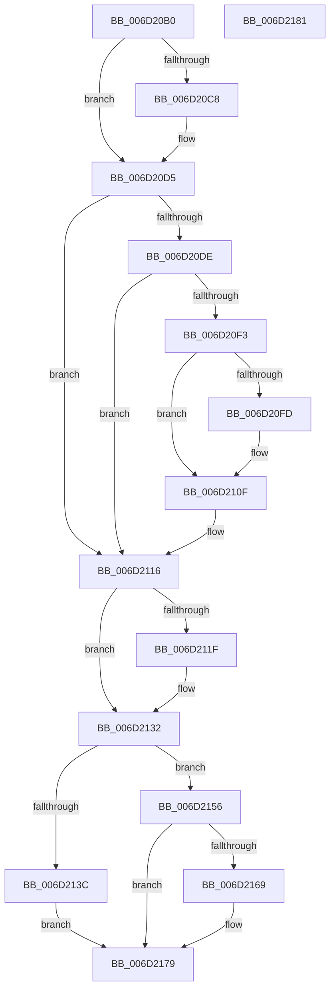

# CcPinFileData$fin$0

- RVA: `0x006D20B0`–`0x006D2182` (길이 `210` bytes)
- VA: `0x00000001406D20B0`
- 실행 섹션: `.text`
- PDB 이름 있음: `예`; PDB Function 태그: `예`
- unwind 정보 RVA: `0x000774A8`
- 디코드: `58`개 명령, `210/210` bytes 표시
- 미해석 바이트: `0` (있으면 어셈블리에 `.byte`로 보존)

> 이 문서는 커널 이미지의 기계어와 PDB 기호를 분석해 생성했습니다. 4번과 5번은 함수 원형과 자료형을 바이너리 사용 방식에서 추정한 C 해석이며 원본 소스 복구 결과는 아닙니다.

## 1. Dependencies

- 직접 호출 지점: **4**; 고유 호출 대상: **4**
- 직접 호출자로 확인된 함수: **0**
- RIP 상대 이미지 참조: **0**

### Outgoing calls
- `0x006D20CF` → [ExReleaseFastMutex](../25/ExReleaseFastMutex_function_002519C0.md) (function, `0x002519C0`)
- `0x006D2109` → [KeSetEvent](../33/KeSetEvent_function_0033F310.md) (function, `0x0033F310`)
- `0x006D212C` → [CcDereferenceFileOffset](../4E/CcDereferenceFileOffset_function_004E004C.md) (function, `0x004E004C`)
- `0x006D2173` → [CcUnpinFileDataEx](../35/CcUnpinFileDataEx_function_00359DEC.md) (function, `0x00359DEC`)

### Direct callers
- 이 함수 시작 RVA로 연결되는 직접 call은 확인되지 않았습니다. 간접 호출은 완전히 역산할 수 없습니다.

### Static image references
- 디코드된 RIP-relative 메모리 참조가 없습니다.

## 2. Other-region calls and transfers

- 다른 실행 섹션으로 향하는 call: **0**
- 별도 외부 분기/꼬리 이동을 확인하지 못했습니다.

## 3. Assembly (complete function range)

```asm
006D20B0  40 53                           push rbx
006D20B2  55                              push rbp
006D20B3  57                              push rdi
006D20B4  48 83 EC 30                     sub rsp, 0x30
006D20B8  48 8B EA                        mov rbp, rdx
006D20BB  48 8B BD B8 00 00 00            mov rdi, qword ptr [rbp + 0xb8]
006D20C2  83 7D 34 00                     cmp dword ptr [rbp + 0x34], 0
006D20C6  74 0D                           je 0x1406d20d5
006D20C8  48 8D 8F 20 01 00 00            lea rcx, [rdi + 0x120]
006D20CF  E8 EC F8 B7 FF                  call 0x1402519c0
006D20D4  90                              nop
006D20D5  48 8B 4D 50                     mov rcx, qword ptr [rbp + 0x50]
006D20D9  48 85 C9                        test rcx, rcx
006D20DC  74 38                           je 0x1406d2116
006D20DE  48 8B 59 08                     mov rbx, qword ptr [rcx + 8]
006D20E2  B8 FF FF FF FF                  mov eax, 0xffffffff
006D20E7  F0 0F C1 41 10                  lock xadd dword ptr [rcx + 0x10], eax
006D20EC  FF C8                           dec eax
006D20EE  66 85 C0                        test ax, ax
006D20F1  75 23                           jne 0x1406d2116
006D20F3  48 83 BB C0 00 00 00 00         cmp qword ptr [rbx + 0xc0], 0
006D20FB  74 12                           je 0x1406d210f
006D20FD  45 33 C0                        xor r8d, r8d
006D2100  33 D2                           xor edx, edx
006D2102  48 8B 8B C0 00 00 00            mov rcx, qword ptr [rbx + 0xc0]
006D2109  E8 02 D2 C6 FF                  call 0x14033f310
006D210E  90                              nop
006D210F  F0 FF 8B 28 02 00 00            lock dec dword ptr [rbx + 0x228]
006D2116  F6 85 58 01 00 00 04            test byte ptr [rbp + 0x158], 4
006D211D  74 13                           je 0x1406d2132
006D211F  48 8B 95 38 01 00 00            mov rdx, qword ptr [rbp + 0x138]
006D2126  48 8B 12                        mov rdx, qword ptr [rdx]
006D2129  48 8B CF                        mov rcx, rdi
006D212C  E8 1B DF E0 FF                  call 0x1404e004c
006D2131  90                              nop
006D2132  48 8B 4D 40                     mov rcx, qword ptr [rbp + 0x40]
006D2136  80 7D 30 00                     cmp byte ptr [rbp + 0x30], 0
006D213A  74 1A                           je 0x1406d2156
006D213C  48 8B 85 60 01 00 00            mov rax, qword ptr [rbp + 0x160]
006D2143  48 89 08                        mov qword ptr [rax], rcx
006D2146  48 8B 49 20                     mov rcx, qword ptr [rcx + 0x20]
006D214A  48 8B 85 70 01 00 00            mov rax, qword ptr [rbp + 0x170]
006D2151  48 89 08                        mov qword ptr [rax], rcx
006D2154  EB 23                           jmp 0x1406d2179
006D2156  48 8B 85 68 01 00 00            mov rax, qword ptr [rbp + 0x168]
006D215D  48 C7 00 00 00 00 00            mov qword ptr [rax], 0
006D2164  48 85 C9                        test rcx, rcx
006D2167  74 10                           je 0x1406d2179
006D2169  45 33 C0                        xor r8d, r8d
006D216C  0F B6 95 48 01 00 00            movzx edx, byte ptr [rbp + 0x148]
006D2173  E8 74 7C C8 FF                  call 0x140359dec
006D2178  90                              nop
006D2179  48 83 C4 30                     add rsp, 0x30
006D217D  5F                              pop rdi
006D217E  5D                              pop rbp
006D217F  5B                              pop rbx
006D2180  C3                              ret
006D2181  CC                              int3
```

## 4. C-style interpretation (structured pseudocode)

```c
__int64 __fastcall CcPinFileData_fin_0(__int64 a1, __int64 a2, int a3)
{
    __int64 result;
    __int64 v_rsp;

    v_rsp = (v_rsp) - (48);
    if ((*(unsigned int *)(a2 + 52)) != 0) {
        a1 = *(unsigned __int64 *)(a2 + 184) + 288;
        result = ExReleaseFastMutex(a1, a2, a3, a4);
    }
    if (*(unsigned __int64 *)(a2 + 80) == 0) goto loc_006D2116;
    result = (unsigned int)(((unsigned int)(0xFFFFFFFFULL)) - 1);
    if ((unsigned __int16)(result) != 0) goto loc_006D2116;
    if ((*(unsigned __int64 *)(*(unsigned __int64 *)(*(unsigned __int64 *)(a2 + 80) + 8) + 192)) != 0) {
        a3 = 0;
        a2 = 0;
        a1 = *(unsigned __int64 *)(*(unsigned __int64 *)(*(unsigned __int64 *)(a2 + 80) + 8) + 192);
        result = KeSetEvent(a1, a2, a3, a4);
    }
loc_006D2116:
    if (((*(unsigned __int8 *)(a2 + 344)) & (4)) != 0) {
        a2 = *(unsigned __int64 *)(a2 + 312);
        a2 = *(unsigned __int64 *)(a2);
        a1 = *(unsigned __int64 *)(a2 + 184);
        result = CcDereferenceFileOffset(a1, a2, a3, a4);
    }
    if ((*(unsigned __int8 *)(a2 + 48)) == 0) goto loc_006D2156;
    *(unsigned __int64 *)(*(unsigned __int64 *)(a2 + 352)) = *(unsigned __int64 *)(a2 + 64);
    *(unsigned __int64 *)(*(unsigned __int64 *)(a2 + 368)) = *(unsigned __int64 *)(*(unsigned __int64 *)(a2 + 64) + 32);
    goto loc_006D2179;
loc_006D2156:
    *(unsigned __int64 *)(*(unsigned __int64 *)(a2 + 360)) = 0;
    result = *(unsigned __int64 *)(a2 + 360);
    if (*(unsigned __int64 *)(*(unsigned __int64 *)(a2 + 64) + 32) != 0) {
        a3 = 0;
        a2 = *(unsigned __int8 *)(a2 + 328);
        result = CcUnpinFileDataEx(*(unsigned __int64 *)(*(unsigned __int64 *)(a2 + 64) + 32), a2, a3, a4);
    }
    v_rsp = (v_rsp) + (48);
    return result;
}
```

## 5. (Beta) C Style

```c
int64_t CcPinFileData_fin_0(int64_t Arg1, void *Arg2, int32_t Arg3)
{
    uint8_t *arg2 = (uint8_t *)Arg2;

    int64_t result;
    int64_t local_rsp;

    local_rsp = (local_rsp) - (48);
    if ((*(uint32_t *)(arg2 + 0x34)) != 0) {
        Arg1 = *(uint64_t *)(arg2 + 0xB8) + 288;
        result = ExReleaseFastMutex(Arg1, Arg2, Arg3, a4);
    }
    if (*(uint64_t *)(arg2 + 0x50) == 0) goto loc_006D2116;
    result = (uint32_t)(((uint32_t)(0xFFFFFFFFULL)) - 1);
    if ((uint16_t)(result) != 0) goto loc_006D2116;
    if ((*(uint64_t *)(*(uint64_t *)(*(uint64_t *)(arg2 + 0x50) + 0x8) + 0xC0)) != 0) {
        Arg3 = 0;
        Arg2 = 0;
        Arg1 = *(uint64_t *)(*(uint64_t *)(*(uint64_t *)(arg2 + 0x50) + 0x8) + 0xC0);
        result = KeSetEvent(Arg1, Arg2, Arg3, a4);
    }
loc_006D2116:
    if (((*(uint8_t *)(arg2 + 0x158)) & (4)) != 0) {
        Arg2 = *(uint64_t *)(arg2 + 0x138);
        Arg2 = *(uint64_t *)(arg2);
        Arg1 = *(uint64_t *)(arg2 + 0xB8);
        result = CcDereferenceFileOffset(Arg1, Arg2, Arg3, a4);
    }
    if ((*(uint8_t *)(arg2 + 0x30)) == 0) goto loc_006D2156;
    *(uint64_t *)(*(uint64_t *)(arg2 + 0x160)) = *(uint64_t *)(arg2 + 0x40);
    *(uint64_t *)(*(uint64_t *)(arg2 + 0x170)) = *(uint64_t *)(*(uint64_t *)(arg2 + 0x40) + 0x20);
    goto loc_006D2179;
loc_006D2156:
    *(uint64_t *)(*(uint64_t *)(arg2 + 0x168)) = 0;
    result = *(uint64_t *)(arg2 + 0x168);
    if (*(uint64_t *)(*(uint64_t *)(arg2 + 0x40) + 0x20) != 0) {
        Arg3 = 0;
        Arg2 = *(uint8_t *)(arg2 + 0x148);
        result = CcUnpinFileDataEx(*(uint64_t *)(*(uint64_t *)(arg2 + 0x40) + 0x20), Arg2, Arg3, a4);
    }
    local_rsp = (local_rsp) + (48);
    return result;
}
```

### 관측된 메모리 오프셋

구조체 형식이 확인되지 않은 접근은 인자 기준의 오프셋으로만 기록했습니다.

| 기준 인자 | 오프셋 표현 | 폭 (bit) | 접근 |
|---|---:|---:|---|
| `Arg2` | `+ 0x30` | `8` | `R` |
| `Arg2` | `+ 0x34` | `32` | `R` |
| `Arg2` | `+ 0x40` | `64` | `R` |
| `Arg2` | `+ 0x50` | `64` | `R` |
| `Arg2` | `+ 0xB8` | `64` | `R` |
| `Arg2` | `+ 0x138` | `64` | `R` |
| `Arg2` | `+ 0x148` | `8` | `R` |
| `Arg2` | `+ 0x158` | `8` | `R` |
| `Arg2` | `+ 0x160` | `64` | `R` |
| `Arg2` | `+ 0x168` | `64` | `R` |
| `Arg2` | `+ 0x170` | `64` | `R` |

## 6. Execution-region graph

[열기: 2D/3D 그래프와 함수 탐색 컨트롤 패널](../../../control-panel.html?section=text&rva=0x006D20B0&view=graph)

- 2D 그래프는 위에서 아래로 흐르고, 3D 그래프는 빈 공간을 드래그해 회전합니다. Shift+드래그는 이동, 휠은 확대·축소, 함수 노드 선택은 대상 보고서 이동입니다.

### Static fallback


