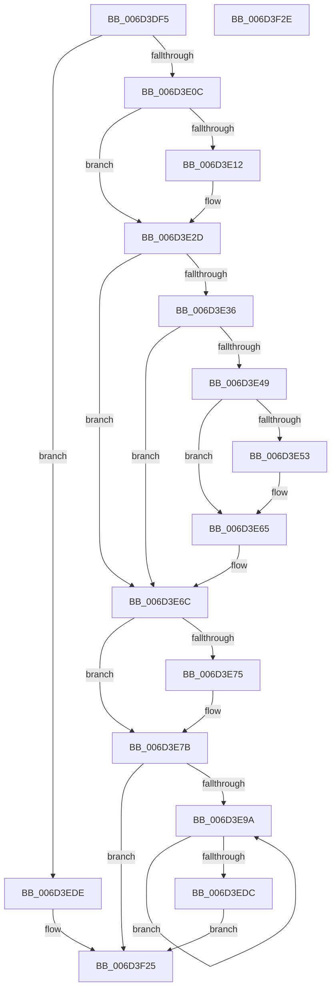

# CcPrepareMdlWrite$fin$0

- RVA: `0x006D3DF5`–`0x006D3F2F` (길이 `314` bytes)
- VA: `0x00000001406D3DF5`
- 실행 섹션: `.text`
- PDB 이름 있음: `예`; PDB Function 태그: `예`
- unwind 정보 RVA: `0x000B4520`
- 디코드: `86`개 명령, `314/314` bytes 표시
- 미해석 바이트: `0` (있으면 어셈블리에 `.byte`로 보존)

> 이 문서는 커널 이미지의 기계어와 PDB 기호를 분석해 생성했습니다. 4번과 5번은 함수 원형과 자료형을 바이너리 사용 방식에서 추정한 C 해석이며 원본 소스 복구 결과는 아닙니다.

## 1. Dependencies

- 직접 호출 지점: **8**; 고유 호출 대상: **7**
- 직접 호출자로 확인된 함수: **0**
- RIP 상대 이미지 참조: **0**

### Outgoing calls
- `0x006D3E5F` → [KeSetEvent](../33/KeSetEvent_function_0033F310.md) (function, `0x0033F310`)
- `0x006D3E75` → [IoFreeMdl](../29/IoFreeMdl_function_0029EA80.md) (function, `0x0029EA80`)
- `0x006D3EA3` → [MmUnlockPages](../29/MmUnlockPages_function_0029EEE0.md) (function, `0x0029EEE0`)
- `0x006D3EBA` → [CcSetDirtyInMask](../3C/CcSetDirtyInMask_function_003CB688.md) (function, `0x003CB688`)
- `0x006D3ECF` → [IoFreeMdl](../29/IoFreeMdl_function_0029EA80.md) (function, `0x0029EA80`)
- `0x006D3F08` → [KeAcquireInStackQueuedSpinLock](../27/KeAcquireInStackQueuedSpinLock_function_002757A0.md) (function, `0x002757A0`)
- `0x006D3F13` → [CcIncrementOpenCount](../4A/CcIncrementOpenCount_function_004A5CC4.md) (function, `0x004A5CC4`)
- `0x006D3F1F` → [KeReleaseInStackQueuedSpinLock](../34/KeReleaseInStackQueuedSpinLock_function_00342CE0.md) (function, `0x00342CE0`)

### Direct callers
- 이 함수 시작 RVA로 연결되는 직접 call은 확인되지 않았습니다. 간접 호출은 완전히 역산할 수 없습니다.

### Static image references
- 디코드된 RIP-relative 메모리 참조가 없습니다.

## 2. Other-region calls and transfers

- 다른 실행 섹션으로 향하는 call: **0**
- 별도 외부 분기/꼬리 이동을 확인하지 못했습니다.

## 3. Assembly (complete function range)

```asm
006D3DF5  40 53                           push rbx
006D3DF7  55                              push rbp
006D3DF8  56                              push rsi
006D3DF9  57                              push rdi
006D3DFA  48 83 EC 38                     sub rsp, 0x38
006D3DFE  48 8B EA                        mov rbp, rdx
006D3E01  88 4D 38                        mov byte ptr [rbp + 0x38], cl
006D3E04  84 C9                           test cl, cl
006D3E06  0F 84 D2 00 00 00               je 0x1406d3ede
006D3E0C  83 7D 34 00                     cmp dword ptr [rbp + 0x34], 0
006D3E10  74 1B                           je 0x1406d3e2d
006D3E12  65 48 8B 0C 25 88 01 00 00      mov rcx, qword ptr gs:[0x188]
006D3E1B  48 89 8D B0 00 00 00            mov qword ptr [rbp + 0xb0], rcx
006D3E22  8B 45 34                        mov eax, dword ptr [rbp + 0x34]
006D3E25  2C 02                           sub al, 2
006D3E27  88 81 AD 05 00 00               mov byte ptr [rcx + 0x5ad], al
006D3E2D  48 8B 4D 50                     mov rcx, qword ptr [rbp + 0x50]
006D3E31  48 85 C9                        test rcx, rcx
006D3E34  74 36                           je 0x1406d3e6c
006D3E36  48 8B 59 08                     mov rbx, qword ptr [rcx + 8]
006D3E3A  83 C8 FF                        or eax, 0xffffffff
006D3E3D  F0 0F C1 41 10                  lock xadd dword ptr [rcx + 0x10], eax
006D3E42  FF C8                           dec eax
006D3E44  66 85 C0                        test ax, ax
006D3E47  75 23                           jne 0x1406d3e6c
006D3E49  48 83 BB C0 00 00 00 00         cmp qword ptr [rbx + 0xc0], 0
006D3E51  74 12                           je 0x1406d3e65
006D3E53  45 33 C0                        xor r8d, r8d
006D3E56  33 D2                           xor edx, edx
006D3E58  48 8B 8B C0 00 00 00            mov rcx, qword ptr [rbx + 0xc0]
006D3E5F  E8 AC B4 C6 FF                  call 0x14033f310
006D3E64  90                              nop
006D3E65  F0 FF 8B 28 02 00 00            lock dec dword ptr [rbx + 0x228]
006D3E6C  48 8B 4D 48                     mov rcx, qword ptr [rbp + 0x48]
006D3E70  48 85 C9                        test rcx, rcx
006D3E73  74 06                           je 0x1406d3e7b
006D3E75  E8 06 AC BC FF                  call 0x14029ea80
006D3E7A  90                              nop
006D3E7B  48 8B 9D 08 01 00 00            mov rbx, qword ptr [rbp + 0x108]
006D3E82  48 8B 1B                        mov rbx, qword ptr [rbx]
006D3E85  48 89 5D 58                     mov qword ptr [rbp + 0x58], rbx
006D3E89  48 8B B5 18 01 00 00            mov rsi, qword ptr [rbp + 0x118]
006D3E90  48 83 3E 00                     cmp qword ptr [rsi], 0
006D3E94  0F 84 8B 00 00 00               je 0x1406d3f25
006D3E9A  48 8B 06                        mov rax, qword ptr [rsi]
006D3E9D  48 8B 38                        mov rdi, qword ptr [rax]
006D3EA0  48 8B C8                        mov rcx, rax
006D3EA3  E8 38 B0 BC FF                  call 0x14029eee0
006D3EA8  4C 8B 06                        mov r8, qword ptr [rsi]
006D3EAB  45 33 C9                        xor r9d, r9d
006D3EAE  45 8B 40 28                     mov r8d, dword ptr [r8 + 0x28]
006D3EB2  48 8D 55 58                     lea rdx, [rbp + 0x58]
006D3EB6  48 8B 4D 60                     mov rcx, qword ptr [rbp + 0x60]
006D3EBA  E8 C9 77 CF FF                  call 0x1403cb688
006D3EBF  48 8B 06                        mov rax, qword ptr [rsi]
006D3EC2  8B 48 28                        mov ecx, dword ptr [rax + 0x28]
006D3EC5  48 03 D9                        add rbx, rcx
006D3EC8  48 89 5D 58                     mov qword ptr [rbp + 0x58], rbx
006D3ECC  48 8B C8                        mov rcx, rax
006D3ECF  E8 AC AB BC FF                  call 0x14029ea80
006D3ED4  48 89 3E                        mov qword ptr [rsi], rdi
006D3ED7  48 85 FF                        test rdi, rdi
006D3EDA  75 BE                           jne 0x1406d3e9a
006D3EDC  EB 47                           jmp 0x1406d3f25
006D3EDE  48 8B 5D 60                     mov rbx, qword ptr [rbp + 0x60]
006D3EE2  48 8B 8B 18 02 00 00            mov rcx, qword ptr [rbx + 0x218]
006D3EE9  48 8B 95 20 01 00 00            mov rdx, qword ptr [rbp + 0x120]
006D3EF0  83 22 00                        and dword ptr [rdx], 0
006D3EF3  8B 45 3C                        mov eax, dword ptr [rbp + 0x3c]
006D3EF6  48 89 42 08                     mov qword ptr [rdx + 8], rax
006D3EFA  48 81 C1 00 03 00 00            add rcx, 0x300
006D3F01  48 8D 95 80 00 00 00            lea rdx, [rbp + 0x80]
006D3F08  E8 93 18 BA FF                  call 0x1402757a0
006D3F0D  41 B0 01                        mov r8b, 1
006D3F10  48 8B CB                        mov rcx, rbx
006D3F13  E8 AC 1D DD FF                  call 0x1404a5cc4
006D3F18  48 8D 8D 80 00 00 00            lea rcx, [rbp + 0x80]
006D3F1F  E8 BC ED C6 FF                  call 0x140342ce0
006D3F24  90                              nop
006D3F25  48 83 C4 38                     add rsp, 0x38
006D3F29  5F                              pop rdi
006D3F2A  5E                              pop rsi
006D3F2B  5D                              pop rbp
006D3F2C  5B                              pop rbx
006D3F2D  C3                              ret
006D3F2E  CC                              int3
```

## 4. C-style interpretation (structured pseudocode)

```c
__int64 __fastcall CcPrepareMdlWrite_fin_0(unsigned __int8 a1, __int64 a2, int a3, int a4)
{
    __int64 result;
    __int64 v_rbx;
    __int64 v_rsp;

    v_rsp = (v_rsp) - (56);
    *(unsigned __int8 *)(a2 + 56) = a1;
    if (a1 == 0) goto loc_006D3EDE;
    if ((*(unsigned int *)(a2 + 52)) != 0) {
        a1 = *(unsigned __int64 *)(gs_base + (0 + 392));
        *(unsigned __int64 *)(a2 + 176) = a1;
        result = *(unsigned int *)(a2 + 52);
        result = (unsigned __int8)((result) - (2));
        *(unsigned __int8 *)(a1 + 1453) = (unsigned __int8)(result);
    }
    if (*(unsigned __int64 *)(a2 + 80) == 0) goto loc_006D3E6C;
    result = (unsigned int)((result) | (0xFFFFFFFFULL));
    result = (unsigned int)((result) - 1);
    if ((unsigned __int16)(result) != 0) goto loc_006D3E6C;
    if ((*(unsigned __int64 *)(*(unsigned __int64 *)(*(unsigned __int64 *)(a2 + 80) + 8) + 192)) != 0) {
        a3 = 0;
        a2 = 0;
        a1 = *(unsigned __int64 *)(*(unsigned __int64 *)(*(unsigned __int64 *)(a2 + 80) + 8) + 192);
        result = KeSetEvent(a1, a2, a3, a4);
    }
loc_006D3E6C:
    if (*(unsigned __int64 *)(a2 + 72) != 0) {
        result = IoFreeMdl(*(unsigned __int64 *)(a2 + 72), a2, a3, a4);
    }
    *(unsigned __int64 *)(a2 + 88) = *(unsigned __int64 *)(*(unsigned __int64 *)(a2 + 264));
    if ((*(unsigned __int64 *)(*(unsigned __int64 *)(a2 + 280))) == 0) goto loc_006D3F25;
loc_006D3E9A:
    result = MmUnlockPages(*(unsigned __int64 *)(*(unsigned __int64 *)(a2 + 280)), a2, a3, a4);
    a4 = 0;
    result = CcSetDirtyInMask(*(unsigned __int64 *)(a2 + 96), a2 + 88, (unsigned int)(*(unsigned int *)(*(unsigned __int64 *)(*(unsigned __int64 *)(a2 + 280)) + 40)), a4);
    v_rbx = (*(unsigned __int64 *)(*(unsigned __int64 *)(a2 + 264))) + ((unsigned int)(*(unsigned int *)(*(unsigned __int64 *)(*(unsigned __int64 *)(a2 + 280)) + 40)));
    *(unsigned __int64 *)(a2 + 88) = v_rbx;
    result = IoFreeMdl(*(unsigned __int64 *)(*(unsigned __int64 *)(a2 + 280)), a2 + 88, (unsigned int)(*(unsigned int *)(*(unsigned __int64 *)(*(unsigned __int64 *)(a2 + 280)) + 40)), a4);
    *(unsigned __int64 *)(*(unsigned __int64 *)(a2 + 280)) = *(unsigned __int64 *)(*(unsigned __int64 *)(*(unsigned __int64 *)(a2 + 280)));
    if (*(unsigned __int64 *)(*(unsigned __int64 *)(*(unsigned __int64 *)(a2 + 280))) != 0) goto loc_006D3E9A;
    goto loc_006D3F25;
loc_006D3EDE:
    *(unsigned __int64 *)(*(unsigned __int64 *)(a2 + 288) + 8) = (unsigned int)(*(unsigned int *)(a2 + 60));
    a1 = (*(unsigned __int64 *)(*(unsigned __int64 *)(a2 + 96) + 536)) + (768);
    result = KeAcquireInStackQueuedSpinLock(a1, a2 + 128, (unsigned int)(*(unsigned int *)(*(unsigned __int64 *)(*(unsigned __int64 *)(a2 + 280)) + 40)), a4);
    result = CcIncrementOpenCount(*(unsigned __int64 *)(a2 + 96), a2 + 128, 1, a4);
    result = KeReleaseInStackQueuedSpinLock(a2 + 128, a2 + 128, 1, a4);
loc_006D3F25:
    v_rsp = (v_rsp) + (56);
    return result;
}
```

## 5. (Beta) C Style

```c
int64_t CcPrepareMdlWrite_fin_0(uint8_t Arg1, void *Arg2, int32_t Arg3, int32_t Arg4)
{
    uint8_t *arg2 = (uint8_t *)Arg2;

    int64_t result;
    int64_t local_rbx;
    int64_t local_rsp;

    local_rsp = (local_rsp) - (56);
    *(uint8_t *)(arg2 + 0x38) = Arg1;
    if (Arg1 == 0) goto loc_006D3EDE;
    if ((*(uint32_t *)(arg2 + 0x34)) != 0) {
        Arg1 = *(uint64_t *)(gs_base + (0 + 0x188));
        *(uint64_t *)(arg2 + 0xB0) = Arg1;
        result = *(uint32_t *)(arg2 + 0x34);
        result = (uint8_t)((result) - (2));
        *(uint8_t *)(Arg1 + 0x5AD) = (uint8_t)(result);
    }
    if (*(uint64_t *)(arg2 + 0x50) == 0) goto loc_006D3E6C;
    result = (uint32_t)((result) | (0xFFFFFFFFULL));
    result = (uint32_t)((result) - 1);
    if ((uint16_t)(result) != 0) goto loc_006D3E6C;
    if ((*(uint64_t *)(*(uint64_t *)(*(uint64_t *)(arg2 + 0x50) + 0x8) + 0xC0)) != 0) {
        Arg3 = 0;
        Arg2 = 0;
        Arg1 = *(uint64_t *)(*(uint64_t *)(*(uint64_t *)(arg2 + 0x50) + 0x8) + 0xC0);
        result = KeSetEvent(Arg1, Arg2, Arg3, Arg4);
    }
loc_006D3E6C:
    if (*(uint64_t *)(arg2 + 0x48) != 0) {
        result = IoFreeMdl(*(uint64_t *)(arg2 + 0x48), Arg2, Arg3, Arg4);
    }
    *(uint64_t *)(arg2 + 0x58) = *(uint64_t *)(*(uint64_t *)(arg2 + 0x108));
    if ((*(uint64_t *)(*(uint64_t *)(arg2 + 0x118))) == 0) goto loc_006D3F25;
loc_006D3E9A:
    result = MmUnlockPages(*(uint64_t *)(*(uint64_t *)(arg2 + 0x118)), Arg2, Arg3, Arg4);
    Arg4 = 0;
    result = CcSetDirtyInMask(*(uint64_t *)(arg2 + 0x60), Arg2 + 88, (uint32_t)(*(uint32_t *)(*(uint64_t *)(*(uint64_t *)(arg2 + 0x118)) + 0x28)), Arg4);
    local_rbx = (*(uint64_t *)(*(uint64_t *)(arg2 + 0x108))) + ((uint32_t)(*(uint32_t *)(*(uint64_t *)(*(uint64_t *)(arg2 + 0x118)) + 0x28)));
    *(uint64_t *)(arg2 + 0x58) = local_rbx;
    result = IoFreeMdl(*(uint64_t *)(*(uint64_t *)(arg2 + 0x118)), Arg2 + 88, (uint32_t)(*(uint32_t *)(*(uint64_t *)(*(uint64_t *)(arg2 + 0x118)) + 0x28)), Arg4);
    *(uint64_t *)(*(uint64_t *)(arg2 + 0x118)) = *(uint64_t *)(*(uint64_t *)(*(uint64_t *)(arg2 + 0x118)));
    if (*(uint64_t *)(*(uint64_t *)(*(uint64_t *)(arg2 + 0x118))) != 0) goto loc_006D3E9A;
    goto loc_006D3F25;
loc_006D3EDE:
    *(uint64_t *)(*(uint64_t *)(arg2 + 0x120) + 0x8) = (uint32_t)(*(uint32_t *)(arg2 + 0x3C));
    Arg1 = (*(uint64_t *)(*(uint64_t *)(arg2 + 0x60) + 0x218)) + (768);
    result = KeAcquireInStackQueuedSpinLock(Arg1, Arg2 + 128, (uint32_t)(*(uint32_t *)(*(uint64_t *)(*(uint64_t *)(arg2 + 0x118)) + 0x28)), Arg4);
    result = CcIncrementOpenCount(*(uint64_t *)(arg2 + 0x60), Arg2 + 128, 1, Arg4);
    result = KeReleaseInStackQueuedSpinLock(Arg2 + 128, Arg2 + 128, 1, Arg4);
loc_006D3F25:
    local_rsp = (local_rsp) + (56);
    return result;
}
```

### 관측된 메모리 오프셋

구조체 형식이 확인되지 않은 접근은 인자 기준의 오프셋으로만 기록했습니다.

| 기준 인자 | 오프셋 표현 | 폭 (bit) | 접근 |
|---|---:|---:|---|
| `Arg2` | `+ 0x34` | `32` | `R` |
| `Arg2` | `+ 0x38` | `8` | `W` |
| `Arg2` | `+ 0x3C` | `32` | `R` |
| `Arg2` | `+ 0x48` | `64` | `R` |
| `Arg2` | `+ 0x50` | `64` | `R` |
| `Arg2` | `+ 0x58` | `64` | `R` |
| `Arg2` | `+ 0x58` | `64` | `W` |
| `Arg2` | `+ 0x60` | `64` | `R` |
| `Arg2` | `+ 0x80` | `64` | `R` |
| `Arg2` | `+ 0xB0` | `64` | `W` |
| `Arg2` | `+ 0x108` | `64` | `R` |
| `Arg2` | `+ 0x118` | `64` | `R` |
| `Arg2` | `+ 0x120` | `64` | `R` |

## 6. Execution-region graph

[열기: 2D/3D 그래프와 함수 탐색 컨트롤 패널](../../../control-panel.html?section=text&rva=0x006D3DF5&view=graph)

- 2D 그래프는 위에서 아래로 흐르고, 3D 그래프는 빈 공간을 드래그해 회전합니다. Shift+드래그는 이동, 휠은 확대·축소, 함수 노드 선택은 대상 보고서 이동입니다.

### Static fallback


