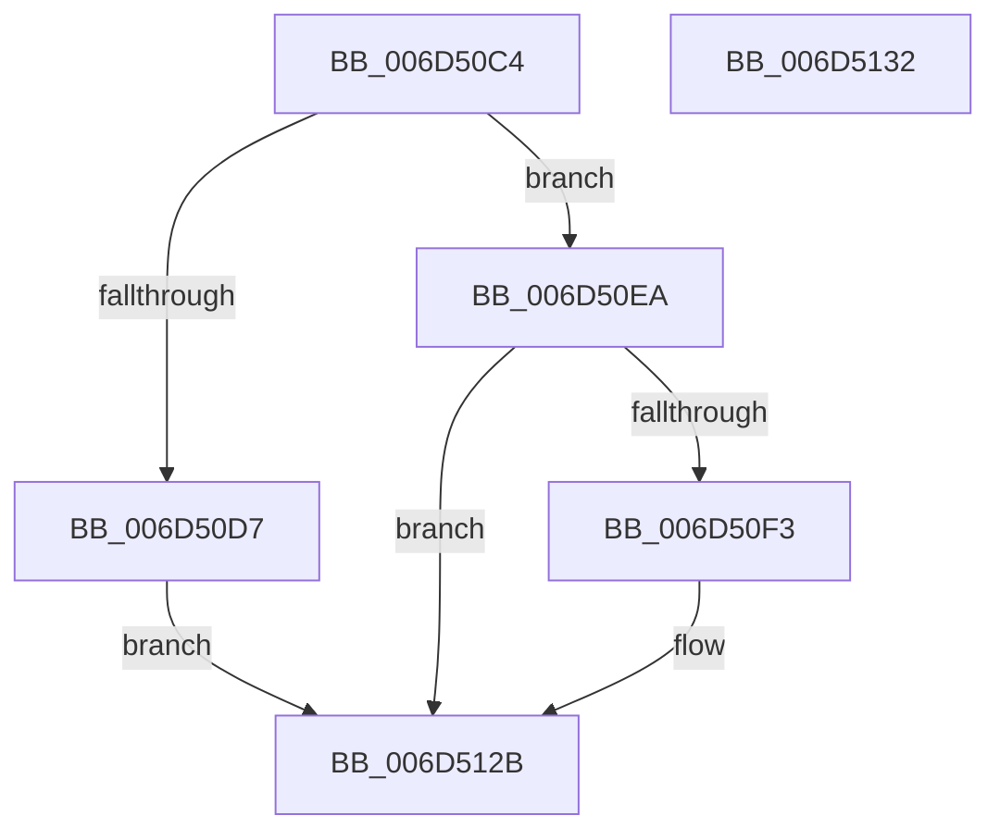

# CcSetupWatchForRegistryChanges$fin$0

- RVA: `0x006D50C4`–`0x006D5133` (길이 `111` bytes)
- VA: `0x00000001406D50C4`
- 실행 섹션: `.text`
- PDB 이름 있음: `예`; PDB Function 태그: `예`
- unwind 정보 RVA: `0x000C5838`
- 디코드: `33`개 명령, `111/111` bytes 표시
- 미해석 바이트: `0` (있으면 어셈블리에 `.byte`로 보존)

> 이 문서는 커널 이미지의 기계어와 PDB 기호를 분석해 생성했습니다. 4번과 5번은 함수 원형과 자료형을 바이너리 사용 방식에서 추정한 C 해석이며 원본 소스 복구 결과는 아닙니다.

## 1. Dependencies

- 직접 호출 지점: **3**; 고유 호출 대상: **2**
- 직접 호출자로 확인된 함수: **0**
- RIP 상대 이미지 참조: **2**

### Outgoing calls
- `0x006D50E3` → [DbgPrintEx](../35/DbgPrintEx_function_00359290.md) (function, `0x00359290`)
- `0x006D5114` → [DbgPrintEx](../35/DbgPrintEx_function_00359290.md) (function, `0x00359290`)
- `0x006D5125` → [ExQueueWorkItem](../2F/ExQueueWorkItem_function_002F9520.md) (function, `0x002F9520`)

### Direct callers
- 이 함수 시작 RVA로 연결되는 직접 call은 확인되지 않았습니다. 간접 호출은 완전히 역산할 수 없습니다.

### Static image references
- `0x006D50D7` → RVA `0x006C7EB0` (` ?? ::FNODOBFM::`string'`; read)
- `0x006D5105` → RVA `0x006C8020` (` ?? ::FNODOBFM::`string'`; read)

## 2. Other-region calls and transfers

- 다른 실행 섹션으로 향하는 call: **0**
- 별도 외부 분기/꼬리 이동을 확인하지 못했습니다.

## 3. Assembly (complete function range)

```asm
006D50C4  40 53                           push rbx
006D50C6  55                              push rbp
006D50C7  48 83 EC 58                     sub rsp, 0x58
006D50CB  48 8B EA                        mov rbp, rdx
006D50CE  48 8B 5D 58                     mov rbx, qword ptr [rbp + 0x58]
006D50D2  48 85 DB                        test rbx, rbx
006D50D5  75 13                           jne 0x1406d50ea
006D50D7  4C 8D 05 D2 2D FF FF            lea r8, [rip - 0xd22e]
006D50DE  33 D2                           xor edx, edx
006D50E0  8D 4B 7F                        lea ecx, [rbx + 0x7f]
006D50E3  E8 A8 41 C8 FF                  call 0x140359290
006D50E8  EB 41                           jmp 0x1406d512b
006D50EA  44 8B 4D 50                     mov r9d, dword ptr [rbp + 0x50]
006D50EE  45 85 C9                        test r9d, r9d
006D50F1  79 38                           jns 0x1406d512b
006D50F3  0F 10 43 38                     movups xmm0, xmmword ptr [rbx + 0x38]
006D50F7  F3 0F 7F 45 60                  movdqu xmmword ptr [rbp + 0x60], xmm0
006D50FC  48 8D 45 60                     lea rax, [rbp + 0x60]
006D5100  48 89 44 24 20                  mov qword ptr [rsp + 0x20], rax
006D5105  4C 8D 05 14 2F FF FF            lea r8, [rip - 0xd0ec]
006D510C  BA 02 00 00 00                  mov edx, 2
006D5111  8D 4A 7D                        lea ecx, [rdx + 0x7d]
006D5114  E8 77 41 C8 FF                  call 0x140359290
006D5119  C6 43 48 01                     mov byte ptr [rbx + 0x48], 1
006D511D  BA 01 00 00 00                  mov edx, 1
006D5122  48 8B CB                        mov rcx, rbx
006D5125  E8 F6 43 C2 FF                  call 0x1402f9520
006D512A  90                              nop
006D512B  48 83 C4 58                     add rsp, 0x58
006D512F  5D                              pop rbp
006D5130  5B                              pop rbx
006D5131  C3                              ret
006D5132  CC                              int3
```

## 4. C-style interpretation (structured pseudocode)

```c
__int64 __fastcall CcSetupWatchForRegistryChanges_fin_0(__int64 a1, __int64 a2)
{
    __int64 result;
    __int64 v_rsp;
    unsigned __int64 v_stack_m48;

    v_rsp = (v_rsp) - (88);
    if (*(unsigned __int64 *)(a2 + 88) != 0) goto loc_006D50EA;
    a2 = 0;
    result = DbgPrintEx(*(unsigned __int64 *)(a2 + 88) + 127, a2, v_rip - 53806, a4);
    goto loc_006D512B;
loc_006D50EA:
    if (sign_flag) {
        *(unsigned __int64 *)(a2 + 96) = v_xmm0;
        result = a2 + 96;
        v_stack_m48 = result;
        a3 = v_rip - 53484;
        a2 = 2;
        a1 = a2 + 125;
        result = DbgPrintEx(a1, a2, a3, (unsigned int)(*(unsigned int *)(a2 + 80)));
        *(unsigned __int8 *)(*(unsigned __int64 *)(a2 + 88) + 72) = 1;
        a2 = 1;
        a1 = *(unsigned __int64 *)(a2 + 88);
        result = ExQueueWorkItem(a1, a2, a3, (unsigned int)(*(unsigned int *)(a2 + 80)));
    }
    v_rsp = (v_rsp) + (88);
    return result;
}
```

## 5. (Beta) C Style

```c
int64_t CcSetupWatchForRegistryChanges_fin_0(int64_t Arg1, void *Arg2)
{
    uint8_t *arg2 = (uint8_t *)Arg2;

    int64_t result;
    int64_t local_rsp;
    uint64_t v_stack_m48;

    local_rsp = (local_rsp) - (88);
    if (*(uint64_t *)(arg2 + 0x58) != 0) goto loc_006D50EA;
    Arg2 = 0;
    result = DbgPrintEx(*(uint64_t *)(arg2 + 0x58) + 127, Arg2, v_rip - 53806, a4);
    goto loc_006D512B;
loc_006D50EA:
    if (sign_flag) {
        *(uint64_t *)(arg2 + 0x60) = v_xmm0;
        result = Arg2 + 96;
        v_stack_m48 = result;
        a3 = v_rip - 53484;
        Arg2 = 2;
        Arg1 = Arg2 + 125;
        result = DbgPrintEx(Arg1, Arg2, a3, (uint32_t)(*(uint32_t *)(arg2 + 0x50)));
        *(uint8_t *)(*(uint64_t *)(arg2 + 0x58) + 0x48) = 1;
        Arg2 = 1;
        Arg1 = *(uint64_t *)(arg2 + 0x58);
        result = ExQueueWorkItem(Arg1, Arg2, a3, (uint32_t)(*(uint32_t *)(arg2 + 0x50)));
    }
    local_rsp = (local_rsp) + (88);
    return result;
}
```

### 관측된 메모리 오프셋

구조체 형식이 확인되지 않은 접근은 인자 기준의 오프셋으로만 기록했습니다.

| 기준 인자 | 오프셋 표현 | 폭 (bit) | 접근 |
|---|---:|---:|---|
| `Arg2` | `+ 0x50` | `32` | `R` |
| `Arg2` | `+ 0x58` | `64` | `R` |
| `Arg2` | `+ 0x60` | `64` | `R` |
| `Arg2` | `+ 0x60` | `128` | `W` |

## 6. Execution-region graph

[열기: 2D/3D 그래프와 함수 탐색 컨트롤 패널](../../../control-panel.html?section=text&rva=0x006D50C4&view=graph)

- 2D 그래프는 위에서 아래로 흐르고, 3D 그래프는 빈 공간을 드래그해 회전합니다. Shift+드래그는 이동, 휠은 확대·축소, 함수 노드 선택은 대상 보고서 이동입니다.

### Static fallback


