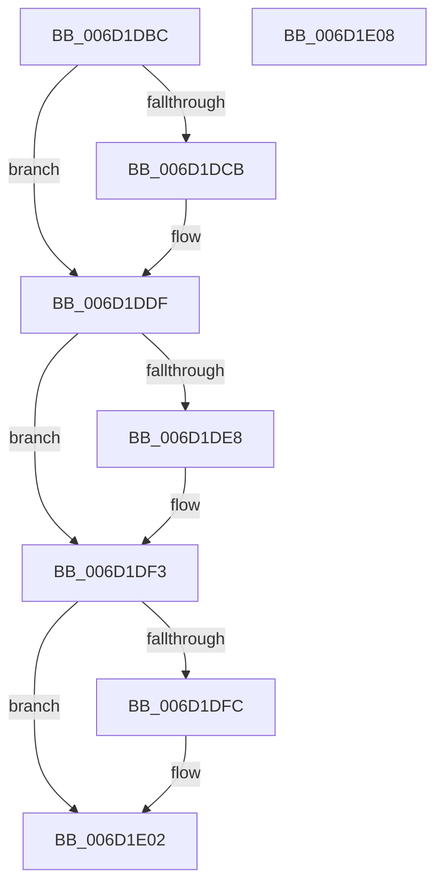

# CcZeroDataInCache$fin$0

- RVA: `0x006D1DBC`–`0x006D1E09` (길이 `77` bytes)
- VA: `0x00000001406D1DBC`
- 실행 섹션: `.text`
- PDB 이름 있음: `예`; PDB Function 태그: `예`
- unwind 정보 RVA: `0x00068200`
- 디코드: `25`개 명령, `77/77` bytes 표시
- 미해석 바이트: `0` (있으면 어셈블리에 `.byte`로 보존)

> 이 문서는 커널 이미지의 기계어와 PDB 기호를 분석해 생성했습니다. 4번과 5번은 함수 원형과 자료형을 바이너리 사용 방식에서 추정한 C 해석이며 원본 소스 복구 결과는 아닙니다.

## 1. Dependencies

- 직접 호출 지점: **2**; 고유 호출 대상: **2**
- 직접 호출자로 확인된 함수: **0**
- RIP 상대 이미지 참조: **0**

### Outgoing calls
- `0x006D1DED` → [CcUnpinFileDataEx](../35/CcUnpinFileDataEx_function_00359DEC.md) (function, `0x00359DEC`)
- `0x006D1DFC` → [IoFreeMdl](../29/IoFreeMdl_function_0029EA80.md) (function, `0x0029EA80`)

### Direct callers
- 이 함수 시작 RVA로 연결되는 직접 call은 확인되지 않았습니다. 간접 호출은 완전히 역산할 수 없습니다.

### Static image references
- 디코드된 RIP-relative 메모리 참조가 없습니다.

## 2. Other-region calls and transfers

- 다른 실행 섹션으로 향하는 call: **0**
- 별도 외부 분기/꼬리 이동을 확인하지 못했습니다.

## 3. Assembly (complete function range)

```asm
006D1DBC  40 55                           push rbp
006D1DBE  48 83 EC 50                     sub rsp, 0x50
006D1DC2  48 8B EA                        mov rbp, rdx
006D1DC5  83 7D 50 00                     cmp dword ptr [rbp + 0x50], 0
006D1DC9  74 14                           je 0x1406d1ddf
006D1DCB  65 48 8B 0C 25 88 01 00 00      mov rcx, qword ptr gs:[0x188]
006D1DD4  8B 45 50                        mov eax, dword ptr [rbp + 0x50]
006D1DD7  2C 02                           sub al, 2
006D1DD9  88 81 AD 05 00 00               mov byte ptr [rcx + 0x5ad], al
006D1DDF  48 8B 4D 68                     mov rcx, qword ptr [rbp + 0x68]
006D1DE3  48 85 C9                        test rcx, rcx
006D1DE6  74 0B                           je 0x1406d1df3
006D1DE8  45 33 C0                        xor r8d, r8d
006D1DEB  33 D2                           xor edx, edx
006D1DED  E8 FA 7F C8 FF                  call 0x140359dec
006D1DF2  90                              nop
006D1DF3  48 8B 4D 60                     mov rcx, qword ptr [rbp + 0x60]
006D1DF7  48 85 C9                        test rcx, rcx
006D1DFA  74 06                           je 0x1406d1e02
006D1DFC  E8 7F CC BC FF                  call 0x14029ea80
006D1E01  90                              nop
006D1E02  48 83 C4 50                     add rsp, 0x50
006D1E06  5D                              pop rbp
006D1E07  C3                              ret
006D1E08  CC                              int3
```

## 4. C-style interpretation (structured pseudocode)

```c
__int64 __fastcall CcZeroDataInCache_fin_0(__int64 a1, __int64 a2, int a3)
{
    __int64 result;
    __int64 v_rsp;

    v_rsp = (v_rsp) - (80);
    if ((*(unsigned int *)(a2 + 80)) != 0) {
        a1 = *(unsigned __int64 *)(gs_base + (0 + 392));
        result = *(unsigned int *)(a2 + 80);
        result = (unsigned __int8)((result) - (2));
        *(unsigned __int8 *)(a1 + 1453) = (unsigned __int8)(result);
    }
    if (*(unsigned __int64 *)(a2 + 104) != 0) {
        a3 = 0;
        a2 = 0;
        result = CcUnpinFileDataEx(*(unsigned __int64 *)(a2 + 104), a2, a3, a4);
    }
    if (*(unsigned __int64 *)(a2 + 96) != 0) {
        result = IoFreeMdl(*(unsigned __int64 *)(a2 + 96), a2, a3, a4);
    }
    v_rsp = (v_rsp) + (80);
    return result;
}
```

## 5. (Beta) C Style

```c
int64_t CcZeroDataInCache_fin_0(int64_t Arg1, void *Arg2, int32_t Arg3)
{
    uint8_t *arg2 = (uint8_t *)Arg2;

    int64_t result;
    int64_t local_rsp;

    local_rsp = (local_rsp) - (80);
    if ((*(uint32_t *)(arg2 + 0x50)) != 0) {
        Arg1 = *(uint64_t *)(gs_base + (0 + 0x188));
        result = *(uint32_t *)(arg2 + 0x50);
        result = (uint8_t)((result) - (2));
        *(uint8_t *)(Arg1 + 0x5AD) = (uint8_t)(result);
    }
    if (*(uint64_t *)(arg2 + 0x68) != 0) {
        Arg3 = 0;
        Arg2 = 0;
        result = CcUnpinFileDataEx(*(uint64_t *)(arg2 + 0x68), Arg2, Arg3, a4);
    }
    if (*(uint64_t *)(arg2 + 0x60) != 0) {
        result = IoFreeMdl(*(uint64_t *)(arg2 + 0x60), Arg2, Arg3, a4);
    }
    local_rsp = (local_rsp) + (80);
    return result;
}
```

### 관측된 메모리 오프셋

구조체 형식이 확인되지 않은 접근은 인자 기준의 오프셋으로만 기록했습니다.

| 기준 인자 | 오프셋 표현 | 폭 (bit) | 접근 |
|---|---:|---:|---|
| `Arg2` | `+ 0x50` | `32` | `R` |
| `Arg2` | `+ 0x60` | `64` | `R` |
| `Arg2` | `+ 0x68` | `64` | `R` |

## 6. Execution-region graph

[열기: 2D/3D 그래프와 함수 탐색 컨트롤 패널](../../../control-panel.html?section=text&rva=0x006D1DBC&view=graph)

- 2D 그래프는 위에서 아래로 흐르고, 3D 그래프는 빈 공간을 드래그해 회전합니다. Shift+드래그는 이동, 휠은 확대·축소, 함수 노드 선택은 대상 보고서 이동입니다.

### Static fallback


