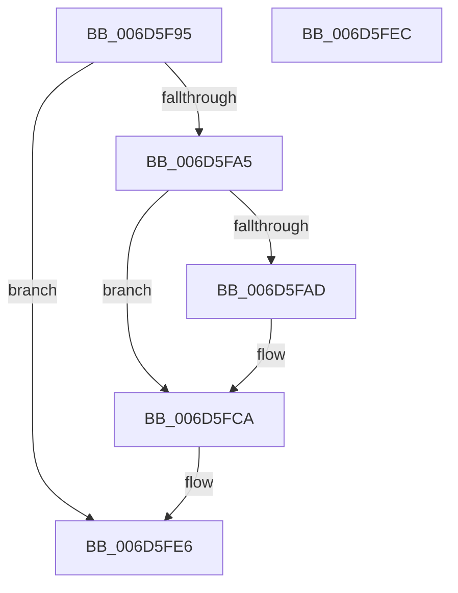

# CmpEnableLazyFlushDpcRoutine$fin$0

- RVA: `0x006D5F95`–`0x006D5FED` (길이 `88` bytes)
- VA: `0x00000001406D5F95`
- 실행 섹션: `.text`
- PDB 이름 있음: `예`; PDB Function 태그: `예`
- unwind 정보 RVA: `0x000BF4C0`
- 디코드: `26`개 명령, `88/88` bytes 표시
- 미해석 바이트: `0` (있으면 어셈블리에 `.byte`로 보존)

> 이 문서는 커널 이미지의 기계어와 PDB 기호를 분석해 생성했습니다. 4번과 5번은 함수 원형과 자료형을 바이너리 사용 방식에서 추정한 C 해석이며 원본 소스 복구 결과는 아닙니다.

## 1. Dependencies

- 직접 호출 지점: **1**; 고유 호출 대상: **1**
- 직접 호출자로 확인된 함수: **0**
- RIP 상대 이미지 참조: **1**

### Outgoing calls
- `0x006D5FC4` → [local_unwind](../4F/local_unwind_function_004FFB40.md) (function, `0x004FFB40`)

### Direct callers
- 이 함수 시작 RVA로 연결되는 직접 call은 확인되지 않았습니다. 간접 호출은 완전히 역산할 수 없습니다.

### Static image references
- `0x006D5FB6` → RVA `0x0066AA35` (`.text`; read)

## 2. Other-region calls and transfers

- 다른 실행 섹션으로 향하는 call: **0**
- 별도 외부 분기/꼬리 이동을 확인하지 못했습니다.

## 3. Assembly (complete function range)

```asm
006D5F95  40 55                           push rbp
006D5F97  48 83 EC 30                     sub rsp, 0x30
006D5F9B  48 8B EA                        mov rbp, rdx
006D5F9E  88 4D 48                        mov byte ptr [rbp + 0x48], cl
006D5FA1  84 C9                           test cl, cl
006D5FA3  74 41                           je 0x1406d5fe6
006D5FA5  8B 45 30                        mov eax, dword ptr [rbp + 0x30]
006D5FA8  83 F8 04                        cmp eax, 4
006D5FAB  75 1D                           jne 0x1406d5fca
006D5FAD  8B 45 30                        mov eax, dword ptr [rbp + 0x30]
006D5FB0  83 C0 04                        add eax, 4
006D5FB3  89 45 30                        mov dword ptr [rbp + 0x30], eax
006D5FB6  48 8D 15 78 4A F9 FF            lea rdx, [rip - 0x6b588]
006D5FBD  48 8B 8D E0 00 00 00            mov rcx, qword ptr [rbp + 0xe0]
006D5FC4  E8 77 9B E2 FF                  call 0x1404ffb40
006D5FC9  90                              nop
006D5FCA  48 83 65 58 00                  and qword ptr [rbp + 0x58], 0
006D5FCF  48 8B 8D D5 00 00 00            mov rcx, qword ptr [rbp + 0xd5]
006D5FD6  48 89 4D 58                     mov qword ptr [rbp + 0x58], rcx
006D5FDA  48 8B 85 A5 00 00 00            mov rax, qword ptr [rbp + 0xa5]
006D5FE1  48 D3 C8                        ror rax, cl
006D5FE4  8B 00                           mov eax, dword ptr [rax]
006D5FE6  48 83 C4 30                     add rsp, 0x30
006D5FEA  5D                              pop rbp
006D5FEB  C3                              ret
006D5FEC  CC                              int3
```

## 4. C-style interpretation (structured pseudocode)

```c
__int64 __fastcall CmpEnableLazyFlushDpcRoutine_fin_0(unsigned __int8 a1, __int64 a2)
{
    __int64 result;
    __int64 v_rsp;

    v_rsp = (v_rsp) - (48);
    *(unsigned __int8 *)(a2 + 72) = a1;
    if (a1 == 0) goto loc_006D5FE6;
    result = (unsigned int)(*(unsigned int *)(a2 + 48));
    if (((unsigned int)((unsigned int)(*(unsigned int *)(a2 + 48)))) == 4) {
        result = *(unsigned int *)(a2 + 48);
        result = (unsigned int)((result) + (4));
        *(unsigned int *)(a2 + 48) = (unsigned int)(result);
        a2 = v_rip - 439688;
        a1 = *(unsigned __int64 *)(a2 + 224);
        result = local_unwind(a1, a2, a3, a4);
    }
    *(unsigned __int64 *)(a2 + 88) = *(unsigned __int64 *)(a2 + 213);
loc_006D5FE6:
    v_rsp = (v_rsp) + (48);
    return (unsigned int)(*(unsigned int *)(*(unsigned __int64 *)(a2 + 165)));
}
```

## 5. (Beta) C Style

```c
int64_t CmpEnableLazyFlushDpcRoutine_fin_0(uint8_t Arg1, void *Arg2)
{
    uint8_t *arg2 = (uint8_t *)Arg2;

    int64_t result;
    int64_t local_rsp;

    local_rsp = (local_rsp) - (48);
    *(uint8_t *)(arg2 + 0x48) = Arg1;
    if (Arg1 == 0) goto loc_006D5FE6;
    result = (uint32_t)(*(uint32_t *)(arg2 + 0x30));
    if (((uint32_t)((uint32_t)(*(uint32_t *)(arg2 + 0x30)))) == 4) {
        result = *(uint32_t *)(arg2 + 0x30);
        result = (uint32_t)((result) + (4));
        *(uint32_t *)(arg2 + 0x30) = (uint32_t)(result);
        Arg2 = v_rip - 439688;
        Arg1 = *(uint64_t *)(arg2 + 0xE0);
        result = local_unwind(Arg1, Arg2, a3, a4);
    }
    *(uint64_t *)(arg2 + 0x58) = *(uint64_t *)(arg2 + 0xD5);
loc_006D5FE6:
    local_rsp = (local_rsp) + (48);
    return (uint32_t)(*(uint32_t *)(*(uint64_t *)(arg2 + 0xA5)));
}
```

### 관측된 메모리 오프셋

구조체 형식이 확인되지 않은 접근은 인자 기준의 오프셋으로만 기록했습니다.

| 기준 인자 | 오프셋 표현 | 폭 (bit) | 접근 |
|---|---:|---:|---|
| `Arg2` | `+ 0x30` | `32` | `R` |
| `Arg2` | `+ 0x30` | `32` | `W` |
| `Arg2` | `+ 0x48` | `8` | `W` |
| `Arg2` | `+ 0x58` | `64` | `R/W` |
| `Arg2` | `+ 0x58` | `64` | `W` |
| `Arg2` | `+ 0xA5` | `64` | `R` |
| `Arg2` | `+ 0xD5` | `64` | `R` |
| `Arg2` | `+ 0xE0` | `64` | `R` |

## 6. Execution-region graph

[열기: 2D/3D 그래프와 함수 탐색 컨트롤 패널](../../../control-panel.html?section=text&rva=0x006D5F95&view=graph)

- 2D 그래프는 위에서 아래로 흐르고, 3D 그래프는 빈 공간을 드래그해 회전합니다. Shift+드래그는 이동, 휠은 확대·축소, 함수 노드 선택은 대상 보고서 이동입니다.

### Static fallback


