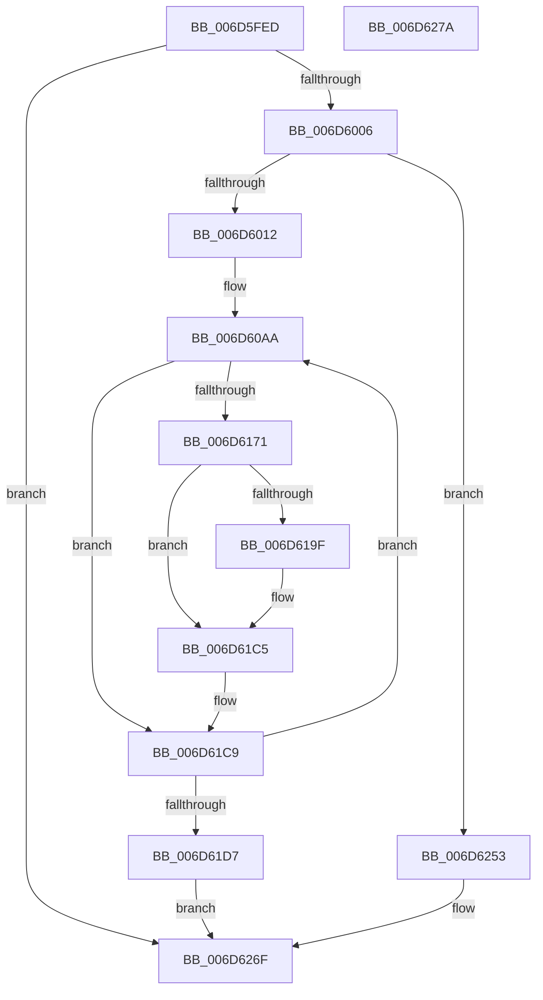

# CmpEnableLazyFlushDpcRoutine$fin$1

- RVA: `0x006D5FED`–`0x006D627B` (길이 `654` bytes)
- VA: `0x00000001406D5FED`
- 실행 섹션: `.text`
- PDB 이름 있음: `예`; PDB Function 태그: `예`
- unwind 정보 RVA: `0x000D4984`
- 디코드: `177`개 명령, `654/654` bytes 표시
- 미해석 바이트: `0` (있으면 어셈블리에 `.byte`로 보존)

> 이 문서는 커널 이미지의 기계어와 PDB 기호를 분석해 생성했습니다. 4번과 5번은 함수 원형과 자료형을 바이너리 사용 방식에서 추정한 C 해석이며 원본 소스 복구 결과는 아닙니다.

## 1. Dependencies

- 직접 호출 지점: **1**; 고유 호출 대상: **1**
- 직접 호출자로 확인된 함수: **0**
- RIP 상대 이미지 참조: **2**

### Outgoing calls
- `0x006D623C` → [guard_dispatch_icall](../6B/guard_dispatch_icall_function_006BAAD0.md) (function, `0x006BAAD0`)

### Direct callers
- 이 함수 시작 RVA로 연결되는 직접 call은 확인되지 않았습니다. 간접 호출은 완전히 역산할 수 없습니다.

### Static image references
- `0x006D60B7` → RVA `0x00FC6F78` (`ALMOSTRO`; read)
- `0x006D60CA` → RVA `0x00FC7250` (`ALMOSTRO`; read)

## 2. Other-region calls and transfers

- 다른 실행 섹션으로 향하는 call: **0**
- 별도 외부 분기/꼬리 이동을 확인하지 못했습니다.

## 3. Assembly (complete function range)

```asm
006D5FED  40 53                           push rbx
006D5FEF  55                              push rbp
006D5FF0  56                              push rsi
006D5FF1  57                              push rdi
006D5FF2  41 56                           push r14
006D5FF4  48 83 EC 30                     sub rsp, 0x30
006D5FF8  48 8B EA                        mov rbp, rdx
006D5FFB  88 4D 49                        mov byte ptr [rbp + 0x49], cl
006D5FFE  84 C9                           test cl, cl
006D6000  0F 84 69 02 00 00               je 0x1406d626f
006D6006  8B 45 30                        mov eax, dword ptr [rbp + 0x30]
006D6009  83 F8 08                        cmp eax, 8
006D600C  0F 85 41 02 00 00               jne 0x1406d6253
006D6012  48 83 65 60 00                  and qword ptr [rbp + 0x60], 0
006D6017  48 8B 8D D5 00 00 00            mov rcx, qword ptr [rbp + 0xd5]
006D601E  48 89 4D 60                     mov qword ptr [rbp + 0x60], rcx
006D6022  4C 8B 85 A5 00 00 00            mov r8, qword ptr [rbp + 0xa5]
006D6029  48 83 65 68 00                  and qword ptr [rbp + 0x68], 0
006D602E  48 8B 85 D5 00 00 00            mov rax, qword ptr [rbp + 0xd5]
006D6035  48 89 45 68                     mov qword ptr [rbp + 0x68], rax
006D6039  48 8B 95 AD 00 00 00            mov rdx, qword ptr [rbp + 0xad]
006D6040  49 D3 C8                        ror r8, cl
006D6043  8B C8                           mov ecx, eax
006D6045  48 D3 C2                        rol rdx, cl
006D6048  83 A5 18 01 00 00 00            and dword ptr [rbp + 0x118], 0
006D604F  4C 8B 5A 40                     mov r11, qword ptr [rdx + 0x40]
006D6053  4C 89 5D 40                     mov qword ptr [rbp + 0x40], r11
006D6057  4D 33 D8                        xor r11, r8
006D605A  48 B8 00 00 00 00 00 80 FF FF   movabs rax, 0xffff800000000000
006D6064  4C 0B D8                        or r11, rax
006D6067  4C 89 9D E8 00 00 00            mov qword ptr [rbp + 0xe8], r11
006D606E  49 8B FB                        mov rdi, r11
006D6071  4C 89 5D 70                     mov qword ptr [rbp + 0x70], r11
006D6075  41 8B C3                        mov eax, r11d
006D6078  83 E0 3F                        and eax, 0x3f
006D607B  B9 40 00 00 00                  mov ecx, 0x40
006D6080  2B C8                           sub ecx, eax
006D6082  49 8B DB                        mov rbx, r11
006D6085  48 D3 E3                        shl rbx, cl
006D6088  41 8B CB                        mov ecx, r11d
006D608B  83 E1 3F                        and ecx, 0x3f
006D608E  49 8B C3                        mov rax, r11
006D6091  48 D3 E8                        shr rax, cl
006D6094  48 0B D8                        or rbx, rax
006D6097  48 89 5D 40                     mov qword ptr [rbp + 0x40], rbx
006D609B  41 BE 19 00 00 00               mov r14d, 0x19
006D60A1  44 89 75 4C                     mov dword ptr [rbp + 0x4c], r14d
006D60A5  33 F6                           xor esi, esi
006D60A7  89 75 50                        mov dword ptr [rbp + 0x50], esi
006D60AA  4C 8B 17                        mov r10, qword ptr [rdi]
006D60AD  4C 89 95 F0 00 00 00            mov qword ptr [rbp + 0xf0], r10
006D60B4  49 8B D2                        mov rdx, r10
006D60B7  48 8B 0D BA 0E 8F 00            mov rcx, qword ptr [rip + 0x8f0eba]
006D60BE  48 33 D1                        xor rdx, rcx
006D60C1  48 D3 C2                        rol rdx, cl
006D60C4  48 33 D3                        xor rdx, rbx
006D60C7  48 0F CA                        bswap rdx
006D60CA  48 33 15 7F 11 8F 00            xor rdx, qword ptr [rip + 0x8f117f]
006D60D1  48 89 17                        mov qword ptr [rdi], rdx
006D60D4  44 8B CE                        mov r9d, esi
006D60D7  48 8D 04 16                     lea rax, [rsi + rdx]
006D60DB  49 03 C3                        add rax, r11
006D60DE  48 89 07                        mov qword ptr [rdi], rax
006D60E1  41 8B C2                        mov eax, r10d
006D60E4  F7 D0                           not eax
006D60E6  83 E0 3F                        and eax, 0x3f
006D60E9  B9 40 00 00 00                  mov ecx, 0x40
006D60EE  2B C8                           sub ecx, eax
006D60F0  41 B8 C8 00 00 00               mov r8d, 0xc8
006D60F6  44 2B C6                        sub r8d, esi
006D60F9  4D 33 C1                        xor r8, r9
006D60FC  49 D3 E0                        shl r8, cl
006D60FF  BA C8 00 00 00                  mov edx, 0xc8
006D6104  2B D6                           sub edx, esi
006D6106  49 33 D1                        xor rdx, r9
006D6109  41 8B CA                        mov ecx, r10d
006D610C  F7 D1                           not ecx
006D610E  83 E1 3F                        and ecx, 0x3f
006D6111  48 D3 EA                        shr rdx, cl
006D6114  4C 0B C2                        or r8, rdx
006D6117  49 33 D8                        xor rbx, r8
006D611A  48 89 5D 40                     mov qword ptr [rbp + 0x40], rbx
006D611E  41 8B C2                        mov eax, r10d
006D6121  83 F0 FA                        xor eax, 0xfffffffa
006D6124  83 E0 3F                        and eax, 0x3f
006D6127  B9 40 00 00 00                  mov ecx, 0x40
006D612C  2B C8                           sub ecx, eax
006D612E  48 8B D3                        mov rdx, rbx
006D6131  48 D3 EA                        shr rdx, cl
006D6134  41 83 F2 FA                     xor r10d, 0xfffffffa
006D6138  41 83 E2 3F                     and r10d, 0x3f
006D613C  41 8A CA                        mov cl, r10b
006D613F  48 8B C3                        mov rax, rbx
006D6142  48 D3 E0                        shl rax, cl
006D6145  48 8B DA                        mov rbx, rdx
006D6148  48 0B D8                        or rbx, rax
006D614B  48 89 5D 40                     mov qword ptr [rbp + 0x40], rbx
006D614F  49 03 DB                        add rbx, r11
006D6152  48 89 5D 40                     mov qword ptr [rbp + 0x40], rbx
006D6156  48 81 F3 84 6D 00 20            xor rbx, 0x20006d84
006D615D  48 89 5D 40                     mov qword ptr [rbp + 0x40], rbx
006D6161  48 83 C7 08                     add rdi, 8
006D6165  48 89 7D 70                     mov qword ptr [rbp + 0x70], rdi
006D6169  8D 46 01                        lea eax, [rsi + 1]
006D616C  83 F8 19                        cmp eax, 0x19
006D616F  75 58                           jne 0x1406d61c9
006D6171  48 B8 82 14 13 81 14 13 85 E0   movabs rax, 0xe085131481131482
006D617B  48 89 45 38                     mov qword ptr [rbp + 0x38], rax
006D617F  48 8B 4D 38                     mov rcx, qword ptr [rbp + 0x38]
006D6183  48 C1 E9 3C                     shr rcx, 0x3c
006D6187  48 8B 45 38                     mov rax, qword ptr [rbp + 0x38]
006D618B  48 C1 E0 04                     shl rax, 4
006D618F  48 0B C1                        or rax, rcx
006D6192  48 89 45 38                     mov qword ptr [rbp + 0x38], rax
006D6196  48 8B 45 38                     mov rax, qword ptr [rbp + 0x38]
006D619A  49 33 03                        xor rax, qword ptr [r11]
006D619D  74 26                           je 0x1406d61c5
006D619F  48 8B 45 38                     mov rax, qword ptr [rbp + 0x38]
006D61A3  48 33 47 F8                     xor rax, qword ptr [rdi - 8]
006D61A7  49 33 03                        xor rax, qword ptr [r11]
006D61AA  48 89 47 F8                     mov qword ptr [rdi - 8], rax
006D61AE  44 03 77 FC                     add r14d, dword ptr [rdi - 4]
006D61B2  44 89 75 4C                     mov dword ptr [rbp + 0x4c], r14d
006D61B6  48 8B 45 38                     mov rax, qword ptr [rbp + 0x38]
006D61BA  48 33 47 F8                     xor rax, qword ptr [rdi - 8]
006D61BE  49 33 03                        xor rax, qword ptr [r11]
006D61C1  48 89 47 F8                     mov qword ptr [rdi - 8], rax
006D61C5  48 8B 5D 40                     mov rbx, qword ptr [rbp + 0x40]
006D61C9  FF C6                           inc esi
006D61CB  89 75 50                        mov dword ptr [rbp + 0x50], esi
006D61CE  41 3B F6                        cmp esi, r14d
006D61D1  0F 82 D3 FE FF FF               jb 0x1406d60aa
006D61D7  48 B8 82 14 13 81 14 13 85 E0   movabs rax, 0xe085131481131482
006D61E1  48 89 45 38                     mov qword ptr [rbp + 0x38], rax
006D61E5  48 8B 4D 38                     mov rcx, qword ptr [rbp + 0x38]
006D61E9  48 C1 E9 3C                     shr rcx, 0x3c
006D61ED  48 8B 45 38                     mov rax, qword ptr [rbp + 0x38]
006D61F1  48 C1 E0 04                     shl rax, 4
006D61F5  48 0B C1                        or rax, rcx
006D61F8  48 89 45 38                     mov qword ptr [rbp + 0x38], rax
006D61FC  48 8B 45 38                     mov rax, qword ptr [rbp + 0x38]
006D6200  49 33 03                        xor rax, qword ptr [r11]
006D6203  48 89 45 40                     mov qword ptr [rbp + 0x40], rax
006D6207  48 C7 45 38 E1 82 14 13         mov qword ptr [rbp + 0x38], 0x131482e1
006D620F  48 8B 55 38                     mov rdx, qword ptr [rbp + 0x38]
006D6213  C1 E2 1C                        shl edx, 0x1c
006D6216  48 8B 4D 38                     mov rcx, qword ptr [rbp + 0x38]
006D621A  48 C1 E9 04                     shr rcx, 4
006D621E  48 0B CA                        or rcx, rdx
006D6221  48 89 4D 38                     mov qword ptr [rbp + 0x38], rcx
006D6225  48 8B 45 38                     mov rax, qword ptr [rbp + 0x38]
006D6229  41 89 03                        mov dword ptr [r11], eax
006D622C  45 33 C9                        xor r9d, r9d
006D622F  45 33 C0                        xor r8d, r8d
006D6232  48 8B 55 40                     mov rdx, qword ptr [rbp + 0x40]
006D6236  49 8B CB                        mov rcx, r11
006D6239  49 8B C3                        mov rax, r11
006D623C  E8 8F 48 FE FF                  call 0x1406baad0
006D6241  C7 45 54 01 00 00 00            mov dword ptr [rbp + 0x54], 1
006D6248  8B 45 30                        mov eax, dword ptr [rbp + 0x30]
006D624B  83 C0 08                        add eax, 8
006D624E  89 45 30                        mov dword ptr [rbp + 0x30], eax
006D6251  EB 1C                           jmp 0x1406d626f
006D6253  48 83 65 78 00                  and qword ptr [rbp + 0x78], 0
006D6258  48 8B 8D D5 00 00 00            mov rcx, qword ptr [rbp + 0xd5]
006D625F  48 89 4D 78                     mov qword ptr [rbp + 0x78], rcx
006D6263  48 8B 85 A5 00 00 00            mov rax, qword ptr [rbp + 0xa5]
006D626A  48 D3 C8                        ror rax, cl
006D626D  8B 00                           mov eax, dword ptr [rax]
006D626F  48 83 C4 30                     add rsp, 0x30
006D6273  41 5E                           pop r14
006D6275  5F                              pop rdi
006D6276  5E                              pop rsi
006D6277  5D                              pop rbp
006D6278  5B                              pop rbx
006D6279  C3                              ret
006D627A  CC                              int3
```

## 4. C-style interpretation (structured pseudocode)

```c
__int64 __fastcall CmpEnableLazyFlushDpcRoutine_fin_1(unsigned __int8 a1, __int64 a2)
{
    __int64 result;
    __int64 v_r10;
    __int64 v_r11;
    __int64 v_r14;
    __int64 v_rbx;
    __int64 v_rdi;
    __int64 v_rsi;
    __int64 v_rsp;

    v_rsp = (v_rsp) - (48);
    *(unsigned __int8 *)(a2 + 73) = a1;
    if (a1 == 0) goto loc_006D626F;
    if (((unsigned int)((unsigned int)(*(unsigned int *)(a2 + 48)))) != 8) goto loc_006D6253;
    *(unsigned __int64 *)(a2 + 96) = *(unsigned __int64 *)(a2 + 213);
    *(unsigned __int64 *)(a2 + 104) = *(unsigned __int64 *)(a2 + 213);
    *(unsigned __int64 *)(a2 + 64) = *(unsigned __int64 *)(*(unsigned __int64 *)(a2 + 173) + 64);
    v_r11 = (*(unsigned __int64 *)(*(unsigned __int64 *)(a2 + 173) + 64)) ^ (*(unsigned __int64 *)(a2 + 165));
    v_r11 = (v_r11) | (*(unsigned __int64 *)(a2 + 213));
    *(unsigned __int64 *)(a2 + 232) = v_r11;
    *(unsigned __int64 *)(a2 + 112) = v_r11;
    result = (unsigned int)(((unsigned int)((unsigned int)(v_r11))) & (63));
    a1 = (unsigned int)((64) - ((unsigned int)(result)));
    v_rbx = (v_r11) << (a1);
    a1 = (unsigned int)(((unsigned int)((unsigned int)(v_r11))) & (63));
    result = (v_r11) >> (a1);
    v_rbx = (v_rbx) | (result);
    *(unsigned __int64 *)(a2 + 64) = v_rbx;
    *(unsigned int *)(a2 + 76) = 25;
    v_rsi = 0;
    *(unsigned int *)(a2 + 80) = 0;
loc_006D60AA:
    *(unsigned __int64 *)(a2 + 240) = *(unsigned __int64 *)(v_r11);
    a2 = (*(unsigned __int64 *)(v_r11)) ^ (*(unsigned __int64 *)(v_rip + 9375418));
    a2 = (a2) ^ (v_rbx);
    a2 = (a2) ^ (*(unsigned __int64 *)(v_rip + 9376127));
    *(unsigned __int64 *)(v_r11) = a2;
    result = (v_rsi + a2 * 1) + (v_r11);
    *(unsigned __int64 *)(v_r11) = result;
    result = (unsigned int)(~((unsigned int)((unsigned int)(*(unsigned __int64 *)(v_r11)))));
    result = (unsigned int)((result) & (63));
    a1 = (unsigned int)((64) - ((unsigned int)(result)));
    a3 = (unsigned int)((200) - (0));
    a3 = (a3) ^ (0);
    a3 = (a3) << (a1);
    a2 = (unsigned int)((200) - (0));
    a2 = (a2) ^ (0);
    a1 = (unsigned int)(~((unsigned int)((unsigned int)(*(unsigned __int64 *)(v_r11)))));
    a1 = (unsigned int)((a1) & (63));
    a2 = (a2) >> (a1);
    a3 = (a3) | (a2);
    v_rbx = (v_rbx) ^ (a3);
    *(unsigned __int64 *)(a2 + 64) = v_rbx;
    result = (unsigned int)(((unsigned int)((unsigned int)(*(unsigned __int64 *)(v_r11)))) ^ (0xFFFFFFFAULL));
    result = (unsigned int)((result) & (63));
    a1 = (unsigned int)((64) - ((unsigned int)(result)));
    a2 = (v_rbx) >> (a1);
    v_r10 = (unsigned int)((*(unsigned __int64 *)(v_r11)) ^ (0xFFFFFFFAULL));
    v_r10 = (unsigned int)((v_r10) & (63));
    result = (v_rbx) << ((unsigned __int8)((unsigned __int8)(v_r10)));
    v_rbx = (a2) | (result);
    *(unsigned __int64 *)(a2 + 64) = v_rbx;
    v_rbx = (v_rbx) + (v_r11);
    *(unsigned __int64 *)(a2 + 64) = v_rbx;
    v_rbx = (v_rbx) ^ (0x20006D84ULL);
    *(unsigned __int64 *)(a2 + 64) = v_rbx;
    v_rdi = (v_r11) + (8);
    *(unsigned __int64 *)(a2 + 112) = v_rdi;
    if (((unsigned int)(v_rsi + 1)) != 25) goto loc_006D61C9;
    *(unsigned __int64 *)(a2 + 56) = v_rsi + 1;
    a1 = (*(unsigned __int64 *)(a2 + 56)) >> (60);
    result = (*(unsigned __int64 *)(a2 + 56)) << (4);
    result = (result) | (a1);
    *(unsigned __int64 *)(a2 + 56) = result;
    result = (*(unsigned __int64 *)(a2 + 56)) ^ (*(unsigned __int64 *)(v_r11));
    v_r14 = 25;
    if (!(condition_is_equal)) {
        result = *(unsigned __int64 *)(a2 + 56);
        result = (result) ^ (*(unsigned __int64 *)(v_rdi - 8));
        result = (result) ^ (*(unsigned __int64 *)(v_r11));
        *(unsigned __int64 *)(v_rdi - 8) = result;
        v_r14 = (unsigned int)((25) + (*(unsigned int *)(v_rdi - 4)));
        *(unsigned int *)(a2 + 76) = (unsigned int)(v_r14);
        result = *(unsigned __int64 *)(a2 + 56);
        result = (result) ^ (*(unsigned __int64 *)(v_rdi - 8));
        result = (result) ^ (*(unsigned __int64 *)(v_r11));
        *(unsigned __int64 *)(v_rdi - 8) = result;
    }
loc_006D61C9:
    v_rsi = (unsigned int)((v_rsi) + 1);
    *(unsigned int *)(a2 + 80) = (unsigned int)(v_rsi);
    if (((unsigned int)(v_rsi)) < ((unsigned int)(v_r14))) goto loc_006D60AA;
    *(unsigned __int64 *)(a2 + 56) = result;
    a1 = (*(unsigned __int64 *)(a2 + 56)) >> (60);
    result = (*(unsigned __int64 *)(a2 + 56)) << (4);
    result = (result) | (a1);
    *(unsigned __int64 *)(a2 + 56) = result;
    result = (*(unsigned __int64 *)(a2 + 56)) ^ (*(unsigned __int64 *)(v_r11));
    *(unsigned __int64 *)(a2 + 64) = result;
    *(unsigned __int64 *)(a2 + 56) = 0x131482E1ULL;
    a2 = (unsigned int)((*(unsigned __int64 *)(a2 + 56)) << (28));
    a1 = (*(unsigned __int64 *)(a2 + 56)) >> (4);
    a1 = (a1) | (a2);
    *(unsigned __int64 *)(a2 + 56) = a1;
    *(unsigned int *)(v_r11) = (unsigned int)(*(unsigned __int64 *)(a2 + 56));
    a4 = 0;
    a3 = 0;
    result = guard_dispatch_icall(v_r11, *(unsigned __int64 *)(a2 + 64), a3, a4);
    *(unsigned int *)(a2 + 84) = 1;
    result = (unsigned int)(((unsigned int)(*(unsigned int *)(a2 + 48))) + (8));
    *(unsigned int *)(a2 + 48) = (unsigned int)(result);
    goto loc_006D626F;
loc_006D6253:
    *(unsigned __int64 *)(a2 + 120) = *(unsigned __int64 *)(a2 + 213);
loc_006D626F:
    v_rsp = (v_rsp) + (48);
    return (unsigned int)(*(unsigned int *)(*(unsigned __int64 *)(a2 + 165)));
}
```

## 5. (Beta) C Style

```c
int64_t CmpEnableLazyFlushDpcRoutine_fin_1(uint8_t Arg1, void *Arg2)
{
    uint8_t *arg2 = (uint8_t *)Arg2;

    int64_t result;
    int64_t local_r10;
    int64_t local_r11;
    int64_t local_r14;
    int64_t local_rbx;
    int64_t local_rdi;
    int64_t local_rsi;
    int64_t local_rsp;

    local_rsp = (local_rsp) - (48);
    *(uint8_t *)(arg2 + 0x49) = Arg1;
    if (Arg1 == 0) goto loc_006D626F;
    if (((uint32_t)((uint32_t)(*(uint32_t *)(arg2 + 0x30)))) != 8) goto loc_006D6253;
    *(uint64_t *)(arg2 + 0x60) = *(uint64_t *)(arg2 + 0xD5);
    *(uint64_t *)(arg2 + 0x68) = *(uint64_t *)(arg2 + 0xD5);
    *(uint64_t *)(arg2 + 0x40) = *(uint64_t *)(*(uint64_t *)(arg2 + 0xAD) + 0x40);
    local_r11 = (*(uint64_t *)(*(uint64_t *)(arg2 + 0xAD) + 0x40)) ^ (*(uint64_t *)(arg2 + 0xA5));
    local_r11 = (local_r11) | (*(uint64_t *)(arg2 + 0xD5));
    *(uint64_t *)(arg2 + 0xE8) = local_r11;
    *(uint64_t *)(arg2 + 0x70) = local_r11;
    result = (uint32_t)(((uint32_t)((uint32_t)(local_r11))) & (63));
    Arg1 = (uint32_t)((64) - ((uint32_t)(result)));
    local_rbx = (local_r11) << (Arg1);
    Arg1 = (uint32_t)(((uint32_t)((uint32_t)(local_r11))) & (63));
    result = (local_r11) >> (Arg1);
    local_rbx = (local_rbx) | (result);
    *(uint64_t *)(arg2 + 0x40) = local_rbx;
    *(uint32_t *)(arg2 + 0x4C) = 25;
    local_rsi = 0;
    *(uint32_t *)(arg2 + 0x50) = 0;
loc_006D60AA:
    *(uint64_t *)(arg2 + 0xF0) = *(uint64_t *)(local_r11);
    Arg2 = (*(uint64_t *)(local_r11)) ^ (*(uint64_t *)(v_rip + 0x8F0EBA));
    Arg2 = (Arg2) ^ (local_rbx);
    Arg2 = (Arg2) ^ (*(uint64_t *)(v_rip + 0x8F117F));
    *(void **)(local_r11) = Arg2;
    result = (local_rsi + Arg2 * 1) + (local_r11);
    *(uint64_t *)(local_r11) = result;
    result = (uint32_t)(~((uint32_t)((uint32_t)(*(uint64_t *)(local_r11)))));
    result = (uint32_t)((result) & (63));
    Arg1 = (uint32_t)((64) - ((uint32_t)(result)));
    a3 = (uint32_t)((200) - (0));
    a3 = (a3) ^ (0);
    a3 = (a3) << (Arg1);
    Arg2 = (uint32_t)((200) - (0));
    Arg2 = (Arg2) ^ (0);
    Arg1 = (uint32_t)(~((uint32_t)((uint32_t)(*(uint64_t *)(local_r11)))));
    Arg1 = (uint32_t)((Arg1) & (63));
    Arg2 = (Arg2) >> (Arg1);
    a3 = (a3) | (Arg2);
    local_rbx = (local_rbx) ^ (a3);
    *(uint64_t *)(arg2 + 0x40) = local_rbx;
    result = (uint32_t)(((uint32_t)((uint32_t)(*(uint64_t *)(local_r11)))) ^ (0xFFFFFFFAULL));
    result = (uint32_t)((result) & (63));
    Arg1 = (uint32_t)((64) - ((uint32_t)(result)));
    Arg2 = (local_rbx) >> (Arg1);
    local_r10 = (uint32_t)((*(uint64_t *)(local_r11)) ^ (0xFFFFFFFAULL));
    local_r10 = (uint32_t)((local_r10) & (63));
    result = (local_rbx) << ((uint8_t)((uint8_t)(local_r10)));
    local_rbx = (Arg2) | (result);
    *(uint64_t *)(arg2 + 0x40) = local_rbx;
    local_rbx = (local_rbx) + (local_r11);
    *(uint64_t *)(arg2 + 0x40) = local_rbx;
    local_rbx = (local_rbx) ^ (0x20006D84ULL);
    *(uint64_t *)(arg2 + 0x40) = local_rbx;
    local_rdi = (local_r11) + (8);
    *(uint64_t *)(arg2 + 0x70) = local_rdi;
    if (((uint32_t)(local_rsi + 1)) != 25) goto loc_006D61C9;
    *(uint64_t *)(arg2 + 0x38) = local_rsi + 1;
    Arg1 = (*(uint64_t *)(arg2 + 0x38)) >> (60);
    result = (*(uint64_t *)(arg2 + 0x38)) << (4);
    result = (result) | (Arg1);
    *(uint64_t *)(arg2 + 0x38) = result;
    result = (*(uint64_t *)(arg2 + 0x38)) ^ (*(uint64_t *)(local_r11));
    local_r14 = 25;
    if (!(condition_is_equal)) {
        result = *(uint64_t *)(arg2 + 0x38);
        result = (result) ^ (*(uint64_t *)(local_rdi - 0x8));
        result = (result) ^ (*(uint64_t *)(local_r11));
        *(uint64_t *)(local_rdi - 0x8) = result;
        local_r14 = (uint32_t)((25) + (*(uint32_t *)(local_rdi - 0x4)));
        *(uint32_t *)(arg2 + 0x4C) = (uint32_t)(local_r14);
        result = *(uint64_t *)(arg2 + 0x38);
        result = (result) ^ (*(uint64_t *)(local_rdi - 0x8));
        result = (result) ^ (*(uint64_t *)(local_r11));
        *(uint64_t *)(local_rdi - 0x8) = result;
    }
loc_006D61C9:
    local_rsi = (uint32_t)((local_rsi) + 1);
    *(uint32_t *)(arg2 + 0x50) = (uint32_t)(local_rsi);
    if (((uint32_t)(local_rsi)) < ((uint32_t)(local_r14))) goto loc_006D60AA;
    *(uint64_t *)(arg2 + 0x38) = result;
    Arg1 = (*(uint64_t *)(arg2 + 0x38)) >> (60);
    result = (*(uint64_t *)(arg2 + 0x38)) << (4);
    result = (result) | (Arg1);
    *(uint64_t *)(arg2 + 0x38) = result;
    result = (*(uint64_t *)(arg2 + 0x38)) ^ (*(uint64_t *)(local_r11));
    *(uint64_t *)(arg2 + 0x40) = result;
    *(uint64_t *)(arg2 + 0x38) = 0x131482E1ULL;
    Arg2 = (uint32_t)((*(uint64_t *)(arg2 + 0x38)) << (28));
    Arg1 = (*(uint64_t *)(arg2 + 0x38)) >> (4);
    Arg1 = (Arg1) | (Arg2);
    *(uint64_t *)(arg2 + 0x38) = Arg1;
    *(uint32_t *)(local_r11) = (uint32_t)(*(uint64_t *)(arg2 + 0x38));
    a4 = 0;
    a3 = 0;
    result = guard_dispatch_icall(local_r11, *(uint64_t *)(arg2 + 0x40), a3, a4);
    *(uint32_t *)(arg2 + 0x54) = 1;
    result = (uint32_t)(((uint32_t)(*(uint32_t *)(arg2 + 0x30))) + (8));
    *(uint32_t *)(arg2 + 0x30) = (uint32_t)(result);
    goto loc_006D626F;
loc_006D6253:
    *(uint64_t *)(arg2 + 0x78) = *(uint64_t *)(arg2 + 0xD5);
loc_006D626F:
    local_rsp = (local_rsp) + (48);
    return (uint32_t)(*(uint32_t *)(*(uint64_t *)(arg2 + 0xA5)));
}
```

### 관측된 메모리 오프셋

구조체 형식이 확인되지 않은 접근은 인자 기준의 오프셋으로만 기록했습니다.

| 기준 인자 | 오프셋 표현 | 폭 (bit) | 접근 |
|---|---:|---:|---|
| `Arg2` | `+ 0x30` | `32` | `R` |
| `Arg2` | `+ 0x30` | `32` | `W` |
| `Arg2` | `+ 0x38` | `64` | `R` |
| `Arg2` | `+ 0x38` | `64` | `W` |
| `Arg2` | `+ 0x40` | `64` | `R` |
| `Arg2` | `+ 0x40` | `64` | `W` |
| `Arg2` | `+ 0x49` | `8` | `W` |
| `Arg2` | `+ 0x4C` | `32` | `W` |
| `Arg2` | `+ 0x50` | `32` | `W` |
| `Arg2` | `+ 0x54` | `32` | `W` |
| `Arg2` | `+ 0x60` | `64` | `R/W` |
| `Arg2` | `+ 0x60` | `64` | `W` |
| `Arg2` | `+ 0x68` | `64` | `R/W` |
| `Arg2` | `+ 0x68` | `64` | `W` |
| `Arg2` | `+ 0x70` | `64` | `W` |
| `Arg2` | `+ 0x78` | `64` | `R/W` |
| `Arg2` | `+ 0x78` | `64` | `W` |
| `Arg2` | `+ 0xA5` | `64` | `R` |
| `Arg2` | `+ 0xAD` | `64` | `R` |
| `Arg2` | `+ 0xD5` | `64` | `R` |
| `Arg2` | `+ 0xE8` | `64` | `W` |
| `Arg2` | `+ 0xF0` | `64` | `W` |
| `Arg2` | `+ 0x118` | `32` | `R/W` |

## 6. Execution-region graph

[열기: 2D/3D 그래프와 함수 탐색 컨트롤 패널](../../../control-panel.html?section=text&rva=0x006D5FED&view=graph)

- 2D 그래프는 위에서 아래로 흐르고, 3D 그래프는 빈 공간을 드래그해 회전합니다. Shift+드래그는 이동, 휠은 확대·축소, 함수 노드 선택은 대상 보고서 이동입니다.

### Static fallback


