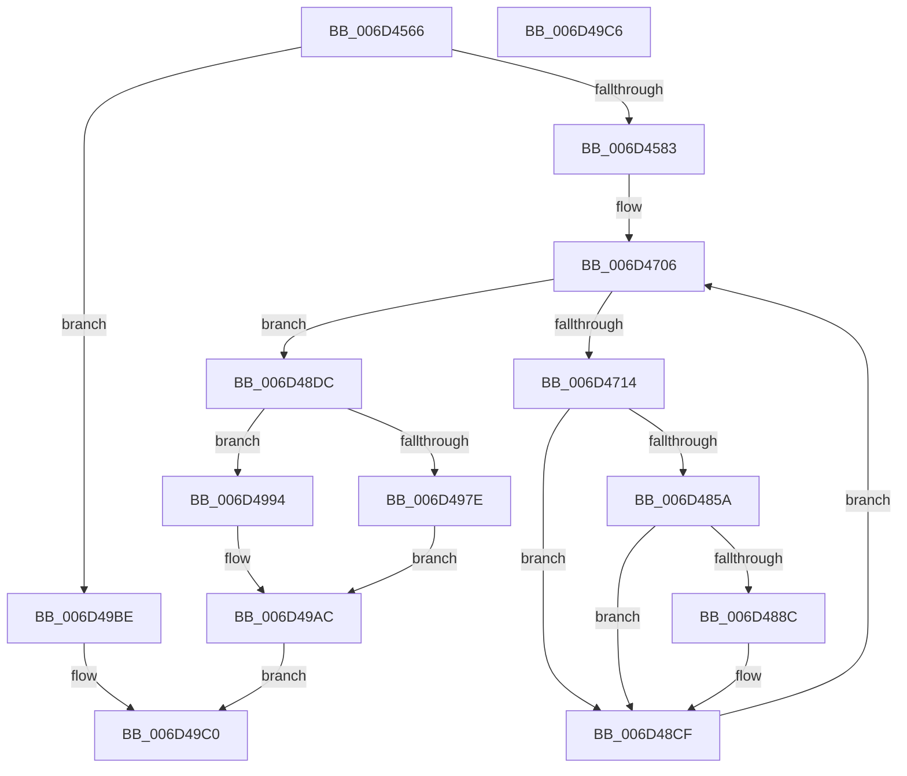

# CmpLazyFlushDpcRoutine$filt$1

- RVA: `0x006D4566`–`0x006D49C7` (길이 `1,121` bytes)
- VA: `0x00000001406D4566`
- 실행 섹션: `.text`
- PDB 이름 있음: `예`; PDB Function 태그: `예`
- unwind 정보 RVA: `0x000B77A8`
- 디코드: `253`개 명령, `1,121/1,121` bytes 표시
- 미해석 바이트: `0` (있으면 어셈블리에 `.byte`로 보존)

> 이 문서는 커널 이미지의 기계어와 PDB 기호를 분석해 생성했습니다. 4번과 5번은 함수 원형과 자료형을 바이너리 사용 방식에서 추정한 C 해석이며 원본 소스 복구 결과는 아닙니다.

## 1. Dependencies

- 직접 호출 지점: **2**; 고유 호출 대상: **2**
- 직접 호출자로 확인된 함수: **0**
- RIP 상대 이미지 참조: **2**

### Outgoing calls
- `0x006D498D` → [RtlpComputeEpilogueOffset](../51/RtlpComputeEpilogueOffset_function_0051C81C.md) (function, `0x0051C81C`)
- `0x006D49A6` → [guard_dispatch_icall](../6B/guard_dispatch_icall_function_006BAAD0.md) (function, `0x006BAAD0`)

### Direct callers
- 이 함수 시작 RVA로 연결되는 직접 call은 확인되지 않았습니다. 간접 호출은 완전히 역산할 수 없습니다.

### Static image references
- `0x006D474F` → RVA `0x00FC6F78` (`ALMOSTRO`; read)
- `0x006D4771` → RVA `0x00FC7250` (`ALMOSTRO`; read)

## 2. Other-region calls and transfers

- 다른 실행 섹션으로 향하는 call: **0**
- 별도 외부 분기/꼬리 이동을 확인하지 못했습니다.

## 3. Assembly (complete function range)

```asm
006D4566  40 55                           push rbp
006D4568  48 83 EC 30                     sub rsp, 0x30
006D456C  48 8B EA                        mov rbp, rdx
006D456F  8B 45 40                        mov eax, dword ptr [rbp + 0x40]
006D4572  FF C0                           inc eax
006D4574  89 45 40                        mov dword ptr [rbp + 0x40], eax
006D4577  8B 45 40                        mov eax, dword ptr [rbp + 0x40]
006D457A  83 F8 01                        cmp eax, 1
006D457D  0F 85 3B 04 00 00               jne 0x1406d49be
006D4583  48 8D 85 76 01 00 00            lea rax, [rbp + 0x176]
006D458A  48 89 85 D0 00 00 00            mov qword ptr [rbp + 0xd0], rax
006D4591  48 C7 85 A0 00 00 00 00 00 00 00  mov qword ptr [rbp + 0xa0], 0
006D459C  48 8B 85 D0 00 00 00            mov rax, qword ptr [rbp + 0xd0]
006D45A3  48 8B 08                        mov rcx, qword ptr [rax]
006D45A6  48 89 8D A0 00 00 00            mov qword ptr [rbp + 0xa0], rcx
006D45AD  48 8D 85 4E 01 00 00            lea rax, [rbp + 0x14e]
006D45B4  48 89 85 D8 00 00 00            mov qword ptr [rbp + 0xd8], rax
006D45BB  48 C7 85 98 00 00 00 00 00 00 00  mov qword ptr [rbp + 0x98], 0
006D45C6  48 8B 85 D8 00 00 00            mov rax, qword ptr [rbp + 0xd8]
006D45CD  48 8B 08                        mov rcx, qword ptr [rax]
006D45D0  48 89 8D 98 00 00 00            mov qword ptr [rbp + 0x98], rcx
006D45D7  48 8D 85 76 01 00 00            lea rax, [rbp + 0x176]
006D45DE  48 89 85 E0 00 00 00            mov qword ptr [rbp + 0xe0], rax
006D45E5  48 C7 85 B0 00 00 00 00 00 00 00  mov qword ptr [rbp + 0xb0], 0
006D45F0  48 8B 85 E0 00 00 00            mov rax, qword ptr [rbp + 0xe0]
006D45F7  48 8B 08                        mov rcx, qword ptr [rax]
006D45FA  48 89 8D B0 00 00 00            mov qword ptr [rbp + 0xb0], rcx
006D4601  48 8D 85 46 01 00 00            lea rax, [rbp + 0x146]
006D4608  48 89 85 E8 00 00 00            mov qword ptr [rbp + 0xe8], rax
006D460F  48 C7 85 A8 00 00 00 00 00 00 00  mov qword ptr [rbp + 0xa8], 0
006D461A  48 8B 85 E8 00 00 00            mov rax, qword ptr [rbp + 0xe8]
006D4621  48 8B 08                        mov rcx, qword ptr [rax]
006D4624  48 89 8D A8 00 00 00            mov qword ptr [rbp + 0xa8], rcx
006D462B  48 8B 85 98 00 00 00            mov rax, qword ptr [rbp + 0x98]
006D4632  8B 8D A0 00 00 00               mov ecx, dword ptr [rbp + 0xa0]
006D4638  48 D3 C8                        ror rax, cl
006D463B  48 89 85 F0 00 00 00            mov qword ptr [rbp + 0xf0], rax
006D4642  48 8B 85 A8 00 00 00            mov rax, qword ptr [rbp + 0xa8]
006D4649  8B 8D B0 00 00 00               mov ecx, dword ptr [rbp + 0xb0]
006D464F  48 D3 C0                        rol rax, cl
006D4652  48 89 85 C0 00 00 00            mov qword ptr [rbp + 0xc0], rax
006D4659  C7 45 70 00 00 00 00            mov dword ptr [rbp + 0x70], 0
006D4660  48 8B 85 C0 00 00 00            mov rax, qword ptr [rbp + 0xc0]
006D4667  48 8B 48 40                     mov rcx, qword ptr [rax + 0x40]
006D466B  48 89 4D 38                     mov qword ptr [rbp + 0x38], rcx
006D466F  48 8B 4D 38                     mov rcx, qword ptr [rbp + 0x38]
006D4673  48 8B 85 F0 00 00 00            mov rax, qword ptr [rbp + 0xf0]
006D467A  48 33 C8                        xor rcx, rax
006D467D  48 89 8D 90 00 00 00            mov qword ptr [rbp + 0x90], rcx
006D4684  48 8B 85 90 00 00 00            mov rax, qword ptr [rbp + 0x90]
006D468B  48 B9 00 00 00 00 00 80 FF FF   movabs rcx, 0xffff800000000000
006D4695  48 0B C1                        or rax, rcx
006D4698  48 89 85 90 00 00 00            mov qword ptr [rbp + 0x90], rax
006D469F  48 8B 85 90 00 00 00            mov rax, qword ptr [rbp + 0x90]
006D46A6  48 89 45 48                     mov qword ptr [rbp + 0x48], rax
006D46AA  48 8B 45 48                     mov rax, qword ptr [rbp + 0x48]
006D46AE  48 89 45 50                     mov qword ptr [rbp + 0x50], rax
006D46B2  48 8B 45 48                     mov rax, qword ptr [rbp + 0x48]
006D46B6  83 E0 3F                        and eax, 0x3f
006D46B9  B9 40 00 00 00                  mov ecx, 0x40
006D46BE  2B C8                           sub ecx, eax
006D46C0  48 8B 55 48                     mov rdx, qword ptr [rbp + 0x48]
006D46C4  48 D3 E2                        shl rdx, cl
006D46C7  48 8B 4D 48                     mov rcx, qword ptr [rbp + 0x48]
006D46CB  83 E1 3F                        and ecx, 0x3f
006D46CE  48 8B 45 48                     mov rax, qword ptr [rbp + 0x48]
006D46D2  48 D3 E8                        shr rax, cl
006D46D5  48 0B C2                        or rax, rdx
006D46D8  48 89 45 38                     mov qword ptr [rbp + 0x38], rax
006D46DC  8B 45 70                        mov eax, dword ptr [rbp + 0x70]
006D46DF  24 03                           and al, 3
006D46E1  F6 D8                           neg al
006D46E3  48 1B C9                        sbb rcx, rcx
006D46E6  48 F7 D1                        not rcx
006D46E9  B8 A4 6B 00 E0                  mov eax, 0xe0006ba4
006D46EE  48 23 C8                        and rcx, rax
006D46F1  48 89 8D 08 01 00 00            mov qword ptr [rbp + 0x108], rcx
006D46F8  C7 45 5C 19 00 00 00            mov dword ptr [rbp + 0x5c], 0x19
006D46FF  C7 45 30 00 00 00 00            mov dword ptr [rbp + 0x30], 0
006D4706  8B 4D 30                        mov ecx, dword ptr [rbp + 0x30]
006D4709  8B 45 5C                        mov eax, dword ptr [rbp + 0x5c]
006D470C  3B C8                           cmp ecx, eax
006D470E  0F 83 C8 01 00 00               jae 0x1406d48dc
006D4714  48 8B 45 50                     mov rax, qword ptr [rbp + 0x50]
006D4718  48 8B 08                        mov rcx, qword ptr [rax]
006D471B  48 89 4D 78                     mov qword ptr [rbp + 0x78], rcx
006D471F  48 8B 45 38                     mov rax, qword ptr [rbp + 0x38]
006D4723  48 89 85 00 01 00 00            mov qword ptr [rbp + 0x100], rax
006D472A  48 8B 45 50                     mov rax, qword ptr [rbp + 0x50]
006D472E  48 8B 08                        mov rcx, qword ptr [rax]
006D4731  48 89 8D F8 00 00 00            mov qword ptr [rbp + 0xf8], rcx
006D4738  48 C7 45 60 00 00 00 00         mov qword ptr [rbp + 0x60], 0
006D4740  48 8B 85 F8 00 00 00            mov rax, qword ptr [rbp + 0xf8]
006D4747  48 89 45 60                     mov qword ptr [rbp + 0x60], rax
006D474B  48 8B 45 60                     mov rax, qword ptr [rbp + 0x60]
006D474F  48 8B 0D 22 28 8F 00            mov rcx, qword ptr [rip + 0x8f2822]
006D4756  48 33 C1                        xor rax, rcx
006D4759  48 D3 C0                        rol rax, cl
006D475C  48 89 45 60                     mov qword ptr [rbp + 0x60], rax
006D4760  48 8B 4D 60                     mov rcx, qword ptr [rbp + 0x60]
006D4764  48 8B 85 00 01 00 00            mov rax, qword ptr [rbp + 0x100]
006D476B  48 33 C8                        xor rcx, rax
006D476E  48 0F C9                        bswap rcx
006D4771  48 33 0D D8 2A 8F 00            xor rcx, qword ptr [rip + 0x8f2ad8]
006D4778  48 89 4D 60                     mov qword ptr [rbp + 0x60], rcx
006D477C  48 8B 4D 50                     mov rcx, qword ptr [rbp + 0x50]
006D4780  48 8B 45 60                     mov rax, qword ptr [rbp + 0x60]
006D4784  48 89 01                        mov qword ptr [rcx], rax
006D4787  8B 55 30                        mov edx, dword ptr [rbp + 0x30]
006D478A  48 8B 45 50                     mov rax, qword ptr [rbp + 0x50]
006D478E  48 8B 00                        mov rax, qword ptr [rax]
006D4791  48 03 C2                        add rax, rdx
006D4794  48 8B 4D 48                     mov rcx, qword ptr [rbp + 0x48]
006D4798  48 03 C8                        add rcx, rax
006D479B  48 8B 45 50                     mov rax, qword ptr [rbp + 0x50]
006D479F  48 89 08                        mov qword ptr [rax], rcx
006D47A2  48 8B 45 78                     mov rax, qword ptr [rbp + 0x78]
006D47A6  F7 D0                           not eax
006D47A8  83 E0 3F                        and eax, 0x3f
006D47AB  B9 40 00 00 00                  mov ecx, 0x40
006D47B0  2B C8                           sub ecx, eax
006D47B2  8B 45 30                        mov eax, dword ptr [rbp + 0x30]
006D47B5  41 B8 C8 00 00 00               mov r8d, 0xc8
006D47BB  44 2B C0                        sub r8d, eax
006D47BE  44 8B 4D 30                     mov r9d, dword ptr [rbp + 0x30]
006D47C2  4D 33 C8                        xor r9, r8
006D47C5  49 D3 E1                        shl r9, cl
006D47C8  8B 45 30                        mov eax, dword ptr [rbp + 0x30]
006D47CB  BA C8 00 00 00                  mov edx, 0xc8
006D47D0  2B D0                           sub edx, eax
006D47D2  44 8B 45 30                     mov r8d, dword ptr [rbp + 0x30]
006D47D6  4C 33 C2                        xor r8, rdx
006D47D9  48 8B 4D 78                     mov rcx, qword ptr [rbp + 0x78]
006D47DD  F7 D1                           not ecx
006D47DF  83 E1 3F                        and ecx, 0x3f
006D47E2  49 D3 E8                        shr r8, cl
006D47E5  4D 0B C1                        or r8, r9
006D47E8  48 8B 45 38                     mov rax, qword ptr [rbp + 0x38]
006D47EC  49 33 C0                        xor rax, r8
006D47EF  48 89 45 38                     mov qword ptr [rbp + 0x38], rax
006D47F3  48 8B 45 78                     mov rax, qword ptr [rbp + 0x78]
006D47F7  83 F0 FA                        xor eax, 0xfffffffa
006D47FA  83 E0 3F                        and eax, 0x3f
006D47FD  B9 40 00 00 00                  mov ecx, 0x40
006D4802  2B C8                           sub ecx, eax
006D4804  48 8B 55 38                     mov rdx, qword ptr [rbp + 0x38]
006D4808  48 D3 EA                        shr rdx, cl
006D480B  48 8B 4D 78                     mov rcx, qword ptr [rbp + 0x78]
006D480F  83 F1 FA                        xor ecx, 0xfffffffa
006D4812  83 E1 3F                        and ecx, 0x3f
006D4815  48 8B 45 38                     mov rax, qword ptr [rbp + 0x38]
006D4819  48 D3 E0                        shl rax, cl
006D481C  48 0B C2                        or rax, rdx
006D481F  48 89 45 38                     mov qword ptr [rbp + 0x38], rax
006D4823  48 8B 4D 48                     mov rcx, qword ptr [rbp + 0x48]
006D4827  48 8B 45 38                     mov rax, qword ptr [rbp + 0x38]
006D482B  48 03 C8                        add rcx, rax
006D482E  48 89 4D 38                     mov qword ptr [rbp + 0x38], rcx
006D4832  48 8B 8D 08 01 00 00            mov rcx, qword ptr [rbp + 0x108]
006D4839  48 8B 45 38                     mov rax, qword ptr [rbp + 0x38]
006D483D  48 33 C8                        xor rcx, rax
006D4840  48 89 4D 38                     mov qword ptr [rbp + 0x38], rcx
006D4844  48 8B 45 50                     mov rax, qword ptr [rbp + 0x50]
006D4848  48 83 C0 08                     add rax, 8
006D484C  48 89 45 50                     mov qword ptr [rbp + 0x50], rax
006D4850  8B 45 30                        mov eax, dword ptr [rbp + 0x30]
006D4853  FF C0                           inc eax
006D4855  83 F8 19                        cmp eax, 0x19
006D4858  75 75                           jne 0x1406d48cf
006D485A  48 B8 41 8A 89 40 8A 89 42 70   movabs rax, 0x7042898a40898a41
006D4864  48 89 45 68                     mov qword ptr [rbp + 0x68], rax
006D4868  48 8B 4D 68                     mov rcx, qword ptr [rbp + 0x68]
006D486C  48 C1 E9 3B                     shr rcx, 0x3b
006D4870  48 8B 45 68                     mov rax, qword ptr [rbp + 0x68]
006D4874  48 C1 E0 05                     shl rax, 5
006D4878  48 0B C1                        or rax, rcx
006D487B  48 89 45 68                     mov qword ptr [rbp + 0x68], rax
006D487F  48 8B 4D 68                     mov rcx, qword ptr [rbp + 0x68]
006D4883  48 8B 45 48                     mov rax, qword ptr [rbp + 0x48]
006D4887  48 33 08                        xor rcx, qword ptr [rax]
006D488A  74 43                           je 0x1406d48cf
006D488C  48 8B 45 50                     mov rax, qword ptr [rbp + 0x50]
006D4890  48 8B 4D 68                     mov rcx, qword ptr [rbp + 0x68]
006D4894  48 33 48 F8                     xor rcx, qword ptr [rax - 8]
006D4898  48 8B 45 48                     mov rax, qword ptr [rbp + 0x48]
006D489C  48 33 08                        xor rcx, qword ptr [rax]
006D489F  48 8B 45 50                     mov rax, qword ptr [rbp + 0x50]
006D48A3  48 89 48 F8                     mov qword ptr [rax - 8], rcx
006D48A7  48 8B 4D 50                     mov rcx, qword ptr [rbp + 0x50]
006D48AB  8B 45 5C                        mov eax, dword ptr [rbp + 0x5c]
006D48AE  03 41 FC                        add eax, dword ptr [rcx - 4]
006D48B1  89 45 5C                        mov dword ptr [rbp + 0x5c], eax
006D48B4  48 8B 45 50                     mov rax, qword ptr [rbp + 0x50]
006D48B8  48 8B 4D 68                     mov rcx, qword ptr [rbp + 0x68]
006D48BC  48 33 48 F8                     xor rcx, qword ptr [rax - 8]
006D48C0  48 8B 45 48                     mov rax, qword ptr [rbp + 0x48]
006D48C4  48 33 08                        xor rcx, qword ptr [rax]
006D48C7  48 8B 45 50                     mov rax, qword ptr [rbp + 0x50]
006D48CB  48 89 48 F8                     mov qword ptr [rax - 8], rcx
006D48CF  8B 45 30                        mov eax, dword ptr [rbp + 0x30]
006D48D2  FF C0                           inc eax
006D48D4  89 45 30                        mov dword ptr [rbp + 0x30], eax
006D48D7  E9 2A FE FF FF                  jmp 0x1406d4706
006D48DC  48 8B 45 48                     mov rax, qword ptr [rbp + 0x48]
006D48E0  48 BA F5 6F 1B AD 5F 93 44 62   movabs rdx, 0x6244935fad1b6ff5
006D48EA  48 8B 08                        mov rcx, qword ptr [rax]
006D48ED  48 33 CA                        xor rcx, rdx
006D48F0  48 89 8D 10 01 00 00            mov qword ptr [rbp + 0x110], rcx
006D48F7  48 8B 85 10 01 00 00            mov rax, qword ptr [rbp + 0x110]
006D48FE  48 89 45 38                     mov qword ptr [rbp + 0x38], rax
006D4902  48 8D 45 38                     lea rax, [rbp + 0x38]
006D4906  48 89 85 18 01 00 00            mov qword ptr [rbp + 0x118], rax
006D490D  48 C7 85 B8 00 00 00 00 00 00 00  mov qword ptr [rbp + 0xb8], 0
006D4918  48 8B 85 18 01 00 00            mov rax, qword ptr [rbp + 0x118]
006D491F  48 8B 08                        mov rcx, qword ptr [rax]
006D4922  48 89 8D B8 00 00 00            mov qword ptr [rbp + 0xb8], rcx
006D4929  48 8B 85 B8 00 00 00            mov rax, qword ptr [rbp + 0xb8]
006D4930  48 B9 DB 27 2A BC 17 A2 15 6A   movabs rcx, 0x6a15a217bc2a27db
006D493A  48 33 C1                        xor rax, rcx
006D493D  48 89 45 38                     mov qword ptr [rbp + 0x38], rax
006D4941  48 8B 45 48                     mov rax, qword ptr [rbp + 0x48]
006D4945  48 89 85 80 00 00 00            mov qword ptr [rbp + 0x80], rax
006D494C  48 8B 85 80 00 00 00            mov rax, qword ptr [rbp + 0x80]
006D4953  C6 00 2E                        mov byte ptr [rax], 0x2e
006D4956  48 8B 85 80 00 00 00            mov rax, qword ptr [rbp + 0x80]
006D495D  C6 40 01 48                     mov byte ptr [rax + 1], 0x48
006D4961  48 8B 85 80 00 00 00            mov rax, qword ptr [rbp + 0x80]
006D4968  C6 40 02 31                     mov byte ptr [rax + 2], 0x31
006D496C  48 8B 85 80 00 00 00            mov rax, qword ptr [rbp + 0x80]
006D4973  C6 40 03 11                     mov byte ptr [rax + 3], 0x11
006D4977  8B 45 70                        mov eax, dword ptr [rbp + 0x70]
006D497A  A8 01                           test al, 1
006D497C  74 16                           je 0x1406d4994
006D497E  4C 8B 45 38                     mov r8, qword ptr [rbp + 0x38]
006D4982  48 8B 55 48                     mov rdx, qword ptr [rbp + 0x48]
006D4986  48 8B 8D C0 00 00 00            mov rcx, qword ptr [rbp + 0xc0]
006D498D  E8 8A 7E E4 FF                  call 0x14051c81c
006D4992  EB 18                           jmp 0x1406d49ac
006D4994  48 8B 45 48                     mov rax, qword ptr [rbp + 0x48]
006D4998  45 33 C9                        xor r9d, r9d
006D499B  45 33 C0                        xor r8d, r8d
006D499E  48 8B 55 38                     mov rdx, qword ptr [rbp + 0x38]
006D49A2  48 8B 4D 48                     mov rcx, qword ptr [rbp + 0x48]
006D49A6  E8 25 61 FE FF                  call 0x1406baad0
006D49AB  90                              nop
006D49AC  C7 85 88 00 00 00 01 00 00 00   mov dword ptr [rbp + 0x88], 1
006D49B6  8B 85 88 00 00 00               mov eax, dword ptr [rbp + 0x88]
006D49BC  EB 02                           jmp 0x1406d49c0
006D49BE  33 C0                           xor eax, eax
006D49C0  48 83 C4 30                     add rsp, 0x30
006D49C4  5D                              pop rbp
006D49C5  C3                              ret
006D49C6  CC                              int3
```

## 4. C-style interpretation (structured pseudocode)

```c
__int64 __fastcall CmpLazyFlushDpcRoutine_filt_1(__int64 a1, __int64 a2)
{
    __int64 result;
    __int64 v_rsp;

    v_rsp = (v_rsp) - (48);
    result = (unsigned int)(((unsigned int)(*(unsigned int *)(a2 + 64))) + 1);
    *(unsigned int *)(a2 + 64) = (unsigned int)(result);
    if (((unsigned int)((unsigned int)(*(unsigned int *)(a2 + 64)))) != 1) goto loc_006D49BE;
    *(unsigned __int64 *)(a2 + 208) = a2 + 374;
    *(unsigned __int64 *)(a2 + 160) = 0;
    *(unsigned __int64 *)(a2 + 160) = *(unsigned __int64 *)(*(unsigned __int64 *)(a2 + 208));
    *(unsigned __int64 *)(a2 + 216) = a2 + 334;
    *(unsigned __int64 *)(a2 + 152) = 0;
    *(unsigned __int64 *)(a2 + 152) = *(unsigned __int64 *)(*(unsigned __int64 *)(a2 + 216));
    *(unsigned __int64 *)(a2 + 224) = a2 + 374;
    *(unsigned __int64 *)(a2 + 176) = 0;
    *(unsigned __int64 *)(a2 + 176) = *(unsigned __int64 *)(*(unsigned __int64 *)(a2 + 224));
    *(unsigned __int64 *)(a2 + 232) = a2 + 326;
    *(unsigned __int64 *)(a2 + 168) = 0;
    *(unsigned __int64 *)(a2 + 168) = *(unsigned __int64 *)(*(unsigned __int64 *)(a2 + 232));
    *(unsigned __int64 *)(a2 + 240) = *(unsigned __int64 *)(a2 + 152);
    *(unsigned __int64 *)(a2 + 192) = *(unsigned __int64 *)(a2 + 168);
    *(unsigned int *)(a2 + 112) = 0;
    *(unsigned __int64 *)(a2 + 56) = *(unsigned __int64 *)(*(unsigned __int64 *)(a2 + 192) + 64);
    a1 = (*(unsigned __int64 *)(a2 + 56)) ^ (*(unsigned __int64 *)(a2 + 240));
    *(unsigned __int64 *)(a2 + 144) = a1;
    result = (*(unsigned __int64 *)(a2 + 144)) | (a1);
    *(unsigned __int64 *)(a2 + 144) = result;
    *(unsigned __int64 *)(a2 + 72) = *(unsigned __int64 *)(a2 + 144);
    *(unsigned __int64 *)(a2 + 80) = *(unsigned __int64 *)(a2 + 72);
    result = (unsigned int)((*(unsigned __int64 *)(a2 + 72)) & (63));
    a1 = (unsigned int)((64) - ((unsigned int)(result)));
    a2 = (*(unsigned __int64 *)(a2 + 72)) << ((unsigned __int8)(a1));
    a1 = (unsigned int)((*(unsigned __int64 *)(a2 + 72)) & (63));
    result = (*(unsigned __int64 *)(a2 + 72)) >> ((unsigned __int8)(a1));
    result = (result) | (a2);
    *(unsigned __int64 *)(a2 + 56) = result;
    result = (unsigned __int8)(((unsigned int)(*(unsigned int *)(a2 + 112))) & (3));
    result = (unsigned __int8)(-(result));
    a1 = ~(a1);
    a1 = (a1) & ((unsigned int)(0xE0006BA4ULL));
    *(unsigned __int64 *)(a2 + 264) = a1;
    *(unsigned int *)(a2 + 92) = 25;
    *(unsigned int *)(a2 + 48) = 0;
loc_006D4706:
    if (((unsigned int)((unsigned int)(*(unsigned int *)(a2 + 48)))) >= ((unsigned int)((unsigned int)(*(unsigned int *)(a2 + 92))))) goto loc_006D48DC;
    *(unsigned __int64 *)(a2 + 120) = *(unsigned __int64 *)(*(unsigned __int64 *)(a2 + 80));
    *(unsigned __int64 *)(a2 + 256) = *(unsigned __int64 *)(a2 + 56);
    *(unsigned __int64 *)(a2 + 248) = *(unsigned __int64 *)(*(unsigned __int64 *)(a2 + 80));
    *(unsigned __int64 *)(a2 + 96) = 0;
    *(unsigned __int64 *)(a2 + 96) = *(unsigned __int64 *)(a2 + 248);
    result = (*(unsigned __int64 *)(a2 + 96)) ^ (*(unsigned __int64 *)(v_rip + 9381922));
    *(unsigned __int64 *)(a2 + 96) = result;
    a1 = (*(unsigned __int64 *)(a2 + 96)) ^ (*(unsigned __int64 *)(a2 + 256));
    a1 = (a1) ^ (*(unsigned __int64 *)(v_rip + 9382616));
    *(unsigned __int64 *)(a2 + 96) = a1;
    *(unsigned __int64 *)(*(unsigned __int64 *)(a2 + 80)) = *(unsigned __int64 *)(a2 + 96);
    result = (*(unsigned __int64 *)(*(unsigned __int64 *)(a2 + 80))) + ((unsigned int)(*(unsigned int *)(a2 + 48)));
    a1 = (*(unsigned __int64 *)(a2 + 72)) + (result);
    *(unsigned __int64 *)(*(unsigned __int64 *)(a2 + 80)) = a1;
    result = (unsigned int)(~(*(unsigned __int64 *)(a2 + 120)));
    result = (unsigned int)((result) & (63));
    a1 = (unsigned int)((64) - ((unsigned int)(result)));
    a3 = (unsigned int)((200) - ((unsigned int)((unsigned int)(*(unsigned int *)(a2 + 48)))));
    a4 = ((unsigned int)(*(unsigned int *)(a2 + 48))) ^ (a3);
    a4 = (a4) << ((unsigned __int8)(a1));
    a2 = (unsigned int)((200) - ((unsigned int)((unsigned int)(*(unsigned int *)(a2 + 48)))));
    a3 = ((unsigned int)(*(unsigned int *)(a2 + 48))) ^ (a2);
    a1 = (unsigned int)(~(*(unsigned __int64 *)(a2 + 120)));
    a1 = (unsigned int)((a1) & (63));
    a3 = (a3) >> ((unsigned __int8)(a1));
    a3 = (a3) | (a4);
    result = (*(unsigned __int64 *)(a2 + 56)) ^ (a3);
    *(unsigned __int64 *)(a2 + 56) = result;
    result = (unsigned int)((*(unsigned __int64 *)(a2 + 120)) ^ (0xFFFFFFFAULL));
    result = (unsigned int)((result) & (63));
    a1 = (unsigned int)((64) - ((unsigned int)(result)));
    a2 = (*(unsigned __int64 *)(a2 + 56)) >> ((unsigned __int8)(a1));
    a1 = (unsigned int)((*(unsigned __int64 *)(a2 + 120)) ^ (0xFFFFFFFAULL));
    a1 = (unsigned int)((a1) & (63));
    result = (*(unsigned __int64 *)(a2 + 56)) << ((unsigned __int8)(a1));
    result = (result) | (a2);
    *(unsigned __int64 *)(a2 + 56) = result;
    a1 = (*(unsigned __int64 *)(a2 + 72)) + (*(unsigned __int64 *)(a2 + 56));
    *(unsigned __int64 *)(a2 + 56) = a1;
    a1 = (*(unsigned __int64 *)(a2 + 264)) ^ (*(unsigned __int64 *)(a2 + 56));
    *(unsigned __int64 *)(a2 + 56) = a1;
    result = (*(unsigned __int64 *)(a2 + 80)) + (8);
    *(unsigned __int64 *)(a2 + 80) = result;
    result = (unsigned int)(((unsigned int)(*(unsigned int *)(a2 + 48))) + 1);
    if (((unsigned int)(result)) != 25) goto loc_006D48CF;
    *(unsigned __int64 *)(a2 + 104) = result;
    a1 = (*(unsigned __int64 *)(a2 + 104)) >> (59);
    result = (*(unsigned __int64 *)(a2 + 104)) << (5);
    result = (result) | (a1);
    *(unsigned __int64 *)(a2 + 104) = result;
    a1 = (*(unsigned __int64 *)(a2 + 104)) ^ (*(unsigned __int64 *)(*(unsigned __int64 *)(a2 + 72)));
    result = *(unsigned __int64 *)(a2 + 72);
    if (!(condition_is_equal)) {
        result = *(unsigned __int64 *)(a2 + 80);
        a1 = *(unsigned __int64 *)(a2 + 104);
        a1 = (a1) ^ (*(unsigned __int64 *)(result - 8));
        result = *(unsigned __int64 *)(a2 + 72);
        a1 = (a1) ^ (*(unsigned __int64 *)(result));
        result = *(unsigned __int64 *)(a2 + 80);
        *(unsigned __int64 *)(result - 8) = a1;
        a1 = *(unsigned __int64 *)(a2 + 80);
        result = *(unsigned int *)(a2 + 92);
        result = (unsigned int)((result) + (*(unsigned int *)(a1 - 4)));
        *(unsigned int *)(a2 + 92) = (unsigned int)(result);
        result = *(unsigned __int64 *)(a2 + 80);
        a1 = *(unsigned __int64 *)(a2 + 104);
        a1 = (a1) ^ (*(unsigned __int64 *)(result - 8));
        result = *(unsigned __int64 *)(a2 + 72);
        a1 = (a1) ^ (*(unsigned __int64 *)(result));
        result = *(unsigned __int64 *)(a2 + 80);
        *(unsigned __int64 *)(result - 8) = a1;
    }
    result = (unsigned int)(((unsigned int)(*(unsigned int *)(a2 + 48))) + 1);
    *(unsigned int *)(a2 + 48) = (unsigned int)(result);
    goto loc_006D4706;
loc_006D48DC:
    a1 = (*(unsigned __int64 *)(*(unsigned __int64 *)(a2 + 72))) ^ (a2);
    *(unsigned __int64 *)(a2 + 272) = a1;
    *(unsigned __int64 *)(a2 + 56) = *(unsigned __int64 *)(a2 + 272);
    *(unsigned __int64 *)(a2 + 280) = a2 + 56;
    *(unsigned __int64 *)(a2 + 184) = 0;
    *(unsigned __int64 *)(a2 + 184) = *(unsigned __int64 *)(*(unsigned __int64 *)(a2 + 280));
    result = (*(unsigned __int64 *)(a2 + 184)) ^ (*(unsigned __int64 *)(*(unsigned __int64 *)(a2 + 280)));
    *(unsigned __int64 *)(a2 + 56) = result;
    *(unsigned __int64 *)(a2 + 128) = *(unsigned __int64 *)(a2 + 72);
    *(unsigned __int8 *)(*(unsigned __int64 *)(a2 + 128)) = 46;
    *(unsigned __int8 *)(*(unsigned __int64 *)(a2 + 128) + 1) = 72;
    *(unsigned __int8 *)(*(unsigned __int64 *)(a2 + 128) + 2) = 49;
    *(unsigned __int8 *)(*(unsigned __int64 *)(a2 + 128) + 3) = 17;
    if ((((unsigned __int8)((unsigned int)(*(unsigned int *)(a2 + 112)))) & (1)) == 0) goto loc_006D4994;
    result = RtlpComputeEpilogueOffset(*(unsigned __int64 *)(a2 + 192), *(unsigned __int64 *)(a2 + 72), *(unsigned __int64 *)(a2 + 56), a4);
    goto loc_006D49AC;
loc_006D4994:
    a4 = 0;
    a3 = 0;
    result = guard_dispatch_icall(*(unsigned __int64 *)(a2 + 72), *(unsigned __int64 *)(a2 + 56), a3, a4);
loc_006D49AC:
    *(unsigned int *)(a2 + 136) = 1;
    goto loc_006D49C0;
loc_006D49BE:
    result = 0;
loc_006D49C0:
    v_rsp = (v_rsp) + (48);
    return result;
}
```

## 5. (Beta) C Style

```c
int64_t CmpLazyFlushDpcRoutine_filt_1(int64_t Arg1, void *Arg2)
{
    uint8_t *arg2 = (uint8_t *)Arg2;

    int64_t result;
    int64_t local_rsp;

    local_rsp = (local_rsp) - (48);
    result = (uint32_t)(((uint32_t)(*(uint32_t *)(arg2 + 0x40))) + 1);
    *(uint32_t *)(arg2 + 0x40) = (uint32_t)(result);
    if (((uint32_t)((uint32_t)(*(uint32_t *)(arg2 + 0x40)))) != 1) goto loc_006D49BE;
    *(void **)(arg2 + 0xD0) = Arg2 + 374;
    *(uint64_t *)(arg2 + 0xA0) = 0;
    *(uint64_t *)(arg2 + 0xA0) = *(uint64_t *)(*(uint64_t *)(arg2 + 0xD0));
    *(void **)(arg2 + 0xD8) = Arg2 + 334;
    *(uint64_t *)(arg2 + 0x98) = 0;
    *(uint64_t *)(arg2 + 0x98) = *(uint64_t *)(*(uint64_t *)(arg2 + 0xD8));
    *(void **)(arg2 + 0xE0) = Arg2 + 374;
    *(uint64_t *)(arg2 + 0xB0) = 0;
    *(uint64_t *)(arg2 + 0xB0) = *(uint64_t *)(*(uint64_t *)(arg2 + 0xE0));
    *(void **)(arg2 + 0xE8) = Arg2 + 326;
    *(uint64_t *)(arg2 + 0xA8) = 0;
    *(uint64_t *)(arg2 + 0xA8) = *(uint64_t *)(*(uint64_t *)(arg2 + 0xE8));
    *(uint64_t *)(arg2 + 0xF0) = *(uint64_t *)(arg2 + 0x98);
    *(uint64_t *)(arg2 + 0xC0) = *(uint64_t *)(arg2 + 0xA8);
    *(uint32_t *)(arg2 + 0x70) = 0;
    *(uint64_t *)(arg2 + 0x38) = *(uint64_t *)(*(uint64_t *)(arg2 + 0xC0) + 0x40);
    Arg1 = (*(uint64_t *)(arg2 + 0x38)) ^ (*(uint64_t *)(arg2 + 0xF0));
    *(uint64_t *)(arg2 + 0x90) = Arg1;
    result = (*(uint64_t *)(arg2 + 0x90)) | (Arg1);
    *(uint64_t *)(arg2 + 0x90) = result;
    *(uint64_t *)(arg2 + 0x48) = *(uint64_t *)(arg2 + 0x90);
    *(uint64_t *)(arg2 + 0x50) = *(uint64_t *)(arg2 + 0x48);
    result = (uint32_t)((*(uint64_t *)(arg2 + 0x48)) & (63));
    Arg1 = (uint32_t)((64) - ((uint32_t)(result)));
    Arg2 = (*(uint64_t *)(arg2 + 0x48)) << ((uint8_t)(Arg1));
    Arg1 = (uint32_t)((*(uint64_t *)(arg2 + 0x48)) & (63));
    result = (*(uint64_t *)(arg2 + 0x48)) >> ((uint8_t)(Arg1));
    result = (result) | (Arg2);
    *(uint64_t *)(arg2 + 0x38) = result;
    result = (uint8_t)(((uint32_t)(*(uint32_t *)(arg2 + 0x70))) & (3));
    result = (uint8_t)(-(result));
    Arg1 = ~(Arg1);
    Arg1 = (Arg1) & ((uint32_t)(0xE0006BA4ULL));
    *(uint64_t *)(arg2 + 0x108) = Arg1;
    *(uint32_t *)(arg2 + 0x5C) = 25;
    *(uint32_t *)(arg2 + 0x30) = 0;
loc_006D4706:
    if (((uint32_t)((uint32_t)(*(uint32_t *)(arg2 + 0x30)))) >= ((uint32_t)((uint32_t)(*(uint32_t *)(arg2 + 0x5C))))) goto loc_006D48DC;
    *(uint64_t *)(arg2 + 0x78) = *(uint64_t *)(*(uint64_t *)(arg2 + 0x50));
    *(uint64_t *)(arg2 + 0x100) = *(uint64_t *)(arg2 + 0x38);
    *(uint64_t *)(arg2 + 0xF8) = *(uint64_t *)(*(uint64_t *)(arg2 + 0x50));
    *(uint64_t *)(arg2 + 0x60) = 0;
    *(uint64_t *)(arg2 + 0x60) = *(uint64_t *)(arg2 + 0xF8);
    result = (*(uint64_t *)(arg2 + 0x60)) ^ (*(uint64_t *)(v_rip + 0x8F2822));
    *(uint64_t *)(arg2 + 0x60) = result;
    Arg1 = (*(uint64_t *)(arg2 + 0x60)) ^ (*(uint64_t *)(arg2 + 0x100));
    Arg1 = (Arg1) ^ (*(uint64_t *)(v_rip + 0x8F2AD8));
    *(uint64_t *)(arg2 + 0x60) = Arg1;
    *(uint64_t *)(*(uint64_t *)(arg2 + 0x50)) = *(uint64_t *)(arg2 + 0x60);
    result = (*(uint64_t *)(*(uint64_t *)(arg2 + 0x50))) + ((uint32_t)(*(uint32_t *)(arg2 + 0x30)));
    Arg1 = (*(uint64_t *)(arg2 + 0x48)) + (result);
    *(uint64_t *)(*(uint64_t *)(arg2 + 0x50)) = Arg1;
    result = (uint32_t)(~(*(uint64_t *)(arg2 + 0x78)));
    result = (uint32_t)((result) & (63));
    Arg1 = (uint32_t)((64) - ((uint32_t)(result)));
    a3 = (uint32_t)((200) - ((uint32_t)((uint32_t)(*(uint32_t *)(arg2 + 0x30)))));
    a4 = ((uint32_t)(*(uint32_t *)(arg2 + 0x30))) ^ (a3);
    a4 = (a4) << ((uint8_t)(Arg1));
    Arg2 = (uint32_t)((200) - ((uint32_t)((uint32_t)(*(uint32_t *)(arg2 + 0x30)))));
    a3 = ((uint32_t)(*(uint32_t *)(arg2 + 0x30))) ^ (Arg2);
    Arg1 = (uint32_t)(~(*(uint64_t *)(arg2 + 0x78)));
    Arg1 = (uint32_t)((Arg1) & (63));
    a3 = (a3) >> ((uint8_t)(Arg1));
    a3 = (a3) | (a4);
    result = (*(uint64_t *)(arg2 + 0x38)) ^ (a3);
    *(uint64_t *)(arg2 + 0x38) = result;
    result = (uint32_t)((*(uint64_t *)(arg2 + 0x78)) ^ (0xFFFFFFFAULL));
    result = (uint32_t)((result) & (63));
    Arg1 = (uint32_t)((64) - ((uint32_t)(result)));
    Arg2 = (*(uint64_t *)(arg2 + 0x38)) >> ((uint8_t)(Arg1));
    Arg1 = (uint32_t)((*(uint64_t *)(arg2 + 0x78)) ^ (0xFFFFFFFAULL));
    Arg1 = (uint32_t)((Arg1) & (63));
    result = (*(uint64_t *)(arg2 + 0x38)) << ((uint8_t)(Arg1));
    result = (result) | (Arg2);
    *(uint64_t *)(arg2 + 0x38) = result;
    Arg1 = (*(uint64_t *)(arg2 + 0x48)) + (*(uint64_t *)(arg2 + 0x38));
    *(uint64_t *)(arg2 + 0x38) = Arg1;
    Arg1 = (*(uint64_t *)(arg2 + 0x108)) ^ (*(uint64_t *)(arg2 + 0x38));
    *(uint64_t *)(arg2 + 0x38) = Arg1;
    result = (*(uint64_t *)(arg2 + 0x50)) + (8);
    *(uint64_t *)(arg2 + 0x50) = result;
    result = (uint32_t)(((uint32_t)(*(uint32_t *)(arg2 + 0x30))) + 1);
    if (((uint32_t)(result)) != 25) goto loc_006D48CF;
    *(uint64_t *)(arg2 + 0x68) = result;
    Arg1 = (*(uint64_t *)(arg2 + 0x68)) >> (59);
    result = (*(uint64_t *)(arg2 + 0x68)) << (5);
    result = (result) | (Arg1);
    *(uint64_t *)(arg2 + 0x68) = result;
    Arg1 = (*(uint64_t *)(arg2 + 0x68)) ^ (*(uint64_t *)(*(uint64_t *)(arg2 + 0x48)));
    result = *(uint64_t *)(arg2 + 0x48);
    if (!(condition_is_equal)) {
        result = *(uint64_t *)(arg2 + 0x50);
        Arg1 = *(uint64_t *)(arg2 + 0x68);
        Arg1 = (Arg1) ^ (*(uint64_t *)(result - 0x8));
        result = *(uint64_t *)(arg2 + 0x48);
        Arg1 = (Arg1) ^ (*(uint64_t *)(result));
        result = *(uint64_t *)(arg2 + 0x50);
        *(uint64_t *)(result - 0x8) = Arg1;
        Arg1 = *(uint64_t *)(arg2 + 0x50);
        result = *(uint32_t *)(arg2 + 0x5C);
        result = (uint32_t)((result) + (*(uint32_t *)(Arg1 - 0x4)));
        *(uint32_t *)(arg2 + 0x5C) = (uint32_t)(result);
        result = *(uint64_t *)(arg2 + 0x50);
        Arg1 = *(uint64_t *)(arg2 + 0x68);
        Arg1 = (Arg1) ^ (*(uint64_t *)(result - 0x8));
        result = *(uint64_t *)(arg2 + 0x48);
        Arg1 = (Arg1) ^ (*(uint64_t *)(result));
        result = *(uint64_t *)(arg2 + 0x50);
        *(uint64_t *)(result - 0x8) = Arg1;
    }
    result = (uint32_t)(((uint32_t)(*(uint32_t *)(arg2 + 0x30))) + 1);
    *(uint32_t *)(arg2 + 0x30) = (uint32_t)(result);
    goto loc_006D4706;
loc_006D48DC:
    Arg1 = (*(uint64_t *)(*(uint64_t *)(arg2 + 0x48))) ^ (Arg2);
    *(uint64_t *)(arg2 + 0x110) = Arg1;
    *(uint64_t *)(arg2 + 0x38) = *(uint64_t *)(arg2 + 0x110);
    *(void **)(arg2 + 0x118) = Arg2 + 56;
    *(uint64_t *)(arg2 + 0xB8) = 0;
    *(uint64_t *)(arg2 + 0xB8) = *(uint64_t *)(*(uint64_t *)(arg2 + 0x118));
    result = (*(uint64_t *)(arg2 + 0xB8)) ^ (*(uint64_t *)(*(uint64_t *)(arg2 + 0x118)));
    *(uint64_t *)(arg2 + 0x38) = result;
    *(uint64_t *)(arg2 + 0x80) = *(uint64_t *)(arg2 + 0x48);
    *(uint8_t *)(*(uint64_t *)(arg2 + 0x80)) = 46;
    *(uint8_t *)(*(uint64_t *)(arg2 + 0x80) + 0x1) = 72;
    *(uint8_t *)(*(uint64_t *)(arg2 + 0x80) + 0x2) = 49;
    *(uint8_t *)(*(uint64_t *)(arg2 + 0x80) + 0x3) = 17;
    if ((((uint8_t)((uint32_t)(*(uint32_t *)(arg2 + 0x70)))) & (1)) == 0) goto loc_006D4994;
    result = RtlpComputeEpilogueOffset(*(uint64_t *)(arg2 + 0xC0), *(uint64_t *)(arg2 + 0x48), *(uint64_t *)(arg2 + 0x38), a4);
    goto loc_006D49AC;
loc_006D4994:
    a4 = 0;
    a3 = 0;
    result = guard_dispatch_icall(*(uint64_t *)(arg2 + 0x48), *(uint64_t *)(arg2 + 0x38), a3, a4);
loc_006D49AC:
    *(uint32_t *)(arg2 + 0x88) = 1;
    goto loc_006D49C0;
loc_006D49BE:
    result = 0;
loc_006D49C0:
    local_rsp = (local_rsp) + (48);
    return result;
}
```

### 관측된 메모리 오프셋

구조체 형식이 확인되지 않은 접근은 인자 기준의 오프셋으로만 기록했습니다.

| 기준 인자 | 오프셋 표현 | 폭 (bit) | 접근 |
|---|---:|---:|---|
| `Arg2` | `+ 0x30` | `32` | `R` |
| `Arg2` | `+ 0x30` | `32` | `W` |
| `Arg2` | `+ 0x38` | `64` | `R` |
| `Arg2` | `+ 0x38` | `64` | `W` |
| `Arg2` | `+ 0x40` | `32` | `R` |
| `Arg2` | `+ 0x40` | `32` | `W` |
| `Arg2` | `+ 0x48` | `64` | `R` |
| `Arg2` | `+ 0x48` | `64` | `W` |
| `Arg2` | `+ 0x50` | `64` | `R` |
| `Arg2` | `+ 0x50` | `64` | `W` |
| `Arg2` | `+ 0x5C` | `32` | `R` |
| `Arg2` | `+ 0x5C` | `32` | `W` |
| `Arg2` | `+ 0x60` | `64` | `R` |
| `Arg2` | `+ 0x60` | `64` | `W` |
| `Arg2` | `+ 0x68` | `64` | `R` |
| `Arg2` | `+ 0x68` | `64` | `W` |
| `Arg2` | `+ 0x70` | `32` | `R` |
| `Arg2` | `+ 0x70` | `32` | `W` |
| `Arg2` | `+ 0x78` | `64` | `R` |
| `Arg2` | `+ 0x78` | `64` | `W` |
| `Arg2` | `+ 0x80` | `64` | `R` |
| `Arg2` | `+ 0x80` | `64` | `W` |
| `Arg2` | `+ 0x88` | `32` | `R` |
| `Arg2` | `+ 0x88` | `32` | `W` |
| `Arg2` | `+ 0x90` | `64` | `R` |
| `Arg2` | `+ 0x90` | `64` | `W` |
| `Arg2` | `+ 0x98` | `64` | `R` |
| `Arg2` | `+ 0x98` | `64` | `W` |
| `Arg2` | `+ 0xA0` | `32` | `R` |
| `Arg2` | `+ 0xA0` | `64` | `W` |
| `Arg2` | `+ 0xA8` | `64` | `R` |
| `Arg2` | `+ 0xA8` | `64` | `W` |

추가 오프셋 29개는 표에서 생략했습니다.

## 6. Execution-region graph

[열기: 2D/3D 그래프와 함수 탐색 컨트롤 패널](../../../control-panel.html?section=text&rva=0x006D4566&view=graph)

- 2D 그래프는 위에서 아래로 흐르고, 3D 그래프는 빈 공간을 드래그해 회전합니다. Shift+드래그는 이동, 휠은 확대·축소, 함수 노드 선택은 대상 보고서 이동입니다.

### Static fallback


