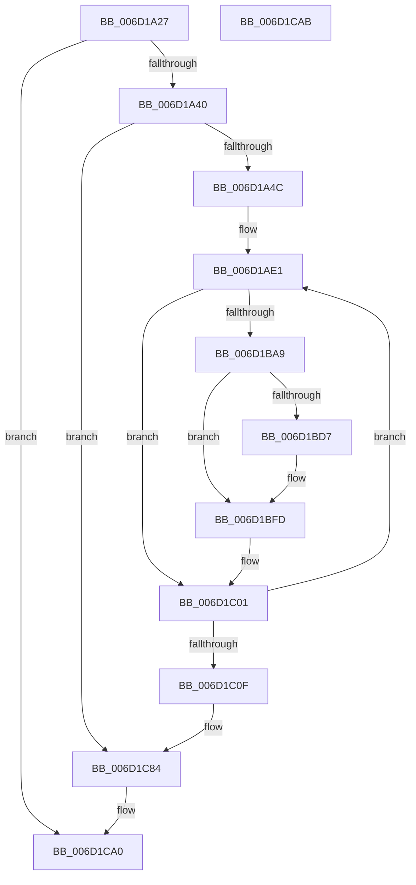

# ExpCenturyDpcRoutine$fin$0

- RVA: `0x006D1A27`–`0x006D1CAC` (길이 `645` bytes)
- VA: `0x00000001406D1A27`
- 실행 섹션: `.text`
- PDB 이름 있음: `예`; PDB Function 태그: `예`
- unwind 정보 RVA: `0x0005F7C0`
- 디코드: `173`개 명령, `645/645` bytes 표시
- 미해석 바이트: `0` (있으면 어셈블리에 `.byte`로 보존)

> 이 문서는 커널 이미지의 기계어와 PDB 기호를 분석해 생성했습니다. 4번과 5번은 함수 원형과 자료형을 바이너리 사용 방식에서 추정한 C 해석이며 원본 소스 복구 결과는 아닙니다.

## 1. Dependencies

- 직접 호출 지점: **2**; 고유 호출 대상: **2**
- 직접 호출자로 확인된 함수: **0**
- RIP 상대 이미지 참조: **3**

### Outgoing calls
- `0x006D1C5B` → [guard_dispatch_icall](../6B/guard_dispatch_icall_function_006BAAD0.md) (function, `0x006BAAD0`)
- `0x006D1C7E` → [local_unwind](../4F/local_unwind_function_004FFB40.md) (function, `0x004FFB40`)

### Direct callers
- 이 함수 시작 RVA로 연결되는 직접 call은 확인되지 않았습니다. 간접 호출은 완전히 역산할 수 없습니다.

### Static image references
- `0x006D1AEE` → RVA `0x00FC6F78` (`ALMOSTRO`; read)
- `0x006D1B01` → RVA `0x00FC7250` (`ALMOSTRO`; read)
- `0x006D1C70` → RVA `0x00223609` (`.text`; read)

## 2. Other-region calls and transfers

- 다른 실행 섹션으로 향하는 call: **0**
- 별도 외부 분기/꼬리 이동을 확인하지 못했습니다.

## 3. Assembly (complete function range)

```asm
006D1A27  40 53                           push rbx
006D1A29  55                              push rbp
006D1A2A  56                              push rsi
006D1A2B  57                              push rdi
006D1A2C  41 56                           push r14
006D1A2E  48 83 EC 30                     sub rsp, 0x30
006D1A32  48 8B EA                        mov rbp, rdx
006D1A35  88 4D 40                        mov byte ptr [rbp + 0x40], cl
006D1A38  84 C9                           test cl, cl
006D1A3A  0F 84 60 02 00 00               je 0x1406d1ca0
006D1A40  8B 45 30                        mov eax, dword ptr [rbp + 0x30]
006D1A43  83 F8 02                        cmp eax, 2
006D1A46  0F 85 38 02 00 00               jne 0x1406d1c84
006D1A4C  48 83 65 60 00                  and qword ptr [rbp + 0x60], 0
006D1A51  48 8B 8D DA 00 00 00            mov rcx, qword ptr [rbp + 0xda]
006D1A58  48 89 4D 60                     mov qword ptr [rbp + 0x60], rcx
006D1A5C  4C 8B 85 D2 00 00 00            mov r8, qword ptr [rbp + 0xd2]
006D1A63  48 83 65 68 00                  and qword ptr [rbp + 0x68], 0
006D1A68  48 8B 85 DA 00 00 00            mov rax, qword ptr [rbp + 0xda]
006D1A6F  48 89 45 68                     mov qword ptr [rbp + 0x68], rax
006D1A73  48 8B 95 8A 00 00 00            mov rdx, qword ptr [rbp + 0x8a]
006D1A7A  49 D3 C8                        ror r8, cl
006D1A7D  8B C8                           mov ecx, eax
006D1A7F  48 D3 C2                        rol rdx, cl
006D1A82  83 65 58 00                     and dword ptr [rbp + 0x58], 0
006D1A86  4C 8B 5A 40                     mov r11, qword ptr [rdx + 0x40]
006D1A8A  4C 89 5D 38                     mov qword ptr [rbp + 0x38], r11
006D1A8E  4D 33 D8                        xor r11, r8
006D1A91  48 B8 00 00 00 00 00 80 FF FF   movabs rax, 0xffff800000000000
006D1A9B  4C 0B D8                        or r11, rax
006D1A9E  4C 89 9D 10 01 00 00            mov qword ptr [rbp + 0x110], r11
006D1AA5  49 8B DB                        mov rbx, r11
006D1AA8  48 89 5D 70                     mov qword ptr [rbp + 0x70], rbx
006D1AAC  41 8B C3                        mov eax, r11d
006D1AAF  83 E0 3F                        and eax, 0x3f
006D1AB2  B9 40 00 00 00                  mov ecx, 0x40
006D1AB7  2B C8                           sub ecx, eax
006D1AB9  49 8B FB                        mov rdi, r11
006D1ABC  48 D3 E7                        shl rdi, cl
006D1ABF  41 8B CB                        mov ecx, r11d
006D1AC2  83 E1 3F                        and ecx, 0x3f
006D1AC5  49 8B C3                        mov rax, r11
006D1AC8  48 D3 E8                        shr rax, cl
006D1ACB  48 0B F8                        or rdi, rax
006D1ACE  48 89 7D 38                     mov qword ptr [rbp + 0x38], rdi
006D1AD2  41 BE 19 00 00 00               mov r14d, 0x19
006D1AD8  44 89 75 50                     mov dword ptr [rbp + 0x50], r14d
006D1ADC  33 F6                           xor esi, esi
006D1ADE  89 75 54                        mov dword ptr [rbp + 0x54], esi
006D1AE1  4C 8B 13                        mov r10, qword ptr [rbx]
006D1AE4  4C 89 95 20 01 00 00            mov qword ptr [rbp + 0x120], r10
006D1AEB  49 8B D2                        mov rdx, r10
006D1AEE  48 8B 0D 83 54 8F 00            mov rcx, qword ptr [rip + 0x8f5483]
006D1AF5  48 33 D1                        xor rdx, rcx
006D1AF8  48 D3 C2                        rol rdx, cl
006D1AFB  48 33 D7                        xor rdx, rdi
006D1AFE  48 0F CA                        bswap rdx
006D1B01  48 33 15 48 57 8F 00            xor rdx, qword ptr [rip + 0x8f5748]
006D1B08  48 89 13                        mov qword ptr [rbx], rdx
006D1B0B  44 8B CE                        mov r9d, esi
006D1B0E  48 8D 04 16                     lea rax, [rsi + rdx]
006D1B12  49 03 C3                        add rax, r11
006D1B15  48 89 03                        mov qword ptr [rbx], rax
006D1B18  41 8B C2                        mov eax, r10d
006D1B1B  F7 D0                           not eax
006D1B1D  83 E0 3F                        and eax, 0x3f
006D1B20  B9 40 00 00 00                  mov ecx, 0x40
006D1B25  2B C8                           sub ecx, eax
006D1B27  41 B8 C8 00 00 00               mov r8d, 0xc8
006D1B2D  44 2B C6                        sub r8d, esi
006D1B30  4D 33 C1                        xor r8, r9
006D1B33  49 D3 E0                        shl r8, cl
006D1B36  BA C8 00 00 00                  mov edx, 0xc8
006D1B3B  2B D6                           sub edx, esi
006D1B3D  49 33 D1                        xor rdx, r9
006D1B40  41 8B CA                        mov ecx, r10d
006D1B43  F7 D1                           not ecx
006D1B45  83 E1 3F                        and ecx, 0x3f
006D1B48  48 D3 EA                        shr rdx, cl
006D1B4B  4C 0B C2                        or r8, rdx
006D1B4E  49 33 F8                        xor rdi, r8
006D1B51  48 89 7D 38                     mov qword ptr [rbp + 0x38], rdi
006D1B55  41 8B C2                        mov eax, r10d
006D1B58  83 F0 FA                        xor eax, 0xfffffffa
006D1B5B  83 E0 3F                        and eax, 0x3f
006D1B5E  B9 40 00 00 00                  mov ecx, 0x40
006D1B63  2B C8                           sub ecx, eax
006D1B65  48 8B D7                        mov rdx, rdi
006D1B68  48 D3 EA                        shr rdx, cl
006D1B6B  41 83 F2 FA                     xor r10d, 0xfffffffa
006D1B6F  41 83 E2 3F                     and r10d, 0x3f
006D1B73  41 8A CA                        mov cl, r10b
006D1B76  48 8B C7                        mov rax, rdi
006D1B79  48 D3 E0                        shl rax, cl
006D1B7C  48 8B FA                        mov rdi, rdx
006D1B7F  48 0B F8                        or rdi, rax
006D1B82  48 89 7D 38                     mov qword ptr [rbp + 0x38], rdi
006D1B86  49 03 FB                        add rdi, r11
006D1B89  48 89 7D 38                     mov qword ptr [rbp + 0x38], rdi
006D1B8D  B8 20 69 00 E2                  mov eax, 0xe2006920
006D1B92  48 33 F8                        xor rdi, rax
006D1B95  48 89 7D 38                     mov qword ptr [rbp + 0x38], rdi
006D1B99  48 83 C3 08                     add rbx, 8
006D1B9D  48 89 5D 70                     mov qword ptr [rbp + 0x70], rbx
006D1BA1  8D 46 01                        lea eax, [rsi + 1]
006D1BA4  83 F8 19                        cmp eax, 0x19
006D1BA7  75 58                           jne 0x1406d1c01
006D1BA9  48 B8 A4 98 08 A4 98 28 04 17   movabs rax, 0x17042898a40898a4
006D1BB3  48 89 45 48                     mov qword ptr [rbp + 0x48], rax
006D1BB7  48 8B 4D 48                     mov rcx, qword ptr [rbp + 0x48]
006D1BBB  48 C1 E9 37                     shr rcx, 0x37
006D1BBF  48 8B 45 48                     mov rax, qword ptr [rbp + 0x48]
006D1BC3  48 C1 E0 09                     shl rax, 9
006D1BC7  48 0B C1                        or rax, rcx
006D1BCA  48 89 45 48                     mov qword ptr [rbp + 0x48], rax
006D1BCE  48 8B 45 48                     mov rax, qword ptr [rbp + 0x48]
006D1BD2  49 33 03                        xor rax, qword ptr [r11]
006D1BD5  74 26                           je 0x1406d1bfd
006D1BD7  48 8B 45 48                     mov rax, qword ptr [rbp + 0x48]
006D1BDB  48 33 43 F8                     xor rax, qword ptr [rbx - 8]
006D1BDF  49 33 03                        xor rax, qword ptr [r11]
006D1BE2  48 89 43 F8                     mov qword ptr [rbx - 8], rax
006D1BE6  44 03 73 FC                     add r14d, dword ptr [rbx - 4]
006D1BEA  44 89 75 50                     mov dword ptr [rbp + 0x50], r14d
006D1BEE  48 8B 45 48                     mov rax, qword ptr [rbp + 0x48]
006D1BF2  48 33 43 F8                     xor rax, qword ptr [rbx - 8]
006D1BF6  49 33 03                        xor rax, qword ptr [r11]
006D1BF9  48 89 43 F8                     mov qword ptr [rbx - 8], rax
006D1BFD  48 8B 7D 38                     mov rdi, qword ptr [rbp + 0x38]
006D1C01  FF C6                           inc esi
006D1C03  89 75 54                        mov dword ptr [rbp + 0x54], esi
006D1C06  41 3B F6                        cmp esi, r14d
006D1C09  0F 82 D2 FE FF FF               jb 0x1406d1ae1
006D1C0F  48 B9 F5 6F 1B AD 5F 93 44 62   movabs rcx, 0x6244935fad1b6ff5
006D1C19  49 8B 03                        mov rax, qword ptr [r11]
006D1C1C  48 33 C1                        xor rax, rcx
006D1C1F  48 89 45 38                     mov qword ptr [rbp + 0x38], rax
006D1C23  48 8B 45 38                     mov rax, qword ptr [rbp + 0x38]
006D1C27  48 B9 DB 27 2A BC 17 A2 15 6A   movabs rcx, 0x6a15a217bc2a27db
006D1C31  48 33 C1                        xor rax, rcx
006D1C34  48 89 45 38                     mov qword ptr [rbp + 0x38], rax
006D1C38  41 C6 03 2E                     mov byte ptr [r11], 0x2e
006D1C3C  41 C6 43 01 48                  mov byte ptr [r11 + 1], 0x48
006D1C41  41 C6 43 02 31                  mov byte ptr [r11 + 2], 0x31
006D1C46  41 C6 43 03 11                  mov byte ptr [r11 + 3], 0x11
006D1C4B  45 33 C9                        xor r9d, r9d
006D1C4E  45 33 C0                        xor r8d, r8d
006D1C51  48 8B 55 38                     mov rdx, qword ptr [rbp + 0x38]
006D1C55  49 8B CB                        mov rcx, r11
006D1C58  49 8B C3                        mov rax, r11
006D1C5B  E8 70 8E FE FF                  call 0x1406baad0
006D1C60  C7 45 5C 01 00 00 00            mov dword ptr [rbp + 0x5c], 1
006D1C67  8B 45 30                        mov eax, dword ptr [rbp + 0x30]
006D1C6A  83 C0 02                        add eax, 2
006D1C6D  89 45 30                        mov dword ptr [rbp + 0x30], eax
006D1C70  48 8D 15 92 19 B5 FF            lea rdx, [rip - 0x4ae66e]
006D1C77  48 8B 8D 40 01 00 00            mov rcx, qword ptr [rbp + 0x140]
006D1C7E  E8 BD DE E2 FF                  call 0x1404ffb40
006D1C83  90                              nop
006D1C84  48 83 65 78 00                  and qword ptr [rbp + 0x78], 0
006D1C89  48 8B 8D DA 00 00 00            mov rcx, qword ptr [rbp + 0xda]
006D1C90  48 89 4D 78                     mov qword ptr [rbp + 0x78], rcx
006D1C94  48 8B 85 D2 00 00 00            mov rax, qword ptr [rbp + 0xd2]
006D1C9B  48 D3 C8                        ror rax, cl
006D1C9E  8B 00                           mov eax, dword ptr [rax]
006D1CA0  48 83 C4 30                     add rsp, 0x30
006D1CA4  41 5E                           pop r14
006D1CA6  5F                              pop rdi
006D1CA7  5E                              pop rsi
006D1CA8  5D                              pop rbp
006D1CA9  5B                              pop rbx
006D1CAA  C3                              ret
006D1CAB  CC                              int3
```

## 4. C-style interpretation (structured pseudocode)

```c
__int64 __fastcall ExpCenturyDpcRoutine_fin_0(unsigned __int8 a1, __int64 a2)
{
    __int64 result;
    __int64 v_r10;
    __int64 v_r11;
    __int64 v_r14;
    __int64 v_rbx;
    __int64 v_rdi;
    __int64 v_rsi;
    __int64 v_rsp;

    v_rsp = (v_rsp) - (48);
    *(unsigned __int8 *)(a2 + 64) = a1;
    if (a1 == 0) goto loc_006D1CA0;
    if (((unsigned int)((unsigned int)(*(unsigned int *)(a2 + 48)))) != 2) goto loc_006D1C84;
    *(unsigned __int64 *)(a2 + 96) = *(unsigned __int64 *)(a2 + 218);
    *(unsigned __int64 *)(a2 + 104) = *(unsigned __int64 *)(a2 + 218);
    *(unsigned __int64 *)(a2 + 56) = *(unsigned __int64 *)(*(unsigned __int64 *)(a2 + 138) + 64);
    v_r11 = (*(unsigned __int64 *)(*(unsigned __int64 *)(a2 + 138) + 64)) ^ (*(unsigned __int64 *)(a2 + 210));
    v_r11 = (v_r11) | (*(unsigned __int64 *)(a2 + 218));
    *(unsigned __int64 *)(a2 + 272) = v_r11;
    *(unsigned __int64 *)(a2 + 112) = v_r11;
    result = (unsigned int)(((unsigned int)((unsigned int)(v_r11))) & (63));
    a1 = (unsigned int)((64) - ((unsigned int)(result)));
    v_rdi = (v_r11) << (a1);
    a1 = (unsigned int)(((unsigned int)((unsigned int)(v_r11))) & (63));
    result = (v_r11) >> (a1);
    v_rdi = (v_rdi) | (result);
    *(unsigned __int64 *)(a2 + 56) = v_rdi;
    *(unsigned int *)(a2 + 80) = 25;
    v_rsi = 0;
    *(unsigned int *)(a2 + 84) = 0;
loc_006D1AE1:
    *(unsigned __int64 *)(a2 + 288) = *(unsigned __int64 *)(v_r11);
    a2 = (*(unsigned __int64 *)(v_r11)) ^ (*(unsigned __int64 *)(v_rip + 9393283));
    a2 = (a2) ^ (v_rdi);
    a2 = (a2) ^ (*(unsigned __int64 *)(v_rip + 9393992));
    *(unsigned __int64 *)(v_r11) = a2;
    result = (v_rsi + a2 * 1) + (v_r11);
    *(unsigned __int64 *)(v_r11) = result;
    result = (unsigned int)(~((unsigned int)((unsigned int)(*(unsigned __int64 *)(v_r11)))));
    result = (unsigned int)((result) & (63));
    a1 = (unsigned int)((64) - ((unsigned int)(result)));
    a3 = (unsigned int)((200) - (0));
    a3 = (a3) ^ (0);
    a3 = (a3) << (a1);
    a2 = (unsigned int)((200) - (0));
    a2 = (a2) ^ (0);
    a1 = (unsigned int)(~((unsigned int)((unsigned int)(*(unsigned __int64 *)(v_r11)))));
    a1 = (unsigned int)((a1) & (63));
    a2 = (a2) >> (a1);
    a3 = (a3) | (a2);
    v_rdi = (v_rdi) ^ (a3);
    *(unsigned __int64 *)(a2 + 56) = v_rdi;
    result = (unsigned int)(((unsigned int)((unsigned int)(*(unsigned __int64 *)(v_r11)))) ^ (0xFFFFFFFAULL));
    result = (unsigned int)((result) & (63));
    a1 = (unsigned int)((64) - ((unsigned int)(result)));
    a2 = (v_rdi) >> (a1);
    v_r10 = (unsigned int)((*(unsigned __int64 *)(v_r11)) ^ (0xFFFFFFFAULL));
    v_r10 = (unsigned int)((v_r10) & (63));
    result = (v_rdi) << ((unsigned __int8)((unsigned __int8)(v_r10)));
    v_rdi = (a2) | (result);
    *(unsigned __int64 *)(a2 + 56) = v_rdi;
    v_rdi = (v_rdi) + (v_r11);
    *(unsigned __int64 *)(a2 + 56) = v_rdi;
    v_rdi = (v_rdi) ^ ((unsigned int)(0xE2006920ULL));
    *(unsigned __int64 *)(a2 + 56) = v_rdi;
    v_rbx = (v_r11) + (8);
    *(unsigned __int64 *)(a2 + 112) = v_rbx;
    if (((unsigned int)(v_rsi + 1)) != 25) goto loc_006D1C01;
    *(unsigned __int64 *)(a2 + 72) = v_rsi + 1;
    a1 = (*(unsigned __int64 *)(a2 + 72)) >> (55);
    result = (*(unsigned __int64 *)(a2 + 72)) << (9);
    result = (result) | (a1);
    *(unsigned __int64 *)(a2 + 72) = result;
    result = (*(unsigned __int64 *)(a2 + 72)) ^ (*(unsigned __int64 *)(v_r11));
    v_r14 = 25;
    if (!(condition_is_equal)) {
        result = *(unsigned __int64 *)(a2 + 72);
        result = (result) ^ (*(unsigned __int64 *)(v_rbx - 8));
        result = (result) ^ (*(unsigned __int64 *)(v_r11));
        *(unsigned __int64 *)(v_rbx - 8) = result;
        v_r14 = (unsigned int)((25) + (*(unsigned int *)(v_rbx - 4)));
        *(unsigned int *)(a2 + 80) = (unsigned int)(v_r14);
        result = *(unsigned __int64 *)(a2 + 72);
        result = (result) ^ (*(unsigned __int64 *)(v_rbx - 8));
        result = (result) ^ (*(unsigned __int64 *)(v_r11));
        *(unsigned __int64 *)(v_rbx - 8) = result;
    }
loc_006D1C01:
    v_rsi = (unsigned int)((v_rsi) + 1);
    *(unsigned int *)(a2 + 84) = (unsigned int)(v_rsi);
    if (((unsigned int)(v_rsi)) < ((unsigned int)(v_r14))) goto loc_006D1AE1;
    result = (*(unsigned __int64 *)(v_r11)) ^ (a1);
    *(unsigned __int64 *)(a2 + 56) = result;
    result = (*(unsigned __int64 *)(a2 + 56)) ^ (a1);
    *(unsigned __int64 *)(a2 + 56) = result;
    *(unsigned __int8 *)(v_r11) = 46;
    *(unsigned __int8 *)(v_r11 + 1) = 72;
    *(unsigned __int8 *)(v_r11 + 2) = 49;
    *(unsigned __int8 *)(v_r11 + 3) = 17;
    a4 = 0;
    a3 = 0;
    result = guard_dispatch_icall(v_r11, *(unsigned __int64 *)(a2 + 56), a3, a4);
    *(unsigned int *)(a2 + 92) = 1;
    result = (unsigned int)(((unsigned int)(*(unsigned int *)(a2 + 48))) + (2));
    *(unsigned int *)(a2 + 48) = (unsigned int)(result);
    result = local_unwind(*(unsigned __int64 *)(a2 + 320), v_rip - 4908654, a3, a4);
loc_006D1C84:
    *(unsigned __int64 *)(a2 + 120) = *(unsigned __int64 *)(a2 + 218);
loc_006D1CA0:
    v_rsp = (v_rsp) + (48);
    return (unsigned int)(*(unsigned int *)(*(unsigned __int64 *)(a2 + 210)));
}
```

## 5. (Beta) C Style

```c
int64_t ExpCenturyDpcRoutine_fin_0(uint8_t Arg1, void *Arg2)
{
    uint8_t *arg2 = (uint8_t *)Arg2;

    int64_t result;
    int64_t local_r10;
    int64_t local_r11;
    int64_t local_r14;
    int64_t local_rbx;
    int64_t local_rdi;
    int64_t local_rsi;
    int64_t local_rsp;

    local_rsp = (local_rsp) - (48);
    *(uint8_t *)(arg2 + 0x40) = Arg1;
    if (Arg1 == 0) goto loc_006D1CA0;
    if (((uint32_t)((uint32_t)(*(uint32_t *)(arg2 + 0x30)))) != 2) goto loc_006D1C84;
    *(uint64_t *)(arg2 + 0x60) = *(uint64_t *)(arg2 + 0xDA);
    *(uint64_t *)(arg2 + 0x68) = *(uint64_t *)(arg2 + 0xDA);
    *(uint64_t *)(arg2 + 0x38) = *(uint64_t *)(*(uint64_t *)(arg2 + 0x8A) + 0x40);
    local_r11 = (*(uint64_t *)(*(uint64_t *)(arg2 + 0x8A) + 0x40)) ^ (*(uint64_t *)(arg2 + 0xD2));
    local_r11 = (local_r11) | (*(uint64_t *)(arg2 + 0xDA));
    *(uint64_t *)(arg2 + 0x110) = local_r11;
    *(uint64_t *)(arg2 + 0x70) = local_r11;
    result = (uint32_t)(((uint32_t)((uint32_t)(local_r11))) & (63));
    Arg1 = (uint32_t)((64) - ((uint32_t)(result)));
    local_rdi = (local_r11) << (Arg1);
    Arg1 = (uint32_t)(((uint32_t)((uint32_t)(local_r11))) & (63));
    result = (local_r11) >> (Arg1);
    local_rdi = (local_rdi) | (result);
    *(uint64_t *)(arg2 + 0x38) = local_rdi;
    *(uint32_t *)(arg2 + 0x50) = 25;
    local_rsi = 0;
    *(uint32_t *)(arg2 + 0x54) = 0;
loc_006D1AE1:
    *(uint64_t *)(arg2 + 0x120) = *(uint64_t *)(local_r11);
    Arg2 = (*(uint64_t *)(local_r11)) ^ (*(uint64_t *)(v_rip + 0x8F5483));
    Arg2 = (Arg2) ^ (local_rdi);
    Arg2 = (Arg2) ^ (*(uint64_t *)(v_rip + 0x8F5748));
    *(void **)(local_r11) = Arg2;
    result = (local_rsi + Arg2 * 1) + (local_r11);
    *(uint64_t *)(local_r11) = result;
    result = (uint32_t)(~((uint32_t)((uint32_t)(*(uint64_t *)(local_r11)))));
    result = (uint32_t)((result) & (63));
    Arg1 = (uint32_t)((64) - ((uint32_t)(result)));
    a3 = (uint32_t)((200) - (0));
    a3 = (a3) ^ (0);
    a3 = (a3) << (Arg1);
    Arg2 = (uint32_t)((200) - (0));
    Arg2 = (Arg2) ^ (0);
    Arg1 = (uint32_t)(~((uint32_t)((uint32_t)(*(uint64_t *)(local_r11)))));
    Arg1 = (uint32_t)((Arg1) & (63));
    Arg2 = (Arg2) >> (Arg1);
    a3 = (a3) | (Arg2);
    local_rdi = (local_rdi) ^ (a3);
    *(uint64_t *)(arg2 + 0x38) = local_rdi;
    result = (uint32_t)(((uint32_t)((uint32_t)(*(uint64_t *)(local_r11)))) ^ (0xFFFFFFFAULL));
    result = (uint32_t)((result) & (63));
    Arg1 = (uint32_t)((64) - ((uint32_t)(result)));
    Arg2 = (local_rdi) >> (Arg1);
    local_r10 = (uint32_t)((*(uint64_t *)(local_r11)) ^ (0xFFFFFFFAULL));
    local_r10 = (uint32_t)((local_r10) & (63));
    result = (local_rdi) << ((uint8_t)((uint8_t)(local_r10)));
    local_rdi = (Arg2) | (result);
    *(uint64_t *)(arg2 + 0x38) = local_rdi;
    local_rdi = (local_rdi) + (local_r11);
    *(uint64_t *)(arg2 + 0x38) = local_rdi;
    local_rdi = (local_rdi) ^ ((uint32_t)(0xE2006920ULL));
    *(uint64_t *)(arg2 + 0x38) = local_rdi;
    local_rbx = (local_r11) + (8);
    *(uint64_t *)(arg2 + 0x70) = local_rbx;
    if (((uint32_t)(local_rsi + 1)) != 25) goto loc_006D1C01;
    *(uint64_t *)(arg2 + 0x48) = local_rsi + 1;
    Arg1 = (*(uint64_t *)(arg2 + 0x48)) >> (55);
    result = (*(uint64_t *)(arg2 + 0x48)) << (9);
    result = (result) | (Arg1);
    *(uint64_t *)(arg2 + 0x48) = result;
    result = (*(uint64_t *)(arg2 + 0x48)) ^ (*(uint64_t *)(local_r11));
    local_r14 = 25;
    if (!(condition_is_equal)) {
        result = *(uint64_t *)(arg2 + 0x48);
        result = (result) ^ (*(uint64_t *)(local_rbx - 0x8));
        result = (result) ^ (*(uint64_t *)(local_r11));
        *(uint64_t *)(local_rbx - 0x8) = result;
        local_r14 = (uint32_t)((25) + (*(uint32_t *)(local_rbx - 0x4)));
        *(uint32_t *)(arg2 + 0x50) = (uint32_t)(local_r14);
        result = *(uint64_t *)(arg2 + 0x48);
        result = (result) ^ (*(uint64_t *)(local_rbx - 0x8));
        result = (result) ^ (*(uint64_t *)(local_r11));
        *(uint64_t *)(local_rbx - 0x8) = result;
    }
loc_006D1C01:
    local_rsi = (uint32_t)((local_rsi) + 1);
    *(uint32_t *)(arg2 + 0x54) = (uint32_t)(local_rsi);
    if (((uint32_t)(local_rsi)) < ((uint32_t)(local_r14))) goto loc_006D1AE1;
    result = (*(uint64_t *)(local_r11)) ^ (Arg1);
    *(uint64_t *)(arg2 + 0x38) = result;
    result = (*(uint64_t *)(arg2 + 0x38)) ^ (Arg1);
    *(uint64_t *)(arg2 + 0x38) = result;
    *(uint8_t *)(local_r11) = 46;
    *(uint8_t *)(local_r11 + 0x1) = 72;
    *(uint8_t *)(local_r11 + 0x2) = 49;
    *(uint8_t *)(local_r11 + 0x3) = 17;
    a4 = 0;
    a3 = 0;
    result = guard_dispatch_icall(local_r11, *(uint64_t *)(arg2 + 0x38), a3, a4);
    *(uint32_t *)(arg2 + 0x5C) = 1;
    result = (uint32_t)(((uint32_t)(*(uint32_t *)(arg2 + 0x30))) + (2));
    *(uint32_t *)(arg2 + 0x30) = (uint32_t)(result);
    result = local_unwind(*(uint64_t *)(arg2 + 0x140), v_rip - 4908654, a3, a4);
loc_006D1C84:
    *(uint64_t *)(arg2 + 0x78) = *(uint64_t *)(arg2 + 0xDA);
loc_006D1CA0:
    local_rsp = (local_rsp) + (48);
    return (uint32_t)(*(uint32_t *)(*(uint64_t *)(arg2 + 0xD2)));
}
```

### 관측된 메모리 오프셋

구조체 형식이 확인되지 않은 접근은 인자 기준의 오프셋으로만 기록했습니다.

| 기준 인자 | 오프셋 표현 | 폭 (bit) | 접근 |
|---|---:|---:|---|
| `Arg2` | `+ 0x30` | `32` | `R` |
| `Arg2` | `+ 0x30` | `32` | `W` |
| `Arg2` | `+ 0x38` | `64` | `R` |
| `Arg2` | `+ 0x38` | `64` | `W` |
| `Arg2` | `+ 0x40` | `8` | `W` |
| `Arg2` | `+ 0x48` | `64` | `R` |
| `Arg2` | `+ 0x48` | `64` | `W` |
| `Arg2` | `+ 0x50` | `32` | `W` |
| `Arg2` | `+ 0x54` | `32` | `W` |
| `Arg2` | `+ 0x58` | `32` | `R/W` |
| `Arg2` | `+ 0x5C` | `32` | `W` |
| `Arg2` | `+ 0x60` | `64` | `R/W` |
| `Arg2` | `+ 0x60` | `64` | `W` |
| `Arg2` | `+ 0x68` | `64` | `R/W` |
| `Arg2` | `+ 0x68` | `64` | `W` |
| `Arg2` | `+ 0x70` | `64` | `W` |
| `Arg2` | `+ 0x78` | `64` | `R/W` |
| `Arg2` | `+ 0x78` | `64` | `W` |
| `Arg2` | `+ 0x8A` | `64` | `R` |
| `Arg2` | `+ 0xD2` | `64` | `R` |
| `Arg2` | `+ 0xDA` | `64` | `R` |
| `Arg2` | `+ 0x110` | `64` | `W` |
| `Arg2` | `+ 0x120` | `64` | `W` |
| `Arg2` | `+ 0x140` | `64` | `R` |

## 6. Execution-region graph

[열기: 2D/3D 그래프와 함수 탐색 컨트롤 패널](../../../control-panel.html?section=text&rva=0x006D1A27&view=graph)

- 2D 그래프는 위에서 아래로 흐르고, 3D 그래프는 빈 공간을 드래그해 회전합니다. Shift+드래그는 이동, 휠은 확대·축소, 함수 노드 선택은 대상 보고서 이동입니다.

### Static fallback


