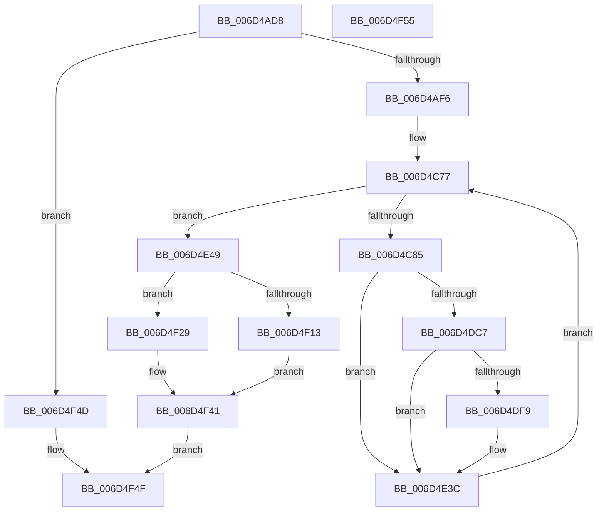

# ExpTimeRefreshDpcRoutine$filt$3

- RVA: `0x006D4AD8`–`0x006D4F56` (길이 `1,150` bytes)
- VA: `0x00000001406D4AD8`
- 실행 섹션: `.text`
- PDB 이름 있음: `예`; PDB Function 태그: `예`
- unwind 정보 RVA: `0x000BB134`
- 디코드: `261`개 명령, `1,150/1,150` bytes 표시
- 미해석 바이트: `0` (있으면 어셈블리에 `.byte`로 보존)

> 이 문서는 커널 이미지의 기계어와 PDB 기호를 분석해 생성했습니다. 4번과 5번은 함수 원형과 자료형을 바이너리 사용 방식에서 추정한 C 해석이며 원본 소스 복구 결과는 아닙니다.

## 1. Dependencies

- 직접 호출 지점: **2**; 고유 호출 대상: **2**
- 직접 호출자로 확인된 함수: **0**
- RIP 상대 이미지 참조: **2**

### Outgoing calls
- `0x006D4F22` → [RtlpComputeEpilogueOffset](../51/RtlpComputeEpilogueOffset_function_0051C81C.md) (function, `0x0051C81C`)
- `0x006D4F3B` → [guard_dispatch_icall](../6B/guard_dispatch_icall_function_006BAAD0.md) (function, `0x006BAAD0`)

### Direct callers
- 이 함수 시작 RVA로 연결되는 직접 call은 확인되지 않았습니다. 간접 호출은 완전히 역산할 수 없습니다.

### Static image references
- `0x006D4CC0` → RVA `0x00FC6F78` (`ALMOSTRO`; read)
- `0x006D4CE2` → RVA `0x00FC7250` (`ALMOSTRO`; read)

## 2. Other-region calls and transfers

- 다른 실행 섹션으로 향하는 call: **0**
- 별도 외부 분기/꼬리 이동을 확인하지 못했습니다.

## 3. Assembly (complete function range)

```asm
006D4AD8  40 55                           push rbp
006D4ADA  48 83 EC 30                     sub rsp, 0x30
006D4ADE  48 8B EA                        mov rbp, rdx
006D4AE1  8B 45 30                        mov eax, dword ptr [rbp + 0x30]
006D4AE4  83 C0 07                        add eax, 7
006D4AE7  89 45 30                        mov dword ptr [rbp + 0x30], eax
006D4AEA  8B 45 30                        mov eax, dword ptr [rbp + 0x30]
006D4AED  83 F8 1C                        cmp eax, 0x1c
006D4AF0  0F 85 57 04 00 00               jne 0x1406d4f4d
006D4AF6  48 8D 85 98 01 00 00            lea rax, [rbp + 0x198]
006D4AFD  48 89 85 D0 00 00 00            mov qword ptr [rbp + 0xd0], rax
006D4B04  48 C7 85 90 00 00 00 00 00 00 00  mov qword ptr [rbp + 0x90], 0
006D4B0F  48 8B 85 D0 00 00 00            mov rax, qword ptr [rbp + 0xd0]
006D4B16  48 8B 08                        mov rcx, qword ptr [rax]
006D4B19  48 89 8D 90 00 00 00            mov qword ptr [rbp + 0x90], rcx
006D4B20  48 8D 85 80 01 00 00            lea rax, [rbp + 0x180]
006D4B27  48 89 85 D8 00 00 00            mov qword ptr [rbp + 0xd8], rax
006D4B2E  48 C7 85 88 00 00 00 00 00 00 00  mov qword ptr [rbp + 0x88], 0
006D4B39  48 8B 85 D8 00 00 00            mov rax, qword ptr [rbp + 0xd8]
006D4B40  48 8B 08                        mov rcx, qword ptr [rax]
006D4B43  48 89 8D 88 00 00 00            mov qword ptr [rbp + 0x88], rcx
006D4B4A  48 8D 85 98 01 00 00            lea rax, [rbp + 0x198]
006D4B51  48 89 85 E0 00 00 00            mov qword ptr [rbp + 0xe0], rax
006D4B58  48 C7 85 A0 00 00 00 00 00 00 00  mov qword ptr [rbp + 0xa0], 0
006D4B63  48 8B 85 E0 00 00 00            mov rax, qword ptr [rbp + 0xe0]
006D4B6A  48 8B 08                        mov rcx, qword ptr [rax]
006D4B6D  48 89 8D A0 00 00 00            mov qword ptr [rbp + 0xa0], rcx
006D4B74  48 8D 85 58 01 00 00            lea rax, [rbp + 0x158]
006D4B7B  48 89 85 E8 00 00 00            mov qword ptr [rbp + 0xe8], rax
006D4B82  48 C7 85 98 00 00 00 00 00 00 00  mov qword ptr [rbp + 0x98], 0
006D4B8D  48 8B 85 E8 00 00 00            mov rax, qword ptr [rbp + 0xe8]
006D4B94  48 8B 08                        mov rcx, qword ptr [rax]
006D4B97  48 89 8D 98 00 00 00            mov qword ptr [rbp + 0x98], rcx
006D4B9E  48 8B 85 88 00 00 00            mov rax, qword ptr [rbp + 0x88]
006D4BA5  8B 8D 90 00 00 00               mov ecx, dword ptr [rbp + 0x90]
006D4BAB  48 D3 C8                        ror rax, cl
006D4BAE  48 89 85 F0 00 00 00            mov qword ptr [rbp + 0xf0], rax
006D4BB5  48 8B 85 98 00 00 00            mov rax, qword ptr [rbp + 0x98]
006D4BBC  8B 8D A0 00 00 00               mov ecx, dword ptr [rbp + 0xa0]
006D4BC2  48 D3 C0                        rol rax, cl
006D4BC5  48 89 85 B0 00 00 00            mov qword ptr [rbp + 0xb0], rax
006D4BCC  C7 45 6C 00 00 00 00            mov dword ptr [rbp + 0x6c], 0
006D4BD3  48 8B 85 B0 00 00 00            mov rax, qword ptr [rbp + 0xb0]
006D4BDA  48 8B 48 40                     mov rcx, qword ptr [rax + 0x40]
006D4BDE  48 89 4D 40                     mov qword ptr [rbp + 0x40], rcx
006D4BE2  48 8B 4D 40                     mov rcx, qword ptr [rbp + 0x40]
006D4BE6  48 8B 85 F0 00 00 00            mov rax, qword ptr [rbp + 0xf0]
006D4BED  48 33 C8                        xor rcx, rax
006D4BF0  48 89 8D 80 00 00 00            mov qword ptr [rbp + 0x80], rcx
006D4BF7  48 8B 85 80 00 00 00            mov rax, qword ptr [rbp + 0x80]
006D4BFE  48 B9 00 00 00 00 00 80 FF FF   movabs rcx, 0xffff800000000000
006D4C08  48 0B C1                        or rax, rcx
006D4C0B  48 89 85 80 00 00 00            mov qword ptr [rbp + 0x80], rax
006D4C12  48 8B 85 80 00 00 00            mov rax, qword ptr [rbp + 0x80]
006D4C19  48 89 45 38                     mov qword ptr [rbp + 0x38], rax
006D4C1D  48 8B 45 38                     mov rax, qword ptr [rbp + 0x38]
006D4C21  48 89 45 48                     mov qword ptr [rbp + 0x48], rax
006D4C25  8B 45 38                        mov eax, dword ptr [rbp + 0x38]
006D4C28  83 E0 3F                        and eax, 0x3f
006D4C2B  B9 40 00 00 00                  mov ecx, 0x40
006D4C30  2B C8                           sub ecx, eax
006D4C32  48 8B 55 38                     mov rdx, qword ptr [rbp + 0x38]
006D4C36  48 D3 E2                        shl rdx, cl
006D4C39  8B 4D 38                        mov ecx, dword ptr [rbp + 0x38]
006D4C3C  83 E1 3F                        and ecx, 0x3f
006D4C3F  48 8B 45 38                     mov rax, qword ptr [rbp + 0x38]
006D4C43  48 D3 E8                        shr rax, cl
006D4C46  48 0B C2                        or rax, rdx
006D4C49  48 89 45 40                     mov qword ptr [rbp + 0x40], rax
006D4C4D  8B 45 6C                        mov eax, dword ptr [rbp + 0x6c]
006D4C50  24 03                           and al, 3
006D4C52  F6 D8                           neg al
006D4C54  48 1B C9                        sbb rcx, rcx
006D4C57  48 F7 D1                        not rcx
006D4C5A  B8 C5 69 00 A0                  mov eax, 0xa00069c5
006D4C5F  48 23 C8                        and rcx, rax
006D4C62  48 89 8D 08 01 00 00            mov qword ptr [rbp + 0x108], rcx
006D4C69  C7 45 54 19 00 00 00            mov dword ptr [rbp + 0x54], 0x19
006D4C70  C7 45 34 00 00 00 00            mov dword ptr [rbp + 0x34], 0
006D4C77  8B 4D 34                        mov ecx, dword ptr [rbp + 0x34]
006D4C7A  8B 45 54                        mov eax, dword ptr [rbp + 0x54]
006D4C7D  3B C8                           cmp ecx, eax
006D4C7F  0F 83 C4 01 00 00               jae 0x1406d4e49
006D4C85  48 8B 45 48                     mov rax, qword ptr [rbp + 0x48]
006D4C89  48 8B 08                        mov rcx, qword ptr [rax]
006D4C8C  48 89 4D 70                     mov qword ptr [rbp + 0x70], rcx
006D4C90  48 8B 45 40                     mov rax, qword ptr [rbp + 0x40]
006D4C94  48 89 85 00 01 00 00            mov qword ptr [rbp + 0x100], rax
006D4C9B  48 8B 45 48                     mov rax, qword ptr [rbp + 0x48]
006D4C9F  48 8B 08                        mov rcx, qword ptr [rax]
006D4CA2  48 89 8D F8 00 00 00            mov qword ptr [rbp + 0xf8], rcx
006D4CA9  48 C7 45 58 00 00 00 00         mov qword ptr [rbp + 0x58], 0
006D4CB1  48 8B 85 F8 00 00 00            mov rax, qword ptr [rbp + 0xf8]
006D4CB8  48 89 45 58                     mov qword ptr [rbp + 0x58], rax
006D4CBC  48 8B 45 58                     mov rax, qword ptr [rbp + 0x58]
006D4CC0  48 8B 0D B1 22 8F 00            mov rcx, qword ptr [rip + 0x8f22b1]
006D4CC7  48 33 C1                        xor rax, rcx
006D4CCA  48 D3 C0                        rol rax, cl
006D4CCD  48 89 45 58                     mov qword ptr [rbp + 0x58], rax
006D4CD1  48 8B 4D 58                     mov rcx, qword ptr [rbp + 0x58]
006D4CD5  48 8B 85 00 01 00 00            mov rax, qword ptr [rbp + 0x100]
006D4CDC  48 33 C8                        xor rcx, rax
006D4CDF  48 0F C9                        bswap rcx
006D4CE2  48 33 0D 67 25 8F 00            xor rcx, qword ptr [rip + 0x8f2567]
006D4CE9  48 89 4D 58                     mov qword ptr [rbp + 0x58], rcx
006D4CED  48 8B 4D 48                     mov rcx, qword ptr [rbp + 0x48]
006D4CF1  48 8B 45 58                     mov rax, qword ptr [rbp + 0x58]
006D4CF5  48 89 01                        mov qword ptr [rcx], rax
006D4CF8  8B 55 34                        mov edx, dword ptr [rbp + 0x34]
006D4CFB  48 8B 45 48                     mov rax, qword ptr [rbp + 0x48]
006D4CFF  48 8B 00                        mov rax, qword ptr [rax]
006D4D02  48 03 C2                        add rax, rdx
006D4D05  48 8B 4D 38                     mov rcx, qword ptr [rbp + 0x38]
006D4D09  48 03 C8                        add rcx, rax
006D4D0C  48 8B 45 48                     mov rax, qword ptr [rbp + 0x48]
006D4D10  48 89 08                        mov qword ptr [rax], rcx
006D4D13  8B 45 70                        mov eax, dword ptr [rbp + 0x70]
006D4D16  F7 D0                           not eax
006D4D18  83 E0 3F                        and eax, 0x3f
006D4D1B  B9 40 00 00 00                  mov ecx, 0x40
006D4D20  2B C8                           sub ecx, eax
006D4D22  8B 45 34                        mov eax, dword ptr [rbp + 0x34]
006D4D25  41 B8 C8 00 00 00               mov r8d, 0xc8
006D4D2B  44 2B C0                        sub r8d, eax
006D4D2E  44 8B 4D 34                     mov r9d, dword ptr [rbp + 0x34]
006D4D32  4D 33 C8                        xor r9, r8
006D4D35  49 D3 E1                        shl r9, cl
006D4D38  8B 45 34                        mov eax, dword ptr [rbp + 0x34]
006D4D3B  BA C8 00 00 00                  mov edx, 0xc8
006D4D40  2B D0                           sub edx, eax
006D4D42  44 8B 45 34                     mov r8d, dword ptr [rbp + 0x34]
006D4D46  4C 33 C2                        xor r8, rdx
006D4D49  8B 4D 70                        mov ecx, dword ptr [rbp + 0x70]
006D4D4C  F7 D1                           not ecx
006D4D4E  83 E1 3F                        and ecx, 0x3f
006D4D51  49 D3 E8                        shr r8, cl
006D4D54  4D 0B C1                        or r8, r9
006D4D57  48 8B 45 40                     mov rax, qword ptr [rbp + 0x40]
006D4D5B  49 33 C0                        xor rax, r8
006D4D5E  48 89 45 40                     mov qword ptr [rbp + 0x40], rax
006D4D62  8B 45 70                        mov eax, dword ptr [rbp + 0x70]
006D4D65  83 F0 FA                        xor eax, 0xfffffffa
006D4D68  83 E0 3F                        and eax, 0x3f
006D4D6B  B9 40 00 00 00                  mov ecx, 0x40
006D4D70  2B C8                           sub ecx, eax
006D4D72  48 8B 55 40                     mov rdx, qword ptr [rbp + 0x40]
006D4D76  48 D3 EA                        shr rdx, cl
006D4D79  8B 4D 70                        mov ecx, dword ptr [rbp + 0x70]
006D4D7C  83 F1 FA                        xor ecx, 0xfffffffa
006D4D7F  83 E1 3F                        and ecx, 0x3f
006D4D82  48 8B 45 40                     mov rax, qword ptr [rbp + 0x40]
006D4D86  48 D3 E0                        shl rax, cl
006D4D89  48 0B C2                        or rax, rdx
006D4D8C  48 89 45 40                     mov qword ptr [rbp + 0x40], rax
006D4D90  48 8B 4D 38                     mov rcx, qword ptr [rbp + 0x38]
006D4D94  48 8B 45 40                     mov rax, qword ptr [rbp + 0x40]
006D4D98  48 03 C8                        add rcx, rax
006D4D9B  48 89 4D 40                     mov qword ptr [rbp + 0x40], rcx
006D4D9F  48 8B 8D 08 01 00 00            mov rcx, qword ptr [rbp + 0x108]
006D4DA6  48 8B 45 40                     mov rax, qword ptr [rbp + 0x40]
006D4DAA  48 33 C8                        xor rcx, rax
006D4DAD  48 89 4D 40                     mov qword ptr [rbp + 0x40], rcx
006D4DB1  48 8B 45 48                     mov rax, qword ptr [rbp + 0x48]
006D4DB5  48 83 C0 08                     add rax, 8
006D4DB9  48 89 45 48                     mov qword ptr [rbp + 0x48], rax
006D4DBD  8B 45 34                        mov eax, dword ptr [rbp + 0x34]
006D4DC0  FF C0                           inc eax
006D4DC2  83 F8 19                        cmp eax, 0x19
006D4DC5  75 75                           jne 0x1406d4e3c
006D4DC7  48 B8 90 62 22 90 62 A2 10 5C   movabs rax, 0x5c10a26290226290
006D4DD1  48 89 45 60                     mov qword ptr [rbp + 0x60], rax
006D4DD5  48 8B 4D 60                     mov rcx, qword ptr [rbp + 0x60]
006D4DD9  48 C1 E9 39                     shr rcx, 0x39
006D4DDD  48 8B 45 60                     mov rax, qword ptr [rbp + 0x60]
006D4DE1  48 C1 E0 07                     shl rax, 7
006D4DE5  48 0B C1                        or rax, rcx
006D4DE8  48 89 45 60                     mov qword ptr [rbp + 0x60], rax
006D4DEC  48 8B 4D 60                     mov rcx, qword ptr [rbp + 0x60]
006D4DF0  48 8B 45 38                     mov rax, qword ptr [rbp + 0x38]
006D4DF4  48 33 08                        xor rcx, qword ptr [rax]
006D4DF7  74 43                           je 0x1406d4e3c
006D4DF9  48 8B 45 48                     mov rax, qword ptr [rbp + 0x48]
006D4DFD  48 8B 4D 60                     mov rcx, qword ptr [rbp + 0x60]
006D4E01  48 33 48 F8                     xor rcx, qword ptr [rax - 8]
006D4E05  48 8B 45 38                     mov rax, qword ptr [rbp + 0x38]
006D4E09  48 33 08                        xor rcx, qword ptr [rax]
006D4E0C  48 8B 45 48                     mov rax, qword ptr [rbp + 0x48]
006D4E10  48 89 48 F8                     mov qword ptr [rax - 8], rcx
006D4E14  48 8B 4D 48                     mov rcx, qword ptr [rbp + 0x48]
006D4E18  8B 45 54                        mov eax, dword ptr [rbp + 0x54]
006D4E1B  03 41 FC                        add eax, dword ptr [rcx - 4]
006D4E1E  89 45 54                        mov dword ptr [rbp + 0x54], eax
006D4E21  48 8B 45 48                     mov rax, qword ptr [rbp + 0x48]
006D4E25  48 8B 4D 60                     mov rcx, qword ptr [rbp + 0x60]
006D4E29  48 33 48 F8                     xor rcx, qword ptr [rax - 8]
006D4E2D  48 8B 45 38                     mov rax, qword ptr [rbp + 0x38]
006D4E31  48 33 08                        xor rcx, qword ptr [rax]
006D4E34  48 8B 45 48                     mov rax, qword ptr [rbp + 0x48]
006D4E38  48 89 48 F8                     mov qword ptr [rax - 8], rcx
006D4E3C  8B 45 34                        mov eax, dword ptr [rbp + 0x34]
006D4E3F  FF C0                           inc eax
006D4E41  89 45 34                        mov dword ptr [rbp + 0x34], eax
006D4E44  E9 2E FE FF FF                  jmp 0x1406d4c77
006D4E49  48 8B 45 38                     mov rax, qword ptr [rbp + 0x38]
006D4E4D  48 BA F5 6F 1B AD 5F 93 44 62   movabs rdx, 0x6244935fad1b6ff5
006D4E57  48 8B 08                        mov rcx, qword ptr [rax]
006D4E5A  48 33 CA                        xor rcx, rdx
006D4E5D  48 89 8D 10 01 00 00            mov qword ptr [rbp + 0x110], rcx
006D4E64  48 8B 85 10 01 00 00            mov rax, qword ptr [rbp + 0x110]
006D4E6B  48 89 45 40                     mov qword ptr [rbp + 0x40], rax
006D4E6F  48 8D 45 40                     lea rax, [rbp + 0x40]
006D4E73  48 89 85 18 01 00 00            mov qword ptr [rbp + 0x118], rax
006D4E7A  48 C7 85 A8 00 00 00 00 00 00 00  mov qword ptr [rbp + 0xa8], 0
006D4E85  48 8B 85 18 01 00 00            mov rax, qword ptr [rbp + 0x118]
006D4E8C  48 8B 08                        mov rcx, qword ptr [rax]
006D4E8F  48 89 8D A8 00 00 00            mov qword ptr [rbp + 0xa8], rcx
006D4E96  48 8B 85 A8 00 00 00            mov rax, qword ptr [rbp + 0xa8]
006D4E9D  48 B9 DB 27 2A BC 17 A2 15 6A   movabs rcx, 0x6a15a217bc2a27db
006D4EA7  48 33 C1                        xor rax, rcx
006D4EAA  48 89 45 40                     mov qword ptr [rbp + 0x40], rax
006D4EAE  48 8B 45 38                     mov rax, qword ptr [rbp + 0x38]
006D4EB2  48 89 85 B0 01 00 00            mov qword ptr [rbp + 0x1b0], rax
006D4EB9  48 8B 45 38                     mov rax, qword ptr [rbp + 0x38]
006D4EBD  48 89 85 20 01 00 00            mov qword ptr [rbp + 0x120], rax
006D4EC4  48 8B 85 20 01 00 00            mov rax, qword ptr [rbp + 0x120]
006D4ECB  C7 00 F5 6F 1B AD               mov dword ptr [rax], 0xad1b6ff5
006D4ED1  48 8B 45 38                     mov rax, qword ptr [rbp + 0x38]
006D4ED5  48 89 85 28 01 00 00            mov qword ptr [rbp + 0x128], rax
006D4EDC  C7 45 68 00 00 00 00            mov dword ptr [rbp + 0x68], 0
006D4EE3  48 8B 85 28 01 00 00            mov rax, qword ptr [rbp + 0x128]
006D4EEA  8B 08                           mov ecx, dword ptr [rax]
006D4EEC  89 4D 68                        mov dword ptr [rbp + 0x68], ecx
006D4EEF  48 8B 45 38                     mov rax, qword ptr [rbp + 0x38]
006D4EF3  48 89 85 30 01 00 00            mov qword ptr [rbp + 0x130], rax
006D4EFA  8B 4D 68                        mov ecx, dword ptr [rbp + 0x68]
006D4EFD  81 F1 DB 27 2A BC               xor ecx, 0xbc2a27db
006D4F03  48 8B 85 30 01 00 00            mov rax, qword ptr [rbp + 0x130]
006D4F0A  89 08                           mov dword ptr [rax], ecx
006D4F0C  8B 45 6C                        mov eax, dword ptr [rbp + 0x6c]
006D4F0F  A8 01                           test al, 1
006D4F11  74 16                           je 0x1406d4f29
006D4F13  4C 8B 45 40                     mov r8, qword ptr [rbp + 0x40]
006D4F17  48 8B 55 38                     mov rdx, qword ptr [rbp + 0x38]
006D4F1B  48 8B 8D B0 00 00 00            mov rcx, qword ptr [rbp + 0xb0]
006D4F22  E8 F5 78 E4 FF                  call 0x14051c81c
006D4F27  EB 18                           jmp 0x1406d4f41
006D4F29  48 8B 45 38                     mov rax, qword ptr [rbp + 0x38]
006D4F2D  45 33 C9                        xor r9d, r9d
006D4F30  45 33 C0                        xor r8d, r8d
006D4F33  48 8B 55 40                     mov rdx, qword ptr [rbp + 0x40]
006D4F37  48 8B 4D 38                     mov rcx, qword ptr [rbp + 0x38]
006D4F3B  E8 90 5B FE FF                  call 0x1406baad0
006D4F40  90                              nop
006D4F41  C7 45 78 01 00 00 00            mov dword ptr [rbp + 0x78], 1
006D4F48  8B 45 78                        mov eax, dword ptr [rbp + 0x78]
006D4F4B  EB 02                           jmp 0x1406d4f4f
006D4F4D  33 C0                           xor eax, eax
006D4F4F  48 83 C4 30                     add rsp, 0x30
006D4F53  5D                              pop rbp
006D4F54  C3                              ret
006D4F55  CC                              int3
```

## 4. C-style interpretation (structured pseudocode)

```c
__int64 __fastcall ExpTimeRefreshDpcRoutine_filt_3(__int64 a1, __int64 a2)
{
    __int64 result;
    __int64 v_rsp;

    v_rsp = (v_rsp) - (48);
    result = (unsigned int)(((unsigned int)(*(unsigned int *)(a2 + 48))) + (7));
    *(unsigned int *)(a2 + 48) = (unsigned int)(result);
    if (((unsigned int)((unsigned int)(*(unsigned int *)(a2 + 48)))) != 28) goto loc_006D4F4D;
    *(unsigned __int64 *)(a2 + 208) = a2 + 408;
    *(unsigned __int64 *)(a2 + 144) = 0;
    *(unsigned __int64 *)(a2 + 144) = *(unsigned __int64 *)(*(unsigned __int64 *)(a2 + 208));
    *(unsigned __int64 *)(a2 + 216) = a2 + 384;
    *(unsigned __int64 *)(a2 + 136) = 0;
    *(unsigned __int64 *)(a2 + 136) = *(unsigned __int64 *)(*(unsigned __int64 *)(a2 + 216));
    *(unsigned __int64 *)(a2 + 224) = a2 + 408;
    *(unsigned __int64 *)(a2 + 160) = 0;
    *(unsigned __int64 *)(a2 + 160) = *(unsigned __int64 *)(*(unsigned __int64 *)(a2 + 224));
    *(unsigned __int64 *)(a2 + 232) = a2 + 344;
    *(unsigned __int64 *)(a2 + 152) = 0;
    *(unsigned __int64 *)(a2 + 152) = *(unsigned __int64 *)(*(unsigned __int64 *)(a2 + 232));
    *(unsigned __int64 *)(a2 + 240) = *(unsigned __int64 *)(a2 + 136);
    *(unsigned __int64 *)(a2 + 176) = *(unsigned __int64 *)(a2 + 152);
    *(unsigned int *)(a2 + 108) = 0;
    *(unsigned __int64 *)(a2 + 64) = *(unsigned __int64 *)(*(unsigned __int64 *)(a2 + 176) + 64);
    a1 = (*(unsigned __int64 *)(a2 + 64)) ^ (*(unsigned __int64 *)(a2 + 240));
    *(unsigned __int64 *)(a2 + 128) = a1;
    result = (*(unsigned __int64 *)(a2 + 128)) | (a1);
    *(unsigned __int64 *)(a2 + 128) = result;
    *(unsigned __int64 *)(a2 + 56) = *(unsigned __int64 *)(a2 + 128);
    *(unsigned __int64 *)(a2 + 72) = *(unsigned __int64 *)(a2 + 56);
    result = (unsigned int)(((unsigned int)(*(unsigned int *)(a2 + 56))) & (63));
    a1 = (unsigned int)((64) - ((unsigned int)(result)));
    a2 = (*(unsigned __int64 *)(a2 + 56)) << ((unsigned __int8)(a1));
    a1 = (unsigned int)(((unsigned int)(*(unsigned int *)(a2 + 56))) & (63));
    result = (*(unsigned __int64 *)(a2 + 56)) >> ((unsigned __int8)(a1));
    result = (result) | (a2);
    *(unsigned __int64 *)(a2 + 64) = result;
    result = (unsigned __int8)(((unsigned int)(*(unsigned int *)(a2 + 108))) & (3));
    result = (unsigned __int8)(-(result));
    a1 = ~(a1);
    a1 = (a1) & ((unsigned int)(0xA00069C5ULL));
    *(unsigned __int64 *)(a2 + 264) = a1;
    *(unsigned int *)(a2 + 84) = 25;
    *(unsigned int *)(a2 + 52) = 0;
loc_006D4C77:
    if (((unsigned int)((unsigned int)(*(unsigned int *)(a2 + 52)))) >= ((unsigned int)((unsigned int)(*(unsigned int *)(a2 + 84))))) goto loc_006D4E49;
    *(unsigned __int64 *)(a2 + 112) = *(unsigned __int64 *)(*(unsigned __int64 *)(a2 + 72));
    *(unsigned __int64 *)(a2 + 256) = *(unsigned __int64 *)(a2 + 64);
    *(unsigned __int64 *)(a2 + 248) = *(unsigned __int64 *)(*(unsigned __int64 *)(a2 + 72));
    *(unsigned __int64 *)(a2 + 88) = 0;
    *(unsigned __int64 *)(a2 + 88) = *(unsigned __int64 *)(a2 + 248);
    result = (*(unsigned __int64 *)(a2 + 88)) ^ (*(unsigned __int64 *)(v_rip + 9380529));
    *(unsigned __int64 *)(a2 + 88) = result;
    a1 = (*(unsigned __int64 *)(a2 + 88)) ^ (*(unsigned __int64 *)(a2 + 256));
    a1 = (a1) ^ (*(unsigned __int64 *)(v_rip + 9381223));
    *(unsigned __int64 *)(a2 + 88) = a1;
    *(unsigned __int64 *)(*(unsigned __int64 *)(a2 + 72)) = *(unsigned __int64 *)(a2 + 88);
    result = (*(unsigned __int64 *)(*(unsigned __int64 *)(a2 + 72))) + ((unsigned int)(*(unsigned int *)(a2 + 52)));
    a1 = (*(unsigned __int64 *)(a2 + 56)) + (result);
    *(unsigned __int64 *)(*(unsigned __int64 *)(a2 + 72)) = a1;
    result = (unsigned int)(~((unsigned int)(*(unsigned int *)(a2 + 112))));
    result = (unsigned int)((result) & (63));
    a1 = (unsigned int)((64) - ((unsigned int)(result)));
    a3 = (unsigned int)((200) - ((unsigned int)((unsigned int)(*(unsigned int *)(a2 + 52)))));
    a4 = ((unsigned int)(*(unsigned int *)(a2 + 52))) ^ (a3);
    a4 = (a4) << ((unsigned __int8)(a1));
    a2 = (unsigned int)((200) - ((unsigned int)((unsigned int)(*(unsigned int *)(a2 + 52)))));
    a3 = ((unsigned int)(*(unsigned int *)(a2 + 52))) ^ (a2);
    a1 = (unsigned int)(~((unsigned int)(*(unsigned int *)(a2 + 112))));
    a1 = (unsigned int)((a1) & (63));
    a3 = (a3) >> ((unsigned __int8)(a1));
    a3 = (a3) | (a4);
    result = (*(unsigned __int64 *)(a2 + 64)) ^ (a3);
    *(unsigned __int64 *)(a2 + 64) = result;
    result = (unsigned int)(((unsigned int)(*(unsigned int *)(a2 + 112))) ^ (0xFFFFFFFAULL));
    result = (unsigned int)((result) & (63));
    a1 = (unsigned int)((64) - ((unsigned int)(result)));
    a2 = (*(unsigned __int64 *)(a2 + 64)) >> ((unsigned __int8)(a1));
    a1 = (unsigned int)(((unsigned int)(*(unsigned int *)(a2 + 112))) ^ (0xFFFFFFFAULL));
    a1 = (unsigned int)((a1) & (63));
    result = (*(unsigned __int64 *)(a2 + 64)) << ((unsigned __int8)(a1));
    result = (result) | (a2);
    *(unsigned __int64 *)(a2 + 64) = result;
    a1 = (*(unsigned __int64 *)(a2 + 56)) + (*(unsigned __int64 *)(a2 + 64));
    *(unsigned __int64 *)(a2 + 64) = a1;
    a1 = (*(unsigned __int64 *)(a2 + 264)) ^ (*(unsigned __int64 *)(a2 + 64));
    *(unsigned __int64 *)(a2 + 64) = a1;
    result = (*(unsigned __int64 *)(a2 + 72)) + (8);
    *(unsigned __int64 *)(a2 + 72) = result;
    result = (unsigned int)(((unsigned int)(*(unsigned int *)(a2 + 52))) + 1);
    if (((unsigned int)(result)) != 25) goto loc_006D4E3C;
    *(unsigned __int64 *)(a2 + 96) = result;
    a1 = (*(unsigned __int64 *)(a2 + 96)) >> (57);
    result = (*(unsigned __int64 *)(a2 + 96)) << (7);
    result = (result) | (a1);
    *(unsigned __int64 *)(a2 + 96) = result;
    a1 = (*(unsigned __int64 *)(a2 + 96)) ^ (*(unsigned __int64 *)(*(unsigned __int64 *)(a2 + 56)));
    result = *(unsigned __int64 *)(a2 + 56);
    if (!(condition_is_equal)) {
        result = *(unsigned __int64 *)(a2 + 72);
        a1 = *(unsigned __int64 *)(a2 + 96);
        a1 = (a1) ^ (*(unsigned __int64 *)(result - 8));
        result = *(unsigned __int64 *)(a2 + 56);
        a1 = (a1) ^ (*(unsigned __int64 *)(result));
        result = *(unsigned __int64 *)(a2 + 72);
        *(unsigned __int64 *)(result - 8) = a1;
        a1 = *(unsigned __int64 *)(a2 + 72);
        result = *(unsigned int *)(a2 + 84);
        result = (unsigned int)((result) + (*(unsigned int *)(a1 - 4)));
        *(unsigned int *)(a2 + 84) = (unsigned int)(result);
        result = *(unsigned __int64 *)(a2 + 72);
        a1 = *(unsigned __int64 *)(a2 + 96);
        a1 = (a1) ^ (*(unsigned __int64 *)(result - 8));
        result = *(unsigned __int64 *)(a2 + 56);
        a1 = (a1) ^ (*(unsigned __int64 *)(result));
        result = *(unsigned __int64 *)(a2 + 72);
        *(unsigned __int64 *)(result - 8) = a1;
    }
    result = (unsigned int)(((unsigned int)(*(unsigned int *)(a2 + 52))) + 1);
    *(unsigned int *)(a2 + 52) = (unsigned int)(result);
    goto loc_006D4C77;
loc_006D4E49:
    a1 = (*(unsigned __int64 *)(*(unsigned __int64 *)(a2 + 56))) ^ (a2);
    *(unsigned __int64 *)(a2 + 272) = a1;
    *(unsigned __int64 *)(a2 + 64) = *(unsigned __int64 *)(a2 + 272);
    *(unsigned __int64 *)(a2 + 280) = a2 + 64;
    *(unsigned __int64 *)(a2 + 168) = 0;
    *(unsigned __int64 *)(a2 + 168) = *(unsigned __int64 *)(*(unsigned __int64 *)(a2 + 280));
    result = (*(unsigned __int64 *)(a2 + 168)) ^ (*(unsigned __int64 *)(*(unsigned __int64 *)(a2 + 280)));
    *(unsigned __int64 *)(a2 + 64) = result;
    *(unsigned __int64 *)(a2 + 432) = *(unsigned __int64 *)(a2 + 56);
    *(unsigned __int64 *)(a2 + 288) = *(unsigned __int64 *)(a2 + 56);
    *(unsigned int *)(*(unsigned __int64 *)(a2 + 288)) = 0xAD1B6FF5ULL;
    *(unsigned __int64 *)(a2 + 296) = *(unsigned __int64 *)(a2 + 56);
    *(unsigned int *)(a2 + 104) = 0;
    *(unsigned int *)(a2 + 104) = (unsigned int)((unsigned int)(*(unsigned int *)(*(unsigned __int64 *)(a2 + 296))));
    *(unsigned __int64 *)(a2 + 304) = *(unsigned __int64 *)(a2 + 56);
    a1 = (unsigned int)(((unsigned int)(*(unsigned int *)(a2 + 104))) ^ (0xBC2A27DBULL));
    *(unsigned int *)(*(unsigned __int64 *)(a2 + 304)) = (unsigned int)(a1);
    if ((((unsigned __int8)((unsigned int)(*(unsigned int *)(a2 + 108)))) & (1)) == 0) goto loc_006D4F29;
    result = RtlpComputeEpilogueOffset(*(unsigned __int64 *)(a2 + 176), *(unsigned __int64 *)(a2 + 56), *(unsigned __int64 *)(a2 + 64), a4);
    goto loc_006D4F41;
loc_006D4F29:
    a4 = 0;
    a3 = 0;
    result = guard_dispatch_icall(*(unsigned __int64 *)(a2 + 56), *(unsigned __int64 *)(a2 + 64), a3, a4);
loc_006D4F41:
    *(unsigned int *)(a2 + 120) = 1;
    goto loc_006D4F4F;
loc_006D4F4D:
    result = 0;
loc_006D4F4F:
    v_rsp = (v_rsp) + (48);
    return result;
}
```

## 5. (Beta) C Style

```c
int64_t ExpTimeRefreshDpcRoutine_filt_3(int64_t Arg1, void *Arg2)
{
    uint8_t *arg2 = (uint8_t *)Arg2;

    int64_t result;
    int64_t local_rsp;

    local_rsp = (local_rsp) - (48);
    result = (uint32_t)(((uint32_t)(*(uint32_t *)(arg2 + 0x30))) + (7));
    *(uint32_t *)(arg2 + 0x30) = (uint32_t)(result);
    if (((uint32_t)((uint32_t)(*(uint32_t *)(arg2 + 0x30)))) != 28) goto loc_006D4F4D;
    *(void **)(arg2 + 0xD0) = Arg2 + 408;
    *(uint64_t *)(arg2 + 0x90) = 0;
    *(uint64_t *)(arg2 + 0x90) = *(uint64_t *)(*(uint64_t *)(arg2 + 0xD0));
    *(void **)(arg2 + 0xD8) = Arg2 + 384;
    *(uint64_t *)(arg2 + 0x88) = 0;
    *(uint64_t *)(arg2 + 0x88) = *(uint64_t *)(*(uint64_t *)(arg2 + 0xD8));
    *(void **)(arg2 + 0xE0) = Arg2 + 408;
    *(uint64_t *)(arg2 + 0xA0) = 0;
    *(uint64_t *)(arg2 + 0xA0) = *(uint64_t *)(*(uint64_t *)(arg2 + 0xE0));
    *(void **)(arg2 + 0xE8) = Arg2 + 344;
    *(uint64_t *)(arg2 + 0x98) = 0;
    *(uint64_t *)(arg2 + 0x98) = *(uint64_t *)(*(uint64_t *)(arg2 + 0xE8));
    *(uint64_t *)(arg2 + 0xF0) = *(uint64_t *)(arg2 + 0x88);
    *(uint64_t *)(arg2 + 0xB0) = *(uint64_t *)(arg2 + 0x98);
    *(uint32_t *)(arg2 + 0x6C) = 0;
    *(uint64_t *)(arg2 + 0x40) = *(uint64_t *)(*(uint64_t *)(arg2 + 0xB0) + 0x40);
    Arg1 = (*(uint64_t *)(arg2 + 0x40)) ^ (*(uint64_t *)(arg2 + 0xF0));
    *(uint64_t *)(arg2 + 0x80) = Arg1;
    result = (*(uint64_t *)(arg2 + 0x80)) | (Arg1);
    *(uint64_t *)(arg2 + 0x80) = result;
    *(uint64_t *)(arg2 + 0x38) = *(uint64_t *)(arg2 + 0x80);
    *(uint64_t *)(arg2 + 0x48) = *(uint64_t *)(arg2 + 0x38);
    result = (uint32_t)(((uint32_t)(*(uint32_t *)(arg2 + 0x38))) & (63));
    Arg1 = (uint32_t)((64) - ((uint32_t)(result)));
    Arg2 = (*(uint64_t *)(arg2 + 0x38)) << ((uint8_t)(Arg1));
    Arg1 = (uint32_t)(((uint32_t)(*(uint32_t *)(arg2 + 0x38))) & (63));
    result = (*(uint64_t *)(arg2 + 0x38)) >> ((uint8_t)(Arg1));
    result = (result) | (Arg2);
    *(uint64_t *)(arg2 + 0x40) = result;
    result = (uint8_t)(((uint32_t)(*(uint32_t *)(arg2 + 0x6C))) & (3));
    result = (uint8_t)(-(result));
    Arg1 = ~(Arg1);
    Arg1 = (Arg1) & ((uint32_t)(0xA00069C5ULL));
    *(uint64_t *)(arg2 + 0x108) = Arg1;
    *(uint32_t *)(arg2 + 0x54) = 25;
    *(uint32_t *)(arg2 + 0x34) = 0;
loc_006D4C77:
    if (((uint32_t)((uint32_t)(*(uint32_t *)(arg2 + 0x34)))) >= ((uint32_t)((uint32_t)(*(uint32_t *)(arg2 + 0x54))))) goto loc_006D4E49;
    *(uint64_t *)(arg2 + 0x70) = *(uint64_t *)(*(uint64_t *)(arg2 + 0x48));
    *(uint64_t *)(arg2 + 0x100) = *(uint64_t *)(arg2 + 0x40);
    *(uint64_t *)(arg2 + 0xF8) = *(uint64_t *)(*(uint64_t *)(arg2 + 0x48));
    *(uint64_t *)(arg2 + 0x58) = 0;
    *(uint64_t *)(arg2 + 0x58) = *(uint64_t *)(arg2 + 0xF8);
    result = (*(uint64_t *)(arg2 + 0x58)) ^ (*(uint64_t *)(v_rip + 0x8F22B1));
    *(uint64_t *)(arg2 + 0x58) = result;
    Arg1 = (*(uint64_t *)(arg2 + 0x58)) ^ (*(uint64_t *)(arg2 + 0x100));
    Arg1 = (Arg1) ^ (*(uint64_t *)(v_rip + 0x8F2567));
    *(uint64_t *)(arg2 + 0x58) = Arg1;
    *(uint64_t *)(*(uint64_t *)(arg2 + 0x48)) = *(uint64_t *)(arg2 + 0x58);
    result = (*(uint64_t *)(*(uint64_t *)(arg2 + 0x48))) + ((uint32_t)(*(uint32_t *)(arg2 + 0x34)));
    Arg1 = (*(uint64_t *)(arg2 + 0x38)) + (result);
    *(uint64_t *)(*(uint64_t *)(arg2 + 0x48)) = Arg1;
    result = (uint32_t)(~((uint32_t)(*(uint32_t *)(arg2 + 0x70))));
    result = (uint32_t)((result) & (63));
    Arg1 = (uint32_t)((64) - ((uint32_t)(result)));
    a3 = (uint32_t)((200) - ((uint32_t)((uint32_t)(*(uint32_t *)(arg2 + 0x34)))));
    a4 = ((uint32_t)(*(uint32_t *)(arg2 + 0x34))) ^ (a3);
    a4 = (a4) << ((uint8_t)(Arg1));
    Arg2 = (uint32_t)((200) - ((uint32_t)((uint32_t)(*(uint32_t *)(arg2 + 0x34)))));
    a3 = ((uint32_t)(*(uint32_t *)(arg2 + 0x34))) ^ (Arg2);
    Arg1 = (uint32_t)(~((uint32_t)(*(uint32_t *)(arg2 + 0x70))));
    Arg1 = (uint32_t)((Arg1) & (63));
    a3 = (a3) >> ((uint8_t)(Arg1));
    a3 = (a3) | (a4);
    result = (*(uint64_t *)(arg2 + 0x40)) ^ (a3);
    *(uint64_t *)(arg2 + 0x40) = result;
    result = (uint32_t)(((uint32_t)(*(uint32_t *)(arg2 + 0x70))) ^ (0xFFFFFFFAULL));
    result = (uint32_t)((result) & (63));
    Arg1 = (uint32_t)((64) - ((uint32_t)(result)));
    Arg2 = (*(uint64_t *)(arg2 + 0x40)) >> ((uint8_t)(Arg1));
    Arg1 = (uint32_t)(((uint32_t)(*(uint32_t *)(arg2 + 0x70))) ^ (0xFFFFFFFAULL));
    Arg1 = (uint32_t)((Arg1) & (63));
    result = (*(uint64_t *)(arg2 + 0x40)) << ((uint8_t)(Arg1));
    result = (result) | (Arg2);
    *(uint64_t *)(arg2 + 0x40) = result;
    Arg1 = (*(uint64_t *)(arg2 + 0x38)) + (*(uint64_t *)(arg2 + 0x40));
    *(uint64_t *)(arg2 + 0x40) = Arg1;
    Arg1 = (*(uint64_t *)(arg2 + 0x108)) ^ (*(uint64_t *)(arg2 + 0x40));
    *(uint64_t *)(arg2 + 0x40) = Arg1;
    result = (*(uint64_t *)(arg2 + 0x48)) + (8);
    *(uint64_t *)(arg2 + 0x48) = result;
    result = (uint32_t)(((uint32_t)(*(uint32_t *)(arg2 + 0x34))) + 1);
    if (((uint32_t)(result)) != 25) goto loc_006D4E3C;
    *(uint64_t *)(arg2 + 0x60) = result;
    Arg1 = (*(uint64_t *)(arg2 + 0x60)) >> (57);
    result = (*(uint64_t *)(arg2 + 0x60)) << (7);
    result = (result) | (Arg1);
    *(uint64_t *)(arg2 + 0x60) = result;
    Arg1 = (*(uint64_t *)(arg2 + 0x60)) ^ (*(uint64_t *)(*(uint64_t *)(arg2 + 0x38)));
    result = *(uint64_t *)(arg2 + 0x38);
    if (!(condition_is_equal)) {
        result = *(uint64_t *)(arg2 + 0x48);
        Arg1 = *(uint64_t *)(arg2 + 0x60);
        Arg1 = (Arg1) ^ (*(uint64_t *)(result - 0x8));
        result = *(uint64_t *)(arg2 + 0x38);
        Arg1 = (Arg1) ^ (*(uint64_t *)(result));
        result = *(uint64_t *)(arg2 + 0x48);
        *(uint64_t *)(result - 0x8) = Arg1;
        Arg1 = *(uint64_t *)(arg2 + 0x48);
        result = *(uint32_t *)(arg2 + 0x54);
        result = (uint32_t)((result) + (*(uint32_t *)(Arg1 - 0x4)));
        *(uint32_t *)(arg2 + 0x54) = (uint32_t)(result);
        result = *(uint64_t *)(arg2 + 0x48);
        Arg1 = *(uint64_t *)(arg2 + 0x60);
        Arg1 = (Arg1) ^ (*(uint64_t *)(result - 0x8));
        result = *(uint64_t *)(arg2 + 0x38);
        Arg1 = (Arg1) ^ (*(uint64_t *)(result));
        result = *(uint64_t *)(arg2 + 0x48);
        *(uint64_t *)(result - 0x8) = Arg1;
    }
    result = (uint32_t)(((uint32_t)(*(uint32_t *)(arg2 + 0x34))) + 1);
    *(uint32_t *)(arg2 + 0x34) = (uint32_t)(result);
    goto loc_006D4C77;
loc_006D4E49:
    Arg1 = (*(uint64_t *)(*(uint64_t *)(arg2 + 0x38))) ^ (Arg2);
    *(uint64_t *)(arg2 + 0x110) = Arg1;
    *(uint64_t *)(arg2 + 0x40) = *(uint64_t *)(arg2 + 0x110);
    *(void **)(arg2 + 0x118) = Arg2 + 64;
    *(uint64_t *)(arg2 + 0xA8) = 0;
    *(uint64_t *)(arg2 + 0xA8) = *(uint64_t *)(*(uint64_t *)(arg2 + 0x118));
    result = (*(uint64_t *)(arg2 + 0xA8)) ^ (*(uint64_t *)(*(uint64_t *)(arg2 + 0x118)));
    *(uint64_t *)(arg2 + 0x40) = result;
    *(uint64_t *)(arg2 + 0x1B0) = *(uint64_t *)(arg2 + 0x38);
    *(uint64_t *)(arg2 + 0x120) = *(uint64_t *)(arg2 + 0x38);
    *(uint32_t *)(*(uint64_t *)(arg2 + 0x120)) = 0xAD1B6FF5ULL;
    *(uint64_t *)(arg2 + 0x128) = *(uint64_t *)(arg2 + 0x38);
    *(uint32_t *)(arg2 + 0x68) = 0;
    *(uint32_t *)(arg2 + 0x68) = (uint32_t)((uint32_t)(*(uint32_t *)(*(uint64_t *)(arg2 + 0x128))));
    *(uint64_t *)(arg2 + 0x130) = *(uint64_t *)(arg2 + 0x38);
    Arg1 = (uint32_t)(((uint32_t)(*(uint32_t *)(arg2 + 0x68))) ^ (0xBC2A27DBULL));
    *(uint32_t *)(*(uint64_t *)(arg2 + 0x130)) = (uint32_t)(Arg1);
    if ((((uint8_t)((uint32_t)(*(uint32_t *)(arg2 + 0x6C)))) & (1)) == 0) goto loc_006D4F29;
    result = RtlpComputeEpilogueOffset(*(uint64_t *)(arg2 + 0xB0), *(uint64_t *)(arg2 + 0x38), *(uint64_t *)(arg2 + 0x40), a4);
    goto loc_006D4F41;
loc_006D4F29:
    a4 = 0;
    a3 = 0;
    result = guard_dispatch_icall(*(uint64_t *)(arg2 + 0x38), *(uint64_t *)(arg2 + 0x40), a3, a4);
loc_006D4F41:
    *(uint32_t *)(arg2 + 0x78) = 1;
    goto loc_006D4F4F;
loc_006D4F4D:
    result = 0;
loc_006D4F4F:
    local_rsp = (local_rsp) + (48);
    return result;
}
```

### 관측된 메모리 오프셋

구조체 형식이 확인되지 않은 접근은 인자 기준의 오프셋으로만 기록했습니다.

| 기준 인자 | 오프셋 표현 | 폭 (bit) | 접근 |
|---|---:|---:|---|
| `Arg2` | `+ 0x30` | `32` | `R` |
| `Arg2` | `+ 0x30` | `32` | `W` |
| `Arg2` | `+ 0x34` | `32` | `R` |
| `Arg2` | `+ 0x34` | `32` | `W` |
| `Arg2` | `+ 0x38` | `32` | `R` |
| `Arg2` | `+ 0x38` | `64` | `R` |
| `Arg2` | `+ 0x38` | `64` | `W` |
| `Arg2` | `+ 0x40` | `64` | `R` |
| `Arg2` | `+ 0x40` | `64` | `W` |
| `Arg2` | `+ 0x48` | `64` | `R` |
| `Arg2` | `+ 0x48` | `64` | `W` |
| `Arg2` | `+ 0x54` | `32` | `R` |
| `Arg2` | `+ 0x54` | `32` | `W` |
| `Arg2` | `+ 0x58` | `64` | `R` |
| `Arg2` | `+ 0x58` | `64` | `W` |
| `Arg2` | `+ 0x60` | `64` | `R` |
| `Arg2` | `+ 0x60` | `64` | `W` |
| `Arg2` | `+ 0x68` | `32` | `R` |
| `Arg2` | `+ 0x68` | `32` | `W` |
| `Arg2` | `+ 0x6C` | `32` | `R` |
| `Arg2` | `+ 0x6C` | `32` | `W` |
| `Arg2` | `+ 0x70` | `32` | `R` |
| `Arg2` | `+ 0x70` | `64` | `W` |
| `Arg2` | `+ 0x78` | `32` | `R` |
| `Arg2` | `+ 0x78` | `32` | `W` |
| `Arg2` | `+ 0x80` | `64` | `R` |
| `Arg2` | `+ 0x80` | `64` | `W` |
| `Arg2` | `+ 0x88` | `64` | `R` |
| `Arg2` | `+ 0x88` | `64` | `W` |
| `Arg2` | `+ 0x90` | `32` | `R` |
| `Arg2` | `+ 0x90` | `64` | `W` |
| `Arg2` | `+ 0x98` | `64` | `R` |

추가 오프셋 37개는 표에서 생략했습니다.

## 6. Execution-region graph

[열기: 2D/3D 그래프와 함수 탐색 컨트롤 패널](../../../control-panel.html?section=text&rva=0x006D4AD8&view=graph)

- 2D 그래프는 위에서 아래로 흐르고, 3D 그래프는 빈 공간을 드래그해 회전합니다. Shift+드래그는 이동, 휠은 확대·축소, 함수 노드 선택은 대상 보고서 이동입니다.

### Static fallback


