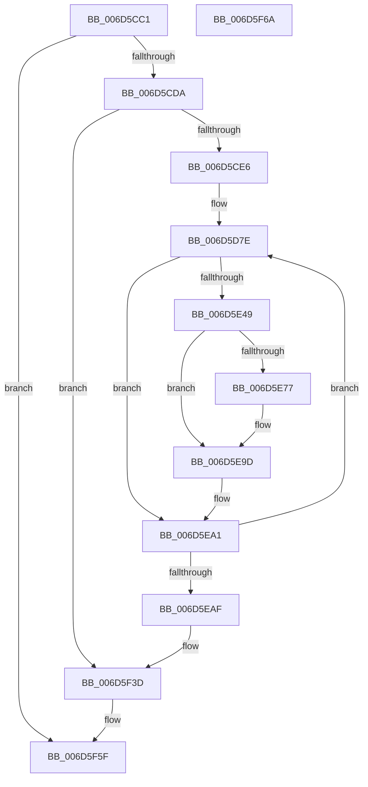

# ExpTimeZoneDpcRoutine$fin$2

- RVA: `0x006D5CC1`–`0x006D5F6B` (길이 `682` bytes)
- VA: `0x00000001406D5CC1`
- 실행 섹션: `.text`
- PDB 이름 있음: `예`; PDB Function 태그: `예`
- unwind 정보 RVA: `0x000D4984`
- 디코드: `181`개 명령, `682/682` bytes 표시
- 미해석 바이트: `0` (있으면 어셈블리에 `.byte`로 보존)

> 이 문서는 커널 이미지의 기계어와 PDB 기호를 분석해 생성했습니다. 4번과 5번은 함수 원형과 자료형을 바이너리 사용 방식에서 추정한 C 해석이며 원본 소스 복구 결과는 아닙니다.

## 1. Dependencies

- 직접 호출 지점: **2**; 고유 호출 대상: **2**
- 직접 호출자로 확인된 함수: **0**
- RIP 상대 이미지 참조: **3**

### Outgoing calls
- `0x006D5F14` → [guard_dispatch_icall](../6B/guard_dispatch_icall_function_006BAAD0.md) (function, `0x006BAAD0`)
- `0x006D5F37` → [local_unwind](../4F/local_unwind_function_004FFB40.md) (function, `0x004FFB40`)

### Direct callers
- 이 함수 시작 RVA로 연결되는 직접 call은 확인되지 않았습니다. 간접 호출은 완전히 역산할 수 없습니다.

### Static image references
- `0x006D5D8B` → RVA `0x00FC6F78` (`ALMOSTRO`; read)
- `0x006D5D9E` → RVA `0x00FC7250` (`ALMOSTRO`; read)
- `0x006D5F29` → RVA `0x00655823` (`.text`; read)

## 2. Other-region calls and transfers

- 다른 실행 섹션으로 향하는 call: **0**
- 별도 외부 분기/꼬리 이동을 확인하지 못했습니다.

## 3. Assembly (complete function range)

```asm
006D5CC1  40 53                           push rbx
006D5CC3  55                              push rbp
006D5CC4  56                              push rsi
006D5CC5  57                              push rdi
006D5CC6  41 56                           push r14
006D5CC8  48 83 EC 30                     sub rsp, 0x30
006D5CCC  48 8B EA                        mov rbp, rdx
006D5CCF  88 4D 49                        mov byte ptr [rbp + 0x49], cl
006D5CD2  84 C9                           test cl, cl
006D5CD4  0F 84 85 02 00 00               je 0x1406d5f5f
006D5CDA  8B 45 30                        mov eax, dword ptr [rbp + 0x30]
006D5CDD  83 F8 20                        cmp eax, 0x20
006D5CE0  0F 85 57 02 00 00               jne 0x1406d5f3d
006D5CE6  48 83 65 70 00                  and qword ptr [rbp + 0x70], 0
006D5CEB  48 8B 8D E9 00 00 00            mov rcx, qword ptr [rbp + 0xe9]
006D5CF2  48 89 4D 70                     mov qword ptr [rbp + 0x70], rcx
006D5CF6  4C 8B 85 D9 00 00 00            mov r8, qword ptr [rbp + 0xd9]
006D5CFD  48 83 65 78 00                  and qword ptr [rbp + 0x78], 0
006D5D02  48 8B 85 E9 00 00 00            mov rax, qword ptr [rbp + 0xe9]
006D5D09  48 89 45 78                     mov qword ptr [rbp + 0x78], rax
006D5D0D  48 8B 95 A1 00 00 00            mov rdx, qword ptr [rbp + 0xa1]
006D5D14  49 D3 C8                        ror r8, cl
006D5D17  8B C8                           mov ecx, eax
006D5D19  48 D3 C2                        rol rdx, cl
006D5D1C  83 65 60 00                     and dword ptr [rbp + 0x60], 0
006D5D20  4C 8B 5A 40                     mov r11, qword ptr [rdx + 0x40]
006D5D24  4C 89 5D 40                     mov qword ptr [rbp + 0x40], r11
006D5D28  4D 33 D8                        xor r11, r8
006D5D2B  48 B8 00 00 00 00 00 80 FF FF   movabs rax, 0xffff800000000000
006D5D35  4C 0B D8                        or r11, rax
006D5D38  4C 89 9D 28 01 00 00            mov qword ptr [rbp + 0x128], r11
006D5D3F  49 8B DB                        mov rbx, r11
006D5D42  48 89 9D 80 00 00 00            mov qword ptr [rbp + 0x80], rbx
006D5D49  41 8B C3                        mov eax, r11d
006D5D4C  83 E0 3F                        and eax, 0x3f
006D5D4F  B9 40 00 00 00                  mov ecx, 0x40
006D5D54  2B C8                           sub ecx, eax
006D5D56  49 8B FB                        mov rdi, r11
006D5D59  48 D3 E7                        shl rdi, cl
006D5D5C  41 8B CB                        mov ecx, r11d
006D5D5F  83 E1 3F                        and ecx, 0x3f
006D5D62  49 8B C3                        mov rax, r11
006D5D65  48 D3 E8                        shr rax, cl
006D5D68  48 0B F8                        or rdi, rax
006D5D6B  48 89 7D 40                     mov qword ptr [rbp + 0x40], rdi
006D5D6F  41 BE 19 00 00 00               mov r14d, 0x19
006D5D75  44 89 75 4C                     mov dword ptr [rbp + 0x4c], r14d
006D5D79  33 F6                           xor esi, esi
006D5D7B  89 75 50                        mov dword ptr [rbp + 0x50], esi
006D5D7E  4C 8B 13                        mov r10, qword ptr [rbx]
006D5D81  4C 89 95 38 01 00 00            mov qword ptr [rbp + 0x138], r10
006D5D88  49 8B D2                        mov rdx, r10
006D5D8B  48 8B 0D E6 11 8F 00            mov rcx, qword ptr [rip + 0x8f11e6]
006D5D92  48 33 D1                        xor rdx, rcx
006D5D95  48 D3 C2                        rol rdx, cl
006D5D98  48 33 D7                        xor rdx, rdi
006D5D9B  48 0F CA                        bswap rdx
006D5D9E  48 33 15 AB 14 8F 00            xor rdx, qword ptr [rip + 0x8f14ab]
006D5DA5  48 89 13                        mov qword ptr [rbx], rdx
006D5DA8  44 8B CE                        mov r9d, esi
006D5DAB  4A 8D 04 1A                     lea rax, [rdx + r11]
006D5DAF  49 03 C1                        add rax, r9
006D5DB2  48 89 03                        mov qword ptr [rbx], rax
006D5DB5  41 8B C2                        mov eax, r10d
006D5DB8  F7 D0                           not eax
006D5DBA  83 E0 3F                        and eax, 0x3f
006D5DBD  B9 40 00 00 00                  mov ecx, 0x40
006D5DC2  2B C8                           sub ecx, eax
006D5DC4  41 B8 C8 00 00 00               mov r8d, 0xc8
006D5DCA  44 2B C6                        sub r8d, esi
006D5DCD  4D 33 C1                        xor r8, r9
006D5DD0  49 D3 E0                        shl r8, cl
006D5DD3  BA C8 00 00 00                  mov edx, 0xc8
006D5DD8  2B D6                           sub edx, esi
006D5DDA  49 33 D1                        xor rdx, r9
006D5DDD  41 8B CA                        mov ecx, r10d
006D5DE0  F7 D1                           not ecx
006D5DE2  83 E1 3F                        and ecx, 0x3f
006D5DE5  48 D3 EA                        shr rdx, cl
006D5DE8  4C 0B C2                        or r8, rdx
006D5DEB  49 33 F8                        xor rdi, r8
006D5DEE  48 89 7D 40                     mov qword ptr [rbp + 0x40], rdi
006D5DF2  41 8B C2                        mov eax, r10d
006D5DF5  83 F0 FA                        xor eax, 0xfffffffa
006D5DF8  83 E0 3F                        and eax, 0x3f
006D5DFB  B9 40 00 00 00                  mov ecx, 0x40
006D5E00  2B C8                           sub ecx, eax
006D5E02  48 8B D7                        mov rdx, rdi
006D5E05  48 D3 EA                        shr rdx, cl
006D5E08  41 83 F2 FA                     xor r10d, 0xfffffffa
006D5E0C  41 83 E2 3F                     and r10d, 0x3f
006D5E10  41 8A CA                        mov cl, r10b
006D5E13  48 8B C7                        mov rax, rdi
006D5E16  48 D3 E0                        shl rax, cl
006D5E19  48 8B FA                        mov rdi, rdx
006D5E1C  48 0B F8                        or rdi, rax
006D5E1F  48 89 7D 40                     mov qword ptr [rbp + 0x40], rdi
006D5E23  49 03 FB                        add rdi, r11
006D5E26  48 89 7D 40                     mov qword ptr [rbp + 0x40], rdi
006D5E2A  B8 5C 69 00 CA                  mov eax, 0xca00695c
006D5E2F  48 33 F8                        xor rdi, rax
006D5E32  48 89 7D 40                     mov qword ptr [rbp + 0x40], rdi
006D5E36  48 83 C3 08                     add rbx, 8
006D5E3A  48 89 9D 80 00 00 00            mov qword ptr [rbp + 0x80], rbx
006D5E41  8D 46 01                        lea eax, [rsi + 1]
006D5E44  83 F8 19                        cmp eax, 0x19
006D5E47  75 58                           jne 0x1406d5ea1
006D5E49  48 B8 48 31 11 48 31 51 08 2E   movabs rax, 0x2e08513148113148
006D5E53  48 89 45 38                     mov qword ptr [rbp + 0x38], rax
006D5E57  48 8B 4D 38                     mov rcx, qword ptr [rbp + 0x38]
006D5E5B  48 C1 E9 38                     shr rcx, 0x38
006D5E5F  48 8B 45 38                     mov rax, qword ptr [rbp + 0x38]
006D5E63  48 C1 E0 08                     shl rax, 8
006D5E67  48 0B C1                        or rax, rcx
006D5E6A  48 89 45 38                     mov qword ptr [rbp + 0x38], rax
006D5E6E  48 8B 45 38                     mov rax, qword ptr [rbp + 0x38]
006D5E72  49 33 03                        xor rax, qword ptr [r11]
006D5E75  74 26                           je 0x1406d5e9d
006D5E77  48 8B 45 38                     mov rax, qword ptr [rbp + 0x38]
006D5E7B  48 33 43 F8                     xor rax, qword ptr [rbx - 8]
006D5E7F  49 33 03                        xor rax, qword ptr [r11]
006D5E82  48 89 43 F8                     mov qword ptr [rbx - 8], rax
006D5E86  44 03 73 FC                     add r14d, dword ptr [rbx - 4]
006D5E8A  44 89 75 4C                     mov dword ptr [rbp + 0x4c], r14d
006D5E8E  48 8B 45 38                     mov rax, qword ptr [rbp + 0x38]
006D5E92  48 33 43 F8                     xor rax, qword ptr [rbx - 8]
006D5E96  49 33 03                        xor rax, qword ptr [r11]
006D5E99  48 89 43 F8                     mov qword ptr [rbx - 8], rax
006D5E9D  48 8B 7D 40                     mov rdi, qword ptr [rbp + 0x40]
006D5EA1  FF C6                           inc esi
006D5EA3  89 75 50                        mov dword ptr [rbp + 0x50], esi
006D5EA6  41 3B F6                        cmp esi, r14d
006D5EA9  0F 82 CF FE FF FF               jb 0x1406d5d7e
006D5EAF  48 B8 48 31 11 48 31 51 08 2E   movabs rax, 0x2e08513148113148
006D5EB9  48 89 45 38                     mov qword ptr [rbp + 0x38], rax
006D5EBD  48 8B 4D 38                     mov rcx, qword ptr [rbp + 0x38]
006D5EC1  48 C1 E9 38                     shr rcx, 0x38
006D5EC5  48 8B 45 38                     mov rax, qword ptr [rbp + 0x38]
006D5EC9  48 C1 E0 08                     shl rax, 8
006D5ECD  48 0B C1                        or rax, rcx
006D5ED0  48 89 45 38                     mov qword ptr [rbp + 0x38], rax
006D5ED4  48 8B 45 38                     mov rax, qword ptr [rbp + 0x38]
006D5ED8  49 33 03                        xor rax, qword ptr [r11]
006D5EDB  48 89 45 40                     mov qword ptr [rbp + 0x40], rax
006D5EDF  48 C7 45 38 11 2E 48 31         mov qword ptr [rbp + 0x38], 0x31482e11
006D5EE7  48 8B 55 38                     mov rdx, qword ptr [rbp + 0x38]
006D5EEB  C1 E2 18                        shl edx, 0x18
006D5EEE  48 8B 4D 38                     mov rcx, qword ptr [rbp + 0x38]
006D5EF2  48 C1 E9 08                     shr rcx, 8
006D5EF6  48 0B CA                        or rcx, rdx
006D5EF9  48 89 4D 38                     mov qword ptr [rbp + 0x38], rcx
006D5EFD  48 8B 45 38                     mov rax, qword ptr [rbp + 0x38]
006D5F01  41 89 03                        mov dword ptr [r11], eax
006D5F04  45 33 C9                        xor r9d, r9d
006D5F07  45 33 C0                        xor r8d, r8d
006D5F0A  48 8B 55 40                     mov rdx, qword ptr [rbp + 0x40]
006D5F0E  49 8B CB                        mov rcx, r11
006D5F11  49 8B C3                        mov rax, r11
006D5F14  E8 B7 4B FE FF                  call 0x1406baad0
006D5F19  C7 45 64 01 00 00 00            mov dword ptr [rbp + 0x64], 1
006D5F20  8B 45 30                        mov eax, dword ptr [rbp + 0x30]
006D5F23  83 C0 08                        add eax, 8
006D5F26  89 45 30                        mov dword ptr [rbp + 0x30], eax
006D5F29  48 8D 15 F3 F8 F7 FF            lea rdx, [rip - 0x8070d]
006D5F30  48 8B 8D 50 01 00 00            mov rcx, qword ptr [rbp + 0x150]
006D5F37  E8 04 9C E2 FF                  call 0x1404ffb40
006D5F3C  90                              nop
006D5F3D  48 83 A5 88 00 00 00 00         and qword ptr [rbp + 0x88], 0
006D5F45  48 8B 8D E9 00 00 00            mov rcx, qword ptr [rbp + 0xe9]
006D5F4C  48 89 8D 88 00 00 00            mov qword ptr [rbp + 0x88], rcx
006D5F53  48 8B 85 D9 00 00 00            mov rax, qword ptr [rbp + 0xd9]
006D5F5A  48 D3 C8                        ror rax, cl
006D5F5D  8B 00                           mov eax, dword ptr [rax]
006D5F5F  48 83 C4 30                     add rsp, 0x30
006D5F63  41 5E                           pop r14
006D5F65  5F                              pop rdi
006D5F66  5E                              pop rsi
006D5F67  5D                              pop rbp
006D5F68  5B                              pop rbx
006D5F69  C3                              ret
006D5F6A  CC                              int3
```

## 4. C-style interpretation (structured pseudocode)

```c
__int64 __fastcall ExpTimeZoneDpcRoutine_fin_2(unsigned __int8 a1, __int64 a2)
{
    __int64 result;
    __int64 v_r10;
    __int64 v_r11;
    __int64 v_r14;
    __int64 v_rbx;
    __int64 v_rdi;
    __int64 v_rsi;
    __int64 v_rsp;

    v_rsp = (v_rsp) - (48);
    *(unsigned __int8 *)(a2 + 73) = a1;
    if (a1 == 0) goto loc_006D5F5F;
    if (((unsigned int)((unsigned int)(*(unsigned int *)(a2 + 48)))) != 32) goto loc_006D5F3D;
    *(unsigned __int64 *)(a2 + 112) = *(unsigned __int64 *)(a2 + 233);
    *(unsigned __int64 *)(a2 + 120) = *(unsigned __int64 *)(a2 + 233);
    *(unsigned __int64 *)(a2 + 64) = *(unsigned __int64 *)(*(unsigned __int64 *)(a2 + 161) + 64);
    v_r11 = (*(unsigned __int64 *)(*(unsigned __int64 *)(a2 + 161) + 64)) ^ (*(unsigned __int64 *)(a2 + 217));
    v_r11 = (v_r11) | (*(unsigned __int64 *)(a2 + 233));
    *(unsigned __int64 *)(a2 + 296) = v_r11;
    *(unsigned __int64 *)(a2 + 128) = v_r11;
    result = (unsigned int)(((unsigned int)((unsigned int)(v_r11))) & (63));
    a1 = (unsigned int)((64) - ((unsigned int)(result)));
    v_rdi = (v_r11) << (a1);
    a1 = (unsigned int)(((unsigned int)((unsigned int)(v_r11))) & (63));
    result = (v_r11) >> (a1);
    v_rdi = (v_rdi) | (result);
    *(unsigned __int64 *)(a2 + 64) = v_rdi;
    *(unsigned int *)(a2 + 76) = 25;
    v_rsi = 0;
    *(unsigned int *)(a2 + 80) = 0;
loc_006D5D7E:
    *(unsigned __int64 *)(a2 + 312) = *(unsigned __int64 *)(v_r11);
    a2 = (*(unsigned __int64 *)(v_r11)) ^ (*(unsigned __int64 *)(v_rip + 9376230));
    a2 = (a2) ^ (v_rdi);
    a2 = (a2) ^ (*(unsigned __int64 *)(v_rip + 9376939));
    *(unsigned __int64 *)(v_r11) = a2;
    result = (a2 + v_r11 * 1) + (0);
    *(unsigned __int64 *)(v_r11) = result;
    result = (unsigned int)(~((unsigned int)((unsigned int)(*(unsigned __int64 *)(v_r11)))));
    result = (unsigned int)((result) & (63));
    a1 = (unsigned int)((64) - ((unsigned int)(result)));
    a3 = (unsigned int)((200) - (0));
    a3 = (a3) ^ (0);
    a3 = (a3) << (a1);
    a2 = (unsigned int)((200) - (0));
    a2 = (a2) ^ (0);
    a1 = (unsigned int)(~((unsigned int)((unsigned int)(*(unsigned __int64 *)(v_r11)))));
    a1 = (unsigned int)((a1) & (63));
    a2 = (a2) >> (a1);
    a3 = (a3) | (a2);
    v_rdi = (v_rdi) ^ (a3);
    *(unsigned __int64 *)(a2 + 64) = v_rdi;
    result = (unsigned int)(((unsigned int)((unsigned int)(*(unsigned __int64 *)(v_r11)))) ^ (0xFFFFFFFAULL));
    result = (unsigned int)((result) & (63));
    a1 = (unsigned int)((64) - ((unsigned int)(result)));
    a2 = (v_rdi) >> (a1);
    v_r10 = (unsigned int)((*(unsigned __int64 *)(v_r11)) ^ (0xFFFFFFFAULL));
    v_r10 = (unsigned int)((v_r10) & (63));
    result = (v_rdi) << ((unsigned __int8)((unsigned __int8)(v_r10)));
    v_rdi = (a2) | (result);
    *(unsigned __int64 *)(a2 + 64) = v_rdi;
    v_rdi = (v_rdi) + (v_r11);
    *(unsigned __int64 *)(a2 + 64) = v_rdi;
    v_rdi = (v_rdi) ^ ((unsigned int)(0xCA00695CULL));
    *(unsigned __int64 *)(a2 + 64) = v_rdi;
    v_rbx = (v_r11) + (8);
    *(unsigned __int64 *)(a2 + 128) = v_rbx;
    if (((unsigned int)(v_rsi + 1)) != 25) goto loc_006D5EA1;
    *(unsigned __int64 *)(a2 + 56) = v_rsi + 1;
    a1 = (*(unsigned __int64 *)(a2 + 56)) >> (56);
    result = (*(unsigned __int64 *)(a2 + 56)) << (8);
    result = (result) | (a1);
    *(unsigned __int64 *)(a2 + 56) = result;
    result = (*(unsigned __int64 *)(a2 + 56)) ^ (*(unsigned __int64 *)(v_r11));
    v_r14 = 25;
    if (!(condition_is_equal)) {
        result = *(unsigned __int64 *)(a2 + 56);
        result = (result) ^ (*(unsigned __int64 *)(v_rbx - 8));
        result = (result) ^ (*(unsigned __int64 *)(v_r11));
        *(unsigned __int64 *)(v_rbx - 8) = result;
        v_r14 = (unsigned int)((25) + (*(unsigned int *)(v_rbx - 4)));
        *(unsigned int *)(a2 + 76) = (unsigned int)(v_r14);
        result = *(unsigned __int64 *)(a2 + 56);
        result = (result) ^ (*(unsigned __int64 *)(v_rbx - 8));
        result = (result) ^ (*(unsigned __int64 *)(v_r11));
        *(unsigned __int64 *)(v_rbx - 8) = result;
    }
loc_006D5EA1:
    v_rsi = (unsigned int)((v_rsi) + 1);
    *(unsigned int *)(a2 + 80) = (unsigned int)(v_rsi);
    if (((unsigned int)(v_rsi)) < ((unsigned int)(v_r14))) goto loc_006D5D7E;
    *(unsigned __int64 *)(a2 + 56) = result;
    a1 = (*(unsigned __int64 *)(a2 + 56)) >> (56);
    result = (*(unsigned __int64 *)(a2 + 56)) << (8);
    result = (result) | (a1);
    *(unsigned __int64 *)(a2 + 56) = result;
    result = (*(unsigned __int64 *)(a2 + 56)) ^ (*(unsigned __int64 *)(v_r11));
    *(unsigned __int64 *)(a2 + 64) = result;
    *(unsigned __int64 *)(a2 + 56) = 0x31482E11ULL;
    a2 = (unsigned int)((*(unsigned __int64 *)(a2 + 56)) << (24));
    a1 = (*(unsigned __int64 *)(a2 + 56)) >> (8);
    a1 = (a1) | (a2);
    *(unsigned __int64 *)(a2 + 56) = a1;
    *(unsigned int *)(v_r11) = (unsigned int)(*(unsigned __int64 *)(a2 + 56));
    a4 = 0;
    a3 = 0;
    result = guard_dispatch_icall(v_r11, *(unsigned __int64 *)(a2 + 64), a3, a4);
    *(unsigned int *)(a2 + 100) = 1;
    result = (unsigned int)(((unsigned int)(*(unsigned int *)(a2 + 48))) + (8));
    *(unsigned int *)(a2 + 48) = (unsigned int)(result);
    result = local_unwind(*(unsigned __int64 *)(a2 + 336), v_rip - 526093, a3, a4);
loc_006D5F3D:
    *(unsigned __int64 *)(a2 + 136) = *(unsigned __int64 *)(a2 + 233);
loc_006D5F5F:
    v_rsp = (v_rsp) + (48);
    return (unsigned int)(*(unsigned int *)(*(unsigned __int64 *)(a2 + 217)));
}
```

## 5. (Beta) C Style

```c
int64_t ExpTimeZoneDpcRoutine_fin_2(uint8_t Arg1, void *Arg2)
{
    uint8_t *arg2 = (uint8_t *)Arg2;

    int64_t result;
    int64_t local_r10;
    int64_t local_r11;
    int64_t local_r14;
    int64_t local_rbx;
    int64_t local_rdi;
    int64_t local_rsi;
    int64_t local_rsp;

    local_rsp = (local_rsp) - (48);
    *(uint8_t *)(arg2 + 0x49) = Arg1;
    if (Arg1 == 0) goto loc_006D5F5F;
    if (((uint32_t)((uint32_t)(*(uint32_t *)(arg2 + 0x30)))) != 32) goto loc_006D5F3D;
    *(uint64_t *)(arg2 + 0x70) = *(uint64_t *)(arg2 + 0xE9);
    *(uint64_t *)(arg2 + 0x78) = *(uint64_t *)(arg2 + 0xE9);
    *(uint64_t *)(arg2 + 0x40) = *(uint64_t *)(*(uint64_t *)(arg2 + 0xA1) + 0x40);
    local_r11 = (*(uint64_t *)(*(uint64_t *)(arg2 + 0xA1) + 0x40)) ^ (*(uint64_t *)(arg2 + 0xD9));
    local_r11 = (local_r11) | (*(uint64_t *)(arg2 + 0xE9));
    *(uint64_t *)(arg2 + 0x128) = local_r11;
    *(uint64_t *)(arg2 + 0x80) = local_r11;
    result = (uint32_t)(((uint32_t)((uint32_t)(local_r11))) & (63));
    Arg1 = (uint32_t)((64) - ((uint32_t)(result)));
    local_rdi = (local_r11) << (Arg1);
    Arg1 = (uint32_t)(((uint32_t)((uint32_t)(local_r11))) & (63));
    result = (local_r11) >> (Arg1);
    local_rdi = (local_rdi) | (result);
    *(uint64_t *)(arg2 + 0x40) = local_rdi;
    *(uint32_t *)(arg2 + 0x4C) = 25;
    local_rsi = 0;
    *(uint32_t *)(arg2 + 0x50) = 0;
loc_006D5D7E:
    *(uint64_t *)(arg2 + 0x138) = *(uint64_t *)(local_r11);
    Arg2 = (*(uint64_t *)(local_r11)) ^ (*(uint64_t *)(v_rip + 0x8F11E6));
    Arg2 = (Arg2) ^ (local_rdi);
    Arg2 = (Arg2) ^ (*(uint64_t *)(v_rip + 0x8F14AB));
    *(void **)(local_r11) = Arg2;
    result = (Arg2 + local_r11 * 1) + (0);
    *(uint64_t *)(local_r11) = result;
    result = (uint32_t)(~((uint32_t)((uint32_t)(*(uint64_t *)(local_r11)))));
    result = (uint32_t)((result) & (63));
    Arg1 = (uint32_t)((64) - ((uint32_t)(result)));
    a3 = (uint32_t)((200) - (0));
    a3 = (a3) ^ (0);
    a3 = (a3) << (Arg1);
    Arg2 = (uint32_t)((200) - (0));
    Arg2 = (Arg2) ^ (0);
    Arg1 = (uint32_t)(~((uint32_t)((uint32_t)(*(uint64_t *)(local_r11)))));
    Arg1 = (uint32_t)((Arg1) & (63));
    Arg2 = (Arg2) >> (Arg1);
    a3 = (a3) | (Arg2);
    local_rdi = (local_rdi) ^ (a3);
    *(uint64_t *)(arg2 + 0x40) = local_rdi;
    result = (uint32_t)(((uint32_t)((uint32_t)(*(uint64_t *)(local_r11)))) ^ (0xFFFFFFFAULL));
    result = (uint32_t)((result) & (63));
    Arg1 = (uint32_t)((64) - ((uint32_t)(result)));
    Arg2 = (local_rdi) >> (Arg1);
    local_r10 = (uint32_t)((*(uint64_t *)(local_r11)) ^ (0xFFFFFFFAULL));
    local_r10 = (uint32_t)((local_r10) & (63));
    result = (local_rdi) << ((uint8_t)((uint8_t)(local_r10)));
    local_rdi = (Arg2) | (result);
    *(uint64_t *)(arg2 + 0x40) = local_rdi;
    local_rdi = (local_rdi) + (local_r11);
    *(uint64_t *)(arg2 + 0x40) = local_rdi;
    local_rdi = (local_rdi) ^ ((uint32_t)(0xCA00695CULL));
    *(uint64_t *)(arg2 + 0x40) = local_rdi;
    local_rbx = (local_r11) + (8);
    *(uint64_t *)(arg2 + 0x80) = local_rbx;
    if (((uint32_t)(local_rsi + 1)) != 25) goto loc_006D5EA1;
    *(uint64_t *)(arg2 + 0x38) = local_rsi + 1;
    Arg1 = (*(uint64_t *)(arg2 + 0x38)) >> (56);
    result = (*(uint64_t *)(arg2 + 0x38)) << (8);
    result = (result) | (Arg1);
    *(uint64_t *)(arg2 + 0x38) = result;
    result = (*(uint64_t *)(arg2 + 0x38)) ^ (*(uint64_t *)(local_r11));
    local_r14 = 25;
    if (!(condition_is_equal)) {
        result = *(uint64_t *)(arg2 + 0x38);
        result = (result) ^ (*(uint64_t *)(local_rbx - 0x8));
        result = (result) ^ (*(uint64_t *)(local_r11));
        *(uint64_t *)(local_rbx - 0x8) = result;
        local_r14 = (uint32_t)((25) + (*(uint32_t *)(local_rbx - 0x4)));
        *(uint32_t *)(arg2 + 0x4C) = (uint32_t)(local_r14);
        result = *(uint64_t *)(arg2 + 0x38);
        result = (result) ^ (*(uint64_t *)(local_rbx - 0x8));
        result = (result) ^ (*(uint64_t *)(local_r11));
        *(uint64_t *)(local_rbx - 0x8) = result;
    }
loc_006D5EA1:
    local_rsi = (uint32_t)((local_rsi) + 1);
    *(uint32_t *)(arg2 + 0x50) = (uint32_t)(local_rsi);
    if (((uint32_t)(local_rsi)) < ((uint32_t)(local_r14))) goto loc_006D5D7E;
    *(uint64_t *)(arg2 + 0x38) = result;
    Arg1 = (*(uint64_t *)(arg2 + 0x38)) >> (56);
    result = (*(uint64_t *)(arg2 + 0x38)) << (8);
    result = (result) | (Arg1);
    *(uint64_t *)(arg2 + 0x38) = result;
    result = (*(uint64_t *)(arg2 + 0x38)) ^ (*(uint64_t *)(local_r11));
    *(uint64_t *)(arg2 + 0x40) = result;
    *(uint64_t *)(arg2 + 0x38) = 0x31482E11ULL;
    Arg2 = (uint32_t)((*(uint64_t *)(arg2 + 0x38)) << (24));
    Arg1 = (*(uint64_t *)(arg2 + 0x38)) >> (8);
    Arg1 = (Arg1) | (Arg2);
    *(uint64_t *)(arg2 + 0x38) = Arg1;
    *(uint32_t *)(local_r11) = (uint32_t)(*(uint64_t *)(arg2 + 0x38));
    a4 = 0;
    a3 = 0;
    result = guard_dispatch_icall(local_r11, *(uint64_t *)(arg2 + 0x40), a3, a4);
    *(uint32_t *)(arg2 + 0x64) = 1;
    result = (uint32_t)(((uint32_t)(*(uint32_t *)(arg2 + 0x30))) + (8));
    *(uint32_t *)(arg2 + 0x30) = (uint32_t)(result);
    result = local_unwind(*(uint64_t *)(arg2 + 0x150), v_rip - 526093, a3, a4);
loc_006D5F3D:
    *(uint64_t *)(arg2 + 0x88) = *(uint64_t *)(arg2 + 0xE9);
loc_006D5F5F:
    local_rsp = (local_rsp) + (48);
    return (uint32_t)(*(uint32_t *)(*(uint64_t *)(arg2 + 0xD9)));
}
```

### 관측된 메모리 오프셋

구조체 형식이 확인되지 않은 접근은 인자 기준의 오프셋으로만 기록했습니다.

| 기준 인자 | 오프셋 표현 | 폭 (bit) | 접근 |
|---|---:|---:|---|
| `Arg2` | `+ 0x30` | `32` | `R` |
| `Arg2` | `+ 0x30` | `32` | `W` |
| `Arg2` | `+ 0x38` | `64` | `R` |
| `Arg2` | `+ 0x38` | `64` | `W` |
| `Arg2` | `+ 0x40` | `64` | `R` |
| `Arg2` | `+ 0x40` | `64` | `W` |
| `Arg2` | `+ 0x49` | `8` | `W` |
| `Arg2` | `+ 0x4C` | `32` | `W` |
| `Arg2` | `+ 0x50` | `32` | `W` |
| `Arg2` | `+ 0x60` | `32` | `R/W` |
| `Arg2` | `+ 0x64` | `32` | `W` |
| `Arg2` | `+ 0x70` | `64` | `R/W` |
| `Arg2` | `+ 0x70` | `64` | `W` |
| `Arg2` | `+ 0x78` | `64` | `R/W` |
| `Arg2` | `+ 0x78` | `64` | `W` |
| `Arg2` | `+ 0x80` | `64` | `W` |
| `Arg2` | `+ 0x88` | `64` | `R/W` |
| `Arg2` | `+ 0x88` | `64` | `W` |
| `Arg2` | `+ 0xA1` | `64` | `R` |
| `Arg2` | `+ 0xD9` | `64` | `R` |
| `Arg2` | `+ 0xE9` | `64` | `R` |
| `Arg2` | `+ 0x128` | `64` | `W` |
| `Arg2` | `+ 0x138` | `64` | `W` |
| `Arg2` | `+ 0x150` | `64` | `R` |

## 6. Execution-region graph

[열기: 2D/3D 그래프와 함수 탐색 컨트롤 패널](../../../control-panel.html?section=text&rva=0x006D5CC1&view=graph)

- 2D 그래프는 위에서 아래로 흐르고, 3D 그래프는 빈 공간을 드래그해 회전합니다. Shift+드래그는 이동, 휠은 확대·축소, 함수 노드 선택은 대상 보고서 이동입니다.

### Static fallback


