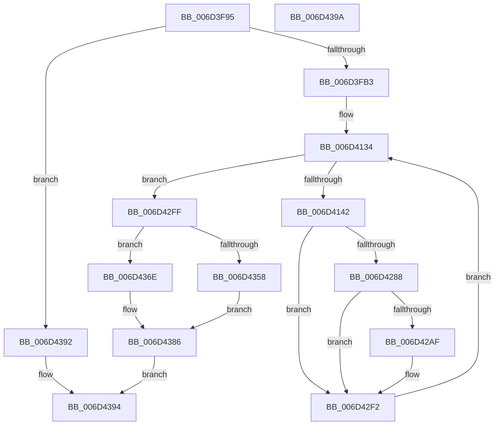

# ExpTimerDpcRoutine$filt$1

- RVA: `0x006D3F95`–`0x006D439B` (길이 `1,030` bytes)
- VA: `0x00000001406D3F95`
- 실행 섹션: `.text`
- PDB 이름 있음: `예`; PDB Function 태그: `예`
- unwind 정보 RVA: `0x000B5BE0`
- 디코드: `240`개 명령, `1,030/1,030` bytes 표시
- 미해석 바이트: `0` (있으면 어셈블리에 `.byte`로 보존)

> 이 문서는 커널 이미지의 기계어와 PDB 기호를 분석해 생성했습니다. 4번과 5번은 함수 원형과 자료형을 바이너리 사용 방식에서 추정한 C 해석이며 원본 소스 복구 결과는 아닙니다.

## 1. Dependencies

- 직접 호출 지점: **2**; 고유 호출 대상: **2**
- 직접 호출자로 확인된 함수: **0**
- RIP 상대 이미지 참조: **2**

### Outgoing calls
- `0x006D4367` → [RtlpComputeEpilogueOffset](../51/RtlpComputeEpilogueOffset_function_0051C81C.md) (function, `0x0051C81C`)
- `0x006D4380` → [guard_dispatch_icall](../6B/guard_dispatch_icall_function_006BAAD0.md) (function, `0x006BAAD0`)

### Direct callers
- 이 함수 시작 RVA로 연결되는 직접 call은 확인되지 않았습니다. 간접 호출은 완전히 역산할 수 없습니다.

### Static image references
- `0x006D417D` → RVA `0x00FC6F78` (`ALMOSTRO`; read)
- `0x006D419F` → RVA `0x00FC7250` (`ALMOSTRO`; read)

## 2. Other-region calls and transfers

- 다른 실행 섹션으로 향하는 call: **0**
- 별도 외부 분기/꼬리 이동을 확인하지 못했습니다.

## 3. Assembly (complete function range)

```asm
006D3F95  40 55                           push rbp
006D3F97  48 83 EC 30                     sub rsp, 0x30
006D3F9B  48 8B EA                        mov rbp, rdx
006D3F9E  8B 45 30                        mov eax, dword ptr [rbp + 0x30]
006D3FA1  83 C0 09                        add eax, 9
006D3FA4  89 45 30                        mov dword ptr [rbp + 0x30], eax
006D3FA7  8B 45 30                        mov eax, dword ptr [rbp + 0x30]
006D3FAA  83 F8 09                        cmp eax, 9
006D3FAD  0F 85 DF 03 00 00               jne 0x1406d4392
006D3FB3  48 8D 85 61 01 00 00            lea rax, [rbp + 0x161]
006D3FBA  48 89 85 B8 00 00 00            mov qword ptr [rbp + 0xb8], rax
006D3FC1  48 C7 85 90 00 00 00 00 00 00 00  mov qword ptr [rbp + 0x90], 0
006D3FCC  48 8B 85 B8 00 00 00            mov rax, qword ptr [rbp + 0xb8]
006D3FD3  48 8B 08                        mov rcx, qword ptr [rax]
006D3FD6  48 89 8D 90 00 00 00            mov qword ptr [rbp + 0x90], rcx
006D3FDD  48 8D 85 11 01 00 00            lea rax, [rbp + 0x111]
006D3FE4  48 89 85 C0 00 00 00            mov qword ptr [rbp + 0xc0], rax
006D3FEB  48 C7 85 88 00 00 00 00 00 00 00  mov qword ptr [rbp + 0x88], 0
006D3FF6  48 8B 85 C0 00 00 00            mov rax, qword ptr [rbp + 0xc0]
006D3FFD  48 8B 08                        mov rcx, qword ptr [rax]
006D4000  48 89 8D 88 00 00 00            mov qword ptr [rbp + 0x88], rcx
006D4007  48 8D 85 61 01 00 00            lea rax, [rbp + 0x161]
006D400E  48 89 85 C8 00 00 00            mov qword ptr [rbp + 0xc8], rax
006D4015  48 C7 85 A0 00 00 00 00 00 00 00  mov qword ptr [rbp + 0xa0], 0
006D4020  48 8B 85 C8 00 00 00            mov rax, qword ptr [rbp + 0xc8]
006D4027  48 8B 08                        mov rcx, qword ptr [rax]
006D402A  48 89 8D A0 00 00 00            mov qword ptr [rbp + 0xa0], rcx
006D4031  48 8D 85 59 01 00 00            lea rax, [rbp + 0x159]
006D4038  48 89 85 D0 00 00 00            mov qword ptr [rbp + 0xd0], rax
006D403F  48 C7 85 98 00 00 00 00 00 00 00  mov qword ptr [rbp + 0x98], 0
006D404A  48 8B 85 D0 00 00 00            mov rax, qword ptr [rbp + 0xd0]
006D4051  48 8B 08                        mov rcx, qword ptr [rax]
006D4054  48 89 8D 98 00 00 00            mov qword ptr [rbp + 0x98], rcx
006D405B  48 8B 85 88 00 00 00            mov rax, qword ptr [rbp + 0x88]
006D4062  8B 8D 90 00 00 00               mov ecx, dword ptr [rbp + 0x90]
006D4068  48 D3 C8                        ror rax, cl
006D406B  48 89 85 D8 00 00 00            mov qword ptr [rbp + 0xd8], rax
006D4072  48 8B 85 98 00 00 00            mov rax, qword ptr [rbp + 0x98]
006D4079  8B 8D A0 00 00 00               mov ecx, dword ptr [rbp + 0xa0]
006D407F  48 D3 C0                        rol rax, cl
006D4082  48 89 85 A8 00 00 00            mov qword ptr [rbp + 0xa8], rax
006D4089  C7 45 68 00 00 00 00            mov dword ptr [rbp + 0x68], 0
006D4090  48 8B 85 A8 00 00 00            mov rax, qword ptr [rbp + 0xa8]
006D4097  48 8B 48 40                     mov rcx, qword ptr [rax + 0x40]
006D409B  48 89 4D 48                     mov qword ptr [rbp + 0x48], rcx
006D409F  48 8B 4D 48                     mov rcx, qword ptr [rbp + 0x48]
006D40A3  48 8B 85 D8 00 00 00            mov rax, qword ptr [rbp + 0xd8]
006D40AA  48 33 C8                        xor rcx, rax
006D40AD  48 89 8D 80 00 00 00            mov qword ptr [rbp + 0x80], rcx
006D40B4  48 8B 85 80 00 00 00            mov rax, qword ptr [rbp + 0x80]
006D40BB  48 B9 00 00 00 00 00 80 FF FF   movabs rcx, 0xffff800000000000
006D40C5  48 0B C1                        or rax, rcx
006D40C8  48 89 85 80 00 00 00            mov qword ptr [rbp + 0x80], rax
006D40CF  48 8B 85 80 00 00 00            mov rax, qword ptr [rbp + 0x80]
006D40D6  48 89 45 40                     mov qword ptr [rbp + 0x40], rax
006D40DA  48 8B 45 40                     mov rax, qword ptr [rbp + 0x40]
006D40DE  48 89 45 50                     mov qword ptr [rbp + 0x50], rax
006D40E2  48 8B 45 40                     mov rax, qword ptr [rbp + 0x40]
006D40E6  83 E0 3F                        and eax, 0x3f
006D40E9  B9 40 00 00 00                  mov ecx, 0x40
006D40EE  2B C8                           sub ecx, eax
006D40F0  48 8B 55 40                     mov rdx, qword ptr [rbp + 0x40]
006D40F4  48 D3 E2                        shl rdx, cl
006D40F7  48 8B 4D 40                     mov rcx, qword ptr [rbp + 0x40]
006D40FB  83 E1 3F                        and ecx, 0x3f
006D40FE  48 8B 45 40                     mov rax, qword ptr [rbp + 0x40]
006D4102  48 D3 E8                        shr rax, cl
006D4105  48 0B C2                        or rax, rdx
006D4108  48 89 45 48                     mov qword ptr [rbp + 0x48], rax
006D410C  8B 45 68                        mov eax, dword ptr [rbp + 0x68]
006D410F  24 03                           and al, 3
006D4111  F6 D8                           neg al
006D4113  48 1B C9                        sbb rcx, rcx
006D4116  48 F7 D1                        not rcx
006D4119  81 E1 D0 77 00 00               and ecx, 0x77d0
006D411F  48 89 8D F0 00 00 00            mov qword ptr [rbp + 0xf0], rcx
006D4126  C7 45 5C 19 00 00 00            mov dword ptr [rbp + 0x5c], 0x19
006D412D  C7 45 34 00 00 00 00            mov dword ptr [rbp + 0x34], 0
006D4134  8B 4D 34                        mov ecx, dword ptr [rbp + 0x34]
006D4137  8B 45 5C                        mov eax, dword ptr [rbp + 0x5c]
006D413A  3B C8                           cmp ecx, eax
006D413C  0F 83 BD 01 00 00               jae 0x1406d42ff
006D4142  48 8B 45 50                     mov rax, qword ptr [rbp + 0x50]
006D4146  48 8B 08                        mov rcx, qword ptr [rax]
006D4149  48 89 4D 70                     mov qword ptr [rbp + 0x70], rcx
006D414D  48 8B 45 48                     mov rax, qword ptr [rbp + 0x48]
006D4151  48 89 85 E8 00 00 00            mov qword ptr [rbp + 0xe8], rax
006D4158  48 8B 45 50                     mov rax, qword ptr [rbp + 0x50]
006D415C  48 8B 08                        mov rcx, qword ptr [rax]
006D415F  48 89 8D E0 00 00 00            mov qword ptr [rbp + 0xe0], rcx
006D4166  48 C7 45 60 00 00 00 00         mov qword ptr [rbp + 0x60], 0
006D416E  48 8B 85 E0 00 00 00            mov rax, qword ptr [rbp + 0xe0]
006D4175  48 89 45 60                     mov qword ptr [rbp + 0x60], rax
006D4179  48 8B 45 60                     mov rax, qword ptr [rbp + 0x60]
006D417D  48 8B 0D F4 2D 8F 00            mov rcx, qword ptr [rip + 0x8f2df4]
006D4184  48 33 C1                        xor rax, rcx
006D4187  48 D3 C0                        rol rax, cl
006D418A  48 89 45 60                     mov qword ptr [rbp + 0x60], rax
006D418E  48 8B 4D 60                     mov rcx, qword ptr [rbp + 0x60]
006D4192  48 8B 85 E8 00 00 00            mov rax, qword ptr [rbp + 0xe8]
006D4199  48 33 C8                        xor rcx, rax
006D419C  48 0F C9                        bswap rcx
006D419F  48 33 0D AA 30 8F 00            xor rcx, qword ptr [rip + 0x8f30aa]
006D41A6  48 89 4D 60                     mov qword ptr [rbp + 0x60], rcx
006D41AA  48 8B 4D 50                     mov rcx, qword ptr [rbp + 0x50]
006D41AE  48 8B 45 60                     mov rax, qword ptr [rbp + 0x60]
006D41B2  48 89 01                        mov qword ptr [rcx], rax
006D41B5  8B 55 34                        mov edx, dword ptr [rbp + 0x34]
006D41B8  48 8B 45 50                     mov rax, qword ptr [rbp + 0x50]
006D41BC  48 8B 00                        mov rax, qword ptr [rax]
006D41BF  48 03 C2                        add rax, rdx
006D41C2  48 8B 4D 40                     mov rcx, qword ptr [rbp + 0x40]
006D41C6  48 03 C8                        add rcx, rax
006D41C9  48 8B 45 50                     mov rax, qword ptr [rbp + 0x50]
006D41CD  48 89 08                        mov qword ptr [rax], rcx
006D41D0  48 8B 45 70                     mov rax, qword ptr [rbp + 0x70]
006D41D4  F7 D0                           not eax
006D41D6  83 E0 3F                        and eax, 0x3f
006D41D9  B9 40 00 00 00                  mov ecx, 0x40
006D41DE  2B C8                           sub ecx, eax
006D41E0  8B 45 34                        mov eax, dword ptr [rbp + 0x34]
006D41E3  41 B8 C8 00 00 00               mov r8d, 0xc8
006D41E9  44 2B C0                        sub r8d, eax
006D41EC  44 8B 4D 34                     mov r9d, dword ptr [rbp + 0x34]
006D41F0  4D 33 C8                        xor r9, r8
006D41F3  49 D3 E1                        shl r9, cl
006D41F6  8B 45 34                        mov eax, dword ptr [rbp + 0x34]
006D41F9  BA C8 00 00 00                  mov edx, 0xc8
006D41FE  2B D0                           sub edx, eax
006D4200  44 8B 45 34                     mov r8d, dword ptr [rbp + 0x34]
006D4204  4C 33 C2                        xor r8, rdx
006D4207  48 8B 4D 70                     mov rcx, qword ptr [rbp + 0x70]
006D420B  F7 D1                           not ecx
006D420D  83 E1 3F                        and ecx, 0x3f
006D4210  49 D3 E8                        shr r8, cl
006D4213  4D 0B C1                        or r8, r9
006D4216  48 8B 45 48                     mov rax, qword ptr [rbp + 0x48]
006D421A  49 33 C0                        xor rax, r8
006D421D  48 89 45 48                     mov qword ptr [rbp + 0x48], rax
006D4221  48 8B 45 70                     mov rax, qword ptr [rbp + 0x70]
006D4225  83 F0 FA                        xor eax, 0xfffffffa
006D4228  83 E0 3F                        and eax, 0x3f
006D422B  B9 40 00 00 00                  mov ecx, 0x40
006D4230  2B C8                           sub ecx, eax
006D4232  48 8B 55 48                     mov rdx, qword ptr [rbp + 0x48]
006D4236  48 D3 EA                        shr rdx, cl
006D4239  48 8B 4D 70                     mov rcx, qword ptr [rbp + 0x70]
006D423D  83 F1 FA                        xor ecx, 0xfffffffa
006D4240  83 E1 3F                        and ecx, 0x3f
006D4243  48 8B 45 48                     mov rax, qword ptr [rbp + 0x48]
006D4247  48 D3 E0                        shl rax, cl
006D424A  48 0B C2                        or rax, rdx
006D424D  48 89 45 48                     mov qword ptr [rbp + 0x48], rax
006D4251  48 8B 4D 40                     mov rcx, qword ptr [rbp + 0x40]
006D4255  48 8B 45 48                     mov rax, qword ptr [rbp + 0x48]
006D4259  48 03 C8                        add rcx, rax
006D425C  48 89 4D 48                     mov qword ptr [rbp + 0x48], rcx
006D4260  48 8B 8D F0 00 00 00            mov rcx, qword ptr [rbp + 0xf0]
006D4267  48 8B 45 48                     mov rax, qword ptr [rbp + 0x48]
006D426B  48 33 C8                        xor rcx, rax
006D426E  48 89 4D 48                     mov qword ptr [rbp + 0x48], rcx
006D4272  48 8B 45 50                     mov rax, qword ptr [rbp + 0x50]
006D4276  48 83 C0 08                     add rax, 8
006D427A  48 89 45 50                     mov qword ptr [rbp + 0x50], rax
006D427E  8B 45 34                        mov eax, dword ptr [rbp + 0x34]
006D4281  FF C0                           inc eax
006D4283  83 F8 19                        cmp eax, 0x19
006D4286  75 6A                           jne 0x1406d42f2
006D4288  48 B8 2E 48 31 11 48 31 51 08   movabs rax, 0x85131481131482e
006D4292  48 89 45 38                     mov qword ptr [rbp + 0x38], rax
006D4296  48 8B 45 38                     mov rax, qword ptr [rbp + 0x38]
006D429A  48 8B 45 38                     mov rax, qword ptr [rbp + 0x38]
006D429E  48 89 45 38                     mov qword ptr [rbp + 0x38], rax
006D42A2  48 8B 4D 38                     mov rcx, qword ptr [rbp + 0x38]
006D42A6  48 8B 45 40                     mov rax, qword ptr [rbp + 0x40]
006D42AA  48 33 08                        xor rcx, qword ptr [rax]
006D42AD  74 43                           je 0x1406d42f2
006D42AF  48 8B 45 50                     mov rax, qword ptr [rbp + 0x50]
006D42B3  48 8B 4D 38                     mov rcx, qword ptr [rbp + 0x38]
006D42B7  48 33 48 F8                     xor rcx, qword ptr [rax - 8]
006D42BB  48 8B 45 40                     mov rax, qword ptr [rbp + 0x40]
006D42BF  48 33 08                        xor rcx, qword ptr [rax]
006D42C2  48 8B 45 50                     mov rax, qword ptr [rbp + 0x50]
006D42C6  48 89 48 F8                     mov qword ptr [rax - 8], rcx
006D42CA  48 8B 4D 50                     mov rcx, qword ptr [rbp + 0x50]
006D42CE  8B 45 5C                        mov eax, dword ptr [rbp + 0x5c]
006D42D1  03 41 FC                        add eax, dword ptr [rcx - 4]
006D42D4  89 45 5C                        mov dword ptr [rbp + 0x5c], eax
006D42D7  48 8B 45 50                     mov rax, qword ptr [rbp + 0x50]
006D42DB  48 8B 4D 38                     mov rcx, qword ptr [rbp + 0x38]
006D42DF  48 33 48 F8                     xor rcx, qword ptr [rax - 8]
006D42E3  48 8B 45 40                     mov rax, qword ptr [rbp + 0x40]
006D42E7  48 33 08                        xor rcx, qword ptr [rax]
006D42EA  48 8B 45 50                     mov rax, qword ptr [rbp + 0x50]
006D42EE  48 89 48 F8                     mov qword ptr [rax - 8], rcx
006D42F2  8B 45 34                        mov eax, dword ptr [rbp + 0x34]
006D42F5  FF C0                           inc eax
006D42F7  89 45 34                        mov dword ptr [rbp + 0x34], eax
006D42FA  E9 35 FE FF FF                  jmp 0x1406d4134
006D42FF  48 B8 2E 48 31 11 48 31 51 08   movabs rax, 0x85131481131482e
006D4309  48 89 45 38                     mov qword ptr [rbp + 0x38], rax
006D430D  48 8B 45 38                     mov rax, qword ptr [rbp + 0x38]
006D4311  48 8B 45 38                     mov rax, qword ptr [rbp + 0x38]
006D4315  48 89 45 38                     mov qword ptr [rbp + 0x38], rax
006D4319  48 8B 4D 38                     mov rcx, qword ptr [rbp + 0x38]
006D431D  48 8B 45 40                     mov rax, qword ptr [rbp + 0x40]
006D4321  48 33 08                        xor rcx, qword ptr [rax]
006D4324  48 89 4D 48                     mov qword ptr [rbp + 0x48], rcx
006D4328  48 8B 45 40                     mov rax, qword ptr [rbp + 0x40]
006D432C  48 89 85 78 01 00 00            mov qword ptr [rbp + 0x178], rax
006D4333  48 C7 45 38 2E 48 31 11         mov qword ptr [rbp + 0x38], 0x1131482e
006D433B  48 8B 45 38                     mov rax, qword ptr [rbp + 0x38]
006D433F  48 8B 4D 38                     mov rcx, qword ptr [rbp + 0x38]
006D4343  48 89 4D 38                     mov qword ptr [rbp + 0x38], rcx
006D4347  48 8B 4D 38                     mov rcx, qword ptr [rbp + 0x38]
006D434B  48 8B 45 40                     mov rax, qword ptr [rbp + 0x40]
006D434F  89 08                           mov dword ptr [rax], ecx
006D4351  8B 45 68                        mov eax, dword ptr [rbp + 0x68]
006D4354  A8 01                           test al, 1
006D4356  74 16                           je 0x1406d436e
006D4358  4C 8B 45 48                     mov r8, qword ptr [rbp + 0x48]
006D435C  48 8B 55 40                     mov rdx, qword ptr [rbp + 0x40]
006D4360  48 8B 8D A8 00 00 00            mov rcx, qword ptr [rbp + 0xa8]
006D4367  E8 B0 84 E4 FF                  call 0x14051c81c
006D436C  EB 18                           jmp 0x1406d4386
006D436E  48 8B 45 40                     mov rax, qword ptr [rbp + 0x40]
006D4372  45 33 C9                        xor r9d, r9d
006D4375  45 33 C0                        xor r8d, r8d
006D4378  48 8B 55 48                     mov rdx, qword ptr [rbp + 0x48]
006D437C  48 8B 4D 40                     mov rcx, qword ptr [rbp + 0x40]
006D4380  E8 4B 67 FE FF                  call 0x1406baad0
006D4385  90                              nop
006D4386  C7 45 78 01 00 00 00            mov dword ptr [rbp + 0x78], 1
006D438D  8B 45 78                        mov eax, dword ptr [rbp + 0x78]
006D4390  EB 02                           jmp 0x1406d4394
006D4392  33 C0                           xor eax, eax
006D4394  48 83 C4 30                     add rsp, 0x30
006D4398  5D                              pop rbp
006D4399  C3                              ret
006D439A  CC                              int3
```

## 4. C-style interpretation (structured pseudocode)

```c
__int64 __fastcall ExpTimerDpcRoutine_filt_1(__int64 a1, __int64 a2)
{
    __int64 result;
    __int64 v_rsp;

    v_rsp = (v_rsp) - (48);
    result = (unsigned int)(((unsigned int)(*(unsigned int *)(a2 + 48))) + (9));
    *(unsigned int *)(a2 + 48) = (unsigned int)(result);
    if (((unsigned int)((unsigned int)(*(unsigned int *)(a2 + 48)))) != 9) goto loc_006D4392;
    *(unsigned __int64 *)(a2 + 184) = a2 + 353;
    *(unsigned __int64 *)(a2 + 144) = 0;
    *(unsigned __int64 *)(a2 + 144) = *(unsigned __int64 *)(*(unsigned __int64 *)(a2 + 184));
    *(unsigned __int64 *)(a2 + 192) = a2 + 273;
    *(unsigned __int64 *)(a2 + 136) = 0;
    *(unsigned __int64 *)(a2 + 136) = *(unsigned __int64 *)(*(unsigned __int64 *)(a2 + 192));
    *(unsigned __int64 *)(a2 + 200) = a2 + 353;
    *(unsigned __int64 *)(a2 + 160) = 0;
    *(unsigned __int64 *)(a2 + 160) = *(unsigned __int64 *)(*(unsigned __int64 *)(a2 + 200));
    *(unsigned __int64 *)(a2 + 208) = a2 + 345;
    *(unsigned __int64 *)(a2 + 152) = 0;
    *(unsigned __int64 *)(a2 + 152) = *(unsigned __int64 *)(*(unsigned __int64 *)(a2 + 208));
    *(unsigned __int64 *)(a2 + 216) = *(unsigned __int64 *)(a2 + 136);
    *(unsigned __int64 *)(a2 + 168) = *(unsigned __int64 *)(a2 + 152);
    *(unsigned int *)(a2 + 104) = 0;
    *(unsigned __int64 *)(a2 + 72) = *(unsigned __int64 *)(*(unsigned __int64 *)(a2 + 168) + 64);
    a1 = (*(unsigned __int64 *)(a2 + 72)) ^ (*(unsigned __int64 *)(a2 + 216));
    *(unsigned __int64 *)(a2 + 128) = a1;
    result = (*(unsigned __int64 *)(a2 + 128)) | (a1);
    *(unsigned __int64 *)(a2 + 128) = result;
    *(unsigned __int64 *)(a2 + 64) = *(unsigned __int64 *)(a2 + 128);
    *(unsigned __int64 *)(a2 + 80) = *(unsigned __int64 *)(a2 + 64);
    result = (unsigned int)((*(unsigned __int64 *)(a2 + 64)) & (63));
    a1 = (unsigned int)((64) - ((unsigned int)(result)));
    a2 = (*(unsigned __int64 *)(a2 + 64)) << ((unsigned __int8)(a1));
    a1 = (unsigned int)((*(unsigned __int64 *)(a2 + 64)) & (63));
    result = (*(unsigned __int64 *)(a2 + 64)) >> ((unsigned __int8)(a1));
    result = (result) | (a2);
    *(unsigned __int64 *)(a2 + 72) = result;
    result = (unsigned __int8)(((unsigned int)(*(unsigned int *)(a2 + 104))) & (3));
    result = (unsigned __int8)(-(result));
    a1 = ~(a1);
    a1 = (unsigned int)((a1) & (0x77D0ULL));
    *(unsigned __int64 *)(a2 + 240) = a1;
    *(unsigned int *)(a2 + 92) = 25;
    *(unsigned int *)(a2 + 52) = 0;
loc_006D4134:
    if (((unsigned int)((unsigned int)(*(unsigned int *)(a2 + 52)))) >= ((unsigned int)((unsigned int)(*(unsigned int *)(a2 + 92))))) goto loc_006D42FF;
    *(unsigned __int64 *)(a2 + 112) = *(unsigned __int64 *)(*(unsigned __int64 *)(a2 + 80));
    *(unsigned __int64 *)(a2 + 232) = *(unsigned __int64 *)(a2 + 72);
    *(unsigned __int64 *)(a2 + 224) = *(unsigned __int64 *)(*(unsigned __int64 *)(a2 + 80));
    *(unsigned __int64 *)(a2 + 96) = 0;
    *(unsigned __int64 *)(a2 + 96) = *(unsigned __int64 *)(a2 + 224);
    result = (*(unsigned __int64 *)(a2 + 96)) ^ (*(unsigned __int64 *)(v_rip + 9383412));
    *(unsigned __int64 *)(a2 + 96) = result;
    a1 = (*(unsigned __int64 *)(a2 + 96)) ^ (*(unsigned __int64 *)(a2 + 232));
    a1 = (a1) ^ (*(unsigned __int64 *)(v_rip + 9384106));
    *(unsigned __int64 *)(a2 + 96) = a1;
    *(unsigned __int64 *)(*(unsigned __int64 *)(a2 + 80)) = *(unsigned __int64 *)(a2 + 96);
    result = (*(unsigned __int64 *)(*(unsigned __int64 *)(a2 + 80))) + ((unsigned int)(*(unsigned int *)(a2 + 52)));
    a1 = (*(unsigned __int64 *)(a2 + 64)) + (result);
    *(unsigned __int64 *)(*(unsigned __int64 *)(a2 + 80)) = a1;
    result = (unsigned int)(~(*(unsigned __int64 *)(a2 + 112)));
    result = (unsigned int)((result) & (63));
    a1 = (unsigned int)((64) - ((unsigned int)(result)));
    a3 = (unsigned int)((200) - ((unsigned int)((unsigned int)(*(unsigned int *)(a2 + 52)))));
    a4 = ((unsigned int)(*(unsigned int *)(a2 + 52))) ^ (a3);
    a4 = (a4) << ((unsigned __int8)(a1));
    a2 = (unsigned int)((200) - ((unsigned int)((unsigned int)(*(unsigned int *)(a2 + 52)))));
    a3 = ((unsigned int)(*(unsigned int *)(a2 + 52))) ^ (a2);
    a1 = (unsigned int)(~(*(unsigned __int64 *)(a2 + 112)));
    a1 = (unsigned int)((a1) & (63));
    a3 = (a3) >> ((unsigned __int8)(a1));
    a3 = (a3) | (a4);
    result = (*(unsigned __int64 *)(a2 + 72)) ^ (a3);
    *(unsigned __int64 *)(a2 + 72) = result;
    result = (unsigned int)((*(unsigned __int64 *)(a2 + 112)) ^ (0xFFFFFFFAULL));
    result = (unsigned int)((result) & (63));
    a1 = (unsigned int)((64) - ((unsigned int)(result)));
    a2 = (*(unsigned __int64 *)(a2 + 72)) >> ((unsigned __int8)(a1));
    a1 = (unsigned int)((*(unsigned __int64 *)(a2 + 112)) ^ (0xFFFFFFFAULL));
    a1 = (unsigned int)((a1) & (63));
    result = (*(unsigned __int64 *)(a2 + 72)) << ((unsigned __int8)(a1));
    result = (result) | (a2);
    *(unsigned __int64 *)(a2 + 72) = result;
    a1 = (*(unsigned __int64 *)(a2 + 64)) + (*(unsigned __int64 *)(a2 + 72));
    *(unsigned __int64 *)(a2 + 72) = a1;
    a1 = (*(unsigned __int64 *)(a2 + 240)) ^ (*(unsigned __int64 *)(a2 + 72));
    *(unsigned __int64 *)(a2 + 72) = a1;
    result = (*(unsigned __int64 *)(a2 + 80)) + (8);
    *(unsigned __int64 *)(a2 + 80) = result;
    result = (unsigned int)(((unsigned int)(*(unsigned int *)(a2 + 52))) + 1);
    if (((unsigned int)(result)) != 25) goto loc_006D42F2;
    *(unsigned __int64 *)(a2 + 56) = result;
    *(unsigned __int64 *)(a2 + 56) = *(unsigned __int64 *)(a2 + 56);
    a1 = (*(unsigned __int64 *)(a2 + 56)) ^ (*(unsigned __int64 *)(*(unsigned __int64 *)(a2 + 64)));
    result = *(unsigned __int64 *)(a2 + 64);
    if (!(condition_is_equal)) {
        result = *(unsigned __int64 *)(a2 + 80);
        a1 = *(unsigned __int64 *)(a2 + 56);
        a1 = (a1) ^ (*(unsigned __int64 *)(result - 8));
        result = *(unsigned __int64 *)(a2 + 64);
        a1 = (a1) ^ (*(unsigned __int64 *)(result));
        result = *(unsigned __int64 *)(a2 + 80);
        *(unsigned __int64 *)(result - 8) = a1;
        a1 = *(unsigned __int64 *)(a2 + 80);
        result = *(unsigned int *)(a2 + 92);
        result = (unsigned int)((result) + (*(unsigned int *)(a1 - 4)));
        *(unsigned int *)(a2 + 92) = (unsigned int)(result);
        result = *(unsigned __int64 *)(a2 + 80);
        a1 = *(unsigned __int64 *)(a2 + 56);
        a1 = (a1) ^ (*(unsigned __int64 *)(result - 8));
        result = *(unsigned __int64 *)(a2 + 64);
        a1 = (a1) ^ (*(unsigned __int64 *)(result));
        result = *(unsigned __int64 *)(a2 + 80);
        *(unsigned __int64 *)(result - 8) = a1;
    }
    result = (unsigned int)(((unsigned int)(*(unsigned int *)(a2 + 52))) + 1);
    *(unsigned int *)(a2 + 52) = (unsigned int)(result);
    goto loc_006D4134;
loc_006D42FF:
    *(unsigned __int64 *)(a2 + 56) = result;
    *(unsigned __int64 *)(a2 + 56) = *(unsigned __int64 *)(a2 + 56);
    a1 = (*(unsigned __int64 *)(a2 + 56)) ^ (*(unsigned __int64 *)(*(unsigned __int64 *)(a2 + 64)));
    *(unsigned __int64 *)(a2 + 72) = a1;
    *(unsigned __int64 *)(a2 + 376) = *(unsigned __int64 *)(a2 + 64);
    *(unsigned __int64 *)(a2 + 56) = 0x1131482EULL;
    *(unsigned __int64 *)(a2 + 56) = *(unsigned __int64 *)(a2 + 56);
    *(unsigned int *)(*(unsigned __int64 *)(a2 + 64)) = (unsigned int)(*(unsigned __int64 *)(a2 + 56));
    if ((((unsigned __int8)((unsigned int)(*(unsigned int *)(a2 + 104)))) & (1)) == 0) goto loc_006D436E;
    result = RtlpComputeEpilogueOffset(*(unsigned __int64 *)(a2 + 168), *(unsigned __int64 *)(a2 + 64), *(unsigned __int64 *)(a2 + 72), a4);
    goto loc_006D4386;
loc_006D436E:
    a4 = 0;
    a3 = 0;
    result = guard_dispatch_icall(*(unsigned __int64 *)(a2 + 64), *(unsigned __int64 *)(a2 + 72), a3, a4);
loc_006D4386:
    *(unsigned int *)(a2 + 120) = 1;
    goto loc_006D4394;
loc_006D4392:
    result = 0;
loc_006D4394:
    v_rsp = (v_rsp) + (48);
    return result;
}
```

## 5. (Beta) C Style

```c
int64_t ExpTimerDpcRoutine_filt_1(int64_t Arg1, void *Arg2)
{
    uint8_t *arg2 = (uint8_t *)Arg2;

    int64_t result;
    int64_t local_rsp;

    local_rsp = (local_rsp) - (48);
    result = (uint32_t)(((uint32_t)(*(uint32_t *)(arg2 + 0x30))) + (9));
    *(uint32_t *)(arg2 + 0x30) = (uint32_t)(result);
    if (((uint32_t)((uint32_t)(*(uint32_t *)(arg2 + 0x30)))) != 9) goto loc_006D4392;
    *(void **)(arg2 + 0xB8) = Arg2 + 353;
    *(uint64_t *)(arg2 + 0x90) = 0;
    *(uint64_t *)(arg2 + 0x90) = *(uint64_t *)(*(uint64_t *)(arg2 + 0xB8));
    *(void **)(arg2 + 0xC0) = Arg2 + 273;
    *(uint64_t *)(arg2 + 0x88) = 0;
    *(uint64_t *)(arg2 + 0x88) = *(uint64_t *)(*(uint64_t *)(arg2 + 0xC0));
    *(void **)(arg2 + 0xC8) = Arg2 + 353;
    *(uint64_t *)(arg2 + 0xA0) = 0;
    *(uint64_t *)(arg2 + 0xA0) = *(uint64_t *)(*(uint64_t *)(arg2 + 0xC8));
    *(void **)(arg2 + 0xD0) = Arg2 + 345;
    *(uint64_t *)(arg2 + 0x98) = 0;
    *(uint64_t *)(arg2 + 0x98) = *(uint64_t *)(*(uint64_t *)(arg2 + 0xD0));
    *(uint64_t *)(arg2 + 0xD8) = *(uint64_t *)(arg2 + 0x88);
    *(uint64_t *)(arg2 + 0xA8) = *(uint64_t *)(arg2 + 0x98);
    *(uint32_t *)(arg2 + 0x68) = 0;
    *(uint64_t *)(arg2 + 0x48) = *(uint64_t *)(*(uint64_t *)(arg2 + 0xA8) + 0x40);
    Arg1 = (*(uint64_t *)(arg2 + 0x48)) ^ (*(uint64_t *)(arg2 + 0xD8));
    *(uint64_t *)(arg2 + 0x80) = Arg1;
    result = (*(uint64_t *)(arg2 + 0x80)) | (Arg1);
    *(uint64_t *)(arg2 + 0x80) = result;
    *(uint64_t *)(arg2 + 0x40) = *(uint64_t *)(arg2 + 0x80);
    *(uint64_t *)(arg2 + 0x50) = *(uint64_t *)(arg2 + 0x40);
    result = (uint32_t)((*(uint64_t *)(arg2 + 0x40)) & (63));
    Arg1 = (uint32_t)((64) - ((uint32_t)(result)));
    Arg2 = (*(uint64_t *)(arg2 + 0x40)) << ((uint8_t)(Arg1));
    Arg1 = (uint32_t)((*(uint64_t *)(arg2 + 0x40)) & (63));
    result = (*(uint64_t *)(arg2 + 0x40)) >> ((uint8_t)(Arg1));
    result = (result) | (Arg2);
    *(uint64_t *)(arg2 + 0x48) = result;
    result = (uint8_t)(((uint32_t)(*(uint32_t *)(arg2 + 0x68))) & (3));
    result = (uint8_t)(-(result));
    Arg1 = ~(Arg1);
    Arg1 = (uint32_t)((Arg1) & (0x77D0ULL));
    *(uint64_t *)(arg2 + 0xF0) = Arg1;
    *(uint32_t *)(arg2 + 0x5C) = 25;
    *(uint32_t *)(arg2 + 0x34) = 0;
loc_006D4134:
    if (((uint32_t)((uint32_t)(*(uint32_t *)(arg2 + 0x34)))) >= ((uint32_t)((uint32_t)(*(uint32_t *)(arg2 + 0x5C))))) goto loc_006D42FF;
    *(uint64_t *)(arg2 + 0x70) = *(uint64_t *)(*(uint64_t *)(arg2 + 0x50));
    *(uint64_t *)(arg2 + 0xE8) = *(uint64_t *)(arg2 + 0x48);
    *(uint64_t *)(arg2 + 0xE0) = *(uint64_t *)(*(uint64_t *)(arg2 + 0x50));
    *(uint64_t *)(arg2 + 0x60) = 0;
    *(uint64_t *)(arg2 + 0x60) = *(uint64_t *)(arg2 + 0xE0);
    result = (*(uint64_t *)(arg2 + 0x60)) ^ (*(uint64_t *)(v_rip + 0x8F2DF4));
    *(uint64_t *)(arg2 + 0x60) = result;
    Arg1 = (*(uint64_t *)(arg2 + 0x60)) ^ (*(uint64_t *)(arg2 + 0xE8));
    Arg1 = (Arg1) ^ (*(uint64_t *)(v_rip + 0x8F30AA));
    *(uint64_t *)(arg2 + 0x60) = Arg1;
    *(uint64_t *)(*(uint64_t *)(arg2 + 0x50)) = *(uint64_t *)(arg2 + 0x60);
    result = (*(uint64_t *)(*(uint64_t *)(arg2 + 0x50))) + ((uint32_t)(*(uint32_t *)(arg2 + 0x34)));
    Arg1 = (*(uint64_t *)(arg2 + 0x40)) + (result);
    *(uint64_t *)(*(uint64_t *)(arg2 + 0x50)) = Arg1;
    result = (uint32_t)(~(*(uint64_t *)(arg2 + 0x70)));
    result = (uint32_t)((result) & (63));
    Arg1 = (uint32_t)((64) - ((uint32_t)(result)));
    a3 = (uint32_t)((200) - ((uint32_t)((uint32_t)(*(uint32_t *)(arg2 + 0x34)))));
    a4 = ((uint32_t)(*(uint32_t *)(arg2 + 0x34))) ^ (a3);
    a4 = (a4) << ((uint8_t)(Arg1));
    Arg2 = (uint32_t)((200) - ((uint32_t)((uint32_t)(*(uint32_t *)(arg2 + 0x34)))));
    a3 = ((uint32_t)(*(uint32_t *)(arg2 + 0x34))) ^ (Arg2);
    Arg1 = (uint32_t)(~(*(uint64_t *)(arg2 + 0x70)));
    Arg1 = (uint32_t)((Arg1) & (63));
    a3 = (a3) >> ((uint8_t)(Arg1));
    a3 = (a3) | (a4);
    result = (*(uint64_t *)(arg2 + 0x48)) ^ (a3);
    *(uint64_t *)(arg2 + 0x48) = result;
    result = (uint32_t)((*(uint64_t *)(arg2 + 0x70)) ^ (0xFFFFFFFAULL));
    result = (uint32_t)((result) & (63));
    Arg1 = (uint32_t)((64) - ((uint32_t)(result)));
    Arg2 = (*(uint64_t *)(arg2 + 0x48)) >> ((uint8_t)(Arg1));
    Arg1 = (uint32_t)((*(uint64_t *)(arg2 + 0x70)) ^ (0xFFFFFFFAULL));
    Arg1 = (uint32_t)((Arg1) & (63));
    result = (*(uint64_t *)(arg2 + 0x48)) << ((uint8_t)(Arg1));
    result = (result) | (Arg2);
    *(uint64_t *)(arg2 + 0x48) = result;
    Arg1 = (*(uint64_t *)(arg2 + 0x40)) + (*(uint64_t *)(arg2 + 0x48));
    *(uint64_t *)(arg2 + 0x48) = Arg1;
    Arg1 = (*(uint64_t *)(arg2 + 0xF0)) ^ (*(uint64_t *)(arg2 + 0x48));
    *(uint64_t *)(arg2 + 0x48) = Arg1;
    result = (*(uint64_t *)(arg2 + 0x50)) + (8);
    *(uint64_t *)(arg2 + 0x50) = result;
    result = (uint32_t)(((uint32_t)(*(uint32_t *)(arg2 + 0x34))) + 1);
    if (((uint32_t)(result)) != 25) goto loc_006D42F2;
    *(uint64_t *)(arg2 + 0x38) = result;
    *(uint64_t *)(arg2 + 0x38) = *(uint64_t *)(arg2 + 0x38);
    Arg1 = (*(uint64_t *)(arg2 + 0x38)) ^ (*(uint64_t *)(*(uint64_t *)(arg2 + 0x40)));
    result = *(uint64_t *)(arg2 + 0x40);
    if (!(condition_is_equal)) {
        result = *(uint64_t *)(arg2 + 0x50);
        Arg1 = *(uint64_t *)(arg2 + 0x38);
        Arg1 = (Arg1) ^ (*(uint64_t *)(result - 0x8));
        result = *(uint64_t *)(arg2 + 0x40);
        Arg1 = (Arg1) ^ (*(uint64_t *)(result));
        result = *(uint64_t *)(arg2 + 0x50);
        *(uint64_t *)(result - 0x8) = Arg1;
        Arg1 = *(uint64_t *)(arg2 + 0x50);
        result = *(uint32_t *)(arg2 + 0x5C);
        result = (uint32_t)((result) + (*(uint32_t *)(Arg1 - 0x4)));
        *(uint32_t *)(arg2 + 0x5C) = (uint32_t)(result);
        result = *(uint64_t *)(arg2 + 0x50);
        Arg1 = *(uint64_t *)(arg2 + 0x38);
        Arg1 = (Arg1) ^ (*(uint64_t *)(result - 0x8));
        result = *(uint64_t *)(arg2 + 0x40);
        Arg1 = (Arg1) ^ (*(uint64_t *)(result));
        result = *(uint64_t *)(arg2 + 0x50);
        *(uint64_t *)(result - 0x8) = Arg1;
    }
    result = (uint32_t)(((uint32_t)(*(uint32_t *)(arg2 + 0x34))) + 1);
    *(uint32_t *)(arg2 + 0x34) = (uint32_t)(result);
    goto loc_006D4134;
loc_006D42FF:
    *(uint64_t *)(arg2 + 0x38) = result;
    *(uint64_t *)(arg2 + 0x38) = *(uint64_t *)(arg2 + 0x38);
    Arg1 = (*(uint64_t *)(arg2 + 0x38)) ^ (*(uint64_t *)(*(uint64_t *)(arg2 + 0x40)));
    *(uint64_t *)(arg2 + 0x48) = Arg1;
    *(uint64_t *)(arg2 + 0x178) = *(uint64_t *)(arg2 + 0x40);
    *(uint64_t *)(arg2 + 0x38) = 0x1131482EULL;
    *(uint64_t *)(arg2 + 0x38) = *(uint64_t *)(arg2 + 0x38);
    *(uint32_t *)(*(uint64_t *)(arg2 + 0x40)) = (uint32_t)(*(uint64_t *)(arg2 + 0x38));
    if ((((uint8_t)((uint32_t)(*(uint32_t *)(arg2 + 0x68)))) & (1)) == 0) goto loc_006D436E;
    result = RtlpComputeEpilogueOffset(*(uint64_t *)(arg2 + 0xA8), *(uint64_t *)(arg2 + 0x40), *(uint64_t *)(arg2 + 0x48), a4);
    goto loc_006D4386;
loc_006D436E:
    a4 = 0;
    a3 = 0;
    result = guard_dispatch_icall(*(uint64_t *)(arg2 + 0x40), *(uint64_t *)(arg2 + 0x48), a3, a4);
loc_006D4386:
    *(uint32_t *)(arg2 + 0x78) = 1;
    goto loc_006D4394;
loc_006D4392:
    result = 0;
loc_006D4394:
    local_rsp = (local_rsp) + (48);
    return result;
}
```

### 관측된 메모리 오프셋

구조체 형식이 확인되지 않은 접근은 인자 기준의 오프셋으로만 기록했습니다.

| 기준 인자 | 오프셋 표현 | 폭 (bit) | 접근 |
|---|---:|---:|---|
| `Arg2` | `+ 0x30` | `32` | `R` |
| `Arg2` | `+ 0x30` | `32` | `W` |
| `Arg2` | `+ 0x34` | `32` | `R` |
| `Arg2` | `+ 0x34` | `32` | `W` |
| `Arg2` | `+ 0x38` | `64` | `R` |
| `Arg2` | `+ 0x38` | `64` | `W` |
| `Arg2` | `+ 0x40` | `64` | `R` |
| `Arg2` | `+ 0x40` | `64` | `W` |
| `Arg2` | `+ 0x48` | `64` | `R` |
| `Arg2` | `+ 0x48` | `64` | `W` |
| `Arg2` | `+ 0x50` | `64` | `R` |
| `Arg2` | `+ 0x50` | `64` | `W` |
| `Arg2` | `+ 0x5C` | `32` | `R` |
| `Arg2` | `+ 0x5C` | `32` | `W` |
| `Arg2` | `+ 0x60` | `64` | `R` |
| `Arg2` | `+ 0x60` | `64` | `W` |
| `Arg2` | `+ 0x68` | `32` | `R` |
| `Arg2` | `+ 0x68` | `32` | `W` |
| `Arg2` | `+ 0x70` | `64` | `R` |
| `Arg2` | `+ 0x70` | `64` | `W` |
| `Arg2` | `+ 0x78` | `32` | `R` |
| `Arg2` | `+ 0x78` | `32` | `W` |
| `Arg2` | `+ 0x80` | `64` | `R` |
| `Arg2` | `+ 0x80` | `64` | `W` |
| `Arg2` | `+ 0x88` | `64` | `R` |
| `Arg2` | `+ 0x88` | `64` | `W` |
| `Arg2` | `+ 0x90` | `32` | `R` |
| `Arg2` | `+ 0x90` | `64` | `W` |
| `Arg2` | `+ 0x98` | `64` | `R` |
| `Arg2` | `+ 0x98` | `64` | `W` |
| `Arg2` | `+ 0xA0` | `32` | `R` |
| `Arg2` | `+ 0xA0` | `64` | `W` |

추가 오프셋 22개는 표에서 생략했습니다.

## 6. Execution-region graph

[열기: 2D/3D 그래프와 함수 탐색 컨트롤 패널](../../../control-panel.html?section=text&rva=0x006D3F95&view=graph)

- 2D 그래프는 위에서 아래로 흐르고, 3D 그래프는 빈 공간을 드래그해 회전합니다. Shift+드래그는 이동, 휠은 확대·축소, 함수 노드 선택은 대상 보고서 이동입니다.

### Static fallback


