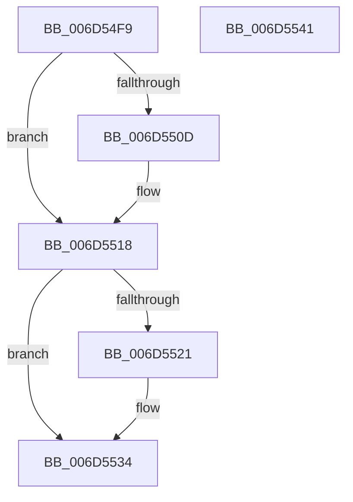

# FsRtlCancelNotify$fin$1

- RVA: `0x006D54F9`–`0x006D5542` (길이 `73` bytes)
- VA: `0x00000001406D54F9`
- 실행 섹션: `.text`
- PDB 이름 있음: `예`; PDB Function 태그: `예`
- unwind 정보 RVA: `0x000C628C`
- 디코드: `26`개 명령, `73/73` bytes 표시
- 미해석 바이트: `0` (있으면 어셈블리에 `.byte`로 보존)

> 이 문서는 커널 이미지의 기계어와 PDB 기호를 분석해 생성했습니다. 4번과 5번은 함수 원형과 자료형을 바이너리 사용 방식에서 추정한 C 해석이며 원본 소스 복구 결과는 아닙니다.

## 1. Dependencies

- 직접 호출 지점: **4**; 고유 호출 대상: **4**
- 직접 호출자로 확인된 함수: **0**
- RIP 상대 이미지 참조: **0**

### Outgoing calls
- `0x006D5512` → [ExReleaseFastMutexUnsafe](../25/ExReleaseFastMutexUnsafe_function_002503A0.md) (function, `0x002503A0`)
- `0x006D5524` → [SeReleaseSubjectContext](../../page/86/SeReleaseSubjectContext_function_0086B710.md) (function, `0x0086B710`)
- `0x006D552E` → [ExFreePoolWithTag](../../poolcode/B8/ExFreePoolWithTag_function_00B82870.md) (function, `0x00B82870`)
- `0x006D5534` → [KeLeaveCriticalRegion](../25/KeLeaveCriticalRegion_function_0025D8B0.md) (function, `0x0025D8B0`)

### Direct callers
- 이 함수 시작 RVA로 연결되는 직접 call은 확인되지 않았습니다. 간접 호출은 완전히 역산할 수 없습니다.

### Static image references
- 디코드된 RIP-relative 메모리 참조가 없습니다.

## 2. Other-region calls and transfers

- 다른 실행 섹션으로 향하는 call: **2**
  - `0x006D5524` → [SeReleaseSubjectContext](../../page/86/SeReleaseSubjectContext_function_0086B710.md) (`.text` → `PAGE`)
  - `0x006D552E` → [ExFreePoolWithTag](../../poolcode/B8/ExFreePoolWithTag_function_00B82870.md) (`.text` → `POOLCODE`)
- 별도 외부 분기/꼬리 이동을 확인하지 못했습니다.

## 3. Assembly (complete function range)

```asm
006D54F9  40 53                           push rbx
006D54FB  55                              push rbp
006D54FC  48 83 EC 38                     sub rsp, 0x38
006D5500  48 8B EA                        mov rbp, rdx
006D5503  48 8B 4D 60                     mov rcx, qword ptr [rbp + 0x60]
006D5507  83 69 40 01                     sub dword ptr [rcx + 0x40], 1
006D550B  75 0B                           jne 0x1406d5518
006D550D  48 83 61 38 00                  and qword ptr [rcx + 0x38], 0
006D5512  E8 89 AE B7 FF                  call 0x1402503a0
006D5517  90                              nop
006D5518  48 8B 5D 48                     mov rbx, qword ptr [rbp + 0x48]
006D551C  48 85 DB                        test rbx, rbx
006D551F  74 13                           je 0x1406d5534
006D5521  48 8B CB                        mov rcx, rbx
006D5524  E8 E7 61 19 00                  call 0x14086b710
006D5529  33 D2                           xor edx, edx
006D552B  48 8B CB                        mov rcx, rbx
006D552E  E8 3D D3 4A 00                  call 0x140b82870
006D5533  90                              nop
006D5534  E8 77 83 B8 FF                  call 0x14025d8b0
006D5539  90                              nop
006D553A  48 83 C4 38                     add rsp, 0x38
006D553E  5D                              pop rbp
006D553F  5B                              pop rbx
006D5540  C3                              ret
006D5541  CC                              int3
```

## 4. C-style interpretation (structured pseudocode)

```c
__int64 __fastcall FsRtlCancelNotify_fin_1(__int64 a1, __int64 a2)
{
    __int64 result;
    __int64 v_rsp;

    v_rsp = (v_rsp) - (56);
    if (!(condition_is_not_equal)) {
        result = ExReleaseFastMutexUnsafe(*(unsigned __int64 *)(a2 + 96), a2, a3, a4);
    }
    if (*(unsigned __int64 *)(a2 + 72) != 0) {
        a1 = *(unsigned __int64 *)(a2 + 72);
        result = SeReleaseSubjectContext(a1, a2, a3, a4);
        a2 = 0;
        a1 = *(unsigned __int64 *)(a2 + 72);
        result = ExFreePoolWithTag(a1, a2, a3, a4);
    }
    result = KeLeaveCriticalRegion(a1, a2, a3, a4);
    v_rsp = (v_rsp) + (56);
    return result;
}
```

## 5. (Beta) C Style

```c
int64_t FsRtlCancelNotify_fin_1(int64_t Arg1, void *Arg2)
{
    uint8_t *arg2 = (uint8_t *)Arg2;

    int64_t result;
    int64_t local_rsp;

    local_rsp = (local_rsp) - (56);
    if (!(condition_is_not_equal)) {
        result = ExReleaseFastMutexUnsafe(*(uint64_t *)(arg2 + 0x60), Arg2, a3, a4);
    }
    if (*(uint64_t *)(arg2 + 0x48) != 0) {
        Arg1 = *(uint64_t *)(arg2 + 0x48);
        result = SeReleaseSubjectContext(Arg1, Arg2, a3, a4);
        Arg2 = 0;
        Arg1 = *(uint64_t *)(arg2 + 0x48);
        result = ExFreePoolWithTag(Arg1, Arg2, a3, a4);
    }
    result = KeLeaveCriticalRegion(Arg1, Arg2, a3, a4);
    local_rsp = (local_rsp) + (56);
    return result;
}
```

### 관측된 메모리 오프셋

구조체 형식이 확인되지 않은 접근은 인자 기준의 오프셋으로만 기록했습니다.

| 기준 인자 | 오프셋 표현 | 폭 (bit) | 접근 |
|---|---:|---:|---|
| `Arg2` | `+ 0x48` | `64` | `R` |
| `Arg2` | `+ 0x60` | `64` | `R` |

## 6. Execution-region graph

[열기: 2D/3D 그래프와 함수 탐색 컨트롤 패널](../../../control-panel.html?section=text&rva=0x006D54F9&view=graph)

- 2D 그래프는 위에서 아래로 흐르고, 3D 그래프는 빈 공간을 드래그해 회전합니다. Shift+드래그는 이동, 휠은 확대·축소, 함수 노드 선택은 대상 보고서 이동입니다.

### Static fallback


