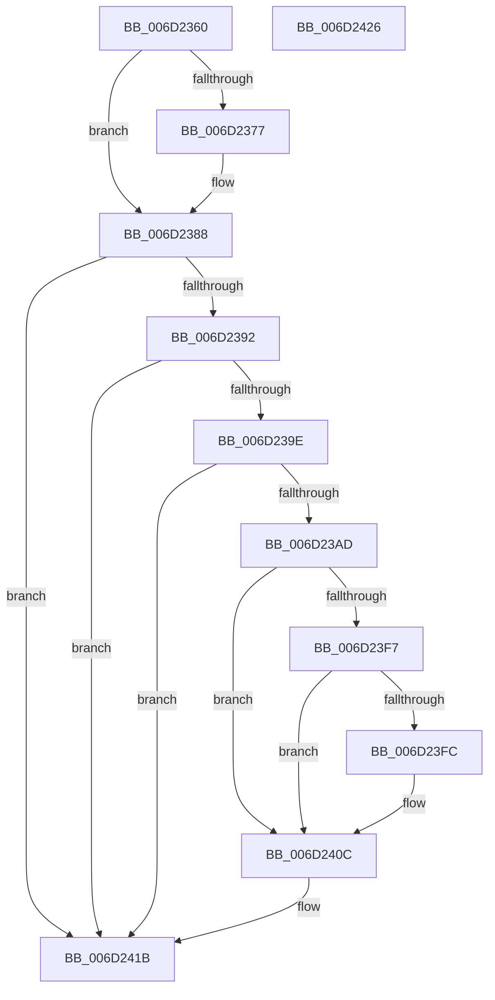

# FsRtlPrivateLock$fin$0

- RVA: `0x006D2360`–`0x006D2427` (길이 `199` bytes)
- VA: `0x00000001406D2360`
- 실행 섹션: `.text`
- PDB 이름 있음: `예`; PDB Function 태그: `예`
- unwind 정보 RVA: `0x00080600`
- 디코드: `59`개 명령, `199/199` bytes 표시
- 미해석 바이트: `0` (있으면 어셈블리에 `.byte`로 보존)

> 이 문서는 커널 이미지의 기계어와 PDB 기호를 분석해 생성했습니다. 4번과 5번은 함수 원형과 자료형을 바이너리 사용 방식에서 추정한 C 해석이며 원본 소스 복구 결과는 아닙니다.

## 1. Dependencies

- 직접 호출 지점: **5**; 고유 호출 대상: **5**
- 직접 호출자로 확인된 함수: **0**
- RIP 상대 이미지 참조: **0**

### Outgoing calls
- `0x006D237F` → [KeReleaseSpinLock](../39/KeReleaseSpinLock_function_00392BA0.md) (function, `0x00392BA0`)
- `0x006D23C3` → [ObfReferenceObjectWithTag](../21/ObfReferenceObjectWithTag_function_00210710.md) (function, `0x00210710`)
- `0x006D23EB` → [FsRtlCompleteLockIrpReal](../49/FsRtlCompleteLockIrpReal_function_004973AC.md) (function, `0x004973AC`)
- `0x006D2406` → [FsRtlPrivateRemoveLock](../4E/FsRtlPrivateRemoveLock_function_004E3244.md) (function, `0x004E3244`)
- `0x006D2414` → [ObfDereferenceObjectWithTag](../2F/ObfDereferenceObjectWithTag_function_002F78E0.md) (function, `0x002F78E0`)

### Direct callers
- 이 함수 시작 RVA로 연결되는 직접 call은 확인되지 않았습니다. 간접 호출은 완전히 역산할 수 없습니다.

### Static image references
- 디코드된 RIP-relative 메모리 참조가 없습니다.

## 2. Other-region calls and transfers

- 다른 실행 섹션으로 향하는 call: **0**
- 별도 외부 분기/꼬리 이동을 확인하지 못했습니다.

## 3. Assembly (complete function range)

```asm
006D2360  40 53                           push rbx
006D2362  55                              push rbp
006D2363  56                              push rsi
006D2364  57                              push rdi
006D2365  41 56                           push r14
006D2367  48 83 EC 30                     sub rsp, 0x30
006D236B  48 8B EA                        mov rbp, rdx
006D236E  0F B6 D9                        movzx ebx, cl
006D2371  80 7D 32 00                     cmp byte ptr [rbp + 0x32], 0
006D2375  74 11                           je 0x1406d2388
006D2377  0F B6 55 31                     movzx edx, byte ptr [rbp + 0x31]
006D237B  48 8B 4D 40                     mov rcx, qword ptr [rbp + 0x40]
006D237F  E8 1C 08 CC FF                  call 0x140392ba0
006D2384  C6 45 32 00                     mov byte ptr [rbp + 0x32], 0
006D2388  8B C3                           mov eax, ebx
006D238A  84 DB                           test bl, bl
006D238C  0F 85 89 00 00 00               jne 0x1406d241b
006D2392  48 8B B5 18 01 00 00            mov rsi, qword ptr [rbp + 0x118]
006D2399  48 85 F6                        test rsi, rsi
006D239C  74 7D                           je 0x1406d241b
006D239E  48 8B 9D 10 01 00 00            mov rbx, qword ptr [rbp + 0x110]
006D23A5  81 3B 03 01 00 00               cmp dword ptr [rbx], 0x103
006D23AB  74 6E                           je 0x1406d241b
006D23AD  C7 45 38 00 00 00 00            mov dword ptr [rbp + 0x38], 0
006D23B4  BA 44 66 6C 74                  mov edx, 0x746c6644
006D23B9  48 8B BD D8 00 00 00            mov rdi, qword ptr [rbp + 0xd8]
006D23C0  48 8B CF                        mov rcx, rdi
006D23C3  E8 48 E3 B3 FF                  call 0x140210710
006D23C8  48 89 7C 24 28                  mov qword ptr [rsp + 0x28], rdi
006D23CD  48 8D 45 38                     lea rax, [rbp + 0x38]
006D23D1  48 89 44 24 20                  mov qword ptr [rsp + 0x20], rax
006D23D6  44 8B 0B                        mov r9d, dword ptr [rbx]
006D23D9  4C 8B C6                        mov r8, rsi
006D23DC  48 8B 95 20 01 00 00            mov rdx, qword ptr [rbp + 0x120]
006D23E3  4C 8B 75 48                     mov r14, qword ptr [rbp + 0x48]
006D23E7  49 8B 4E 08                     mov rcx, qword ptr [r14 + 8]
006D23EB  E8 BC 4F DC FF                  call 0x1404973ac
006D23F0  8B 75 38                        mov esi, dword ptr [rbp + 0x38]
006D23F3  85 F6                           test esi, esi
006D23F5  79 15                           jns 0x1406d240c
006D23F7  83 3B 00                        cmp dword ptr [rbx], 0
006D23FA  7C 10                           jl 0x1406d240c
006D23FC  41 B0 01                        mov r8b, 1
006D23FF  48 8D 55 58                     lea rdx, [rbp + 0x58]
006D2403  49 8B CE                        mov rcx, r14
006D2406  E8 39 0E E1 FF                  call 0x1404e3244
006D240B  90                              nop
006D240C  BA 44 66 6C 74                  mov edx, 0x746c6644
006D2411  48 8B CF                        mov rcx, rdi
006D2414  E8 C7 54 C2 FF                  call 0x1402f78e0
006D2419  89 33                           mov dword ptr [rbx], esi
006D241B  48 83 C4 30                     add rsp, 0x30
006D241F  41 5E                           pop r14
006D2421  5F                              pop rdi
006D2422  5E                              pop rsi
006D2423  5D                              pop rbp
006D2424  5B                              pop rbx
006D2425  C3                              ret
006D2426  CC                              int3
```

## 4. C-style interpretation (structured pseudocode)

```c
__int64 __fastcall FsRtlPrivateLock_fin_0(unsigned __int8 a1, __int64 a2)
{
    __int64 result;
    __int64 v_rsp;
    unsigned __int64 v_stack_m30;
    unsigned __int64 v_stack_m38;

    v_rsp = (v_rsp) - (48);
    if ((*(unsigned __int8 *)(a2 + 50)) != 0) {
        a2 = *(unsigned __int8 *)(a2 + 49);
        a1 = *(unsigned __int64 *)(a2 + 64);
        result = KeReleaseSpinLock(a1, a2, a3, a4);
        *(unsigned __int8 *)(a2 + 50) = 0;
    }
    if (a1 != 0) goto loc_006D241B;
    if (*(unsigned __int64 *)(a2 + 280) == 0) goto loc_006D241B;
    if ((*(unsigned int *)(*(unsigned __int64 *)(a2 + 272))) == 259) goto loc_006D241B;
    *(unsigned int *)(a2 + 56) = 0;
    result = ObfReferenceObjectWithTag(*(unsigned __int64 *)(a2 + 216), (unsigned int)(0x746C6644ULL), a3, a4);
    v_stack_m30 = *(unsigned __int64 *)(a2 + 216);
    v_stack_m38 = a2 + 56;
    result = FsRtlCompleteLockIrpReal(*(unsigned __int64 *)(*(unsigned __int64 *)(a2 + 72) + 8), *(unsigned __int64 *)(a2 + 288), *(unsigned __int64 *)(a2 + 280), (unsigned int)(*(unsigned int *)(*(unsigned __int64 *)(a2 + 272))));
    if (!sign_flag) goto loc_006D240C;
    if ((*(unsigned int *)(*(unsigned __int64 *)(a2 + 272))) >= 0) {
        a3 = 1;
        a2 = a2 + 88;
        a1 = *(unsigned __int64 *)(a2 + 72);
        result = FsRtlPrivateRemoveLock(a1, a2, a3, (unsigned int)(*(unsigned int *)(*(unsigned __int64 *)(a2 + 272))));
    }
    result = ObfDereferenceObjectWithTag(*(unsigned __int64 *)(a2 + 216), (unsigned int)(0x746C6644ULL), a3, (unsigned int)(*(unsigned int *)(*(unsigned __int64 *)(a2 + 272))));
    *(unsigned int *)(*(unsigned __int64 *)(a2 + 272)) = (unsigned int)((unsigned int)(*(unsigned int *)(a2 + 56)));
loc_006D241B:
    v_rsp = (v_rsp) + (48);
    return result;
}
```

## 5. (Beta) C Style

```c
int64_t FsRtlPrivateLock_fin_0(uint8_t Arg1, void *Arg2)
{
    uint8_t *arg2 = (uint8_t *)Arg2;

    int64_t result;
    int64_t local_rsp;
    uint64_t v_stack_m30;
    uint64_t v_stack_m38;

    local_rsp = (local_rsp) - (48);
    if ((*(uint8_t *)(arg2 + 0x32)) != 0) {
        Arg2 = *(uint8_t *)(arg2 + 0x31);
        Arg1 = *(uint64_t *)(arg2 + 0x40);
        result = KeReleaseSpinLock(Arg1, Arg2, a3, a4);
        *(uint8_t *)(arg2 + 0x32) = 0;
    }
    if (Arg1 != 0) goto loc_006D241B;
    if (*(uint64_t *)(arg2 + 0x118) == 0) goto loc_006D241B;
    if ((*(uint32_t *)(*(uint64_t *)(arg2 + 0x110))) == 259) goto loc_006D241B;
    *(uint32_t *)(arg2 + 0x38) = 0;
    result = ObfReferenceObjectWithTag(*(uint64_t *)(arg2 + 0xD8), (uint32_t)(0x746C6644ULL), a3, a4);
    v_stack_m30 = *(uint64_t *)(arg2 + 0xD8);
    v_stack_m38 = Arg2 + 56;
    result = FsRtlCompleteLockIrpReal(*(uint64_t *)(*(uint64_t *)(arg2 + 0x48) + 0x8), *(uint64_t *)(arg2 + 0x120), *(uint64_t *)(arg2 + 0x118), (uint32_t)(*(uint32_t *)(*(uint64_t *)(arg2 + 0x110))));
    if (!sign_flag) goto loc_006D240C;
    if ((*(uint32_t *)(*(uint64_t *)(arg2 + 0x110))) >= 0) {
        a3 = 1;
        Arg2 = Arg2 + 88;
        Arg1 = *(uint64_t *)(arg2 + 0x48);
        result = FsRtlPrivateRemoveLock(Arg1, Arg2, a3, (uint32_t)(*(uint32_t *)(*(uint64_t *)(arg2 + 0x110))));
    }
    result = ObfDereferenceObjectWithTag(*(uint64_t *)(arg2 + 0xD8), (uint32_t)(0x746C6644ULL), a3, (uint32_t)(*(uint32_t *)(*(uint64_t *)(arg2 + 0x110))));
    *(uint32_t *)(*(uint64_t *)(arg2 + 0x110)) = (uint32_t)((uint32_t)(*(uint32_t *)(arg2 + 0x38)));
loc_006D241B:
    local_rsp = (local_rsp) + (48);
    return result;
}
```

### 관측된 메모리 오프셋

구조체 형식이 확인되지 않은 접근은 인자 기준의 오프셋으로만 기록했습니다.

| 기준 인자 | 오프셋 표현 | 폭 (bit) | 접근 |
|---|---:|---:|---|
| `Arg2` | `+ 0x31` | `8` | `R` |
| `Arg2` | `+ 0x32` | `8` | `R` |
| `Arg2` | `+ 0x32` | `8` | `W` |
| `Arg2` | `+ 0x38` | `32` | `R` |
| `Arg2` | `+ 0x38` | `32` | `W` |
| `Arg2` | `+ 0x38` | `64` | `R` |
| `Arg2` | `+ 0x40` | `64` | `R` |
| `Arg2` | `+ 0x48` | `64` | `R` |
| `Arg2` | `+ 0x58` | `64` | `R` |
| `Arg2` | `+ 0xD8` | `64` | `R` |
| `Arg2` | `+ 0x110` | `64` | `R` |
| `Arg2` | `+ 0x118` | `64` | `R` |
| `Arg2` | `+ 0x120` | `64` | `R` |

## 6. Execution-region graph

[열기: 2D/3D 그래프와 함수 탐색 컨트롤 패널](../../../control-panel.html?section=text&rva=0x006D2360&view=graph)

- 2D 그래프는 위에서 아래로 흐르고, 3D 그래프는 빈 공간을 드래그해 회전합니다. Shift+드래그는 이동, 휠은 확대·축소, 함수 노드 선택은 대상 보고서 이동입니다.

### Static fallback


