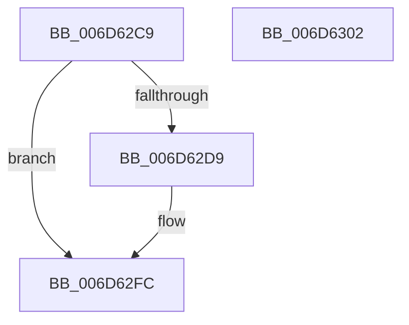

# FsRtlTruncateSmallMcb$fin$1

- RVA: `0x006D62C9`–`0x006D6303` (길이 `58` bytes)
- VA: `0x00000001406D62C9`
- 실행 섹션: `.text`
- PDB 이름 있음: `예`; PDB Function 태그: `예`
- unwind 정보 RVA: `0x000BF6EC`
- 디코드: `17`개 명령, `58/58` bytes 표시
- 미해석 바이트: `0` (있으면 어셈블리에 `.byte`로 보존)

> 이 문서는 커널 이미지의 기계어와 PDB 기호를 분석해 생성했습니다. 4번과 5번은 함수 원형과 자료형을 바이너리 사용 방식에서 추정한 C 해석이며 원본 소스 복구 결과는 아닙니다.

## 1. Dependencies

- 직접 호출 지점: **0**; 고유 호출 대상: **0**
- 직접 호출자로 확인된 함수: **0**
- RIP 상대 이미지 참조: **0**

### Outgoing calls
- 직접 디코드된 call 명령이 없습니다.

### Direct callers
- 이 함수 시작 RVA로 연결되는 직접 call은 확인되지 않았습니다. 간접 호출은 완전히 역산할 수 없습니다.

### Static image references
- 디코드된 RIP-relative 메모리 참조가 없습니다.

## 2. Other-region calls and transfers

- 다른 실행 섹션으로 향하는 call: **0**
- 별도 외부 분기/꼬리 이동을 확인하지 못했습니다.

## 3. Assembly (complete function range)

```asm
006D62C9  40 55                           push rbp
006D62CB  48 83 EC 20                     sub rsp, 0x20
006D62CF  48 8B EA                        mov rbp, rdx
006D62D2  88 4D 24                        mov byte ptr [rbp + 0x24], cl
006D62D5  84 C9                           test cl, cl
006D62D7  74 23                           je 0x1406d62fc
006D62D9  83 45 20 07                     add dword ptr [rbp + 0x20], 7
006D62DD  48 83 A5 C8 00 00 00 00         and qword ptr [rbp + 0xc8], 0
006D62E5  48 8B 8D 91 00 00 00            mov rcx, qword ptr [rbp + 0x91]
006D62EC  48 89 8D C8 00 00 00            mov qword ptr [rbp + 0xc8], rcx
006D62F3  48 8B 45 41                     mov rax, qword ptr [rbp + 0x41]
006D62F7  48 D3 C8                        ror rax, cl
006D62FA  8B 00                           mov eax, dword ptr [rax]
006D62FC  48 83 C4 20                     add rsp, 0x20
006D6300  5D                              pop rbp
006D6301  C3                              ret
006D6302  CC                              int3
```

## 4. C-style interpretation (structured pseudocode)

```c
__int64 __fastcall FsRtlTruncateSmallMcb_fin_1(unsigned __int8 a1, __int64 a2)
{
    __int64 result;
    __int64 v_rsp;

    v_rsp = (v_rsp) - (32);
    *(unsigned __int8 *)(a2 + 36) = a1;
    if (a1 != 0) {
        a1 = *(unsigned __int64 *)(a2 + 145);
        *(unsigned __int64 *)(a2 + 200) = a1;
        result = *(unsigned __int64 *)(a2 + 65);
        result = *(unsigned int *)(result);
    }
    v_rsp = (v_rsp) + (32);
    return result;
}
```

## 5. (Beta) C Style

```c
int64_t FsRtlTruncateSmallMcb_fin_1(uint8_t Arg1, void *Arg2)
{
    uint8_t *arg2 = (uint8_t *)Arg2;

    int64_t result;
    int64_t local_rsp;

    local_rsp = (local_rsp) - (32);
    *(uint8_t *)(arg2 + 0x24) = Arg1;
    if (Arg1 != 0) {
        Arg1 = *(uint64_t *)(arg2 + 0x91);
        *(uint64_t *)(arg2 + 0xC8) = Arg1;
        result = *(uint64_t *)(arg2 + 0x41);
        result = *(uint32_t *)(result);
    }
    local_rsp = (local_rsp) + (32);
    return result;
}
```

### 관측된 메모리 오프셋

구조체 형식이 확인되지 않은 접근은 인자 기준의 오프셋으로만 기록했습니다.

| 기준 인자 | 오프셋 표현 | 폭 (bit) | 접근 |
|---|---:|---:|---|
| `Arg2` | `+ 0x20` | `32` | `R/W` |
| `Arg2` | `+ 0x24` | `8` | `W` |
| `Arg2` | `+ 0x41` | `64` | `R` |
| `Arg2` | `+ 0x91` | `64` | `R` |
| `Arg2` | `+ 0xC8` | `64` | `R/W` |
| `Arg2` | `+ 0xC8` | `64` | `W` |

## 6. Execution-region graph

[열기: 2D/3D 그래프와 함수 탐색 컨트롤 패널](../../../control-panel.html?section=text&rva=0x006D62C9&view=graph)

- 2D 그래프는 위에서 아래로 흐르고, 3D 그래프는 빈 공간을 드래그해 회전합니다. Shift+드래그는 이동, 휠은 확대·축소, 함수 노드 선택은 대상 보고서 이동입니다.

### Static fallback


