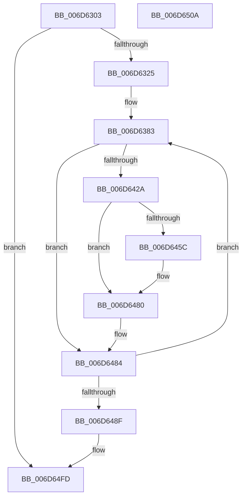

# FsRtlTruncateSmallMcb$fin$2

- RVA: `0x006D6303`–`0x006D650B` (길이 `520` bytes)
- VA: `0x00000001406D6303`
- 실행 섹션: `.text`
- PDB 이름 있음: `예`; PDB Function 태그: `예`
- unwind 정보 RVA: `0x000D9818`
- 디코드: `136`개 명령, `520/520` bytes 표시
- 미해석 바이트: `0` (있으면 어셈블리에 `.byte`로 보존)

> 이 문서는 커널 이미지의 기계어와 PDB 기호를 분석해 생성했습니다. 4번과 5번은 함수 원형과 자료형을 바이너리 사용 방식에서 추정한 C 해석이며 원본 소스 복구 결과는 아닙니다.

## 1. Dependencies

- 직접 호출 지점: **1**; 고유 호출 대상: **1**
- 직접 호출자로 확인된 함수: **0**
- RIP 상대 이미지 참조: **2**

### Outgoing calls
- `0x006D64F7` → [RtlpComputeEpilogueOffset](../51/RtlpComputeEpilogueOffset_function_0051C81C.md) (function, `0x0051C81C`)

### Direct callers
- 이 함수 시작 RVA로 연결되는 직접 call은 확인되지 않았습니다. 간접 호출은 완전히 역산할 수 없습니다.

### Static image references
- `0x006D638A` → RVA `0x00FC6F78` (`ALMOSTRO`; read)
- `0x006D63A0` → RVA `0x00FC7250` (`ALMOSTRO`; read)

## 2. Other-region calls and transfers

- 다른 실행 섹션으로 향하는 call: **0**
- 별도 외부 분기/꼬리 이동을 확인하지 못했습니다.

## 3. Assembly (complete function range)

```asm
006D6303  40 53                           push rbx
006D6305  55                              push rbp
006D6306  56                              push rsi
006D6307  57                              push rdi
006D6308  41 56                           push r14
006D630A  41 57                           push r15
006D630C  48 83 EC 28                     sub rsp, 0x28
006D6310  48 8B EA                        mov rbp, rdx
006D6313  8B 45 20                        mov eax, dword ptr [rbp + 0x20]
006D6316  83 C0 07                        add eax, 7
006D6319  89 45 20                        mov dword ptr [rbp + 0x20], eax
006D631C  83 F8 15                        cmp eax, 0x15
006D631F  0F 85 D8 01 00 00               jne 0x1406d64fd
006D6325  48 8B 8D 91 00 00 00            mov rcx, qword ptr [rbp + 0x91]
006D632C  4C 8B 5D 41                     mov r11, qword ptr [rbp + 0x41]
006D6330  48 8B 85 91 00 00 00            mov rax, qword ptr [rbp + 0x91]
006D6337  4C 8B BD 89 00 00 00            mov r15, qword ptr [rbp + 0x89]
006D633E  49 D3 CB                        ror r11, cl
006D6341  8B C8                           mov ecx, eax
006D6343  49 D3 C7                        rol r15, cl
006D6346  4D 33 5F 40                     xor r11, qword ptr [r15 + 0x40]
006D634A  48 B8 00 00 00 00 00 80 FF FF   movabs rax, 0xffff800000000000
006D6354  4C 0B D8                        or r11, rax
006D6357  41 8B C3                        mov eax, r11d
006D635A  83 E0 3F                        and eax, 0x3f
006D635D  B9 40 00 00 00                  mov ecx, 0x40
006D6362  2B C8                           sub ecx, eax
006D6364  49 8B DB                        mov rbx, r11
006D6367  48 D3 E3                        shl rbx, cl
006D636A  41 8B CB                        mov ecx, r11d
006D636D  83 E1 3F                        and ecx, 0x3f
006D6370  49 8B C3                        mov rax, r11
006D6373  48 D3 E8                        shr rax, cl
006D6376  48 0B D8                        or rbx, rax
006D6379  33 F6                           xor esi, esi
006D637B  44 8D 76 19                     lea r14d, [rsi + 0x19]
006D637F  49 8D 7B F8                     lea rdi, [r11 - 8]
006D6383  4C 8B 57 08                     mov r10, qword ptr [rdi + 8]
006D6387  49 8B D2                        mov rdx, r10
006D638A  48 8B 0D E7 0B 8F 00            mov rcx, qword ptr [rip + 0x8f0be7]
006D6391  48 33 D1                        xor rdx, rcx
006D6394  48 D3 C2                        rol rdx, cl
006D6397  44 8B CE                        mov r9d, esi
006D639A  48 33 D3                        xor rdx, rbx
006D639D  48 0F CA                        bswap rdx
006D63A0  48 33 15 A9 0E 8F 00            xor rdx, qword ptr [rip + 0x8f0ea9]
006D63A7  49 03 D1                        add rdx, r9
006D63AA  49 03 D3                        add rdx, r11
006D63AD  48 89 57 08                     mov qword ptr [rdi + 8], rdx
006D63B1  41 8B C2                        mov eax, r10d
006D63B4  F7 D0                           not eax
006D63B6  83 E0 3F                        and eax, 0x3f
006D63B9  B9 40 00 00 00                  mov ecx, 0x40
006D63BE  2B C8                           sub ecx, eax
006D63C0  41 B8 C8 00 00 00               mov r8d, 0xc8
006D63C6  44 2B C6                        sub r8d, esi
006D63C9  4D 33 C1                        xor r8, r9
006D63CC  49 D3 E0                        shl r8, cl
006D63CF  BA C8 00 00 00                  mov edx, 0xc8
006D63D4  2B D6                           sub edx, esi
006D63D6  49 33 D1                        xor rdx, r9
006D63D9  41 8B CA                        mov ecx, r10d
006D63DC  F7 D1                           not ecx
006D63DE  83 E1 3F                        and ecx, 0x3f
006D63E1  48 D3 EA                        shr rdx, cl
006D63E4  4C 0B C2                        or r8, rdx
006D63E7  49 33 D8                        xor rbx, r8
006D63EA  41 8B C2                        mov eax, r10d
006D63ED  83 F0 FA                        xor eax, 0xfffffffa
006D63F0  83 E0 3F                        and eax, 0x3f
006D63F3  B9 40 00 00 00                  mov ecx, 0x40
006D63F8  2B C8                           sub ecx, eax
006D63FA  48 8B D3                        mov rdx, rbx
006D63FD  48 D3 EA                        shr rdx, cl
006D6400  41 83 F2 FA                     xor r10d, 0xfffffffa
006D6404  41 83 E2 3F                     and r10d, 0x3f
006D6408  41 8A CA                        mov cl, r10b
006D640B  48 8B C3                        mov rax, rbx
006D640E  48 D3 E0                        shl rax, cl
006D6411  48 8B DA                        mov rbx, rdx
006D6414  48 0B D8                        or rbx, rax
006D6417  49 03 DB                        add rbx, r11
006D641A  48 89 5D 30                     mov qword ptr [rbp + 0x30], rbx
006D641E  48 8D 7F 08                     lea rdi, [rdi + 8]
006D6422  8D 46 01                        lea eax, [rsi + 1]
006D6425  83 F8 19                        cmp eax, 0x19
006D6428  75 5A                           jne 0x1406d6484
006D642A  48 B8 2E 48 31 11 48 31 51 08   movabs rax, 0x85131481131482e
006D6434  48 89 85 C8 00 00 00            mov qword ptr [rbp + 0xc8], rax
006D643B  48 8B 85 C8 00 00 00            mov rax, qword ptr [rbp + 0xc8]
006D6442  48 8B 85 C8 00 00 00            mov rax, qword ptr [rbp + 0xc8]
006D6449  48 89 85 C8 00 00 00            mov qword ptr [rbp + 0xc8], rax
006D6450  48 8B 85 C8 00 00 00            mov rax, qword ptr [rbp + 0xc8]
006D6457  49 33 03                        xor rax, qword ptr [r11]
006D645A  74 24                           je 0x1406d6480
006D645C  48 8B 85 C8 00 00 00            mov rax, qword ptr [rbp + 0xc8]
006D6463  48 33 07                        xor rax, qword ptr [rdi]
006D6466  49 33 03                        xor rax, qword ptr [r11]
006D6469  48 89 07                        mov qword ptr [rdi], rax
006D646C  44 03 77 04                     add r14d, dword ptr [rdi + 4]
006D6470  48 8B 85 C8 00 00 00            mov rax, qword ptr [rbp + 0xc8]
006D6477  48 33 07                        xor rax, qword ptr [rdi]
006D647A  49 33 03                        xor rax, qword ptr [r11]
006D647D  48 89 07                        mov qword ptr [rdi], rax
006D6480  48 8B 5D 30                     mov rbx, qword ptr [rbp + 0x30]
006D6484  FF C6                           inc esi
006D6486  41 3B F6                        cmp esi, r14d
006D6489  0F 82 F4 FE FF FF               jb 0x1406d6383
006D648F  48 B8 2E 48 31 11 48 31 51 08   movabs rax, 0x85131481131482e
006D6499  48 89 85 C8 00 00 00            mov qword ptr [rbp + 0xc8], rax
006D64A0  48 8B 85 C8 00 00 00            mov rax, qword ptr [rbp + 0xc8]
006D64A7  48 8B 85 C8 00 00 00            mov rax, qword ptr [rbp + 0xc8]
006D64AE  48 89 85 C8 00 00 00            mov qword ptr [rbp + 0xc8], rax
006D64B5  48 8B 85 C8 00 00 00            mov rax, qword ptr [rbp + 0xc8]
006D64BC  49 33 03                        xor rax, qword ptr [r11]
006D64BF  48 89 45 30                     mov qword ptr [rbp + 0x30], rax
006D64C3  48 C7 85 C8 00 00 00 2E 48 31 11  mov qword ptr [rbp + 0xc8], 0x1131482e
006D64CE  48 8B 85 C8 00 00 00            mov rax, qword ptr [rbp + 0xc8]
006D64D5  4C 8B 85 C8 00 00 00            mov r8, qword ptr [rbp + 0xc8]
006D64DC  4C 89 85 C8 00 00 00            mov qword ptr [rbp + 0xc8], r8
006D64E3  48 8B 85 C8 00 00 00            mov rax, qword ptr [rbp + 0xc8]
006D64EA  41 89 03                        mov dword ptr [r11], eax
006D64ED  4C 8B 45 30                     mov r8, qword ptr [rbp + 0x30]
006D64F1  49 8B D3                        mov rdx, r11
006D64F4  49 8B CF                        mov rcx, r15
006D64F7  E8 20 63 E4 FF                  call 0x14051c81c
006D64FC  90                              nop
006D64FD  48 83 C4 28                     add rsp, 0x28
006D6501  41 5F                           pop r15
006D6503  41 5E                           pop r14
006D6505  5F                              pop rdi
006D6506  5E                              pop rsi
006D6507  5D                              pop rbp
006D6508  5B                              pop rbx
006D6509  C3                              ret
006D650A  CC                              int3
```

## 4. C-style interpretation (structured pseudocode)

```c
__int64 __fastcall FsRtlTruncateSmallMcb_fin_2(__int64 a1, __int64 a2)
{
    __int64 result;
    __int64 v_r10;
    __int64 v_r11;
    __int64 v_r14;
    __int64 v_rbx;
    __int64 v_rsi;
    __int64 v_rsp;

    v_rsp = (v_rsp) - (40);
    result = (unsigned int)(((unsigned int)(*(unsigned int *)(a2 + 32))) + (7));
    *(unsigned int *)(a2 + 32) = (unsigned int)(result);
    if (((unsigned int)(result)) != 21) goto loc_006D64FD;
    v_r11 = (*(unsigned __int64 *)(a2 + 65)) ^ (*(unsigned __int64 *)(*(unsigned __int64 *)(a2 + 137) + 64));
    v_r11 = (v_r11) | (*(unsigned __int64 *)(a2 + 145));
    result = (unsigned int)(((unsigned int)((unsigned int)(v_r11))) & (63));
    a1 = (unsigned int)((64) - ((unsigned int)(result)));
    v_rbx = (v_r11) << ((unsigned __int8)(a1));
    a1 = (unsigned int)(((unsigned int)((unsigned int)(v_r11))) & (63));
    result = (v_r11) >> ((unsigned __int8)(a1));
    v_rbx = (v_rbx) | (result);
    v_rsi = 0;
loc_006D6383:
    a2 = (*(unsigned __int64 *)(v_r11 - 8 + 8)) ^ (*(unsigned __int64 *)(v_rip + 9374695));
    a2 = (a2) ^ (v_rbx);
    a2 = (a2) ^ (*(unsigned __int64 *)(v_rip + 9375401));
    a2 = (a2) + (0);
    a2 = (a2) + (v_r11);
    *(unsigned __int64 *)(v_r11 - 8 + 8) = a2;
    result = (unsigned int)(~((unsigned int)((unsigned int)(*(unsigned __int64 *)(v_r11 - 8 + 8)))));
    result = (unsigned int)((result) & (63));
    a1 = (unsigned int)((64) - ((unsigned int)(result)));
    a3 = (unsigned int)((200) - (0));
    a3 = (a3) ^ (0);
    a3 = (a3) << ((unsigned __int8)(a1));
    a2 = (unsigned int)((200) - (0));
    a2 = (a2) ^ (0);
    a1 = (unsigned int)(~((unsigned int)((unsigned int)(*(unsigned __int64 *)(v_r11 - 8 + 8)))));
    a1 = (unsigned int)((a1) & (63));
    a2 = (a2) >> ((unsigned __int8)(a1));
    a3 = (a3) | (a2);
    v_rbx = (v_rbx) ^ (a3);
    result = (unsigned int)(((unsigned int)((unsigned int)(*(unsigned __int64 *)(v_r11 - 8 + 8)))) ^ (0xFFFFFFFAULL));
    result = (unsigned int)((result) & (63));
    a1 = (unsigned int)((64) - ((unsigned int)(result)));
    a2 = (v_rbx) >> ((unsigned __int8)(a1));
    v_r10 = (unsigned int)((*(unsigned __int64 *)(v_r11 - 8 + 8)) ^ (0xFFFFFFFAULL));
    v_r10 = (unsigned int)((v_r10) & (63));
    result = (v_rbx) << ((unsigned __int8)((unsigned __int8)(v_r10)));
    v_rbx = (a2) | (result);
    v_rbx = (v_rbx) + (v_r11);
    *(unsigned __int64 *)(a2 + 48) = v_rbx;
    if (((unsigned int)(v_rsi + 1)) != 25) goto loc_006D6484;
    *(unsigned __int64 *)(a2 + 200) = v_rsi + 1;
    *(unsigned __int64 *)(a2 + 200) = *(unsigned __int64 *)(a2 + 200);
    result = (*(unsigned __int64 *)(a2 + 200)) ^ (*(unsigned __int64 *)(v_r11));
    v_r14 = v_rsi + 25;
    if (!(condition_is_equal)) {
        result = *(unsigned __int64 *)(a2 + 200);
        result = (result) ^ (*(unsigned __int64 *)(v_r11 - 8 + 8));
        result = (result) ^ (*(unsigned __int64 *)(v_r11));
        *(unsigned __int64 *)(v_r11 - 8 + 8) = result;
        v_r14 = (unsigned int)((v_rsi + 25) + (*(unsigned int *)(v_r11 - 8 + 8 + 4)));
        result = *(unsigned __int64 *)(a2 + 200);
        result = (result) ^ (*(unsigned __int64 *)(v_r11 - 8 + 8));
        result = (result) ^ (*(unsigned __int64 *)(v_r11));
        *(unsigned __int64 *)(v_r11 - 8 + 8) = result;
    }
loc_006D6484:
    v_rsi = (unsigned int)((v_rsi) + 1);
    if (((unsigned int)(v_rsi)) < ((unsigned int)(v_r14))) goto loc_006D6383;
    *(unsigned __int64 *)(a2 + 200) = result;
    *(unsigned __int64 *)(a2 + 200) = *(unsigned __int64 *)(a2 + 200);
    result = (*(unsigned __int64 *)(a2 + 200)) ^ (*(unsigned __int64 *)(v_r11));
    *(unsigned __int64 *)(a2 + 48) = result;
    *(unsigned __int64 *)(a2 + 200) = 0x1131482EULL;
    *(unsigned __int64 *)(a2 + 200) = *(unsigned __int64 *)(a2 + 200);
    *(unsigned int *)(v_r11) = (unsigned int)(*(unsigned __int64 *)(a2 + 200));
    result = RtlpComputeEpilogueOffset(*(unsigned __int64 *)(a2 + 137), v_r11, *(unsigned __int64 *)(a2 + 48), 0);
loc_006D64FD:
    v_rsp = (v_rsp) + (40);
    return result;
}
```

## 5. (Beta) C Style

```c
int64_t FsRtlTruncateSmallMcb_fin_2(int64_t Arg1, void *Arg2)
{
    uint8_t *arg2 = (uint8_t *)Arg2;

    int64_t result;
    int64_t local_r10;
    int64_t local_r11;
    int64_t local_r14;
    int64_t local_rbx;
    int64_t local_rsi;
    int64_t local_rsp;

    local_rsp = (local_rsp) - (40);
    result = (uint32_t)(((uint32_t)(*(uint32_t *)(arg2 + 0x20))) + (7));
    *(uint32_t *)(arg2 + 0x20) = (uint32_t)(result);
    if (((uint32_t)(result)) != 21) goto loc_006D64FD;
    local_r11 = (*(uint64_t *)(arg2 + 0x41)) ^ (*(uint64_t *)(*(uint64_t *)(arg2 + 0x89) + 0x40));
    local_r11 = (local_r11) | (*(uint64_t *)(arg2 + 0x91));
    result = (uint32_t)(((uint32_t)((uint32_t)(local_r11))) & (63));
    Arg1 = (uint32_t)((64) - ((uint32_t)(result)));
    local_rbx = (local_r11) << ((uint8_t)(Arg1));
    Arg1 = (uint32_t)(((uint32_t)((uint32_t)(local_r11))) & (63));
    result = (local_r11) >> ((uint8_t)(Arg1));
    local_rbx = (local_rbx) | (result);
    local_rsi = 0;
loc_006D6383:
    Arg2 = (*(uint64_t *)(local_r11 - 0x8 + 0x8)) ^ (*(uint64_t *)(v_rip + 0x8F0BE7));
    Arg2 = (Arg2) ^ (local_rbx);
    Arg2 = (Arg2) ^ (*(uint64_t *)(v_rip + 0x8F0EA9));
    Arg2 = (Arg2) + (0);
    Arg2 = (Arg2) + (local_r11);
    *(void **)(local_r11 - 0x8 + 0x8) = Arg2;
    result = (uint32_t)(~((uint32_t)((uint32_t)(*(uint64_t *)(local_r11 - 0x8 + 0x8)))));
    result = (uint32_t)((result) & (63));
    Arg1 = (uint32_t)((64) - ((uint32_t)(result)));
    a3 = (uint32_t)((200) - (0));
    a3 = (a3) ^ (0);
    a3 = (a3) << ((uint8_t)(Arg1));
    Arg2 = (uint32_t)((200) - (0));
    Arg2 = (Arg2) ^ (0);
    Arg1 = (uint32_t)(~((uint32_t)((uint32_t)(*(uint64_t *)(local_r11 - 0x8 + 0x8)))));
    Arg1 = (uint32_t)((Arg1) & (63));
    Arg2 = (Arg2) >> ((uint8_t)(Arg1));
    a3 = (a3) | (Arg2);
    local_rbx = (local_rbx) ^ (a3);
    result = (uint32_t)(((uint32_t)((uint32_t)(*(uint64_t *)(local_r11 - 0x8 + 0x8)))) ^ (0xFFFFFFFAULL));
    result = (uint32_t)((result) & (63));
    Arg1 = (uint32_t)((64) - ((uint32_t)(result)));
    Arg2 = (local_rbx) >> ((uint8_t)(Arg1));
    local_r10 = (uint32_t)((*(uint64_t *)(local_r11 - 0x8 + 0x8)) ^ (0xFFFFFFFAULL));
    local_r10 = (uint32_t)((local_r10) & (63));
    result = (local_rbx) << ((uint8_t)((uint8_t)(local_r10)));
    local_rbx = (Arg2) | (result);
    local_rbx = (local_rbx) + (local_r11);
    *(uint64_t *)(arg2 + 0x30) = local_rbx;
    if (((uint32_t)(local_rsi + 1)) != 25) goto loc_006D6484;
    *(uint64_t *)(arg2 + 0xC8) = local_rsi + 1;
    *(uint64_t *)(arg2 + 0xC8) = *(uint64_t *)(arg2 + 0xC8);
    result = (*(uint64_t *)(arg2 + 0xC8)) ^ (*(uint64_t *)(local_r11));
    local_r14 = local_rsi + 25;
    if (!(condition_is_equal)) {
        result = *(uint64_t *)(arg2 + 0xC8);
        result = (result) ^ (*(uint64_t *)(local_r11 - 0x8 + 0x8));
        result = (result) ^ (*(uint64_t *)(local_r11));
        *(uint64_t *)(local_r11 - 0x8 + 0x8) = result;
        local_r14 = (uint32_t)((local_rsi + 25) + (*(uint32_t *)(local_r11 - 0x8 + 0x8 + 0x4)));
        result = *(uint64_t *)(arg2 + 0xC8);
        result = (result) ^ (*(uint64_t *)(local_r11 - 0x8 + 0x8));
        result = (result) ^ (*(uint64_t *)(local_r11));
        *(uint64_t *)(local_r11 - 0x8 + 0x8) = result;
    }
loc_006D6484:
    local_rsi = (uint32_t)((local_rsi) + 1);
    if (((uint32_t)(local_rsi)) < ((uint32_t)(local_r14))) goto loc_006D6383;
    *(uint64_t *)(arg2 + 0xC8) = result;
    *(uint64_t *)(arg2 + 0xC8) = *(uint64_t *)(arg2 + 0xC8);
    result = (*(uint64_t *)(arg2 + 0xC8)) ^ (*(uint64_t *)(local_r11));
    *(uint64_t *)(arg2 + 0x30) = result;
    *(uint64_t *)(arg2 + 0xC8) = 0x1131482EULL;
    *(uint64_t *)(arg2 + 0xC8) = *(uint64_t *)(arg2 + 0xC8);
    *(uint32_t *)(local_r11) = (uint32_t)(*(uint64_t *)(arg2 + 0xC8));
    result = RtlpComputeEpilogueOffset(*(uint64_t *)(arg2 + 0x89), local_r11, *(uint64_t *)(arg2 + 0x30), 0);
loc_006D64FD:
    local_rsp = (local_rsp) + (40);
    return result;
}
```

### 관측된 메모리 오프셋

구조체 형식이 확인되지 않은 접근은 인자 기준의 오프셋으로만 기록했습니다.

| 기준 인자 | 오프셋 표현 | 폭 (bit) | 접근 |
|---|---:|---:|---|
| `Arg2` | `+ 0x20` | `32` | `R` |
| `Arg2` | `+ 0x20` | `32` | `W` |
| `Arg2` | `+ 0x30` | `64` | `R` |
| `Arg2` | `+ 0x30` | `64` | `W` |
| `Arg2` | `+ 0x41` | `64` | `R` |
| `Arg2` | `+ 0x89` | `64` | `R` |
| `Arg2` | `+ 0x91` | `64` | `R` |
| `Arg2` | `+ 0xC8` | `64` | `R` |
| `Arg2` | `+ 0xC8` | `64` | `W` |

## 6. Execution-region graph

[열기: 2D/3D 그래프와 함수 탐색 컨트롤 패널](../../../control-panel.html?section=text&rva=0x006D6303&view=graph)

- 2D 그래프는 위에서 아래로 흐르고, 3D 그래프는 빈 공간을 드래그해 회전합니다. Shift+드래그는 이동, 휠은 확대·축소, 함수 노드 선택은 대상 보고서 이동입니다.

### Static fallback


