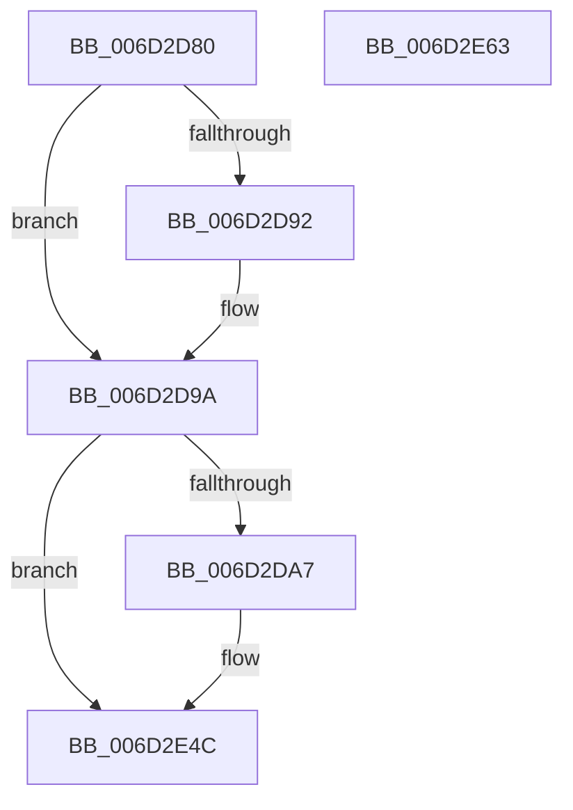

# FsRtlpAcknowledgeOplockBreakByCacheFlags$fin$0

- RVA: `0x006D2D80`–`0x006D2E64` (길이 `228` bytes)
- VA: `0x00000001406D2D80`
- 실행 섹션: `.text`
- PDB 이름 있음: `예`; PDB Function 태그: `예`
- unwind 정보 RVA: `0x00097008`
- 디코드: `46`개 명령, `228/228` bytes 표시
- 미해석 바이트: `0` (있으면 어셈블리에 `.byte`로 보존)

> 이 문서는 커널 이미지의 기계어와 PDB 기호를 분석해 생성했습니다. 4번과 5번은 함수 원형과 자료형을 바이너리 사용 방식에서 추정한 C 해석이며 원본 소스 복구 결과는 아닙니다.

## 1. Dependencies

- 직접 호출 지점: **3**; 고유 호출 대상: **3**
- 직접 호출자로 확인된 함수: **0**
- RIP 상대 이미지 참조: **2**

### Outgoing calls
- `0x006D2D94` → [ExFreePoolWithTag](../../poolcode/B8/ExFreePoolWithTag_function_00B82870.md) (function, `0x00B82870`)
- `0x006D2E46` → [tlgWriteTransfer_EtwWriteTransfer](../42/tlgWriteTransfer_EtwWriteTransfer_function_004260E0.md) (function, `0x004260E0`)
- `0x006D2E57` → [ExReleaseFastMutexUnsafe](../25/ExReleaseFastMutexUnsafe_function_002503A0.md) (function, `0x002503A0`)

### Direct callers
- 이 함수 시작 RVA로 연결되는 직접 call은 확인되지 않았습니다. 간접 호출은 완전히 역산할 수 없습니다.

### Static image references
- `0x006D2D9A` → RVA `0x00E06C50` (`.data`; read)
- `0x006D2E38` → RVA `0x00045823` (`.rdata`; read)

## 2. Other-region calls and transfers

- 다른 실행 섹션으로 향하는 call: **1**
  - `0x006D2D94` → [ExFreePoolWithTag](../../poolcode/B8/ExFreePoolWithTag_function_00B82870.md) (`.text` → `POOLCODE`)
- 별도 외부 분기/꼬리 이동을 확인하지 못했습니다.

## 3. Assembly (complete function range)

```asm
006D2D80  40 55                           push rbp
006D2D82  48 83 EC 50                     sub rsp, 0x50
006D2D86  48 8B EA                        mov rbp, rdx
006D2D89  48 8B 4D 70                     mov rcx, qword ptr [rbp + 0x70]
006D2D8D  48 85 C9                        test rcx, rcx
006D2D90  74 08                           je 0x1406d2d9a
006D2D92  33 D2                           xor edx, edx
006D2D94  E8 D7 FA 4A 00                  call 0x140b82870
006D2D99  90                              nop
006D2D9A  83 3D AF 3E 73 00 05            cmp dword ptr [rip + 0x733eaf], 5
006D2DA1  0F 86 A5 00 00 00               jbe 0x1406d2e4c
006D2DA7  8B 45 5C                        mov eax, dword ptr [rbp + 0x5c]
006D2DAA  89 45 7C                        mov dword ptr [rbp + 0x7c], eax
006D2DAD  48 8D 45 7C                     lea rax, [rbp + 0x7c]
006D2DB1  48 89 85 10 01 00 00            mov qword ptr [rbp + 0x110], rax
006D2DB8  C7 85 18 01 00 00 04 00 00 00   mov dword ptr [rbp + 0x118], 4
006D2DC2  83 A5 1C 01 00 00 00            and dword ptr [rbp + 0x11c], 0
006D2DC9  48 8B 45 50                     mov rax, qword ptr [rbp + 0x50]
006D2DCD  48 89 85 A8 00 00 00            mov qword ptr [rbp + 0xa8], rax
006D2DD4  48 8D 8D A8 00 00 00            lea rcx, [rbp + 0xa8]
006D2DDB  48 89 8D 20 01 00 00            mov qword ptr [rbp + 0x120], rcx
006D2DE2  C7 85 28 01 00 00 08 00 00 00   mov dword ptr [rbp + 0x128], 8
006D2DEC  83 A5 2C 01 00 00 00            and dword ptr [rbp + 0x12c], 0
006D2DF3  8B 80 90 00 00 00               mov eax, dword ptr [rax + 0x90]
006D2DF9  89 85 80 00 00 00               mov dword ptr [rbp + 0x80], eax
006D2DFF  48 8D 85 80 00 00 00            lea rax, [rbp + 0x80]
006D2E06  48 89 85 30 01 00 00            mov qword ptr [rbp + 0x130], rax
006D2E0D  C7 85 38 01 00 00 04 00 00 00   mov dword ptr [rbp + 0x138], 4
006D2E17  83 A5 3C 01 00 00 00            and dword ptr [rbp + 0x13c], 0
006D2E1E  48 8D 85 F0 00 00 00            lea rax, [rbp + 0xf0]
006D2E25  48 89 44 24 28                  mov qword ptr [rsp + 0x28], rax
006D2E2A  C7 44 24 20 05 00 00 00         mov dword ptr [rsp + 0x20], 5
006D2E32  45 33 C9                        xor r9d, r9d
006D2E35  45 33 C0                        xor r8d, r8d
006D2E38  48 8D 15 E4 29 97 FF            lea rdx, [rip - 0x68d61c]
006D2E3F  48 8D 0D 0A 3E 73 00            lea rcx, [rip + 0x733e0a]
006D2E46  E8 95 32 D5 FF                  call 0x1404260e0
006D2E4B  90                              nop
006D2E4C  48 8B 4D 50                     mov rcx, qword ptr [rbp + 0x50]
006D2E50  48 8B 89 98 00 00 00            mov rcx, qword ptr [rcx + 0x98]
006D2E57  E8 44 D5 B7 FF                  call 0x1402503a0
006D2E5C  90                              nop
006D2E5D  48 83 C4 50                     add rsp, 0x50
006D2E61  5D                              pop rbp
006D2E62  C3                              ret
006D2E63  CC                              int3
```

## 4. C-style interpretation (structured pseudocode)

```c
__int64 __fastcall FsRtlpAcknowledgeOplockBreakByCacheFlags_fin_0(__int64 a1, __int64 a2, int a3, int a4)
{
    __int64 result;
    __int64 v_rsp;
    unsigned __int64 v_stack_m30;
    unsigned int v_stack_m38;

    v_rsp = (v_rsp) - (80);
    if (*(unsigned __int64 *)(a2 + 112) != 0) {
        a2 = 0;
        result = ExFreePoolWithTag(*(unsigned __int64 *)(a2 + 112), a2, a3, a4);
    }
    if ((*(unsigned int *)(v_rip + 7552687)) >= = 5) {
        result = *(unsigned int *)(a2 + 92);
        *(unsigned int *)(a2 + 124) = (unsigned int)(result);
        result = a2 + 124;
        *(unsigned __int64 *)(a2 + 272) = result;
        *(unsigned int *)(a2 + 280) = 4;
        result = *(unsigned __int64 *)(a2 + 80);
        *(unsigned __int64 *)(a2 + 168) = result;
        a1 = a2 + 168;
        *(unsigned __int64 *)(a2 + 288) = a1;
        *(unsigned int *)(a2 + 296) = 8;
        result = *(unsigned int *)(result + 144);
        *(unsigned int *)(a2 + 128) = (unsigned int)(result);
        result = a2 + 128;
        *(unsigned __int64 *)(a2 + 304) = result;
        *(unsigned int *)(a2 + 312) = 4;
        result = a2 + 240;
        v_stack_m30 = result;
        v_stack_m38 = 5;
        a4 = 0;
        a3 = 0;
        a2 = v_rip - 6870556;
        a1 = v_rip + 7552522;
        result = tlgWriteTransfer_EtwWriteTransfer(a1, a2, a3, a4);
    }
    result = ExReleaseFastMutexUnsafe(*(unsigned __int64 *)(*(unsigned __int64 *)(a2 + 80) + 152), a2, a3, a4);
    v_rsp = (v_rsp) + (80);
    return result;
}
```

## 5. (Beta) C Style

```c
int64_t FsRtlpAcknowledgeOplockBreakByCacheFlags_fin_0(int64_t Arg1, void *Arg2, int32_t Arg3, int32_t Arg4)
{
    uint8_t *arg2 = (uint8_t *)Arg2;

    int64_t result;
    int64_t local_rsp;
    uint64_t v_stack_m30;
    uint32_t v_stack_m38;

    local_rsp = (local_rsp) - (80);
    if (*(uint64_t *)(arg2 + 0x70) != 0) {
        Arg2 = 0;
        result = ExFreePoolWithTag(*(uint64_t *)(arg2 + 0x70), Arg2, Arg3, Arg4);
    }
    if ((*(uint32_t *)(v_rip + 0x733EAF)) >= = 5) {
        result = *(uint32_t *)(arg2 + 0x5C);
        *(uint32_t *)(arg2 + 0x7C) = (uint32_t)(result);
        result = Arg2 + 124;
        *(uint64_t *)(arg2 + 0x110) = result;
        *(uint32_t *)(arg2 + 0x118) = 4;
        result = *(uint64_t *)(arg2 + 0x50);
        *(uint64_t *)(arg2 + 0xA8) = result;
        Arg1 = Arg2 + 168;
        *(uint64_t *)(arg2 + 0x120) = Arg1;
        *(uint32_t *)(arg2 + 0x128) = 8;
        result = *(uint32_t *)(result + 0x90);
        *(uint32_t *)(arg2 + 0x80) = (uint32_t)(result);
        result = Arg2 + 128;
        *(uint64_t *)(arg2 + 0x130) = result;
        *(uint32_t *)(arg2 + 0x138) = 4;
        result = Arg2 + 240;
        v_stack_m30 = result;
        v_stack_m38 = 5;
        Arg4 = 0;
        Arg3 = 0;
        Arg2 = v_rip - 6870556;
        Arg1 = v_rip + 7552522;
        result = tlgWriteTransfer_EtwWriteTransfer(Arg1, Arg2, Arg3, Arg4);
    }
    result = ExReleaseFastMutexUnsafe(*(uint64_t *)(*(uint64_t *)(arg2 + 0x50) + 0x98), Arg2, Arg3, Arg4);
    local_rsp = (local_rsp) + (80);
    return result;
}
```

### 관측된 메모리 오프셋

구조체 형식이 확인되지 않은 접근은 인자 기준의 오프셋으로만 기록했습니다.

| 기준 인자 | 오프셋 표현 | 폭 (bit) | 접근 |
|---|---:|---:|---|
| `Arg2` | `+ 0x50` | `64` | `R` |
| `Arg2` | `+ 0x5C` | `32` | `R` |
| `Arg2` | `+ 0x70` | `64` | `R` |
| `Arg2` | `+ 0x7C` | `32` | `W` |
| `Arg2` | `+ 0x7C` | `64` | `R` |
| `Arg2` | `+ 0x80` | `32` | `W` |
| `Arg2` | `+ 0x80` | `64` | `R` |
| `Arg2` | `+ 0xA8` | `64` | `R` |
| `Arg2` | `+ 0xA8` | `64` | `W` |
| `Arg2` | `+ 0xF0` | `64` | `R` |
| `Arg2` | `+ 0x110` | `64` | `W` |
| `Arg2` | `+ 0x118` | `32` | `W` |
| `Arg2` | `+ 0x11C` | `32` | `R/W` |
| `Arg2` | `+ 0x120` | `64` | `W` |
| `Arg2` | `+ 0x128` | `32` | `W` |
| `Arg2` | `+ 0x12C` | `32` | `R/W` |
| `Arg2` | `+ 0x130` | `64` | `W` |
| `Arg2` | `+ 0x138` | `32` | `W` |
| `Arg2` | `+ 0x13C` | `32` | `R/W` |

## 6. Execution-region graph

[열기: 2D/3D 그래프와 함수 탐색 컨트롤 패널](../../../control-panel.html?section=text&rva=0x006D2D80&view=graph)

- 2D 그래프는 위에서 아래로 흐르고, 3D 그래프는 빈 공간을 드래그해 회전합니다. Shift+드래그는 이동, 휠은 확대·축소, 함수 노드 선택은 대상 보고서 이동입니다.

### Static fallback


