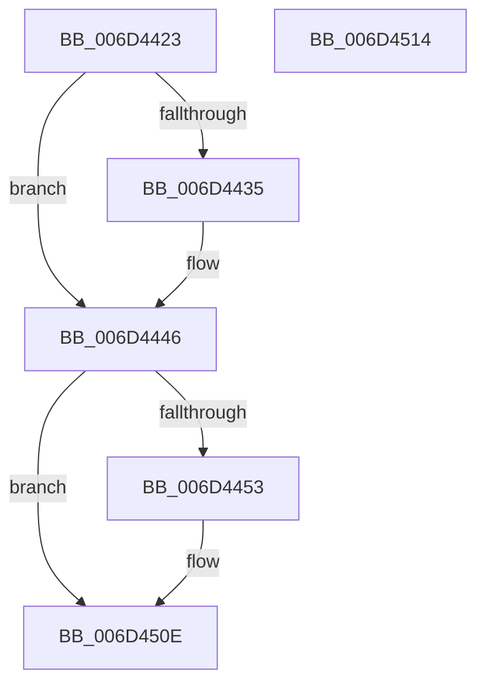

# FsRtlpCancelOplockRHIrp$fin$0

- RVA: `0x006D4423`–`0x006D4515` (길이 `242` bytes)
- VA: `0x00000001406D4423`
- 실행 섹션: `.text`
- PDB 이름 있음: `예`; PDB Function 태그: `예`
- unwind 정보 RVA: `0x000B69E0`
- 디코드: `48`개 명령, `242/242` bytes 표시
- 미해석 바이트: `0` (있으면 어셈블리에 `.byte`로 보존)

> 이 문서는 커널 이미지의 기계어와 PDB 기호를 분석해 생성했습니다. 4번과 5번은 함수 원형과 자료형을 바이너리 사용 방식에서 추정한 C 해석이며 원본 소스 복구 결과는 아닙니다.

## 1. Dependencies

- 직접 호출 지점: **2**; 고유 호출 대상: **2**
- 직접 호출자로 확인된 함수: **0**
- RIP 상대 이미지 참조: **2**

### Outgoing calls
- `0x006D4440` → [ExReleaseFastMutex](../25/ExReleaseFastMutex_function_002519C0.md) (function, `0x002519C0`)
- `0x006D4508` → [tlgWriteTransfer_EtwWriteTransfer](../42/tlgWriteTransfer_EtwWriteTransfer_function_004260E0.md) (function, `0x004260E0`)

### Direct callers
- 이 함수 시작 RVA로 연결되는 직접 call은 확인되지 않았습니다. 간접 호출은 완전히 역산할 수 없습니다.

### Static image references
- `0x006D4446` → RVA `0x00E06C50` (`.data`; read)
- `0x006D44FA` → RVA `0x000444E6` (`.rdata`; read)

## 2. Other-region calls and transfers

- 다른 실행 섹션으로 향하는 call: **0**
- 별도 외부 분기/꼬리 이동을 확인하지 못했습니다.

## 3. Assembly (complete function range)

```asm
006D4423  40 55                           push rbp
006D4425  48 83 EC 40                     sub rsp, 0x40
006D4429  48 8B EA                        mov rbp, rdx
006D442C  80 BD 78 01 00 00 00            cmp byte ptr [rbp + 0x178], 0
006D4433  75 11                           jne 0x1406d4446
006D4435  48 8B 4D 60                     mov rcx, qword ptr [rbp + 0x60]
006D4439  48 8B 89 98 00 00 00            mov rcx, qword ptr [rcx + 0x98]
006D4440  E8 7B D5 B7 FF                  call 0x1402519c0
006D4445  90                              nop
006D4446  83 3D 03 28 73 00 05            cmp dword ptr [rip + 0x732803], 5
006D444D  0F 86 BB 00 00 00               jbe 0x1406d450e
006D4453  8A 85 80 01 00 00               mov al, byte ptr [rbp + 0x180]
006D4459  88 45 40                        mov byte ptr [rbp + 0x40], al
006D445C  48 8D 45 40                     lea rax, [rbp + 0x40]
006D4460  48 89 85 90 00 00 00            mov qword ptr [rbp + 0x90], rax
006D4467  C7 85 98 00 00 00 01 00 00 00   mov dword ptr [rbp + 0x98], 1
006D4471  83 A5 9C 00 00 00 00            and dword ptr [rbp + 0x9c], 0
006D4478  8A 45 42                        mov al, byte ptr [rbp + 0x42]
006D447B  88 45 41                        mov byte ptr [rbp + 0x41], al
006D447E  48 8D 45 41                     lea rax, [rbp + 0x41]
006D4482  48 89 85 A0 00 00 00            mov qword ptr [rbp + 0xa0], rax
006D4489  C7 85 A8 00 00 00 01 00 00 00   mov dword ptr [rbp + 0xa8], 1
006D4493  83 A5 AC 00 00 00 00            and dword ptr [rbp + 0xac], 0
006D449A  48 8B 45 60                     mov rax, qword ptr [rbp + 0x60]
006D449E  48 89 45 50                     mov qword ptr [rbp + 0x50], rax
006D44A2  48 8D 4D 50                     lea rcx, [rbp + 0x50]
006D44A6  48 89 8D B0 00 00 00            mov qword ptr [rbp + 0xb0], rcx
006D44AD  C7 85 B8 00 00 00 08 00 00 00   mov dword ptr [rbp + 0xb8], 8
006D44B7  83 A5 BC 00 00 00 00            and dword ptr [rbp + 0xbc], 0
006D44BE  8B 80 90 00 00 00               mov eax, dword ptr [rax + 0x90]
006D44C4  89 45 44                        mov dword ptr [rbp + 0x44], eax
006D44C7  48 8D 45 44                     lea rax, [rbp + 0x44]
006D44CB  48 89 85 C0 00 00 00            mov qword ptr [rbp + 0xc0], rax
006D44D2  C7 85 C8 00 00 00 04 00 00 00   mov dword ptr [rbp + 0xc8], 4
006D44DC  83 A5 CC 00 00 00 00            and dword ptr [rbp + 0xcc], 0
006D44E3  48 8D 45 70                     lea rax, [rbp + 0x70]
006D44E7  48 89 44 24 28                  mov qword ptr [rsp + 0x28], rax
006D44EC  C7 44 24 20 06 00 00 00         mov dword ptr [rsp + 0x20], 6
006D44F4  45 33 C9                        xor r9d, r9d
006D44F7  45 33 C0                        xor r8d, r8d
006D44FA  48 8D 15 E5 FF 96 FF            lea rdx, [rip - 0x69001b]
006D4501  48 8D 0D 48 27 73 00            lea rcx, [rip + 0x732748]
006D4508  E8 D3 1B D5 FF                  call 0x1404260e0
006D450D  90                              nop
006D450E  48 83 C4 40                     add rsp, 0x40
006D4512  5D                              pop rbp
006D4513  C3                              ret
006D4514  CC                              int3
```

## 4. C-style interpretation (structured pseudocode)

```c
__int64 __fastcall FsRtlpCancelOplockRHIrp_fin_0(__int64 a1, __int64 a2, int a3, int a4)
{
    __int64 result;
    __int64 v_rsp;
    unsigned __int64 v_stack_m20;
    unsigned int v_stack_m28;

    v_rsp = (v_rsp) - (64);
    if ((*(unsigned __int8 *)(a2 + 376)) == 0) {
        a1 = *(unsigned __int64 *)(a2 + 96);
        a1 = *(unsigned __int64 *)(a1 + 152);
        result = ExReleaseFastMutex(a1, a2, a3, a4);
    }
    if ((*(unsigned int *)(v_rip + 7546883)) >= = 5) {
        result = *(unsigned __int8 *)(a2 + 384);
        *(unsigned __int8 *)(a2 + 64) = (unsigned __int8)(result);
        result = a2 + 64;
        *(unsigned __int64 *)(a2 + 144) = result;
        *(unsigned int *)(a2 + 152) = 1;
        result = *(unsigned __int8 *)(a2 + 66);
        *(unsigned __int8 *)(a2 + 65) = (unsigned __int8)(result);
        result = a2 + 65;
        *(unsigned __int64 *)(a2 + 160) = result;
        *(unsigned int *)(a2 + 168) = 1;
        result = *(unsigned __int64 *)(a2 + 96);
        *(unsigned __int64 *)(a2 + 80) = result;
        a1 = a2 + 80;
        *(unsigned __int64 *)(a2 + 176) = a1;
        *(unsigned int *)(a2 + 184) = 8;
        result = *(unsigned int *)(result + 144);
        *(unsigned int *)(a2 + 68) = (unsigned int)(result);
        result = a2 + 68;
        *(unsigned __int64 *)(a2 + 192) = result;
        *(unsigned int *)(a2 + 200) = 4;
        result = a2 + 112;
        v_stack_m20 = result;
        v_stack_m28 = 6;
        a4 = 0;
        a3 = 0;
        a2 = v_rip - 6881307;
        a1 = v_rip + 7546696;
        result = tlgWriteTransfer_EtwWriteTransfer(a1, a2, a3, a4);
    }
    v_rsp = (v_rsp) + (64);
    return result;
}
```

## 5. (Beta) C Style

```c
int64_t FsRtlpCancelOplockRHIrp_fin_0(int64_t Arg1, void *Arg2, int32_t Arg3, int32_t Arg4)
{
    uint8_t *arg2 = (uint8_t *)Arg2;

    int64_t result;
    int64_t local_rsp;
    uint64_t v_stack_m20;
    uint32_t v_stack_m28;

    local_rsp = (local_rsp) - (64);
    if ((*(uint8_t *)(arg2 + 0x178)) == 0) {
        Arg1 = *(uint64_t *)(arg2 + 0x60);
        Arg1 = *(uint64_t *)(Arg1 + 0x98);
        result = ExReleaseFastMutex(Arg1, Arg2, Arg3, Arg4);
    }
    if ((*(uint32_t *)(v_rip + 0x732803)) >= = 5) {
        result = *(uint8_t *)(arg2 + 0x180);
        *(uint8_t *)(arg2 + 0x40) = (uint8_t)(result);
        result = Arg2 + 64;
        *(uint64_t *)(arg2 + 0x90) = result;
        *(uint32_t *)(arg2 + 0x98) = 1;
        result = *(uint8_t *)(arg2 + 0x42);
        *(uint8_t *)(arg2 + 0x41) = (uint8_t)(result);
        result = Arg2 + 65;
        *(uint64_t *)(arg2 + 0xA0) = result;
        *(uint32_t *)(arg2 + 0xA8) = 1;
        result = *(uint64_t *)(arg2 + 0x60);
        *(uint64_t *)(arg2 + 0x50) = result;
        Arg1 = Arg2 + 80;
        *(uint64_t *)(arg2 + 0xB0) = Arg1;
        *(uint32_t *)(arg2 + 0xB8) = 8;
        result = *(uint32_t *)(result + 0x90);
        *(uint32_t *)(arg2 + 0x44) = (uint32_t)(result);
        result = Arg2 + 68;
        *(uint64_t *)(arg2 + 0xC0) = result;
        *(uint32_t *)(arg2 + 0xC8) = 4;
        result = Arg2 + 112;
        v_stack_m20 = result;
        v_stack_m28 = 6;
        Arg4 = 0;
        Arg3 = 0;
        Arg2 = v_rip - 6881307;
        Arg1 = v_rip + 7546696;
        result = tlgWriteTransfer_EtwWriteTransfer(Arg1, Arg2, Arg3, Arg4);
    }
    local_rsp = (local_rsp) + (64);
    return result;
}
```

### 관측된 메모리 오프셋

구조체 형식이 확인되지 않은 접근은 인자 기준의 오프셋으로만 기록했습니다.

| 기준 인자 | 오프셋 표현 | 폭 (bit) | 접근 |
|---|---:|---:|---|
| `Arg2` | `+ 0x40` | `8` | `W` |
| `Arg2` | `+ 0x40` | `64` | `R` |
| `Arg2` | `+ 0x41` | `8` | `W` |
| `Arg2` | `+ 0x41` | `64` | `R` |
| `Arg2` | `+ 0x42` | `8` | `R` |
| `Arg2` | `+ 0x44` | `32` | `W` |
| `Arg2` | `+ 0x44` | `64` | `R` |
| `Arg2` | `+ 0x50` | `64` | `R` |
| `Arg2` | `+ 0x50` | `64` | `W` |
| `Arg2` | `+ 0x60` | `64` | `R` |
| `Arg2` | `+ 0x70` | `64` | `R` |
| `Arg2` | `+ 0x90` | `64` | `W` |
| `Arg2` | `+ 0x98` | `32` | `W` |
| `Arg2` | `+ 0x9C` | `32` | `R/W` |
| `Arg2` | `+ 0xA0` | `64` | `W` |
| `Arg2` | `+ 0xA8` | `32` | `W` |
| `Arg2` | `+ 0xAC` | `32` | `R/W` |
| `Arg2` | `+ 0xB0` | `64` | `W` |
| `Arg2` | `+ 0xB8` | `32` | `W` |
| `Arg2` | `+ 0xBC` | `32` | `R/W` |
| `Arg2` | `+ 0xC0` | `64` | `W` |
| `Arg2` | `+ 0xC8` | `32` | `W` |
| `Arg2` | `+ 0xCC` | `32` | `R/W` |
| `Arg2` | `+ 0x178` | `8` | `R` |
| `Arg2` | `+ 0x180` | `8` | `R` |

## 6. Execution-region graph

[열기: 2D/3D 그래프와 함수 탐색 컨트롤 패널](../../../control-panel.html?section=text&rva=0x006D4423&view=graph)

- 2D 그래프는 위에서 아래로 흐르고, 3D 그래프는 빈 공간을 드래그해 회전합니다. Shift+드래그는 이동, 휠은 확대·축소, 함수 노드 선택은 대상 보고서 이동입니다.

### Static fallback


