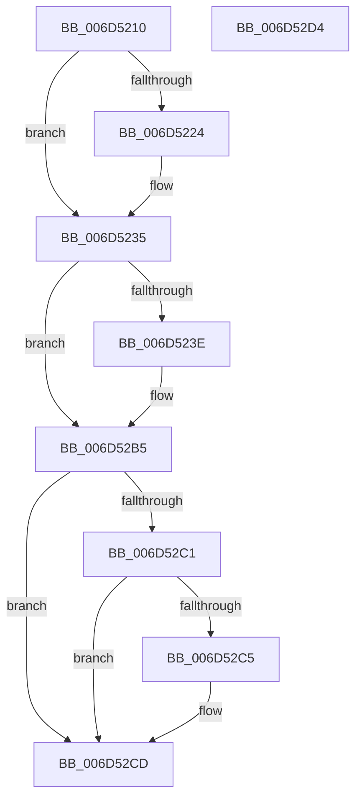

# FsRtlpCancelWaitingIrp$fin$0

- RVA: `0x006D5210`–`0x006D52D5` (길이 `197` bytes)
- VA: `0x00000001406D5210`
- 실행 섹션: `.text`
- PDB 이름 있음: `예`; PDB Function 태그: `예`
- unwind 정보 RVA: `0x000C5EA0`
- 디코드: `47`개 명령, `197/197` bytes 표시
- 미해석 바이트: `0` (있으면 어셈블리에 `.byte`로 보존)

> 이 문서는 커널 이미지의 기계어와 PDB 기호를 분석해 생성했습니다. 4번과 5번은 함수 원형과 자료형을 바이너리 사용 방식에서 추정한 C 해석이며 원본 소스 복구 결과는 아닙니다.

## 1. Dependencies

- 직접 호출 지점: **3**; 고유 호출 대상: **3**
- 직접 호출자로 확인된 함수: **0**
- RIP 상대 이미지 참조: **2**

### Outgoing calls
- `0x006D522F` → [ExReleaseFastMutex](../25/ExReleaseFastMutex_function_002519C0.md) (function, `0x002519C0`)
- `0x006D52AF` → [tlgWriteTransfer_EtwWriteTransfer](../42/tlgWriteTransfer_EtwWriteTransfer_function_004260E0.md) (function, `0x004260E0`)
- `0x006D52B5` → [Feature_3609177402__private_IsEnabledDeviceUsageNoInline](../58/Feature_3609177402__private_IsEnabledDeviceUsageNoInline_function_00581D30.md) (function, `0x00581D30`)

### Direct callers
- 이 함수 시작 RVA로 연결되는 직접 call은 확인되지 않았습니다. 간접 호출은 완전히 역산할 수 없습니다.

### Static image references
- `0x006D5235` → RVA `0x00E06C50` (`.data`; read)
- `0x006D52A1` → RVA `0x000443AD` (`.rdata`; read)

## 2. Other-region calls and transfers

- 다른 실행 섹션으로 향하는 call: **0**
- 별도 외부 분기/꼬리 이동을 확인하지 못했습니다.

## 3. Assembly (complete function range)

```asm
006D5210  40 53                           push rbx
006D5212  55                              push rbp
006D5213  48 83 EC 38                     sub rsp, 0x38
006D5217  48 8B EA                        mov rbp, rdx
006D521A  8A 9D 98 01 00 00               mov bl, byte ptr [rbp + 0x198]
006D5220  84 DB                           test bl, bl
006D5222  75 11                           jne 0x1406d5235
006D5224  48 8B 4D 38                     mov rcx, qword ptr [rbp + 0x38]
006D5228  48 8B 89 98 00 00 00            mov rcx, qword ptr [rcx + 0x98]
006D522F  E8 8C C7 B7 FF                  call 0x1402519c0
006D5234  90                              nop
006D5235  83 3D 14 1A 73 00 05            cmp dword ptr [rip + 0x731a14], 5
006D523C  76 77                           jbe 0x1406d52b5
006D523E  48 8B 45 38                     mov rax, qword ptr [rbp + 0x38]
006D5242  48 89 45 48                     mov qword ptr [rbp + 0x48], rax
006D5246  48 8D 4D 48                     lea rcx, [rbp + 0x48]
006D524A  48 89 8D A0 00 00 00            mov qword ptr [rbp + 0xa0], rcx
006D5251  C7 85 A8 00 00 00 08 00 00 00   mov dword ptr [rbp + 0xa8], 8
006D525B  83 A5 AC 00 00 00 00            and dword ptr [rbp + 0xac], 0
006D5262  8B 80 90 00 00 00               mov eax, dword ptr [rax + 0x90]
006D5268  89 45 34                        mov dword ptr [rbp + 0x34], eax
006D526B  48 8D 45 34                     lea rax, [rbp + 0x34]
006D526F  48 89 85 B0 00 00 00            mov qword ptr [rbp + 0xb0], rax
006D5276  C7 85 B8 00 00 00 04 00 00 00   mov dword ptr [rbp + 0xb8], 4
006D5280  83 A5 BC 00 00 00 00            and dword ptr [rbp + 0xbc], 0
006D5287  48 8D 85 80 00 00 00            lea rax, [rbp + 0x80]
006D528E  48 89 44 24 28                  mov qword ptr [rsp + 0x28], rax
006D5293  C7 44 24 20 04 00 00 00         mov dword ptr [rsp + 0x20], 4
006D529B  45 33 C9                        xor r9d, r9d
006D529E  45 33 C0                        xor r8d, r8d
006D52A1  48 8D 15 05 F1 96 FF            lea rdx, [rip - 0x690efb]
006D52A8  48 8D 0D A1 19 73 00            lea rcx, [rip + 0x7319a1]
006D52AF  E8 2C 0E D5 FF                  call 0x1404260e0
006D52B4  90                              nop
006D52B5  E8 76 CA EA FF                  call 0x140581d30
006D52BA  89 45 38                        mov dword ptr [rbp + 0x38], eax
006D52BD  85 C0                           test eax, eax
006D52BF  74 0C                           je 0x1406d52cd
006D52C1  84 DB                           test bl, bl
006D52C3  75 08                           jne 0x1406d52cd
006D52C5  48 8B 45 58                     mov rax, qword ptr [rbp + 0x58]
006D52C9  F0 FF 48 08                     lock dec dword ptr [rax + 8]
006D52CD  48 83 C4 38                     add rsp, 0x38
006D52D1  5D                              pop rbp
006D52D2  5B                              pop rbx
006D52D3  C3                              ret
006D52D4  CC                              int3
```

## 4. C-style interpretation (structured pseudocode)

```c
__int64 __fastcall FsRtlpCancelWaitingIrp_fin_0(__int64 a1, __int64 a2, int a3, int a4)
{
    __int64 result;
    __int64 v_rsp;
    unsigned __int64 v_stack_m20;
    unsigned int v_stack_m28;

    v_rsp = (v_rsp) - (56);
    if ((unsigned __int8)(*(unsigned __int8 *)(a2 + 408)) == 0) {
        a1 = *(unsigned __int64 *)(a2 + 56);
        a1 = *(unsigned __int64 *)(a1 + 152);
        result = ExReleaseFastMutex(a1, a2, a3, a4);
    }
    if ((*(unsigned int *)(v_rip + 7543316)) >= = 5) {
        result = *(unsigned __int64 *)(a2 + 56);
        *(unsigned __int64 *)(a2 + 72) = result;
        a1 = a2 + 72;
        *(unsigned __int64 *)(a2 + 160) = a1;
        *(unsigned int *)(a2 + 168) = 8;
        result = *(unsigned int *)(result + 144);
        *(unsigned int *)(a2 + 52) = (unsigned int)(result);
        result = a2 + 52;
        *(unsigned __int64 *)(a2 + 176) = result;
        *(unsigned int *)(a2 + 184) = 4;
        result = a2 + 128;
        v_stack_m20 = result;
        v_stack_m28 = 4;
        a4 = 0;
        a3 = 0;
        a2 = v_rip - 6885115;
        a1 = v_rip + 7543201;
        result = tlgWriteTransfer_EtwWriteTransfer(a1, a2, a3, a4);
    }
    result = Feature_3609177402__private_IsEnabledDeviceUsageNoInline(a1, a2, a3, a4);
    *(unsigned int *)(a2 + 56) = (unsigned int)(result);
    if ((unsigned int)(result) == 0) goto loc_006D52CD;
    if ((unsigned __int8)(*(unsigned __int8 *)(a2 + 408)) == 0) {
        result = *(unsigned __int64 *)(a2 + 88);
    }
    v_rsp = (v_rsp) + (56);
    return result;
}
```

## 5. (Beta) C Style

```c
int64_t FsRtlpCancelWaitingIrp_fin_0(int64_t Arg1, void *Arg2, int32_t Arg3, int32_t Arg4)
{
    uint8_t *arg2 = (uint8_t *)Arg2;

    int64_t result;
    int64_t local_rsp;
    uint64_t v_stack_m20;
    uint32_t v_stack_m28;

    local_rsp = (local_rsp) - (56);
    if ((uint8_t)(*(uint8_t *)(arg2 + 0x198)) == 0) {
        Arg1 = *(uint64_t *)(arg2 + 0x38);
        Arg1 = *(uint64_t *)(Arg1 + 0x98);
        result = ExReleaseFastMutex(Arg1, Arg2, Arg3, Arg4);
    }
    if ((*(uint32_t *)(v_rip + 0x731A14)) >= = 5) {
        result = *(uint64_t *)(arg2 + 0x38);
        *(uint64_t *)(arg2 + 0x48) = result;
        Arg1 = Arg2 + 72;
        *(uint64_t *)(arg2 + 0xA0) = Arg1;
        *(uint32_t *)(arg2 + 0xA8) = 8;
        result = *(uint32_t *)(result + 0x90);
        *(uint32_t *)(arg2 + 0x34) = (uint32_t)(result);
        result = Arg2 + 52;
        *(uint64_t *)(arg2 + 0xB0) = result;
        *(uint32_t *)(arg2 + 0xB8) = 4;
        result = Arg2 + 128;
        v_stack_m20 = result;
        v_stack_m28 = 4;
        Arg4 = 0;
        Arg3 = 0;
        Arg2 = v_rip - 6885115;
        Arg1 = v_rip + 7543201;
        result = tlgWriteTransfer_EtwWriteTransfer(Arg1, Arg2, Arg3, Arg4);
    }
    result = Feature_3609177402__private_IsEnabledDeviceUsageNoInline(Arg1, Arg2, Arg3, Arg4);
    *(uint32_t *)(arg2 + 0x38) = (uint32_t)(result);
    if ((uint32_t)(result) == 0) goto loc_006D52CD;
    if ((uint8_t)(*(uint8_t *)(arg2 + 0x198)) == 0) {
        result = *(uint64_t *)(arg2 + 0x58);
    }
    local_rsp = (local_rsp) + (56);
    return result;
}
```

### 관측된 메모리 오프셋

구조체 형식이 확인되지 않은 접근은 인자 기준의 오프셋으로만 기록했습니다.

| 기준 인자 | 오프셋 표현 | 폭 (bit) | 접근 |
|---|---:|---:|---|
| `Arg2` | `+ 0x34` | `32` | `W` |
| `Arg2` | `+ 0x34` | `64` | `R` |
| `Arg2` | `+ 0x38` | `32` | `W` |
| `Arg2` | `+ 0x38` | `64` | `R` |
| `Arg2` | `+ 0x48` | `64` | `R` |
| `Arg2` | `+ 0x48` | `64` | `W` |
| `Arg2` | `+ 0x58` | `64` | `R` |
| `Arg2` | `+ 0x80` | `64` | `R` |
| `Arg2` | `+ 0xA0` | `64` | `W` |
| `Arg2` | `+ 0xA8` | `32` | `W` |
| `Arg2` | `+ 0xAC` | `32` | `R/W` |
| `Arg2` | `+ 0xB0` | `64` | `W` |
| `Arg2` | `+ 0xB8` | `32` | `W` |
| `Arg2` | `+ 0xBC` | `32` | `R/W` |
| `Arg2` | `+ 0x198` | `8` | `R` |

## 6. Execution-region graph

[열기: 2D/3D 그래프와 함수 탐색 컨트롤 패널](../../../control-panel.html?section=text&rva=0x006D5210&view=graph)

- 2D 그래프는 위에서 아래로 흐르고, 3D 그래프는 빈 공간을 드래그해 회전합니다. Shift+드래그는 이동, 휠은 확대·축소, 함수 노드 선택은 대상 보고서 이동입니다.

### Static fallback


