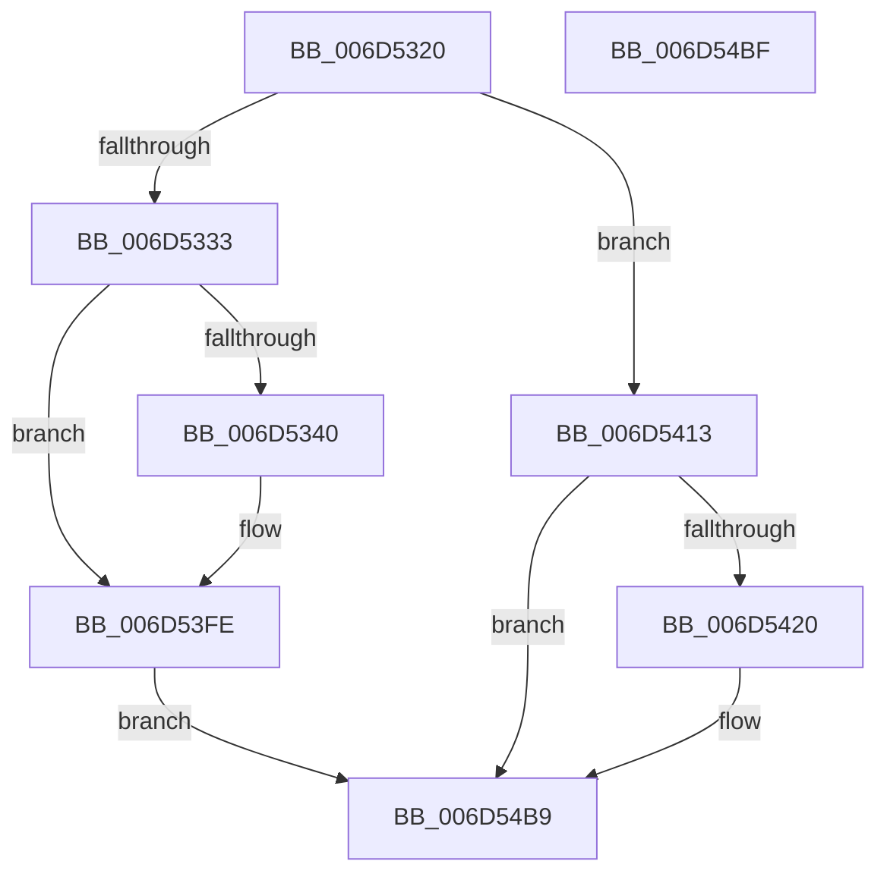

# FsRtlpWaitOnIrp$fin$0

- RVA: `0x006D5320`–`0x006D54C0` (길이 `416` bytes)
- VA: `0x00000001406D5320`
- 실행 섹션: `.text`
- PDB 이름 있음: `예`; PDB Function 태그: `예`
- unwind 정보 RVA: `0x000C5EE8`
- 디코드: `79`개 명령, `416/416` bytes 표시
- 미해석 바이트: `0` (있으면 어셈블리에 `.byte`로 보존)

> 이 문서는 커널 이미지의 기계어와 PDB 기호를 분석해 생성했습니다. 4번과 5번은 함수 원형과 자료형을 바이너리 사용 방식에서 추정한 C 해석이며 원본 소스 복구 결과는 아닙니다.

## 1. Dependencies

- 직접 호출 지점: **3**; 고유 호출 대상: **2**
- 직접 호출자로 확인된 함수: **0**
- RIP 상대 이미지 참조: **3**

### Outgoing calls
- `0x006D53F8` → [tlgWriteTransfer_EtwWriteTransfer](../42/tlgWriteTransfer_EtwWriteTransfer_function_004260E0.md) (function, `0x004260E0`)
- `0x006D5409` → [ExReleaseFastMutexUnsafe](../25/ExReleaseFastMutexUnsafe_function_002503A0.md) (function, `0x002503A0`)
- `0x006D54B3` → [tlgWriteTransfer_EtwWriteTransfer](../42/tlgWriteTransfer_EtwWriteTransfer_function_004260E0.md) (function, `0x004260E0`)

### Direct callers
- 이 함수 시작 RVA로 연결되는 직접 call은 확인되지 않았습니다. 간접 호출은 완전히 역산할 수 없습니다.

### Static image references
- `0x006D5333` → RVA `0x00E06C50` (`.data`; read)
- `0x006D53EA` → RVA `0x000443F2` (`.rdata`; read)
- `0x006D54A5` → RVA `0x00044451` (`.rdata`; read)

## 2. Other-region calls and transfers

- 다른 실행 섹션으로 향하는 call: **0**
- 별도 외부 분기/꼬리 이동을 확인하지 못했습니다.

## 3. Assembly (complete function range)

```asm
006D5320  40 55                           push rbp
006D5322  48 83 EC 30                     sub rsp, 0x30
006D5326  48 8B EA                        mov rbp, rdx
006D5329  80 7D 30 00                     cmp byte ptr [rbp + 0x30], 0
006D532D  0F 84 E0 00 00 00               je 0x1406d5413
006D5333  83 3D 16 19 73 00 05            cmp dword ptr [rip + 0x731916], 5
006D533A  0F 86 BE 00 00 00               jbe 0x1406d53fe
006D5340  8B 45 34                        mov eax, dword ptr [rbp + 0x34]
006D5343  89 45 38                        mov dword ptr [rbp + 0x38], eax
006D5346  48 8D 45 38                     lea rax, [rbp + 0x38]
006D534A  48 89 85 F0 00 00 00            mov qword ptr [rbp + 0xf0], rax
006D5351  C7 85 F8 00 00 00 04 00 00 00   mov dword ptr [rbp + 0xf8], 4
006D535B  83 A5 FC 00 00 00 00            and dword ptr [rbp + 0xfc], 0
006D5362  48 8B 45 48                     mov rax, qword ptr [rbp + 0x48]
006D5366  8A 08                           mov cl, byte ptr [rax]
006D5368  88 4D 31                        mov byte ptr [rbp + 0x31], cl
006D536B  48 8D 45 31                     lea rax, [rbp + 0x31]
006D536F  48 89 85 00 01 00 00            mov qword ptr [rbp + 0x100], rax
006D5376  C7 85 08 01 00 00 01 00 00 00   mov dword ptr [rbp + 0x108], 1
006D5380  83 A5 0C 01 00 00 00            and dword ptr [rbp + 0x10c], 0
006D5387  48 8B 45 70                     mov rax, qword ptr [rbp + 0x70]
006D538B  48 89 45 68                     mov qword ptr [rbp + 0x68], rax
006D538F  48 8D 4D 68                     lea rcx, [rbp + 0x68]
006D5393  48 89 8D 10 01 00 00            mov qword ptr [rbp + 0x110], rcx
006D539A  C7 85 18 01 00 00 08 00 00 00   mov dword ptr [rbp + 0x118], 8
006D53A4  83 A5 1C 01 00 00 00            and dword ptr [rbp + 0x11c], 0
006D53AB  8B 80 90 00 00 00               mov eax, dword ptr [rax + 0x90]
006D53B1  89 45 3C                        mov dword ptr [rbp + 0x3c], eax
006D53B4  48 8D 45 3C                     lea rax, [rbp + 0x3c]
006D53B8  48 89 85 20 01 00 00            mov qword ptr [rbp + 0x120], rax
006D53BF  C7 85 28 01 00 00 04 00 00 00   mov dword ptr [rbp + 0x128], 4
006D53C9  83 A5 2C 01 00 00 00            and dword ptr [rbp + 0x12c], 0
006D53D0  48 8D 85 D0 00 00 00            lea rax, [rbp + 0xd0]
006D53D7  48 89 44 24 28                  mov qword ptr [rsp + 0x28], rax
006D53DC  C7 44 24 20 06 00 00 00         mov dword ptr [rsp + 0x20], 6
006D53E4  45 33 C9                        xor r9d, r9d
006D53E7  45 33 C0                        xor r8d, r8d
006D53EA  48 8D 15 01 F0 96 FF            lea rdx, [rip - 0x690fff]
006D53F1  48 8D 0D 58 18 73 00            lea rcx, [rip + 0x731858]
006D53F8  E8 E3 0C D5 FF                  call 0x1404260e0
006D53FD  90                              nop
006D53FE  48 8B 4D 70                     mov rcx, qword ptr [rbp + 0x70]
006D5402  48 8B 89 98 00 00 00            mov rcx, qword ptr [rcx + 0x98]
006D5409  E8 92 AF B7 FF                  call 0x1402503a0
006D540E  E9 A6 00 00 00                  jmp 0x1406d54b9
006D5413  83 3D 36 18 73 00 05            cmp dword ptr [rip + 0x731836], 5
006D541A  0F 86 99 00 00 00               jbe 0x1406d54b9
006D5420  8B 45 34                        mov eax, dword ptr [rbp + 0x34]
006D5423  89 45 40                        mov dword ptr [rbp + 0x40], eax
006D5426  48 8D 45 40                     lea rax, [rbp + 0x40]
006D542A  48 89 85 50 01 00 00            mov qword ptr [rbp + 0x150], rax
006D5431  C7 85 58 01 00 00 04 00 00 00   mov dword ptr [rbp + 0x158], 4
006D543B  83 A5 5C 01 00 00 00            and dword ptr [rbp + 0x15c], 0
006D5442  48 8B 45 48                     mov rax, qword ptr [rbp + 0x48]
006D5446  8A 08                           mov cl, byte ptr [rax]
006D5448  88 4D 32                        mov byte ptr [rbp + 0x32], cl
006D544B  48 8D 45 32                     lea rax, [rbp + 0x32]
006D544F  48 89 85 60 01 00 00            mov qword ptr [rbp + 0x160], rax
006D5456  C7 85 68 01 00 00 01 00 00 00   mov dword ptr [rbp + 0x168], 1
006D5460  83 A5 6C 01 00 00 00            and dword ptr [rbp + 0x16c], 0
006D5467  48 8B 45 70                     mov rax, qword ptr [rbp + 0x70]
006D546B  48 89 45 78                     mov qword ptr [rbp + 0x78], rax
006D546F  48 8D 45 78                     lea rax, [rbp + 0x78]
006D5473  48 89 85 70 01 00 00            mov qword ptr [rbp + 0x170], rax
006D547A  C7 85 78 01 00 00 08 00 00 00   mov dword ptr [rbp + 0x178], 8
006D5484  83 A5 7C 01 00 00 00            and dword ptr [rbp + 0x17c], 0
006D548B  48 8D 85 30 01 00 00            lea rax, [rbp + 0x130]
006D5492  48 89 44 24 28                  mov qword ptr [rsp + 0x28], rax
006D5497  C7 44 24 20 05 00 00 00         mov dword ptr [rsp + 0x20], 5
006D549F  45 33 C9                        xor r9d, r9d
006D54A2  45 33 C0                        xor r8d, r8d
006D54A5  48 8D 15 A5 EF 96 FF            lea rdx, [rip - 0x69105b]
006D54AC  48 8D 0D 9D 17 73 00            lea rcx, [rip + 0x73179d]
006D54B3  E8 28 0C D5 FF                  call 0x1404260e0
006D54B8  90                              nop
006D54B9  48 83 C4 30                     add rsp, 0x30
006D54BD  5D                              pop rbp
006D54BE  C3                              ret
006D54BF  CC                              int3
```

## 4. C-style interpretation (structured pseudocode)

```c
__int64 __fastcall FsRtlpWaitOnIrp_fin_0(__int64 a1, __int64 a2, int a3, int a4)
{
    __int64 result;
    __int64 v_rsp;
    unsigned __int64 v_stack_m10;
    unsigned int v_stack_m18;

    v_rsp = (v_rsp) - (48);
    if ((*(unsigned __int8 *)(a2 + 48)) == 0) goto loc_006D5413;
    if ((*(unsigned int *)(v_rip + 7543062)) >= = 5) {
        result = *(unsigned int *)(a2 + 52);
        *(unsigned int *)(a2 + 56) = (unsigned int)(result);
        result = a2 + 56;
        *(unsigned __int64 *)(a2 + 240) = result;
        *(unsigned int *)(a2 + 248) = 4;
        result = *(unsigned __int64 *)(a2 + 72);
        a1 = *(unsigned __int8 *)(result);
        *(unsigned __int8 *)(a2 + 49) = (unsigned __int8)(a1);
        result = a2 + 49;
        *(unsigned __int64 *)(a2 + 256) = result;
        *(unsigned int *)(a2 + 264) = 1;
        result = *(unsigned __int64 *)(a2 + 112);
        *(unsigned __int64 *)(a2 + 104) = result;
        a1 = a2 + 104;
        *(unsigned __int64 *)(a2 + 272) = a1;
        *(unsigned int *)(a2 + 280) = 8;
        result = *(unsigned int *)(result + 144);
        *(unsigned int *)(a2 + 60) = (unsigned int)(result);
        result = a2 + 60;
        *(unsigned __int64 *)(a2 + 288) = result;
        *(unsigned int *)(a2 + 296) = 4;
        result = a2 + 208;
        v_stack_m10 = result;
        v_stack_m18 = 6;
        a4 = 0;
        a3 = 0;
        a2 = v_rip - 6885375;
        a1 = v_rip + 7542872;
        result = tlgWriteTransfer_EtwWriteTransfer(a1, a2, a3, a4);
    }
    result = ExReleaseFastMutexUnsafe(*(unsigned __int64 *)(*(unsigned __int64 *)(a2 + 112) + 152), a2, a3, a4);
    goto loc_006D54B9;
loc_006D5413:
    if ((*(unsigned int *)(v_rip + 7542838)) >= = 5) {
        result = *(unsigned int *)(a2 + 52);
        *(unsigned int *)(a2 + 64) = (unsigned int)(result);
        result = a2 + 64;
        *(unsigned __int64 *)(a2 + 336) = result;
        *(unsigned int *)(a2 + 344) = 4;
        result = *(unsigned __int64 *)(a2 + 72);
        a1 = *(unsigned __int8 *)(result);
        *(unsigned __int8 *)(a2 + 50) = (unsigned __int8)(a1);
        result = a2 + 50;
        *(unsigned __int64 *)(a2 + 352) = result;
        *(unsigned int *)(a2 + 360) = 1;
        result = *(unsigned __int64 *)(a2 + 112);
        *(unsigned __int64 *)(a2 + 120) = result;
        result = a2 + 120;
        *(unsigned __int64 *)(a2 + 368) = result;
        *(unsigned int *)(a2 + 376) = 8;
        result = a2 + 304;
        v_stack_m10 = result;
        v_stack_m18 = 5;
        a4 = 0;
        a3 = 0;
        a2 = v_rip - 6885467;
        a1 = v_rip + 7542685;
        result = tlgWriteTransfer_EtwWriteTransfer(a1, a2, a3, a4);
    }
    v_rsp = (v_rsp) + (48);
    return result;
}
```

## 5. (Beta) C Style

```c
int64_t FsRtlpWaitOnIrp_fin_0(int64_t Arg1, void *Arg2, int32_t Arg3, int32_t Arg4)
{
    uint8_t *arg2 = (uint8_t *)Arg2;

    int64_t result;
    int64_t local_rsp;
    uint64_t v_stack_m10;
    uint32_t v_stack_m18;

    local_rsp = (local_rsp) - (48);
    if ((*(uint8_t *)(arg2 + 0x30)) == 0) goto loc_006D5413;
    if ((*(uint32_t *)(v_rip + 0x731916)) >= = 5) {
        result = *(uint32_t *)(arg2 + 0x34);
        *(uint32_t *)(arg2 + 0x38) = (uint32_t)(result);
        result = Arg2 + 56;
        *(uint64_t *)(arg2 + 0xF0) = result;
        *(uint32_t *)(arg2 + 0xF8) = 4;
        result = *(uint64_t *)(arg2 + 0x48);
        Arg1 = *(uint8_t *)(result);
        *(uint8_t *)(arg2 + 0x31) = (uint8_t)(Arg1);
        result = Arg2 + 49;
        *(uint64_t *)(arg2 + 0x100) = result;
        *(uint32_t *)(arg2 + 0x108) = 1;
        result = *(uint64_t *)(arg2 + 0x70);
        *(uint64_t *)(arg2 + 0x68) = result;
        Arg1 = Arg2 + 104;
        *(uint64_t *)(arg2 + 0x110) = Arg1;
        *(uint32_t *)(arg2 + 0x118) = 8;
        result = *(uint32_t *)(result + 0x90);
        *(uint32_t *)(arg2 + 0x3C) = (uint32_t)(result);
        result = Arg2 + 60;
        *(uint64_t *)(arg2 + 0x120) = result;
        *(uint32_t *)(arg2 + 0x128) = 4;
        result = Arg2 + 208;
        v_stack_m10 = result;
        v_stack_m18 = 6;
        Arg4 = 0;
        Arg3 = 0;
        Arg2 = v_rip - 6885375;
        Arg1 = v_rip + 7542872;
        result = tlgWriteTransfer_EtwWriteTransfer(Arg1, Arg2, Arg3, Arg4);
    }
    result = ExReleaseFastMutexUnsafe(*(uint64_t *)(*(uint64_t *)(arg2 + 0x70) + 0x98), Arg2, Arg3, Arg4);
    goto loc_006D54B9;
loc_006D5413:
    if ((*(uint32_t *)(v_rip + 0x731836)) >= = 5) {
        result = *(uint32_t *)(arg2 + 0x34);
        *(uint32_t *)(arg2 + 0x40) = (uint32_t)(result);
        result = Arg2 + 64;
        *(uint64_t *)(arg2 + 0x150) = result;
        *(uint32_t *)(arg2 + 0x158) = 4;
        result = *(uint64_t *)(arg2 + 0x48);
        Arg1 = *(uint8_t *)(result);
        *(uint8_t *)(arg2 + 0x32) = (uint8_t)(Arg1);
        result = Arg2 + 50;
        *(uint64_t *)(arg2 + 0x160) = result;
        *(uint32_t *)(arg2 + 0x168) = 1;
        result = *(uint64_t *)(arg2 + 0x70);
        *(uint64_t *)(arg2 + 0x78) = result;
        result = Arg2 + 120;
        *(uint64_t *)(arg2 + 0x170) = result;
        *(uint32_t *)(arg2 + 0x178) = 8;
        result = Arg2 + 304;
        v_stack_m10 = result;
        v_stack_m18 = 5;
        Arg4 = 0;
        Arg3 = 0;
        Arg2 = v_rip - 6885467;
        Arg1 = v_rip + 7542685;
        result = tlgWriteTransfer_EtwWriteTransfer(Arg1, Arg2, Arg3, Arg4);
    }
    local_rsp = (local_rsp) + (48);
    return result;
}
```

### 관측된 메모리 오프셋

구조체 형식이 확인되지 않은 접근은 인자 기준의 오프셋으로만 기록했습니다.

| 기준 인자 | 오프셋 표현 | 폭 (bit) | 접근 |
|---|---:|---:|---|
| `Arg2` | `+ 0x30` | `8` | `R` |
| `Arg2` | `+ 0x31` | `8` | `W` |
| `Arg2` | `+ 0x31` | `64` | `R` |
| `Arg2` | `+ 0x32` | `8` | `W` |
| `Arg2` | `+ 0x32` | `64` | `R` |
| `Arg2` | `+ 0x34` | `32` | `R` |
| `Arg2` | `+ 0x38` | `32` | `W` |
| `Arg2` | `+ 0x38` | `64` | `R` |
| `Arg2` | `+ 0x3C` | `32` | `W` |
| `Arg2` | `+ 0x3C` | `64` | `R` |
| `Arg2` | `+ 0x40` | `32` | `W` |
| `Arg2` | `+ 0x40` | `64` | `R` |
| `Arg2` | `+ 0x48` | `64` | `R` |
| `Arg2` | `+ 0x68` | `64` | `R` |
| `Arg2` | `+ 0x68` | `64` | `W` |
| `Arg2` | `+ 0x70` | `64` | `R` |
| `Arg2` | `+ 0x78` | `64` | `R` |
| `Arg2` | `+ 0x78` | `64` | `W` |
| `Arg2` | `+ 0xD0` | `64` | `R` |
| `Arg2` | `+ 0xF0` | `64` | `W` |
| `Arg2` | `+ 0xF8` | `32` | `W` |
| `Arg2` | `+ 0xFC` | `32` | `R/W` |
| `Arg2` | `+ 0x100` | `64` | `W` |
| `Arg2` | `+ 0x108` | `32` | `W` |
| `Arg2` | `+ 0x10C` | `32` | `R/W` |
| `Arg2` | `+ 0x110` | `64` | `W` |
| `Arg2` | `+ 0x118` | `32` | `W` |
| `Arg2` | `+ 0x11C` | `32` | `R/W` |
| `Arg2` | `+ 0x120` | `64` | `W` |
| `Arg2` | `+ 0x128` | `32` | `W` |
| `Arg2` | `+ 0x12C` | `32` | `R/W` |
| `Arg2` | `+ 0x130` | `64` | `R` |

추가 오프셋 9개는 표에서 생략했습니다.

## 6. Execution-region graph

[열기: 2D/3D 그래프와 함수 탐색 컨트롤 패널](../../../control-panel.html?section=text&rva=0x006D5320&view=graph)

- 2D 그래프는 위에서 아래로 흐르고, 3D 그래프는 빈 공간을 드래그해 회전합니다. Shift+드래그는 이동, 휠은 확대·축소, 함수 노드 선택은 대상 보고서 이동입니다.

### Static fallback


