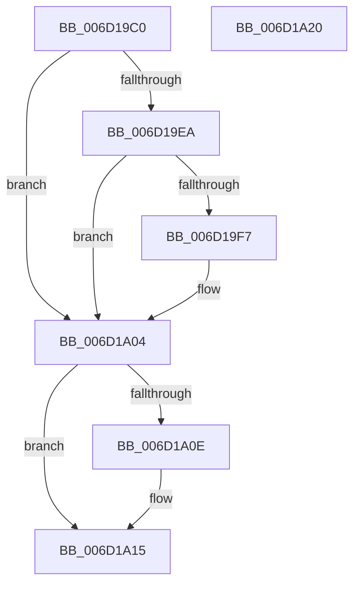

# IopCompleteRequest$filt$0

- RVA: `0x006D19C0`–`0x006D1A21` (길이 `97` bytes)
- VA: `0x00000001406D19C0`
- 실행 섹션: `.text`
- PDB 이름 있음: `예`; PDB Function 태그: `예`
- unwind 정보 RVA: `0x0005D80C`
- 디코드: `29`개 명령, `97/97` bytes 표시
- 미해석 바이트: `0` (있으면 어셈블리에 `.byte`로 보존)

> 이 문서는 커널 이미지의 기계어와 PDB 기호를 분석해 생성했습니다. 4번과 5번은 함수 원형과 자료형을 바이너리 사용 방식에서 추정한 C 해석이며 원본 소스 복구 결과는 아닙니다.

## 1. Dependencies

- 직접 호출 지점: **0**; 고유 호출 대상: **0**
- 직접 호출자로 확인된 함수: **0**
- RIP 상대 이미지 참조: **0**

### Outgoing calls
- 직접 디코드된 call 명령이 없습니다.

### Direct callers
- 이 함수 시작 RVA로 연결되는 직접 call은 확인되지 않았습니다. 간접 호출은 완전히 역산할 수 없습니다.

### Static image references
- 디코드된 RIP-relative 메모리 참조가 없습니다.

## 2. Other-region calls and transfers

- 다른 실행 섹션으로 향하는 call: **0**
- 별도 외부 분기/꼬리 이동을 확인하지 못했습니다.

## 3. Assembly (complete function range)

```asm
006D19C0  40 55                           push rbp
006D19C2  48 83 EC 20                     sub rsp, 0x20
006D19C6  48 8B EA                        mov rbp, rdx
006D19C9  48 89 8D 80 00 00 00            mov qword ptr [rbp + 0x80], rcx
006D19D0  48 89 4D 30                     mov qword ptr [rbp + 0x30], rcx
006D19D4  48 8B 45 30                     mov rax, qword ptr [rbp + 0x30]
006D19D8  48 8B 08                        mov rcx, qword ptr [rax]
006D19DB  8B 01                           mov eax, dword ptr [rcx]
006D19DD  89 45 20                        mov dword ptr [rbp + 0x20], eax
006D19E0  8B 45 20                        mov eax, dword ptr [rbp + 0x20]
006D19E3  3D 06 00 00 C0                  cmp eax, 0xc0000006
006D19E8  75 1A                           jne 0x1406d1a04
006D19EA  48 8B 45 30                     mov rax, qword ptr [rbp + 0x30]
006D19EE  48 8B 08                        mov rcx, qword ptr [rax]
006D19F1  83 79 18 03                     cmp dword ptr [rcx + 0x18], 3
006D19F5  72 0D                           jb 0x1406d1a04
006D19F7  48 8B 45 30                     mov rax, qword ptr [rbp + 0x30]
006D19FB  48 8B 08                        mov rcx, qword ptr [rax]
006D19FE  8B 41 30                        mov eax, dword ptr [rcx + 0x30]
006D1A01  89 45 20                        mov dword ptr [rbp + 0x20], eax
006D1A04  8B 45 20                        mov eax, dword ptr [rbp + 0x20]
006D1A07  3D 02 00 00 80                  cmp eax, 0x80000002
006D1A0C  75 07                           jne 0x1406d1a15
006D1A0E  C7 45 20 C5 02 00 C0            mov dword ptr [rbp + 0x20], 0xc00002c5
006D1A15  B8 01 00 00 00                  mov eax, 1
006D1A1A  48 83 C4 20                     add rsp, 0x20
006D1A1E  5D                              pop rbp
006D1A1F  C3                              ret
006D1A20  CC                              int3
```

## 4. C-style interpretation (structured pseudocode)

```c
__int64 __fastcall IopCompleteRequest_filt_0(__int64 a1, __int64 a2)
{
    __int64 result;
    __int64 v_rsp;

    v_rsp = (v_rsp) - (32);
    *(unsigned __int64 *)(a2 + 128) = a1;
    *(unsigned __int64 *)(a2 + 48) = a1;
    *(unsigned int *)(a2 + 32) = (unsigned int)((unsigned int)(*(unsigned int *)(*(unsigned __int64 *)(*(unsigned __int64 *)(a2 + 48)))));
    if (((unsigned int)((unsigned int)(*(unsigned int *)(a2 + 32)))) != 0xC0000006ULL) goto loc_006D1A04;
    result = *(unsigned __int64 *)(a2 + 48);
    if ((*(unsigned int *)(*(unsigned __int64 *)(*(unsigned __int64 *)(a2 + 48)) + 24)) >= 3) {
        result = *(unsigned __int64 *)(a2 + 48);
        a1 = *(unsigned __int64 *)(result);
        result = *(unsigned int *)(a1 + 48);
        *(unsigned int *)(a2 + 32) = (unsigned int)(result);
    }
    if (((unsigned int)((unsigned int)(*(unsigned int *)(a2 + 32)))) == 0x80000002ULL) {
        *(unsigned int *)(a2 + 32) = 0xC00002C5ULL;
    }
    v_rsp = (v_rsp) + (32);
    return 1;
}
```

## 5. (Beta) C Style

```c
int64_t IopCompleteRequest_filt_0(int64_t Arg1, void *Arg2)
{
    uint8_t *arg2 = (uint8_t *)Arg2;

    int64_t result;
    int64_t local_rsp;

    local_rsp = (local_rsp) - (32);
    *(uint64_t *)(arg2 + 0x80) = Arg1;
    *(uint64_t *)(arg2 + 0x30) = Arg1;
    *(uint32_t *)(arg2 + 0x20) = (uint32_t)((uint32_t)(*(uint32_t *)(*(uint64_t *)(*(uint64_t *)(arg2 + 0x30)))));
    if (((uint32_t)((uint32_t)(*(uint32_t *)(arg2 + 0x20)))) != 0xC0000006ULL) goto loc_006D1A04;
    result = *(uint64_t *)(arg2 + 0x30);
    if ((*(uint32_t *)(*(uint64_t *)(*(uint64_t *)(arg2 + 0x30)) + 0x18)) >= 3) {
        result = *(uint64_t *)(arg2 + 0x30);
        Arg1 = *(uint64_t *)(result);
        result = *(uint32_t *)(Arg1 + 0x30);
        *(uint32_t *)(arg2 + 0x20) = (uint32_t)(result);
    }
    if (((uint32_t)((uint32_t)(*(uint32_t *)(arg2 + 0x20)))) == 0x80000002ULL) {
        *(uint32_t *)(arg2 + 0x20) = 0xC00002C5ULL;
    }
    local_rsp = (local_rsp) + (32);
    return 1;
}
```

### 관측된 메모리 오프셋

구조체 형식이 확인되지 않은 접근은 인자 기준의 오프셋으로만 기록했습니다.

| 기준 인자 | 오프셋 표현 | 폭 (bit) | 접근 |
|---|---:|---:|---|
| `Arg2` | `+ 0x20` | `32` | `R` |
| `Arg2` | `+ 0x20` | `32` | `W` |
| `Arg2` | `+ 0x30` | `64` | `R` |
| `Arg2` | `+ 0x30` | `64` | `W` |
| `Arg2` | `+ 0x80` | `64` | `W` |

## 6. Execution-region graph

[열기: 2D/3D 그래프와 함수 탐색 컨트롤 패널](../../../control-panel.html?section=text&rva=0x006D19C0&view=graph)

- 2D 그래프는 위에서 아래로 흐르고, 3D 그래프는 빈 공간을 드래그해 회전합니다. Shift+드래그는 이동, 휠은 확대·축소, 함수 노드 선택은 대상 보고서 이동입니다.

### Static fallback


