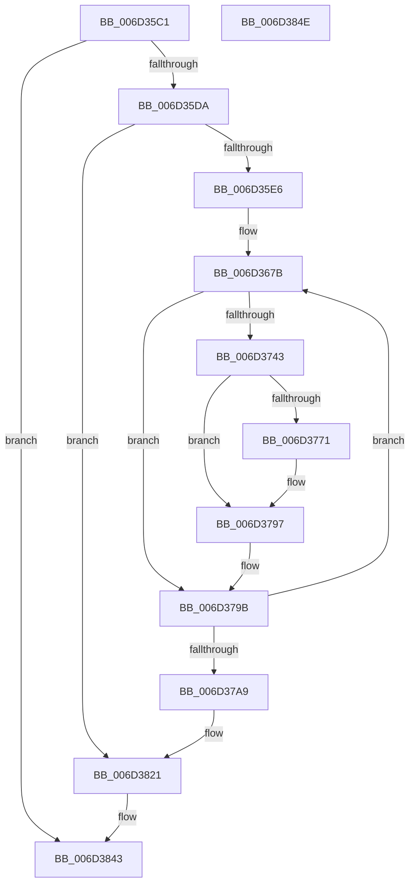

# IopIrpStackProfilerDpcRoutine$fin$1

- RVA: `0x006D35C1`–`0x006D384F` (길이 `654` bytes)
- VA: `0x00000001406D35C1`
- 실행 섹션: `.text`
- PDB 이름 있음: `예`; PDB Function 태그: `예`
- unwind 정보 RVA: `0x000ACB9C`
- 디코드: `175`개 명령, `654/654` bytes 표시
- 미해석 바이트: `0` (있으면 어셈블리에 `.byte`로 보존)

> 이 문서는 커널 이미지의 기계어와 PDB 기호를 분석해 생성했습니다. 4번과 5번은 함수 원형과 자료형을 바이너리 사용 방식에서 추정한 C 해석이며 원본 소스 복구 결과는 아닙니다.

## 1. Dependencies

- 직접 호출 지점: **2**; 고유 호출 대상: **2**
- 직접 호출자로 확인된 함수: **0**
- RIP 상대 이미지 참조: **3**

### Outgoing calls
- `0x006D37F8` → [guard_dispatch_icall](../6B/guard_dispatch_icall_function_006BAAD0.md) (function, `0x006BAAD0`)
- `0x006D381B` → [local_unwind](../4F/local_unwind_function_004FFB40.md) (function, `0x004FFB40`)

### Direct callers
- 이 함수 시작 RVA로 연결되는 직접 call은 확인되지 않았습니다. 간접 호출은 완전히 역산할 수 없습니다.

### Static image references
- `0x006D3688` → RVA `0x00FC6F78` (`ALMOSTRO`; read)
- `0x006D369B` → RVA `0x00FC7250` (`ALMOSTRO`; read)
- `0x006D380D` → RVA `0x004755EC` (`.text`; read)

## 2. Other-region calls and transfers

- 다른 실행 섹션으로 향하는 call: **0**
- 별도 외부 분기/꼬리 이동을 확인하지 못했습니다.

## 3. Assembly (complete function range)

```asm
006D35C1  40 53                           push rbx
006D35C3  55                              push rbp
006D35C4  56                              push rsi
006D35C5  57                              push rdi
006D35C6  41 56                           push r14
006D35C8  48 83 EC 30                     sub rsp, 0x30
006D35CC  48 8B EA                        mov rbp, rdx
006D35CF  88 4D 49                        mov byte ptr [rbp + 0x49], cl
006D35D2  84 C9                           test cl, cl
006D35D4  0F 84 69 02 00 00               je 0x1406d3843
006D35DA  8B 45 30                        mov eax, dword ptr [rbp + 0x30]
006D35DD  83 F8 0C                        cmp eax, 0xc
006D35E0  0F 85 3B 02 00 00               jne 0x1406d3821
006D35E6  48 83 65 68 00                  and qword ptr [rbp + 0x68], 0
006D35EB  48 8B 8D E3 00 00 00            mov rcx, qword ptr [rbp + 0xe3]
006D35F2  48 89 4D 68                     mov qword ptr [rbp + 0x68], rcx
006D35F6  4C 8B 85 A3 00 00 00            mov r8, qword ptr [rbp + 0xa3]
006D35FD  48 83 65 70 00                  and qword ptr [rbp + 0x70], 0
006D3602  48 8B 85 E3 00 00 00            mov rax, qword ptr [rbp + 0xe3]
006D3609  48 89 45 70                     mov qword ptr [rbp + 0x70], rax
006D360D  48 8B 95 CB 00 00 00            mov rdx, qword ptr [rbp + 0xcb]
006D3614  49 D3 C8                        ror r8, cl
006D3617  8B C8                           mov ecx, eax
006D3619  48 D3 C2                        rol rdx, cl
006D361C  83 65 54 00                     and dword ptr [rbp + 0x54], 0
006D3620  4C 8B 5A 40                     mov r11, qword ptr [rdx + 0x40]
006D3624  4C 89 5D 40                     mov qword ptr [rbp + 0x40], r11
006D3628  4D 33 D8                        xor r11, r8
006D362B  48 B8 00 00 00 00 00 80 FF FF   movabs rax, 0xffff800000000000
006D3635  4C 0B D8                        or r11, rax
006D3638  4C 89 9D 20 01 00 00            mov qword ptr [rbp + 0x120], r11
006D363F  49 8B DB                        mov rbx, r11
006D3642  48 89 5D 78                     mov qword ptr [rbp + 0x78], rbx
006D3646  41 8B C3                        mov eax, r11d
006D3649  83 E0 3F                        and eax, 0x3f
006D364C  B9 40 00 00 00                  mov ecx, 0x40
006D3651  2B C8                           sub ecx, eax
006D3653  49 8B FB                        mov rdi, r11
006D3656  48 D3 E7                        shl rdi, cl
006D3659  41 8B CB                        mov ecx, r11d
006D365C  83 E1 3F                        and ecx, 0x3f
006D365F  49 8B C3                        mov rax, r11
006D3662  48 D3 E8                        shr rax, cl
006D3665  48 0B F8                        or rdi, rax
006D3668  48 89 7D 40                     mov qword ptr [rbp + 0x40], rdi
006D366C  41 BE 19 00 00 00               mov r14d, 0x19
006D3672  44 89 75 4C                     mov dword ptr [rbp + 0x4c], r14d
006D3676  33 F6                           xor esi, esi
006D3678  89 75 50                        mov dword ptr [rbp + 0x50], esi
006D367B  4C 8B 13                        mov r10, qword ptr [rbx]
006D367E  4C 89 95 30 01 00 00            mov qword ptr [rbp + 0x130], r10
006D3685  49 8B D2                        mov rdx, r10
006D3688  48 8B 0D E9 38 8F 00            mov rcx, qword ptr [rip + 0x8f38e9]
006D368F  48 33 D1                        xor rdx, rcx
006D3692  48 D3 C2                        rol rdx, cl
006D3695  48 33 D7                        xor rdx, rdi
006D3698  48 0F CA                        bswap rdx
006D369B  48 33 15 AE 3B 8F 00            xor rdx, qword ptr [rip + 0x8f3bae]
006D36A2  48 89 13                        mov qword ptr [rbx], rdx
006D36A5  44 8B CE                        mov r9d, esi
006D36A8  4A 8D 04 1A                     lea rax, [rdx + r11]
006D36AC  49 03 C1                        add rax, r9
006D36AF  48 89 03                        mov qword ptr [rbx], rax
006D36B2  41 8B C2                        mov eax, r10d
006D36B5  F7 D0                           not eax
006D36B7  83 E0 3F                        and eax, 0x3f
006D36BA  B9 40 00 00 00                  mov ecx, 0x40
006D36BF  2B C8                           sub ecx, eax
006D36C1  41 B8 C8 00 00 00               mov r8d, 0xc8
006D36C7  44 2B C6                        sub r8d, esi
006D36CA  4D 33 C1                        xor r8, r9
006D36CD  49 D3 E0                        shl r8, cl
006D36D0  BA C8 00 00 00                  mov edx, 0xc8
006D36D5  2B D6                           sub edx, esi
006D36D7  49 33 D1                        xor rdx, r9
006D36DA  41 8B CA                        mov ecx, r10d
006D36DD  F7 D1                           not ecx
006D36DF  83 E1 3F                        and ecx, 0x3f
006D36E2  48 D3 EA                        shr rdx, cl
006D36E5  4C 0B C2                        or r8, rdx
006D36E8  49 33 F8                        xor rdi, r8
006D36EB  48 89 7D 40                     mov qword ptr [rbp + 0x40], rdi
006D36EF  41 8B C2                        mov eax, r10d
006D36F2  83 F0 FA                        xor eax, 0xfffffffa
006D36F5  83 E0 3F                        and eax, 0x3f
006D36F8  B9 40 00 00 00                  mov ecx, 0x40
006D36FD  2B C8                           sub ecx, eax
006D36FF  48 8B D7                        mov rdx, rdi
006D3702  48 D3 EA                        shr rdx, cl
006D3705  41 83 F2 FA                     xor r10d, 0xfffffffa
006D3709  41 83 E2 3F                     and r10d, 0x3f
006D370D  41 8A CA                        mov cl, r10b
006D3710  48 8B C7                        mov rax, rdi
006D3713  48 D3 E0                        shl rax, cl
006D3716  48 8B FA                        mov rdi, rdx
006D3719  48 0B F8                        or rdi, rax
006D371C  48 89 7D 40                     mov qword ptr [rbp + 0x40], rdi
006D3720  49 03 FB                        add rdi, r11
006D3723  48 89 7D 40                     mov qword ptr [rbp + 0x40], rdi
006D3727  B8 11 74 00 80                  mov eax, 0x80007411
006D372C  48 33 F8                        xor rdi, rax
006D372F  48 89 7D 40                     mov qword ptr [rbp + 0x40], rdi
006D3733  48 83 C3 08                     add rbx, 8
006D3737  48 89 5D 78                     mov qword ptr [rbp + 0x78], rbx
006D373B  8D 46 01                        lea eax, [rsi + 1]
006D373E  83 F8 19                        cmp eax, 0x19
006D3741  75 58                           jne 0x1406d379b
006D3743  48 B8 0B 52 4C 04 52 4C 14 82   movabs rax, 0x82144c52044c520b
006D374D  48 89 45 38                     mov qword ptr [rbp + 0x38], rax
006D3751  48 8B 4D 38                     mov rcx, qword ptr [rbp + 0x38]
006D3755  48 C1 E9 3E                     shr rcx, 0x3e
006D3759  48 8B 45 38                     mov rax, qword ptr [rbp + 0x38]
006D375D  48 C1 E0 02                     shl rax, 2
006D3761  48 0B C1                        or rax, rcx
006D3764  48 89 45 38                     mov qword ptr [rbp + 0x38], rax
006D3768  48 8B 45 38                     mov rax, qword ptr [rbp + 0x38]
006D376C  49 33 03                        xor rax, qword ptr [r11]
006D376F  74 26                           je 0x1406d3797
006D3771  48 8B 45 38                     mov rax, qword ptr [rbp + 0x38]
006D3775  48 33 43 F8                     xor rax, qword ptr [rbx - 8]
006D3779  49 33 03                        xor rax, qword ptr [r11]
006D377C  48 89 43 F8                     mov qword ptr [rbx - 8], rax
006D3780  44 03 73 FC                     add r14d, dword ptr [rbx - 4]
006D3784  44 89 75 4C                     mov dword ptr [rbp + 0x4c], r14d
006D3788  48 8B 45 38                     mov rax, qword ptr [rbp + 0x38]
006D378C  48 33 43 F8                     xor rax, qword ptr [rbx - 8]
006D3790  49 33 03                        xor rax, qword ptr [r11]
006D3793  48 89 43 F8                     mov qword ptr [rbx - 8], rax
006D3797  48 8B 7D 40                     mov rdi, qword ptr [rbp + 0x40]
006D379B  FF C6                           inc esi
006D379D  89 75 50                        mov dword ptr [rbp + 0x50], esi
006D37A0  41 3B F6                        cmp esi, r14d
006D37A3  0F 82 D2 FE FF FF               jb 0x1406d367b
006D37A9  48 B8 0B 52 4C 04 52 4C 14 82   movabs rax, 0x82144c52044c520b
006D37B3  48 89 45 38                     mov qword ptr [rbp + 0x38], rax
006D37B7  48 8B 4D 38                     mov rcx, qword ptr [rbp + 0x38]
006D37BB  48 C1 E9 3E                     shr rcx, 0x3e
006D37BF  48 8B 45 38                     mov rax, qword ptr [rbp + 0x38]
006D37C3  48 C1 E0 02                     shl rax, 2
006D37C7  48 0B C1                        or rax, rcx
006D37CA  48 89 45 38                     mov qword ptr [rbp + 0x38], rax
006D37CE  48 8B 55 38                     mov rdx, qword ptr [rbp + 0x38]
006D37D2  49 33 13                        xor rdx, qword ptr [r11]
006D37D5  48 89 55 40                     mov qword ptr [rbp + 0x40], rdx
006D37D9  41 C6 43 03 11                  mov byte ptr [r11 + 3], 0x11
006D37DE  41 C6 43 02 31                  mov byte ptr [r11 + 2], 0x31
006D37E3  41 C6 43 01 48                  mov byte ptr [r11 + 1], 0x48
006D37E8  41 C6 03 2E                     mov byte ptr [r11], 0x2e
006D37EC  45 33 C9                        xor r9d, r9d
006D37EF  45 33 C0                        xor r8d, r8d
006D37F2  49 8B CB                        mov rcx, r11
006D37F5  49 8B C3                        mov rax, r11
006D37F8  E8 D3 72 FE FF                  call 0x1406baad0
006D37FD  C7 45 58 01 00 00 00            mov dword ptr [rbp + 0x58], 1
006D3804  8B 45 30                        mov eax, dword ptr [rbp + 0x30]
006D3807  83 C0 06                        add eax, 6
006D380A  89 45 30                        mov dword ptr [rbp + 0x30], eax
006D380D  48 8D 15 D8 1D DA FF            lea rdx, [rip - 0x25e228]
006D3814  48 8B 8D 48 01 00 00            mov rcx, qword ptr [rbp + 0x148]
006D381B  E8 20 C3 E2 FF                  call 0x1404ffb40
006D3820  90                              nop
006D3821  48 83 A5 80 00 00 00 00         and qword ptr [rbp + 0x80], 0
006D3829  48 8B 8D E3 00 00 00            mov rcx, qword ptr [rbp + 0xe3]
006D3830  48 89 8D 80 00 00 00            mov qword ptr [rbp + 0x80], rcx
006D3837  48 8B 85 A3 00 00 00            mov rax, qword ptr [rbp + 0xa3]
006D383E  48 D3 C8                        ror rax, cl
006D3841  8B 00                           mov eax, dword ptr [rax]
006D3843  48 83 C4 30                     add rsp, 0x30
006D3847  41 5E                           pop r14
006D3849  5F                              pop rdi
006D384A  5E                              pop rsi
006D384B  5D                              pop rbp
006D384C  5B                              pop rbx
006D384D  C3                              ret
006D384E  CC                              int3
```

## 4. C-style interpretation (structured pseudocode)

```c
__int64 __fastcall IopIrpStackProfilerDpcRoutine_fin_1(unsigned __int8 a1, __int64 a2)
{
    __int64 result;
    __int64 v_r10;
    __int64 v_r11;
    __int64 v_r14;
    __int64 v_rbx;
    __int64 v_rdi;
    __int64 v_rsi;
    __int64 v_rsp;

    v_rsp = (v_rsp) - (48);
    *(unsigned __int8 *)(a2 + 73) = a1;
    if (a1 == 0) goto loc_006D3843;
    if (((unsigned int)((unsigned int)(*(unsigned int *)(a2 + 48)))) != 12) goto loc_006D3821;
    *(unsigned __int64 *)(a2 + 104) = *(unsigned __int64 *)(a2 + 227);
    *(unsigned __int64 *)(a2 + 112) = *(unsigned __int64 *)(a2 + 227);
    *(unsigned __int64 *)(a2 + 64) = *(unsigned __int64 *)(*(unsigned __int64 *)(a2 + 203) + 64);
    v_r11 = (*(unsigned __int64 *)(*(unsigned __int64 *)(a2 + 203) + 64)) ^ (*(unsigned __int64 *)(a2 + 163));
    v_r11 = (v_r11) | (*(unsigned __int64 *)(a2 + 227));
    *(unsigned __int64 *)(a2 + 288) = v_r11;
    *(unsigned __int64 *)(a2 + 120) = v_r11;
    result = (unsigned int)(((unsigned int)((unsigned int)(v_r11))) & (63));
    a1 = (unsigned int)((64) - ((unsigned int)(result)));
    v_rdi = (v_r11) << (a1);
    a1 = (unsigned int)(((unsigned int)((unsigned int)(v_r11))) & (63));
    result = (v_r11) >> (a1);
    v_rdi = (v_rdi) | (result);
    *(unsigned __int64 *)(a2 + 64) = v_rdi;
    *(unsigned int *)(a2 + 76) = 25;
    v_rsi = 0;
    *(unsigned int *)(a2 + 80) = 0;
loc_006D367B:
    *(unsigned __int64 *)(a2 + 304) = *(unsigned __int64 *)(v_r11);
    a2 = (*(unsigned __int64 *)(v_r11)) ^ (*(unsigned __int64 *)(v_rip + 9386217));
    a2 = (a2) ^ (v_rdi);
    a2 = (a2) ^ (*(unsigned __int64 *)(v_rip + 9386926));
    *(unsigned __int64 *)(v_r11) = a2;
    result = (a2 + v_r11 * 1) + (0);
    *(unsigned __int64 *)(v_r11) = result;
    result = (unsigned int)(~((unsigned int)((unsigned int)(*(unsigned __int64 *)(v_r11)))));
    result = (unsigned int)((result) & (63));
    a1 = (unsigned int)((64) - ((unsigned int)(result)));
    a3 = (unsigned int)((200) - (0));
    a3 = (a3) ^ (0);
    a3 = (a3) << (a1);
    a2 = (unsigned int)((200) - (0));
    a2 = (a2) ^ (0);
    a1 = (unsigned int)(~((unsigned int)((unsigned int)(*(unsigned __int64 *)(v_r11)))));
    a1 = (unsigned int)((a1) & (63));
    a2 = (a2) >> (a1);
    a3 = (a3) | (a2);
    v_rdi = (v_rdi) ^ (a3);
    *(unsigned __int64 *)(a2 + 64) = v_rdi;
    result = (unsigned int)(((unsigned int)((unsigned int)(*(unsigned __int64 *)(v_r11)))) ^ (0xFFFFFFFAULL));
    result = (unsigned int)((result) & (63));
    a1 = (unsigned int)((64) - ((unsigned int)(result)));
    a2 = (v_rdi) >> (a1);
    v_r10 = (unsigned int)((*(unsigned __int64 *)(v_r11)) ^ (0xFFFFFFFAULL));
    v_r10 = (unsigned int)((v_r10) & (63));
    result = (v_rdi) << ((unsigned __int8)((unsigned __int8)(v_r10)));
    v_rdi = (a2) | (result);
    *(unsigned __int64 *)(a2 + 64) = v_rdi;
    v_rdi = (v_rdi) + (v_r11);
    *(unsigned __int64 *)(a2 + 64) = v_rdi;
    v_rdi = (v_rdi) ^ ((unsigned int)(0x80007411ULL));
    *(unsigned __int64 *)(a2 + 64) = v_rdi;
    v_rbx = (v_r11) + (8);
    *(unsigned __int64 *)(a2 + 120) = v_rbx;
    if (((unsigned int)(v_rsi + 1)) != 25) goto loc_006D379B;
    *(unsigned __int64 *)(a2 + 56) = v_rsi + 1;
    a1 = (*(unsigned __int64 *)(a2 + 56)) >> (62);
    result = (*(unsigned __int64 *)(a2 + 56)) << (2);
    result = (result) | (a1);
    *(unsigned __int64 *)(a2 + 56) = result;
    result = (*(unsigned __int64 *)(a2 + 56)) ^ (*(unsigned __int64 *)(v_r11));
    v_r14 = 25;
    if (!(condition_is_equal)) {
        result = *(unsigned __int64 *)(a2 + 56);
        result = (result) ^ (*(unsigned __int64 *)(v_rbx - 8));
        result = (result) ^ (*(unsigned __int64 *)(v_r11));
        *(unsigned __int64 *)(v_rbx - 8) = result;
        v_r14 = (unsigned int)((25) + (*(unsigned int *)(v_rbx - 4)));
        *(unsigned int *)(a2 + 76) = (unsigned int)(v_r14);
        result = *(unsigned __int64 *)(a2 + 56);
        result = (result) ^ (*(unsigned __int64 *)(v_rbx - 8));
        result = (result) ^ (*(unsigned __int64 *)(v_r11));
        *(unsigned __int64 *)(v_rbx - 8) = result;
    }
loc_006D379B:
    v_rsi = (unsigned int)((v_rsi) + 1);
    *(unsigned int *)(a2 + 80) = (unsigned int)(v_rsi);
    if (((unsigned int)(v_rsi)) < ((unsigned int)(v_r14))) goto loc_006D367B;
    *(unsigned __int64 *)(a2 + 56) = result;
    a1 = (*(unsigned __int64 *)(a2 + 56)) >> (62);
    result = (*(unsigned __int64 *)(a2 + 56)) << (2);
    result = (result) | (a1);
    *(unsigned __int64 *)(a2 + 56) = result;
    a2 = (*(unsigned __int64 *)(a2 + 56)) ^ (*(unsigned __int64 *)(v_r11));
    *(unsigned __int64 *)(a2 + 64) = a2;
    *(unsigned __int8 *)(v_r11 + 3) = 17;
    *(unsigned __int8 *)(v_r11 + 2) = 49;
    *(unsigned __int8 *)(v_r11 + 1) = 72;
    *(unsigned __int8 *)(v_r11) = 46;
    a4 = 0;
    a3 = 0;
    result = guard_dispatch_icall(v_r11, a2, a3, a4);
    *(unsigned int *)(a2 + 88) = 1;
    result = (unsigned int)(((unsigned int)(*(unsigned int *)(a2 + 48))) + (6));
    *(unsigned int *)(a2 + 48) = (unsigned int)(result);
    result = local_unwind(*(unsigned __int64 *)(a2 + 328), v_rip - 2482728, a3, a4);
loc_006D3821:
    *(unsigned __int64 *)(a2 + 128) = *(unsigned __int64 *)(a2 + 227);
loc_006D3843:
    v_rsp = (v_rsp) + (48);
    return (unsigned int)(*(unsigned int *)(*(unsigned __int64 *)(a2 + 163)));
}
```

## 5. (Beta) C Style

```c
int64_t IopIrpStackProfilerDpcRoutine_fin_1(uint8_t Arg1, void *Arg2)
{
    uint8_t *arg2 = (uint8_t *)Arg2;

    int64_t result;
    int64_t local_r10;
    int64_t local_r11;
    int64_t local_r14;
    int64_t local_rbx;
    int64_t local_rdi;
    int64_t local_rsi;
    int64_t local_rsp;

    local_rsp = (local_rsp) - (48);
    *(uint8_t *)(arg2 + 0x49) = Arg1;
    if (Arg1 == 0) goto loc_006D3843;
    if (((uint32_t)((uint32_t)(*(uint32_t *)(arg2 + 0x30)))) != 12) goto loc_006D3821;
    *(uint64_t *)(arg2 + 0x68) = *(uint64_t *)(arg2 + 0xE3);
    *(uint64_t *)(arg2 + 0x70) = *(uint64_t *)(arg2 + 0xE3);
    *(uint64_t *)(arg2 + 0x40) = *(uint64_t *)(*(uint64_t *)(arg2 + 0xCB) + 0x40);
    local_r11 = (*(uint64_t *)(*(uint64_t *)(arg2 + 0xCB) + 0x40)) ^ (*(uint64_t *)(arg2 + 0xA3));
    local_r11 = (local_r11) | (*(uint64_t *)(arg2 + 0xE3));
    *(uint64_t *)(arg2 + 0x120) = local_r11;
    *(uint64_t *)(arg2 + 0x78) = local_r11;
    result = (uint32_t)(((uint32_t)((uint32_t)(local_r11))) & (63));
    Arg1 = (uint32_t)((64) - ((uint32_t)(result)));
    local_rdi = (local_r11) << (Arg1);
    Arg1 = (uint32_t)(((uint32_t)((uint32_t)(local_r11))) & (63));
    result = (local_r11) >> (Arg1);
    local_rdi = (local_rdi) | (result);
    *(uint64_t *)(arg2 + 0x40) = local_rdi;
    *(uint32_t *)(arg2 + 0x4C) = 25;
    local_rsi = 0;
    *(uint32_t *)(arg2 + 0x50) = 0;
loc_006D367B:
    *(uint64_t *)(arg2 + 0x130) = *(uint64_t *)(local_r11);
    Arg2 = (*(uint64_t *)(local_r11)) ^ (*(uint64_t *)(v_rip + 0x8F38E9));
    Arg2 = (Arg2) ^ (local_rdi);
    Arg2 = (Arg2) ^ (*(uint64_t *)(v_rip + 0x8F3BAE));
    *(void **)(local_r11) = Arg2;
    result = (Arg2 + local_r11 * 1) + (0);
    *(uint64_t *)(local_r11) = result;
    result = (uint32_t)(~((uint32_t)((uint32_t)(*(uint64_t *)(local_r11)))));
    result = (uint32_t)((result) & (63));
    Arg1 = (uint32_t)((64) - ((uint32_t)(result)));
    a3 = (uint32_t)((200) - (0));
    a3 = (a3) ^ (0);
    a3 = (a3) << (Arg1);
    Arg2 = (uint32_t)((200) - (0));
    Arg2 = (Arg2) ^ (0);
    Arg1 = (uint32_t)(~((uint32_t)((uint32_t)(*(uint64_t *)(local_r11)))));
    Arg1 = (uint32_t)((Arg1) & (63));
    Arg2 = (Arg2) >> (Arg1);
    a3 = (a3) | (Arg2);
    local_rdi = (local_rdi) ^ (a3);
    *(uint64_t *)(arg2 + 0x40) = local_rdi;
    result = (uint32_t)(((uint32_t)((uint32_t)(*(uint64_t *)(local_r11)))) ^ (0xFFFFFFFAULL));
    result = (uint32_t)((result) & (63));
    Arg1 = (uint32_t)((64) - ((uint32_t)(result)));
    Arg2 = (local_rdi) >> (Arg1);
    local_r10 = (uint32_t)((*(uint64_t *)(local_r11)) ^ (0xFFFFFFFAULL));
    local_r10 = (uint32_t)((local_r10) & (63));
    result = (local_rdi) << ((uint8_t)((uint8_t)(local_r10)));
    local_rdi = (Arg2) | (result);
    *(uint64_t *)(arg2 + 0x40) = local_rdi;
    local_rdi = (local_rdi) + (local_r11);
    *(uint64_t *)(arg2 + 0x40) = local_rdi;
    local_rdi = (local_rdi) ^ ((uint32_t)(0x80007411ULL));
    *(uint64_t *)(arg2 + 0x40) = local_rdi;
    local_rbx = (local_r11) + (8);
    *(uint64_t *)(arg2 + 0x78) = local_rbx;
    if (((uint32_t)(local_rsi + 1)) != 25) goto loc_006D379B;
    *(uint64_t *)(arg2 + 0x38) = local_rsi + 1;
    Arg1 = (*(uint64_t *)(arg2 + 0x38)) >> (62);
    result = (*(uint64_t *)(arg2 + 0x38)) << (2);
    result = (result) | (Arg1);
    *(uint64_t *)(arg2 + 0x38) = result;
    result = (*(uint64_t *)(arg2 + 0x38)) ^ (*(uint64_t *)(local_r11));
    local_r14 = 25;
    if (!(condition_is_equal)) {
        result = *(uint64_t *)(arg2 + 0x38);
        result = (result) ^ (*(uint64_t *)(local_rbx - 0x8));
        result = (result) ^ (*(uint64_t *)(local_r11));
        *(uint64_t *)(local_rbx - 0x8) = result;
        local_r14 = (uint32_t)((25) + (*(uint32_t *)(local_rbx - 0x4)));
        *(uint32_t *)(arg2 + 0x4C) = (uint32_t)(local_r14);
        result = *(uint64_t *)(arg2 + 0x38);
        result = (result) ^ (*(uint64_t *)(local_rbx - 0x8));
        result = (result) ^ (*(uint64_t *)(local_r11));
        *(uint64_t *)(local_rbx - 0x8) = result;
    }
loc_006D379B:
    local_rsi = (uint32_t)((local_rsi) + 1);
    *(uint32_t *)(arg2 + 0x50) = (uint32_t)(local_rsi);
    if (((uint32_t)(local_rsi)) < ((uint32_t)(local_r14))) goto loc_006D367B;
    *(uint64_t *)(arg2 + 0x38) = result;
    Arg1 = (*(uint64_t *)(arg2 + 0x38)) >> (62);
    result = (*(uint64_t *)(arg2 + 0x38)) << (2);
    result = (result) | (Arg1);
    *(uint64_t *)(arg2 + 0x38) = result;
    Arg2 = (*(uint64_t *)(arg2 + 0x38)) ^ (*(uint64_t *)(local_r11));
    *(void **)(arg2 + 0x40) = Arg2;
    *(uint8_t *)(local_r11 + 0x3) = 17;
    *(uint8_t *)(local_r11 + 0x2) = 49;
    *(uint8_t *)(local_r11 + 0x1) = 72;
    *(uint8_t *)(local_r11) = 46;
    a4 = 0;
    a3 = 0;
    result = guard_dispatch_icall(local_r11, Arg2, a3, a4);
    *(uint32_t *)(arg2 + 0x58) = 1;
    result = (uint32_t)(((uint32_t)(*(uint32_t *)(arg2 + 0x30))) + (6));
    *(uint32_t *)(arg2 + 0x30) = (uint32_t)(result);
    result = local_unwind(*(uint64_t *)(arg2 + 0x148), v_rip - 2482728, a3, a4);
loc_006D3821:
    *(uint64_t *)(arg2 + 0x80) = *(uint64_t *)(arg2 + 0xE3);
loc_006D3843:
    local_rsp = (local_rsp) + (48);
    return (uint32_t)(*(uint32_t *)(*(uint64_t *)(arg2 + 0xA3)));
}
```

### 관측된 메모리 오프셋

구조체 형식이 확인되지 않은 접근은 인자 기준의 오프셋으로만 기록했습니다.

| 기준 인자 | 오프셋 표현 | 폭 (bit) | 접근 |
|---|---:|---:|---|
| `Arg2` | `+ 0x30` | `32` | `R` |
| `Arg2` | `+ 0x30` | `32` | `W` |
| `Arg2` | `+ 0x38` | `64` | `R` |
| `Arg2` | `+ 0x38` | `64` | `W` |
| `Arg2` | `+ 0x40` | `64` | `R` |
| `Arg2` | `+ 0x40` | `64` | `W` |
| `Arg2` | `+ 0x49` | `8` | `W` |
| `Arg2` | `+ 0x4C` | `32` | `W` |
| `Arg2` | `+ 0x50` | `32` | `W` |
| `Arg2` | `+ 0x54` | `32` | `R/W` |
| `Arg2` | `+ 0x58` | `32` | `W` |
| `Arg2` | `+ 0x68` | `64` | `R/W` |
| `Arg2` | `+ 0x68` | `64` | `W` |
| `Arg2` | `+ 0x70` | `64` | `R/W` |
| `Arg2` | `+ 0x70` | `64` | `W` |
| `Arg2` | `+ 0x78` | `64` | `W` |
| `Arg2` | `+ 0x80` | `64` | `R/W` |
| `Arg2` | `+ 0x80` | `64` | `W` |
| `Arg2` | `+ 0xA3` | `64` | `R` |
| `Arg2` | `+ 0xCB` | `64` | `R` |
| `Arg2` | `+ 0xE3` | `64` | `R` |
| `Arg2` | `+ 0x120` | `64` | `W` |
| `Arg2` | `+ 0x130` | `64` | `W` |
| `Arg2` | `+ 0x148` | `64` | `R` |

## 6. Execution-region graph

[열기: 2D/3D 그래프와 함수 탐색 컨트롤 패널](../../../control-panel.html?section=text&rva=0x006D35C1&view=graph)

- 2D 그래프는 위에서 아래로 흐르고, 3D 그래프는 빈 공간을 드래그해 회전합니다. Shift+드래그는 이동, 휠은 확대·축소, 함수 노드 선택은 대상 보고서 이동입니다.

### Static fallback


