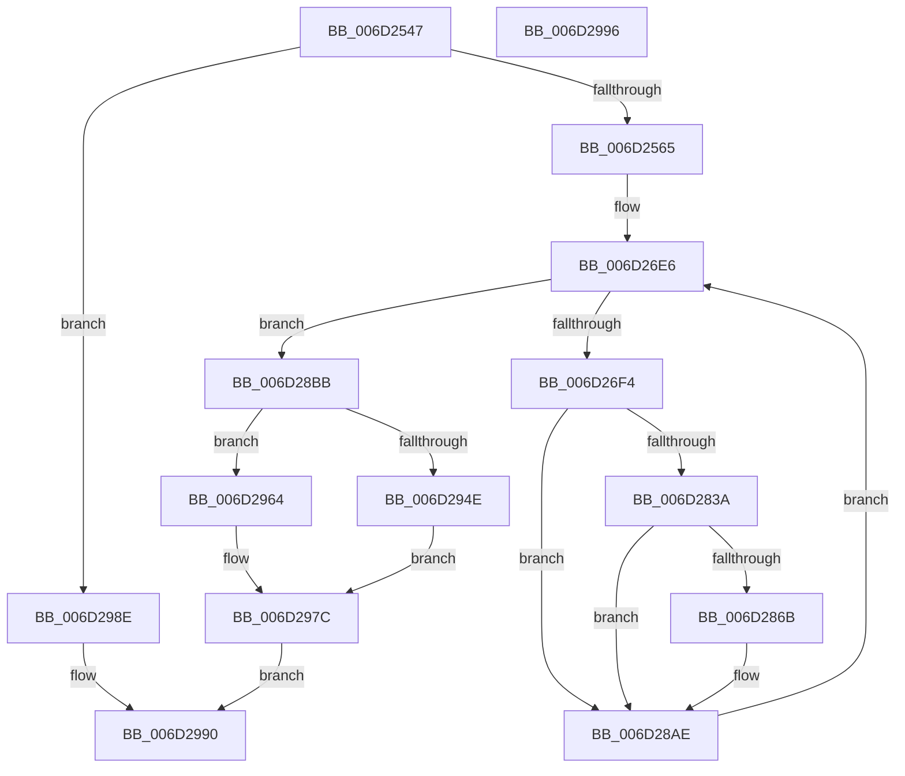

# IopTimerDispatch$filt$2

- RVA: `0x006D2547`–`0x006D2997` (길이 `1,104` bytes)
- VA: `0x00000001406D2547`
- 실행 섹션: `.text`
- PDB 이름 있음: `예`; PDB Function 태그: `예`
- unwind 정보 RVA: `0x000822E8`
- 디코드: `252`개 명령, `1,104/1,104` bytes 표시
- 미해석 바이트: `0` (있으면 어셈블리에 `.byte`로 보존)

> 이 문서는 커널 이미지의 기계어와 PDB 기호를 분석해 생성했습니다. 4번과 5번은 함수 원형과 자료형을 바이너리 사용 방식에서 추정한 C 해석이며 원본 소스 복구 결과는 아닙니다.

## 1. Dependencies

- 직접 호출 지점: **2**; 고유 호출 대상: **2**
- 직접 호출자로 확인된 함수: **0**
- RIP 상대 이미지 참조: **2**

### Outgoing calls
- `0x006D295D` → [RtlpComputeEpilogueOffset](../51/RtlpComputeEpilogueOffset_function_0051C81C.md) (function, `0x0051C81C`)
- `0x006D2976` → [guard_dispatch_icall](../6B/guard_dispatch_icall_function_006BAAD0.md) (function, `0x006BAAD0`)

### Direct callers
- 이 함수 시작 RVA로 연결되는 직접 call은 확인되지 않았습니다. 간접 호출은 완전히 역산할 수 없습니다.

### Static image references
- `0x006D272F` → RVA `0x00FC6F78` (`ALMOSTRO`; read)
- `0x006D2751` → RVA `0x00FC7250` (`ALMOSTRO`; read)

## 2. Other-region calls and transfers

- 다른 실행 섹션으로 향하는 call: **0**
- 별도 외부 분기/꼬리 이동을 확인하지 못했습니다.

## 3. Assembly (complete function range)

```asm
006D2547  40 55                           push rbp
006D2549  48 83 EC 30                     sub rsp, 0x30
006D254D  48 8B EA                        mov rbp, rdx
006D2550  8B 45 30                        mov eax, dword ptr [rbp + 0x30]
006D2553  83 C0 03                        add eax, 3
006D2556  89 45 30                        mov dword ptr [rbp + 0x30], eax
006D2559  8B 45 30                        mov eax, dword ptr [rbp + 0x30]
006D255C  83 F8 03                        cmp eax, 3
006D255F  0F 85 29 04 00 00               jne 0x1406d298e
006D2565  48 8D 85 82 01 00 00            lea rax, [rbp + 0x182]
006D256C  48 89 85 D0 00 00 00            mov qword ptr [rbp + 0xd0], rax
006D2573  48 C7 85 98 00 00 00 00 00 00 00  mov qword ptr [rbp + 0x98], 0
006D257E  48 8B 85 D0 00 00 00            mov rax, qword ptr [rbp + 0xd0]
006D2585  48 8B 08                        mov rcx, qword ptr [rax]
006D2588  48 89 8D 98 00 00 00            mov qword ptr [rbp + 0x98], rcx
006D258F  48 8D 85 3A 01 00 00            lea rax, [rbp + 0x13a]
006D2596  48 89 85 D8 00 00 00            mov qword ptr [rbp + 0xd8], rax
006D259D  48 C7 85 90 00 00 00 00 00 00 00  mov qword ptr [rbp + 0x90], 0
006D25A8  48 8B 85 D8 00 00 00            mov rax, qword ptr [rbp + 0xd8]
006D25AF  48 8B 08                        mov rcx, qword ptr [rax]
006D25B2  48 89 8D 90 00 00 00            mov qword ptr [rbp + 0x90], rcx
006D25B9  48 8D 85 82 01 00 00            lea rax, [rbp + 0x182]
006D25C0  48 89 85 E0 00 00 00            mov qword ptr [rbp + 0xe0], rax
006D25C7  48 C7 85 A8 00 00 00 00 00 00 00  mov qword ptr [rbp + 0xa8], 0
006D25D2  48 8B 85 E0 00 00 00            mov rax, qword ptr [rbp + 0xe0]
006D25D9  48 8B 08                        mov rcx, qword ptr [rax]
006D25DC  48 89 8D A8 00 00 00            mov qword ptr [rbp + 0xa8], rcx
006D25E3  48 8D 85 72 01 00 00            lea rax, [rbp + 0x172]
006D25EA  48 89 85 E8 00 00 00            mov qword ptr [rbp + 0xe8], rax
006D25F1  48 C7 85 A0 00 00 00 00 00 00 00  mov qword ptr [rbp + 0xa0], 0
006D25FC  48 8B 85 E8 00 00 00            mov rax, qword ptr [rbp + 0xe8]
006D2603  48 8B 08                        mov rcx, qword ptr [rax]
006D2606  48 89 8D A0 00 00 00            mov qword ptr [rbp + 0xa0], rcx
006D260D  48 8B 85 90 00 00 00            mov rax, qword ptr [rbp + 0x90]
006D2614  8B 8D 98 00 00 00               mov ecx, dword ptr [rbp + 0x98]
006D261A  48 D3 C8                        ror rax, cl
006D261D  48 89 85 F0 00 00 00            mov qword ptr [rbp + 0xf0], rax
006D2624  48 8B 85 A0 00 00 00            mov rax, qword ptr [rbp + 0xa0]
006D262B  8B 8D A8 00 00 00               mov ecx, dword ptr [rbp + 0xa8]
006D2631  48 D3 C0                        rol rax, cl
006D2634  48 89 85 B8 00 00 00            mov qword ptr [rbp + 0xb8], rax
006D263B  C7 45 68 00 00 00 00            mov dword ptr [rbp + 0x68], 0
006D2642  48 8B 85 B8 00 00 00            mov rax, qword ptr [rbp + 0xb8]
006D2649  48 8B 48 40                     mov rcx, qword ptr [rax + 0x40]
006D264D  48 89 4D 38                     mov qword ptr [rbp + 0x38], rcx
006D2651  48 8B 4D 38                     mov rcx, qword ptr [rbp + 0x38]
006D2655  48 8B 85 F0 00 00 00            mov rax, qword ptr [rbp + 0xf0]
006D265C  48 33 C8                        xor rcx, rax
006D265F  48 89 8D 88 00 00 00            mov qword ptr [rbp + 0x88], rcx
006D2666  48 8B 85 88 00 00 00            mov rax, qword ptr [rbp + 0x88]
006D266D  48 B9 00 00 00 00 00 80 FF FF   movabs rcx, 0xffff800000000000
006D2677  48 0B C1                        or rax, rcx
006D267A  48 89 85 88 00 00 00            mov qword ptr [rbp + 0x88], rax
006D2681  48 8B 85 88 00 00 00            mov rax, qword ptr [rbp + 0x88]
006D2688  48 89 45 40                     mov qword ptr [rbp + 0x40], rax
006D268C  48 8B 45 40                     mov rax, qword ptr [rbp + 0x40]
006D2690  48 89 45 48                     mov qword ptr [rbp + 0x48], rax
006D2694  48 8B 45 40                     mov rax, qword ptr [rbp + 0x40]
006D2698  83 E0 3F                        and eax, 0x3f
006D269B  B9 40 00 00 00                  mov ecx, 0x40
006D26A0  2B C8                           sub ecx, eax
006D26A2  48 8B 55 40                     mov rdx, qword ptr [rbp + 0x40]
006D26A6  48 D3 E2                        shl rdx, cl
006D26A9  48 8B 4D 40                     mov rcx, qword ptr [rbp + 0x40]
006D26AD  83 E1 3F                        and ecx, 0x3f
006D26B0  48 8B 45 40                     mov rax, qword ptr [rbp + 0x40]
006D26B4  48 D3 E8                        shr rax, cl
006D26B7  48 0B C2                        or rax, rdx
006D26BA  48 89 45 38                     mov qword ptr [rbp + 0x38], rax
006D26BE  8B 45 68                        mov eax, dword ptr [rbp + 0x68]
006D26C1  24 03                           and al, 3
006D26C3  F6 D8                           neg al
006D26C5  48 1B C9                        sbb rcx, rcx
006D26C8  48 F7 D1                        not rcx
006D26CB  81 E1 D0 77 00 00               and ecx, 0x77d0
006D26D1  48 89 8D 08 01 00 00            mov qword ptr [rbp + 0x108], rcx
006D26D8  C7 45 54 19 00 00 00            mov dword ptr [rbp + 0x54], 0x19
006D26DF  C7 45 34 00 00 00 00            mov dword ptr [rbp + 0x34], 0
006D26E6  8B 4D 34                        mov ecx, dword ptr [rbp + 0x34]
006D26E9  8B 45 54                        mov eax, dword ptr [rbp + 0x54]
006D26EC  3B C8                           cmp ecx, eax
006D26EE  0F 83 C7 01 00 00               jae 0x1406d28bb
006D26F4  48 8B 45 48                     mov rax, qword ptr [rbp + 0x48]
006D26F8  48 8B 08                        mov rcx, qword ptr [rax]
006D26FB  48 89 4D 70                     mov qword ptr [rbp + 0x70], rcx
006D26FF  48 8B 45 38                     mov rax, qword ptr [rbp + 0x38]
006D2703  48 89 85 00 01 00 00            mov qword ptr [rbp + 0x100], rax
006D270A  48 8B 45 48                     mov rax, qword ptr [rbp + 0x48]
006D270E  48 8B 08                        mov rcx, qword ptr [rax]
006D2711  48 89 8D F8 00 00 00            mov qword ptr [rbp + 0xf8], rcx
006D2718  48 C7 45 58 00 00 00 00         mov qword ptr [rbp + 0x58], 0
006D2720  48 8B 85 F8 00 00 00            mov rax, qword ptr [rbp + 0xf8]
006D2727  48 89 45 58                     mov qword ptr [rbp + 0x58], rax
006D272B  48 8B 45 58                     mov rax, qword ptr [rbp + 0x58]
006D272F  48 8B 0D 42 48 8F 00            mov rcx, qword ptr [rip + 0x8f4842]
006D2736  48 33 C1                        xor rax, rcx
006D2739  48 D3 C0                        rol rax, cl
006D273C  48 89 45 58                     mov qword ptr [rbp + 0x58], rax
006D2740  48 8B 4D 58                     mov rcx, qword ptr [rbp + 0x58]
006D2744  48 8B 85 00 01 00 00            mov rax, qword ptr [rbp + 0x100]
006D274B  48 33 C8                        xor rcx, rax
006D274E  48 0F C9                        bswap rcx
006D2751  48 33 0D F8 4A 8F 00            xor rcx, qword ptr [rip + 0x8f4af8]
006D2758  48 89 4D 58                     mov qword ptr [rbp + 0x58], rcx
006D275C  48 8B 4D 48                     mov rcx, qword ptr [rbp + 0x48]
006D2760  48 8B 45 58                     mov rax, qword ptr [rbp + 0x58]
006D2764  48 89 01                        mov qword ptr [rcx], rax
006D2767  8B 55 34                        mov edx, dword ptr [rbp + 0x34]
006D276A  48 8B 45 48                     mov rax, qword ptr [rbp + 0x48]
006D276E  48 8B 00                        mov rax, qword ptr [rax]
006D2771  48 03 C2                        add rax, rdx
006D2774  48 8B 4D 40                     mov rcx, qword ptr [rbp + 0x40]
006D2778  48 03 C8                        add rcx, rax
006D277B  48 8B 45 48                     mov rax, qword ptr [rbp + 0x48]
006D277F  48 89 08                        mov qword ptr [rax], rcx
006D2782  48 8B 45 70                     mov rax, qword ptr [rbp + 0x70]
006D2786  F7 D0                           not eax
006D2788  83 E0 3F                        and eax, 0x3f
006D278B  B9 40 00 00 00                  mov ecx, 0x40
006D2790  2B C8                           sub ecx, eax
006D2792  8B 45 34                        mov eax, dword ptr [rbp + 0x34]
006D2795  41 B8 C8 00 00 00               mov r8d, 0xc8
006D279B  44 2B C0                        sub r8d, eax
006D279E  44 8B 4D 34                     mov r9d, dword ptr [rbp + 0x34]
006D27A2  4D 33 C8                        xor r9, r8
006D27A5  49 D3 E1                        shl r9, cl
006D27A8  8B 45 34                        mov eax, dword ptr [rbp + 0x34]
006D27AB  BA C8 00 00 00                  mov edx, 0xc8
006D27B0  2B D0                           sub edx, eax
006D27B2  44 8B 45 34                     mov r8d, dword ptr [rbp + 0x34]
006D27B6  4C 33 C2                        xor r8, rdx
006D27B9  48 8B 4D 70                     mov rcx, qword ptr [rbp + 0x70]
006D27BD  F7 D1                           not ecx
006D27BF  83 E1 3F                        and ecx, 0x3f
006D27C2  49 D3 E8                        shr r8, cl
006D27C5  4D 0B C1                        or r8, r9
006D27C8  48 8B 45 38                     mov rax, qword ptr [rbp + 0x38]
006D27CC  49 33 C0                        xor rax, r8
006D27CF  48 89 45 38                     mov qword ptr [rbp + 0x38], rax
006D27D3  48 8B 45 70                     mov rax, qword ptr [rbp + 0x70]
006D27D7  83 F0 FA                        xor eax, 0xfffffffa
006D27DA  83 E0 3F                        and eax, 0x3f
006D27DD  B9 40 00 00 00                  mov ecx, 0x40
006D27E2  2B C8                           sub ecx, eax
006D27E4  48 8B 55 38                     mov rdx, qword ptr [rbp + 0x38]
006D27E8  48 D3 EA                        shr rdx, cl
006D27EB  48 8B 4D 70                     mov rcx, qword ptr [rbp + 0x70]
006D27EF  83 F1 FA                        xor ecx, 0xfffffffa
006D27F2  83 E1 3F                        and ecx, 0x3f
006D27F5  48 8B 45 38                     mov rax, qword ptr [rbp + 0x38]
006D27F9  48 D3 E0                        shl rax, cl
006D27FC  48 0B C2                        or rax, rdx
006D27FF  48 89 45 38                     mov qword ptr [rbp + 0x38], rax
006D2803  48 8B 4D 40                     mov rcx, qword ptr [rbp + 0x40]
006D2807  48 8B 45 38                     mov rax, qword ptr [rbp + 0x38]
006D280B  48 03 C8                        add rcx, rax
006D280E  48 89 4D 38                     mov qword ptr [rbp + 0x38], rcx
006D2812  48 8B 8D 08 01 00 00            mov rcx, qword ptr [rbp + 0x108]
006D2819  48 8B 45 38                     mov rax, qword ptr [rbp + 0x38]
006D281D  48 33 C8                        xor rcx, rax
006D2820  48 89 4D 38                     mov qword ptr [rbp + 0x38], rcx
006D2824  48 8B 45 48                     mov rax, qword ptr [rbp + 0x48]
006D2828  48 83 C0 08                     add rax, 8
006D282C  48 89 45 48                     mov qword ptr [rbp + 0x48], rax
006D2830  8B 45 34                        mov eax, dword ptr [rbp + 0x34]
006D2833  FF C0                           inc eax
006D2835  83 F8 19                        cmp eax, 0x19
006D2838  75 74                           jne 0x1406d28ae
006D283A  48 B8 17 A4 98 08 A4 98 28 04   movabs rax, 0x42898a40898a417
006D2844  48 89 45 60                     mov qword ptr [rbp + 0x60], rax
006D2848  48 8B 4D 60                     mov rcx, qword ptr [rbp + 0x60]
006D284C  48 C1 E9 3F                     shr rcx, 0x3f
006D2850  48 8B 45 60                     mov rax, qword ptr [rbp + 0x60]
006D2854  48 03 C0                        add rax, rax
006D2857  48 0B C1                        or rax, rcx
006D285A  48 89 45 60                     mov qword ptr [rbp + 0x60], rax
006D285E  48 8B 4D 60                     mov rcx, qword ptr [rbp + 0x60]
006D2862  48 8B 45 40                     mov rax, qword ptr [rbp + 0x40]
006D2866  48 33 08                        xor rcx, qword ptr [rax]
006D2869  74 43                           je 0x1406d28ae
006D286B  48 8B 45 48                     mov rax, qword ptr [rbp + 0x48]
006D286F  48 8B 4D 60                     mov rcx, qword ptr [rbp + 0x60]
006D2873  48 33 48 F8                     xor rcx, qword ptr [rax - 8]
006D2877  48 8B 45 40                     mov rax, qword ptr [rbp + 0x40]
006D287B  48 33 08                        xor rcx, qword ptr [rax]
006D287E  48 8B 45 48                     mov rax, qword ptr [rbp + 0x48]
006D2882  48 89 48 F8                     mov qword ptr [rax - 8], rcx
006D2886  48 8B 4D 48                     mov rcx, qword ptr [rbp + 0x48]
006D288A  8B 45 54                        mov eax, dword ptr [rbp + 0x54]
006D288D  03 41 FC                        add eax, dword ptr [rcx - 4]
006D2890  89 45 54                        mov dword ptr [rbp + 0x54], eax
006D2893  48 8B 45 48                     mov rax, qword ptr [rbp + 0x48]
006D2897  48 8B 4D 60                     mov rcx, qword ptr [rbp + 0x60]
006D289B  48 33 48 F8                     xor rcx, qword ptr [rax - 8]
006D289F  48 8B 45 40                     mov rax, qword ptr [rbp + 0x40]
006D28A3  48 33 08                        xor rcx, qword ptr [rax]
006D28A6  48 8B 45 48                     mov rax, qword ptr [rbp + 0x48]
006D28AA  48 89 48 F8                     mov qword ptr [rax - 8], rcx
006D28AE  8B 45 34                        mov eax, dword ptr [rbp + 0x34]
006D28B1  FF C0                           inc eax
006D28B3  89 45 34                        mov dword ptr [rbp + 0x34], eax
006D28B6  E9 2B FE FF FF                  jmp 0x1406d26e6
006D28BB  48 8B 45 40                     mov rax, qword ptr [rbp + 0x40]
006D28BF  48 BA F5 6F 1B AD 5F 93 44 62   movabs rdx, 0x6244935fad1b6ff5
006D28C9  48 8B 08                        mov rcx, qword ptr [rax]
006D28CC  48 33 CA                        xor rcx, rdx
006D28CF  48 89 8D 10 01 00 00            mov qword ptr [rbp + 0x110], rcx
006D28D6  48 8B 85 10 01 00 00            mov rax, qword ptr [rbp + 0x110]
006D28DD  48 89 45 38                     mov qword ptr [rbp + 0x38], rax
006D28E1  48 8D 45 38                     lea rax, [rbp + 0x38]
006D28E5  48 89 85 18 01 00 00            mov qword ptr [rbp + 0x118], rax
006D28EC  48 C7 85 B0 00 00 00 00 00 00 00  mov qword ptr [rbp + 0xb0], 0
006D28F7  48 8B 85 18 01 00 00            mov rax, qword ptr [rbp + 0x118]
006D28FE  48 8B 08                        mov rcx, qword ptr [rax]
006D2901  48 89 8D B0 00 00 00            mov qword ptr [rbp + 0xb0], rcx
006D2908  48 8B 85 B0 00 00 00            mov rax, qword ptr [rbp + 0xb0]
006D290F  48 B9 DB 27 2A BC 17 A2 15 6A   movabs rcx, 0x6a15a217bc2a27db
006D2919  48 33 C1                        xor rax, rcx
006D291C  48 89 45 38                     mov qword ptr [rbp + 0x38], rax
006D2920  48 8B 45 40                     mov rax, qword ptr [rbp + 0x40]
006D2924  48 89 45 78                     mov qword ptr [rbp + 0x78], rax
006D2928  48 8B 45 78                     mov rax, qword ptr [rbp + 0x78]
006D292C  C6 00 2E                        mov byte ptr [rax], 0x2e
006D292F  48 8B 45 78                     mov rax, qword ptr [rbp + 0x78]
006D2933  C6 40 01 48                     mov byte ptr [rax + 1], 0x48
006D2937  48 8B 45 78                     mov rax, qword ptr [rbp + 0x78]
006D293B  C6 40 02 31                     mov byte ptr [rax + 2], 0x31
006D293F  48 8B 45 78                     mov rax, qword ptr [rbp + 0x78]
006D2943  C6 40 03 11                     mov byte ptr [rax + 3], 0x11
006D2947  8B 45 68                        mov eax, dword ptr [rbp + 0x68]
006D294A  A8 01                           test al, 1
006D294C  74 16                           je 0x1406d2964
006D294E  4C 8B 45 38                     mov r8, qword ptr [rbp + 0x38]
006D2952  48 8B 55 40                     mov rdx, qword ptr [rbp + 0x40]
006D2956  48 8B 8D B8 00 00 00            mov rcx, qword ptr [rbp + 0xb8]
006D295D  E8 BA 9E E4 FF                  call 0x14051c81c
006D2962  EB 18                           jmp 0x1406d297c
006D2964  48 8B 45 40                     mov rax, qword ptr [rbp + 0x40]
006D2968  45 33 C9                        xor r9d, r9d
006D296B  45 33 C0                        xor r8d, r8d
006D296E  48 8B 55 38                     mov rdx, qword ptr [rbp + 0x38]
006D2972  48 8B 4D 40                     mov rcx, qword ptr [rbp + 0x40]
006D2976  E8 55 81 FE FF                  call 0x1406baad0
006D297B  90                              nop
006D297C  C7 85 80 00 00 00 01 00 00 00   mov dword ptr [rbp + 0x80], 1
006D2986  8B 85 80 00 00 00               mov eax, dword ptr [rbp + 0x80]
006D298C  EB 02                           jmp 0x1406d2990
006D298E  33 C0                           xor eax, eax
006D2990  48 83 C4 30                     add rsp, 0x30
006D2994  5D                              pop rbp
006D2995  C3                              ret
006D2996  CC                              int3
```

## 4. C-style interpretation (structured pseudocode)

```c
__int64 __fastcall IopTimerDispatch_filt_2(__int64 a1, __int64 a2)
{
    __int64 result;
    __int64 v_rsp;

    v_rsp = (v_rsp) - (48);
    result = (unsigned int)(((unsigned int)(*(unsigned int *)(a2 + 48))) + (3));
    *(unsigned int *)(a2 + 48) = (unsigned int)(result);
    if (((unsigned int)((unsigned int)(*(unsigned int *)(a2 + 48)))) != 3) goto loc_006D298E;
    *(unsigned __int64 *)(a2 + 208) = a2 + 386;
    *(unsigned __int64 *)(a2 + 152) = 0;
    *(unsigned __int64 *)(a2 + 152) = *(unsigned __int64 *)(*(unsigned __int64 *)(a2 + 208));
    *(unsigned __int64 *)(a2 + 216) = a2 + 314;
    *(unsigned __int64 *)(a2 + 144) = 0;
    *(unsigned __int64 *)(a2 + 144) = *(unsigned __int64 *)(*(unsigned __int64 *)(a2 + 216));
    *(unsigned __int64 *)(a2 + 224) = a2 + 386;
    *(unsigned __int64 *)(a2 + 168) = 0;
    *(unsigned __int64 *)(a2 + 168) = *(unsigned __int64 *)(*(unsigned __int64 *)(a2 + 224));
    *(unsigned __int64 *)(a2 + 232) = a2 + 370;
    *(unsigned __int64 *)(a2 + 160) = 0;
    *(unsigned __int64 *)(a2 + 160) = *(unsigned __int64 *)(*(unsigned __int64 *)(a2 + 232));
    *(unsigned __int64 *)(a2 + 240) = *(unsigned __int64 *)(a2 + 144);
    *(unsigned __int64 *)(a2 + 184) = *(unsigned __int64 *)(a2 + 160);
    *(unsigned int *)(a2 + 104) = 0;
    *(unsigned __int64 *)(a2 + 56) = *(unsigned __int64 *)(*(unsigned __int64 *)(a2 + 184) + 64);
    a1 = (*(unsigned __int64 *)(a2 + 56)) ^ (*(unsigned __int64 *)(a2 + 240));
    *(unsigned __int64 *)(a2 + 136) = a1;
    result = (*(unsigned __int64 *)(a2 + 136)) | (a1);
    *(unsigned __int64 *)(a2 + 136) = result;
    *(unsigned __int64 *)(a2 + 64) = *(unsigned __int64 *)(a2 + 136);
    *(unsigned __int64 *)(a2 + 72) = *(unsigned __int64 *)(a2 + 64);
    result = (unsigned int)((*(unsigned __int64 *)(a2 + 64)) & (63));
    a1 = (unsigned int)((64) - ((unsigned int)(result)));
    a2 = (*(unsigned __int64 *)(a2 + 64)) << ((unsigned __int8)(a1));
    a1 = (unsigned int)((*(unsigned __int64 *)(a2 + 64)) & (63));
    result = (*(unsigned __int64 *)(a2 + 64)) >> ((unsigned __int8)(a1));
    result = (result) | (a2);
    *(unsigned __int64 *)(a2 + 56) = result;
    result = (unsigned __int8)(((unsigned int)(*(unsigned int *)(a2 + 104))) & (3));
    result = (unsigned __int8)(-(result));
    a1 = ~(a1);
    a1 = (unsigned int)((a1) & (0x77D0ULL));
    *(unsigned __int64 *)(a2 + 264) = a1;
    *(unsigned int *)(a2 + 84) = 25;
    *(unsigned int *)(a2 + 52) = 0;
loc_006D26E6:
    if (((unsigned int)((unsigned int)(*(unsigned int *)(a2 + 52)))) >= ((unsigned int)((unsigned int)(*(unsigned int *)(a2 + 84))))) goto loc_006D28BB;
    *(unsigned __int64 *)(a2 + 112) = *(unsigned __int64 *)(*(unsigned __int64 *)(a2 + 72));
    *(unsigned __int64 *)(a2 + 256) = *(unsigned __int64 *)(a2 + 56);
    *(unsigned __int64 *)(a2 + 248) = *(unsigned __int64 *)(*(unsigned __int64 *)(a2 + 72));
    *(unsigned __int64 *)(a2 + 88) = 0;
    *(unsigned __int64 *)(a2 + 88) = *(unsigned __int64 *)(a2 + 248);
    result = (*(unsigned __int64 *)(a2 + 88)) ^ (*(unsigned __int64 *)(v_rip + 9390146));
    *(unsigned __int64 *)(a2 + 88) = result;
    a1 = (*(unsigned __int64 *)(a2 + 88)) ^ (*(unsigned __int64 *)(a2 + 256));
    a1 = (a1) ^ (*(unsigned __int64 *)(v_rip + 9390840));
    *(unsigned __int64 *)(a2 + 88) = a1;
    *(unsigned __int64 *)(*(unsigned __int64 *)(a2 + 72)) = *(unsigned __int64 *)(a2 + 88);
    result = (*(unsigned __int64 *)(*(unsigned __int64 *)(a2 + 72))) + ((unsigned int)(*(unsigned int *)(a2 + 52)));
    a1 = (*(unsigned __int64 *)(a2 + 64)) + (result);
    *(unsigned __int64 *)(*(unsigned __int64 *)(a2 + 72)) = a1;
    result = (unsigned int)(~(*(unsigned __int64 *)(a2 + 112)));
    result = (unsigned int)((result) & (63));
    a1 = (unsigned int)((64) - ((unsigned int)(result)));
    a3 = (unsigned int)((200) - ((unsigned int)((unsigned int)(*(unsigned int *)(a2 + 52)))));
    a4 = ((unsigned int)(*(unsigned int *)(a2 + 52))) ^ (a3);
    a4 = (a4) << ((unsigned __int8)(a1));
    a2 = (unsigned int)((200) - ((unsigned int)((unsigned int)(*(unsigned int *)(a2 + 52)))));
    a3 = ((unsigned int)(*(unsigned int *)(a2 + 52))) ^ (a2);
    a1 = (unsigned int)(~(*(unsigned __int64 *)(a2 + 112)));
    a1 = (unsigned int)((a1) & (63));
    a3 = (a3) >> ((unsigned __int8)(a1));
    a3 = (a3) | (a4);
    result = (*(unsigned __int64 *)(a2 + 56)) ^ (a3);
    *(unsigned __int64 *)(a2 + 56) = result;
    result = (unsigned int)((*(unsigned __int64 *)(a2 + 112)) ^ (0xFFFFFFFAULL));
    result = (unsigned int)((result) & (63));
    a1 = (unsigned int)((64) - ((unsigned int)(result)));
    a2 = (*(unsigned __int64 *)(a2 + 56)) >> ((unsigned __int8)(a1));
    a1 = (unsigned int)((*(unsigned __int64 *)(a2 + 112)) ^ (0xFFFFFFFAULL));
    a1 = (unsigned int)((a1) & (63));
    result = (*(unsigned __int64 *)(a2 + 56)) << ((unsigned __int8)(a1));
    result = (result) | (a2);
    *(unsigned __int64 *)(a2 + 56) = result;
    a1 = (*(unsigned __int64 *)(a2 + 64)) + (*(unsigned __int64 *)(a2 + 56));
    *(unsigned __int64 *)(a2 + 56) = a1;
    a1 = (*(unsigned __int64 *)(a2 + 264)) ^ (*(unsigned __int64 *)(a2 + 56));
    *(unsigned __int64 *)(a2 + 56) = a1;
    result = (*(unsigned __int64 *)(a2 + 72)) + (8);
    *(unsigned __int64 *)(a2 + 72) = result;
    result = (unsigned int)(((unsigned int)(*(unsigned int *)(a2 + 52))) + 1);
    if (((unsigned int)(result)) != 25) goto loc_006D28AE;
    *(unsigned __int64 *)(a2 + 96) = result;
    a1 = (*(unsigned __int64 *)(a2 + 96)) >> (63);
    result = (*(unsigned __int64 *)(a2 + 96)) + (*(unsigned __int64 *)(a2 + 96));
    result = (result) | (a1);
    *(unsigned __int64 *)(a2 + 96) = result;
    a1 = (*(unsigned __int64 *)(a2 + 96)) ^ (*(unsigned __int64 *)(*(unsigned __int64 *)(a2 + 64)));
    result = *(unsigned __int64 *)(a2 + 64);
    if (!(condition_is_equal)) {
        result = *(unsigned __int64 *)(a2 + 72);
        a1 = *(unsigned __int64 *)(a2 + 96);
        a1 = (a1) ^ (*(unsigned __int64 *)(result - 8));
        result = *(unsigned __int64 *)(a2 + 64);
        a1 = (a1) ^ (*(unsigned __int64 *)(result));
        result = *(unsigned __int64 *)(a2 + 72);
        *(unsigned __int64 *)(result - 8) = a1;
        a1 = *(unsigned __int64 *)(a2 + 72);
        result = *(unsigned int *)(a2 + 84);
        result = (unsigned int)((result) + (*(unsigned int *)(a1 - 4)));
        *(unsigned int *)(a2 + 84) = (unsigned int)(result);
        result = *(unsigned __int64 *)(a2 + 72);
        a1 = *(unsigned __int64 *)(a2 + 96);
        a1 = (a1) ^ (*(unsigned __int64 *)(result - 8));
        result = *(unsigned __int64 *)(a2 + 64);
        a1 = (a1) ^ (*(unsigned __int64 *)(result));
        result = *(unsigned __int64 *)(a2 + 72);
        *(unsigned __int64 *)(result - 8) = a1;
    }
    result = (unsigned int)(((unsigned int)(*(unsigned int *)(a2 + 52))) + 1);
    *(unsigned int *)(a2 + 52) = (unsigned int)(result);
    goto loc_006D26E6;
loc_006D28BB:
    a1 = (*(unsigned __int64 *)(*(unsigned __int64 *)(a2 + 64))) ^ (a2);
    *(unsigned __int64 *)(a2 + 272) = a1;
    *(unsigned __int64 *)(a2 + 56) = *(unsigned __int64 *)(a2 + 272);
    *(unsigned __int64 *)(a2 + 280) = a2 + 56;
    *(unsigned __int64 *)(a2 + 176) = 0;
    *(unsigned __int64 *)(a2 + 176) = *(unsigned __int64 *)(*(unsigned __int64 *)(a2 + 280));
    result = (*(unsigned __int64 *)(a2 + 176)) ^ (*(unsigned __int64 *)(*(unsigned __int64 *)(a2 + 280)));
    *(unsigned __int64 *)(a2 + 56) = result;
    *(unsigned __int64 *)(a2 + 120) = *(unsigned __int64 *)(a2 + 64);
    *(unsigned __int8 *)(*(unsigned __int64 *)(a2 + 120)) = 46;
    *(unsigned __int8 *)(*(unsigned __int64 *)(a2 + 120) + 1) = 72;
    *(unsigned __int8 *)(*(unsigned __int64 *)(a2 + 120) + 2) = 49;
    *(unsigned __int8 *)(*(unsigned __int64 *)(a2 + 120) + 3) = 17;
    if ((((unsigned __int8)((unsigned int)(*(unsigned int *)(a2 + 104)))) & (1)) == 0) goto loc_006D2964;
    result = RtlpComputeEpilogueOffset(*(unsigned __int64 *)(a2 + 184), *(unsigned __int64 *)(a2 + 64), *(unsigned __int64 *)(a2 + 56), a4);
    goto loc_006D297C;
loc_006D2964:
    a4 = 0;
    a3 = 0;
    result = guard_dispatch_icall(*(unsigned __int64 *)(a2 + 64), *(unsigned __int64 *)(a2 + 56), a3, a4);
loc_006D297C:
    *(unsigned int *)(a2 + 128) = 1;
    goto loc_006D2990;
loc_006D298E:
    result = 0;
loc_006D2990:
    v_rsp = (v_rsp) + (48);
    return result;
}
```

## 5. (Beta) C Style

```c
int64_t IopTimerDispatch_filt_2(int64_t Arg1, void *Arg2)
{
    uint8_t *arg2 = (uint8_t *)Arg2;

    int64_t result;
    int64_t local_rsp;

    local_rsp = (local_rsp) - (48);
    result = (uint32_t)(((uint32_t)(*(uint32_t *)(arg2 + 0x30))) + (3));
    *(uint32_t *)(arg2 + 0x30) = (uint32_t)(result);
    if (((uint32_t)((uint32_t)(*(uint32_t *)(arg2 + 0x30)))) != 3) goto loc_006D298E;
    *(void **)(arg2 + 0xD0) = Arg2 + 386;
    *(uint64_t *)(arg2 + 0x98) = 0;
    *(uint64_t *)(arg2 + 0x98) = *(uint64_t *)(*(uint64_t *)(arg2 + 0xD0));
    *(void **)(arg2 + 0xD8) = Arg2 + 314;
    *(uint64_t *)(arg2 + 0x90) = 0;
    *(uint64_t *)(arg2 + 0x90) = *(uint64_t *)(*(uint64_t *)(arg2 + 0xD8));
    *(void **)(arg2 + 0xE0) = Arg2 + 386;
    *(uint64_t *)(arg2 + 0xA8) = 0;
    *(uint64_t *)(arg2 + 0xA8) = *(uint64_t *)(*(uint64_t *)(arg2 + 0xE0));
    *(void **)(arg2 + 0xE8) = Arg2 + 370;
    *(uint64_t *)(arg2 + 0xA0) = 0;
    *(uint64_t *)(arg2 + 0xA0) = *(uint64_t *)(*(uint64_t *)(arg2 + 0xE8));
    *(uint64_t *)(arg2 + 0xF0) = *(uint64_t *)(arg2 + 0x90);
    *(uint64_t *)(arg2 + 0xB8) = *(uint64_t *)(arg2 + 0xA0);
    *(uint32_t *)(arg2 + 0x68) = 0;
    *(uint64_t *)(arg2 + 0x38) = *(uint64_t *)(*(uint64_t *)(arg2 + 0xB8) + 0x40);
    Arg1 = (*(uint64_t *)(arg2 + 0x38)) ^ (*(uint64_t *)(arg2 + 0xF0));
    *(uint64_t *)(arg2 + 0x88) = Arg1;
    result = (*(uint64_t *)(arg2 + 0x88)) | (Arg1);
    *(uint64_t *)(arg2 + 0x88) = result;
    *(uint64_t *)(arg2 + 0x40) = *(uint64_t *)(arg2 + 0x88);
    *(uint64_t *)(arg2 + 0x48) = *(uint64_t *)(arg2 + 0x40);
    result = (uint32_t)((*(uint64_t *)(arg2 + 0x40)) & (63));
    Arg1 = (uint32_t)((64) - ((uint32_t)(result)));
    Arg2 = (*(uint64_t *)(arg2 + 0x40)) << ((uint8_t)(Arg1));
    Arg1 = (uint32_t)((*(uint64_t *)(arg2 + 0x40)) & (63));
    result = (*(uint64_t *)(arg2 + 0x40)) >> ((uint8_t)(Arg1));
    result = (result) | (Arg2);
    *(uint64_t *)(arg2 + 0x38) = result;
    result = (uint8_t)(((uint32_t)(*(uint32_t *)(arg2 + 0x68))) & (3));
    result = (uint8_t)(-(result));
    Arg1 = ~(Arg1);
    Arg1 = (uint32_t)((Arg1) & (0x77D0ULL));
    *(uint64_t *)(arg2 + 0x108) = Arg1;
    *(uint32_t *)(arg2 + 0x54) = 25;
    *(uint32_t *)(arg2 + 0x34) = 0;
loc_006D26E6:
    if (((uint32_t)((uint32_t)(*(uint32_t *)(arg2 + 0x34)))) >= ((uint32_t)((uint32_t)(*(uint32_t *)(arg2 + 0x54))))) goto loc_006D28BB;
    *(uint64_t *)(arg2 + 0x70) = *(uint64_t *)(*(uint64_t *)(arg2 + 0x48));
    *(uint64_t *)(arg2 + 0x100) = *(uint64_t *)(arg2 + 0x38);
    *(uint64_t *)(arg2 + 0xF8) = *(uint64_t *)(*(uint64_t *)(arg2 + 0x48));
    *(uint64_t *)(arg2 + 0x58) = 0;
    *(uint64_t *)(arg2 + 0x58) = *(uint64_t *)(arg2 + 0xF8);
    result = (*(uint64_t *)(arg2 + 0x58)) ^ (*(uint64_t *)(v_rip + 0x8F4842));
    *(uint64_t *)(arg2 + 0x58) = result;
    Arg1 = (*(uint64_t *)(arg2 + 0x58)) ^ (*(uint64_t *)(arg2 + 0x100));
    Arg1 = (Arg1) ^ (*(uint64_t *)(v_rip + 0x8F4AF8));
    *(uint64_t *)(arg2 + 0x58) = Arg1;
    *(uint64_t *)(*(uint64_t *)(arg2 + 0x48)) = *(uint64_t *)(arg2 + 0x58);
    result = (*(uint64_t *)(*(uint64_t *)(arg2 + 0x48))) + ((uint32_t)(*(uint32_t *)(arg2 + 0x34)));
    Arg1 = (*(uint64_t *)(arg2 + 0x40)) + (result);
    *(uint64_t *)(*(uint64_t *)(arg2 + 0x48)) = Arg1;
    result = (uint32_t)(~(*(uint64_t *)(arg2 + 0x70)));
    result = (uint32_t)((result) & (63));
    Arg1 = (uint32_t)((64) - ((uint32_t)(result)));
    a3 = (uint32_t)((200) - ((uint32_t)((uint32_t)(*(uint32_t *)(arg2 + 0x34)))));
    a4 = ((uint32_t)(*(uint32_t *)(arg2 + 0x34))) ^ (a3);
    a4 = (a4) << ((uint8_t)(Arg1));
    Arg2 = (uint32_t)((200) - ((uint32_t)((uint32_t)(*(uint32_t *)(arg2 + 0x34)))));
    a3 = ((uint32_t)(*(uint32_t *)(arg2 + 0x34))) ^ (Arg2);
    Arg1 = (uint32_t)(~(*(uint64_t *)(arg2 + 0x70)));
    Arg1 = (uint32_t)((Arg1) & (63));
    a3 = (a3) >> ((uint8_t)(Arg1));
    a3 = (a3) | (a4);
    result = (*(uint64_t *)(arg2 + 0x38)) ^ (a3);
    *(uint64_t *)(arg2 + 0x38) = result;
    result = (uint32_t)((*(uint64_t *)(arg2 + 0x70)) ^ (0xFFFFFFFAULL));
    result = (uint32_t)((result) & (63));
    Arg1 = (uint32_t)((64) - ((uint32_t)(result)));
    Arg2 = (*(uint64_t *)(arg2 + 0x38)) >> ((uint8_t)(Arg1));
    Arg1 = (uint32_t)((*(uint64_t *)(arg2 + 0x70)) ^ (0xFFFFFFFAULL));
    Arg1 = (uint32_t)((Arg1) & (63));
    result = (*(uint64_t *)(arg2 + 0x38)) << ((uint8_t)(Arg1));
    result = (result) | (Arg2);
    *(uint64_t *)(arg2 + 0x38) = result;
    Arg1 = (*(uint64_t *)(arg2 + 0x40)) + (*(uint64_t *)(arg2 + 0x38));
    *(uint64_t *)(arg2 + 0x38) = Arg1;
    Arg1 = (*(uint64_t *)(arg2 + 0x108)) ^ (*(uint64_t *)(arg2 + 0x38));
    *(uint64_t *)(arg2 + 0x38) = Arg1;
    result = (*(uint64_t *)(arg2 + 0x48)) + (8);
    *(uint64_t *)(arg2 + 0x48) = result;
    result = (uint32_t)(((uint32_t)(*(uint32_t *)(arg2 + 0x34))) + 1);
    if (((uint32_t)(result)) != 25) goto loc_006D28AE;
    *(uint64_t *)(arg2 + 0x60) = result;
    Arg1 = (*(uint64_t *)(arg2 + 0x60)) >> (63);
    result = (*(uint64_t *)(arg2 + 0x60)) + (*(uint64_t *)(arg2 + 0x60));
    result = (result) | (Arg1);
    *(uint64_t *)(arg2 + 0x60) = result;
    Arg1 = (*(uint64_t *)(arg2 + 0x60)) ^ (*(uint64_t *)(*(uint64_t *)(arg2 + 0x40)));
    result = *(uint64_t *)(arg2 + 0x40);
    if (!(condition_is_equal)) {
        result = *(uint64_t *)(arg2 + 0x48);
        Arg1 = *(uint64_t *)(arg2 + 0x60);
        Arg1 = (Arg1) ^ (*(uint64_t *)(result - 0x8));
        result = *(uint64_t *)(arg2 + 0x40);
        Arg1 = (Arg1) ^ (*(uint64_t *)(result));
        result = *(uint64_t *)(arg2 + 0x48);
        *(uint64_t *)(result - 0x8) = Arg1;
        Arg1 = *(uint64_t *)(arg2 + 0x48);
        result = *(uint32_t *)(arg2 + 0x54);
        result = (uint32_t)((result) + (*(uint32_t *)(Arg1 - 0x4)));
        *(uint32_t *)(arg2 + 0x54) = (uint32_t)(result);
        result = *(uint64_t *)(arg2 + 0x48);
        Arg1 = *(uint64_t *)(arg2 + 0x60);
        Arg1 = (Arg1) ^ (*(uint64_t *)(result - 0x8));
        result = *(uint64_t *)(arg2 + 0x40);
        Arg1 = (Arg1) ^ (*(uint64_t *)(result));
        result = *(uint64_t *)(arg2 + 0x48);
        *(uint64_t *)(result - 0x8) = Arg1;
    }
    result = (uint32_t)(((uint32_t)(*(uint32_t *)(arg2 + 0x34))) + 1);
    *(uint32_t *)(arg2 + 0x34) = (uint32_t)(result);
    goto loc_006D26E6;
loc_006D28BB:
    Arg1 = (*(uint64_t *)(*(uint64_t *)(arg2 + 0x40))) ^ (Arg2);
    *(uint64_t *)(arg2 + 0x110) = Arg1;
    *(uint64_t *)(arg2 + 0x38) = *(uint64_t *)(arg2 + 0x110);
    *(void **)(arg2 + 0x118) = Arg2 + 56;
    *(uint64_t *)(arg2 + 0xB0) = 0;
    *(uint64_t *)(arg2 + 0xB0) = *(uint64_t *)(*(uint64_t *)(arg2 + 0x118));
    result = (*(uint64_t *)(arg2 + 0xB0)) ^ (*(uint64_t *)(*(uint64_t *)(arg2 + 0x118)));
    *(uint64_t *)(arg2 + 0x38) = result;
    *(uint64_t *)(arg2 + 0x78) = *(uint64_t *)(arg2 + 0x40);
    *(uint8_t *)(*(uint64_t *)(arg2 + 0x78)) = 46;
    *(uint8_t *)(*(uint64_t *)(arg2 + 0x78) + 0x1) = 72;
    *(uint8_t *)(*(uint64_t *)(arg2 + 0x78) + 0x2) = 49;
    *(uint8_t *)(*(uint64_t *)(arg2 + 0x78) + 0x3) = 17;
    if ((((uint8_t)((uint32_t)(*(uint32_t *)(arg2 + 0x68)))) & (1)) == 0) goto loc_006D2964;
    result = RtlpComputeEpilogueOffset(*(uint64_t *)(arg2 + 0xB8), *(uint64_t *)(arg2 + 0x40), *(uint64_t *)(arg2 + 0x38), a4);
    goto loc_006D297C;
loc_006D2964:
    a4 = 0;
    a3 = 0;
    result = guard_dispatch_icall(*(uint64_t *)(arg2 + 0x40), *(uint64_t *)(arg2 + 0x38), a3, a4);
loc_006D297C:
    *(uint32_t *)(arg2 + 0x80) = 1;
    goto loc_006D2990;
loc_006D298E:
    result = 0;
loc_006D2990:
    local_rsp = (local_rsp) + (48);
    return result;
}
```

### 관측된 메모리 오프셋

구조체 형식이 확인되지 않은 접근은 인자 기준의 오프셋으로만 기록했습니다.

| 기준 인자 | 오프셋 표현 | 폭 (bit) | 접근 |
|---|---:|---:|---|
| `Arg2` | `+ 0x30` | `32` | `R` |
| `Arg2` | `+ 0x30` | `32` | `W` |
| `Arg2` | `+ 0x34` | `32` | `R` |
| `Arg2` | `+ 0x34` | `32` | `W` |
| `Arg2` | `+ 0x38` | `64` | `R` |
| `Arg2` | `+ 0x38` | `64` | `W` |
| `Arg2` | `+ 0x40` | `64` | `R` |
| `Arg2` | `+ 0x40` | `64` | `W` |
| `Arg2` | `+ 0x48` | `64` | `R` |
| `Arg2` | `+ 0x48` | `64` | `W` |
| `Arg2` | `+ 0x54` | `32` | `R` |
| `Arg2` | `+ 0x54` | `32` | `W` |
| `Arg2` | `+ 0x58` | `64` | `R` |
| `Arg2` | `+ 0x58` | `64` | `W` |
| `Arg2` | `+ 0x60` | `64` | `R` |
| `Arg2` | `+ 0x60` | `64` | `W` |
| `Arg2` | `+ 0x68` | `32` | `R` |
| `Arg2` | `+ 0x68` | `32` | `W` |
| `Arg2` | `+ 0x70` | `64` | `R` |
| `Arg2` | `+ 0x70` | `64` | `W` |
| `Arg2` | `+ 0x78` | `64` | `R` |
| `Arg2` | `+ 0x78` | `64` | `W` |
| `Arg2` | `+ 0x80` | `32` | `R` |
| `Arg2` | `+ 0x80` | `32` | `W` |
| `Arg2` | `+ 0x88` | `64` | `R` |
| `Arg2` | `+ 0x88` | `64` | `W` |
| `Arg2` | `+ 0x90` | `64` | `R` |
| `Arg2` | `+ 0x90` | `64` | `W` |
| `Arg2` | `+ 0x98` | `32` | `R` |
| `Arg2` | `+ 0x98` | `64` | `W` |
| `Arg2` | `+ 0xA0` | `64` | `R` |
| `Arg2` | `+ 0xA0` | `64` | `W` |

추가 오프셋 29개는 표에서 생략했습니다.

## 6. Execution-region graph

[열기: 2D/3D 그래프와 함수 탐색 컨트롤 패널](../../../control-panel.html?section=text&rva=0x006D2547&view=graph)

- 2D 그래프는 위에서 아래로 흐르고, 3D 그래프는 빈 공간을 드래그해 회전합니다. Shift+드래그는 이동, 휠은 확대·축소, 함수 노드 선택은 대상 보고서 이동입니다.

### Static fallback


