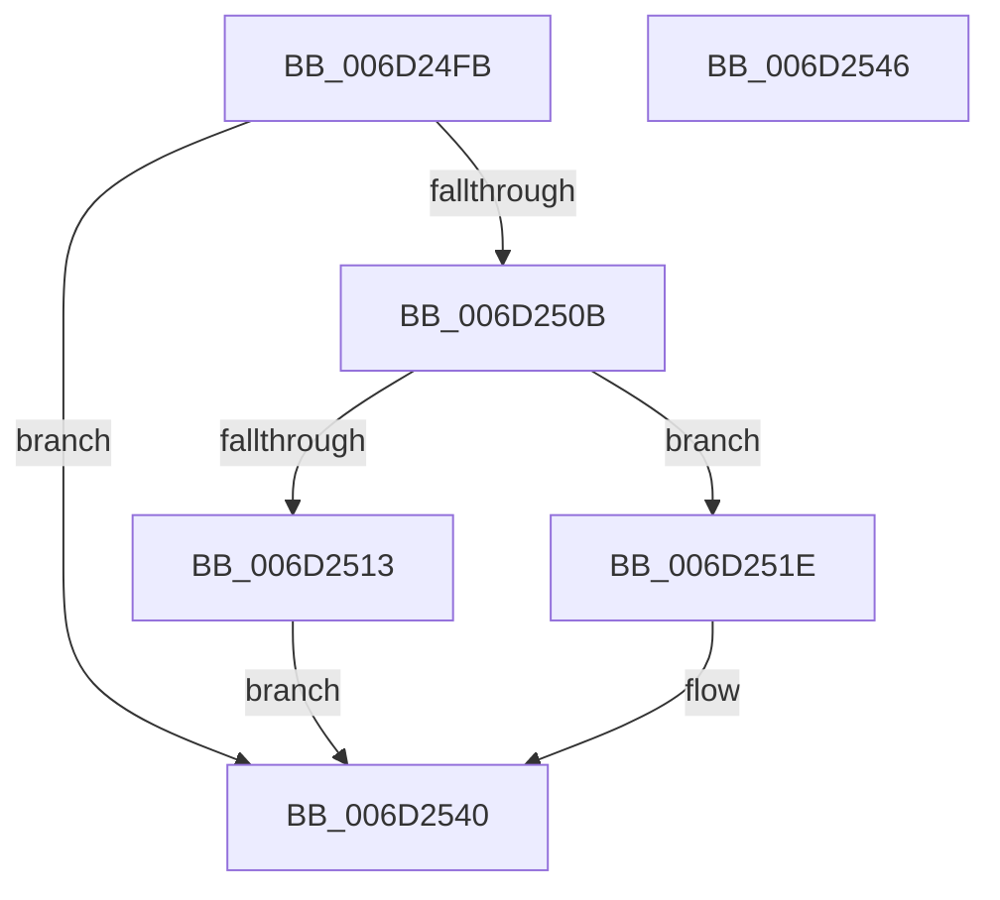

# IopTimerDispatch$fin$1

- RVA: `0x006D24FB`–`0x006D2547` (길이 `76` bytes)
- VA: `0x00000001406D24FB`
- 실행 섹션: `.text`
- PDB 이름 있음: `예`; PDB Function 태그: `예`
- unwind 정보 RVA: `0x000822DC`
- 디코드: `23`개 명령, `76/76` bytes 표시
- 미해석 바이트: `0` (있으면 어셈블리에 `.byte`로 보존)

> 이 문서는 커널 이미지의 기계어와 PDB 기호를 분석해 생성했습니다. 4번과 5번은 함수 원형과 자료형을 바이너리 사용 방식에서 추정한 C 해석이며 원본 소스 복구 결과는 아닙니다.

## 1. Dependencies

- 직접 호출 지점: **0**; 고유 호출 대상: **0**
- 직접 호출자로 확인된 함수: **0**
- RIP 상대 이미지 참조: **0**

### Outgoing calls
- 직접 디코드된 call 명령이 없습니다.

### Direct callers
- 이 함수 시작 RVA로 연결되는 직접 call은 확인되지 않았습니다. 간접 호출은 완전히 역산할 수 없습니다.

### Static image references
- 디코드된 RIP-relative 메모리 참조가 없습니다.

## 2. Other-region calls and transfers

- 다른 실행 섹션으로 향하는 call: **0**
- 별도 외부 분기/꼬리 이동을 확인하지 못했습니다.

## 3. Assembly (complete function range)

```asm
006D24FB  40 55                           push rbp
006D24FD  48 83 EC 30                     sub rsp, 0x30
006D2501  48 8B EA                        mov rbp, rdx
006D2504  88 4D 51                        mov byte ptr [rbp + 0x51], cl
006D2507  84 C9                           test cl, cl
006D2509  74 35                           je 0x1406d2540
006D250B  8B 45 30                        mov eax, dword ptr [rbp + 0x30]
006D250E  83 F8 06                        cmp eax, 6
006D2511  75 0B                           jne 0x1406d251e
006D2513  8B 45 30                        mov eax, dword ptr [rbp + 0x30]
006D2516  83 C0 03                        add eax, 3
006D2519  89 45 30                        mov dword ptr [rbp + 0x30], eax
006D251C  EB 22                           jmp 0x1406d2540
006D251E  48 83 A5 C8 00 00 00 00         and qword ptr [rbp + 0xc8], 0
006D2526  48 8B 8D 82 01 00 00            mov rcx, qword ptr [rbp + 0x182]
006D252D  48 89 8D C8 00 00 00            mov qword ptr [rbp + 0xc8], rcx
006D2534  48 8B 85 3A 01 00 00            mov rax, qword ptr [rbp + 0x13a]
006D253B  48 D3 C8                        ror rax, cl
006D253E  8B 00                           mov eax, dword ptr [rax]
006D2540  48 83 C4 30                     add rsp, 0x30
006D2544  5D                              pop rbp
006D2545  C3                              ret
006D2546  CC                              int3
```

## 4. C-style interpretation (structured pseudocode)

```c
__int64 __fastcall IopTimerDispatch_fin_1(unsigned __int8 a1, __int64 a2)
{
    __int64 result;
    __int64 v_rsp;

    v_rsp = (v_rsp) - (48);
    *(unsigned __int8 *)(a2 + 81) = a1;
    if (a1 == 0) goto loc_006D2540;
    if (((unsigned int)((unsigned int)(*(unsigned int *)(a2 + 48)))) != 6) goto loc_006D251E;
    result = (unsigned int)(((unsigned int)(*(unsigned int *)(a2 + 48))) + (3));
    *(unsigned int *)(a2 + 48) = (unsigned int)(result);
    goto loc_006D2540;
loc_006D251E:
    *(unsigned __int64 *)(a2 + 200) = *(unsigned __int64 *)(a2 + 386);
loc_006D2540:
    v_rsp = (v_rsp) + (48);
    return (unsigned int)(*(unsigned int *)(*(unsigned __int64 *)(a2 + 314)));
}
```

## 5. (Beta) C Style

```c
int64_t IopTimerDispatch_fin_1(uint8_t Arg1, void *Arg2)
{
    uint8_t *arg2 = (uint8_t *)Arg2;

    int64_t result;
    int64_t local_rsp;

    local_rsp = (local_rsp) - (48);
    *(uint8_t *)(arg2 + 0x51) = Arg1;
    if (Arg1 == 0) goto loc_006D2540;
    if (((uint32_t)((uint32_t)(*(uint32_t *)(arg2 + 0x30)))) != 6) goto loc_006D251E;
    result = (uint32_t)(((uint32_t)(*(uint32_t *)(arg2 + 0x30))) + (3));
    *(uint32_t *)(arg2 + 0x30) = (uint32_t)(result);
    goto loc_006D2540;
loc_006D251E:
    *(uint64_t *)(arg2 + 0xC8) = *(uint64_t *)(arg2 + 0x182);
loc_006D2540:
    local_rsp = (local_rsp) + (48);
    return (uint32_t)(*(uint32_t *)(*(uint64_t *)(arg2 + 0x13A)));
}
```

### 관측된 메모리 오프셋

구조체 형식이 확인되지 않은 접근은 인자 기준의 오프셋으로만 기록했습니다.

| 기준 인자 | 오프셋 표현 | 폭 (bit) | 접근 |
|---|---:|---:|---|
| `Arg2` | `+ 0x30` | `32` | `R` |
| `Arg2` | `+ 0x30` | `32` | `W` |
| `Arg2` | `+ 0x51` | `8` | `W` |
| `Arg2` | `+ 0xC8` | `64` | `R/W` |
| `Arg2` | `+ 0xC8` | `64` | `W` |
| `Arg2` | `+ 0x13A` | `64` | `R` |
| `Arg2` | `+ 0x182` | `64` | `R` |

## 6. Execution-region graph

[열기: 2D/3D 그래프와 함수 탐색 컨트롤 패널](../../../control-panel.html?section=text&rva=0x006D24FB&view=graph)

- 2D 그래프는 위에서 아래로 흐르고, 3D 그래프는 빈 공간을 드래그해 회전합니다. Shift+드래그는 이동, 휠은 확대·축소, 함수 노드 선택은 대상 보고서 이동입니다.

### Static fallback


