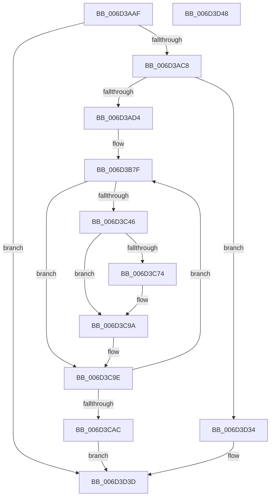

# KiBalanceSetManagerDeferredRoutine$fin$0

- RVA: `0x006D3AAF`–`0x006D3D49` (길이 `666` bytes)
- VA: `0x00000001406D3AAF`
- 실행 섹션: `.text`
- PDB 이름 있음: `예`; PDB Function 태그: `예`
- unwind 정보 RVA: `0x000B35B4`
- 디코드: `177`개 명령, `666/666` bytes 표시
- 미해석 바이트: `0` (있으면 어셈블리에 `.byte`로 보존)

> 이 문서는 커널 이미지의 기계어와 PDB 기호를 분석해 생성했습니다. 4번과 5번은 함수 원형과 자료형을 바이너리 사용 방식에서 추정한 C 해석이며 원본 소스 복구 결과는 아닙니다.

## 1. Dependencies

- 직접 호출 지점: **1**; 고유 호출 대상: **1**
- 직접 호출자로 확인된 함수: **0**
- RIP 상대 이미지 참조: **2**

### Outgoing calls
- `0x006D3CFB` → [guard_dispatch_icall](../6B/guard_dispatch_icall_function_006BAAD0.md) (function, `0x006BAAD0`)

### Direct callers
- 이 함수 시작 RVA로 연결되는 직접 call은 확인되지 않았습니다. 간접 호출은 완전히 역산할 수 없습니다.

### Static image references
- `0x006D3B8C` → RVA `0x00FC6F78` (`ALMOSTRO`; read)
- `0x006D3B9F` → RVA `0x00FC7250` (`ALMOSTRO`; read)

## 2. Other-region calls and transfers

- 다른 실행 섹션으로 향하는 call: **0**
- 별도 외부 분기/꼬리 이동을 확인하지 못했습니다.

## 3. Assembly (complete function range)

```asm
006D3AAF  40 53                           push rbx
006D3AB1  55                              push rbp
006D3AB2  56                              push rsi
006D3AB3  57                              push rdi
006D3AB4  41 56                           push r14
006D3AB6  48 83 EC 30                     sub rsp, 0x30
006D3ABA  48 8B EA                        mov rbp, rdx
006D3ABD  88 4D 48                        mov byte ptr [rbp + 0x48], cl
006D3AC0  84 C9                           test cl, cl
006D3AC2  0F 84 75 02 00 00               je 0x1406d3d3d
006D3AC8  8B 45 30                        mov eax, dword ptr [rbp + 0x30]
006D3ACB  83 F8 0A                        cmp eax, 0xa
006D3ACE  0F 85 60 02 00 00               jne 0x1406d3d34
006D3AD4  48 8D 85 E7 00 00 00            lea rax, [rbp + 0xe7]
006D3ADB  48 89 45 58                     mov qword ptr [rbp + 0x58], rax
006D3ADF  48 83 65 68 00                  and qword ptr [rbp + 0x68], 0
006D3AE4  48 8B 8D E7 00 00 00            mov rcx, qword ptr [rbp + 0xe7]
006D3AEB  48 89 4D 68                     mov qword ptr [rbp + 0x68], rcx
006D3AEF  4C 8B 85 C7 00 00 00            mov r8, qword ptr [rbp + 0xc7]
006D3AF6  48 83 65 70 00                  and qword ptr [rbp + 0x70], 0
006D3AFB  48 8B 85 E7 00 00 00            mov rax, qword ptr [rbp + 0xe7]
006D3B02  48 89 45 70                     mov qword ptr [rbp + 0x70], rax
006D3B06  48 8B 95 AF 00 00 00            mov rdx, qword ptr [rbp + 0xaf]
006D3B0D  49 D3 C8                        ror r8, cl
006D3B10  8B C8                           mov ecx, eax
006D3B12  48 D3 C2                        rol rdx, cl
006D3B15  83 65 60 00                     and dword ptr [rbp + 0x60], 0
006D3B19  4C 8B 5A 40                     mov r11, qword ptr [rdx + 0x40]
006D3B1D  4C 89 5D 40                     mov qword ptr [rbp + 0x40], r11
006D3B21  4D 33 D8                        xor r11, r8
006D3B24  48 B8 00 00 00 00 00 80 FF FF   movabs rax, 0xffff800000000000
006D3B2E  4C 0B D8                        or r11, rax
006D3B31  4C 89 9D 08 01 00 00            mov qword ptr [rbp + 0x108], r11
006D3B38  49 8B DB                        mov rbx, r11
006D3B3B  48 89 5D 78                     mov qword ptr [rbp + 0x78], rbx
006D3B3F  41 8B C3                        mov eax, r11d
006D3B42  83 E0 3F                        and eax, 0x3f
006D3B45  B9 40 00 00 00                  mov ecx, 0x40
006D3B4A  2B C8                           sub ecx, eax
006D3B4C  49 8B FB                        mov rdi, r11
006D3B4F  48 D3 E7                        shl rdi, cl
006D3B52  41 8B CB                        mov ecx, r11d
006D3B55  83 E1 3F                        and ecx, 0x3f
006D3B58  49 8B C3                        mov rax, r11
006D3B5B  48 D3 E8                        shr rax, cl
006D3B5E  48 0B F8                        or rdi, rax
006D3B61  48 89 7D 40                     mov qword ptr [rbp + 0x40], rdi
006D3B65  48 C7 85 10 01 00 00 79 6A 00 58  mov qword ptr [rbp + 0x110], 0x58006a79
006D3B70  41 BE 19 00 00 00               mov r14d, 0x19
006D3B76  44 89 75 4C                     mov dword ptr [rbp + 0x4c], r14d
006D3B7A  33 F6                           xor esi, esi
006D3B7C  89 75 50                        mov dword ptr [rbp + 0x50], esi
006D3B7F  4C 8B 13                        mov r10, qword ptr [rbx]
006D3B82  4C 89 95 18 01 00 00            mov qword ptr [rbp + 0x118], r10
006D3B89  49 8B D2                        mov rdx, r10
006D3B8C  48 8B 0D E5 33 8F 00            mov rcx, qword ptr [rip + 0x8f33e5]
006D3B93  48 33 D1                        xor rdx, rcx
006D3B96  48 D3 C2                        rol rdx, cl
006D3B99  48 33 D7                        xor rdx, rdi
006D3B9C  48 0F CA                        bswap rdx
006D3B9F  48 33 15 AA 36 8F 00            xor rdx, qword ptr [rip + 0x8f36aa]
006D3BA6  48 89 13                        mov qword ptr [rbx], rdx
006D3BA9  44 8B CE                        mov r9d, esi
006D3BAC  48 8D 04 16                     lea rax, [rsi + rdx]
006D3BB0  49 03 C3                        add rax, r11
006D3BB3  48 89 03                        mov qword ptr [rbx], rax
006D3BB6  41 8B C2                        mov eax, r10d
006D3BB9  F7 D0                           not eax
006D3BBB  83 E0 3F                        and eax, 0x3f
006D3BBE  B9 40 00 00 00                  mov ecx, 0x40
006D3BC3  2B C8                           sub ecx, eax
006D3BC5  41 B8 C8 00 00 00               mov r8d, 0xc8
006D3BCB  44 2B C6                        sub r8d, esi
006D3BCE  4D 33 C1                        xor r8, r9
006D3BD1  49 D3 E0                        shl r8, cl
006D3BD4  BA C8 00 00 00                  mov edx, 0xc8
006D3BD9  2B D6                           sub edx, esi
006D3BDB  49 33 D1                        xor rdx, r9
006D3BDE  41 8B CA                        mov ecx, r10d
006D3BE1  F7 D1                           not ecx
006D3BE3  83 E1 3F                        and ecx, 0x3f
006D3BE6  48 D3 EA                        shr rdx, cl
006D3BE9  4C 0B C2                        or r8, rdx
006D3BEC  49 33 F8                        xor rdi, r8
006D3BEF  48 89 7D 40                     mov qword ptr [rbp + 0x40], rdi
006D3BF3  41 8B C2                        mov eax, r10d
006D3BF6  83 F0 FA                        xor eax, 0xfffffffa
006D3BF9  83 E0 3F                        and eax, 0x3f
006D3BFC  B9 40 00 00 00                  mov ecx, 0x40
006D3C01  2B C8                           sub ecx, eax
006D3C03  48 8B D7                        mov rdx, rdi
006D3C06  48 D3 EA                        shr rdx, cl
006D3C09  41 83 F2 FA                     xor r10d, 0xfffffffa
006D3C0D  41 83 E2 3F                     and r10d, 0x3f
006D3C11  41 8A CA                        mov cl, r10b
006D3C14  48 8B C7                        mov rax, rdi
006D3C17  48 D3 E0                        shl rax, cl
006D3C1A  48 8B FA                        mov rdi, rdx
006D3C1D  48 0B F8                        or rdi, rax
006D3C20  48 89 7D 40                     mov qword ptr [rbp + 0x40], rdi
006D3C24  49 03 FB                        add rdi, r11
006D3C27  48 89 7D 40                     mov qword ptr [rbp + 0x40], rdi
006D3C2B  48 81 F7 79 6A 00 58            xor rdi, 0x58006a79
006D3C32  48 89 7D 40                     mov qword ptr [rbp + 0x40], rdi
006D3C36  48 83 C3 08                     add rbx, 8
006D3C3A  48 89 5D 78                     mov qword ptr [rbp + 0x78], rbx
006D3C3E  8D 46 01                        lea eax, [rsi + 1]
006D3C41  83 F8 19                        cmp eax, 0x19
006D3C44  75 58                           jne 0x1406d3c9e
006D3C46  48 B8 20 C5 44 20 C5 44 21 B8   movabs rax, 0xb82144c52044c520
006D3C50  48 89 45 38                     mov qword ptr [rbp + 0x38], rax
006D3C54  48 8B 4D 38                     mov rcx, qword ptr [rbp + 0x38]
006D3C58  48 C1 E9 3A                     shr rcx, 0x3a
006D3C5C  48 8B 45 38                     mov rax, qword ptr [rbp + 0x38]
006D3C60  48 C1 E0 06                     shl rax, 6
006D3C64  48 0B C1                        or rax, rcx
006D3C67  48 89 45 38                     mov qword ptr [rbp + 0x38], rax
006D3C6B  48 8B 45 38                     mov rax, qword ptr [rbp + 0x38]
006D3C6F  49 33 03                        xor rax, qword ptr [r11]
006D3C72  74 26                           je 0x1406d3c9a
006D3C74  48 8B 45 38                     mov rax, qword ptr [rbp + 0x38]
006D3C78  48 33 43 F8                     xor rax, qword ptr [rbx - 8]
006D3C7C  49 33 03                        xor rax, qword ptr [r11]
006D3C7F  48 89 43 F8                     mov qword ptr [rbx - 8], rax
006D3C83  44 03 73 FC                     add r14d, dword ptr [rbx - 4]
006D3C87  44 89 75 4C                     mov dword ptr [rbp + 0x4c], r14d
006D3C8B  48 8B 45 38                     mov rax, qword ptr [rbp + 0x38]
006D3C8F  48 33 43 F8                     xor rax, qword ptr [rbx - 8]
006D3C93  49 33 03                        xor rax, qword ptr [r11]
006D3C96  48 89 43 F8                     mov qword ptr [rbx - 8], rax
006D3C9A  48 8B 7D 40                     mov rdi, qword ptr [rbp + 0x40]
006D3C9E  FF C6                           inc esi
006D3CA0  89 75 50                        mov dword ptr [rbp + 0x50], esi
006D3CA3  41 3B F6                        cmp esi, r14d
006D3CA6  0F 82 D3 FE FF FF               jb 0x1406d3b7f
006D3CAC  48 B8 20 C5 44 20 C5 44 21 B8   movabs rax, 0xb82144c52044c520
006D3CB6  48 89 45 38                     mov qword ptr [rbp + 0x38], rax
006D3CBA  48 8B 4D 38                     mov rcx, qword ptr [rbp + 0x38]
006D3CBE  48 C1 E9 3A                     shr rcx, 0x3a
006D3CC2  48 8B 45 38                     mov rax, qword ptr [rbp + 0x38]
006D3CC6  48 C1 E0 06                     shl rax, 6
006D3CCA  48 0B C1                        or rax, rcx
006D3CCD  48 89 45 38                     mov qword ptr [rbp + 0x38], rax
006D3CD1  48 8B 55 38                     mov rdx, qword ptr [rbp + 0x38]
006D3CD5  49 33 13                        xor rdx, qword ptr [r11]
006D3CD8  48 89 55 40                     mov qword ptr [rbp + 0x40], rdx
006D3CDC  41 C6 43 03 11                  mov byte ptr [r11 + 3], 0x11
006D3CE1  41 C6 43 02 31                  mov byte ptr [r11 + 2], 0x31
006D3CE6  41 C6 43 01 48                  mov byte ptr [r11 + 1], 0x48
006D3CEB  41 C6 03 2E                     mov byte ptr [r11], 0x2e
006D3CEF  45 33 C9                        xor r9d, r9d
006D3CF2  45 33 C0                        xor r8d, r8d
006D3CF5  49 8B CB                        mov rcx, r11
006D3CF8  49 8B C3                        mov rax, r11
006D3CFB  E8 D0 6D FE FF                  call 0x1406baad0
006D3D00  C7 45 64 01 00 00 00            mov dword ptr [rbp + 0x64], 1
006D3D07  8B 45 30                        mov eax, dword ptr [rbp + 0x30]
006D3D0A  83 C0 0A                        add eax, 0xa
006D3D0D  89 45 30                        mov dword ptr [rbp + 0x30], eax
006D3D10  48 83 A5 80 00 00 00 00         and qword ptr [rbp + 0x80], 0
006D3D18  48 8B 8D E7 00 00 00            mov rcx, qword ptr [rbp + 0xe7]
006D3D1F  48 89 8D 80 00 00 00            mov qword ptr [rbp + 0x80], rcx
006D3D26  48 8B 85 C7 00 00 00            mov rax, qword ptr [rbp + 0xc7]
006D3D2D  48 D3 C8                        ror rax, cl
006D3D30  8B 00                           mov eax, dword ptr [rax]
006D3D32  EB 09                           jmp 0x1406d3d3d
006D3D34  8B 45 30                        mov eax, dword ptr [rbp + 0x30]
006D3D37  83 C0 0B                        add eax, 0xb
006D3D3A  89 45 30                        mov dword ptr [rbp + 0x30], eax
006D3D3D  48 83 C4 30                     add rsp, 0x30
006D3D41  41 5E                           pop r14
006D3D43  5F                              pop rdi
006D3D44  5E                              pop rsi
006D3D45  5D                              pop rbp
006D3D46  5B                              pop rbx
006D3D47  C3                              ret
006D3D48  CC                              int3
```

## 4. C-style interpretation (structured pseudocode)

```c
__int64 __fastcall KiBalanceSetManagerDeferredRoutine_fin_0(unsigned __int8 a1, __int64 a2)
{
    __int64 result;
    __int64 v_r10;
    __int64 v_r11;
    __int64 v_r14;
    __int64 v_rbx;
    __int64 v_rdi;
    __int64 v_rsi;
    __int64 v_rsp;

    v_rsp = (v_rsp) - (48);
    *(unsigned __int8 *)(a2 + 72) = a1;
    if (a1 == 0) goto loc_006D3D3D;
    if (((unsigned int)((unsigned int)(*(unsigned int *)(a2 + 48)))) != 10) goto loc_006D3D34;
    *(unsigned __int64 *)(a2 + 88) = a2 + 231;
    *(unsigned __int64 *)(a2 + 104) = *(unsigned __int64 *)(a2 + 231);
    *(unsigned __int64 *)(a2 + 112) = *(unsigned __int64 *)(a2 + 231);
    *(unsigned __int64 *)(a2 + 64) = *(unsigned __int64 *)(*(unsigned __int64 *)(a2 + 175) + 64);
    v_r11 = (*(unsigned __int64 *)(*(unsigned __int64 *)(a2 + 175) + 64)) ^ (*(unsigned __int64 *)(a2 + 199));
    v_r11 = (v_r11) | (*(unsigned __int64 *)(a2 + 231));
    *(unsigned __int64 *)(a2 + 264) = v_r11;
    *(unsigned __int64 *)(a2 + 120) = v_r11;
    result = (unsigned int)(((unsigned int)((unsigned int)(v_r11))) & (63));
    a1 = (unsigned int)((64) - ((unsigned int)(result)));
    v_rdi = (v_r11) << (a1);
    a1 = (unsigned int)(((unsigned int)((unsigned int)(v_r11))) & (63));
    result = (v_r11) >> (a1);
    v_rdi = (v_rdi) | (result);
    *(unsigned __int64 *)(a2 + 64) = v_rdi;
    *(unsigned __int64 *)(a2 + 272) = 0x58006A79ULL;
    *(unsigned int *)(a2 + 76) = 25;
    v_rsi = 0;
    *(unsigned int *)(a2 + 80) = 0;
loc_006D3B7F:
    *(unsigned __int64 *)(a2 + 280) = *(unsigned __int64 *)(v_r11);
    a2 = (*(unsigned __int64 *)(v_r11)) ^ (*(unsigned __int64 *)(v_rip + 9384933));
    a2 = (a2) ^ (v_rdi);
    a2 = (a2) ^ (*(unsigned __int64 *)(v_rip + 9385642));
    *(unsigned __int64 *)(v_r11) = a2;
    result = (v_rsi + a2 * 1) + (v_r11);
    *(unsigned __int64 *)(v_r11) = result;
    result = (unsigned int)(~((unsigned int)((unsigned int)(*(unsigned __int64 *)(v_r11)))));
    result = (unsigned int)((result) & (63));
    a1 = (unsigned int)((64) - ((unsigned int)(result)));
    a3 = (unsigned int)((200) - (0));
    a3 = (a3) ^ (0);
    a3 = (a3) << (a1);
    a2 = (unsigned int)((200) - (0));
    a2 = (a2) ^ (0);
    a1 = (unsigned int)(~((unsigned int)((unsigned int)(*(unsigned __int64 *)(v_r11)))));
    a1 = (unsigned int)((a1) & (63));
    a2 = (a2) >> (a1);
    a3 = (a3) | (a2);
    v_rdi = (v_rdi) ^ (a3);
    *(unsigned __int64 *)(a2 + 64) = v_rdi;
    result = (unsigned int)(((unsigned int)((unsigned int)(*(unsigned __int64 *)(v_r11)))) ^ (0xFFFFFFFAULL));
    result = (unsigned int)((result) & (63));
    a1 = (unsigned int)((64) - ((unsigned int)(result)));
    a2 = (v_rdi) >> (a1);
    v_r10 = (unsigned int)((*(unsigned __int64 *)(v_r11)) ^ (0xFFFFFFFAULL));
    v_r10 = (unsigned int)((v_r10) & (63));
    result = (v_rdi) << ((unsigned __int8)((unsigned __int8)(v_r10)));
    v_rdi = (a2) | (result);
    *(unsigned __int64 *)(a2 + 64) = v_rdi;
    v_rdi = (v_rdi) + (v_r11);
    *(unsigned __int64 *)(a2 + 64) = v_rdi;
    v_rdi = (v_rdi) ^ (0x58006A79ULL);
    *(unsigned __int64 *)(a2 + 64) = v_rdi;
    v_rbx = (v_r11) + (8);
    *(unsigned __int64 *)(a2 + 120) = v_rbx;
    if (((unsigned int)(v_rsi + 1)) != 25) goto loc_006D3C9E;
    *(unsigned __int64 *)(a2 + 56) = v_rsi + 1;
    a1 = (*(unsigned __int64 *)(a2 + 56)) >> (58);
    result = (*(unsigned __int64 *)(a2 + 56)) << (6);
    result = (result) | (a1);
    *(unsigned __int64 *)(a2 + 56) = result;
    result = (*(unsigned __int64 *)(a2 + 56)) ^ (*(unsigned __int64 *)(v_r11));
    v_r14 = 25;
    if (!(condition_is_equal)) {
        result = *(unsigned __int64 *)(a2 + 56);
        result = (result) ^ (*(unsigned __int64 *)(v_rbx - 8));
        result = (result) ^ (*(unsigned __int64 *)(v_r11));
        *(unsigned __int64 *)(v_rbx - 8) = result;
        v_r14 = (unsigned int)((25) + (*(unsigned int *)(v_rbx - 4)));
        *(unsigned int *)(a2 + 76) = (unsigned int)(v_r14);
        result = *(unsigned __int64 *)(a2 + 56);
        result = (result) ^ (*(unsigned __int64 *)(v_rbx - 8));
        result = (result) ^ (*(unsigned __int64 *)(v_r11));
        *(unsigned __int64 *)(v_rbx - 8) = result;
    }
loc_006D3C9E:
    v_rsi = (unsigned int)((v_rsi) + 1);
    *(unsigned int *)(a2 + 80) = (unsigned int)(v_rsi);
    if (((unsigned int)(v_rsi)) < ((unsigned int)(v_r14))) goto loc_006D3B7F;
    *(unsigned __int64 *)(a2 + 56) = result;
    a1 = (*(unsigned __int64 *)(a2 + 56)) >> (58);
    result = (*(unsigned __int64 *)(a2 + 56)) << (6);
    result = (result) | (a1);
    *(unsigned __int64 *)(a2 + 56) = result;
    a2 = (*(unsigned __int64 *)(a2 + 56)) ^ (*(unsigned __int64 *)(v_r11));
    *(unsigned __int64 *)(a2 + 64) = a2;
    *(unsigned __int8 *)(v_r11 + 3) = 17;
    *(unsigned __int8 *)(v_r11 + 2) = 49;
    *(unsigned __int8 *)(v_r11 + 1) = 72;
    *(unsigned __int8 *)(v_r11) = 46;
    a4 = 0;
    a3 = 0;
    result = guard_dispatch_icall(v_r11, a2, a3, a4);
    *(unsigned int *)(a2 + 100) = 1;
    result = (unsigned int)(((unsigned int)(*(unsigned int *)(a2 + 48))) + (10));
    *(unsigned int *)(a2 + 48) = (unsigned int)(result);
    *(unsigned __int64 *)(a2 + 128) = *(unsigned __int64 *)(a2 + 231);
    goto loc_006D3D3D;
loc_006D3D34:
    result = (unsigned int)(((unsigned int)(*(unsigned int *)(a2 + 48))) + (11));
    *(unsigned int *)(a2 + 48) = (unsigned int)(result);
loc_006D3D3D:
    v_rsp = (v_rsp) + (48);
    return result;
}
```

## 5. (Beta) C Style

```c
int64_t KiBalanceSetManagerDeferredRoutine_fin_0(uint8_t Arg1, void *Arg2)
{
    uint8_t *arg2 = (uint8_t *)Arg2;

    int64_t result;
    int64_t local_r10;
    int64_t local_r11;
    int64_t local_r14;
    int64_t local_rbx;
    int64_t local_rdi;
    int64_t local_rsi;
    int64_t local_rsp;

    local_rsp = (local_rsp) - (48);
    *(uint8_t *)(arg2 + 0x48) = Arg1;
    if (Arg1 == 0) goto loc_006D3D3D;
    if (((uint32_t)((uint32_t)(*(uint32_t *)(arg2 + 0x30)))) != 10) goto loc_006D3D34;
    *(void **)(arg2 + 0x58) = Arg2 + 231;
    *(uint64_t *)(arg2 + 0x68) = *(uint64_t *)(arg2 + 0xE7);
    *(uint64_t *)(arg2 + 0x70) = *(uint64_t *)(arg2 + 0xE7);
    *(uint64_t *)(arg2 + 0x40) = *(uint64_t *)(*(uint64_t *)(arg2 + 0xAF) + 0x40);
    local_r11 = (*(uint64_t *)(*(uint64_t *)(arg2 + 0xAF) + 0x40)) ^ (*(uint64_t *)(arg2 + 0xC7));
    local_r11 = (local_r11) | (*(uint64_t *)(arg2 + 0xE7));
    *(uint64_t *)(arg2 + 0x108) = local_r11;
    *(uint64_t *)(arg2 + 0x78) = local_r11;
    result = (uint32_t)(((uint32_t)((uint32_t)(local_r11))) & (63));
    Arg1 = (uint32_t)((64) - ((uint32_t)(result)));
    local_rdi = (local_r11) << (Arg1);
    Arg1 = (uint32_t)(((uint32_t)((uint32_t)(local_r11))) & (63));
    result = (local_r11) >> (Arg1);
    local_rdi = (local_rdi) | (result);
    *(uint64_t *)(arg2 + 0x40) = local_rdi;
    *(uint64_t *)(arg2 + 0x110) = 0x58006A79ULL;
    *(uint32_t *)(arg2 + 0x4C) = 25;
    local_rsi = 0;
    *(uint32_t *)(arg2 + 0x50) = 0;
loc_006D3B7F:
    *(uint64_t *)(arg2 + 0x118) = *(uint64_t *)(local_r11);
    Arg2 = (*(uint64_t *)(local_r11)) ^ (*(uint64_t *)(v_rip + 0x8F33E5));
    Arg2 = (Arg2) ^ (local_rdi);
    Arg2 = (Arg2) ^ (*(uint64_t *)(v_rip + 0x8F36AA));
    *(void **)(local_r11) = Arg2;
    result = (local_rsi + Arg2 * 1) + (local_r11);
    *(uint64_t *)(local_r11) = result;
    result = (uint32_t)(~((uint32_t)((uint32_t)(*(uint64_t *)(local_r11)))));
    result = (uint32_t)((result) & (63));
    Arg1 = (uint32_t)((64) - ((uint32_t)(result)));
    a3 = (uint32_t)((200) - (0));
    a3 = (a3) ^ (0);
    a3 = (a3) << (Arg1);
    Arg2 = (uint32_t)((200) - (0));
    Arg2 = (Arg2) ^ (0);
    Arg1 = (uint32_t)(~((uint32_t)((uint32_t)(*(uint64_t *)(local_r11)))));
    Arg1 = (uint32_t)((Arg1) & (63));
    Arg2 = (Arg2) >> (Arg1);
    a3 = (a3) | (Arg2);
    local_rdi = (local_rdi) ^ (a3);
    *(uint64_t *)(arg2 + 0x40) = local_rdi;
    result = (uint32_t)(((uint32_t)((uint32_t)(*(uint64_t *)(local_r11)))) ^ (0xFFFFFFFAULL));
    result = (uint32_t)((result) & (63));
    Arg1 = (uint32_t)((64) - ((uint32_t)(result)));
    Arg2 = (local_rdi) >> (Arg1);
    local_r10 = (uint32_t)((*(uint64_t *)(local_r11)) ^ (0xFFFFFFFAULL));
    local_r10 = (uint32_t)((local_r10) & (63));
    result = (local_rdi) << ((uint8_t)((uint8_t)(local_r10)));
    local_rdi = (Arg2) | (result);
    *(uint64_t *)(arg2 + 0x40) = local_rdi;
    local_rdi = (local_rdi) + (local_r11);
    *(uint64_t *)(arg2 + 0x40) = local_rdi;
    local_rdi = (local_rdi) ^ (0x58006A79ULL);
    *(uint64_t *)(arg2 + 0x40) = local_rdi;
    local_rbx = (local_r11) + (8);
    *(uint64_t *)(arg2 + 0x78) = local_rbx;
    if (((uint32_t)(local_rsi + 1)) != 25) goto loc_006D3C9E;
    *(uint64_t *)(arg2 + 0x38) = local_rsi + 1;
    Arg1 = (*(uint64_t *)(arg2 + 0x38)) >> (58);
    result = (*(uint64_t *)(arg2 + 0x38)) << (6);
    result = (result) | (Arg1);
    *(uint64_t *)(arg2 + 0x38) = result;
    result = (*(uint64_t *)(arg2 + 0x38)) ^ (*(uint64_t *)(local_r11));
    local_r14 = 25;
    if (!(condition_is_equal)) {
        result = *(uint64_t *)(arg2 + 0x38);
        result = (result) ^ (*(uint64_t *)(local_rbx - 0x8));
        result = (result) ^ (*(uint64_t *)(local_r11));
        *(uint64_t *)(local_rbx - 0x8) = result;
        local_r14 = (uint32_t)((25) + (*(uint32_t *)(local_rbx - 0x4)));
        *(uint32_t *)(arg2 + 0x4C) = (uint32_t)(local_r14);
        result = *(uint64_t *)(arg2 + 0x38);
        result = (result) ^ (*(uint64_t *)(local_rbx - 0x8));
        result = (result) ^ (*(uint64_t *)(local_r11));
        *(uint64_t *)(local_rbx - 0x8) = result;
    }
loc_006D3C9E:
    local_rsi = (uint32_t)((local_rsi) + 1);
    *(uint32_t *)(arg2 + 0x50) = (uint32_t)(local_rsi);
    if (((uint32_t)(local_rsi)) < ((uint32_t)(local_r14))) goto loc_006D3B7F;
    *(uint64_t *)(arg2 + 0x38) = result;
    Arg1 = (*(uint64_t *)(arg2 + 0x38)) >> (58);
    result = (*(uint64_t *)(arg2 + 0x38)) << (6);
    result = (result) | (Arg1);
    *(uint64_t *)(arg2 + 0x38) = result;
    Arg2 = (*(uint64_t *)(arg2 + 0x38)) ^ (*(uint64_t *)(local_r11));
    *(void **)(arg2 + 0x40) = Arg2;
    *(uint8_t *)(local_r11 + 0x3) = 17;
    *(uint8_t *)(local_r11 + 0x2) = 49;
    *(uint8_t *)(local_r11 + 0x1) = 72;
    *(uint8_t *)(local_r11) = 46;
    a4 = 0;
    a3 = 0;
    result = guard_dispatch_icall(local_r11, Arg2, a3, a4);
    *(uint32_t *)(arg2 + 0x64) = 1;
    result = (uint32_t)(((uint32_t)(*(uint32_t *)(arg2 + 0x30))) + (10));
    *(uint32_t *)(arg2 + 0x30) = (uint32_t)(result);
    *(uint64_t *)(arg2 + 0x80) = *(uint64_t *)(arg2 + 0xE7);
    goto loc_006D3D3D;
loc_006D3D34:
    result = (uint32_t)(((uint32_t)(*(uint32_t *)(arg2 + 0x30))) + (11));
    *(uint32_t *)(arg2 + 0x30) = (uint32_t)(result);
loc_006D3D3D:
    local_rsp = (local_rsp) + (48);
    return result;
}
```

### 관측된 메모리 오프셋

구조체 형식이 확인되지 않은 접근은 인자 기준의 오프셋으로만 기록했습니다.

| 기준 인자 | 오프셋 표현 | 폭 (bit) | 접근 |
|---|---:|---:|---|
| `Arg2` | `+ 0x30` | `32` | `R` |
| `Arg2` | `+ 0x30` | `32` | `W` |
| `Arg2` | `+ 0x38` | `64` | `R` |
| `Arg2` | `+ 0x38` | `64` | `W` |
| `Arg2` | `+ 0x40` | `64` | `R` |
| `Arg2` | `+ 0x40` | `64` | `W` |
| `Arg2` | `+ 0x48` | `8` | `W` |
| `Arg2` | `+ 0x4C` | `32` | `W` |
| `Arg2` | `+ 0x50` | `32` | `W` |
| `Arg2` | `+ 0x58` | `64` | `W` |
| `Arg2` | `+ 0x60` | `32` | `R/W` |
| `Arg2` | `+ 0x64` | `32` | `W` |
| `Arg2` | `+ 0x68` | `64` | `R/W` |
| `Arg2` | `+ 0x68` | `64` | `W` |
| `Arg2` | `+ 0x70` | `64` | `R/W` |
| `Arg2` | `+ 0x70` | `64` | `W` |
| `Arg2` | `+ 0x78` | `64` | `W` |
| `Arg2` | `+ 0x80` | `64` | `R/W` |
| `Arg2` | `+ 0x80` | `64` | `W` |
| `Arg2` | `+ 0xAF` | `64` | `R` |
| `Arg2` | `+ 0xC7` | `64` | `R` |
| `Arg2` | `+ 0xE7` | `64` | `R` |
| `Arg2` | `+ 0x108` | `64` | `W` |
| `Arg2` | `+ 0x110` | `64` | `W` |
| `Arg2` | `+ 0x118` | `64` | `W` |

## 6. Execution-region graph

[열기: 2D/3D 그래프와 함수 탐색 컨트롤 패널](../../../control-panel.html?section=text&rva=0x006D3AAF&view=graph)

- 2D 그래프는 위에서 아래로 흐르고, 3D 그래프는 빈 공간을 드래그해 회전합니다. Shift+드래그는 이동, 휠은 확대·축소, 함수 노드 선택은 대상 보고서 이동입니다.

### Static fallback


