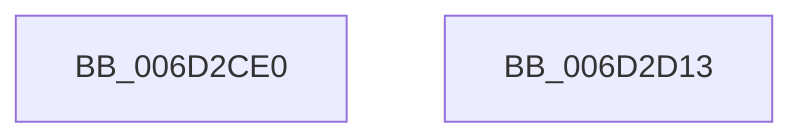

# KiDispatchException$filt$0

- RVA: `0x006D2CE0`–`0x006D2D14` (길이 `52` bytes)
- VA: `0x00000001406D2CE0`
- 실행 섹션: `.text`
- PDB 이름 있음: `예`; PDB Function 태그: `예`
- unwind 정보 RVA: `0x00093C58`
- 디코드: `14`개 명령, `52/52` bytes 표시
- 미해석 바이트: `0` (있으면 어셈블리에 `.byte`로 보존)

> 이 문서는 커널 이미지의 기계어와 PDB 기호를 분석해 생성했습니다. 4번과 5번은 함수 원형과 자료형을 바이너리 사용 방식에서 추정한 C 해석이며 원본 소스 복구 결과는 아닙니다.

## 1. Dependencies

- 직접 호출 지점: **1**; 고유 호출 대상: **1**
- 직접 호출자로 확인된 함수: **0**
- RIP 상대 이미지 참조: **0**

### Outgoing calls
- `0x006D2D03` → [KeCopyExceptionRecord](../43/KeCopyExceptionRecord_function_00439750.md) (function, `0x00439750`)

### Direct callers
- 이 함수 시작 RVA로 연결되는 직접 call은 확인되지 않았습니다. 간접 호출은 완전히 역산할 수 없습니다.

### Static image references
- 디코드된 RIP-relative 메모리 참조가 없습니다.

## 2. Other-region calls and transfers

- 다른 실행 섹션으로 향하는 call: **0**
- 별도 외부 분기/꼬리 이동을 확인하지 못했습니다.

## 3. Assembly (complete function range)

```asm
006D2CE0  40 55                           push rbp
006D2CE2  48 83 EC 30                     sub rsp, 0x30
006D2CE6  48 8D 6A 30                     lea rbp, [rdx + 0x30]
006D2CEA  48 89 8D 90 00 00 00            mov qword ptr [rbp + 0x90], rcx
006D2CF1  48 8B 01                        mov rax, qword ptr [rcx]
006D2CF4  48 89 45 60                     mov qword ptr [rbp + 0x60], rax
006D2CF8  48 8B 55 60                     mov rdx, qword ptr [rbp + 0x60]
006D2CFC  48 8D 8D A0 00 00 00            lea rcx, [rbp + 0xa0]
006D2D03  E8 48 6A D6 FF                  call 0x140439750
006D2D08  B8 01 00 00 00                  mov eax, 1
006D2D0D  48 83 C4 30                     add rsp, 0x30
006D2D11  5D                              pop rbp
006D2D12  C3                              ret
006D2D13  CC                              int3
```

## 4. C-style interpretation (structured pseudocode)

```c
__int64 __fastcall KiDispatchException_filt_0(__int64 a1, __int64 a2)
{
    __int64 result;
    __int64 v_rsp;

    v_rsp = (v_rsp) - (48);
    *(unsigned __int64 *)(a2 + 48 + 144) = a1;
    *(unsigned __int64 *)(a2 + 48 + 96) = *(unsigned __int64 *)(a1);
    result = KeCopyExceptionRecord(a2 + 48 + 160, *(unsigned __int64 *)(a2 + 48 + 96), a3, a4);
    v_rsp = (v_rsp) + (48);
    return 1;
}
```

## 5. (Beta) C Style

```c
int64_t KiDispatchException_filt_0(void *Arg1, void *Arg2)
{
    uint8_t *arg1 = (uint8_t *)Arg1;
    uint8_t *arg2 = (uint8_t *)Arg2;

    int64_t result;
    int64_t local_rsp;

    local_rsp = (local_rsp) - (48);
    *(void **)(arg2 + 0x30 + 0x90) = Arg1;
    *(uint64_t *)(arg2 + 0x30 + 0x60) = *(uint64_t *)(arg1);
    result = KeCopyExceptionRecord(Arg2 + 48 + 160, *(uint64_t *)(arg2 + 0x30 + 0x60), a3, a4);
    local_rsp = (local_rsp) + (48);
    return 1;
}
```

### 관측된 메모리 오프셋

구조체 형식이 확인되지 않은 접근은 인자 기준의 오프셋으로만 기록했습니다.

| 기준 인자 | 오프셋 표현 | 폭 (bit) | 접근 |
|---|---:|---:|---|
| `Arg1` | `+ 0x0` | `64` | `R` |
| `Arg2` | `+ 0x30` | `64` | `R` |
| `Arg2` | `+ 0x60` | `64` | `R` |
| `Arg2` | `+ 0x60` | `64` | `W` |
| `Arg2` | `+ 0x90` | `64` | `W` |
| `Arg2` | `+ 0xA0` | `64` | `R` |

## 6. Execution-region graph

[열기: 2D/3D 그래프와 함수 탐색 컨트롤 패널](../../../control-panel.html?section=text&rva=0x006D2CE0&view=graph)

- 2D 그래프는 위에서 아래로 흐르고, 3D 그래프는 빈 공간을 드래그해 회전합니다. Shift+드래그는 이동, 휠은 확대·축소, 함수 노드 선택은 대상 보고서 이동입니다.

### Static fallback


