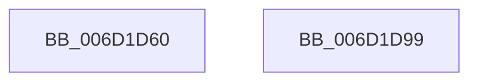

# KiExecuteAllDpcs$filt$0

- RVA: `0x006D1D60`–`0x006D1D9A` (길이 `58` bytes)
- VA: `0x00000001406D1D60`
- 실행 섹션: `.text`
- PDB 이름 있음: `예`; PDB Function 태그: `예`
- unwind 정보 RVA: `0x00064088`
- 디코드: `17`개 명령, `58/58` bytes 표시
- 미해석 바이트: `0` (있으면 어셈블리에 `.byte`로 보존)

> 이 문서는 커널 이미지의 기계어와 PDB 기호를 분석해 생성했습니다. 4번과 5번은 함수 원형과 자료형을 바이너리 사용 방식에서 추정한 C 해석이며 원본 소스 복구 결과는 아닙니다.

## 1. Dependencies

- 직접 호출 지점: **0**; 고유 호출 대상: **0**
- 직접 호출자로 확인된 함수: **0**
- RIP 상대 이미지 참조: **0**

### Outgoing calls
- 직접 디코드된 call 명령이 없습니다.

### Direct callers
- 이 함수 시작 RVA로 연결되는 직접 call은 확인되지 않았습니다. 간접 호출은 완전히 역산할 수 없습니다.

### Static image references
- 디코드된 RIP-relative 메모리 참조가 없습니다.

## 2. Other-region calls and transfers

- 다른 실행 섹션으로 향하는 call: **0**
- 별도 외부 분기/꼬리 이동을 확인하지 못했습니다.

## 3. Assembly (complete function range)

```asm
006D1D60  40 55                           push rbp
006D1D62  48 83 EC 30                     sub rsp, 0x30
006D1D66  48 8B EA                        mov rbp, rdx
006D1D69  48 89 8D 88 01 00 00            mov qword ptr [rbp + 0x188], rcx
006D1D70  48 8B 01                        mov rax, qword ptr [rcx]
006D1D73  8B 08                           mov ecx, dword ptr [rax]
006D1D75  89 8D 08 01 00 00               mov dword ptr [rbp + 0x108], ecx
006D1D7B  C7 45 70 00 00 00 00            mov dword ptr [rbp + 0x70], 0
006D1D82  33 C0                           xor eax, eax
006D1D84  81 F9 34 00 00 80               cmp ecx, 0x80000034
006D1D8A  0F 94 C0                        sete al
006D1D8D  89 45 70                        mov dword ptr [rbp + 0x70], eax
006D1D90  8B 45 70                        mov eax, dword ptr [rbp + 0x70]
006D1D93  48 83 C4 30                     add rsp, 0x30
006D1D97  5D                              pop rbp
006D1D98  C3                              ret
006D1D99  CC                              int3
```

## 4. C-style interpretation (structured pseudocode)

```c
__int64 __fastcall KiExecuteAllDpcs_filt_0(__int64 a1, __int64 a2)
{
    __int64 result;
    __int64 v_rsp;

    v_rsp = (v_rsp) - (48);
    *(unsigned __int64 *)(a2 + 392) = a1;
    *(unsigned int *)(a2 + 264) = (unsigned int)((unsigned int)(*(unsigned int *)(*(unsigned __int64 *)(a1))));
    *(unsigned int *)(a2 + 112) = 0;
    result = 0;
    result = (((unsigned int)((unsigned int)(*(unsigned int *)(*(unsigned __int64 *)(a1))))) == 0x80000034ULL) ? 1 : 0;
    *(unsigned int *)(a2 + 112) = (unsigned int)(result);
    v_rsp = (v_rsp) + (48);
    return (unsigned int)(*(unsigned int *)(a2 + 112));
}
```

## 5. (Beta) C Style

```c
int64_t KiExecuteAllDpcs_filt_0(void *Arg1, void *Arg2)
{
    uint8_t *arg1 = (uint8_t *)Arg1;
    uint8_t *arg2 = (uint8_t *)Arg2;

    int64_t result;
    int64_t local_rsp;

    local_rsp = (local_rsp) - (48);
    *(void **)(arg2 + 0x188) = Arg1;
    *(uint32_t *)(arg2 + 0x108) = (uint32_t)((uint32_t)(*(uint32_t *)(*(uint64_t *)(arg1))));
    *(uint32_t *)(arg2 + 0x70) = 0;
    result = 0;
    result = (((uint32_t)((uint32_t)(*(uint32_t *)(*(uint64_t *)(arg1))))) == 0x80000034ULL) ? 1 : 0;
    *(uint32_t *)(arg2 + 0x70) = (uint32_t)(result);
    local_rsp = (local_rsp) + (48);
    return (uint32_t)(*(uint32_t *)(arg2 + 0x70));
}
```

### 관측된 메모리 오프셋

구조체 형식이 확인되지 않은 접근은 인자 기준의 오프셋으로만 기록했습니다.

| 기준 인자 | 오프셋 표현 | 폭 (bit) | 접근 |
|---|---:|---:|---|
| `Arg1` | `+ 0x0` | `64` | `R` |
| `Arg2` | `+ 0x70` | `32` | `R` |
| `Arg2` | `+ 0x70` | `32` | `W` |
| `Arg2` | `+ 0x108` | `32` | `W` |
| `Arg2` | `+ 0x188` | `64` | `W` |

## 6. Execution-region graph

[열기: 2D/3D 그래프와 함수 탐색 컨트롤 패널](../../../control-panel.html?section=text&rva=0x006D1D60&view=graph)

- 2D 그래프는 위에서 아래로 흐르고, 3D 그래프는 빈 공간을 드래그해 회전합니다. Shift+드래그는 이동, 휠은 확대·축소, 함수 노드 선택은 대상 보고서 이동입니다.

### Static fallback


