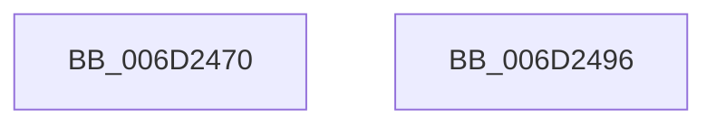

# NtSignalAndWaitForSingleObject$filt$0

- RVA: `0x006D2470`–`0x006D2497` (길이 `39` bytes)
- VA: `0x00000001406D2470`
- 실행 섹션: `.text`
- PDB 이름 있음: `예`; PDB Function 태그: `예`
- unwind 정보 RVA: `0x00081EB0`
- 디코드: `13`개 명령, `39/39` bytes 표시
- 미해석 바이트: `0` (있으면 어셈블리에 `.byte`로 보존)

> 이 문서는 커널 이미지의 기계어와 PDB 기호를 분석해 생성했습니다. 4번과 5번은 함수 원형과 자료형을 바이너리 사용 방식에서 추정한 C 해석이며 원본 소스 복구 결과는 아닙니다.

## 1. Dependencies

- 직접 호출 지점: **0**; 고유 호출 대상: **0**
- 직접 호출자로 확인된 함수: **0**
- RIP 상대 이미지 참조: **0**

### Outgoing calls
- 직접 디코드된 call 명령이 없습니다.

### Direct callers
- 이 함수 시작 RVA로 연결되는 직접 call은 확인되지 않았습니다. 간접 호출은 완전히 역산할 수 없습니다.

### Static image references
- 디코드된 RIP-relative 메모리 참조가 없습니다.

## 2. Other-region calls and transfers

- 다른 실행 섹션으로 향하는 call: **0**
- 별도 외부 분기/꼬리 이동을 확인하지 못했습니다.

## 3. Assembly (complete function range)

```asm
006D2470  40 55                           push rbp
006D2472  48 83 EC 40                     sub rsp, 0x40
006D2476  48 8B EA                        mov rbp, rdx
006D2479  48 89 8D 88 00 00 00            mov qword ptr [rbp + 0x88], rcx
006D2480  48 8B 01                        mov rax, qword ptr [rcx]
006D2483  8B 08                           mov ecx, dword ptr [rax]
006D2485  33 C0                           xor eax, eax
006D2487  81 F9 91 01 00 C0               cmp ecx, 0xc0000191
006D248D  0F 94 C0                        sete al
006D2490  48 83 C4 40                     add rsp, 0x40
006D2494  5D                              pop rbp
006D2495  C3                              ret
006D2496  CC                              int3
```

## 4. C-style interpretation (structured pseudocode)

```c
__int64 __fastcall NtSignalAndWaitForSingleObject_filt_0(__int64 a1, __int64 a2)
{
    __int64 result;
    __int64 v_rsp;

    v_rsp = (v_rsp) - (64);
    *(unsigned __int64 *)(a2 + 136) = a1;
    result = 0;
    result = (((unsigned int)((unsigned int)(*(unsigned int *)(*(unsigned __int64 *)(a1))))) == 0xC0000191ULL) ? 1 : 0;
    v_rsp = (v_rsp) + (64);
    return result;
}
```

## 5. (Beta) C Style

```c
int64_t NtSignalAndWaitForSingleObject_filt_0(void *Arg1, void *Arg2)
{
    uint8_t *arg1 = (uint8_t *)Arg1;
    uint8_t *arg2 = (uint8_t *)Arg2;

    int64_t result;
    int64_t local_rsp;

    local_rsp = (local_rsp) - (64);
    *(void **)(arg2 + 0x88) = Arg1;
    result = 0;
    result = (((uint32_t)((uint32_t)(*(uint32_t *)(*(uint64_t *)(arg1))))) == 0xC0000191ULL) ? 1 : 0;
    local_rsp = (local_rsp) + (64);
    return result;
}
```

### 관측된 메모리 오프셋

구조체 형식이 확인되지 않은 접근은 인자 기준의 오프셋으로만 기록했습니다.

| 기준 인자 | 오프셋 표현 | 폭 (bit) | 접근 |
|---|---:|---:|---|
| `Arg1` | `+ 0x0` | `64` | `R` |
| `Arg2` | `+ 0x88` | `64` | `W` |

## 6. Execution-region graph

[열기: 2D/3D 그래프와 함수 탐색 컨트롤 패널](../../../control-panel.html?section=text&rva=0x006D2470&view=graph)

- 2D 그래프는 위에서 아래로 흐르고, 3D 그래프는 빈 공간을 드래그해 회전합니다. Shift+드래그는 이동, 휠은 확대·축소, 함수 노드 선택은 대상 보고서 이동입니다.

### Static fallback


