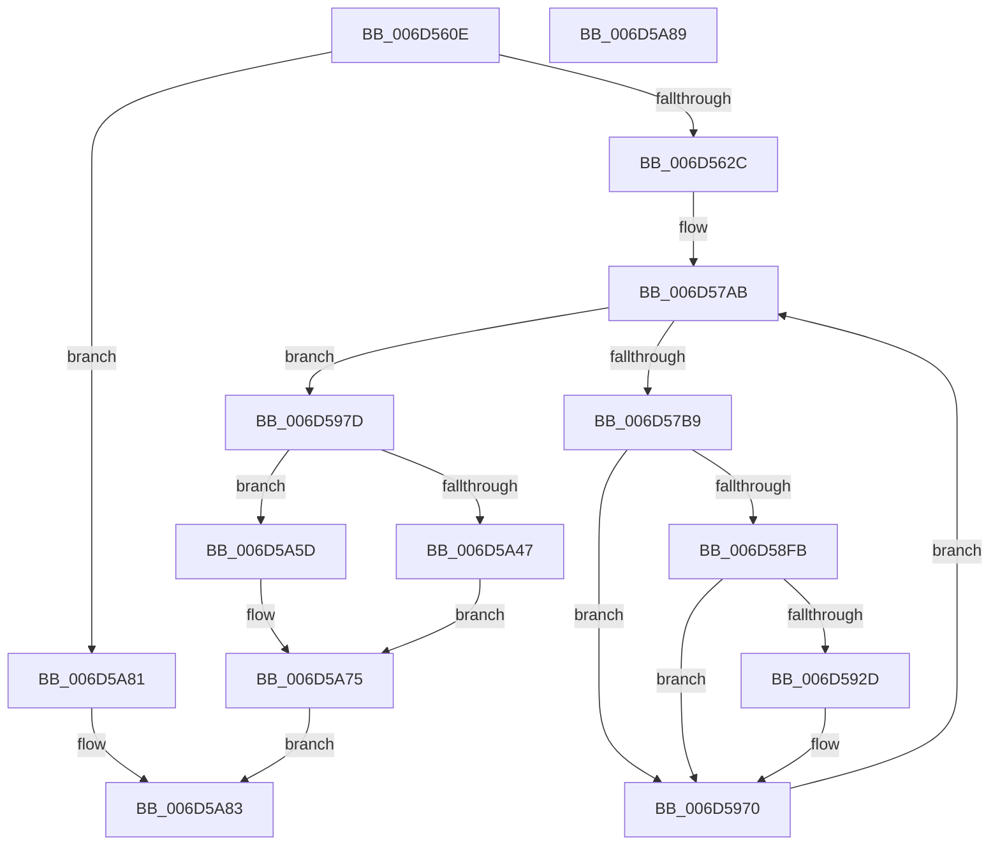

# PopThermalZoneDpc$filt$2

- RVA: `0x006D560E`–`0x006D5A8A` (길이 `1,148` bytes)
- VA: `0x00000001406D560E`
- 실행 섹션: `.text`
- PDB 이름 있음: `예`; PDB Function 태그: `예`
- unwind 정보 RVA: `0x000BF4C0`
- 디코드: `260`개 명령, `1,148/1,148` bytes 표시
- 미해석 바이트: `0` (있으면 어셈블리에 `.byte`로 보존)

> 이 문서는 커널 이미지의 기계어와 PDB 기호를 분석해 생성했습니다. 4번과 5번은 함수 원형과 자료형을 바이너리 사용 방식에서 추정한 C 해석이며 원본 소스 복구 결과는 아닙니다.

## 1. Dependencies

- 직접 호출 지점: **2**; 고유 호출 대상: **2**
- 직접 호출자로 확인된 함수: **0**
- RIP 상대 이미지 참조: **2**

### Outgoing calls
- `0x006D5A56` → [RtlpComputeEpilogueOffset](../51/RtlpComputeEpilogueOffset_function_0051C81C.md) (function, `0x0051C81C`)
- `0x006D5A6F` → [guard_dispatch_icall](../6B/guard_dispatch_icall_function_006BAAD0.md) (function, `0x006BAAD0`)

### Direct callers
- 이 함수 시작 RVA로 연결되는 직접 call은 확인되지 않았습니다. 간접 호출은 완전히 역산할 수 없습니다.

### Static image references
- `0x006D57F4` → RVA `0x00FC6F78` (`ALMOSTRO`; read)
- `0x006D5816` → RVA `0x00FC7250` (`ALMOSTRO`; read)

## 2. Other-region calls and transfers

- 다른 실행 섹션으로 향하는 call: **0**
- 별도 외부 분기/꼬리 이동을 확인하지 못했습니다.

## 3. Assembly (complete function range)

```asm
006D560E  40 55                           push rbp
006D5610  48 83 EC 30                     sub rsp, 0x30
006D5614  48 8B EA                        mov rbp, rdx
006D5617  8B 45 30                        mov eax, dword ptr [rbp + 0x30]
006D561A  83 C0 05                        add eax, 5
006D561D  89 45 30                        mov dword ptr [rbp + 0x30], eax
006D5620  8B 45 30                        mov eax, dword ptr [rbp + 0x30]
006D5623  83 F8 05                        cmp eax, 5
006D5626  0F 85 55 04 00 00               jne 0x1406d5a81
006D562C  48 8D 85 84 01 00 00            lea rax, [rbp + 0x184]
006D5633  48 89 85 C8 00 00 00            mov qword ptr [rbp + 0xc8], rax
006D563A  48 C7 85 90 00 00 00 00 00 00 00  mov qword ptr [rbp + 0x90], 0
006D5645  48 8B 85 C8 00 00 00            mov rax, qword ptr [rbp + 0xc8]
006D564C  48 8B 08                        mov rcx, qword ptr [rax]
006D564F  48 89 8D 90 00 00 00            mov qword ptr [rbp + 0x90], rcx
006D5656  48 8D 85 4C 01 00 00            lea rax, [rbp + 0x14c]
006D565D  48 89 85 D0 00 00 00            mov qword ptr [rbp + 0xd0], rax
006D5664  48 C7 85 88 00 00 00 00 00 00 00  mov qword ptr [rbp + 0x88], 0
006D566F  48 8B 85 D0 00 00 00            mov rax, qword ptr [rbp + 0xd0]
006D5676  48 8B 08                        mov rcx, qword ptr [rax]
006D5679  48 89 8D 88 00 00 00            mov qword ptr [rbp + 0x88], rcx
006D5680  48 8D 85 84 01 00 00            lea rax, [rbp + 0x184]
006D5687  48 89 85 D8 00 00 00            mov qword ptr [rbp + 0xd8], rax
006D568E  48 C7 85 A0 00 00 00 00 00 00 00  mov qword ptr [rbp + 0xa0], 0
006D5699  48 8B 85 D8 00 00 00            mov rax, qword ptr [rbp + 0xd8]
006D56A0  48 8B 08                        mov rcx, qword ptr [rax]
006D56A3  48 89 8D A0 00 00 00            mov qword ptr [rbp + 0xa0], rcx
006D56AA  48 8D 85 64 01 00 00            lea rax, [rbp + 0x164]
006D56B1  48 89 85 E0 00 00 00            mov qword ptr [rbp + 0xe0], rax
006D56B8  48 C7 85 98 00 00 00 00 00 00 00  mov qword ptr [rbp + 0x98], 0
006D56C3  48 8B 85 E0 00 00 00            mov rax, qword ptr [rbp + 0xe0]
006D56CA  48 8B 08                        mov rcx, qword ptr [rax]
006D56CD  48 89 8D 98 00 00 00            mov qword ptr [rbp + 0x98], rcx
006D56D4  48 8B 85 88 00 00 00            mov rax, qword ptr [rbp + 0x88]
006D56DB  8B 8D 90 00 00 00               mov ecx, dword ptr [rbp + 0x90]
006D56E1  48 D3 C8                        ror rax, cl
006D56E4  48 89 85 E8 00 00 00            mov qword ptr [rbp + 0xe8], rax
006D56EB  48 8B 85 98 00 00 00            mov rax, qword ptr [rbp + 0x98]
006D56F2  8B 8D A0 00 00 00               mov ecx, dword ptr [rbp + 0xa0]
006D56F8  48 D3 C0                        rol rax, cl
006D56FB  48 89 85 B0 00 00 00            mov qword ptr [rbp + 0xb0], rax
006D5702  C7 45 6C 00 00 00 00            mov dword ptr [rbp + 0x6c], 0
006D5709  48 8B 85 B0 00 00 00            mov rax, qword ptr [rbp + 0xb0]
006D5710  48 8B 48 40                     mov rcx, qword ptr [rax + 0x40]
006D5714  48 89 4D 40                     mov qword ptr [rbp + 0x40], rcx
006D5718  48 8B 4D 40                     mov rcx, qword ptr [rbp + 0x40]
006D571C  48 8B 85 E8 00 00 00            mov rax, qword ptr [rbp + 0xe8]
006D5723  48 33 C8                        xor rcx, rax
006D5726  48 89 8D 80 00 00 00            mov qword ptr [rbp + 0x80], rcx
006D572D  48 8B 85 80 00 00 00            mov rax, qword ptr [rbp + 0x80]
006D5734  48 B9 00 00 00 00 00 80 FF FF   movabs rcx, 0xffff800000000000
006D573E  48 0B C1                        or rax, rcx
006D5741  48 89 85 80 00 00 00            mov qword ptr [rbp + 0x80], rax
006D5748  48 8B 85 80 00 00 00            mov rax, qword ptr [rbp + 0x80]
006D574F  48 89 45 38                     mov qword ptr [rbp + 0x38], rax
006D5753  48 8B 45 38                     mov rax, qword ptr [rbp + 0x38]
006D5757  48 89 45 48                     mov qword ptr [rbp + 0x48], rax
006D575B  8B 45 38                        mov eax, dword ptr [rbp + 0x38]
006D575E  83 E0 3F                        and eax, 0x3f
006D5761  B9 40 00 00 00                  mov ecx, 0x40
006D5766  2B C8                           sub ecx, eax
006D5768  48 8B 55 38                     mov rdx, qword ptr [rbp + 0x38]
006D576C  48 D3 E2                        shl rdx, cl
006D576F  8B 4D 38                        mov ecx, dword ptr [rbp + 0x38]
006D5772  83 E1 3F                        and ecx, 0x3f
006D5775  48 8B 45 38                     mov rax, qword ptr [rbp + 0x38]
006D5779  48 D3 E8                        shr rax, cl
006D577C  48 0B C2                        or rax, rdx
006D577F  48 89 45 40                     mov qword ptr [rbp + 0x40], rax
006D5783  8B 45 6C                        mov eax, dword ptr [rbp + 0x6c]
006D5786  24 03                           and al, 3
006D5788  F6 D8                           neg al
006D578A  48 1B C9                        sbb rcx, rcx
006D578D  48 F7 D1                        not rcx
006D5790  81 E1 53 70 00 00               and ecx, 0x7053
006D5796  48 89 8D 00 01 00 00            mov qword ptr [rbp + 0x100], rcx
006D579D  C7 45 54 19 00 00 00            mov dword ptr [rbp + 0x54], 0x19
006D57A4  C7 45 34 00 00 00 00            mov dword ptr [rbp + 0x34], 0
006D57AB  8B 4D 34                        mov ecx, dword ptr [rbp + 0x34]
006D57AE  8B 45 54                        mov eax, dword ptr [rbp + 0x54]
006D57B1  3B C8                           cmp ecx, eax
006D57B3  0F 83 C4 01 00 00               jae 0x1406d597d
006D57B9  48 8B 45 48                     mov rax, qword ptr [rbp + 0x48]
006D57BD  48 8B 08                        mov rcx, qword ptr [rax]
006D57C0  48 89 4D 70                     mov qword ptr [rbp + 0x70], rcx
006D57C4  48 8B 45 40                     mov rax, qword ptr [rbp + 0x40]
006D57C8  48 89 85 F8 00 00 00            mov qword ptr [rbp + 0xf8], rax
006D57CF  48 8B 45 48                     mov rax, qword ptr [rbp + 0x48]
006D57D3  48 8B 08                        mov rcx, qword ptr [rax]
006D57D6  48 89 8D F0 00 00 00            mov qword ptr [rbp + 0xf0], rcx
006D57DD  48 C7 45 58 00 00 00 00         mov qword ptr [rbp + 0x58], 0
006D57E5  48 8B 85 F0 00 00 00            mov rax, qword ptr [rbp + 0xf0]
006D57EC  48 89 45 58                     mov qword ptr [rbp + 0x58], rax
006D57F0  48 8B 45 58                     mov rax, qword ptr [rbp + 0x58]
006D57F4  48 8B 0D 7D 17 8F 00            mov rcx, qword ptr [rip + 0x8f177d]
006D57FB  48 33 C1                        xor rax, rcx
006D57FE  48 D3 C0                        rol rax, cl
006D5801  48 89 45 58                     mov qword ptr [rbp + 0x58], rax
006D5805  48 8B 4D 58                     mov rcx, qword ptr [rbp + 0x58]
006D5809  48 8B 85 F8 00 00 00            mov rax, qword ptr [rbp + 0xf8]
006D5810  48 33 C8                        xor rcx, rax
006D5813  48 0F C9                        bswap rcx
006D5816  48 33 0D 33 1A 8F 00            xor rcx, qword ptr [rip + 0x8f1a33]
006D581D  48 89 4D 58                     mov qword ptr [rbp + 0x58], rcx
006D5821  48 8B 4D 48                     mov rcx, qword ptr [rbp + 0x48]
006D5825  48 8B 45 58                     mov rax, qword ptr [rbp + 0x58]
006D5829  48 89 01                        mov qword ptr [rcx], rax
006D582C  8B 55 34                        mov edx, dword ptr [rbp + 0x34]
006D582F  48 8B 45 48                     mov rax, qword ptr [rbp + 0x48]
006D5833  48 8B 00                        mov rax, qword ptr [rax]
006D5836  48 03 C2                        add rax, rdx
006D5839  48 8B 4D 38                     mov rcx, qword ptr [rbp + 0x38]
006D583D  48 03 C8                        add rcx, rax
006D5840  48 8B 45 48                     mov rax, qword ptr [rbp + 0x48]
006D5844  48 89 08                        mov qword ptr [rax], rcx
006D5847  8B 45 70                        mov eax, dword ptr [rbp + 0x70]
006D584A  F7 D0                           not eax
006D584C  83 E0 3F                        and eax, 0x3f
006D584F  B9 40 00 00 00                  mov ecx, 0x40
006D5854  2B C8                           sub ecx, eax
006D5856  8B 45 34                        mov eax, dword ptr [rbp + 0x34]
006D5859  41 B8 C8 00 00 00               mov r8d, 0xc8
006D585F  44 2B C0                        sub r8d, eax
006D5862  44 8B 4D 34                     mov r9d, dword ptr [rbp + 0x34]
006D5866  4D 33 C8                        xor r9, r8
006D5869  49 D3 E1                        shl r9, cl
006D586C  8B 45 34                        mov eax, dword ptr [rbp + 0x34]
006D586F  BA C8 00 00 00                  mov edx, 0xc8
006D5874  2B D0                           sub edx, eax
006D5876  44 8B 45 34                     mov r8d, dword ptr [rbp + 0x34]
006D587A  4C 33 C2                        xor r8, rdx
006D587D  8B 4D 70                        mov ecx, dword ptr [rbp + 0x70]
006D5880  F7 D1                           not ecx
006D5882  83 E1 3F                        and ecx, 0x3f
006D5885  49 D3 E8                        shr r8, cl
006D5888  4D 0B C1                        or r8, r9
006D588B  48 8B 45 40                     mov rax, qword ptr [rbp + 0x40]
006D588F  49 33 C0                        xor rax, r8
006D5892  48 89 45 40                     mov qword ptr [rbp + 0x40], rax
006D5896  8B 45 70                        mov eax, dword ptr [rbp + 0x70]
006D5899  83 F0 FA                        xor eax, 0xfffffffa
006D589C  83 E0 3F                        and eax, 0x3f
006D589F  B9 40 00 00 00                  mov ecx, 0x40
006D58A4  2B C8                           sub ecx, eax
006D58A6  48 8B 55 40                     mov rdx, qword ptr [rbp + 0x40]
006D58AA  48 D3 EA                        shr rdx, cl
006D58AD  8B 4D 70                        mov ecx, dword ptr [rbp + 0x70]
006D58B0  83 F1 FA                        xor ecx, 0xfffffffa
006D58B3  83 E1 3F                        and ecx, 0x3f
006D58B6  48 8B 45 40                     mov rax, qword ptr [rbp + 0x40]
006D58BA  48 D3 E0                        shl rax, cl
006D58BD  48 0B C2                        or rax, rdx
006D58C0  48 89 45 40                     mov qword ptr [rbp + 0x40], rax
006D58C4  48 8B 4D 38                     mov rcx, qword ptr [rbp + 0x38]
006D58C8  48 8B 45 40                     mov rax, qword ptr [rbp + 0x40]
006D58CC  48 03 C8                        add rcx, rax
006D58CF  48 89 4D 40                     mov qword ptr [rbp + 0x40], rcx
006D58D3  48 8B 8D 00 01 00 00            mov rcx, qword ptr [rbp + 0x100]
006D58DA  48 8B 45 40                     mov rax, qword ptr [rbp + 0x40]
006D58DE  48 33 C8                        xor rcx, rax
006D58E1  48 89 4D 40                     mov qword ptr [rbp + 0x40], rcx
006D58E5  48 8B 45 48                     mov rax, qword ptr [rbp + 0x48]
006D58E9  48 83 C0 08                     add rax, 8
006D58ED  48 89 45 48                     mov qword ptr [rbp + 0x48], rax
006D58F1  8B 45 34                        mov eax, dword ptr [rbp + 0x34]
006D58F4  FF C0                           inc eax
006D58F6  83 F8 19                        cmp eax, 0x19
006D58F9  75 75                           jne 0x1406d5970
006D58FB  48 B8 05 29 26 02 29 26 0A C1   movabs rax, 0xc10a262902262905
006D5905  48 89 45 60                     mov qword ptr [rbp + 0x60], rax
006D5909  48 8B 4D 60                     mov rcx, qword ptr [rbp + 0x60]
006D590D  48 C1 E9 3D                     shr rcx, 0x3d
006D5911  48 8B 45 60                     mov rax, qword ptr [rbp + 0x60]
006D5915  48 C1 E0 03                     shl rax, 3
006D5919  48 0B C1                        or rax, rcx
006D591C  48 89 45 60                     mov qword ptr [rbp + 0x60], rax
006D5920  48 8B 4D 60                     mov rcx, qword ptr [rbp + 0x60]
006D5924  48 8B 45 38                     mov rax, qword ptr [rbp + 0x38]
006D5928  48 33 08                        xor rcx, qword ptr [rax]
006D592B  74 43                           je 0x1406d5970
006D592D  48 8B 45 48                     mov rax, qword ptr [rbp + 0x48]
006D5931  48 8B 4D 60                     mov rcx, qword ptr [rbp + 0x60]
006D5935  48 33 48 F8                     xor rcx, qword ptr [rax - 8]
006D5939  48 8B 45 38                     mov rax, qword ptr [rbp + 0x38]
006D593D  48 33 08                        xor rcx, qword ptr [rax]
006D5940  48 8B 45 48                     mov rax, qword ptr [rbp + 0x48]
006D5944  48 89 48 F8                     mov qword ptr [rax - 8], rcx
006D5948  48 8B 4D 48                     mov rcx, qword ptr [rbp + 0x48]
006D594C  8B 45 54                        mov eax, dword ptr [rbp + 0x54]
006D594F  03 41 FC                        add eax, dword ptr [rcx - 4]
006D5952  89 45 54                        mov dword ptr [rbp + 0x54], eax
006D5955  48 8B 45 48                     mov rax, qword ptr [rbp + 0x48]
006D5959  48 8B 4D 60                     mov rcx, qword ptr [rbp + 0x60]
006D595D  48 33 48 F8                     xor rcx, qword ptr [rax - 8]
006D5961  48 8B 45 38                     mov rax, qword ptr [rbp + 0x38]
006D5965  48 33 08                        xor rcx, qword ptr [rax]
006D5968  48 8B 45 48                     mov rax, qword ptr [rbp + 0x48]
006D596C  48 89 48 F8                     mov qword ptr [rax - 8], rcx
006D5970  8B 45 34                        mov eax, dword ptr [rbp + 0x34]
006D5973  FF C0                           inc eax
006D5975  89 45 34                        mov dword ptr [rbp + 0x34], eax
006D5978  E9 2E FE FF FF                  jmp 0x1406d57ab
006D597D  48 8B 45 38                     mov rax, qword ptr [rbp + 0x38]
006D5981  48 BA F5 6F 1B AD 5F 93 44 62   movabs rdx, 0x6244935fad1b6ff5
006D598B  48 8B 08                        mov rcx, qword ptr [rax]
006D598E  48 33 CA                        xor rcx, rdx
006D5991  48 89 8D 08 01 00 00            mov qword ptr [rbp + 0x108], rcx
006D5998  48 8B 85 08 01 00 00            mov rax, qword ptr [rbp + 0x108]
006D599F  48 89 45 40                     mov qword ptr [rbp + 0x40], rax
006D59A3  48 8D 45 40                     lea rax, [rbp + 0x40]
006D59A7  48 89 85 10 01 00 00            mov qword ptr [rbp + 0x110], rax
006D59AE  48 C7 85 A8 00 00 00 00 00 00 00  mov qword ptr [rbp + 0xa8], 0
006D59B9  48 8B 85 10 01 00 00            mov rax, qword ptr [rbp + 0x110]
006D59C0  48 8B 08                        mov rcx, qword ptr [rax]
006D59C3  48 89 8D A8 00 00 00            mov qword ptr [rbp + 0xa8], rcx
006D59CA  48 8B 85 A8 00 00 00            mov rax, qword ptr [rbp + 0xa8]
006D59D1  48 B9 DB 27 2A BC 17 A2 15 6A   movabs rcx, 0x6a15a217bc2a27db
006D59DB  48 33 C1                        xor rax, rcx
006D59DE  48 89 45 40                     mov qword ptr [rbp + 0x40], rax
006D59E2  48 8B 45 38                     mov rax, qword ptr [rbp + 0x38]
006D59E6  48 89 85 A8 01 00 00            mov qword ptr [rbp + 0x1a8], rax
006D59ED  48 8B 45 38                     mov rax, qword ptr [rbp + 0x38]
006D59F1  48 89 85 18 01 00 00            mov qword ptr [rbp + 0x118], rax
006D59F8  48 8B 85 18 01 00 00            mov rax, qword ptr [rbp + 0x118]
006D59FF  C7 00 F5 6F 1B AD               mov dword ptr [rax], 0xad1b6ff5
006D5A05  48 8B 45 38                     mov rax, qword ptr [rbp + 0x38]
006D5A09  48 89 85 20 01 00 00            mov qword ptr [rbp + 0x120], rax
006D5A10  C7 45 68 00 00 00 00            mov dword ptr [rbp + 0x68], 0
006D5A17  48 8B 85 20 01 00 00            mov rax, qword ptr [rbp + 0x120]
006D5A1E  8B 08                           mov ecx, dword ptr [rax]
006D5A20  89 4D 68                        mov dword ptr [rbp + 0x68], ecx
006D5A23  48 8B 45 38                     mov rax, qword ptr [rbp + 0x38]
006D5A27  48 89 85 28 01 00 00            mov qword ptr [rbp + 0x128], rax
006D5A2E  8B 4D 68                        mov ecx, dword ptr [rbp + 0x68]
006D5A31  81 F1 DB 27 2A BC               xor ecx, 0xbc2a27db
006D5A37  48 8B 85 28 01 00 00            mov rax, qword ptr [rbp + 0x128]
006D5A3E  89 08                           mov dword ptr [rax], ecx
006D5A40  8B 45 6C                        mov eax, dword ptr [rbp + 0x6c]
006D5A43  A8 01                           test al, 1
006D5A45  74 16                           je 0x1406d5a5d
006D5A47  4C 8B 45 40                     mov r8, qword ptr [rbp + 0x40]
006D5A4B  48 8B 55 38                     mov rdx, qword ptr [rbp + 0x38]
006D5A4F  48 8B 8D B0 00 00 00            mov rcx, qword ptr [rbp + 0xb0]
006D5A56  E8 C1 6D E4 FF                  call 0x14051c81c
006D5A5B  EB 18                           jmp 0x1406d5a75
006D5A5D  48 8B 45 38                     mov rax, qword ptr [rbp + 0x38]
006D5A61  45 33 C9                        xor r9d, r9d
006D5A64  45 33 C0                        xor r8d, r8d
006D5A67  48 8B 55 40                     mov rdx, qword ptr [rbp + 0x40]
006D5A6B  48 8B 4D 38                     mov rcx, qword ptr [rbp + 0x38]
006D5A6F  E8 5C 50 FE FF                  call 0x1406baad0
006D5A74  90                              nop
006D5A75  C7 45 78 01 00 00 00            mov dword ptr [rbp + 0x78], 1
006D5A7C  8B 45 78                        mov eax, dword ptr [rbp + 0x78]
006D5A7F  EB 02                           jmp 0x1406d5a83
006D5A81  33 C0                           xor eax, eax
006D5A83  48 83 C4 30                     add rsp, 0x30
006D5A87  5D                              pop rbp
006D5A88  C3                              ret
006D5A89  CC                              int3
```

## 4. C-style interpretation (structured pseudocode)

```c
__int64 __fastcall PopThermalZoneDpc_filt_2(__int64 a1, __int64 a2)
{
    __int64 result;
    __int64 v_rsp;

    v_rsp = (v_rsp) - (48);
    result = (unsigned int)(((unsigned int)(*(unsigned int *)(a2 + 48))) + (5));
    *(unsigned int *)(a2 + 48) = (unsigned int)(result);
    if (((unsigned int)((unsigned int)(*(unsigned int *)(a2 + 48)))) != 5) goto loc_006D5A81;
    *(unsigned __int64 *)(a2 + 200) = a2 + 388;
    *(unsigned __int64 *)(a2 + 144) = 0;
    *(unsigned __int64 *)(a2 + 144) = *(unsigned __int64 *)(*(unsigned __int64 *)(a2 + 200));
    *(unsigned __int64 *)(a2 + 208) = a2 + 332;
    *(unsigned __int64 *)(a2 + 136) = 0;
    *(unsigned __int64 *)(a2 + 136) = *(unsigned __int64 *)(*(unsigned __int64 *)(a2 + 208));
    *(unsigned __int64 *)(a2 + 216) = a2 + 388;
    *(unsigned __int64 *)(a2 + 160) = 0;
    *(unsigned __int64 *)(a2 + 160) = *(unsigned __int64 *)(*(unsigned __int64 *)(a2 + 216));
    *(unsigned __int64 *)(a2 + 224) = a2 + 356;
    *(unsigned __int64 *)(a2 + 152) = 0;
    *(unsigned __int64 *)(a2 + 152) = *(unsigned __int64 *)(*(unsigned __int64 *)(a2 + 224));
    *(unsigned __int64 *)(a2 + 232) = *(unsigned __int64 *)(a2 + 136);
    *(unsigned __int64 *)(a2 + 176) = *(unsigned __int64 *)(a2 + 152);
    *(unsigned int *)(a2 + 108) = 0;
    *(unsigned __int64 *)(a2 + 64) = *(unsigned __int64 *)(*(unsigned __int64 *)(a2 + 176) + 64);
    a1 = (*(unsigned __int64 *)(a2 + 64)) ^ (*(unsigned __int64 *)(a2 + 232));
    *(unsigned __int64 *)(a2 + 128) = a1;
    result = (*(unsigned __int64 *)(a2 + 128)) | (a1);
    *(unsigned __int64 *)(a2 + 128) = result;
    *(unsigned __int64 *)(a2 + 56) = *(unsigned __int64 *)(a2 + 128);
    *(unsigned __int64 *)(a2 + 72) = *(unsigned __int64 *)(a2 + 56);
    result = (unsigned int)(((unsigned int)(*(unsigned int *)(a2 + 56))) & (63));
    a1 = (unsigned int)((64) - ((unsigned int)(result)));
    a2 = (*(unsigned __int64 *)(a2 + 56)) << ((unsigned __int8)(a1));
    a1 = (unsigned int)(((unsigned int)(*(unsigned int *)(a2 + 56))) & (63));
    result = (*(unsigned __int64 *)(a2 + 56)) >> ((unsigned __int8)(a1));
    result = (result) | (a2);
    *(unsigned __int64 *)(a2 + 64) = result;
    result = (unsigned __int8)(((unsigned int)(*(unsigned int *)(a2 + 108))) & (3));
    result = (unsigned __int8)(-(result));
    a1 = ~(a1);
    a1 = (unsigned int)((a1) & (0x7053ULL));
    *(unsigned __int64 *)(a2 + 256) = a1;
    *(unsigned int *)(a2 + 84) = 25;
    *(unsigned int *)(a2 + 52) = 0;
loc_006D57AB:
    if (((unsigned int)((unsigned int)(*(unsigned int *)(a2 + 52)))) >= ((unsigned int)((unsigned int)(*(unsigned int *)(a2 + 84))))) goto loc_006D597D;
    *(unsigned __int64 *)(a2 + 112) = *(unsigned __int64 *)(*(unsigned __int64 *)(a2 + 72));
    *(unsigned __int64 *)(a2 + 248) = *(unsigned __int64 *)(a2 + 64);
    *(unsigned __int64 *)(a2 + 240) = *(unsigned __int64 *)(*(unsigned __int64 *)(a2 + 72));
    *(unsigned __int64 *)(a2 + 88) = 0;
    *(unsigned __int64 *)(a2 + 88) = *(unsigned __int64 *)(a2 + 240);
    result = (*(unsigned __int64 *)(a2 + 88)) ^ (*(unsigned __int64 *)(v_rip + 9377661));
    *(unsigned __int64 *)(a2 + 88) = result;
    a1 = (*(unsigned __int64 *)(a2 + 88)) ^ (*(unsigned __int64 *)(a2 + 248));
    a1 = (a1) ^ (*(unsigned __int64 *)(v_rip + 9378355));
    *(unsigned __int64 *)(a2 + 88) = a1;
    *(unsigned __int64 *)(*(unsigned __int64 *)(a2 + 72)) = *(unsigned __int64 *)(a2 + 88);
    result = (*(unsigned __int64 *)(*(unsigned __int64 *)(a2 + 72))) + ((unsigned int)(*(unsigned int *)(a2 + 52)));
    a1 = (*(unsigned __int64 *)(a2 + 56)) + (result);
    *(unsigned __int64 *)(*(unsigned __int64 *)(a2 + 72)) = a1;
    result = (unsigned int)(~((unsigned int)(*(unsigned int *)(a2 + 112))));
    result = (unsigned int)((result) & (63));
    a1 = (unsigned int)((64) - ((unsigned int)(result)));
    a3 = (unsigned int)((200) - ((unsigned int)((unsigned int)(*(unsigned int *)(a2 + 52)))));
    a4 = ((unsigned int)(*(unsigned int *)(a2 + 52))) ^ (a3);
    a4 = (a4) << ((unsigned __int8)(a1));
    a2 = (unsigned int)((200) - ((unsigned int)((unsigned int)(*(unsigned int *)(a2 + 52)))));
    a3 = ((unsigned int)(*(unsigned int *)(a2 + 52))) ^ (a2);
    a1 = (unsigned int)(~((unsigned int)(*(unsigned int *)(a2 + 112))));
    a1 = (unsigned int)((a1) & (63));
    a3 = (a3) >> ((unsigned __int8)(a1));
    a3 = (a3) | (a4);
    result = (*(unsigned __int64 *)(a2 + 64)) ^ (a3);
    *(unsigned __int64 *)(a2 + 64) = result;
    result = (unsigned int)(((unsigned int)(*(unsigned int *)(a2 + 112))) ^ (0xFFFFFFFAULL));
    result = (unsigned int)((result) & (63));
    a1 = (unsigned int)((64) - ((unsigned int)(result)));
    a2 = (*(unsigned __int64 *)(a2 + 64)) >> ((unsigned __int8)(a1));
    a1 = (unsigned int)(((unsigned int)(*(unsigned int *)(a2 + 112))) ^ (0xFFFFFFFAULL));
    a1 = (unsigned int)((a1) & (63));
    result = (*(unsigned __int64 *)(a2 + 64)) << ((unsigned __int8)(a1));
    result = (result) | (a2);
    *(unsigned __int64 *)(a2 + 64) = result;
    a1 = (*(unsigned __int64 *)(a2 + 56)) + (*(unsigned __int64 *)(a2 + 64));
    *(unsigned __int64 *)(a2 + 64) = a1;
    a1 = (*(unsigned __int64 *)(a2 + 256)) ^ (*(unsigned __int64 *)(a2 + 64));
    *(unsigned __int64 *)(a2 + 64) = a1;
    result = (*(unsigned __int64 *)(a2 + 72)) + (8);
    *(unsigned __int64 *)(a2 + 72) = result;
    result = (unsigned int)(((unsigned int)(*(unsigned int *)(a2 + 52))) + 1);
    if (((unsigned int)(result)) != 25) goto loc_006D5970;
    *(unsigned __int64 *)(a2 + 96) = result;
    a1 = (*(unsigned __int64 *)(a2 + 96)) >> (61);
    result = (*(unsigned __int64 *)(a2 + 96)) << (3);
    result = (result) | (a1);
    *(unsigned __int64 *)(a2 + 96) = result;
    a1 = (*(unsigned __int64 *)(a2 + 96)) ^ (*(unsigned __int64 *)(*(unsigned __int64 *)(a2 + 56)));
    result = *(unsigned __int64 *)(a2 + 56);
    if (!(condition_is_equal)) {
        result = *(unsigned __int64 *)(a2 + 72);
        a1 = *(unsigned __int64 *)(a2 + 96);
        a1 = (a1) ^ (*(unsigned __int64 *)(result - 8));
        result = *(unsigned __int64 *)(a2 + 56);
        a1 = (a1) ^ (*(unsigned __int64 *)(result));
        result = *(unsigned __int64 *)(a2 + 72);
        *(unsigned __int64 *)(result - 8) = a1;
        a1 = *(unsigned __int64 *)(a2 + 72);
        result = *(unsigned int *)(a2 + 84);
        result = (unsigned int)((result) + (*(unsigned int *)(a1 - 4)));
        *(unsigned int *)(a2 + 84) = (unsigned int)(result);
        result = *(unsigned __int64 *)(a2 + 72);
        a1 = *(unsigned __int64 *)(a2 + 96);
        a1 = (a1) ^ (*(unsigned __int64 *)(result - 8));
        result = *(unsigned __int64 *)(a2 + 56);
        a1 = (a1) ^ (*(unsigned __int64 *)(result));
        result = *(unsigned __int64 *)(a2 + 72);
        *(unsigned __int64 *)(result - 8) = a1;
    }
    result = (unsigned int)(((unsigned int)(*(unsigned int *)(a2 + 52))) + 1);
    *(unsigned int *)(a2 + 52) = (unsigned int)(result);
    goto loc_006D57AB;
loc_006D597D:
    a1 = (*(unsigned __int64 *)(*(unsigned __int64 *)(a2 + 56))) ^ (a2);
    *(unsigned __int64 *)(a2 + 264) = a1;
    *(unsigned __int64 *)(a2 + 64) = *(unsigned __int64 *)(a2 + 264);
    *(unsigned __int64 *)(a2 + 272) = a2 + 64;
    *(unsigned __int64 *)(a2 + 168) = 0;
    *(unsigned __int64 *)(a2 + 168) = *(unsigned __int64 *)(*(unsigned __int64 *)(a2 + 272));
    result = (*(unsigned __int64 *)(a2 + 168)) ^ (*(unsigned __int64 *)(*(unsigned __int64 *)(a2 + 272)));
    *(unsigned __int64 *)(a2 + 64) = result;
    *(unsigned __int64 *)(a2 + 424) = *(unsigned __int64 *)(a2 + 56);
    *(unsigned __int64 *)(a2 + 280) = *(unsigned __int64 *)(a2 + 56);
    *(unsigned int *)(*(unsigned __int64 *)(a2 + 280)) = 0xAD1B6FF5ULL;
    *(unsigned __int64 *)(a2 + 288) = *(unsigned __int64 *)(a2 + 56);
    *(unsigned int *)(a2 + 104) = 0;
    *(unsigned int *)(a2 + 104) = (unsigned int)((unsigned int)(*(unsigned int *)(*(unsigned __int64 *)(a2 + 288))));
    *(unsigned __int64 *)(a2 + 296) = *(unsigned __int64 *)(a2 + 56);
    a1 = (unsigned int)(((unsigned int)(*(unsigned int *)(a2 + 104))) ^ (0xBC2A27DBULL));
    *(unsigned int *)(*(unsigned __int64 *)(a2 + 296)) = (unsigned int)(a1);
    if ((((unsigned __int8)((unsigned int)(*(unsigned int *)(a2 + 108)))) & (1)) == 0) goto loc_006D5A5D;
    result = RtlpComputeEpilogueOffset(*(unsigned __int64 *)(a2 + 176), *(unsigned __int64 *)(a2 + 56), *(unsigned __int64 *)(a2 + 64), a4);
    goto loc_006D5A75;
loc_006D5A5D:
    a4 = 0;
    a3 = 0;
    result = guard_dispatch_icall(*(unsigned __int64 *)(a2 + 56), *(unsigned __int64 *)(a2 + 64), a3, a4);
loc_006D5A75:
    *(unsigned int *)(a2 + 120) = 1;
    goto loc_006D5A83;
loc_006D5A81:
    result = 0;
loc_006D5A83:
    v_rsp = (v_rsp) + (48);
    return result;
}
```

## 5. (Beta) C Style

```c
int64_t PopThermalZoneDpc_filt_2(int64_t Arg1, void *Arg2)
{
    uint8_t *arg2 = (uint8_t *)Arg2;

    int64_t result;
    int64_t local_rsp;

    local_rsp = (local_rsp) - (48);
    result = (uint32_t)(((uint32_t)(*(uint32_t *)(arg2 + 0x30))) + (5));
    *(uint32_t *)(arg2 + 0x30) = (uint32_t)(result);
    if (((uint32_t)((uint32_t)(*(uint32_t *)(arg2 + 0x30)))) != 5) goto loc_006D5A81;
    *(void **)(arg2 + 0xC8) = Arg2 + 388;
    *(uint64_t *)(arg2 + 0x90) = 0;
    *(uint64_t *)(arg2 + 0x90) = *(uint64_t *)(*(uint64_t *)(arg2 + 0xC8));
    *(void **)(arg2 + 0xD0) = Arg2 + 332;
    *(uint64_t *)(arg2 + 0x88) = 0;
    *(uint64_t *)(arg2 + 0x88) = *(uint64_t *)(*(uint64_t *)(arg2 + 0xD0));
    *(void **)(arg2 + 0xD8) = Arg2 + 388;
    *(uint64_t *)(arg2 + 0xA0) = 0;
    *(uint64_t *)(arg2 + 0xA0) = *(uint64_t *)(*(uint64_t *)(arg2 + 0xD8));
    *(void **)(arg2 + 0xE0) = Arg2 + 356;
    *(uint64_t *)(arg2 + 0x98) = 0;
    *(uint64_t *)(arg2 + 0x98) = *(uint64_t *)(*(uint64_t *)(arg2 + 0xE0));
    *(uint64_t *)(arg2 + 0xE8) = *(uint64_t *)(arg2 + 0x88);
    *(uint64_t *)(arg2 + 0xB0) = *(uint64_t *)(arg2 + 0x98);
    *(uint32_t *)(arg2 + 0x6C) = 0;
    *(uint64_t *)(arg2 + 0x40) = *(uint64_t *)(*(uint64_t *)(arg2 + 0xB0) + 0x40);
    Arg1 = (*(uint64_t *)(arg2 + 0x40)) ^ (*(uint64_t *)(arg2 + 0xE8));
    *(uint64_t *)(arg2 + 0x80) = Arg1;
    result = (*(uint64_t *)(arg2 + 0x80)) | (Arg1);
    *(uint64_t *)(arg2 + 0x80) = result;
    *(uint64_t *)(arg2 + 0x38) = *(uint64_t *)(arg2 + 0x80);
    *(uint64_t *)(arg2 + 0x48) = *(uint64_t *)(arg2 + 0x38);
    result = (uint32_t)(((uint32_t)(*(uint32_t *)(arg2 + 0x38))) & (63));
    Arg1 = (uint32_t)((64) - ((uint32_t)(result)));
    Arg2 = (*(uint64_t *)(arg2 + 0x38)) << ((uint8_t)(Arg1));
    Arg1 = (uint32_t)(((uint32_t)(*(uint32_t *)(arg2 + 0x38))) & (63));
    result = (*(uint64_t *)(arg2 + 0x38)) >> ((uint8_t)(Arg1));
    result = (result) | (Arg2);
    *(uint64_t *)(arg2 + 0x40) = result;
    result = (uint8_t)(((uint32_t)(*(uint32_t *)(arg2 + 0x6C))) & (3));
    result = (uint8_t)(-(result));
    Arg1 = ~(Arg1);
    Arg1 = (uint32_t)((Arg1) & (0x7053ULL));
    *(uint64_t *)(arg2 + 0x100) = Arg1;
    *(uint32_t *)(arg2 + 0x54) = 25;
    *(uint32_t *)(arg2 + 0x34) = 0;
loc_006D57AB:
    if (((uint32_t)((uint32_t)(*(uint32_t *)(arg2 + 0x34)))) >= ((uint32_t)((uint32_t)(*(uint32_t *)(arg2 + 0x54))))) goto loc_006D597D;
    *(uint64_t *)(arg2 + 0x70) = *(uint64_t *)(*(uint64_t *)(arg2 + 0x48));
    *(uint64_t *)(arg2 + 0xF8) = *(uint64_t *)(arg2 + 0x40);
    *(uint64_t *)(arg2 + 0xF0) = *(uint64_t *)(*(uint64_t *)(arg2 + 0x48));
    *(uint64_t *)(arg2 + 0x58) = 0;
    *(uint64_t *)(arg2 + 0x58) = *(uint64_t *)(arg2 + 0xF0);
    result = (*(uint64_t *)(arg2 + 0x58)) ^ (*(uint64_t *)(v_rip + 0x8F177D));
    *(uint64_t *)(arg2 + 0x58) = result;
    Arg1 = (*(uint64_t *)(arg2 + 0x58)) ^ (*(uint64_t *)(arg2 + 0xF8));
    Arg1 = (Arg1) ^ (*(uint64_t *)(v_rip + 0x8F1A33));
    *(uint64_t *)(arg2 + 0x58) = Arg1;
    *(uint64_t *)(*(uint64_t *)(arg2 + 0x48)) = *(uint64_t *)(arg2 + 0x58);
    result = (*(uint64_t *)(*(uint64_t *)(arg2 + 0x48))) + ((uint32_t)(*(uint32_t *)(arg2 + 0x34)));
    Arg1 = (*(uint64_t *)(arg2 + 0x38)) + (result);
    *(uint64_t *)(*(uint64_t *)(arg2 + 0x48)) = Arg1;
    result = (uint32_t)(~((uint32_t)(*(uint32_t *)(arg2 + 0x70))));
    result = (uint32_t)((result) & (63));
    Arg1 = (uint32_t)((64) - ((uint32_t)(result)));
    a3 = (uint32_t)((200) - ((uint32_t)((uint32_t)(*(uint32_t *)(arg2 + 0x34)))));
    a4 = ((uint32_t)(*(uint32_t *)(arg2 + 0x34))) ^ (a3);
    a4 = (a4) << ((uint8_t)(Arg1));
    Arg2 = (uint32_t)((200) - ((uint32_t)((uint32_t)(*(uint32_t *)(arg2 + 0x34)))));
    a3 = ((uint32_t)(*(uint32_t *)(arg2 + 0x34))) ^ (Arg2);
    Arg1 = (uint32_t)(~((uint32_t)(*(uint32_t *)(arg2 + 0x70))));
    Arg1 = (uint32_t)((Arg1) & (63));
    a3 = (a3) >> ((uint8_t)(Arg1));
    a3 = (a3) | (a4);
    result = (*(uint64_t *)(arg2 + 0x40)) ^ (a3);
    *(uint64_t *)(arg2 + 0x40) = result;
    result = (uint32_t)(((uint32_t)(*(uint32_t *)(arg2 + 0x70))) ^ (0xFFFFFFFAULL));
    result = (uint32_t)((result) & (63));
    Arg1 = (uint32_t)((64) - ((uint32_t)(result)));
    Arg2 = (*(uint64_t *)(arg2 + 0x40)) >> ((uint8_t)(Arg1));
    Arg1 = (uint32_t)(((uint32_t)(*(uint32_t *)(arg2 + 0x70))) ^ (0xFFFFFFFAULL));
    Arg1 = (uint32_t)((Arg1) & (63));
    result = (*(uint64_t *)(arg2 + 0x40)) << ((uint8_t)(Arg1));
    result = (result) | (Arg2);
    *(uint64_t *)(arg2 + 0x40) = result;
    Arg1 = (*(uint64_t *)(arg2 + 0x38)) + (*(uint64_t *)(arg2 + 0x40));
    *(uint64_t *)(arg2 + 0x40) = Arg1;
    Arg1 = (*(uint64_t *)(arg2 + 0x100)) ^ (*(uint64_t *)(arg2 + 0x40));
    *(uint64_t *)(arg2 + 0x40) = Arg1;
    result = (*(uint64_t *)(arg2 + 0x48)) + (8);
    *(uint64_t *)(arg2 + 0x48) = result;
    result = (uint32_t)(((uint32_t)(*(uint32_t *)(arg2 + 0x34))) + 1);
    if (((uint32_t)(result)) != 25) goto loc_006D5970;
    *(uint64_t *)(arg2 + 0x60) = result;
    Arg1 = (*(uint64_t *)(arg2 + 0x60)) >> (61);
    result = (*(uint64_t *)(arg2 + 0x60)) << (3);
    result = (result) | (Arg1);
    *(uint64_t *)(arg2 + 0x60) = result;
    Arg1 = (*(uint64_t *)(arg2 + 0x60)) ^ (*(uint64_t *)(*(uint64_t *)(arg2 + 0x38)));
    result = *(uint64_t *)(arg2 + 0x38);
    if (!(condition_is_equal)) {
        result = *(uint64_t *)(arg2 + 0x48);
        Arg1 = *(uint64_t *)(arg2 + 0x60);
        Arg1 = (Arg1) ^ (*(uint64_t *)(result - 0x8));
        result = *(uint64_t *)(arg2 + 0x38);
        Arg1 = (Arg1) ^ (*(uint64_t *)(result));
        result = *(uint64_t *)(arg2 + 0x48);
        *(uint64_t *)(result - 0x8) = Arg1;
        Arg1 = *(uint64_t *)(arg2 + 0x48);
        result = *(uint32_t *)(arg2 + 0x54);
        result = (uint32_t)((result) + (*(uint32_t *)(Arg1 - 0x4)));
        *(uint32_t *)(arg2 + 0x54) = (uint32_t)(result);
        result = *(uint64_t *)(arg2 + 0x48);
        Arg1 = *(uint64_t *)(arg2 + 0x60);
        Arg1 = (Arg1) ^ (*(uint64_t *)(result - 0x8));
        result = *(uint64_t *)(arg2 + 0x38);
        Arg1 = (Arg1) ^ (*(uint64_t *)(result));
        result = *(uint64_t *)(arg2 + 0x48);
        *(uint64_t *)(result - 0x8) = Arg1;
    }
    result = (uint32_t)(((uint32_t)(*(uint32_t *)(arg2 + 0x34))) + 1);
    *(uint32_t *)(arg2 + 0x34) = (uint32_t)(result);
    goto loc_006D57AB;
loc_006D597D:
    Arg1 = (*(uint64_t *)(*(uint64_t *)(arg2 + 0x38))) ^ (Arg2);
    *(uint64_t *)(arg2 + 0x108) = Arg1;
    *(uint64_t *)(arg2 + 0x40) = *(uint64_t *)(arg2 + 0x108);
    *(void **)(arg2 + 0x110) = Arg2 + 64;
    *(uint64_t *)(arg2 + 0xA8) = 0;
    *(uint64_t *)(arg2 + 0xA8) = *(uint64_t *)(*(uint64_t *)(arg2 + 0x110));
    result = (*(uint64_t *)(arg2 + 0xA8)) ^ (*(uint64_t *)(*(uint64_t *)(arg2 + 0x110)));
    *(uint64_t *)(arg2 + 0x40) = result;
    *(uint64_t *)(arg2 + 0x1A8) = *(uint64_t *)(arg2 + 0x38);
    *(uint64_t *)(arg2 + 0x118) = *(uint64_t *)(arg2 + 0x38);
    *(uint32_t *)(*(uint64_t *)(arg2 + 0x118)) = 0xAD1B6FF5ULL;
    *(uint64_t *)(arg2 + 0x120) = *(uint64_t *)(arg2 + 0x38);
    *(uint32_t *)(arg2 + 0x68) = 0;
    *(uint32_t *)(arg2 + 0x68) = (uint32_t)((uint32_t)(*(uint32_t *)(*(uint64_t *)(arg2 + 0x120))));
    *(uint64_t *)(arg2 + 0x128) = *(uint64_t *)(arg2 + 0x38);
    Arg1 = (uint32_t)(((uint32_t)(*(uint32_t *)(arg2 + 0x68))) ^ (0xBC2A27DBULL));
    *(uint32_t *)(*(uint64_t *)(arg2 + 0x128)) = (uint32_t)(Arg1);
    if ((((uint8_t)((uint32_t)(*(uint32_t *)(arg2 + 0x6C)))) & (1)) == 0) goto loc_006D5A5D;
    result = RtlpComputeEpilogueOffset(*(uint64_t *)(arg2 + 0xB0), *(uint64_t *)(arg2 + 0x38), *(uint64_t *)(arg2 + 0x40), a4);
    goto loc_006D5A75;
loc_006D5A5D:
    a4 = 0;
    a3 = 0;
    result = guard_dispatch_icall(*(uint64_t *)(arg2 + 0x38), *(uint64_t *)(arg2 + 0x40), a3, a4);
loc_006D5A75:
    *(uint32_t *)(arg2 + 0x78) = 1;
    goto loc_006D5A83;
loc_006D5A81:
    result = 0;
loc_006D5A83:
    local_rsp = (local_rsp) + (48);
    return result;
}
```

### 관측된 메모리 오프셋

구조체 형식이 확인되지 않은 접근은 인자 기준의 오프셋으로만 기록했습니다.

| 기준 인자 | 오프셋 표현 | 폭 (bit) | 접근 |
|---|---:|---:|---|
| `Arg2` | `+ 0x30` | `32` | `R` |
| `Arg2` | `+ 0x30` | `32` | `W` |
| `Arg2` | `+ 0x34` | `32` | `R` |
| `Arg2` | `+ 0x34` | `32` | `W` |
| `Arg2` | `+ 0x38` | `32` | `R` |
| `Arg2` | `+ 0x38` | `64` | `R` |
| `Arg2` | `+ 0x38` | `64` | `W` |
| `Arg2` | `+ 0x40` | `64` | `R` |
| `Arg2` | `+ 0x40` | `64` | `W` |
| `Arg2` | `+ 0x48` | `64` | `R` |
| `Arg2` | `+ 0x48` | `64` | `W` |
| `Arg2` | `+ 0x54` | `32` | `R` |
| `Arg2` | `+ 0x54` | `32` | `W` |
| `Arg2` | `+ 0x58` | `64` | `R` |
| `Arg2` | `+ 0x58` | `64` | `W` |
| `Arg2` | `+ 0x60` | `64` | `R` |
| `Arg2` | `+ 0x60` | `64` | `W` |
| `Arg2` | `+ 0x68` | `32` | `R` |
| `Arg2` | `+ 0x68` | `32` | `W` |
| `Arg2` | `+ 0x6C` | `32` | `R` |
| `Arg2` | `+ 0x6C` | `32` | `W` |
| `Arg2` | `+ 0x70` | `32` | `R` |
| `Arg2` | `+ 0x70` | `64` | `W` |
| `Arg2` | `+ 0x78` | `32` | `R` |
| `Arg2` | `+ 0x78` | `32` | `W` |
| `Arg2` | `+ 0x80` | `64` | `R` |
| `Arg2` | `+ 0x80` | `64` | `W` |
| `Arg2` | `+ 0x88` | `64` | `R` |
| `Arg2` | `+ 0x88` | `64` | `W` |
| `Arg2` | `+ 0x90` | `32` | `R` |
| `Arg2` | `+ 0x90` | `64` | `W` |
| `Arg2` | `+ 0x98` | `64` | `R` |

추가 오프셋 37개는 표에서 생략했습니다.

## 6. Execution-region graph

[열기: 2D/3D 그래프와 함수 탐색 컨트롤 패널](../../../control-panel.html?section=text&rva=0x006D560E&view=graph)

- 2D 그래프는 위에서 아래로 흐르고, 3D 그래프는 빈 공간을 드래그해 회전합니다. Shift+드래그는 이동, 휠은 확대·축소, 함수 노드 선택은 대상 보고서 이동입니다.

### Static fallback


