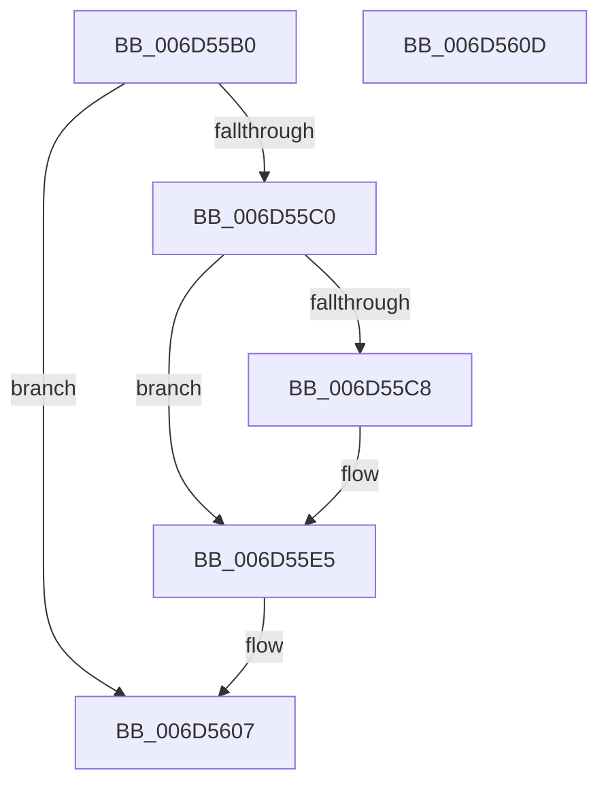

# PopThermalZoneDpc$fin$1

- RVA: `0x006D55B0`–`0x006D560E` (길이 `94` bytes)
- VA: `0x00000001406D55B0`
- 실행 섹션: `.text`
- PDB 이름 있음: `예`; PDB Function 태그: `예`
- unwind 정보 RVA: `0x000BF4C0`
- 디코드: `26`개 명령, `94/94` bytes 표시
- 미해석 바이트: `0` (있으면 어셈블리에 `.byte`로 보존)

> 이 문서는 커널 이미지의 기계어와 PDB 기호를 분석해 생성했습니다. 4번과 5번은 함수 원형과 자료형을 바이너리 사용 방식에서 추정한 C 해석이며 원본 소스 복구 결과는 아닙니다.

## 1. Dependencies

- 직접 호출 지점: **1**; 고유 호출 대상: **1**
- 직접 호출자로 확인된 함수: **0**
- RIP 상대 이미지 참조: **1**

### Outgoing calls
- `0x006D55DF` → [local_unwind](../4F/local_unwind_function_004FFB40.md) (function, `0x004FFB40`)

### Direct callers
- 이 함수 시작 RVA로 연결되는 직접 call은 확인되지 않았습니다. 간접 호출은 완전히 역산할 수 없습니다.

### Static image references
- `0x006D55D1` → RVA `0x005D5A00` (`.text`; read)

## 2. Other-region calls and transfers

- 다른 실행 섹션으로 향하는 call: **0**
- 별도 외부 분기/꼬리 이동을 확인하지 못했습니다.

## 3. Assembly (complete function range)

```asm
006D55B0  40 55                           push rbp
006D55B2  48 83 EC 30                     sub rsp, 0x30
006D55B6  48 8B EA                        mov rbp, rdx
006D55B9  88 4D 51                        mov byte ptr [rbp + 0x51], cl
006D55BC  84 C9                           test cl, cl
006D55BE  74 47                           je 0x1406d5607
006D55C0  8B 45 30                        mov eax, dword ptr [rbp + 0x30]
006D55C3  83 F8 0A                        cmp eax, 0xa
006D55C6  75 1D                           jne 0x1406d55e5
006D55C8  8B 45 30                        mov eax, dword ptr [rbp + 0x30]
006D55CB  83 C0 05                        add eax, 5
006D55CE  89 45 30                        mov dword ptr [rbp + 0x30], eax
006D55D1  48 8D 15 28 04 F0 FF            lea rdx, [rip - 0xffbd8]
006D55D8  48 8B 8D A0 01 00 00            mov rcx, qword ptr [rbp + 0x1a0]
006D55DF  E8 5C A5 E2 FF                  call 0x1404ffb40
006D55E4  90                              nop
006D55E5  48 83 A5 C0 00 00 00 00         and qword ptr [rbp + 0xc0], 0
006D55ED  48 8B 8D 84 01 00 00            mov rcx, qword ptr [rbp + 0x184]
006D55F4  48 89 8D C0 00 00 00            mov qword ptr [rbp + 0xc0], rcx
006D55FB  48 8B 85 4C 01 00 00            mov rax, qword ptr [rbp + 0x14c]
006D5602  48 D3 C8                        ror rax, cl
006D5605  8B 00                           mov eax, dword ptr [rax]
006D5607  48 83 C4 30                     add rsp, 0x30
006D560B  5D                              pop rbp
006D560C  C3                              ret
006D560D  CC                              int3
```

## 4. C-style interpretation (structured pseudocode)

```c
__int64 __fastcall PopThermalZoneDpc_fin_1(unsigned __int8 a1, __int64 a2)
{
    __int64 result;
    __int64 v_rsp;

    v_rsp = (v_rsp) - (48);
    *(unsigned __int8 *)(a2 + 81) = a1;
    if (a1 == 0) goto loc_006D5607;
    result = (unsigned int)(*(unsigned int *)(a2 + 48));
    if (((unsigned int)((unsigned int)(*(unsigned int *)(a2 + 48)))) == 10) {
        result = *(unsigned int *)(a2 + 48);
        result = (unsigned int)((result) + (5));
        *(unsigned int *)(a2 + 48) = (unsigned int)(result);
        a2 = v_rip - 1047512;
        a1 = *(unsigned __int64 *)(a2 + 416);
        result = local_unwind(a1, a2, a3, a4);
    }
    *(unsigned __int64 *)(a2 + 192) = *(unsigned __int64 *)(a2 + 388);
loc_006D5607:
    v_rsp = (v_rsp) + (48);
    return (unsigned int)(*(unsigned int *)(*(unsigned __int64 *)(a2 + 332)));
}
```

## 5. (Beta) C Style

```c
int64_t PopThermalZoneDpc_fin_1(uint8_t Arg1, void *Arg2)
{
    uint8_t *arg2 = (uint8_t *)Arg2;

    int64_t result;
    int64_t local_rsp;

    local_rsp = (local_rsp) - (48);
    *(uint8_t *)(arg2 + 0x51) = Arg1;
    if (Arg1 == 0) goto loc_006D5607;
    result = (uint32_t)(*(uint32_t *)(arg2 + 0x30));
    if (((uint32_t)((uint32_t)(*(uint32_t *)(arg2 + 0x30)))) == 10) {
        result = *(uint32_t *)(arg2 + 0x30);
        result = (uint32_t)((result) + (5));
        *(uint32_t *)(arg2 + 0x30) = (uint32_t)(result);
        Arg2 = v_rip - 1047512;
        Arg1 = *(uint64_t *)(arg2 + 0x1A0);
        result = local_unwind(Arg1, Arg2, a3, a4);
    }
    *(uint64_t *)(arg2 + 0xC0) = *(uint64_t *)(arg2 + 0x184);
loc_006D5607:
    local_rsp = (local_rsp) + (48);
    return (uint32_t)(*(uint32_t *)(*(uint64_t *)(arg2 + 0x14C)));
}
```

### 관측된 메모리 오프셋

구조체 형식이 확인되지 않은 접근은 인자 기준의 오프셋으로만 기록했습니다.

| 기준 인자 | 오프셋 표현 | 폭 (bit) | 접근 |
|---|---:|---:|---|
| `Arg2` | `+ 0x30` | `32` | `R` |
| `Arg2` | `+ 0x30` | `32` | `W` |
| `Arg2` | `+ 0x51` | `8` | `W` |
| `Arg2` | `+ 0xC0` | `64` | `R/W` |
| `Arg2` | `+ 0xC0` | `64` | `W` |
| `Arg2` | `+ 0x14C` | `64` | `R` |
| `Arg2` | `+ 0x184` | `64` | `R` |
| `Arg2` | `+ 0x1A0` | `64` | `R` |

## 6. Execution-region graph

[열기: 2D/3D 그래프와 함수 탐색 컨트롤 패널](../../../control-panel.html?section=text&rva=0x006D55B0&view=graph)

- 2D 그래프는 위에서 아래로 흐르고, 3D 그래프는 빈 공간을 드래그해 회전합니다. Shift+드래그는 이동, 휠은 확대·축소, 함수 노드 선택은 대상 보고서 이동입니다.

### Static fallback


