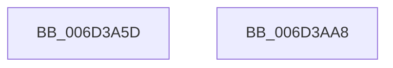

# PspSystemThreadStartup$filt$0

- RVA: `0x006D3A5D`–`0x006D3AA9` (길이 `76` bytes)
- VA: `0x00000001406D3A5D`
- 실행 섹션: `.text`
- PDB 이름 있음: `예`; PDB Function 태그: `예`
- unwind 정보 RVA: `0x000B30F8`
- 디코드: `23`개 명령, `76/76` bytes 표시
- 미해석 바이트: `0` (있으면 어셈블리에 `.byte`로 보존)

> 이 문서는 커널 이미지의 기계어와 PDB 기호를 분석해 생성했습니다. 4번과 5번은 함수 원형과 자료형을 바이너리 사용 방식에서 추정한 C 해석이며 원본 소스 복구 결과는 아닙니다.

## 1. Dependencies

- 직접 호출 지점: **1**; 고유 호출 대상: **1**
- 직접 호출자로 확인된 함수: **0**
- RIP 상대 이미지 참조: **0**

### Outgoing calls
- `0x006D3A9C` → [KeBugCheckEx](../4F/KeBugCheckEx_function_004FD660.md) (function, `0x004FD660`)

### Direct callers
- 이 함수 시작 RVA로 연결되는 직접 call은 확인되지 않았습니다. 간접 호출은 완전히 역산할 수 없습니다.

### Static image references
- 디코드된 RIP-relative 메모리 참조가 없습니다.

## 2. Other-region calls and transfers

- 다른 실행 섹션으로 향하는 call: **0**
- 별도 외부 분기/꼬리 이동을 확인하지 못했습니다.

## 3. Assembly (complete function range)

```asm
006D3A5D  40 55                           push rbp
006D3A5F  48 83 EC 30                     sub rsp, 0x30
006D3A63  48 8B EA                        mov rbp, rdx
006D3A66  48 89 4D 38                     mov qword ptr [rbp + 0x38], rcx
006D3A6A  48 89 4D 30                     mov qword ptr [rbp + 0x30], rcx
006D3A6E  4C 8B 45 30                     mov r8, qword ptr [rbp + 0x30]
006D3A72  4C 8B 4D 30                     mov r9, qword ptr [rbp + 0x30]
006D3A76  48 8B 45 30                     mov rax, qword ptr [rbp + 0x30]
006D3A7A  4C 8B 10                        mov r10, qword ptr [rax]
006D3A7D  48 8B 45 30                     mov rax, qword ptr [rbp + 0x30]
006D3A81  48 8B 08                        mov rcx, qword ptr [rax]
006D3A84  48 63 11                        movsxd rdx, dword ptr [rcx]
006D3A87  49 8B 40 08                     mov rax, qword ptr [r8 + 8]
006D3A8B  48 89 44 24 20                  mov qword ptr [rsp + 0x20], rax
006D3A90  4D 8B 09                        mov r9, qword ptr [r9]
006D3A93  4D 8B 42 10                     mov r8, qword ptr [r10 + 0x10]
006D3A97  B9 7E 00 00 00                  mov ecx, 0x7e
006D3A9C  E8 BF 9B E2 FF                  call 0x1404fd660
006D3AA1  90                              nop
006D3AA2  48 83 C4 30                     add rsp, 0x30
006D3AA6  5D                              pop rbp
006D3AA7  C3                              ret
006D3AA8  CC                              int3
```

## 4. C-style interpretation (structured pseudocode)

```c
__int64 __fastcall PspSystemThreadStartup_filt_0(__int64 a1, __int64 a2)
{
    __int64 result;
    __int64 v_rsp;
    unsigned __int64 v_stack_m18;

    v_rsp = (v_rsp) - (48);
    *(unsigned __int64 *)(a2 + 56) = a1;
    *(unsigned __int64 *)(a2 + 48) = a1;
    v_stack_m18 = *(unsigned __int64 *)(*(unsigned __int64 *)(a2 + 48) + 8);
    result = KeBugCheckEx(126, (int)(*(unsigned int *)(*(unsigned __int64 *)(*(unsigned __int64 *)(a2 + 48)))), *(unsigned __int64 *)(*(unsigned __int64 *)(*(unsigned __int64 *)(a2 + 48)) + 16), *(unsigned __int64 *)(*(unsigned __int64 *)(a2 + 48)));
    v_rsp = (v_rsp) + (48);
    return result;
}
```

## 5. (Beta) C Style

```c
int64_t PspSystemThreadStartup_filt_0(int64_t Arg1, void *Arg2)
{
    uint8_t *arg2 = (uint8_t *)Arg2;

    int64_t result;
    int64_t local_rsp;
    uint64_t v_stack_m18;

    local_rsp = (local_rsp) - (48);
    *(uint64_t *)(arg2 + 0x38) = Arg1;
    *(uint64_t *)(arg2 + 0x30) = Arg1;
    v_stack_m18 = *(uint64_t *)(*(uint64_t *)(arg2 + 0x30) + 0x8);
    result = KeBugCheckEx(126, (int32_t)(*(uint32_t *)(*(uint64_t *)(*(uint64_t *)(arg2 + 0x30)))), *(uint64_t *)(*(uint64_t *)(*(uint64_t *)(arg2 + 0x30)) + 0x10), *(uint64_t *)(*(uint64_t *)(arg2 + 0x30)));
    local_rsp = (local_rsp) + (48);
    return result;
}
```

### 관측된 메모리 오프셋

구조체 형식이 확인되지 않은 접근은 인자 기준의 오프셋으로만 기록했습니다.

| 기준 인자 | 오프셋 표현 | 폭 (bit) | 접근 |
|---|---:|---:|---|
| `Arg2` | `+ 0x30` | `64` | `R` |
| `Arg2` | `+ 0x30` | `64` | `W` |
| `Arg2` | `+ 0x38` | `64` | `W` |

## 6. Execution-region graph

[열기: 2D/3D 그래프와 함수 탐색 컨트롤 패널](../../../control-panel.html?section=text&rva=0x006D3A5D&view=graph)

- 2D 그래프는 위에서 아래로 흐르고, 3D 그래프는 빈 공간을 드래그해 회전합니다. Shift+드래그는 이동, 휠은 확대·축소, 함수 노드 선택은 대상 보고서 이동입니다.

### Static fallback


