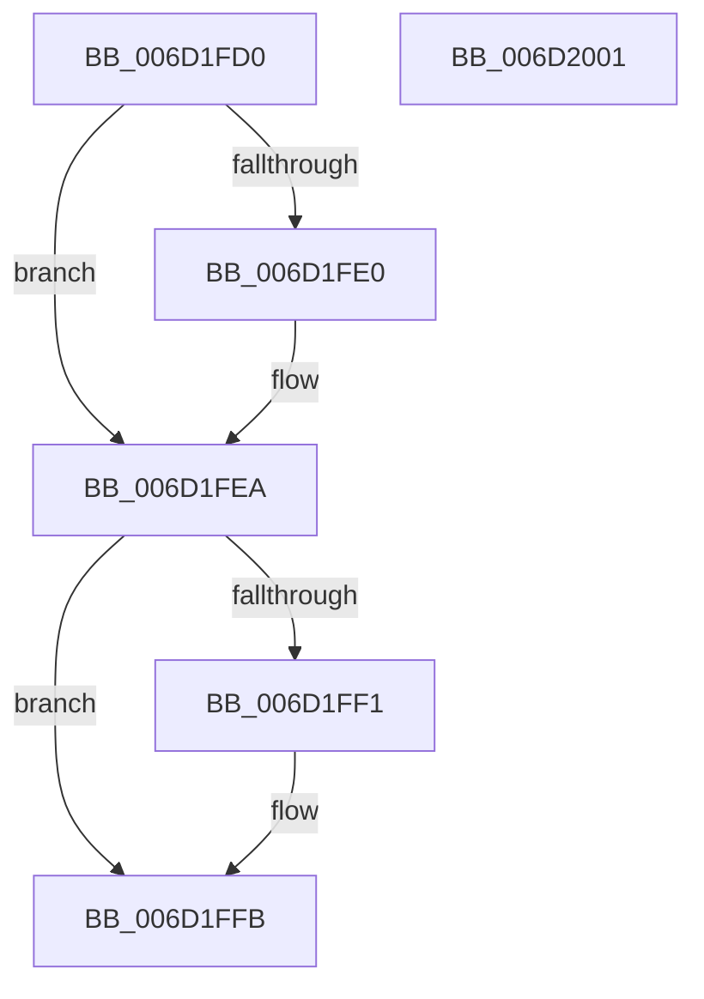

# RtlIsNameInUnUpcasedExpression$fin$0

- RVA: `0x006D1FD0`–`0x006D2002` (길이 `50` bytes)
- VA: `0x00000001406D1FD0`
- 실행 섹션: `.text`
- PDB 이름 있음: `예`; PDB Function 태그: `예`
- unwind 정보 RVA: `0x00072CE4`
- 디코드: `17`개 명령, `50/50` bytes 표시
- 미해석 바이트: `0` (있으면 어셈블리에 `.byte`로 보존)

> 이 문서는 커널 이미지의 기계어와 PDB 기호를 분석해 생성했습니다. 4번과 5번은 함수 원형과 자료형을 바이너리 사용 방식에서 추정한 C 해석이며 원본 소스 복구 결과는 아닙니다.

## 1. Dependencies

- 직접 호출 지점: **2**; 고유 호출 대상: **1**
- 직접 호출자로 확인된 함수: **0**
- RIP 상대 이미지 참조: **0**

### Outgoing calls
- `0x006D1FE4` → [RtlFreeAnsiString](../../page/9C/RtlFreeAnsiString_function_009C0800.md) (function, `0x009C0800`)
- `0x006D1FF5` → [RtlFreeAnsiString](../../page/9C/RtlFreeAnsiString_function_009C0800.md) (function, `0x009C0800`)

### Direct callers
- 이 함수 시작 RVA로 연결되는 직접 call은 확인되지 않았습니다. 간접 호출은 완전히 역산할 수 없습니다.

### Static image references
- 디코드된 RIP-relative 메모리 참조가 없습니다.

## 2. Other-region calls and transfers

- 다른 실행 섹션으로 향하는 call: **2**
  - `0x006D1FE4` → [RtlFreeAnsiString](../../page/9C/RtlFreeAnsiString_function_009C0800.md) (`.text` → `PAGE`)
  - `0x006D1FF5` → [RtlFreeAnsiString](../../page/9C/RtlFreeAnsiString_function_009C0800.md) (`.text` → `PAGE`)
- 별도 외부 분기/꼬리 이동을 확인하지 못했습니다.

## 3. Assembly (complete function range)

```asm
006D1FD0  40 55                           push rbp
006D1FD2  48 83 EC 30                     sub rsp, 0x30
006D1FD6  48 8B EA                        mov rbp, rdx
006D1FD9  48 83 7D 38 00                  cmp qword ptr [rbp + 0x38], 0
006D1FDE  74 0A                           je 0x1406d1fea
006D1FE0  48 8D 4D 30                     lea rcx, [rbp + 0x30]
006D1FE4  E8 17 E8 2E 00                  call 0x1409c0800
006D1FE9  90                              nop
006D1FEA  48 83 7D 48 00                  cmp qword ptr [rbp + 0x48], 0
006D1FEF  74 0A                           je 0x1406d1ffb
006D1FF1  48 8D 4D 40                     lea rcx, [rbp + 0x40]
006D1FF5  E8 06 E8 2E 00                  call 0x1409c0800
006D1FFA  90                              nop
006D1FFB  48 83 C4 30                     add rsp, 0x30
006D1FFF  5D                              pop rbp
006D2000  C3                              ret
006D2001  CC                              int3
```

## 4. C-style interpretation (structured pseudocode)

```c
__int64 __fastcall RtlIsNameInUnUpcasedExpression_fin_0(__int64 a1, __int64 a2)
{
    __int64 result;
    __int64 v_rsp;

    v_rsp = (v_rsp) - (48);
    if ((*(unsigned __int64 *)(a2 + 56)) != 0) {
        a1 = a2 + 48;
        result = RtlFreeAnsiString(a1, a2, a3, a4);
    }
    if ((*(unsigned __int64 *)(a2 + 72)) != 0) {
        a1 = a2 + 64;
        result = RtlFreeAnsiString(a1, a2, a3, a4);
    }
    v_rsp = (v_rsp) + (48);
    return result;
}
```

## 5. (Beta) C Style

```c
int64_t RtlIsNameInUnUpcasedExpression_fin_0(int64_t Arg1, void *Arg2)
{
    uint8_t *arg2 = (uint8_t *)Arg2;

    int64_t result;
    int64_t local_rsp;

    local_rsp = (local_rsp) - (48);
    if ((*(uint64_t *)(arg2 + 0x38)) != 0) {
        Arg1 = Arg2 + 48;
        result = RtlFreeAnsiString(Arg1, Arg2, a3, a4);
    }
    if ((*(uint64_t *)(arg2 + 0x48)) != 0) {
        Arg1 = Arg2 + 64;
        result = RtlFreeAnsiString(Arg1, Arg2, a3, a4);
    }
    local_rsp = (local_rsp) + (48);
    return result;
}
```

### 관측된 메모리 오프셋

구조체 형식이 확인되지 않은 접근은 인자 기준의 오프셋으로만 기록했습니다.

| 기준 인자 | 오프셋 표현 | 폭 (bit) | 접근 |
|---|---:|---:|---|
| `Arg2` | `+ 0x30` | `64` | `R` |
| `Arg2` | `+ 0x38` | `64` | `R` |
| `Arg2` | `+ 0x40` | `64` | `R` |
| `Arg2` | `+ 0x48` | `64` | `R` |

## 6. Execution-region graph

[열기: 2D/3D 그래프와 함수 탐색 컨트롤 패널](../../../control-panel.html?section=text&rva=0x006D1FD0&view=graph)

- 2D 그래프는 위에서 아래로 흐르고, 3D 그래프는 빈 공간을 드래그해 회전합니다. Shift+드래그는 이동, 휠은 확대·축소, 함수 노드 선택은 대상 보고서 이동입니다.

### Static fallback


